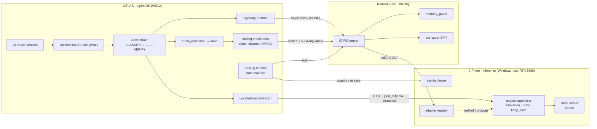

# JARVIS

**An autonomous multi-agent operating system that writes, validates, and lands changes to its own codebase — served by a local 30B model at zero marginal inference cost, and fine-tuned on its own verified commits.**

JARVIS is the control plane of the **Trinity** platform: three repositories, solo-architected by [Derek J. Russell](https://github.com/drussell23), that together close a full self-improvement loop on a single workstation GPU.

| Repository | Tier | What it owns |
|---|---|---|
| **JARVIS** (this repo) | Agent OS / control plane | Ouroboros + Venom (O+V) autonomous engineering pipeline, intake sensors, governance, promotion, provenance, training orchestration |
| [**J-Prime**](https://github.com/drussell23/JARVIS-Prime) | Inference serving | llama.cpp supervisor: VRAM admission, OpenAI + Ollama protocols, training lease, versioned LoRA registry |
| [**Reactor-Core**](https://github.com/drussell23/JARVIS-Reactor) | Training | GRPO LoRA fine-tuning of a 30B MoE on one 32 GB card: per-expert NF4, calibrated memory envelope |

**The goal.** JARVIS should develop itself through O+V — *"O+V develops the JARVIS repo proactively + fully autonomously, while doing so safely and governance-bounded"* (PRD §41.1, the North Star). That is a migration of authority, not the removal of the human: the operator moves from writing and reviewing every change to signing the roadmap and deciding what is published. Today O+V lands validated work on its own (mostly tests, some production fixes), one trained adapter is served, and no held-out gain has been shown yet. The [research paper's §94](https://drussell23.github.io/JARVIS/architecture/OV_RESEARCH_PAPER_2026-04-16.html) explains how the subsystems fit together and where the goal stands.

---

## At a glance

<!-- readme-stats:begin -->

<!-- Generated by scripts/readme_stats.py — do not edit by hand.
     Regenerate: python3 scripts/readme_stats.py --write
     Verify with --check (exits non-zero on drift). -->

| Repository | Lines | Files | Python | Commits |
|---|---:|---:|---:|---:|
| **JARVIS (Body)** | 5,072,684 | 10,727 | 3,868,263 (7,959 files) | 10,796 |
| **J-Prime (Mind)** | 148,565 | 243 | 142,431 (211 files) | 283 |
| **Reactor Core (Soul)** | 129,993 | 247 | 116,230 (203 files) | 179 |
| **Trinity total** | **5,351,242** (~5.35M) | | 4,126,924 | **11,258** |

Within JARVIS, by path — each row is reproducible from its own prefix:

| Subset | Path | Lines | Files |
|---|---|---:|---:|
| **O+V engine** | `backend/core/ouroboros/` | 1,027,813 | 1,639 |
| **Test spine** | `tests/` | 1,179,765 | 3,784 |

_3 of 3 repositories measured._

Reproduce exactly:

```bash
python3 scripts/readme_stats.py

# Or by hand — note the awk. `git ls-files -z | xargs -0 wc -l`
# alone splits into several batches and prints one 'total' PER
# BATCH, so reading the last one reports a small fraction of the
# real figure.
git ls-files -z | xargs -0 wc -l \
  | awk '$2=="total"{s+=$1} END{print s}'
```

<!-- readme-stats:end -->

- **67,800+ `def test_` functions** across the three repositories (static count; parametrization expands the collected total — a full JARVIS repo-fallback collection measured **69,353** tests on 2026-09-08, PRD v3.38).
- **17-phase** governed operation lifecycle, **24** intake sensors, fail-closed fast-forward promotion, HMAC-signed operator goals.
- **6.03 h** unattended production soak: **10 verified autonomous landings**, exit 0, no OOM (`bt-2026-10-05-012717`, PRD v3.40).
- **$0.00** marginal inference cost per operation on the local lane; paid providers are optional and can be switched off entirely.

---

## System topology



**The loop, end to end:** a sensor files work → O+V plans and generates a candidate against the locally served 30B model → VALIDATE runs only the covering tests → the commit lands on an accumulation branch and is fast-forwarded to local `main` only if the provenance, public-surface, semantic-delta and coverage checks pass → `landing_provenance` proves which recorded candidates actually landed and survived → when a training cycle is started (by the operator; automatic triggering, `JARVIS_GRPO_AUTOTRAIN_ENABLED`, is off by default and also waits for enough unlearned landings), the training handoff takes an exclusive GPU lease from J-Prime, Reactor-Core trains a GRPO LoRA on those trajectories, and the handoff publishes it to J-Prime's adapter registry and re-scores it on real tasks (greedy decoding, prompt cache off). It is kept only if it scores at least as well as the incumbent did; otherwise it is rejected and the previous adapter is restored and re-verified. The organism never pushes: publishing to GitHub is the operator's act.

---

## The O+V pipeline

`OperationPhase` (`backend/core/ouroboros/governance/op_context.py`):

```
CLASSIFY → ROUTE → CONTEXT_EXPANSION → PLAN → GENERATE ⇄ GENERATE_RETRY
        → VALIDATE ⇄ VALIDATE_RETRY → GATE → APPROVE → APPLY → VERIFY → VISUAL_VERIFY
        → COMPLETE | CANCELLED | EXPIRED | POSTMORTEM
```

| Mechanism | Implementation | Guarantee |
|---|---|---|
| Intake | `intake/unified_intake_router.py`, 24 `*Sensor` classes | WAL-backed, deduplicated, liveness-tombstoned signals |
| VALIDATE | `phase_runners/validate_runner.py` | Single owner; scoped to covering tests (450 s → 1.31 s per candidate) |
| Promotion | `main_promoter.py` → `accumulation_promotion_gate.py` → `git merge --ff-only` | Fail-closed on provenance, public-surface shrink, cosmetic-only changes (no AST delta), and covering-test failure; never pushes |
| Operator sanction | `operator_goal_sanction.py`, `roadmap_reader.compute_signature` | Governance edits must trace to an HMAC-SHA256-signed roadmap goal |
| Autonomy | `autonomy/sentinel.py`, `sentinel_loop.py` | Auto-approval capped at a tier ceiling; safety-class ops always escalate to a human |
| Review lane | `orange_pr_reviewer.py` | PR-based human review; remote pushes air-gapped by default |
| Provenance | `observability/landing_provenance.py` | sha256 of the landed blob (signature stripped) == recorded `candidate_hash` |
| Training handoff | `observability/training_handoff.py` | `LABELING → PREFLIGHT → BASELINE → LEASING → TRAINING → CONVERTING → PUBLISHING → RESTORING → VERIFYING → COMMITTED \| ROLLED_BACK`, single-flight via `flock` |

---

## The local inference lane

`backend/core/ouroboros/governance/local_inference_director.py` is the client side of local inference: the component that makes a self-hosted model reliable enough to drive an autonomous pipeline.

| Capability | How it works |
|---|---|
| **JSON-Schema constrained decoding** | The generation envelope schema (`providers.build_response_json_schema`) is attached as `response_format: json_schema` (OpenAI transport) or `format` (native transport), so a missing required field is unrepresentable at the sampler. A degradation ladder `json_schema → json_object → none` is learned per `(base_url, model)` from the engine's own 4xx — never from a version table — and a 5xx never weakens the constraint. |
| **Zero-cost local routing** | `paid_lanes.py` is the single authority on paid lanes. With `JARVIS_PAID_LANES_ENABLED=false` (or no paid credential), `candidate_generator._try_local_primary` serves every route locally before route-based dispatch. |
| **Per-draw sampling control** | `sibling_entropy.sampling_for` assigns each sibling draw its own point on a `(temperature, top_p, top_k, repeat_penalty)` ladder and a deterministic seed `sha256(op \| draw \| escalation)`. `_config_for_draw` applies it via `dataclasses.replace`, so a sibling's sampling never leaks into later ops on a shared client. |
| **Streaming inter-token timeout** | `LatencyProfiler.inter_token_budget_s` derives separate first-token and steady-state deadlines from EWMA latency, prompt size, and sampling entropy, credited for measured event-loop lag. Each `readline` races the shutdown event; a wedge raises `InterTokenStall`, a cooperative shutdown raises `GracefulStreamInterruption` carrying the partial output. |
| **Memory admission** | `local_model_admission.py` returns `ADMIT / PRUNE / DEFER` against host and accelerator pressure — deferral is a result, not an exception. |
| **Thinking budget** | `reasoning_effort` defaults to `none`: same schema-valid output, **6.8 s → 1.5 s** on the constrained path (measured on `qwen3.8:27b` over Ollama, `4f4591661a`). |

---

## Benchmarks

All figures are measured on the reference host — RTX 5090 (32,607 MiB), Windows 11 + WSL2 (24 cores, 47 GiB) — serving `qwen3-coder-ov:30b` (30.5B MoE, 8 of 128 experts active, Q4_K_M, 17.3 GiB weights) plus a 27 MB GRPO LoRA through J-Prime on llama.cpp b11462 / CUDA 13.4. Methodology and raw sources: [J-Prime `BENCHMARKS.md`](https://github.com/drussell23/JARVIS-Prime/blob/main/BENCHMARKS.md), [`docs/architecture/HARDWARE_CONSTRAINTS.md`](docs/architecture/HARDWARE_CONSTRAINTS.md).

| Metric | Result | Source |
|---|---|---|
| Decode throughput | **p50 172 tok/s** (p10 152, p90 184; n = 337 generations) | J-Prime llama-server timings, 2026-10-07 |
| First-token (prefill) latency, 4k–8k uncached tokens | **p50 885 ms** (~6.5k tok/s; n = 88) | same |
| First-token (prefill) latency, 8k–16k uncached tokens | **p50 1.41 s** (n = 43) | same |
| Marginal inference cost per operation | **$0.00** local vs an estimated ~$0.002/op on DoubleWord and ~$0.20–1.00 per moderate op on Claude Sonnet (token-math estimates, not measured) | `OUROBOROS_VENOM_NORTH_STAR.md` §51.11.33 |
| VALIDATE per candidate | **450 s → 1.31 s** (covering tests vs 69,353-test repo fallback) | PRD v3.38 |
| Unattended production soak | **6.03 h, 10 verified landings** (6 substantive), 0 OOM | PRD v3.40 |
| Training-lease handoff | **21,236 MiB** freed and verified; full cycle `COMMITTED` in 26.6 min (1-step proof) | `eecadb334f` |
| KV cache cost | **96 KiB/token** → 3.0 GiB per 32k-context stream | `HARDWARE_CONSTRAINTS.md` §3 |

---

## Components

| Path | Role |
|---|---|
| `backend/core/ouroboros/governance/` | O+V: orchestrator, phase runners, providers, candidate generation, promotion, sanction, provenance |
| `backend/core/ouroboros/battle_test/` | Harness, `serpent_flow.py` cockpit transcript, soak runner |
| `backend/core/ouroboros/cli/ov.py` | The `ov` entry point (cockpit, daemon, status, attach, doctor, …) |
| `unified_supervisor.py` | ~98K-line boot kernel for the full interactive stack |
| `backend/vision/`, `backend/voice/`, `backend/ghost_hands/` | Screen capture and computer use, voice I/O, focus-preserving UI automation |
| `backend/core_contexts/` | Five execution contexts (Executor, Architect, Developer, Communicator, Observer) |
| `ci/lint_gate.py` | Undefined-name ratchet: whole-package zero for O+V packages, differential elsewhere |
| `scripts/readme_stats.py` | Regenerates the figures above from git (`--check` fails on drift) |

---

## Symbiotic AI-Native Manifesto: Trinity Ecosystem Unification

This initiative is **not a software refactor**. It is the genesis of an autonomous, self-evolving **Artificial Intelligence Operating System**. The project explicitly rejects the rigid paradigms of traditional software engineering in favor of a symbiotic design: **the models and agents carry intelligence; the codebase is the nervous system** that connects senses, cognition, and safe execution.

> `StrategicDirectionService` reads this section at boot and injects the seven principles into every O+V generation prompt. The full original text, including the zero-shortcut mandate and the five execution contexts, is preserved in [`docs/architecture/MANIFESTO.md`](docs/architecture/MANIFESTO.md).

### The seven principles

**1. The unified organism (tri-partite microkernel)**  
One authoritative entry point coordinates senses, cognition, and sandboxed execution with consistent lifecycle and health semantics.

**2. Progressive awakening (adaptive lifecycle)**  
Local senses reach readiness quickly while heavy resources spin up asynchronously; readiness always tracks real backend state.

**3. Asynchronous tendrils (disciplined concurrency)**  
Structured concurrency throughout; background work must never starve the event loop, leak context, or corrupt shared state.

**4. The synthetic soul (Trinity consciousness)**  
The system keeps episodic awareness of what worked and what failed, and treats persistent uncertainty as a signal to explore, not to fail silently.

**5. Intelligence-driven routing (the cognitive forge)**  
Routing, planning, and decomposition are semantic and policy-driven, not regex catalogs; complex work is expressed as DAG-shaped plans.

**6. Threshold-triggered neuroplasticity (Ouroboros)**  
A capability gap triggers a just-in-time response — an ephemeral tool in the sandbox, graduated to permanent, tested integration once it proves itself repeatedly.

**7. Absolute observability (systemic transparency)**  
Every autonomous decision, state transition, and error is visible — in telemetry, the cockpit, and, where appropriate, voice.

---

## Local setup

**Requirements:** Windows 11 + WSL2 (Ubuntu) or Linux — the engine is POSIX-only (`fcntl`, Unix sockets, `SIGHUP`) · Python **3.11.10** · NVIDIA GPU with ≥ 32 GB VRAM for the local 30B lane · a running [J-Prime](https://github.com/drussell23/JARVIS-Prime) engine. Full guide: [`docs/BRINGUP_WINDOWS_WSL2.md`](docs/BRINGUP_WINDOWS_WSL2.md).

```bash
# Clone onto ext4 inside WSL2 — never /mnt/c (9p is too slow for a repo this size)
git clone https://github.com/drussell23/JARVIS.git ~/jarvis && cd ~/jarvis
pyenv install 3.11.10 && pyenv local 3.11.10
python3 -m venv .venv && source .venv/bin/activate
pip install -r requirements.txt && pip install -e . --no-deps   # puts `ov` on PATH
cp .env.example .env
```

Point the local lane at J-Prime in `.env`:

```bash
JARVIS_LOCAL_PRIME_ENABLED=true
JARVIS_LOCAL_MODEL_BASE_URL=http://127.0.0.1:8000
JARVIS_LOCAL_MODEL_NAME=qwen3-coder-ov:30b
JARVIS_PAID_LANES_ENABLED=false          # zero-cost: local lane only
```

Verify, then run:

```bash
JARVIS_COMPUTE_TOPOLOGY_ENABLED=1 ov doctor   # connectivity matrix; the hardware edge answers even with the daemon down
ov                                            # interactive cockpit (arms the Sentinel; --no-sentinel to opt out)
ov run --max-wall-seconds 2400                # headless soak
```

---

## Testing and CI

```bash
python3 -m pytest tests/governance -q                 # O+V governance spine
python3 -m pytest $(cat ci/ov-surface-suites.txt)     # the O+V surface suite CI runs
python3 ci/lint_gate.py --root . --require-base       # undefined-name ratchet
python3 scripts/readme_stats.py --check               # README figures match git
```

`pytest.ini` enforces `--strict-markers`, `asyncio_mode=auto`, and a 120 s per-test timeout. Eight test files import macOS frameworks and fail to *collect* on Linux, which shrinks the denominator instead of failing loudly. Compare **collected** counts, not pass counts, when moving hosts.

---

## Documentation

| Document | Covers |
|---|---|
| [O+V research paper](https://drussell23.github.io/JARVIS/architecture/OV_RESEARCH_PAPER_2026-04-16.html) ([PDF](https://drussell23.github.io/JARVIS/architecture/OV_RESEARCH_PAPER_2026-04-16.pdf)) | Architecture, safety and governance, with dated addenda; §94 covers the whole system and the North Star |
| [`docs/architecture/OUROBOROS.md`](docs/architecture/OUROBOROS.md) | Governance pipeline, phases, graduation, components |
| [`docs/architecture/OUROBOROS_VENOM_PRD.md`](docs/architecture/OUROBOROS_VENOM_PRD.md) | Requirements, measured soak record, roadmap |
| [`docs/architecture/OUROBOROS_VENOM_NORTH_STAR.md`](docs/architecture/OUROBOROS_VENOM_NORTH_STAR.md) | The North Star, autonomy tiers and the active roadmap |
| [`docs/architecture/HARDWARE_CONSTRAINTS.md`](docs/architecture/HARDWARE_CONSTRAINTS.md) | Measured VRAM/KV envelope and the arithmetic behind concurrency limits |
| [`docs/architecture/BRAIN_ROUTING.md`](docs/architecture/BRAIN_ROUTING.md) | Provider and model routing |
| [`docs/architecture/TRINITY_OVERVIEW.md`](docs/architecture/TRINITY_OVERVIEW.md) | Cross-repository architecture |
| [`TRINITY_MANIFESTO.md`](TRINITY_MANIFESTO.md) | Design principles and safety laws |

---

## License

Proprietary. All rights reserved.
