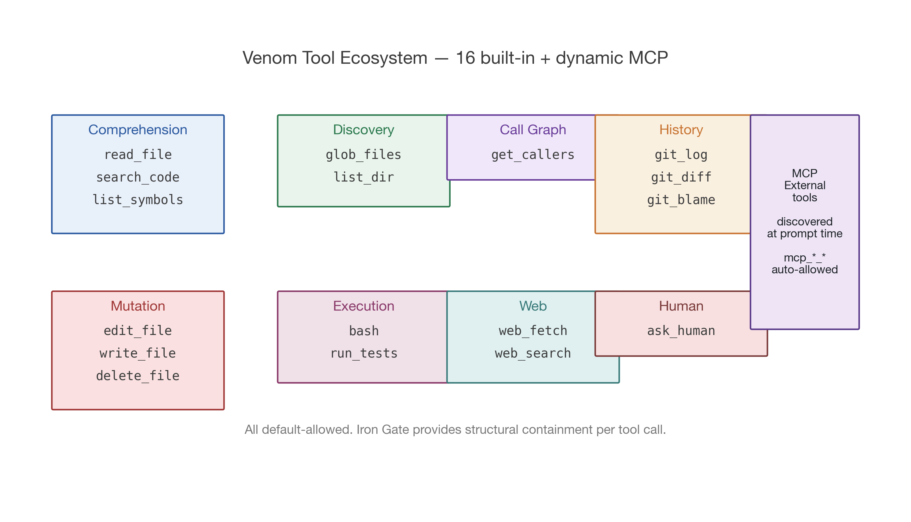
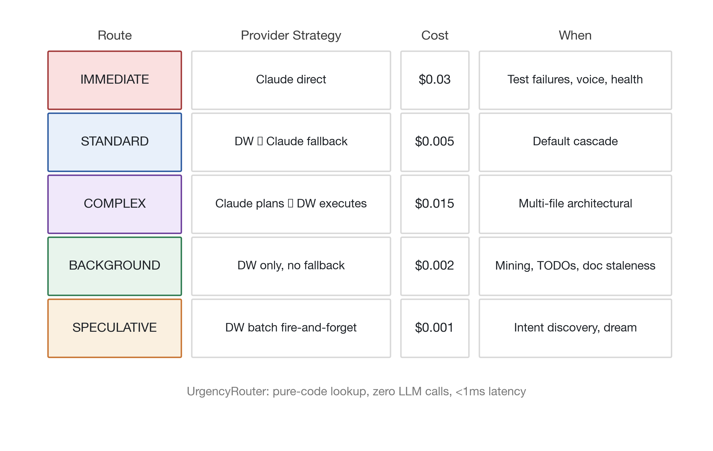

# Ouroboros + Venom (O+V): A Governed Architecture for Autonomous Self-Development

> **Prepared by:** Derek J. Russell
> **Report date:** 2026-04-16
> **Last updated:** 2026-10-13. See **§93. Developments (May 14 – October 13, 2026)** for the local-model era, the first autonomous landings and the Trinity learning loop, and **§92** for April 17 – May 13. The original §1–§91 substrate is unchanged; both addenda are appended per the policy in Appendix F, and §93.16 lists the earlier text they supersede.
> **Repository:** `github.com/drussell23/JARVIS` (formerly `JARVIS-AI-Agent`, which redirects)
> **Canonical technical reference:** `docs/architecture/OUROBOROS.md` (2,774 lines)
> **This paper:** research-paper treatment of the above — plain-English explanation, analogies, architectural narrative, visual diagrams, honest evidence-backed claims.

---

## Abstract

Ouroboros + Venom (O+V) is the autonomous self-development engine at the heart of the JARVIS Trinity AI Operating System. It is the mechanism by which the system detects its own improvement opportunities, reasons about code changes, generates patches, validates them against tests, applies them to disk, commits them under an autonomous signature, and learns from the outcome — without a human engineer in the driver's seat for most operations.

The paper describes O+V at three levels simultaneously. For non-technical readers, each section opens with a plain-English **Big Picture** paragraph using analogies drawn from biology, medicine, manufacturing, and everyday life. For software engineers, the technical detail — phase semantics, FSM transitions, budget allocations, safety invariants — is presented in full with source-file citations. For researchers interested in autonomous AI systems, the design principles are connected back to a coherent architectural philosophy: a deterministic skeleton with an agentic nervous system, governed by a constitutional document (the Manifesto), and supervised by a metacognition layer (Trinity Consciousness).

Battle-test evidence is treated with equal seriousness. The paper includes a full postmortem of sessions A through W — the 11-day arc during which O+V evolved from a shadow-mode exploration scorer to producing its first end-to-end autonomous multi-file `APPLY` on 2026-04-15 (Session W: four Python test modules autonomously generated, validated, repaired, written to disk, committed, 20/20 pytest green). The paper is honest about what is proven (enforcement, persistence, Iron Gate semantics) and what is not yet proven (durability per Manifesto §6, broader scope beyond new-file creation, load-bearing workarounds on three deferred latent bugs).

The architecture is open — the full source is at `github.com/drussell23/JARVIS-AI-Agent`, every file cited in this paper is browseable at the referenced line numbers, and every battle-test session has its own debug log preserved in `.ouroboros/sessions/`. The goal is that a researcher or engineer can read this paper, clone the repo, and reproduce any claim end-to-end.

---

## How to Read This Paper

This is a **comprehensive research-paper treatment of O+V**, written to work simultaneously for three audiences:

1. **Non-technical readers — business partners, investors, research peers, newcomers to autonomous AI.** Each section opens with a **Big Picture** callout in plain English, using everyday analogies (apprentices, immune systems, dining rooms, mentorship loops). You can read just these callouts end-to-end and come away with the full narrative of what O+V is, how it works, and why it matters.

2. **Software engineers — anyone who might read, extend, or adopt ideas from the O+V codebase.** Every technical section cites source files, line numbers, configuration variables, and FSM transitions. A glossary is included as Appendix A. All environment variables are indexed in Appendix B.

3. **Researchers — anyone studying autonomous AI, governance architectures, or self-improving systems.** The paper connects implementation details back to design principles (the seven Manifesto principles) and provides honest evidence — what is proven through battle tests, what remains unproven, and what the deliberate deferred trade-offs are.

The paper is **intentionally long** — approximately 150 pages — because O+V is genuinely intricate. A cursory treatment would not do the architecture justice. However, the structure supports **skim reading**: every Part opens with a Big Picture paragraph and a brief contents summary, so a reader can navigate directly to the parts relevant to their interest.

**The canonical technical reference** remains `docs/architecture/OUROBOROS.md` in the repository. This paper is a companion document — it adds narrative, context, and accessibility, while pointing at OUROBOROS.md for the deepest technical detail and at the battle-test session logs for the raw evidence.

---

# PART I — Vision and Context

> **Big Picture:** This Part explains what Ouroboros + Venom is — in plain English first, then in technical terms, then in the context of the philosophical document (the Manifesto) that shapes every design decision. If you only read the first three sections of this paper, you will come away with the complete conceptual picture.

## §1. What O+V Is, In Plain English

> **Analogy:** Imagine hiring a junior software engineer who works 24 hours a day, never gets tired, and costs almost nothing per task. This engineer reads the team's codebase, notices what needs fixing, writes the fix, tests it against the existing test suite, checks in the result, and learns from whether it worked. A senior engineer reviews the junior's work when the stakes are high; when the stakes are low, the junior is trusted to act autonomously. Over time, the junior develops opinions about which parts of the codebase are fragile, remembers which past attempts failed, and asks clarifying questions when the direction is ambiguous.
>
> That is what Ouroboros + Venom is. It is an autonomous software engineer that lives inside your codebase, with the discipline of a senior professional and the scale of a machine. The word "Ouroboros" — the serpent eating its own tail — captures the self-referential nature: JARVIS uses O+V to improve JARVIS.

### §1.1 What it *does*

Every few seconds, a set of 16 autonomous sensors scans the codebase for specific classes of improvement opportunities. One sensor watches the test suite and fires when a test fails. Another looks at code complexity and flags overly-tangled functions. A third reads the most recent commits and notices documentation that has drifted out of sync with the code it describes. Yet another scans for `TODO`, `FIXME`, and `HACK` comments left by human engineers. These sensors are event-driven — they do not poll on a schedule; they react to events in the file system and the version control system.

When a sensor fires, it produces a **signal**: a structured description of a potential change, including the target files, a goal (a sentence describing what should happen), an urgency level, and metadata about where the signal came from. The signal enters a **pipeline**. The pipeline is the heart of O+V.

The pipeline has **eleven phases**. At each phase, the operation is either permitted to proceed, queued for later, escalated for human review, or rejected outright. The phases handle, in order: classifying the operation's risk level, routing it to the correct model provider (cheap inference for routine work, expensive reasoning for critical work), expanding the context the model will see, reasoning about the implementation strategy, generating the actual code change, validating that change against the test suite, gating it through deterministic safety checks, approving it (automatically for low risk, human-in-the-loop for higher risk), applying it to disk, verifying the applied change still passes tests, and completing the operation with a postmortem entry.

Between the phases, a **metacognition layer** (Trinity Consciousness) records what happened and predicts what will happen next time. It remembers which files have been trouble before, notices when the same failure is recurring across operations, predicts regression risk before a change is attempted, and during idle time speculatively pre-computes improvements that might be valuable later.

The whole thing runs with an explicit budget — cost per operation, cost per day, wall-clock time per phase, and human-approval time limits. When budgets are exhausted, the system falls back gracefully rather than burning resources or asking the human to intervene at 3 AM.

### §1.2 What makes it different

Three things distinguish O+V from a typical AI coding assistant.

First, it is **proactive, not reactive**. A chatbot answers when asked. A copilot suggests when invoked. O+V *initiates*: it decides for itself what to work on next, based on what the sensors have detected, what the human has prioritized, and what the metacognition layer predicts will be most valuable. There is no prompt box. There is no "generate me a fix for X." There is a running organism, and its decisions are observable through a rich terminal interface and a persistent thought log.

Second, it is **governed, not free**. The autonomy is contained inside a deterministic safety skeleton called the Iron Gate. The Iron Gate is not an AI. It is a set of hard-coded rules — AST parsers, command blocklists, exploration-depth scorers, file-path protectors, cost ceilings — that no model can override. When a model tries to edit a file outside the repository, the Iron Gate blocks it. When a model tries to run a destructive shell command, the Iron Gate blocks it. When a model produces output containing non-ASCII characters that might corrupt a file, the Iron Gate blocks it. The agentic intelligence provides flexibility; the deterministic skeleton provides safety. The model cannot deceive the skeleton because the skeleton is not listening to language — it is reading file paths, token types, and exit codes.

Third, it is **accountable**. Every operation has an identifier. Every phase transition is written to an append-only ledger. Every model call is recorded with its cost. Every applied change becomes a git commit with a structured message that attributes the work to the autonomous system, names the operation ID, notes the risk tier, and cites the provider used. If something goes wrong six months later, the full causal chain can be reconstructed from the ledger and the git history.

### §1.3 Why the name

**Ouroboros** is the ancient symbol of a serpent consuming its own tail — a closed loop of self-reference. The name captures the architectural fact that the system is the subject of its own improvements. JARVIS uses O+V to refactor JARVIS, to add features to JARVIS, to write tests for JARVIS, and to document JARVIS.

**Venom** is the agentic execution layer — the subsystem that gives the provider (the language model) the ability to read files, search code, run tests, and revise its output across multiple turns. The name is taken from the Marvel symbiote — a nervous system that attaches to a host, granting the host abilities the host could not exercise alone. The analogy is deliberate: Ouroboros is the governance skeleton; Venom is the fluid intelligence layered on top.

Together, **Ouroboros + Venom** means "disciplined self-improvement." The discipline comes from Ouroboros. The self-improvement comes from Venom. Neither works without the other.

<!-- engage:begin -->
<div class="quick-check" id="qc-1">
<p class="qc-label">Quick check · §1</p>
<details class="qc"><summary>1. At each pipeline phase an operation has four possible fates. What are they, and why does it matter that two of them are neither "go" nor "stop"?</summary>
<p>An operation may proceed, be queued for later, be escalated for human review, or be rejected (§1.1). Queueing and escalation let the system defer work when a budget is exhausted, or hand risky work to a human, instead of forcing a yes/no choice. That is how it "falls back gracefully" rather than burning resources or paging a human at 3 AM.</p>
</details>
<details class="qc"><summary>2. A bad change surfaces six months later. Which records from §1.2 let you rebuild what happened?</summary>
<p>Every operation has an identifier, and every phase transition goes to an append-only ledger. Every model call is recorded with its cost. Every applied change is a git commit whose message names the operation ID, the risk tier and the provider. The ledger plus the git history give the full causal chain.</p>
</details>
<details class="qc"><summary>3. In the name "Ouroboros + Venom", which half supplies the discipline and which supplies the capability?</summary>
<p>Ouroboros is the governance skeleton: the discipline. Venom is the agentic execution layer that lets the model read files, search code, run tests and revise its output over several turns: the self-improvement (§1.3). The paper says neither works without the other.</p>
</details>
</div>
<!-- engage:end -->

## §2. What O+V Is, In Technical Terms

> **Big Picture:** This section re-states the same system in technical vocabulary. If you are an engineer, this is the section that situates O+V inside a system architecture you can reason about. The plain-English framing in §1 is the *what*; this section is the *how*.

O+V is a six-layer event-driven pipeline running as a governed coroutine tree inside the JARVIS backend process. The layers, from top to bottom, are:

1. **Strategic Direction** (`strategic_direction.py`) — a boot-time service that reads the Manifesto (`README.md`) and architectural documents, extracts the seven core principles, and injects a ~2,500-character strategic context digest into every generation prompt. This layer answers the question "where are we going?" and ensures the model generates Manifesto-aligned code, not generic fixes.

2. **Trinity Consciousness** (`backend/core/ouroboros/consciousness/`) — a metacognition layer comprising four core engines (HealthCortex, MemoryEngine, DreamEngine, ProphecyEngine) and three awareness-fusion engines (Contextual Awareness Intelligence, Situational Awareness Intelligence, Unified Awareness Engine). This layer answers "why evolve?" and feeds cross-session episodic learning back into the pipeline.

3. **Event Spine** (`backend/core/ouroboros/governance/intake/`) — the `IntakeLayerService` (Zone 6.9) and 16 sensors plugged into a unified event bus. This layer answers "when to act?" Signals arrive event-driven (filesystem changes via `watchdog`, test-result JSON from a pytest plugin, post-commit hook metadata, webhook deliveries, voice commands) rather than via polling loops.

4. **Ouroboros Pipeline** (`backend/core/ouroboros/governance/orchestrator.py`) — the deterministic governance skeleton running the 11-phase FSM. This layer answers "what to do, safely." It owns no domain logic — only phase transitions, error handling, retry bookkeeping, and ledger writes. Every unhandled exception routes to `POSTMORTEM`. Every phase transition writes a `LedgerEntry` to an append-only JSONL log.

5. **Venom Agentic Loop** (`tool_executor.py`, `repair_engine.py`) — the multi-turn tool-use layer. A `ToolLoopCoordinator` wraps each generation call. The provider (Claude or DoubleWord) is given a tool manifest; it can call `read_file`, `search_code`, `edit_file`, `run_tests`, `bash`, and twelve other tools across multiple turns within a single generation. When validation fails, the L2 Self-Repair Engine attempts up to five iterations of fix-test-classify-revise within a 120-second wall-clock timebox.

6. **ChangeEngine + AutoCommitter** (`change_engine.py`, `auto_committer.py`) — the persistence layer. When the pipeline decides to APPLY, the ChangeEngine writes the patch to disk with pre-APPLY snapshots for rollback. When VERIFY passes, the AutoCommitter creates a structured git commit with an `Ouroboros+Venom` co-author signature, an operation identifier, a risk tier, and an integrity hash.

The pipeline runs inside a `BackgroundAgentPool` of three workers (default; configurable via `JARVIS_BG_POOL_SIZE`). Operations are dequeued from a 16-slot `PriorityQueue` keyed on a composite score (source tier, urgency boost, file-count penalty, confidence bonus, dependency credit). The pool guarantees bounded concurrency and provides worker watchdog timeouts configurable per route (IMMEDIATE 60s, STANDARD 120s, COMPLEX/BACKGROUND 180s, plus grace and tool-loop overhead).

Provider routing is deterministic — a pure-code `UrgencyRouter` at the ROUTE phase maps `(urgency, source, complexity)` to a `ProviderRoute` enum in under a millisecond with zero LLM calls. The five routes (`IMMEDIATE`, `STANDARD`, `COMPLEX`, `BACKGROUND`, `SPECULATIVE`) each define a cascade contract — which provider is primary, whether a fallback exists, what the cost target is. Adaptive recovery within the cascade is handled by a `FailbackStateMachine` that classifies failures into modes (`RATE_LIMITED`, `TIMEOUT`, `SERVER_ERROR`, `CONNECTION_ERROR`, `CONTENT_FAILURE`) and uses exponential backoff with failure-mode-specific timing.

The system is *not* monolithic. Each layer has a clean interface and is independently testable. The pipeline orchestrator imports the providers via a `CandidateProvider` protocol; it does not know whether a given provider is backed by Claude, DoubleWord, a self-hosted Prime instance, or a test mock. The consciousness bridge is optional — if disabled, the pipeline runs without metacognition; the ops still complete, just without reputation-driven risk assessment. The Venom tool loop can be disabled with `JARVIS_GOVERNED_TOOL_USE_ENABLED=false`, at which point the system degrades gracefully to single-shot generation.

All of this runs under one overriding architectural commitment: **no hardcoded model names**. Every model reference is resolved at runtime from `brain_selection_policy.yaml` or an environment variable. This makes the system model-agnostic; when a new inference provider is on-boarded, the code does not change — only the policy file does.

<!-- engage:begin -->
<div class="quick-check" id="qc-2">
<p class="qc-label">Quick check · §2</p>
<details class="qc"><summary>1. What still works if the consciousness bridge is turned off, or if <code>JARVIS_GOVERNED_TOOL_USE_ENABLED=false</code>?</summary>
<p>Without the consciousness bridge, operations still complete, but without reputation-driven risk assessment. With the tool loop off, the system falls back to single-shot generation. Both follow from the claim that each layer has a clean interface and can be tested on its own.</p>
</details>
<details class="qc"><summary>2. How can the orchestrator call a provider without knowing whether it is Claude, DoubleWord, Prime or a test mock?</summary>
<p>It imports providers through a <code>CandidateProvider</code> protocol. Under the "no hardcoded model names" rule, every model reference is resolved at runtime from <code>brain_selection_policy.yaml</code> or an environment variable. Onboarding a new provider changes the policy file, not the code.</p>
</details>
<details class="qc"><summary>3. Why does the <code>BackgroundAgentPool</code> use a different watchdog timeout for each route instead of one timeout?</summary>
<p>The routes carry different kinds of work, so the watchdog limits differ: IMMEDIATE 60 s, STANDARD 120 s, COMPLEX/BACKGROUND 180 s, plus grace and tool-loop overhead. One short timeout would kill heavy architectural work. One long timeout would let urgent work hang. With three workers and a 16-slot queue, concurrency stays bounded either way.</p>
</details>
</div>
<!-- engage:end -->

## §3. The Seven Manifesto Principles

> **Big Picture:** Every engineering team has values — usually unwritten. The JARVIS Trinity has them written down as seven principles, and those principles are actively injected into every AI generation call as prompt context. The model is literally reminded of the team's architectural philosophy every time it writes code. This section states the principles in the form they appear in the source code, with a plain-English gloss of what each one means in practice.

The seven principles are quoted verbatim from `strategic_direction.py`. They are numbered and named here for ease of reference throughout the rest of the paper.

### Principle 1 — The Unified Organism

> *"Tri-partite microkernel. Single entry point."*

JARVIS is not a collection of scripts — it is one organism with three parts (Body, Mind, Soul) that communicate via well-defined protocols. The organism has a single entry point; you do not start ten services to run JARVIS; you start JARVIS, and JARVIS orchestrates everything else.

In O+V terms: the governed loop service is a single coroutine tree. It is not spawned by a supervisor and forgotten; it is owned, observed, and shut down cleanly as part of the unified process lifecycle. When the organism shuts down, every in-flight operation is either completed, explicitly cancelled, or recorded as aborted. No silent leaks.

### Principle 2 — Progressive Awakening

> *"Adaptive lifecycle. No blocking boot chains."*

The system comes online *adaptively*. If a dependency is slow, the system does not hang — it marks the dependency as degraded, continues booting, and hot-swaps the dependency in when it becomes ready. There is no twenty-second blocking wait at startup.

In O+V terms: providers can be `INACTIVE`, `STARTING`, `ACTIVE`, `DEGRADED`, `STOPPING`. The GovernedLoopService runs `_oracle_index_loop` as a background task; it does not wait for the codebase index to finish before accepting operations. If the index is stale, operations run with stale-index warnings; they do not fail.

### Principle 3 — Asynchronous Tendrils (Disciplined Concurrency)

> *"Structured concurrency. No event-loop starvation. Zero polling. Pure reflex."*

All I/O is `asyncio`. Nothing blocks the event loop. Nothing polls. The system reacts to events via message passing, not timers. When a file changes, a filesystem watcher publishes an event; a sensor subscribes; the sensor decides whether the event is actionable; if it is, a signal is pushed into the intake router. No five-second `while True: sleep(5); scan()` loops anywhere.

In O+V terms: the DW 3-tier event-driven architecture (Part VI, §34) is a direct expression of this principle. Tier 0 is real-time SSE streaming (zero polling). Tier 1 is webhook-driven batch (zero polling). Tier 2 is adaptive-backoff polling — used only as a safety net when webhooks are unavailable, and even then with exponential backoff plus jitter, not fixed-interval polling.

### Principle 4 — The Synthetic Soul

> *"Episodic awareness. Cross-session learning."*

The organism has memory. Not parameter-weight memory — *episodic* memory. It remembers that file X failed three operations ago. It remembers that the operator rejected a change to file Y yesterday with a specific reason. It remembers which routing decisions have worked on which classes of problem.

In O+V terms: the MemoryEngine writes `FileReputation` records to `~/.jarvis/ouroboros/consciousness/` with a 168-hour TTL. The UserPreferenceMemory persists typed memory entries across sessions. The LastSessionSummary reads the previous session's `summary.json` at CONTEXT_EXPANSION so the new session inherits context. Cross-session learning is first-class, not an add-on.

### Principle 5 — Intelligence-Driven Routing

> *"Semantic, not regex. DAGs, not scripts. The cognitive forge."*

Decisions are made by reasoning about *meaning*, not pattern-matching on *strings*. A regex that dispatches work based on the presence of the word "refactor" in a signal description is a crude proxy for what the routing layer should actually do: reason about the signal's semantic content, its likely complexity, its risk profile, and the appropriate provider tier.

But — and this is the nuance — routing itself should be *deterministic code*, not another model call. The deterministic fast-path (`UrgencyRouter`) executes in under a millisecond with zero LLM calls, by consulting lookup tables derived from the intelligence layer's offline analysis. The model reasons about *what* the change should be. The deterministic code decides *which provider* will do the reasoning.

### Principle 6 — Threshold-Triggered Neuroplasticity (Ouroboros)

> *"Detect gaps. Synthesize. Graduate."*

When the system detects a gap in its own capabilities, it does not merely log a `TODO`. It synthesizes a candidate fix, validates it, and — if the fix works reliably over multiple attempts — graduates the capability into a permanent part of the organism. The Ouroboros loop is the mechanism: detect → generate → validate → apply → verify → learn → graduate.

The graduation threshold is deliberately conservative: three consecutive successes for a capability class (configurable via `JARVIS_GRADUATION_THRESHOLD`). One success is a data point. Three successes is a pattern.

### Principle 7 — Absolute Observability

> *"Every autonomous decision is visible."*

The organism's decisions are not a black box. Every operation has a visible thought log (`.jarvis/ouroboros_thoughts.jsonl`). Every heartbeat is rendered in the SerpentFlow CLI. Every model call's cost is tracked and summed. Every commit carries an `Ouroboros+Venom` signature identifying which subsystems contributed. If something goes wrong, the full causal chain from signal to side-effect can be reconstructed from disk.

In O+V terms: five-phase `CommProtocol` messages (`INTENT → PLAN → HEARTBEAT → DECISION → POSTMORTEM`) provide structured observability for every operation. The `SerpentFlow` CLI renders these messages using the same visual language Claude Code popularized, adapted for O+V's proactive nature. A human can sit in front of the terminal and watch the organism think.

### The Zero-Shortcut Mandate

Beyond the seven principles, the Manifesto contains one overriding *mandate*:

> **"No brute-force retries without diagnosis. No hardcoded routing tables. Structural repair, not bypasses."**

When something fails, the answer is not to retry harder or to special-case the failure. The answer is to understand the failure, to fix the structural cause, and to ensure the failure cannot recur for the same reason. This mandate is invoked repeatedly through the battle-test postmortems (Part XII): when an issue was discovered, the fix was never "retry five more times." It was always "instrument the FSM, find the true root cause, and rewrite the contract."

<!-- engage:begin -->
<div class="quick-check" id="qc-3">
<p class="qc-label">Quick check · §3</p>
<details class="qc"><summary>1. Under Principle 2, what does the service do if the codebase index is not ready, and what failure does that avoid?</summary>
<p>It runs <code>_oracle_index_loop</code> as a background task and accepts operations without waiting. If the index is stale, operations run with stale-index warnings instead of failing. This avoids a blocking boot chain, where one slow dependency would hold up the whole system.</p>
</details>
<details class="qc"><summary>2. Principle 3 says "zero polling", yet DoubleWord's Tier 2 polls. How does the paper reconcile the two?</summary>
<p>Tiers 0 (SSE streaming) and 1 (webhooks) do not poll. Tier 2 is a safety net used only when webhooks are unavailable. Even then it uses exponential backoff with jitter, not polling on a fixed interval.</p>
</details>
<details class="qc"><summary>3. Principle 4 calls the organism's memory "episodic, not parameter-weight". Name two concrete stores that make this true.</summary>
<p>Any two of these: the MemoryEngine's <code>FileReputation</code> records (168-hour TTL), the UserPreferenceMemory's typed entries that persist across sessions, and the LastSessionSummary, which reads the previous session's <code>summary.json</code> at CONTEXT_EXPANSION. All three are records on disk, not changes to model weights.</p>
</details>
</div>
<!-- engage:end -->

<!-- engage:begin -->
<aside class="checkpoint" id="cp-part-i-1">
<p class="cp-label">Pause and predict</p>
<p class="cp-q">The paper insists O+V is not meant to replace human engineers. What kind of work do you predict it is built to take over, and what do you think is the single hardest requirement for an agent doing that work unsupervised?</p>
<details class="cp-a"><summary>Reveal the answer</summary>
<p>It targets maintenance: the roughly thirty-two of forty weekly hours a senior engineer spends on flaky tests, drifted docs, lint, dependency bumps, renames and small refactors. That work is prescriptive, so a disciplined agent can do it while the engineer sleeps. The hard requirement is discipline: humans are kept careful by fear of breaking things, an agent has no fear, so discipline must be built into the structure. See §4.</p>
</details>
</aside>
<!-- engage:end -->

## §4. Why This Was Built

> **Big Picture:** There is a specific reason autonomous software engineering is worth building, and it has nothing to do with replacing human engineers. The goal is to make maintenance work — the grinding 80% of an engineer's time spent on small fixes, test repairs, doc updates, and refactors — happen while the engineer is doing something else. This section makes that case in concrete terms.

The thesis that motivates O+V is not "AI will replace programmers." The thesis is: **most of the work programmers do is maintenance, and most of that maintenance is proceduralizable by a disciplined autonomous agent.**

Consider a typical week for a senior engineer on a mature codebase. They spend maybe eight hours writing genuinely novel code — the code that required their actual judgment, their taste, their architectural intuition. They spend the other thirty-two hours on: investigating flaky tests, updating docs that drifted out of sync, fixing lint warnings, bumping dependency versions, writing tests for edge cases they spotted during code review, renaming a symbol across the codebase, refactoring a duplicated pattern into a utility, triaging GitHub issues, and responding to alerts.

The thirty-two hours are *not* wasted. They are the work that keeps a codebase habitable. But they are also *prescriptive* — the engineer knows what needs to happen; the question is only whether they have the time to do it. An autonomous agent with enough discipline to not cause damage, enough taste to produce patches that feel hand-written, and enough observability to be audited after the fact, could do most of that thirty-two hours while the engineer sleeps.

The key constraint is *discipline*. A human engineer doing maintenance work is disciplined by fear — fear of breaking the build, fear of triggering a pager, fear of being called out in code review. An autonomous agent has no such fear. The discipline must be structural — baked into the system. That is what O+V is: structural discipline for autonomous code generation.

The seven Manifesto principles are the philosophical embodiment of that discipline. The eleven-phase pipeline is the structural embodiment. The Iron Gate is the unconditional-safety embodiment. Trinity Consciousness is the episodic-learning embodiment. Every design choice in O+V exists in service of the following invariant:

> *The organism may do any procedurally-describable maintenance work, autonomously, at any hour, under its own budget — but it may never do work the human would not have sanctioned, cannot be audited, or cannot be rolled back.*

This is the bargain O+V offers. In exchange for structural discipline, the organism is granted procedural autonomy. That is the bargain the Manifesto codifies, the pipeline enforces, and the battle-test log (Part XII) has been incrementally validating one session at a time.

<!-- engage:begin -->
<div class="quick-check" id="qc-4">
<p class="qc-label">Quick check · §4</p>
<details class="qc"><summary>1. Why does §4 argue that an agent's discipline must be structural rather than behavioural?</summary>
<p>Fear disciplines a human maintainer: fear of breaking the build, of a pager, of code review. An agent has no such fear. Its discipline therefore has to be built into the system, which is what §4 says O+V is.</p>
</details>
<details class="qc"><summary>2. The §4 invariant lists three kinds of work the organism may never do. What are they?</summary>
<p>Work the human would not have sanctioned, work that cannot be audited, and work that cannot be rolled back. Within those limits, it may do any maintenance work that can be described as a procedure, at any hour, under its own budget. That is the "bargain" of procedural autonomy in exchange for structural discipline.</p>
</details>
</div>
<!-- engage:end -->

<!-- engage:begin -->
#### Check your understanding: PART I — Vision and Context

<div class="engage" id="engage-part-i">
<p class="engage-kicker">Conceptual questions</p>
<details class="cq"><summary>1. Principle 5 says decisions should be "semantic, not regex", yet the router that picks a provider is plain deterministic code. Why is that not a contradiction?</summary>
<p>The paper splits the work in two. The model reasons about what the change should be, which is the semantic part. Deterministic code decides which provider does that reasoning, using lookup tables derived from the intelligence layer's offline analysis. Routing runs for every operation, so making it a model call would add cost and latency and would make the route non-reproducible. Keeping routing deterministic preserves the ledger's ability to replay a signal and get the same route. See §2 and §3 (Principle 5).</p>
</details>
<details class="cq"><summary>2. Why does the paper stress that the Iron Gate "is not an AI"? What would be lost if the safety checks were themselves model calls?</summary>
<p>The Iron Gate is a set of hard-coded rules: AST parsers, command blocklists, path protectors, cost ceilings. Because it reads file paths, token types and exit codes rather than language, a model cannot talk its way past it. If the safety layer were another model, it could be persuaded, could disagree with itself across runs, and could fail in the same ways as the generator it is meant to check. The design pairs flexible agentic intelligence with a skeleton the intelligence cannot negotiate with. See §1.2.</p>
</details>
<details class="cq"><summary>3. How do the three distinguishing traits in §1.2 (proactive, governed, accountable) depend on each other? What happens if you keep proactivity but drop the other two?</summary>
<p>Proactivity means O+V decides for itself what to work on, with no prompt box. That is only acceptable if the actions are bounded (governed) and reconstructable afterwards (accountable). Without governance, a self-initiating agent could edit files outside the repo or run destructive commands. Without accountability, nobody could trace a bad change months later through the ledger and structured commits. The closing invariant in §4 states the bargain directly: procedural autonomy is granted only in exchange for structural discipline, with work that is sanctioned, auditable and reversible. See §1.2 and §4.</p>
</details>
<p class="engage-kicker">Quiz</p>
<div class="quiz" id="quiz-part-i">
<div class="mcq" data-answer="3">
<p class="mcq-q">1. According to §1.1, how many autonomous sensors and how many pipeline phases does O+V have?</p>
<ol class="mcq-options" type="A">
<li>7 sensors and 6 phases</li>
<li>12 sensors and 5 phases</li>
<li>16 sensors and 11 phases</li>
<li>24 sensors and 8 phases</li>
</ol>
<details class="mcq-why"><summary>Show answer</summary>
<p><strong>C.</strong> §1.1 describes a set of 16 event-driven sensors feeding a pipeline of eleven phases. The six figure is the number of architectural layers in §2, and seven is the number of Manifesto principles.</p>
</details>
</div>
<div class="mcq" data-answer="1">
<p class="mcq-q">2. Why does the paper say a model cannot deceive the Iron Gate?</p>
<ol class="mcq-options" type="A">
<li>It checks file paths, token types and exit codes, not language.</li>
<li>It asks a second, larger model to audit every response.</li>
<li>It only runs after a human has approved the change.</li>
<li>It keeps the model's output hidden until tests pass.</li>
</ol>
<details class="mcq-why"><summary>Show answer</summary>
<p><strong>A.</strong> §1.2 says the skeleton "is not listening to language"; its rules are deterministic checks on paths, tokens and exit codes, so persuasive text has nothing to act on.</p>
</details>
</div>
<div class="mcq" data-answer="4">
<p class="mcq-q">3. Under Principle 6, what is the default threshold before a capability graduates into a permanent part of the organism?</p>
<ol class="mcq-options" type="A">
<li>One successful operation with passing tests</li>
<li>Five successes within a 120-second timebox</li>
<li>Human sign-off on a review pull request</li>
<li>Three consecutive successes for that capability class</li>
</ol>
<details class="mcq-why"><summary>Show answer</summary>
<p><strong>D.</strong> §3 sets the graduation threshold at three consecutive successes, configurable via <code>JARVIS_GRADUATION_THRESHOLD</code>: "One success is a data point. Three successes is a pattern."</p>
</details>
</div>
<div class="mcq" data-answer="2">
<p class="mcq-q">4. A provider call keeps failing. What response does the Zero-Shortcut Mandate require?</p>
<ol class="mcq-options" type="A">
<li>Retry with exponential backoff until the call succeeds</li>
<li>Diagnose the failure and fix its structural cause</li>
<li>Add a special case that skips the failing input</li>
<li>Escalate the operation to a human immediately</li>
</ol>
<details class="mcq-why"><summary>Show answer</summary>
<p><strong>B.</strong> §3 quotes the mandate: "No brute-force retries without diagnosis... Structural repair, not bypasses." The fix is to understand the failure and make sure it cannot recur for the same reason.</p>
</details>
</div>
</div>
<p class="engage-kicker">Problem set</p>
<div class="pset" id="pset-part-i">
<div class="problem">
<p class="problem-q"><strong>Problem 1 (trace).</strong> A unit test starts failing on a quiet Sunday. Using only §1.1 and §2, follow this event from detection to a git commit. Name each of the six layers it touches, in the order it touches them, and say what each layer contributes.</p>
<details class="problem-hint"><summary>Hint</summary>
<p>Start with the layer that answers "when to act?", and remember that two layers feed the pipeline with context rather than sitting in the signal's direct path.</p>
</details>
<details class="problem-sol"><summary>Worked solution</summary>
<p>The Event Spine (layer 3) sees the failure through the pytest plugin's test-result JSON; a sensor turns it into a signal with target files, a goal and an urgency. The signal enters the Ouroboros Pipeline (layer 4), the deterministic 11-phase FSM that logs every transition to the ledger.</p>
<p>During generation, Strategic Direction (layer 1) has already injected its roughly 2,500-character Manifesto digest into the prompt, and Trinity Consciousness (layer 2) supplies memory and regression predictions between phases.</p>
<p>At GENERATE, the Venom Agentic Loop (layer 5) lets the provider read files, search code and run tests over several turns; if validation fails, L2 Self-Repair gets up to five iterations in 120 seconds.</p>
<p>Finally the ChangeEngine (layer 6) writes the patch with pre-APPLY snapshots, and once VERIFY passes the AutoCommitter creates a commit carrying the Ouroboros+Venom signature, operation id, risk tier and integrity hash. See §1.1 and §2.</p>
</details>
</div>
<div class="problem">
<p class="problem-q"><strong>Problem 2 (design).</strong> A contributor proposes replacing the <code>UrgencyRouter</code> with a small LLM that reads each signal's description and picks the provider, arguing this is more "semantic". Using §2 and §3, write a short critique: what would the change cost, and which guarantees would it weaken?</p>
<details class="problem-hint"><summary>Hint</summary>
<p>§9's reasons are previewed in Principle 5 and in §2's description of the router's speed and cost.</p>
</details>
<details class="problem-sol"><summary>Worked solution</summary>
<p>Today the router maps (urgency, source, complexity) to a route in under a millisecond with zero LLM calls (§2). An LLM router would add a model call to every operation, which costs money and eats into per-phase time budgets.</p>
<p>It would also make routing non-deterministic. Principle 5 says the model should reason about what the change is, while deterministic code decides which provider does the reasoning; this keeps the route reproducible from the signal alone.</p>
<p>The contributor might cite the mandate's "No hardcoded routing tables". The paper's answer is that the router's tables are derived from the intelligence layer's offline analysis, not hand-typed guesses. So the better fix, per Principle 5, is to improve that offline analysis while keeping the online decision deterministic. See §2 and §3.</p>
</details>
</div>
<div class="problem">
<p class="problem-q"><strong>Problem 3 (analysis).</strong> §4 says a senior engineer spends about 8 of 40 weekly hours on novel code. (a) What share of the week is maintenance, and does it match the "grinding 80%" in the section's summary? (b) The invariant at the end of §4 forbids three kinds of work. For each, name one mechanism from Part I that enforces it.</p>
<details class="problem-hint"><summary>Hint</summary>
<p>The three forbidden kinds are work that is unsanctioned, unauditable, or not reversible. Look at §1.1, §1.2 and §2 for matching mechanisms.</p>
</details>
<details class="problem-sol"><summary>Worked solution</summary>
<p>(a) Maintenance is 32 of 40 hours, which is 80 percent, matching the summary's figure.</p>
<p>(b) Unsanctioned work: the risk tiers and approval step in the pipeline; low-risk work is autonomous but higher-risk work goes to a human, as the "senior engineer reviews when stakes are high" analogy in §1 describes, and the Iron Gate blocks forbidden actions outright (§1.2).</p>
<p>Unauditable work: every phase transition is written to an append-only ledger and every change becomes a structured git commit naming the operation id, risk tier and provider (§1.2).</p>
<p>Irreversible work: the ChangeEngine takes pre-APPLY snapshots for rollback before writing a patch (§2). Together these let the organism act "at any hour, under its own budget" without violating the invariant. See §4.</p>
</details>
</div>
</div>
<p class="engage-kicker engage-kicker-adv">Advanced conceptual questions</p>
<details class="cq-adv"><summary>A1. The §4 invariant forbids work "the human would not have sanctioned", yet §1.2 says O+V decides for itself what to work on. By October (§93.7) goals found by Goal Discovery are signed automatically by <code>synthesize_and_sign()</code>. Is that still sanction, or has proactivity quietly eaten the invariant?</summary>
<p>In the April design, sanction was spread across the pipeline rather than given per item. Sensors proposed work (§1.1), the risk ladder set a tier (§9.1), and only Orange work waited for a human (§14.1). Green and Yellow work was sanctioned by policy: the operator had agreed in advance to what those tiers allow.</p>
<p>§93.7 makes that policy explicit and narrows it. Every source of work, including model-invented proposals, must pass through one signer ("There is no second sanction path"). Goal Discovery may only sign evidence-only work, such as ambient red tests and uncovered modules. The Sentinel auto-approves only up to a tier ceiling, and BLOCKED work, Order-2 self-modification and anything touching the cage always escalate.</p>
<p>A defensible position is that this is still sanction, but sanction of a class of work rather than of each item. The operator signs a rule ("evidence-only goals below this tier"), not each goal. The weakness is that a rule can admit items the operator would have refused. §93.14 records four wrong landings out of 91: one hollow, one with no intended change, one that dropped content and one that flattened text.</p>
<p>The evidence that would settle it is the rate at which auto-signed goals produce landings the operator later reverts or repairs, compared with operator-sanctioned goals. If auto-signed work is reverted much more often, the class-level rule is too wide and the invariant is being honoured in form only.</p>
</details>
<details class="cq-adv"><summary>A2. Principle 6 says three consecutive successes make "a pattern" (§3), and §78 adds "under comparable conditions". Why would that bar still fail to show that the Reactor learning loop of §93.11 made the model better?</summary>
<p>Principle 6 measures <em>repeatability</em>: can a capability succeed again and again under the same conditions (§3, §78)? It does not compare against a baseline. A model that was already able to write a passing test file would pass three times in a row whether or not training changed anything.</p>
<p>§93.11 shows the gap in practice. The first adapter beat the incumbent 4/6 to 3/6 on the handoff's greedy comparison. The project's own notes reject this as evidence of learning: only three answers contributed, the gradient norm was about 1e-4, and the margin was one greedy flip. On a held-out benchmark of 30 tasks drawn from human commits with hidden tests, the adapter solved 0, with a mean gain of 0.03.</p>
<p>So the learning question needs a controlled comparison that Principle 6 does not demand: the same held-out tasks, the incumbent as control, and a gain that exceeds run-to-run noise. The operator's standing rule, that no training-derived change is pushed until a held-out gain is shown (§93.11), is that missing clause. Graduation asks "does it keep working?" The learning loop must also ask "does it work better than before?"</p>
</details>
<details class="cq-adv"><summary>A3. §1.2 says the model "cannot deceive the skeleton because the skeleton is not listening to language". §93.3 reports that about 8.8% of LLM-generated adversarial mutations escape the static cage. Does the second result refute the first?</summary>
<p>Not directly. The two claims are about different things. §1.2 is about <em>persuasion</em>: the gate does not read arguments, so no wording can talk it into allowing a path or command. Nothing in §93.3 suggests the escapes worked by persuasion.</p>
<p>§93.3 is about <em>visibility</em>. The North Star attributes the residue to <code>eval</code>, <code>exec</code>, <code>subprocess</code> and <code>pickle</code> called on strings built at runtime. A gate that reads file paths, token types and exit codes can only judge structure that is present in the text it reads. A string that becomes code only when it runs is invisible to it by construction. So "cannot be deceived" is true, while "cannot be evaded" is false at about twice the 4.4% gate.</p>
<p>This also explains the stated remedy: OS-level runtime containment, not more AST rules (§93.3). It fits the April design's own split, where execution was meant to happen inside a sandbox with process isolation (§5.3), and the October PID-namespace containment for test runs (§93.8). The paper notes that no re-measurement after the later hardening was found, so the open evidence is the escape rate with runtime containment in place.</p>
</details>
<p class="engage-kicker engage-kicker-adv">Challenge problems</p>
<div class="pset pset-adv">
<div class="problem problem-adv">
<p class="problem-q"><strong>Challenge 1 (quantitative).</strong> §4 imagines an agent doing "most of" a senior engineer's 32 weekly maintenance hours. Test this against §93.10. Givens: the 6.03 h soak <code>bt-2026-10-05-012717</code> made 6 substantive landings, with "1.34/h in the first 2.98 h" and nothing landing in a window from 22:24 to 00:29. The 1.97 h soak <code>bt-2026-09-26-143412</code> made 3 substantive landings. There were 91 autonomous landings dated 2026-09-06 to 2026-10-10, of which 84 were test files. (a) Compute the substantive rate in the second part of the 6.03 h soak. (b) What fraction of that soak was the idle window? (c) Compute the average daily landing rate over the 91-landing period. (d) Say which of the §4 maintenance tasks this evidence covers.</p>
<details class="problem-hint"><summary>Hint</summary>
<p>Treat the 1.34/h figure as a substantive rate, multiply it out to get landings in the first part, and subtract from 6. Count calendar days inclusively for (c).</p>
</details>
<details class="problem-sol"><summary>Worked solution</summary>
<p>Assumption: the "1.34/h in the first 2.98 h" note sits in the substantive-per-hour column, so it is read as a substantive rate.</p>
<p>(a) Substantive landings in the first part: 1.34 × 2.98 ≈ 3.99, so about 4. The remaining 6 − 4 = 2 landed in 6.03 − 2.98 = 3.05 h, which is about 0.66 per hour. That is roughly half the early rate. This is the "supply wall" that PRD §34 records: after about four hours on uncovered modules, yield is bounded by the supply of landable work, not by the model.</p>
<p>(b) From 22:24 to 00:29 is 2 h 5 min, or about 2.08 h. 2.08 / 6.03 ≈ 0.345, so about a third of the soak landed nothing.</p>
<p>(c) 2026-09-06 to 2026-10-10 inclusive is 25 days in September plus 10 in October, which is 35 days. 91 / 35 = 2.6 landings per day. Test files alone give 84 / 35 = 2.4 per day.</p>
<p>(d) §4 lists flaky-test investigation, doc drift, lint, dependency bumps, edge-case tests, renames, refactors, issue triage and alerts. The evidence covers one item strongly (writing tests: 84 of 91), docs weakly (2 landings, one repaired by hand), and production fixes thinly (5 landings, one reverted). §93.14 says production-code landings at cadence are "not demonstrated".</p>
<p>Conclusion: the rate is real but narrow. It covers a slice of one §4 task, it is limited by work supply, and it is far from "most of" 32 hours. Check: 4 + 2 = 6 matches the table, and 1.00 per hour over 6.03 h also gives about 6.</p>
</details>
</div>
<div class="problem problem-adv">
<p class="problem-q"><strong>Challenge 2 (adversarial).</strong> The §4 invariant says the organism may never do work that "cannot be rolled back". Build an operation that respects every file-level rule yet breaks this invariant in spirit: a generated test file whose body calls <code>pkill -f jarvis</code> (an event §93.8 records really happened). The target path is ordinary, the content is ASCII, and the model explored first. Go through the April layers in §1.2, §5.3, §12.4 and §15 and decide which, if any, stops it. Then name what the October paper added.</p>
<details class="problem-hint"><summary>Hint</summary>
<p>Ask what each layer actually reads. Does the bash blocklist see a test file's body? What does a <code>RollbackArtifact</code> restore?</p>
</details>
<details class="problem-sol"><summary>Worked solution</summary>
<p>Walk the layers in order.</p>
<ul>
<li><strong>Protected paths (§9.1 Rule 0).</strong> A new file under <code>tests/</code> matches none of <code>.env</code>, <code>credentials.*</code>, <code>.git/</code> or supervisor files. It passes.</li>
<li><strong>GENERATE Iron Gates (§12.4).</strong> The exploration-first and ASCII checks look at the model's behaviour and the bytes of the content. Both pass by assumption.</li>
<li><strong>Bash blocklist (§1.2, §12.3).</strong> This gates the <code>bash</code> <em>tool call</em>. Here the dangerous command is inside a test that VALIDATE or VERIFY runs as part of a normal test run. The blocklist does not inspect test bodies, so nothing in the paper says it would fire.</li>
<li><strong>Rollback (§15.1, §15.2).</strong> <code>RollbackArtifact</code> snapshots and restores <em>files</em>. Killing a process is not a file change, so there is nothing for it to restore.</li>
<li><strong>Sandbox (§5.3).</strong> April's answer was to run tests inside Reactor with process isolation. That is the only layer that could stop it, and only if the isolation stops a test from signalling processes outside its sandbox.</li>
</ul>
<p>What happened: §93.8 records that the candidate test killed the daemon. So in the environment that ran it, no layer stopped it. The paper does not say why the §5.3 isolation did not apply there. The fix was containment at the OS level: test runs now execute in a PID namespace (<code>6b00b8adf5</code>), so the test cannot see the daemon's process to kill it.</p>
<p>Lesson: the invariant's "rollback" is defined over repository state, but executing candidate code has side effects outside the repository. Only runtime containment covers those. This matches §93.3's conclusion for the cage. Check: a PID namespace leaves every file-level rule unchanged, so this fix closes the gap without weakening any other layer.</p>
</details>
</div>
</div>
<p class="engage-kicker engage-kicker-x">Connections</p>
<div class="pset pset-x">
<div class="problem problem-x">
<p class="problem-q"><strong>Connection 1 (Queueing theory).</strong> §2 says operations run in a <code>BackgroundAgentPool</code> of 3 workers and are taken from a 16-slot <code>PriorityQueue</code>. The paper gives no measured service time, so assume each operation holds a worker for 120 s, the STANDARD watchdog limit. Treat this as a worst-case planning figure, not a measurement. (a) What is the pool's maximum throughput? (b) What is utilization if signals arrive at 1 per minute? (c) Arrivals jump to 2 per minute. How long until the queue fills, starting empty? (d) Once it is full, use Little's law to estimate how long a newly admitted operation spends in the system.</p>
<details class="problem-hint"><summary>Hint</summary>
<p>Capacity is workers divided by service time. In a full, saturated system, the rate at which operations are admitted equals the rate at which they leave, so Little's law uses throughput as the arrival rate.</p>
</details>
<details class="problem-sol"><summary>Worked solution</summary>
<p>(a) Each worker finishes one operation per 120 s, so three workers finish 3 / 120 = 0.025 operations per second. That is 1.5 per minute, or 90 per hour.</p>
<p>(b) Utilization is arrival rate over capacity: rho = 1 / 1.5 = 0.67. The system is stable. The queue empties between bursts, and a newly arriving operation usually finds a free worker or a short wait.</p>
<p>(c) At 2 per minute, rho = 2 / 1.5 = 1.33, which is above 1. The queue grows at 2 - 1.5 = 0.5 operations per minute, so 16 slots fill in 16 / 0.5 = 32 minutes.</p>
<p>(d) Once the queue is full, 16 operations wait and 3 are in service, so L = 19. Only 1.5 per minute leave, so only 1.5 per minute can be admitted. Little's law, W = L / lambda, gives 19 / 1.5 = 12.7 minutes. The other 0.5 per minute (30 per hour) cannot enter. §2 does not say what happens to them.</p>
<p>What this says about the architecture: a bounded pool and a bounded queue turn overload into a bounded delay (about 13 minutes under these assumptions) instead of a backlog that grows without limit. The cost is that someone must decide what to drop or defer. That is why the queue is a priority queue keyed on source tier, urgency and confidence (§2): under saturation, the score decides who gets one of the 19 places.</p>
</details>
</div>
<div class="problem problem-x">
<p class="problem-q"><strong>Connection 2 (Probability and statistics).</strong> Principle 6 (§3) graduates a capability after three consecutive successes (<code>JARVIS_GRADUATION_THRESHOLD</code>), on the grounds that "one success is a data point; three successes is a pattern." Assume attempts are independent and each succeeds with a fixed probability p. (a) What is the chance of three straight successes for p = 0.5, 0.8 and 0.95? (b) Treat three straight successes as evidence against the null hypothesis p = 0.5. What is the one-sided p-value? How many consecutive successes would push it below 0.05? (c) Ten capability classes, each a coin flip (p = 0.5), each make one run of three attempts. How many would you expect to graduate by luck?</p>
<details class="problem-hint"><summary>Hint</summary>
<p>Under independence, the probability of n straight successes is p to the power n. Expected graduations are the number of classes times the per-class probability.</p>
</details>
<details class="problem-sol"><summary>Worked solution</summary>
<p>(a) p^3 = 0.125 for p = 0.5. It is 0.512 for p = 0.8 and 0.857 for p = 0.95. So a mediocre capability graduates one time in eight, and even a 95%-reliable one fails the bar about one time in seven.</p>
<p>(b) Under H0 (p = 0.5), three straight successes occur with probability 0.125, so the one-sided p-value is 0.125. That is not significant at the 0.05 level. Four straight gives 0.0625, still not enough. Five gives 0.5^5 = 0.03125, which clears 0.05.</p>
<p>(c) 10 x 0.125 = 1.25 expected false graduations from ten coin-flip classes.</p>
<p>What this says about the architecture: three in a row is "conservative" compared with one success, as §3 says. Read as a statistical test, though, it is a weak filter. It trades evidence for speed. The threshold is configurable, so the evidence bar is an operator's choice, not a fixed property of the design. Real attempts are also not independent (the same file, model and prompts recur), which makes a short streak even weaker evidence than this calculation suggests.</p>
</details>
</div>
<div class="problem problem-x">
<p class="problem-q"><strong>Connection 3 (Markov chains).</strong> Connection 2 looked at a single window of three attempts. A capability that keeps trying gets many windows. Model the Principle 6 rule (§3) as a Markov chain. The state is the current streak of consecutive successes: 0, 1, 2 or 3. State 3 (graduated) is absorbing. Each attempt succeeds independently with probability p. Success moves the streak up by one, and failure resets it to 0. (a) Write the transitions. (b) Find the expected number of attempts until graduation, as a function of p. (c) Evaluate it for p = 0.5, 0.8 and 0.95. (d) What is the probability that a p = 0.5 capability eventually graduates if attempts are unlimited?</p>
<details class="problem-hint"><summary>Hint</summary>
<p>Let E_i be the expected number of attempts to reach state 3 from streak i. Each E_i equals 1 plus p times the next state's E plus (1 - p) times E_0. Solve from E_3 = 0.</p>
</details>
<details class="problem-sol"><summary>Worked solution</summary>
<p>(a) From state i (i = 0, 1, 2): go to i + 1 with probability p, and to 0 with probability 1 - p. State 3 goes only to itself.</p>
<p>(b) E_2 = 1 + (1 - p) E_0. E_1 = 1 + p E_2 + (1 - p) E_0. E_0 = 1 + p E_1 + (1 - p) E_0. Substitute and solve. The standard result for a run of k successes is E_0 = 1/p + 1/p^2 + ... + 1/p^k. For k = 3 that is 1/p + 1/p^2 + 1/p^3.</p>
<p>(c) p = 0.5: 2 + 4 + 8 = 14 attempts. p = 0.8: 1.25 + 1.5625 + 1.953 = about 4.8 attempts. p = 0.95: 1.053 + 1.108 + 1.166 = about 3.3 attempts.</p>
<p>(d) From every transient state, the chain reaches the absorbing state with positive probability within three steps. So absorption is certain: probability 1. A coin-flip capability graduates after about 14 attempts on average.</p>
<p>What this says about the architecture: a streak threshold separates good capabilities from bad ones by how fast they graduate, not by whether they graduate. Unlimited retries make graduation certain for any p above 0. For the threshold to work as a filter, it needs a companion limit: a bounded number of attempts, a time window, or a failure count that blocks graduation. The paper's Zero-Shortcut Mandate against brute-force retries without diagnosis (§3) points the same way.</p>
</details>
</div>
</div>
</div>
<!-- engage:end -->

---

# PART II — The Trinity Architecture

> **Big Picture:** Before we descend into the details of the pipeline, we need to understand the *body* O+V lives in. JARVIS is not a monolith — it is a three-part organism. Each part has a distinct role, a distinct codebase, and a distinct hosting environment. O+V runs in the Body layer, but it reaches into the Mind and the Soul. This Part establishes the three parts and the Multi-Repo Saga pattern that lets O+V coordinate work across all three.

## §5. The Three-Part Organism: Body, Mind, Soul


> **Analogy:** Think of a Formula 1 racing team. The car (the Body) is what physically races. The driver (the Mind) makes split-second decisions on how to race. The strategy engineers back at the factory (the Soul) reason about race strategy, long-term trade-offs, and what the car should do next lap. Each part is essential; none can replace the others; and they communicate via clear protocols (radio comms, telemetry streams, pit stops). JARVIS is architected the same way.

### §5.1 JARVIS — The Body

**Role:** Real-time perception and action on the operator's machine.

**Codebase:** `github.com/drussell23/JARVIS-AI-Agent` (this repository).

**Runs on:** macOS, as a local process with privileged access to screen, keyboard, audio, and filesystem.

**Contains:**
- Vision pipeline: `backend/vision/` — screen capture, OCR, visual-language-action models, frame server.
- Voice pipeline: `backend/voice/` — voice I/O, wake-word detection, text-to-speech.
- Ghost Hands: `backend/ghost_hands/` — focus-preserving UI automation (moves the mouse and types without stealing focus).
- Core Contexts: `backend/core_contexts/` — five execution contexts (Executor, Architect, Developer, Communicator, Observer).
- **The O+V pipeline itself**: `backend/core/ouroboros/` — because self-development happens on the Body's codebase.
- The unified supervisor: `unified_supervisor.py` — a 102,000-line monolithic kernel that owns process lifecycle across Zones 0 through 7.

The Body is where real-time work happens. When you speak to JARVIS, the Body hears you. When JARVIS types on your keyboard, the Body types. When O+V generates a patch, the Body writes it to disk.

### §5.2 J-Prime — The Mind

**Role:** Self-hosted model inference, heavy reasoning, cross-session cognitive state.

**Codebase:** Separate repository (`JARVIS_PRIME_REPO_PATH`).

**Runs on:** Google Cloud Platform virtual machines with GPU acceleration.

**Contains:**
- `PrimeClient`: HTTP protocol for model invocation with schema enforcement.
- Self-hosted model weights (when available) for cost-optimized heavy reasoning.
- Cross-session memory that is too large to fit on the operator's laptop.

In the provider cascade (Part VI), J-Prime is Tier 2. It is used when available but is not required — if J-Prime is `unhealthy`, the CandidateGenerator promotes DoubleWord to primary. The architecture is deliberately resilient to J-Prime being offline.

### §5.3 Reactor Core — The Soul

**Role:** Sandboxed execution runtime.

**Codebase:** Separate repository (`JARVIS_REACTOR_REPO_PATH`).

**Runs on:** Can be local (development) or remote (production).

**Contains:**
- Execution sandboxes for code that Venom's tool loop wants to run.
- Isolated environments for validating candidate patches.
- Resource limits, process isolation, syscall filtering.

When Venom's `run_tests` tool is invoked, it runs inside Reactor. When the Iron Gate permits a `bash` command, the command executes inside Reactor, not on the Body's shell. This separation is what makes the Iron Gate's containment guarantees meaningful.

### §5.4 Communication Between the Three

The three parts talk via explicit protocols, not shared memory.

- **Body ↔ Mind:** HTTP/WebSocket over TLS. The Body sends generation requests to the Mind; the Mind streams results back. The protocol carries operation identifiers so the Body's ledger and the Mind's telemetry can be correlated.
- **Body ↔ Soul:** Sandbox invocation protocol. The Body hands the Soul a patch to validate; the Soul runs tests in an isolated environment and returns structured results.
- **Mind ↔ Soul:** Uncommon. Usually mediated through the Body, but the architecture permits it for capability-graduation workflows.

The communication protocol carries **tracing data**: every request has an operation identifier and phase identifier; every response carries the context necessary to reconstruct the causal chain. This is Principle 7 (Absolute Observability) manifesting at the inter-part boundary.

<!-- engage:begin -->
<div class="quick-check" id="qc-5">
<p class="qc-label">Quick check · §5</p>
<details class="qc"><summary>1. Why does the paper say that running <code>bash</code> and <code>run_tests</code> inside Reactor Core is "what makes the Iron Gate's containment guarantees meaningful"?</summary>
<p>The Body runs with privileged access to the screen, keyboard, audio and filesystem. Reactor provides sandboxes with resource limits, process isolation and syscall filtering. A command the Iron Gate permits still runs in that sandbox, not on the Body's shell, so a permitted command's reach stays bounded.</p>
</details>
<details class="qc"><summary>2. The three parts talk over explicit protocols rather than shared memory. What does every message carry, and what does that buy?</summary>
<p>Every request carries an operation identifier and a phase identifier, and every response carries the context needed to rebuild the causal chain (§5.4). This lets the Body's ledger be correlated with the Mind's telemetry: Principle 7 applied at the boundary between parts. Shared memory would not work anyway, because the parts run on different hosts (macOS locally, GPU VMs on GCP).</p>
</details>
<details class="qc"><summary>3. Why does the O+V pipeline itself live in the Body rather than in the Mind?</summary>
<p>Self-development happens on the Body's codebase, and the Body is where patches are written to disk (§5.1). The Mind is used for heavy reasoning when it is available, but the architecture is deliberately resilient to J-Prime being offline.</p>
</details>
</div>
<!-- engage:end -->

## §6. Zone 6.8 — The Governed Loop Service

> **Big Picture:** The Governed Loop Service is the *process lifecycle manager* for O+V. It is not the pipeline itself — the pipeline runs as a coroutine tree inside it. The Service is what turns the pipeline on and off cleanly, what handles the in-flight operations when the process is shutting down, and what ensures that every operation is either completed or gracefully abandoned. It is the boring infrastructure that makes everything else not-boring work.

**Source:** `backend/core/ouroboros/governance/governed_loop_service.py`.

**Zone:** 6.8 in the unified supervisor's numbering scheme.

The Service is instantiated by the supervisor at Zone 6.8 boot-time. It owns:

- **Provider wiring:** it constructs `DoublewordProvider`, `ClaudeProvider`, and (if available) `PrimeProvider`, passing them configured API keys, cost caps, and retry budgets.
- **Orchestrator construction:** it builds a `GovernedOrchestrator` with the providers and an `OrchestratorConfig`.
- **Health probes:** a 30-second health loop polls each provider and records whether the provider is healthy, degraded, or in `QUEUE_ONLY` mode.
- **The file-touch cache:** `_file_touch_cache` — a three-touches-per-ten-minutes-window counter per file. If a file has been modified three times in ten minutes by O+V, further modifications are hard-blocked until the window resets. This is a concurrency guard.
- **The active brain set:** `_active_brain_set` — the set of usable provider endpoints discovered during the boot handshake. Providers that failed the handshake are excluded.
- **The Oracle index loop:** a background coroutine that continuously indexes the codebase's symbol graph. The index is used by `get_callers`, `list_symbols`, and `list_dir` tools. If the index is stale (more than 300 seconds old), context expansion emits a warning rather than blocking.
- **The repo registry:** `_repo_registry` — the map from repo key (`jarvis`, `jarvis-prime`, `jarvis-reactor`) to local path. Used for multi-repo operations.

### §6.1 The Service State Machine

The Service itself has a deterministic state machine:

```
    INACTIVE ──→ STARTING ──→ ACTIVE
                     │             │
                     └──→ FAILED   ├──→ DEGRADED
                                   │
                                   └──→ STOPPING ──→ INACTIVE
```

**INACTIVE** is the cold state. **STARTING** happens during boot. **ACTIVE** is steady-state healthy. **DEGRADED** is steady-state with some providers unhealthy but operations still flowing. **STOPPING** is a cooperative shutdown — in-flight operations are given a grace period to complete before being cancelled. **FAILED** is a terminal failure state that prevents further operations.

Transitions are logged to the ledger and emitted as structured events. An operator watching the CLI sees precisely when the Service transitioned.

### §6.2 The `submit()` Interface

All operation submission flows through a single method:

```python
async def submit(self, envelope: SignalEnvelope) -> OperationContext:
    """Delegate to orchestrator. Never blocks on I/O longer than necessary."""
```

The Service does not do any pipeline work itself. It delegates to the orchestrator. This separation is deliberate: the Service is the lifecycle manager, not the pipeline. An upgrade to the pipeline (e.g., adding a new phase) does not require modifying the Service.

<!-- engage:begin -->
<div class="quick-check" id="qc-6">
<p class="qc-label">Quick check · §6</p>
<details class="qc"><summary>1. Why does <code>submit()</code> delegate all pipeline work to the orchestrator instead of doing any itself?</summary>
<p>The Service manages lifecycle; it is not the pipeline (§6.2). Keeping the two apart means a pipeline upgrade, such as a new phase, needs no change to the Service.</p>
</details>
<details class="qc"><summary>2. What happens to in-flight operations when the Service enters STOPPING, and how does that differ from FAILED?</summary>
<p>STOPPING is a cooperative shutdown: in-flight operations get a grace period to complete before they are cancelled, and the Service then returns to INACTIVE. FAILED is a terminal state that prevents any further operations (§6.1).</p>
</details>
<details class="qc"><summary>3. The Oracle's symbol index is more than 300 seconds old. What does context expansion do, and why?</summary>
<p>It emits a warning and continues instead of blocking. The index is rebuilt continuously by a background coroutine, so slightly stale structural data is preferred over stalling the operation while waiting for a fresh index.</p>
</details>
</div>
<!-- engage:end -->

<!-- engage:begin -->
<aside class="checkpoint" id="cp-part-ii-1">
<p class="cp-label">Pause and predict</p>
<p class="cp-q">A fix must edit one file in the Body repo and one in the Mind repo. The Body edit applies cleanly, then the Mind edit fails. What should the system do, and what end states should it never allow?</p>
<details class="cp-a"><summary>Reveal the answer</summary>
<p>It should undo the Body edit. The Saga pattern walks already-applied patches in reverse order and reverts each through <code>ChangeEngine.rollback()</code>, a step called compensation. The only allowed end states are fully applied or fully reverted; a half-applied contract change would break the protocol between the two repos. See §7.1 and §7.2.</p>
</details>
</aside>
<!-- engage:end -->

## §7. Multi-Repo Operation — The Saga Pattern

> **Big Picture:** Real work in the Trinity often spans multiple repositories. A change to an HTTP contract must land in both the Body and the Mind simultaneously — if only one side is updated, the contract is broken. The Saga pattern is how O+V coordinates these multi-repo changes atomically, with rollback if any part fails.

**Source:** `backend/core/ouroboros/governance/saga/`.

### §7.1 The Problem

Imagine a sensor detects that the API contract between JARVIS Body and J-Prime has drifted. The fix requires editing `jarvis/backend/protocols/prime.py` (Body side) *and* `jarvis-prime/api/v1/schemas.py` (Mind side). If O+V applies only the Body change, the Mind will reject requests. If O+V applies only the Mind change, the Body will send stale requests. Both must land, or neither.

### §7.2 The Solution

The Saga pattern wraps multi-repo operations in an atomic transaction with compensation. The pipeline produces a `schema 2c.1` candidate — a patch dictionary keyed by repo, with per-repo `RepoPatch` objects. The `SagaApplyStrategy` applies them in dependency order, with each `RepoPatch` recording an undo descriptor.

If any single `RepoPatch` fails validation or application, the Saga enters **compensation**: it walks the already-applied patches in reverse order and reverts them via `ChangeEngine.rollback()`. The end state is either **fully applied** or **fully reverted** — never partially applied.

The `CrossRepoVerifier` runs *after* all repo patches have been applied but *before* commit. It executes cross-repo tests to validate that the union of the patches is consistent. If the cross-repo verification fails, the Saga compensates even though every individual patch validated in isolation.

Schema versions carried by the pipeline:

| Schema | Use |
|---|---|
| `2b.1` | Single-repo patch (the common case) |
| `2b.1-noop` | Target change is already present; fast-path to COMPLETE |
| `2c.1` | Multi-repo patch (Saga) |
| `2d.1` | Execution-graph operations (L3 self-repair with parallel work units) |

### §7.3 Where Sagas Fit in the Pipeline

From the orchestrator's perspective, a Saga is just a candidate with `schema: 2c.1`. The pipeline phases (CLASSIFY through COMPLETE) run once per operation, not once per repo. Only the APPLY phase knows it is handling a Saga — it dispatches to `SagaApplyStrategy` instead of the single-repo `ChangeEngine.execute()`.

This is a design choice: the pipeline's 11 phases remain uniform. Multi-repo complexity is encapsulated in the apply strategy. A reader of the orchestrator source code can understand the phase flow without needing to understand Saga semantics.

<!-- engage:begin -->
<div class="quick-check" id="qc-7">
<p class="qc-label">Quick check · §7</p>
<details class="qc"><summary>1. When a Saga compensates, why does it revert the already-applied patches in reverse order?</summary>
<p>Patches are applied in dependency order, each recording an undo descriptor. Walking back in reverse undoes dependents before the things they depend on, via <code>ChangeEngine.rollback()</code>. The guaranteed end state is fully applied or fully reverted, never partial (§7.2).</p>
</details>
<details class="qc"><summary>2. Every <code>RepoPatch</code> validated on its own. Why can the <code>CrossRepoVerifier</code> still force compensation?</summary>
<p>Each patch being valid in isolation does not mean their union is consistent: for example, a contract both sides must agree on. The verifier runs cross-repo tests after all patches are applied and before commit. If they fail, the Saga compensates anyway.</p>
</details>
<details class="qc"><summary>3. What does schema <code>2b.1-noop</code> signal, and what does the pipeline do with it?</summary>
<p>It means the target change is already present. The operation takes a fast path to COMPLETE instead of applying a redundant patch (§7.2 table).</p>
</details>
</div>
<!-- engage:end -->

<!-- engage:begin -->
#### Check your understanding: PART II — The Trinity Architecture

<div class="engage" id="engage-part-ii">
<p class="engage-kicker">Conceptual questions</p>
<details class="cq"><summary>1. Why does Venom's <code>bash</code> and <code>run_tests</code> execution happen inside Reactor Core rather than on the Body's own shell?</summary>
<p>The Body has privileged access to the operator's screen, keyboard, audio and filesystem. Reactor Core provides sandboxes with resource limits, process isolation and syscall filtering. Running model-requested commands there means that even a command the Iron Gate permits cannot reach the Body's privileges directly. The paper says this separation "is what makes the Iron Gate's containment guarantees meaningful": the gate decides what may run, and the sandbox limits what a permitted command can touch. See §5.1 and §5.3.</p>
</details>
<details class="cq"><summary>2. The Governed Loop Service only delegates <code>submit()</code> to the orchestrator and does no pipeline work itself. What does this separation buy?</summary>
<p>The Service is a lifecycle manager: it wires providers, runs health probes, keeps the file-touch cache and the Oracle index loop, and handles clean startup and shutdown. The pipeline's phases live in the orchestrator. Because of the split, adding or changing a phase does not require touching the Service. It also keeps responsibilities clear: the Service ensures every in-flight operation is completed or gracefully abandoned, while the orchestrator owns phase transitions. See §6 and §6.2.</p>
</details>
<details class="cq"><summary>3. Why is the <code>CrossRepoVerifier</code> needed if every repo patch has already passed validation on its own?</summary>
<p>Each patch validated in isolation only proves that repo is internally consistent. A multi-repo change exists because two repos must agree, for example on an HTTP contract between Body and Mind. Only tests that run across the union of patches can check that agreement. So the verifier runs after all patches apply and before commit, and if it fails the Saga compensates even though every individual patch was valid. See §7.1 and §7.2.</p>
</details>
<p class="engage-kicker">Quiz</p>
<div class="quiz" id="quiz-part-ii">
<div class="mcq" data-answer="2">
<p class="mcq-q">1. J-Prime reports itself unhealthy. What does the paper say happens to generation?</p>
<ol class="mcq-options" type="A">
<li>All operations pause until J-Prime recovers</li>
<li>The CandidateGenerator promotes DoubleWord to primary</li>
<li>The Service moves to the FAILED state</li>
<li>Generation moves into the Reactor Core sandbox</li>
</ol>
<details class="mcq-why"><summary>Show answer</summary>
<p><strong>B.</strong> §5.2 says J-Prime is used when available but is not required; if it is unhealthy, the CandidateGenerator promotes DoubleWord to primary. The architecture is deliberately resilient to J-Prime being offline.</p>
</details>
</div>
<div class="mcq" data-answer="4">
<p class="mcq-q">2. O+V has already modified a file three times in the last ten minutes. What does the Service's file-touch cache do with a fourth attempt?</p>
<ol class="mcq-options" type="A">
<li>Raises the operation's risk tier by one step</li>
<li>Sends the operation to the Orange PR reviewer</li>
<li>Lets it through but writes a ledger warning</li>
<li>Hard-blocks it until the window resets</li>
</ol>
<details class="mcq-why"><summary>Show answer</summary>
<p><strong>D.</strong> §6 describes <code>_file_touch_cache</code> as a three-touches-per-ten-minutes counter; further modifications are hard-blocked until the window resets. It is a concurrency guard.</p>
</details>
</div>
<div class="mcq" data-answer="1">
<p class="mcq-q">3. Which pipeline phase knows that an operation is a multi-repo Saga?</p>
<ol class="mcq-options" type="A">
<li>Only APPLY, which dispatches to <code>SagaApplyStrategy</code></li>
<li>Only CLASSIFY, which tags the op with schema <code>2c.1</code></li>
<li>Every phase, which runs once per repo in the saga</li>
<li>Only VERIFY, which calls the <code>CrossRepoVerifier</code></li>
</ol>
<details class="mcq-why"><summary>Show answer</summary>
<p><strong>A.</strong> §7.3 says the phases run once per operation, not once per repo, and only APPLY knows it is handling a Saga. Multi-repo complexity is kept inside the apply strategy so the 11 phases stay uniform.</p>
</details>
</div>
<div class="mcq" data-answer="3">
<p class="mcq-q">4. In the Service state machine, what distinguishes DEGRADED from FAILED?</p>
<ol class="mcq-options" type="A">
<li>DEGRADED happens at boot; FAILED only at shutdown</li>
<li>DEGRADED blocks new ops; FAILED cancels in-flight ops</li>
<li>DEGRADED keeps ops flowing; FAILED is terminal and stops them</li>
<li>DEGRADED needs a human; FAILED recovers automatically</li>
</ol>
<details class="mcq-why"><summary>Show answer</summary>
<p><strong>C.</strong> §6.1 defines DEGRADED as steady-state with some providers unhealthy but operations still flowing, and FAILED as a terminal failure state that prevents further operations.</p>
</details>
</div>
</div>
<p class="engage-kicker">Problem set</p>
<div class="pset" id="pset-part-ii">
<div class="problem">
<p class="problem-q"><strong>Problem 1 (trace).</strong> A Saga carries a <code>2c.1</code> candidate with patches for <code>jarvis</code>, <code>jarvis-prime</code> and <code>jarvis-reactor</code>, applied in that dependency order. All three apply, but the <code>CrossRepoVerifier</code> fails. Trace what happens next, in order, and state the final state of each repo.</p>
<details class="problem-hint"><summary>Hint</summary>
<p>Compensation walks the applied patches in a specific direction, using the undo descriptor each <code>RepoPatch</code> recorded.</p>
</details>
<details class="problem-sol"><summary>Worked solution</summary>
<p>Each <code>RepoPatch</code> recorded an undo descriptor when it was applied (§7.2). The verifier runs after all patches apply but before commit, so nothing has been committed yet.</p>
<p>Its failure triggers compensation even though each patch validated alone. The Saga walks applied patches in reverse: first <code>jarvis-reactor</code>, then <code>jarvis-prime</code>, then <code>jarvis</code>, each reverted with <code>ChangeEngine.rollback()</code>.</p>
<p>All three repos end in their pre-operation state: "fully reverted", never partially applied. The rest of the pipeline treats this as one operation, since only APPLY knew it was a Saga (§7.3). See §7.2.</p>
</details>
</div>
<div class="problem">
<p class="problem-q"><strong>Problem 2 (design).</strong> A contributor suggests that every pipeline phase should loop over repos, so CLASSIFY, GENERATE and VALIDATE each run once per repo in a Saga. Using §7.3 and §6.2, argue for or against this, naming what the current design protects.</p>
<details class="problem-hint"><summary>Hint</summary>
<p>Ask who would need to understand Saga semantics under each design.</p>
</details>
<details class="problem-sol"><summary>Worked solution</summary>
<p>The current design runs the phases once per operation and lets only APPLY dispatch to <code>SagaApplyStrategy</code> (§7.3). That keeps all 11 phases uniform and lets a reader follow the orchestrator without knowing Saga semantics.</p>
<p>Looping every phase over repos would spread multi-repo logic into every phase, so every phase author would need to handle partial progress across repos. It would also split one operation into several partial ones, which works against the single all-or-nothing result the Saga guarantees.</p>
<p>The same principle appears in §6.2: the Service delegates to the orchestrator so that pipeline changes do not ripple into lifecycle code. Encapsulating complexity in one place is the pattern. The argument favours keeping the current design. See §6.2 and §7.3.</p>
</details>
</div>
<div class="problem">
<p class="problem-q"><strong>Problem 3 (code reading).</strong> Open <code>backend/core/ouroboros/governance/governed_loop_service.py</code>. (a) Find the <code>ServiceState</code> enum and compare its members with the diagram in §6.1. (b) Search for <code>_file_touch_cache</code> and find the cooldown guard. What are its window and hit-count constants, and which phase does a blocked operation advance to?</p>
<details class="problem-hint"><summary>Hint</summary>
<p>The guard sits under a comment beginning "Cooldown guard"; look at the <code>return</code> inside the loop.</p>
</details>
<details class="problem-sol"><summary>Worked solution</summary>
<p>(a) <code>ServiceState</code> has six members: <code>INACTIVE</code>, <code>STARTING</code>, <code>ACTIVE</code>, <code>DEGRADED</code>, <code>STOPPING</code> and <code>FAILED</code>. These match the six states in the §6.1 diagram.</p>
<p>(b) The guard sets <code>_COOLDOWN_WINDOW_S = 600.0</code> (ten minutes) and <code>_COOLDOWN_MAX_HITS = 3</code>. For each target file it keeps a deque of timestamps keyed by the resolved path, drops entries older than the window, appends the current time, and blocks if the count exceeds 3. So the fourth touch inside ten minutes is the one blocked, which matches §6's "three touches" description.</p>
<p>A blocked operation calls <code>ctx.advance(OperationPhase.CANCELLED)</code>, so in code the "hard block" takes the form of a cancellation, and a warning is logged naming the file and op id. See §6.</p>
</details>
</div>
</div>
<p class="engage-kicker engage-kicker-adv">Advanced conceptual questions</p>
<details class="cq-adv"><summary>A1. §5.2 calls J-Prime an optional Tier 2 that the architecture is "deliberately resilient" to losing. §93.6 makes it the only lane, with paid lanes switched off by declaration. What second-order effects follow when the optional Mind becomes the single point of failure, and should the system still "degrade gracefully"?</summary>
<p>In April, resilience came from the cascade: if J-Prime was unhealthy, DoubleWord was promoted, and Claude sat behind it (§5.2, §12.1). With <code>JARVIS_PAID_LANES_ENABLED=false</code>, Claude and DoubleWord are not even constructed (§93.6). There is nothing to fall back to.</p>
<p>Three effects follow. First, failure classification matters more. §93.5 shows a 402 read as an outage, which produced 125 false awaken triggers in one session. With one lane, a misclassified failure leaves nowhere to send the work. Second, the Mind now shares a single GPU with the Soul: training takes the card through an exclusive lease, so the lane is also unavailable whenever learning runs (§93.6, §93.11). Third, Principle 2's habit of "mark degraded and continue" (§3) stops making sense, because there is no lesser lane to continue on.</p>
<p>A defensible position is that, with one lane, the right behaviour is to refuse and queue, not to degrade. October's design leans this way. Capability assurance refuses to run an operation below its declared envelope rather than degrading silently (§93.12). The cost governor already queues work rather than executing it when the budget is gone (§8.2, clause 5). The rehearsal tier records what was exhausted and when it lifts, but it is default off (§93.5). The evidence that would settle it is whether ops queued during an outage or lease later land at the same rate as ops that never waited.</p>
</details>
<details class="cq-adv"><summary>A2. §5.3 defines Reactor Core as the sandboxed execution runtime and says that separation "is what makes the Iron Gate's containment guarantees meaningful". §93.11 describes JARVIS-Reactor as the training repository. If the Soul's job changed, where did containment go, and what happened to the "uncommon" Mind-to-Soul channel of §5.4?</summary>
<p>In April, the Soul was where code ran: <code>run_tests</code> and permitted <code>bash</code> executed inside Reactor, with resource limits, process isolation and syscall filtering (§5.3). By October, §93.11 says the Soul, "JARVIS-Reactor, the training repository", had been "architecture on paper", and it now trains a GRPO LoRA adapter on what O+V recorded. The §93.16 corrections table does not list this change, so the reader has to reconcile the two descriptions.</p>
<p>Containment did not disappear. It moved to mechanisms the October text names on the Body side. Operations execute in a sovereignty worktree (§93.7). Test runs execute in a PID namespace (§93.8). A resource-aware execution lock stops a test suite from out-of-memory-killing a soak (§93.8). Modules that execute on import are quarantined (§93.8). So the §5.3 claim survives in purpose but not in location.</p>
<p>The Mind-to-Soul channel that §5.4 called "uncommon", allowed "for capability-graduation workflows", became central. The Training Lifecycle Handoff leases J-Prime, verifies the VRAM release, trains, converts and publishes the adapter to J-Prime's registry, then activates it or rolls back (§93.11). The second-order effect is contention: Mind and Soul now compete for one GPU, and the lease is the protocol that keeps them from both holding it.</p>
</details>
<details class="cq-adv"><summary>A3. The Saga guarantees "fully applied or fully reverted" at APPLY (§7.2). §93.7 adds later stages: accumulation branches, a promotion gate that can quarantine a landing, and fast-forward-only promotion to local <code>main</code>. Does Saga atomicity survive these later stages?</summary>
<p>The Saga's guarantee is scoped to APPLY and the <code>CrossRepoVerifier</code> before commit (§7.2, §7.3). Once each repo's change is committed, the paper's atomicity argument has done its job. §93.7 then describes promotion as a per-branch pipeline: accumulation onto <code>ouroboros/battle-test/&lt;ts&gt;</code>, a promotion gate checking provenance, coverage and vanished public symbols, quarantine on failure, and fast-forward to local <code>main</code>.</p>
<p>The paper describes that path for JARVIS and does not say whether promotion is coordinated across the three repos. If the gate quarantined the Body half of a contract change while the Mind half was promoted, local <code>main</code> in the two repos would disagree. That is the very partial state §7.1 exists to prevent, recreated one stage later.</p>
<p>A cautious position: until promotion is shown to be repo-aware, a cross-repo landing should be treated as atomic only up to commit. The evidence that would settle it is either code showing the promotion gate groups commits by operation ID across repos, or a test that quarantines one half of a <code>2c.1</code> landing and checks what happens to the other.</p>
</details>
<p class="engage-kicker engage-kicker-adv">Challenge problems</p>
<div class="pset pset-adv">
<div class="problem problem-adv">
<p class="problem-q"><strong>Challenge 1 (adversarial).</strong> A <code>2c.1</code> Saga renames a request field from <code>user_id</code> to <code>uid</code> in <code>jarvis/backend/protocols/prime.py</code> and in <code>jarvis-prime/api/v1/schemas.py</code>, the two files from §7.1. Both patches validate on their own, both apply, and the <code>CrossRepoVerifier</code> passes. But a module in <code>jarvis-reactor</code> also reads <code>user_id</code>, and it is not in the Saga. Find every layer in Parts II and III that might catch the third consumer, and decide honestly whether any of them does. Then propose, and label as a proposal, the smallest change that would.</p>
<details class="problem-hint"><summary>Hint</summary>
<p>Look at what CONTEXT_EXPANSION does with a path outside the repo (§10.1, step 4), and at which tests VERIFY selects (§16.1).</p>
</details>
<details class="problem-sol"><summary>Worked solution</summary>
<p>Go through the candidate layers.</p>
<ul>
<li><strong>CONTEXT_EXPANSION (§10.1).</strong> Suggested paths are resolved against the repo root, and paths outside the repo are rejected by the Iron Gate. Even if the model guessed the Reactor consumer, expansion could not add it to context. The model is structurally unable to look across the boundary through this phase.</li>
<li><strong>Saga application (§7.2).</strong> Compensation only covers repos that appear in the patch dictionary. Reactor is not one of them, so nothing there is applied or reverted.</li>
<li><strong>CrossRepoVerifier (§7.2).</strong> It "executes cross-repo tests to validate that the union of the patches is consistent". It catches the break only if its test selection includes Reactor tests that touch the field. The paper does not say how that selection is made, and the scenario says it passed.</li>
<li><strong>VERIFY (§16.1).</strong> It runs a scoped set of tests that exercise the <em>changed</em> files. The Reactor consumer is unchanged, so its tests are not in scope.</li>
<li><strong>Stale-exploration guard (§15.3).</strong> It compares hashes of the target files only. It is irrelevant here.</li>
</ul>
<p>Honest conclusion: as described, no layer is guaranteed to catch it. The design would ship a contract break into the third repo and leave it for a later sensor, such as a test-failure signal, to find.</p>
<p>Proposal (not in the paper): when a candidate changes a symbol named in a cross-repo contract, the CrossRepoVerifier's scope should be every repo in the Service's <code>_repo_registry</code> (§6), which already lists <code>jarvis</code>, <code>jarvis-prime</code> and <code>jarvis-reactor</code>, not just the repos in the patch. A cheap first step is a deterministic search for the old field name across all registered repos before GATE, failing closed on any hit outside the Saga. This is a structural check, not a model call, so it fits Principle 5 (§3). To check the proposal, plant exactly this scenario and confirm the operation ends in POSTMORTEM rather than COMPLETE.</p>
</details>
</div>
<div class="problem problem-adv">
<p class="problem-q"><strong>Challenge 2 (systems design).</strong> Under the October constraints (one 32 GB GPU, no paid lanes), the Service state machine of §6.1 has no honest way to say "the only lane is lent to training". Givens from §93.6 and §93.11: J-Prime cold-loads in 15 s to 18.9 GiB resident; the lease releases 21,236 MiB; Reactor holds the 30B at 15.64 GiB resident while training. (a) Show with the numbers why serving and training cannot share the card. (b) Explain why neither DEGRADED nor FAILED describes a lent lane. (c) Design the missing behaviour and justify it against Principle 2 and §8.2.</p>
<details class="problem-hint"><summary>Hint</summary>
<p>Re-read the definitions of DEGRADED and FAILED in §6.1 word for word. Then look for an existing "queue rather than execute" rule in Part III.</p>
</details>
<details class="problem-sol"><summary>Worked solution</summary>
<p>(a) Serving needs 18.9 GiB and training needs 15.64 GiB, a total of 34.54 GiB. A 32 GB card holds at most 32 GiB even on the most generous reading, and less (about 29.8 GiB) if GB means 10^9 bytes. Either way, the two jobs do not fit together, which is why the lease is exclusive. The lease frees 21,236 MiB (about 20.7 GiB), which is more than the 15.64 GiB that training needs. Returning to service costs at least the 15 s cold load.</p>
<p>(b) §6.1 defines DEGRADED as "some providers unhealthy but operations still flowing". With one lane lent, no generation can flow, so DEGRADED would mislead the operator. FAILED is "a terminal failure state that prevents further operations". A lease is planned and temporary, so marking it terminal would be wrong, and it would block the return.</p>
<p>(c) Proposal (not in the paper): add a non-terminal state, for example <code>LEASED</code>, entered from ACTIVE when the training lease is granted and left back to ACTIVE when J-Prime's reload is confirmed. While LEASED:</p>
<ul>
<li>Intake keeps accepting signals, but the pool does not dispatch GENERATE. This mirrors §8.2 clause 5, where an exhausted budget queues the next operation instead of running it.</li>
<li>In-flight operations either finish before the lease is granted or are recorded as aborted, never leaked (Principle 1, §8.1).</li>
<li>The transition is written to the ledger and shown in the cockpit, which already has a GPU-lease lock screen (§6.1, §93.9).</li>
</ul>
<p>Justification: Principle 2 forbids blocking boot chains and hanging on a slow dependency. LEASED does not hang; it states plainly that one resource is away and resumes when it returns. It also matches capability assurance, which refuses to run below the declared envelope rather than degrading silently (§93.12). To check the design, run a training handoff during a soak and confirm three things: no operation reaches GENERATE while LEASED, no operation is lost, and queued operations dispatch within roughly the cold-load time after release.</p>
</details>
</div>
</div>
<p class="engage-kicker engage-kicker-x">Connections</p>
<div class="pset pset-x">
<div class="problem problem-x">
<p class="problem-q"><strong>Connection 1 (Graph theory).</strong> A Saga (§7.2) carries three <code>RepoPatch</code> objects: P_prime (a J-Prime schema), P_jarvis (the Body client for that schema) and P_reactor (a Reactor runner that calls the Body client). The declared dependencies are that P_jarvis needs P_prime, and P_reactor needs P_jarvis. (a) Draw the dependency DAG and give every valid apply order. (b) Drop the second edge, so P_reactor is independent. How many valid orders are there now? (c) With the original DAG, P_reactor fails to apply. List the compensation steps. (d) All three apply, but the <code>CrossRepoVerifier</code> fails. List the compensation steps and count the total <code>ChangeEngine</code> calls. (e) Show that undoing in reverse order never leaves an applied patch without its dependency, while undoing in forward order can.</p>
<details class="problem-hint"><summary>Hint</summary>
<p>A valid apply order is a topological sort. During compensation, look at the set of patches still applied after each step, and ask whether that set is closed under "depends on".</p>
</details>
<details class="problem-sol"><summary>Worked solution</summary>
<p>(a) The edges are P_prime to P_jarvis to P_reactor, a chain. A chain has exactly one topological order: P_prime, P_jarvis, P_reactor.</p>
<p>(b) With only the edge P_prime to P_jarvis, P_reactor can go in any of three positions relative to the fixed pair. That gives 3 valid orders: (R, P, J), (P, R, J) and (P, J, R).</p>
<p>(c) P_prime and P_jarvis are already applied. Compensation walks them in reverse: roll back P_jarvis, then roll back P_prime. That is 2 rollbacks, after 2 successful applies and 1 failed apply.</p>
<p>(d) All three are applied, so compensation rolls back P_reactor, then P_jarvis, then P_prime. That is 3 applies plus 3 rollbacks: 6 <code>ChangeEngine</code> calls, ending fully reverted, as §7.2 guarantees.</p>
<p>(e) Applying in topological order means the applied set is always a prefix of that order. A prefix of a topological order is closed under dependencies: every applied patch has its prerequisites applied. Removing the last element of a prefix leaves a shorter prefix, so reverse-order undo keeps that invariant at every step. Forward-order undo would first remove P_prime while P_jarvis is still applied: a Body client pointing at a schema that no longer exists. That is exactly the broken-contract state §7.1 warns about.</p>
<p>What this says about the architecture: the dependency DAG fixes the apply order, and its reverse fixes the undo order. Every intermediate state of the Saga is then internally consistent, not just the two end states.</p>
</details>
</div>
<div class="problem problem-x">
<p class="problem-q"><strong>Connection 2 (Formal verification: invariants).</strong> §6 says the <code>_file_touch_cache</code> allows three O+V modifications per file per ten-minute window, after which "further modifications are hard-blocked until the window resets". Suppose the property you want is I: "no file is modified more than 3 times in any 10-minute interval." The paper does not say whether windows are fixed (aligned to boundaries) or sliding, so analyse both. (a) Under fixed windows, build a trace that satisfies the cache but violates I. What is the most touches possible within a few seconds? (b) Under each design, what is the most touches in any 60-minute interval? (c) Which design makes I an invariant?</p>
<details class="problem-hint"><summary>Hint</summary>
<p>A fixed-window counter forgets everything at the boundary. An arbitrary 60-minute interval that does not start on a boundary overlaps seven fixed windows.</p>
</details>
<details class="problem-sol"><summary>Worked solution</summary>
<p>(a) Fixed windows, boundaries at 10:00 and 10:10. Touch the file at 10:09:58, 10:09:59 and 10:09:59.5. That is 3 touches in window one, all allowed. At 10:10:00 the counter resets, so touches at 10:10:00, 10:10:00.5 and 10:10:01 are also allowed. That is 6 touches in about 3 seconds, violating I.</p>
<p>(b) Sliding window: any 60-minute interval splits into six consecutive 10-minute intervals, each holding at most 3 touches. That gives at most 18. Fixed windows: an interval starting mid-window overlaps seven windows (a partial first one, five whole ones, a partial last one). Each can put 3 touches inside the overlap, so up to 21.</p>
<p>(c) Only the sliding design, which keeps per-file timestamps and counts those in the last 600 s, makes I hold in every state. The fixed design enforces a weaker property: at most 3 per aligned window, which allows bursts of 6 across a boundary.</p>
<p>What this says about the architecture: the cache is a concurrency guard against O+V repeatedly reworking the same file. Whether it meets that intent depends on an implementation detail the description leaves open. Writing the guard's property down as an invariant shows exactly which detail matters, and gives a test to check it against: the boundary-burst trace in (a).</p>
</details>
</div>
</div>
</div>
<!-- engage:end -->

---

# PART III — The Eleven-Phase Pipeline

> **Big Picture:** The pipeline is the heart of O+V. Every operation passes through the same eleven phases, in the same order, with the same contract at each boundary. The phases are *deterministic* — they transition based on explicit conditions, not on model output. The *content* of what happens at GENERATE is agentic and probabilistic; the *decision* about whether GENERATE's output proceeds to APPLY is deterministic. This is the key architectural choice that makes O+V safe while still being autonomous.

## §8. The Eleven Phases — Overview


The eleven-phase flow:

```
CLASSIFY → ROUTE → [CONTEXT_EXPANSION] → [PLAN] → GENERATE → VALIDATE
                                                              │
                                                              ▼
           COMPLETE ← VERIFY ← APPLY ← APPROVE ← GATE
```

Square brackets indicate phases that may be skipped for trivial operations (single-file, short-description changes).

Each phase has a **contract**: the inputs it receives from the previous phase, the outputs it produces for the next phase, the failure modes it can emit, and the retry budget it is governed by. The contracts are enforced by the orchestrator; a phase cannot transition to an arbitrary next phase — only to phases the contract permits.

### §8.1 Terminal and Non-Terminal Phases

| Phase | Terminal? | Notes |
|---|---|---|
| `CLASSIFY` | No | |
| `ROUTE` | No | |
| `CONTEXT_EXPANSION` | No | |
| `PLAN` | No | |
| `GENERATE` | No | |
| `GENERATE_RETRY` | No | |
| `VALIDATE` | No | |
| `VALIDATE_RETRY` | No | |
| `GATE` | No | |
| `APPROVE` | No | |
| `APPLY` | No | |
| `VERIFY` | No | |
| `COMPLETE` | **Yes** | Success |
| `POSTMORTEM` | **Yes** | Failure — always reached, never skipped |
| `CANCELLED` | **Yes** | User-initiated cancellation |
| `BLOCKED` | **Yes** | Short-circuited at CLASSIFY (e.g., protected path) |
| `FAILED_PERMANENT` | **Yes** | Unrecoverable error — sink state |

Every operation ends in a terminal state. The orchestrator's guarantee is that **no operation is leaked** — if an exception unwinds the call stack without being handled, the FSM's `__exit__` handler transitions to POSTMORTEM before re-raising. Every terminal transition writes a `LedgerEntry`.

### §8.2 The Governance Contract

The phases are what gives O+V its structure, but the *governance contract* is what gives it its safety. The contract has five clauses:

1. **Every phase transition is logged.** No silent transitions.
2. **Every unhandled exception routes to POSTMORTEM.** No silent crashes.
3. **Retries are bounded by config.** No infinite retry loops.
4. **BLOCKED operations short-circuit at CLASSIFY.** No wasted work on a pre-rejected op.
5. **Cost is tracked continuously.** Every phase transition carries a cost update. When the daily budget is exhausted, the next operation is queued rather than executed.

These five clauses are not advisory. They are enforced by the orchestrator's code structure. A contributor who adds a new phase must wire it into the contract; otherwise the phase will not be reachable from the FSM.

<!-- engage:begin -->
<div class="quick-check" id="qc-8">
<p class="qc-label">Quick check · §8</p>
<details class="qc"><summary>1. An exception unwinds the stack and no phase handles it. What guarantees the operation still ends in a terminal state?</summary>
<p>The FSM's <code>__exit__</code> handler moves the operation to POSTMORTEM before re-raising, so no operation is leaked (§8.1). That terminal transition also writes a <code>LedgerEntry</code>.</p>
</details>
<details class="qc"><summary>2. The daily cost budget runs out mid-session. What happens to the next operation, and which clause of the contract governs it?</summary>
<p>Clause 5 (cost is tracked continuously): every phase transition carries a cost update, and once the daily budget is exhausted the next operation is queued rather than executed (§8.2).</p>
</details>
<details class="qc"><summary>3. A contributor adds a new phase but does not wire it into the governance contract. What happens, and why?</summary>
<p>The phase cannot be reached. The orchestrator only lets a phase move to the phases its contract permits, and the five clauses are enforced by the code's structure, not by convention (§8.2).</p>
</details>
</div>
<!-- engage:end -->

<!-- engage:begin -->
<aside class="checkpoint" id="cp-part-iii-1">
<p class="cp-label">Pause and predict</p>
<p class="cp-q">The first two phases decide how dangerous a change is and which model provider should handle it. Would you use a language model to make these two decisions? Predict what the paper chose and why.</p>
<details class="cp-a"><summary>Reveal the answer</summary>
<p>Neither phase calls a model. CLASSIFY runs a twelve-rule ladder where the first matching rule assigns the risk tier, and ROUTE is a pure-code router that finishes in under a millisecond using lookup tables. The reasons are determinism (replaying a signal gives the same route), cost (routing runs for every operation) and latency (generation needs the time budget). See §9.1 and §9.2.</p>
</details>
</aside>
<!-- engage:end -->

## §9. CLASSIFY & ROUTE — Risk and Urgency

> **Big Picture:** The first two phases exist to answer two deterministic questions: "how dangerous is this change?" (CLASSIFY) and "which model provider should handle it?" (ROUTE). Neither phase calls a model. Both use lookup tables, heuristic code, and cached metadata. The goal is to spend zero inference cost deciding whether an operation is cheap or expensive — the deterministic fast-path is a cost-optimization on top of a safety-optimization.

### §9.1 CLASSIFY — The Risk Engine

**Source:** `backend/core/ouroboros/governance/risk_engine.py`.

**Purpose:** Assign a `RiskTier` and a `ChangeType` to the incoming signal.

The `RiskTier` enum has four levels:

| Tier | Color | Auto-Apply? | Example Triggers |
|---|---|---|---|
| `SAFE_AUTO` | Green | Yes, silent | Single-file, non-core, non-security |
| `NOTIFY_APPLY` | Yellow | Yes, visible | New files, multi-file changes, core orchestration paths |
| `APPROVAL_REQUIRED` | Orange | No, blocks for human | Security-sensitive, breaking API changes |
| `BLOCKED` | Red | Never reaches APPLY | Supervisor files, credentials, governance-engine internals |

The tier is assigned by evaluating the signal against a rule ladder — twelve rules, evaluated in order, with the first matching rule assigning the tier. Rule 0 is protected-path detection: if any target file matches `.env`, `credentials.*`, `.git/`, or the supervisor's core files, the tier is `BLOCKED` and the operation short-circuits immediately. Rule 1 is security-sensitive pattern detection (API keys, secrets). Rules 2–11 handle increasing specificity: file count, line count, path class, change-type class, intent-description keywords, consciousness-driven escalation.

Consciousness-driven escalation is the interesting one: if `ConsciousnessBridge.assess_regression_risk()` returns `HIGH`, the operation's tier is elevated by one step (Yellow → Orange, Green → Yellow). The MemoryEngine knows that the target files have failed often before; the ProphecyEngine predicts the operation is risky; the risk engine listens.

### §9.2 ROUTE — The Urgency Router

**Source:** `backend/core/ouroboros/governance/urgency_router.py`.

**Purpose:** Stamp a `ProviderRoute` onto the operation based on `(urgency, source, complexity)`.

The five routes:

| Route | Strategy | Intended Cost/Op | When |
|---|---|---|---|
| `IMMEDIATE` | Claude direct (skip DW) | ~$0.03 | Test failures, voice commands, runtime-health critical |
| `STANDARD` | DW primary → Claude fallback | ~$0.005 | Default cascade for normal-priority work |
| `COMPLEX` | Claude plans → DW executes | ~$0.015 | Multi-file architectural, heavy tool loops |
| `BACKGROUND` | DW only, no Claude fallback | ~$0.002 | Opportunity mining, doc staleness, TODOs |
| `SPECULATIVE` | DW batch fire-and-forget | ~$0.001 | Intent discovery, proactive exploration, dream-engine |

The router is pure code. No LLM call. Latency under one millisecond. It consults two deterministic lookup tables:

- `_IMMEDIATE_SOURCES`: frozen set of source names whose high-urgency signals always route to IMMEDIATE (`test_failure`, `voice_human`, `runtime_health`).
- `_BACKGROUND_SOURCES`: frozen set whose signals always route to BACKGROUND regardless of urgency (`ai_miner`, `exploration`, `backlog`, `architecture`, `todo_scanner`, `doc_staleness`).

And one deterministic complexity check:

- `_COMPLEX_COMPLEXITIES`: frozen set (`heavy_code`, `complex`) — architectural operations route to COMPLEX regardless of urgency.

If none of those apply, the signal falls through to STANDARD. The fall-through default is the cheapest cascade that still has a Claude safety net.

**Why deterministic and not model-driven?** Three reasons:

1. **Determinism** — the routing must be reproducible from the signal envelope alone. If you replay a signal, you get the same route. Non-determinism in routing would break the ledger's causal reconstruction guarantee.
2. **Cost** — a routing model call would itself cost money. Routing happens for *every* operation; inferencing every routing decision would double the bill.
3. **Latency** — agent workloads have tight per-phase budgets. A routing model call would consume budget the generation phase needs.

<!-- engage:begin -->
<div class="quick-check" id="qc-9">
<p class="qc-label">Quick check · §9</p>
<details class="qc"><summary>1. The risk ladder assigns the tier from the first rule that matches. Why must protected-path detection be Rule 0?</summary>
<p>With first-match rules, order is precedence. If a later rule such as "single-file, non-core" fired first, a change to <code>.env</code> or a supervisor core file could be classed Green. Putting protected paths first makes BLOCKED win, and the operation short-circuits immediately (§9.1).</p>
</details>
<details class="qc"><summary>2. What triggers consciousness-driven escalation, and how far can it move a tier?</summary>
<p>It fires when <code>ConsciousnessBridge.assess_regression_risk()</code> returns HIGH, reflecting the MemoryEngine's file history and the ProphecyEngine's prediction. It raises the tier one step: Green to Yellow, or Yellow to Orange (§9.1).</p>
</details>
<details class="qc"><summary>3. A high-urgency signal arrives from <code>todo_scanner</code>. Which route does it get, and which provider will run it?</summary>
<p>BACKGROUND. <code>todo_scanner</code> is in <code>_BACKGROUND_SOURCES</code>, which routes to BACKGROUND regardless of urgency. That route is DoubleWord only, with no Claude fallback (§9.2).</p>
</details>
</div>
<!-- engage:end -->

## §10. CONTEXT_EXPANSION — Bounded Exploration Before Generation

> **Big Picture:** Before the model writes code, it helps to have seen the code. Context expansion is where O+V identifies which files the model should read *before* generation, so it is not writing blind. But exploration must be bounded — letting the model wander the codebase would be expensive and slow. The context expander is a two-round, five-files-per-round, lightweight-prompt service that the model uses to nominate additional context.

**Source:** `backend/core/ouroboros/governance/context_expander.py`.

**Hardcoded governance limits:**

| Limit | Value |
|---|---|
| `MAX_ROUNDS` | 2 |
| `MAX_FILES_PER_ROUND` | 5 |
| `MAX_FILES_PER_CATEGORY` | 10 |

The phase runs only when `context_expansion_enabled=true` in the orchestrator config (default `true`). For trivial operations (single file, short description), the orchestrator skips expansion entirely via a fast-path heuristic.

### §10.1 The Expansion Loop

Each round:

1. **Build a lightweight prompt** — description, target filenames, no file contents. The goal is to spend as few input tokens as possible to get expansion suggestions.
2. **Call `generator.plan(prompt, deadline)`** — a plan-oriented model call that returns `expansion.1` schema JSON.
3. **Parse the response** — extract a list of file path suggestions with per-file justifications.
4. **Resolve the paths** — each suggestion is resolved against the repo root. Paths outside the repo are rejected (Iron Gate). Paths that don't exist are silently skipped (the model may hallucinate).
5. **Accumulate** — confirmed paths are added to `ctx.expanded_context_files`.

The loop stops early if: the response is empty, the JSON is invalid, no paths confirm, or the generator raises.

### §10.2 Why Two Rounds?

The two-round limit is a deliberate compromise. One round captures first-order relationships (files imported by the target). A second round captures second-order relationships (files imported by the files imported by the target). A third round would be mostly noise — the useful signal is concentrated in orders one and two.

### §10.3 Stale-Index Tolerance

Context expansion consults the Oracle (`backend/core/ouroboros/oracle.py`) for structural neighborhood data. The Oracle maintains a NetworkX graph of the codebase, indexed asynchronously by `_oracle_index_loop`. If the index is more than 300 seconds stale (checked via `Oracle.index_age_s()`), the context expander emits a warning but does not block. Stale data is better than no data.

<!-- engage:begin -->
<div class="quick-check" id="qc-10">
<p class="qc-label">Quick check · §10</p>
<details class="qc"><summary>1. Why does the expansion prompt include target filenames but not file contents?</summary>
<p>The aim is to get expansion suggestions while spending as few input tokens as possible (§10.1, step 1). The model only has to nominate files, not reason about their code.</p>
</details>
<details class="qc"><summary>2. The model suggests one path outside the repository and one inside it that does not exist. How is each handled, and why the difference?</summary>
<p>The outside path is rejected as an Iron Gate violation, because it is a boundary breach. The missing path is silently skipped, because the model may simply have hallucinated it, which is harmless (§10.1, step 4).</p>
</details>
<details class="qc"><summary>3. What does each of the two rounds capture, and why is there no third?</summary>
<p>Round one captures first-order relationships (files imported by the target). Round two captures second-order ones (files imported by those files). The paper judges that a third round would be mostly noise, because the useful signal is concentrated in orders one and two (§10.2).</p>
</details>
</div>
<!-- engage:end -->

## §11. PLAN — Model-Reasoned Implementation Strategy

> **Big Picture:** Before generating code, the model reasons about *how* to implement the change. This phase mirrors what Claude Code does internally, exposed as an explicit phase so the reasoning is observable and auditable. For trivial operations, planning is skipped — the overhead would exceed the value. For architectural operations, planning is required — the coordination across files is what makes the change tractable.

**Source:** `backend/core/ouroboros/governance/plan_generator.py` (`PlanGenerator`, `PlanResult`).

### §11.1 The `plan.1` Schema

The model produces structured JSON conforming to the `plan.1` schema:

| Field | Type | Purpose |
|---|---|---|
| `approach` | string | 1–3 sentence strategy summary |
| `complexity` | enum (`trivial`/`moderate`/`complex`/`architectural`) | Self-assessed complexity |
| `ordered_changes` | list of `FileChangeDescriptor` | Dependency-ordered list of changes |
| `risk_factors` | list of string | Specific actionable risks |
| `test_strategy` | string | Verification approach |
| `architectural_notes` | string | Cross-cutting concerns |

The `ordered_changes` list is the most important field. It tells the GENERATE phase which files to change in which order, with per-file rationale.

### §11.2 When Planning Runs, When It Doesn't

Planning runs when:

- The operation involves more than one file (`JARVIS_PLAN_TRIVIAL_MAX_FILES`, default `1`).
- The description is longer than a trivial threshold.
- Complexity was classified as `moderate` or higher at ROUTE.

Planning is skipped when the operation is trivial — single-file, short description, low-complexity classification. The orchestrator short-circuits through PLAN with an implicit "default approach" entry.

### §11.3 Soft Failure

Planning failures are **soft** — if the plan call times out or returns invalid JSON, the pipeline falls through to GENERATE with no plan injected. This is a deliberate choice: planning is *helpful* but not *required*. A failed plan should not block a routine operation.

### §11.4 Prompt Injection

The plan is injected into the GENERATE prompt under an `## Implementation Plan` section. The code-generation model sees the plan's strategy summary, the ordered changes, and the risk factors. This ensures coherent execution across multi-file operations — file 3 is written knowing what files 1 and 2 committed to.

### §11.5 Coherence Validation

Before the plan is injected, it is validated for coherence:

- **File overlap:** planned files must overlap with target files. A plan that omits all target files is incoherent.
- **Acyclic dependencies:** if the plan declares that file A depends on file B and B depends on A, the plan has a cycle. Cycles are rejected.
- **Ordering:** the file order must be a topological sort of the declared dependencies.

Validation failures downgrade the plan to "default approach" rather than blocking the pipeline.

### §11.6 Observability

SerpentFlow renders the plan phase as:
- `🗺️  planning` during execution.
- `🗺️  planned [complexity=moderate]` on completion, with the complexity badge visible.

The plan itself is recorded in the ledger under the `PLAN` state entry — `ctx.plan_result` is serialized with the `ordered_changes` structure so a postmortem reader can reconstruct what the model intended before GENERATE began.

<!-- engage:begin -->
<div class="quick-check" id="qc-11">
<p class="qc-label">Quick check · §11</p>
<details class="qc"><summary>1. Name the three coherence checks a plan must pass, and say what happens if it fails one.</summary>
<p>The planned files must overlap the target files, the declared dependencies must be acyclic, and the file order must be a topological sort of those dependencies (§11.5). A failure downgrades the plan to "default approach"; it does not block the pipeline.</p>
</details>
<details class="qc"><summary>2. Why is a planning failure soft rather than fatal?</summary>
<p>Planning is helpful but not required. If the plan call times out or returns invalid JSON, GENERATE runs without a plan, so a failed plan never blocks a routine operation (§11.3).</p>
</details>
<details class="qc"><summary>3. How does an injected plan help when the third file of a multi-file change is being written?</summary>
<p>The plan's approach, ordered changes and risk factors are injected under an <code>## Implementation Plan</code> section of the GENERATE prompt. File 3 is therefore written knowing what files 1 and 2 committed to (§11.4).</p>
</details>
</div>
<!-- engage:end -->

## §12. GENERATE — The Agentic Heart

> **Big Picture:** This is where the model actually writes code. But unlike a single-shot "here's a prompt, give me a completion" call, GENERATE with Venom is a multi-turn conversation in which the model can read files, search the codebase, run tests, and revise its own output across multiple iterations. This turns generation from a one-shot gamble into a process of exploration, drafting, and verification — the same process a human engineer uses. This phase consumes more than half of the total operation wall-clock on architectural changes, and that's by design.

**Sources:**
- `backend/core/ouroboros/governance/providers.py` — `ClaudeProvider`, `PrimeProvider`.
- `backend/core/ouroboros/governance/doubleword_provider.py` — `DoublewordProvider`.
- `backend/core/ouroboros/governance/tool_executor.py` — `ToolLoopCoordinator`.
- `backend/core/ouroboros/governance/candidate_generator.py` — cascade routing.

### §12.1 The Cascade

At GENERATE time, the provider decision has already been made at ROUTE. Depending on route:

- **IMMEDIATE**: call Claude directly; skip DoubleWord entirely.
- **STANDARD**: call DoubleWord primary; on failure, cascade to Claude.
- **COMPLEX**: call Claude for planning; call DoubleWord for execution (current topology has DW sealed from COMPLEX pending SSE stability; see `brain_selection_policy.yaml`).
- **BACKGROUND**: call DoubleWord only; no Claude cascade (cost optimization).
- **SPECULATIVE**: call DoubleWord batch; tolerate high discard rate.

The `CandidateGenerator` owns cascade mechanics. It wraps each provider call in a `FailbackStateMachine` that classifies failures and decides recovery timing. If the primary provider fails with `TIMEOUT`, the FSM enters `FALLBACK_ACTIVE` and the next operation prefers the fallback. If it fails with `CONNECTION_ERROR` (unreachable host), the FSM enters `QUEUE_ONLY` and waits for a health-probe success before retrying.

### §12.2 The Tool Loop

Each provider's `generate()` method accepts an optional `tool_loop: ToolLoopCoordinator`. When provided, `generate()` delegates to the coordinator instead of making a single API call.

The coordinator's `run()` method is the multi-turn loop:

1. Send the prompt (plus accumulated tool results) to the provider.
2. Parse the provider's response for tool calls.
3. For each tool call:
   - `GoverningToolPolicy.evaluate()` — check the call against the Iron Gate (Part XI).
   - If allowed: `AsyncProcessToolBackend.execute()` runs the tool in a subprocess sandbox.
   - If denied: emit a `tool_denied` result back to the provider.
4. Append tool results to the conversation.
5. Loop until the provider produces a response with no tool calls (the final answer).

The loop is bounded by `JARVIS_GOVERNED_TOOL_MAX_ROUNDS` (default `5`) and by the generation deadline.

### §12.3 The 16 Tools

The full tool manifest is the subject of Part IV (Venom). In brief, the tools cover:

- **Comprehension:** `read_file`, `search_code`, `list_symbols`.
- **Discovery:** `glob_files`, `list_dir`.
- **Call graph:** `get_callers`.
- **History:** `git_log`, `git_diff`, `git_blame`.
- **Mutation:** `edit_file`, `write_file`, `delete_file` (Iron-Gate-protected).
- **Execution:** `bash` (blocklist-gated), `run_tests` (policy-gated).
- **Web:** `web_fetch`, `web_search` (domain-allowlisted).
- **Human:** `ask_human` (risk-tier-gated).

Plus MCP external tools discovered from connected servers at prompt construction time.

### §12.4 The Iron Gate at GENERATE

Two Iron Gates fire in the GENERATE phase:

1. **Exploration-first gate.** Before emitting any patch, the model must have called at least two exploration tools (`read_file`, `search_code`, `get_callers`). Violating this produces a `GENERATE_RETRY` with targeted feedback.

2. **ASCII-strictness gate.** The candidate's content must contain only ASCII codepoints. Non-ASCII characters trigger automatic repair (replacing the character with an ASCII approximation) or, if repair fails, rejection.

These gates flow through the GENERATE retry loop — they are enforced post-generation, pre-VALIDATE, and violations result in a regeneration rather than a fall-through to APPLY. Part XI details the full Iron Gate philosophy.

### §12.5 Context Auto-Compaction

During long tool-loop runs, the accumulated prompt grows. Older tool results are compacted into a deterministic summary when the prompt exceeds 75% of the maximum budget (default 98,304 characters). The compaction preserves the most recent six tool chunks and summarizes older ones as:

```
[CONTEXT COMPACTED]
Compacted 12 earlier tool results (45,230 chars): 5 read_file, 4 search_code, 3 bash.
Recent results preserved below.
[END CONTEXT COMPACTED]
```

No model inference is used for the summary — it is pure deterministic counting and string manipulation. This keeps the loop viable on long runs without spending extra tokens.

### §12.6 The Candidate Produced

At the end of GENERATE (whether single-shot or tool-loop), the provider returns a `GenerationResult`:

- `candidates`: a list of candidate patches. Usually length 1; some providers support multiple candidates.
- `rationales`: per-candidate model reasoning (for observability).
- `tool_execution_records`: audit log of every tool call made during the loop.
- `usage`: token counts and cost.

The candidate is a structured object with `file_path` + `full_content` (single-file) or a `files: [{file_path, full_content, rationale}, ...]` list (multi-file). Multi-file candidates unlock coordinated changes across several files in a single atomic APPLY (see §15).

<!-- engage:begin -->
<div class="quick-check" id="qc-12">
<p class="qc-label">Quick check · §12</p>
<details class="qc"><summary>1. On the STANDARD route, the primary provider fails once with TIMEOUT and, in another case, with CONNECTION_ERROR. How does the <code>FailbackStateMachine</code> react to each?</summary>
<p>TIMEOUT puts it in <code>FALLBACK_ACTIVE</code>: the next operation prefers the fallback provider. CONNECTION_ERROR (host unreachable) puts it in <code>QUEUE_ONLY</code>: it waits for a successful health probe before retrying (§12.1).</p>
</details>
<details class="qc"><summary>2. What bounds the tool loop, and what happens when the Iron Gate denies a tool call?</summary>
<p>Two limits bound it: <code>JARVIS_GOVERNED_TOOL_MAX_ROUNDS</code> (default 5) and the generation deadline. A denied call is not fatal. A <code>tool_denied</code> result goes back to the provider as part of the conversation, and the loop continues (§12.2).</p>
</details>
<details class="qc"><summary>3. Why does context auto-compaction build its summary by counting instead of asking a model to summarise?</summary>
<p>The summary is deterministic counting and string manipulation, so compaction spends no extra tokens or inference. That keeps long tool loops viable at no added model cost (§12.5).</p>
</details>
</div>
<!-- engage:end -->

## §13. VALIDATE — Tests and Iron Gates

> **Big Picture:** Generating a candidate is necessary but not sufficient. The candidate must *work* — it must compile, pass type checks, pass tests, and meet the project's structural requirements. The VALIDATE phase runs the candidate through a gauntlet of increasingly strict checks. Failures here don't end the operation; they route to VALIDATE_RETRY or L2 Self-Repair.

**Source:** `backend/core/ouroboros/governance/orchestrator.py` (VALIDATE phase), `validation_runner.py`.

### §13.1 What Gets Validated

For each candidate file:

1. **Syntax check:** parse the file with the language's AST (Python `ast`, etc.). Invalid syntax = immediate rejection.
2. **Type check:** run `mypy` or equivalent. Type errors are classified as recoverable (can be fixed by L2) or unrecoverable (structural issue that needs regeneration).
3. **Test run:** `JARVIS_VERIFY_TIMEOUT_S` (default 60s) test run on the affected files. Tests that pass in isolation but fail together are rare but possible; they're caught here.
4. **Iron Gate checks:** exploration ledger, ASCII strictness, multi-file coverage (see Part XI).

### §13.2 The VALIDATE_RETRY Loop

If validation fails, the operation enters `VALIDATE_RETRY` and regenerates. The retry budget is bounded by `JARVIS_MAX_VALIDATE_RETRIES` (default `2`). After the budget is exhausted, the operation escalates to L2 Self-Repair.

### §13.3 L2 Self-Repair

L2 is an iterative convergence loop with its own FSM (see Part IV, §23). It tries up to `JARVIS_L2_MAX_ITERS` (default `5`) iterations within a `JARVIS_L2_TIMEBOX_S` (default `120s`) wall-clock budget. Each iteration:

1. Generate a patch informed by the failure context.
2. Run validation in sandbox.
3. Classify the failure (syntax, test, environment, flaky).
4. Evaluate progress (new failures? same failures? oscillation?).
5. Decide to retry, stop, or converge.

Kill conditions: deadline exhaustion, timebox expiry, max iterations, no-progress streak (`2`), oscillation detection (signature hash matching).

### §13.4 Convergence

A successful L2 iteration transitions the operation out of VALIDATE_RETRY and into GATE. A failed L2 sequence routes to POSTMORTEM with `root_cause` reflecting the failure class.

<!-- engage:begin -->
<div class="quick-check" id="qc-13">
<p class="qc-label">Quick check · §13</p>
<details class="qc"><summary>1. Validation keeps failing. Trace the escalation from the first failure to a terminal state.</summary>
<p>The operation enters VALIDATE_RETRY and regenerates, up to <code>JARVIS_MAX_VALIDATE_RETRIES</code> (default 2). Once that budget is spent it escalates to L2 Self-Repair: up to 5 iterations within a 120 s timebox. A successful L2 iteration moves to GATE; a failed L2 sequence goes to POSTMORTEM with a classified <code>root_cause</code> (§13.2 to §13.4).</p>
</details>
<details class="qc"><summary>2. Which L2 kill conditions detect a loop that is not making progress, as opposed to one that has run out of time or turns?</summary>
<p>The no-progress streak (2) and oscillation detection (matching signature hashes) catch a loop that is going nowhere. Deadline exhaustion, timebox expiry and max iterations are resource limits (§13.3).</p>
</details>
<details class="qc"><summary>3. Why does VALIDATE sort type errors into recoverable and unrecoverable?</summary>
<p>The class decides the remedy. A recoverable type error can be fixed by L2. An unrecoverable one is a structural problem that needs a fresh generation (§13.1).</p>
</details>
</div>
<!-- engage:end -->

## §14. GATE & APPROVE — The Safety Chokepoint

> **Big Picture:** GATE is the last safety checkpoint before a change is written to disk. It is the final "should we really do this?" moment. For low-risk changes, GATE auto-approves and the operation proceeds. For medium-risk changes, GATE emits a notification and proceeds after a brief delay. For high-risk changes, GATE blocks and waits for a human.

**Source:** `backend/core/ouroboros/governance/policy_engine.py`, `orchestrator.py` (Phase 5b).

### §14.1 The Four-Tier Escalator

This is the same risk-tier table from §9.1, repeated here because its operational meaning is at GATE:

| Tier | GATE Behavior |
|---|---|
| `SAFE_AUTO` (Green) | Auto-approve silently. Proceed to APPLY. |
| `NOTIFY_APPLY` (Yellow) | Emit `notify_apply` decision via CommProtocol. Render diff preview. Wait `JARVIS_NOTIFY_APPLY_DELAY_S` (default 5s) for human cancellation. Proceed to APPLY if no cancel. |
| `APPROVAL_REQUIRED` (Orange) | Block. Emit `awaiting_approval` decision. Wait up to `approval_timeout_s` (default 600s) for human Y/N. |
| `BLOCKED` (Red) | Already short-circuited at CLASSIFY. GATE is unreachable for BLOCKED ops. |

### §14.2 The Orange PR Reviewer

For `APPROVAL_REQUIRED` ops, the default approval provider is a CLI prompt. The human types Y/N at the SerpentFlow REPL. But a second provider is available: `OrangePRReviewer`.

**Source:** `backend/core/ouroboros/governance/orange_pr_reviewer.py`.

When `JARVIS_ORANGE_PR_ENABLED=true`, Orange-tier operations are async-reviewed instead of blocking. The reviewer:

1. Creates a branch `ouroboros/review/<op-id>`.
2. Commits the candidate to that branch.
3. Pushes the branch to origin.
4. Files a GitHub PR via `gh pr create` with an evidence body and review checklist.
5. **The autonomous loop continues immediately** — it does not block on the PR.

The human reviews the PR asynchronously. If approved and merged, the review is retroactively validated. If rejected, the branch is deleted and a `FEEDBACK` memory entry is recorded with the rejection reason.

This is **Manifesto §7 (Absolute Observability)** at work: the PR is the auditable artifact. The operation is not hidden behind a REPL interaction; it is a reviewable unit of work the human can engage with on their own schedule.

### §14.3 The Diff Preview

Before any Yellow auto-apply, the diff is rendered in the CLI with five seconds of delay. During that window, the operator can type `cancel <op-id>` at the REPL to abort. This is Refinement #17 from Edge Case Hardening — a trust-building mechanism that lets the operator veto decisions they disagree with without requiring a full approval workflow.

<!-- engage:begin -->
<div class="quick-check" id="qc-14">
<p class="qc-label">Quick check · §14</p>
<details class="qc"><summary>1. What does the Yellow tier's five-second delay give the operator, and why is it described as trust-building?</summary>
<p>The diff is shown, and for <code>JARVIS_NOTIFY_APPLY_DELAY_S</code> (default 5 s) the operator can type <code>cancel &lt;op-id&gt;</code> to abort. It lets a human veto a decision they disagree with without the cost of a full approval workflow (§14.1, §14.3).</p>
</details>
<details class="qc"><summary>2. With <code>JARVIS_ORANGE_PR_ENABLED=true</code>, how does Orange-tier handling change, and what happens if the human rejects the PR?</summary>
<p>Instead of blocking at the REPL, the reviewer commits the candidate to <code>ouroboros/review/&lt;op-id&gt;</code>, pushes it, opens a PR, and the autonomous loop carries on at once. On rejection the branch is deleted and a <code>FEEDBACK</code> memory entry records the reason (§14.2).</p>
</details>
<details class="qc"><summary>3. Why does GATE have no behaviour for the BLOCKED tier?</summary>
<p>BLOCKED operations short-circuit at CLASSIFY, so they never reach GATE (§14.1).</p>
</details>
</div>
<!-- engage:end -->

<!-- engage:begin -->
<aside class="checkpoint" id="cp-part-iii-2">
<p class="cp-label">Pause and predict</p>
<p class="cp-q">A validated, approved candidate changes four files. The first two write to disk fine, then the third write fails. What state should the repository be left in, and how could the system make that possible?</p>
<details class="cp-a"><summary>Reveal the answer</summary>
<p>The repository should be left exactly as it was before APPLY. Before each file is written, <code>RollbackArtifact.capture()</code> snapshots it; on failure, the already-applied files are restored in reverse order from those snapshots and the error propagates to POSTMORTEM. Each file also gets its own <code>::NN</code> sub-op id for observability. See §15.1 and §15.2.</p>
</details>
</aside>
<!-- engage:end -->

## §15. APPLY — Writing Changes to Disk

> **Big Picture:** APPLY is the moment of truth. The patches have been validated. Approval has been secured. Now the changes are actually written to the file system. The ChangeEngine performs this with full rollback capability — if anything goes wrong mid-write, the pre-APPLY state is restored.

**Source:** `backend/core/ouroboros/governance/change_engine.py`, `orchestrator.py` (APPLY phase).

### §15.1 Single-File APPLY

For single-file candidates:

1. `RollbackArtifact.capture()` snapshots the target file's pre-APPLY state. If the file is new, the artifact records "create" semantics.
2. `ChangeEngine.execute()` writes the candidate's `full_content` to disk atomically (write to temp, then rename).
3. The operation's `APPLY` state entry is written to the ledger with pre- and post-hash metadata.
4. Success: transition to VERIFY. Failure: `RollbackArtifact.restore()` is called to revert, and the operation routes to POSTMORTEM.

### §15.2 Multi-File APPLY

For multi-file candidates (the `files: [...]` schema), APPLY iterates the list:

```python
for idx, file_spec in enumerate(candidate.files):
    pre_snapshots[idx] = RollbackArtifact.capture(file_spec.file_path)
    try:
        ChangeEngine.execute(file_spec)
    except Exception:
        # Batch-level rollback: revert all already-applied files in this batch.
        for j in range(idx - 1, -1, -1):
            pre_snapshots[j].restore()
        raise
```

Every file has its own `::NN` sub-op identifier (`op-<uuid>::00`, `::01`, `::02`, ...) for per-file observability. If any file fails, the batch is rolled back atomically — all already-applied files are reverted via the captured snapshots. This preserves the atomic-update guarantee for multi-file operations.

### §15.3 Stale Exploration Guard

At APPLY, the target files' current SHA-256 hashes are recomputed and compared against the hashes that were snapshotted at GENERATE time (`ctx.generate_file_hashes`). If any differ, the candidate was built on stale file state. This is a soft gate today (warning + ledger entry) rather than a hard reject, on the theory that concurrent operations are rare and the cost of false positives is worse than the cost of occasional stale writes. The stale-exploration guard exists to catch the failure; L2 or the next-operation sensors will repair it.

### §15.4 The REPL `/cancel`

Between GATE and APPLY, a cooperative cancellation check fires. If `serpent_flow.py:SerpentREPL._handle_cancel` has set the cancellation flag for this op-id (via the operator typing `cancel <op-id>` at the REPL), the orchestrator transitions to `CANCELLED` with `reason=user_cancelled` instead of proceeding to APPLY. This is a last-chance abort mechanism — even after approval, the human can still stop the write.

<!-- engage:begin -->
<div class="quick-check" id="qc-15">
<p class="qc-label">Quick check · §15</p>
<details class="qc"><summary>1. Single-file APPLY writes to a temp file and then renames it. What property does that give, and what is captured beforehand in case the write still fails?</summary>
<p>The write is atomic: the target is replaced in one step, never left half-written. Before writing, <code>RollbackArtifact.capture()</code> snapshots the file's pre-APPLY state ("create" semantics for a new file). On failure, <code>restore()</code> reverts it and the operation goes to POSTMORTEM (§15.1).</p>
</details>
<details class="qc"><summary>2. What exactly does the stale-exploration guard compare, and what does it do on a mismatch?</summary>
<p>It recomputes the target files' SHA-256 hashes at APPLY and compares them with those snapshotted at GENERATE (<code>ctx.generate_file_hashes</code>). A mismatch today produces a warning and a ledger entry, not a rejection (§15.3).</p>
</details>
<details class="qc"><summary>3. What are the <code>::NN</code> sub-op identifiers in a multi-file APPLY for?</summary>
<p>Each file gets its own identifier (<code>op-&lt;uuid&gt;::00</code>, <code>::01</code>, ...), so per-file progress and failures can be observed. The batch is still all-or-nothing: if any file fails, the files already written are restored from their snapshots in reverse order (§15.2).</p>
</details>
</div>
<!-- engage:end -->

## §16. VERIFY — Post-Apply Verification Loop

> **Big Picture:** Writing the patch to disk is not the end. The test suite must be re-run with the patch applied — validation in isolation is not enough; validation in situ is what actually matters. If the post-apply tests fail, L2 Repair gets one more chance. If L2 also fails, the operation rolls back.

**Source:** `backend/core/ouroboros/governance/orchestrator.py` (Phase 8a).

### §16.1 Scoped Test Run

VERIFY runs `_validation_runner.run(changed_files, timeout=JARVIS_VERIFY_TIMEOUT_S)`. This is a **scoped** test run — only tests that exercise the changed files are executed. Running the entire test suite would be slow; running a scope targeted to the diff catches regressions without burning the wall clock.

### §16.2 Outcomes

- **PASS:** Continue to the benchmark gate (if enabled) and COMPLETE.
- **FAIL:** Route to L2 Repair. L2 is given the post-apply test failure context and attempts to fix the regression. If L2 converges, the fix is APPLY'd (via ChangeEngine) on top of the already-applied change, and VERIFY re-runs. If L2 fails, the operation transitions to POSTMORTEM with the `RollbackArtifact` stack rolling back all applied changes.

### §16.3 Heartbeat Observability

During VERIFY, SerpentFlow renders:

```
⏺ Verify(test_foo.py, test_bar.py)  →  2/2 passed  (3.4s)
```

Pass/fail counts are visible in real time. An operator watching the CLI sees precisely when verification passes or fails.

<!-- engage:begin -->
<div class="quick-check" id="qc-16">
<p class="qc-label">Quick check · §16</p>
<details class="qc"><summary>1. Why does VERIFY run a scoped test run instead of the whole suite?</summary>
<p>Running only the tests that exercise the changed files catches regressions targeted at the diff without the wall-clock cost of the full suite (§16.1).</p>
</details>
<details class="qc"><summary>2. Post-apply tests fail and L2 converges on a fix. What happens next, and what if L2 had failed?</summary>
<p>The fix is applied by the ChangeEngine on top of the already-applied change, and VERIFY runs again. If L2 fails, the operation goes to POSTMORTEM and the <code>RollbackArtifact</code> stack rolls back all applied changes (§16.2).</p>
</details>
</div>
<!-- engage:end -->

## §17. POSTMORTEM, COMPLETE, and Terminal States

> **Big Picture:** Every operation ends somewhere. COMPLETE is the happy path. POSTMORTEM is the failure path — but crucially, POSTMORTEM is not silent; it is the mechanism by which the organism *learns* from what went wrong. The terminal state is the most important state for the organism's long-term development.

**Source:** `backend/core/ouroboros/governance/comm_protocol.py` (POSTMORTEM emission), `orchestrator.py` (terminal transitions).

### §17.1 COMPLETE

The COMPLETE state is reached when VERIFY passes and the benchmark gate (if enabled) passes. The terminal state record includes:

- Final operation status.
- Total wall-clock duration.
- Total cost.
- Provider breakdown.
- File hash pairs (pre vs post).
- Cost-governor summary.

COMPLETE triggers the AutoCommitter (Phase 8b) to create a structured git commit with the O+V signature.

### §17.2 POSTMORTEM

POSTMORTEM is reached on any failure path. It is **always reached** — the orchestrator's `__exit__` handler guarantees that every operation terminates in a terminal state, POSTMORTEM included. A POSTMORTEM record includes:

- `failed_phase`: which phase produced the terminal failure.
- `root_cause`: classified cause (`infra`, `test`, `lsp`, `timeout`, `user_cancelled`, etc., or `none` if the postmortem closes without a specific cause).
- `artifacts`: logs, diffs, and state snapshots useful for debugging.

The POSTMORTEM record is published via `CommProtocol.emit_postmortem()`, which feeds it into the ConversationBridge for cross-op episodic visibility (see Part V, §31).

### §17.3 CANCELLED

`CANCELLED` is the user-initiated terminal state, reachable from GATE or APPLY via the REPL `cancel <op-id>` command. The cancellation is cooperative — the orchestrator checks the flag at phase boundaries, not mid-phase, so an in-flight model call is allowed to complete before transitioning. The cancelled record includes the phase where cancellation took effect and the reason string (default `user_cancelled`).

### §17.4 BLOCKED

`BLOCKED` is the pre-classification terminal state. It is reached only when CLASSIFY short-circuits because the target files match a hardcoded protected pattern (`.env`, `credentials.*`, `.git/`, supervisor core files). BLOCKED is recorded in the ledger but does no further work.

### §17.5 FAILED_PERMANENT

`FAILED_PERMANENT` is a sink state for unrecoverable errors — the kind that indicate a programmer mistake (invalid configuration, missing env var, schema violations that should have been caught earlier). It is terminal; further events for the op are no-ops.

### §17.6 The Ledger as Causal Record

Every terminal transition writes a `LedgerEntry` to `~/.jarvis/ouroboros/ledger/<op_id>.jsonl`. The ledger is append-only, file-backed, and deduplicated by `(op_id, state)`. A postmortem reader opens the ledger file, iterates the entries, and reconstructs the complete causal chain: when the op was CLASSIFIED, what the risk tier was, which route was stamped, which context files were expanded, what the plan was, what the candidate was, which Iron Gates fired, what the test results were, which phase terminated, what the root cause was.

This ledger is the foundation for Principle 7 (Absolute Observability). It is the data source that feeds cost analysis, failure-mode classification, convergence trend detection, and — ultimately — the capability-graduation mechanism (Manifesto §6).

<!-- engage:begin -->
<div class="quick-check" id="qc-17">
<p class="qc-label">Quick check · §17</p>
<details class="qc"><summary>1. An operator cancels while a model call is in flight. Why does the call finish before the operation becomes CANCELLED?</summary>
<p>Cancellation is cooperative. The orchestrator checks the flag at phase boundaries, not mid-phase, so the in-flight call completes before the transition. The record notes the phase where cancellation took effect and the reason (default <code>user_cancelled</code>) (§17.3).</p>
</details>
<details class="qc"><summary>2. How does FAILED_PERMANENT differ from POSTMORTEM?</summary>
<p>FAILED_PERMANENT is a sink for errors that point to a programmer mistake, such as invalid configuration, a missing env var, or a schema violation that should have been caught earlier. Further events for the op are no-ops. POSTMORTEM is the general failure path. It records <code>failed_phase</code>, <code>root_cause</code> and artifacts, and feeds the ConversationBridge so the organism can learn from the failure (§17.2, §17.5).</p>
</details>
<details class="qc"><summary>3. What does the per-operation ledger let a reader rebuild, and which later mechanisms depend on it?</summary>
<p>From <code>&lt;op_id&gt;.jsonl</code> (append-only, deduplicated by <code>(op_id, state)</code>) a reader can rebuild the full causal chain: risk tier, route, expanded context, plan, candidate, which Iron Gates fired, test results, terminating phase and root cause. It feeds cost analysis, failure-mode classification, convergence-trend detection and capability graduation (§17.6).</p>
</details>
</div>
<!-- engage:end -->

<!-- engage:begin -->
#### Check your understanding: PART III — The Eleven-Phase Pipeline

<div class="engage" id="engage-part-iii">
<p class="engage-kicker">Conceptual questions</p>
<details class="cq"><summary>1. The Part's opening says GENERATE's content is probabilistic but the decision to proceed is deterministic. Where does that boundary show up in the phases, and why does it make autonomy safe?</summary>
<p>GENERATE is the only place the model shapes the change, through a multi-turn tool loop (§12). Everything that decides whether that output reaches disk is deterministic: the exploration and ASCII gates after GENERATE (§12.4), syntax, type and test checks in VALIDATE (§13.1), the tier table at GATE (§14.1), and the scoped tests at VERIFY (§16.1). A model can produce a bad patch, but it cannot argue its way through a failing test or a tier rule. Transitions follow explicit conditions enforced by the orchestrator's contract, so the system can be autonomous without trusting the model's judgement about its own work (§8, §8.2).</p>
</details>
<details class="cq"><summary>2. Planning failures are "soft" and the stale-exploration guard is also soft, while the Iron Gates at GENERATE are hard. What principle seems to decide which checks may fail open?</summary>
<p>Soft checks are ones whose failure costs quality or efficiency but not safety. A failed plan just means GENERATE runs without one, and an incoherent plan is downgraded to "default approach" (§11.3, §11.5). The stale guard is soft because concurrent operations are rare and false positives are judged worse than occasional stale writes, with L2 or later sensors repairing the damage (§15.3). The Iron Gates protect against things the system has decided must never happen without exploration, or that could corrupt files (non-ASCII), so violations force regeneration (§12.4). The paper is candid that the stale guard is a trade-off "today", not a guarantee.</p>
</details>
<details class="cq"><summary>3. Why does VERIFY re-run tests after APPLY when VALIDATE already ran them on the candidate?</summary>
<p>VALIDATE checks the candidate in isolation; VERIFY checks it in situ, with the patch actually on disk alongside everything else (§16). The paper's point is that "validation in isolation is not enough". Problems such as the stale-file case in §15.3, where a candidate was built on outdated file state, only show up once the real tree is involved. VERIFY keeps cost down by running only tests that exercise the changed files (§16.1). If those fail and L2 cannot repair it, the RollbackArtifact stack undoes the applied changes, so the safety net covers the write itself (§16.2).</p>
</details>
<p class="engage-kicker">Quiz</p>
<div class="quiz" id="quiz-part-iii">
<div class="mcq" data-answer="4">
<p class="mcq-q">1. A <code>todo_scanner</code> signal of ordinary complexity arrives marked high urgency. According to §9.2, which route does it get?</p>
<ol class="mcq-options" type="A">
<li>IMMEDIATE, because urgency is high</li>
<li>STANDARD, the fall-through default</li>
<li>SPECULATIVE, as proactive exploration</li>
<li>BACKGROUND, regardless of urgency</li>
</ol>
<details class="mcq-why"><summary>Show answer</summary>
<p><strong>D.</strong> §9.2 lists <code>todo_scanner</code> in <code>_BACKGROUND_SOURCES</code>, whose signals "always route to BACKGROUND regardless of urgency". Only the three sources in <code>_IMMEDIATE_SOURCES</code> get IMMEDIATE on high urgency.</p>
</details>
</div>
<div class="mcq" data-answer="2">
<p class="mcq-q">2. A model emits a patch after calling only <code>list_dir</code> and one <code>read_file</code>. What happens?</p>
<ol class="mcq-options" type="A">
<li>The patch goes to VALIDATE with a warning attached</li>
<li>GENERATE_RETRY with targeted feedback to explore more</li>
<li>The operation is BLOCKED and ends at once</li>
<li>The ASCII gate repairs the patch and lets it pass</li>
</ol>
<details class="mcq-why"><summary>Show answer</summary>
<p><strong>B.</strong> §12.4 requires at least two calls to exploration tools (<code>read_file</code>, <code>search_code</code>, <code>get_callers</code>) before any patch. One <code>read_file</code> is not enough, and <code>list_dir</code> is not on that list, so the gate triggers a regeneration.</p>
</details>
</div>
<div class="mcq" data-answer="1">
<p class="mcq-q">3. When does context auto-compaction kick in during a tool loop, and what does it keep?</p>
<ol class="mcq-options" type="A">
<li>Above 75% of a 98,304-character budget; it keeps the six newest tool chunks</li>
<li>Above 50% of the budget; a model summarises all prior tool results</li>
<li>After five tool rounds; it drops every result except the final one</li>
<li>Above 90% of the budget; it keeps only the <code>read_file</code> results</li>
</ol>
<details class="mcq-why"><summary>Show answer</summary>
<p><strong>A.</strong> §12.5 sets the threshold at 75% of a default 98,304-character budget, keeps the six most recent tool chunks, and summarises older ones by deterministic counting with no model inference.</p>
</details>
</div>
<div class="mcq" data-answer="3">
<p class="mcq-q">4. An operator types <code>cancel &lt;op-id&gt;</code> while a model call is still streaming. When does the operation become CANCELLED?</p>
<ol class="mcq-options" type="A">
<li>Immediately; the model call is killed mid-stream</li>
<li>Only after VERIFY, so the change can be rolled back</li>
<li>At the next phase boundary, after the in-flight call finishes</li>
<li>Never; cancellation applies only to Orange-tier operations</li>
</ol>
<details class="mcq-why"><summary>Show answer</summary>
<p><strong>C.</strong> §17.3 says cancellation is cooperative: the orchestrator checks the flag at phase boundaries, not mid-phase, so an in-flight model call completes before the transition. §15.4 describes the last such check, between GATE and APPLY.</p>
</details>
</div>
</div>
<p class="engage-kicker">Problem set</p>
<div class="pset" id="pset-part-iii">
<div class="problem">
<p class="problem-q"><strong>Problem 1 (trace).</strong> At 03:00 a test fails in a single, non-core, non-security file, and the signal arrives with high urgency from <code>test_failure</code>. Walk the operation through every phase to COMPLETE. For each phase, name the decision taken and one thing that could stop or divert the operation there.</p>
<details class="problem-hint"><summary>Hint</summary>
<p>Decide the risk tier and route first, then check which bracketed phases a trivial operation skips. Do not forget the consciousness bridge at CLASSIFY or the budget clause in §8.2.</p>
</details>
<details class="problem-sol"><summary>Worked solution</summary>
<p>CLASSIFY: a single non-core, non-security file is <code>SAFE_AUTO</code> (§9.1). It could be diverted to BLOCKED if the file matched a protected path, or bumped to <code>NOTIFY_APPLY</code> if the consciousness bridge rates regression risk HIGH. ROUTE: <code>test_failure</code> with high urgency goes IMMEDIATE, so Claude is called directly (§9.2). If the daily budget is exhausted, the op is queued instead (§8.2).</p>
<p>CONTEXT_EXPANSION and PLAN may be skipped for a trivial single-file op (§10, §11.2); a failed plan would be soft anyway (§11.3).</p>
<p>GENERATE: the tool loop runs for up to five rounds; the exploration-first and ASCII gates can force GENERATE_RETRY (§12.2, §12.4).</p>
<p>VALIDATE: syntax, type check, a 60-second test run and Iron Gate checks. Failure uses up to two VALIDATE_RETRY attempts, then L2 with five iterations in 120 seconds; if L2 fails, the op goes to POSTMORTEM (§13).</p>
<p>GATE: <code>SAFE_AUTO</code> auto-approves silently (§14.1). A cancel flag checked before APPLY would end it as CANCELLED (§15.4).</p>
<p>APPLY: snapshot, then an atomic temp-then-rename write; a write failure restores the snapshot and goes to POSTMORTEM (§15.1). VERIFY: scoped tests; a failure goes to L2, and if L2 fails everything is rolled back (§16.2).</p>
<p>COMPLETE: the terminal record is written and the AutoCommitter creates the signed commit (§17.1).</p>
</details>
</div>
<div class="problem">
<p class="problem-q"><strong>Problem 2 (design).</strong> Someone proposes making the stale-exploration guard a hard reject: if any target file's SHA-256 at APPLY differs from its GENERATE-time hash, the operation fails. Using §15.3 and the governance contract in §8.2, weigh the benefit against the cost and say what you would need to know before adopting it.</p>
<details class="problem-hint"><summary>Hint</summary>
<p>The paper states its own reasoning for keeping the guard soft. What assumption does that reasoning rest on?</p>
</details>
<details class="problem-sol"><summary>Worked solution</summary>
<p>Benefit: no candidate built on outdated file state would ever be written, closing the window §15.3 admits exists ("occasional stale writes").</p>
<p>Cost: today the guard only warns and writes a ledger entry because the paper judges concurrent operations rare and false positives worse than stale writes. A hard reject would send every mismatch to POSTMORTEM, wasting the generation and validation spend already incurred, which the cost clause of §8.2 tracks.</p>
<p>The decision rests on an empirical question: how often hashes actually differ, and how often those cases are harmless. The ledger records every stale-guard warning, so you could measure the rate before deciding. If stale writes turned out common or damaging, the assumption behind the soft gate would fail and a hard reject would be justified. See §15.3 and §17.6.</p>
</details>
</div>
<div class="problem">
<p class="problem-q"><strong>Problem 3 (code reading).</strong> Open <code>backend/core/ouroboros/governance/urgency_router.py</code>. Find <code>_IMMEDIATE_SOURCES</code>, <code>_BACKGROUND_SOURCES</code> and <code>_COMPLEX_COMPLEXITIES</code>, then the routing method that uses them. (a) List entries in each set that are not in the paper's §9.2 description. (b) Is it exactly true in code that a background source routes to BACKGROUND "regardless of urgency"?</p>
<details class="problem-hint"><summary>Hint</summary>
<p>Search for <code>source in _BACKGROUND_SOURCES</code> and read the condition on the second such check.</p>
</details>
<details class="problem-sol"><summary>Worked solution</summary>
<p>(a) <code>_IMMEDIATE_SOURCES</code> now also includes <code>operator_chat</code>, a goal typed by the operator, justified in a comment as the same class as <code>voice_human</code>. <code>_BACKGROUND_SOURCES</code> adds <code>memory_hygiene</code>, <code>cage_hygiene</code>, <code>capability_severance</code> and <code>audit_regression</code>. <code>_COMPLEX_COMPLEXITIES</code> adds <code>architectural</code>; its comment says leaving it out made architectural single-file ops fall through to STANDARD.</p>
<p>(b) Not exactly. The code first routes a background source with low urgency (the only member of <code>_BACKGROUND_URGENCIES</code>) to BACKGROUND, and then routes any other background source to BACKGROUND only if its complexity is not in <code>_COMPLEX_COMPLEXITIES</code>. A background source with <code>heavy_code</code>, <code>complex</code> or <code>architectural</code> complexity therefore falls through to the COMPLEX check. Also note IMMEDIATE checks come first in the method, so their ordering matters.</p>
<p>The lesson matches §9.2's core claim: routing is a fixed, ordered set of pure-code checks you can read and replay, and the paper's table is a summary of that ordering, which has grown since it was written.</p>
</details>
</div>
</div>
<p class="engage-kicker engage-kicker-adv">Advanced conceptual questions</p>
<details class="cq-adv"><summary>A1. The governance contract (§8.2) guarantees every transition is logged, every exception reaches POSTMORTEM, and every retry is bounded. Yet §93.8 reports 524 byte-identical VALIDATE_RETRY iterations re-validating a frozen pool, and 532 micro-fix runs that made zero repairs. What does the contract guarantee, and what does it not?</summary>
<p>The five clauses are about <em>termination and visibility</em>. No operation leaks (§8.1). No crash is silent. No loop runs forever. No pre-rejected op wastes work. Cost is always tracked. Every one of those held during the 524 retries: they were bounded, logged and ended in a terminal state.</p>
<p>What the contract does not promise is <em>efficacy</em>: that a rung, once reached, actually changes anything. A retry that re-validates the same frozen candidate is reachable, bounded and logged, and it still does nothing. That is exactly the "brute-force retries without diagnosis" the Zero-Shortcut Mandate forbids (§3), and the contract cannot see it, because it checks the shape of the run, not its effect.</p>
<p>§93.12 names the missing dimension. The reachability ledger tracks each capability through registered, invoked and <em>effective</em>, and a full scan found 131 features "DARK". The evidence needed per rung is simple: did the retry produce a different candidate, and did the repair change the verdict? A rung that runs often but never changes the candidate or the verdict is inert, however clean its ledger looks.</p>
</details>
<details class="cq-adv"><summary>A2. The exploration-first gate (§12.4) is hard: a patch without at least two exploration calls goes to GENERATE_RETRY. What happens when that hard gate meets a model that cannot reliably satisfy it, and why was the October fix not to soften the gate?</summary>
<p>A hard gate turns non-compliance into retries, and repeated non-compliance into zero throughput. §93.6 shows this live: before the fix, the local 30B produced 106 in-loop rejections and zero candidates in <code>bt-2026-08-31-155308</code>. The gate did its safety job perfectly and stopped the pipeline completely.</p>
<p>Softening the gate would have bought throughput by giving up the property the gate exists for: patches written by a model that had read the code first (§12.4, Part VII §47). That would be a bypass, which the Zero-Shortcut Mandate rules out (§3).</p>
<p>The fix was structural instead. Stateful tool masking (lever 3, <code>tool_masking.py</code>) changes the constrained-decoding grammar so that only tool calls are allowed until the minimum exploration is met. With nothing else changed, the full tool union explored 0/3, {tool, noop} gave 3/3 noop, and {tool} explored 3/3 (§93.6). The gate stayed hard. The model was simply made unable to violate it. The general lesson is that a hard gate on a weak generator should be enforced at the point of generation, not only checked after it.</p>
</details>
<details class="cq-adv"><summary>A3. VERIFY runs only tests that exercise the changed files (§16.1). §93.10 reports that 84 of 91 autonomous landings were new test files. What does a VERIFY "pass" actually tell you for such a landing, and is the Test Reality Gate the right fix?</summary>
<p>When the candidate is itself a new test file, the scoped run is mostly the candidate testing itself. A test that asserts nothing, or never imports the module it claims to test, passes trivially. For this class of landing, VERIFY's pass is close to vacuous: it shows the file runs, not that it checks anything.</p>
<p>The paper records this failure happening. A hollow landing (<code>c985ccaee4</code>) reached <code>main</code> and was reverted (<code>fcc50352f0</code>). The Test Reality Gate followed: it rejects candidate tests that cannot execute, assert nothing, or never import their subject (§93.8). Separately, the Antivenom audit added a detector for tautological ("quine") tests (§93.12).</p>
<p>A reasonable position is that the Reality Gate is necessary but not sufficient. It rules out tests that are hollow in form, but a test can import its subject and assert something true without being able to catch a real bug. The evidence that would settle it is a mutation check on the subject module. Proposal (not in the paper): plant a small fault in the subject and require the new test to fail. If a meaningful share of Reality-Gate-passing tests still pass against the mutant, the gate is too weak for a corpus that is 92% tests.</p>
</details>
<p class="engage-kicker engage-kicker-adv">Challenge problems</p>
<div class="pset pset-adv">
<div class="problem problem-adv">
<p class="problem-q"><strong>Challenge 1 (quantitative).</strong> Use only the April defaults to test whether the budgets fit together. Givens: STANDARD worker watchdog 120 s and COMPLEX 180 s, "plus grace and tool-loop overhead" (§2); test runs time out at <code>JARVIS_VERIFY_TIMEOUT_S</code> = 60 s (§13.1, §16.1); <code>JARVIS_MAX_VALIDATE_RETRIES</code> = 2 (§13.2); L2 timebox 120 s (§13.3); Orange approval wait 600 s (§14.1). Assume every test run uses its full timeout and ignore generation time. (a) Compute a lower bound for the test-and-repair time of a STANDARD op that uses every rung in VALIDATE and VERIFY. (b) Compare the Orange approval wait with the COMPLEX watchdog. (c) Say what §93.12 did about this.</p>
<details class="problem-hint"><summary>Hint</summary>
<p>VALIDATE is one run plus two retries, then L2. VERIFY is one run, then L2, then a re-run of VERIFY (§16.2).</p>
</details>
<details class="problem-sol"><summary>Worked solution</summary>
<p>Assumptions: each test run takes its full 60 s timeout, generation and grace are left out, and L2 uses its full 120 s timebox. Leaving out generation makes this a lower bound.</p>
<p>(a) VALIDATE: the first run plus two retries is 3 × 60 = 180 s. Escalating to L2 adds 120 s, for 300 s. VERIFY: one run is 60 s. On failure L2 adds 120 s, and the re-run of VERIFY adds 60 s, for 240 s. The total is 300 + 240 = 540 s, which is 4.5 times the 120 s STANDARD watchdog. Even the minimum path, one VALIDATE run and one VERIFY run, is 120 s at full timeout: the whole watchdog, with nothing left for generation.</p>
<p>(b) An Orange op can wait 600 s for a human. That is 600 / 180 ≈ 3.3 times the COMPLEX watchdog. A watchdog that is not suspended during the approval wait would fire long before the human answered.</p>
<p>(c) The paper does not say how April resolved these overlaps; the unspecified "grace and tool-loop overhead" may have absorbed some of them. What §93.12 records is the structural fix. About 40 run budgets are now derived from one wall-clock figure instead of being set independently, with tests that pin them against drift. The inline approval wait now has a deadline below the pipeline budget and fails closed.</p>
<p>Conclusion: independently set timeouts can each be sensible and still contradict each other. Deriving them from one figure makes the contradiction impossible to write down. Check: re-add the sums (180 + 120 + 60 + 120 + 60 = 540) and confirm that every term is a default quoted in Part III or §2.</p>
</details>
</div>
<div class="problem problem-adv">
<p class="problem-q"><strong>Challenge 2 (cross-Part trace).</strong> §93.10 lists landing <code>f97f8195d6</code> (2026-09-07) on <code>governance/candidate_generator.py</code>. It was meant to make the generator decline multi-file swarm ops, but only a punctuation rewrite landed, and it was reverted (<code>c8430f9b6a</code>). Trace a change like this through the Part III phases and the October path to <code>main</code> (§93.7, §93.8). At each gate, say whether it would catch "valid code that does not do what the goal asked". Then say what kind of check would catch it, labelling anything new as a proposal.</p>
<details class="problem-hint"><summary>Hint</summary>
<p>Every gate you will meet checks safety, syntax, tests or structure. Look for one that compares the diff with the goal's intent.</p>
</details>
<details class="problem-sol"><summary>Worked solution</summary>
<p>Trace the phases.</p>
<ul>
<li><strong>CLASSIFY and ROUTE (§9).</strong> The path is not protected, so the op is not BLOCKED. A governance file may raise the tier, but tiering is about risk, not intent.</li>
<li><strong>GENERATE (§12.4).</strong> Exploration-first and ASCII checks look at behaviour and bytes. A punctuation edit passes both.</li>
<li><strong>VALIDATE (§13.1).</strong> Syntax, types and tests all pass, because punctuation changes nothing they measure. The Test Reality Gate (§93.8) only applies to candidate tests.</li>
<li><strong>GATE and APPROVE (§14).</strong> With the Sentinel, approval is automatic up to a tier ceiling. BLOCKED work, Order-2 self-modification and anything touching the cage escalate (§93.7). This file was none of those, so nothing escalated.</li>
<li><strong>APPLY and VERIFY (§15, §16).</strong> The write succeeds and the scoped tests still pass.</li>
<li><strong>Promotion gate (§93.7).</strong> It checks provenance, coverage, and that no public symbol vanished. A punctuation edit keeps every symbol. It passes.</li>
</ul>
<p>So every gate described would let this through, because each one asks "is it safe and well-formed?" and none asks "did it do the task?" The paper says this was reverted by hand. It does not say which gates were active on 2026-09-07, so this trace uses the gates as described.</p>
<p>What exists nearby: the declared-symbol contract carries the goal's target symbol to GENERATE (§93.8), and §93.4 mentions a "candidate value gate" from July without describing its rule. The paper does not show either one judging a diff against intent.</p>
<p>Proposal (not in the paper): a deterministic post-VALIDATE check that the diff touches the declared target symbol, and that it is not whitespace or punctuation only. Ops failing it would go to VALIDATE_RETRY with that feedback. It is pure code, so it keeps Principle 5's rule that deterministic code decides (§3). To check it, replay <code>f97f8195d6</code>'s candidate and confirm it is rejected while <code>e7b3bdfec2</code>, the +9-line retry that stands, passes.</p>
</details>
</div>
</div>
<p class="engage-kicker engage-kicker-x">Connections</p>
<div class="pset pset-x">
<div class="problem problem-x">
<p class="problem-q"><strong>Connection 1 (Graph theory).</strong> §11.5 validates a <code>plan.1</code> before injecting it. Planned files must overlap the targets, the declared dependencies must be acyclic, and the file order must be a topological sort. An operation targets <code>service.py</code> and <code>api.py</code>. The model declares: <code>service.py</code> needs <code>models.py</code>; <code>api.py</code> needs <code>service.py</code>; <code>test_api.py</code> needs <code>api.py</code> and <code>models.py</code>. (a) Plan A orders the changes as models, api, service, test_api. Run Kahn's algorithm to find the valid order(s) and decide whether Plan A passes. (b) Plan B adds "<code>models.py</code> needs <code>test_api.py</code>". What does Kahn's algorithm report? (c) Plan C lists only <code>README.md</code> and <code>docs.md</code>. Which check fails? (d) What does the pipeline do in each failing case, and how expensive are these checks?</p>
<details class="problem-hint"><summary>Hint</summary>
<p>Draw an edge from each prerequisite to the file that needs it. Kahn's algorithm repeatedly removes a node with in-degree 0. If it gets stuck before removing every node, there is a cycle.</p>
</details>
<details class="problem-sol"><summary>Worked solution</summary>
<p>(a) The edges are models to service, service to api, api to test_api, and models to test_api. The in-degrees are models 0, service 1, api 1, test_api 2. Only models has in-degree 0, so remove it. Service drops to 0 and test_api to 1. Remove service, and api drops to 0. Remove api, and test_api drops to 0. Remove it. The queue never held more than one node, so the order is unique: models, service, api, test_api. Plan A puts api before service, but api needs service, so the ordering check fails.</p>
<p>(b) The new edge test_api to models closes the loop models, service, api, test_api, models. Now every node has in-degree at least 1, so Kahn's algorithm cannot start: 0 of 4 nodes are removed. That proves a cycle, and the acyclicity check fails.</p>
<p>(c) Neither target file appears, so the overlap check fails: "a plan that omits all target files is incoherent".</p>
<p>(d) In all three cases the plan is downgraded to "default approach", and GENERATE goes ahead without it (§11.5). Kahn's algorithm runs in O(V + E) time, here 4 nodes and 4 or 5 edges, and the overlap check is a set intersection.</p>
<p>What this says about the architecture: the model produces the plan, but deterministic graph checks decide whether it is coherent. They cost microseconds and no tokens. A model that contradicts itself (a cycle, or an order that breaks its own dependencies) is caught before its plan can mislead GENERATE, and the failure stays soft, consistent with §11.3.</p>
</details>
</div>
<div class="problem problem-x">
<p class="problem-q"><strong>Connection 2 (Markov chains).</strong> Model the validation ladder of §13 as an absorbing Markov chain. An operation makes an initial validation attempt, then up to 2 VALIDATE_RETRY attempts (<code>JARVIS_MAX_VALIDATE_RETRIES</code>), then up to 5 L2 iterations (<code>JARVIS_L2_MAX_ITERS</code>). Ignore the 120 s timebox. The two absorbing states are GATE (a pass) and POSTMORTEM (the ladder is exhausted). Assume each attempt passes with probability p = 0.3. This is an illustrative figure, not a measurement. (a) If attempts are independent, what is the probability of reaching POSTMORTEM, and how many attempts are used on average? (b) Now suppose the attempts are perfectly correlated: every retry produces a candidate that fails or passes exactly as the first did. What is P(POSTMORTEM), and how many attempts are wasted when it fails? (c) Which mechanisms in §13.3 act on case (b), and which part of the ladder has none?</p>
<details class="problem-hint"><summary>Hint</summary>
<p>With independent attempts, the chain is a line of 8 transient states, and each one either absorbs into GATE with probability p or moves to the next. The expected number of steps is a geometric series cut off at 8.</p>
</details>
<details class="problem-sol"><summary>Worked solution</summary>
<p>(a) The run ends in POSTMORTEM only if all 8 attempts fail: 0.7^8. Squaring step by step, 0.7^2 = 0.49, 0.7^4 = 0.2401 and 0.7^8 = 0.0576. So the chance of reaching GATE is about 94%. The expected number of attempts is the sum of 0.7^k for k = 0 to 7, which equals (1 - 0.7^8) / 0.3 = 0.9424 / 0.3, about 3.14. Most operations that pass do so early.</p>
<p>(b) If the attempts are identical, the first one decides everything. P(POSTMORTEM) = 0.7 no matter how long the ladder is, and a failing operation uses all 8 attempts, 7 of them pure waste. Depth then buys nothing.</p>
<p>(c) L2 is built for case (b). Each iteration generates a patch informed by the failure context, which aims to decorrelate it from the last attempt. It also classifies progress, and it stops on a no-progress streak of 2 or on oscillation (a matching signature hash), instead of running all 5 iterations. As §13.2 describes the two VALIDATE_RETRY regenerations, they have no progress or repetition detector, so correlated failures there are paid for in full.</p>
<p>What this says about the architecture: a retry ladder helps only to the extent that its attempts are independent. Real gains come from changing the input between attempts and from detecting when the input has not changed. That is the Zero-Shortcut Mandate (§3) in numbers: "no brute-force retries without diagnosis".</p>
</details>
</div>
</div>
</div>
<!-- engage:end -->

---

# PART IV — Venom: The Agentic Execution Layer

> **Big Picture:** The original O+V pipeline was a one-shot code generator — send a prompt, get a patch back. That design could not plan. It could not read target files before writing. It could not run tests and revise. Venom is what transforms the pipeline into a multi-turn agentic loop — the same capability that makes Claude Code powerful, but wrapped inside the deterministic Ouroboros skeleton. This Part describes Venom's design, its 16-tool manifest, the MCP forwarding architecture, and the L2 Self-Repair Engine that rescues operations when first-pass validation fails.

## §18. Why Venom Exists — The Phone-Call vs Letter Analogy

> **Analogy:** Imagine asking a friend to plan a week-long trip to Japan. In a one-shot arrangement, you write one letter: "please plan my trip." Your friend replies with a complete itinerary — but they had no way to ask you clarifying questions mid-planning, no way to check flight prices, no way to verify that your preferred hotel is available. In a multi-turn arrangement, you have a phone conversation. Your friend asks "what's your budget?" mid-planning. They say "let me check — the hotel you mentioned is fully booked, can I suggest an alternative?" The conversation is iterative, responsive, and produces a better itinerary because the planner could explore before committing.
>
> Venom is the phone-call version of code generation. The model can read files mid-generation, search for related code mid-generation, run tests mid-generation, and revise its patch based on what it finds. Without Venom, O+V is writing letters. With Venom, O+V is having conversations.

### §18.1 What Venom Adds

Four specific capabilities:

1. **Pre-patch exploration.** Before writing code, the model reads the target files, searches for related code, and inspects the call graph. This prevents patches generated from stale parameter-weight memory — "senior engineer behavior" replacing "junior engineer guessing."

2. **Intra-generation verification.** The model can run `run_tests` mid-generation to verify its own work. A test that fails after the first draft informs the second draft. The model iterates on its output before submitting it to VALIDATE.

3. **Agentic tool use.** The model uses tools the way a human engineer uses tools — not as a black box, but as a set of instruments that extend reach. `edit_file` lets the model make targeted changes. `bash` lets it run commands (under Iron Gate supervision). `web_fetch` lets it consult external documentation.

4. **Self-repair when validation fails.** If VALIDATE rejects the candidate, L2 Self-Repair takes over — iterating up to five times within a 120-second wall-clock budget, classifying failures, building repair prompts, and converging on a fix.

### §18.2 Why the Name

Venom is named after the Marvel symbiote — a creature that attaches to a host and grants abilities the host could not exercise alone, while the host grants the symbiote a vessel. The analogy holds: Ouroboros is the governance skeleton (the host); Venom is the agentic intelligence (the symbiote). Without Ouroboros, Venom would be unconstrained — an unsupervised model making uncaged changes to disk. Without Venom, Ouroboros would be rigid — a pipeline that cannot explore before acting. Together, they are disciplined self-improvement.

### §18.3 Tool Defaults — Unshackled Under Governance

All 15 primary tools are **enabled by default**. The safety perimeter is not env-var opt-in — it is the Iron Gate (AST parser, command blocklist, path protection), the risk engine, and the approval gates. Quoting `OUROBOROS.md` on this choice:

> *"The Iron Gate (AST parser, command blocklist) is the deterministic skeleton. The tools are the nervous system. The skeleton does not think; the nervous system does not hold weight."*

This is a deliberate architectural inversion of the industry default. Most agentic frameworks disable tools by default and require opt-in. O+V enables tools by default and requires opt-out — because the containment guarantees are structural, not configurational.

<!-- engage:begin -->
<div class="quick-check" id="qc-18">
<p class="qc-label">Quick check · §18</p>
<details class="qc"><summary>1. Which of Venom's four added capabilities targets patches written from "stale parameter-weight memory", and how?</summary>
<p>Pre-patch exploration. Before writing code, the model reads the target files, searches related code and inspects the call graph, so the patch is based on the repository as it is now, not on what the model remembers from training (§18.1).</p>
</details>
<details class="qc"><summary>2. In the symbiote analogy, what does each partner lack without the other?</summary>
<p>Without Ouroboros, Venom would be an unsupervised model making uncaged changes to disk. Without Venom, Ouroboros would be a rigid pipeline that cannot explore before acting. Together they give disciplined self-improvement (§18.2).</p>
</details>
<details class="qc"><summary>3. Why does the paper say O+V can enable tools by default when most frameworks require opt-in?</summary>
<p>Because its containment is structural, not configurational: the Iron Gate (AST parser, command blocklist, path protection), the risk engine and the approval gates hold the line, not an environment flag (§18.3).</p>
</details>
</div>
<!-- engage:end -->

## §19. The ToolLoopCoordinator

> **Big Picture:** The ToolLoopCoordinator is the engine room of Venom. It is the loop that sends a prompt, parses the model's response for tool calls, gates each tool call through the Iron Gate, executes approved tools in subprocess sandboxes, feeds the results back into the conversation, and iterates until the model produces a final answer. Everything in this Part is about what happens inside that loop.

**Source:** `backend/core/ouroboros/governance/tool_executor.py`.

### §19.1 The Loop

```
┌─────────────────────────────────────────────────────────┐
│  ToolLoopCoordinator.run(prompt, deadline, max_rounds)  │
├─────────────────────────────────────────────────────────┤
│                                                          │
│  Round 1:                                                │
│    ├─ Provider.stream(prompt) → response                 │
│    ├─ parse_fn(response) → List[ToolCall]                │
│    ├─ For each ToolCall:                                 │
│    │    ├─ GoverningToolPolicy.evaluate(call)            │
│    │    │    ├─ Allowed  → execute                       │
│    │    │    └─ Denied   → inject tool_denied result     │
│    │    └─ AsyncProcessToolBackend.execute(call)         │
│    └─ Append tool results to conversation                │
│                                                          │
│  Round 2..N: (same pattern)                              │
│                                                          │
│  Termination:                                            │
│    - No tool calls in response → final answer            │
│    - max_rounds reached → system nudge "produce answer"  │
│    - deadline exceeded → abort with partial candidate    │
└─────────────────────────────────────────────────────────┘
```

### §19.2 Configuration

| Variable | Default | Purpose |
|---|---|---|
| `JARVIS_GOVERNED_TOOL_USE_ENABLED` | `true` | Master switch — `false` disables the loop |
| `JARVIS_GOVERNED_TOOL_MAX_ROUNDS` | `5` | Max tool iterations per generation |
| `JARVIS_GOVERNED_TOOL_TIMEOUT_S` | `30` | Per-tool execution timeout |
| `JARVIS_GOVERNED_TOOL_MAX_CONCURRENT` | `2` | Concurrent tool executions |
| `JARVIS_TOOL_OUTPUT_CAP_BYTES` | `4096` | Max tool output size in prompt |

The five-round default is conservative. Most generations complete in 2–3 rounds; a fifth round is the last-chance budget. The max rounds is hard — after round 5, a system message nudges the model: *"You have enough context. Produce your final code change now."*

### §19.3 Provider Integration

Both `ClaudeProvider` and `PrimeProvider` accept a `tool_loop: Optional[ToolLoopCoordinator]` parameter. When provided, their `generate()` method delegates to `tool_loop.run()` instead of making a single API call. The coordinator handles:

- Deadline enforcement (per-round and aggregate).
- Token-budget management (prompt growth, compaction triggering).
- Audit trail recording via `ToolExecutionRecord` objects — every tool call becomes a ledger entry.

### §19.4 MCP Forwarding Inside the Loop

External MCP tools are discovered at prompt-construction time via `GovernanceMCPClient.discover_tools()`. The discovered tools are injected into the prompt's tool manifest under an `**External MCP tools:**` section. When the model calls `mcp_{server}_{tool}`, the coordinator dispatches to `AsyncProcessToolBackend._run_mcp_tool()`, which makes a JSON-RPC `tools/call` to the external server.

MCP tools bypass the standard manifest check (policy Rule 0) and are auto-allowed by Rule 0b (`tool.allowed.mcp_external`). External servers handle their own authentication and authorization. The Iron Gate still applies to the invocation transport: `create_subprocess_exec` arrays for stdio, TLS for SSE. No shell injection surface.

<!-- engage:begin -->
<div class="quick-check" id="qc-19">
<p class="qc-label">Quick check · §19</p>
<details class="qc"><summary>1. When the policy denies a tool call, does the loop stop?</summary>
<p>No. The coordinator injects a <code>tool_denied</code> result into the conversation and carries on, so the model sees the denial on its next round and can choose a different action (§19.1).</p>
</details>
<details class="qc"><summary>2. How does a provider switch from a single API call to the agentic loop?</summary>
<p>Both <code>ClaudeProvider</code> and <code>PrimeProvider</code> take an optional <code>tool_loop</code>. When one is supplied, <code>generate()</code> delegates to <code>tool_loop.run()</code>; when it is absent, the provider makes one call (§19.3). <code>JARVIS_GOVERNED_TOOL_USE_ENABLED</code> is the master switch (§19.2).</p>
</details>
<details class="qc"><summary>3. Why does every tool call become a <code>ToolExecutionRecord</code>?</summary>
<p>So that the loop leaves an audit trail: each call is a ledger entry that can be inspected afterwards, alongside deadline and token-budget management that the coordinator also owns (§19.3).</p>
</details>
</div>
<!-- engage:end -->

## §20. The 16 Built-In Tools

> **Big Picture:** The tool manifest is the model's palette of actions. Every tool has a specific purpose, a specific input schema, a specific Iron Gate check, and a specific output shape. This section lists them, grouped by category, with enough detail that a reader can predict what the model will use each tool for.



### §20.1 Comprehension Tools

**`read_file`** — Read a file from the repository.
- *Input:* `path` (string, must resolve within repo root).
- *Output:* File contents (capped at `JARVIS_TOOL_OUTPUT_CAP_BYTES`).
- *Iron Gate:* Path must be within the repo root; no `..` traversal; no `.git/` or `.env` paths.

**`search_code`** — Grep-style pattern search.
- *Input:* `pattern` (regex), `path_glob` (optional).
- *Output:* Matching lines with file+line locations.
- *Iron Gate:* No `..` in glob patterns.

**`list_symbols`** — Extract classes, functions, and top-level symbols from a Python module.
- *Input:* `path` (Python file within repo).
- *Output:* Symbol tree with kind, name, line range.
- *Iron Gate:* Path within repo root.

### §20.2 Discovery Tools

**`glob_files`** — Enumerate files matching a glob pattern.
- *Input:* `pattern` (e.g., `backend/**/*.py`).
- *Output:* List of matching paths.
- *Iron Gate:* Glob rooted at repo root; no escape to parent directories.

**`list_dir`** — List the contents of a directory.
- *Input:* `path` (directory within repo).
- *Output:* Entries with name, kind, size.
- *Iron Gate:* Path within repo root.

### §20.3 Call-Graph Tool

**`get_callers`** — Find all call sites of a function.
- *Input:* `symbol` (function name), optional `scope`.
- *Output:* List of (file, line, caller context) tuples.
- *Iron Gate:* Symbol search scoped to repo; Oracle graph used when available.

### §20.4 History Tools

**`git_log`** — Read recent commit history.
- *Input:* `max_count` (optional), `path` (optional scope).
- *Output:* Commit list with hash, author, subject, date.
- *Iron Gate:* Read-only; no mutation risk.

**`git_diff`** — Show diff between commits or working tree.
- *Input:* `rev1`, `rev2` (optional), `path` (optional scope).
- *Output:* Unified diff.
- *Iron Gate:* Read-only.

**`git_blame`** — Annotate file with commit attribution per line.
- *Input:* `path`, optional `range`.
- *Output:* Per-line blame records.
- *Iron Gate:* Read-only.

### §20.5 Mutation Tools

**`edit_file`** — Targeted in-place edit of a file.
- *Input:* `path`, `old_string`, `new_string` (exact match required for precision).
- *Output:* Confirmation with pre/post line count delta.
- *Iron Gate:* Path within repo; not `.env`/`credentials`/`.git/`; `JARVIS_TOOL_EDIT_ALLOWED=true` (default `true`); stale-exploration guard.

**`write_file`** — Write a full file (create or overwrite).
- *Input:* `path`, `content`.
- *Output:* Bytes written.
- *Iron Gate:* Same as `edit_file` plus ASCII-strictness check on `content`.

**`delete_file`** — Remove a file from the repository.
- *Input:* `path`.
- *Output:* Confirmation.
- *Iron Gate:* Same path protections; extra risk-tier check — `delete_file` on multi-file targets or core paths escalates to Orange.

### §20.6 Execution Tools

**`bash`** — Sandboxed shell execution.
- *Input:* `command` (string), optional `cwd`, optional `timeout_s`.
- *Output:* stdout, stderr, exit code.
- *Iron Gate:* Command evaluated against a blocklist (`rm -rf`, `curl | sh`, destructive `git` commands, etc.). Allowed commands run in a subprocess sandbox (Reactor Core) with syscall filtering. `JARVIS_TOOL_BASH_ALLOWED=true` (default `true`).

**`run_tests`** — Run pytest on specific test files.
- *Input:* `paths` (list of test file paths), optional `pytest_args`.
- *Output:* Test result structure with pass/fail counts and stacktraces.
- *Iron Gate:* `JARVIS_TOOL_RUN_TESTS_ALLOWED=true` (default `true`); paths within repo.

### §20.7 Web Tools

**`web_fetch`** — HTTP content retrieval.
- *Input:* `url`.
- *Output:* Content (HTML/JSON/text), capped.
- *Iron Gate:* Domain allowlist (`JARVIS_WEB_TOOL_ENABLED=true` + allowlist). No POST/PUT/DELETE in default mode.

**`web_search`** — Web search via a permitted provider.
- *Input:* `query`.
- *Output:* Top-N result summaries.
- *Iron Gate:* `JARVIS_WEB_TOOL_ENABLED=true`.

### §20.8 Human Tool

**`ask_human`** — Request clarification from the human operator.
- *Input:* `question` (string).
- *Output:* Operator's answer, or `{"status": "timeout"}` after 300s.
- *Iron Gate:* **Risk-tier gated.** DENIED for `SAFE_AUTO` (low-risk ops should not interrupt). ALLOWED for `NOTIFY_APPLY` and `APPROVAL_REQUIRED`. DENIED for `BLOCKED`. Manifesto §5 alignment: asking the human a 10-second question can save 5 minutes of wrong-direction work, but only when the risk warrants the interruption.

<!-- engage:begin -->
<div class="quick-check" id="qc-20">
<p class="qc-label">Quick check · §20</p>
<details class="qc"><summary>1. What extra check does <code>delete_file</code> get beyond the path protections it shares with the other mutation tools?</summary>
<p>A risk-tier check: deleting on multi-file targets or core paths escalates the operation to Orange (§20.5).</p>
</details>
<details class="qc"><summary>2. Why can <code>ask_human</code> not stall a generation forever?</summary>
<p>It returns <code>{"status": "timeout"}</code> after 300 seconds if the operator does not answer, so the loop gets a result either way (§20.8).</p>
</details>
<details class="qc"><summary>3. Why do the three git tools need almost no Iron Gate check?</summary>
<p><code>git_log</code>, <code>git_diff</code> and <code>git_blame</code> are read-only. They report history and cannot change repository state, so there is no mutation risk to gate (§20.4).</p>
</details>
</div>
<!-- engage:end -->

<!-- engage:begin -->
<aside class="checkpoint" id="cp-part-iv-1">
<p class="cp-label">Pause and predict</p>
<p class="cp-q">All 15 primary tools, including <code>bash</code> and <code>write_file</code>, are enabled by default. If the safety perimeter is not an opt-in switch, what kind of check must stand between a model's tool call and its execution, and should that check reason about the model's explanation?</p>
<details class="cp-a"><summary>Reveal the answer</summary>
<p>A deterministic policy engine evaluates every call against an ordered rule ladder (path containment, protected paths, a command blocklist, a domain allowlist, risk-tier and environment gates, concurrency and rate limits) and returns ALLOWED or DENIED with a reason. It deliberately ignores the model's reasoning: it reads file paths, token types and command strings, so a persuasive argument for <code>rm -rf /</code> is still denied. The paper calls this gate pre-linguistic. See §21.</p>
</details>
</aside>
<!-- engage:end -->

## §21. The Iron Gate at the Tool Boundary

> **Big Picture:** Every tool call is evaluated by a policy engine before execution. The policy is not an AI — it is a rule ladder that reads the call's arguments, checks them against a deterministic set of checks, and returns `ALLOWED` or `DENIED` with a reason. This section describes the policy's structure, because understanding it is the key to understanding why O+V can enable tools by default without compromising safety.

**Source:** `backend/core/ouroboros/governance/governing_tool_policy.py`, `iron_gate.py`.

### §21.1 The Rule Ladder

The policy evaluates each tool call against a ladder of rules. The first rule to match determines the outcome.

**Rule 0 — Manifest check:** Is this tool name in the built-in manifest? If no, go to Rule 0b (MCP).

**Rule 0b — MCP auto-allow:** Does the name match the pattern `mcp_*_*`? If yes, auto-allow (`tool.allowed.mcp_external`). External servers own their own auth.

**Rule 1 — Path containment:** For any tool with a path argument (`read_file`, `edit_file`, `write_file`, etc.), the path must resolve within the repo root. Paths with `..` are rejected. Absolute paths outside the repo are rejected.

**Rule 2 — Protected paths:** The file must not match any protected pattern:
- `.env*`
- `credentials*`
- `.git/`
- Supervisor core files (`unified_supervisor.py`, etc.)
- Governance engine internals (the orchestrator must not rewrite the orchestrator).
- Any `FORBIDDEN_PATH` in UserPreferenceMemory.

**Rule 3 — Command blocklist:** For `bash`, the command is parsed and checked against a blocklist of destructive patterns (`rm -rf /`, `rm -rf ~`, `curl | sh`, `wget | bash`, `dd of=`, `git push --force-with-lease origin main`, etc.).

**Rule 4 — Domain allowlist:** For `web_fetch` and `web_search`, the domain must be in the allowlist.

**Rule 5 — Risk-tier gate (for `ask_human`):** Tier must be `NOTIFY_APPLY` or `APPROVAL_REQUIRED`.

**Rule 6 — Environment gates:** The tool's environment flag must be set (`JARVIS_TOOL_EDIT_ALLOWED`, `JARVIS_TOOL_BASH_ALLOWED`, `JARVIS_TOOL_RUN_TESTS_ALLOWED`, `JARVIS_WEB_TOOL_ENABLED`).

**Rule 7 — Concurrency cap:** At most `JARVIS_GOVERNED_TOOL_MAX_CONCURRENT` tool calls may execute concurrently (default `2`).

**Rule 8 — Rate limit:** Per-tool rate limits prevent runaway loops.

**Rule 9 — Default allow:** If no earlier rule has denied, allow.

### §21.2 The Key Architectural Inversion

Most agentic frameworks use a **default-deny** policy (tools are disabled unless explicitly allowed). O+V uses **default-allow** with **structural deny** — tools are enabled, but the Iron Gate rules deny anything that crosses a safety boundary.

The logic: a model operating inside the Iron Gate cannot escape via language. The gate is not listening to the model's reasoning; it is reading file paths, token types, and command strings. If the model writes a plausible-sounding argument for why `rm -rf /` is safe, the gate still denies. The gate is **pre-linguistic**.

### §21.3 Why This Matters

The inversion is the key to O+V's claim of **procedural autonomy under structural discipline** (§4). If the tools were default-deny, procedural autonomy would require the human to pre-authorize every class of action, which defeats the autonomy. If the tools were default-allow without structural deny, there would be no autonomy — just unconstrained risk.

Default-allow with structural deny lets the model try anything *that passes the structural checks*. The structural checks encode the human's non-negotiable safety constraints. Everything else is the model's to explore.

<!-- engage:begin -->
<div class="quick-check" id="qc-21">
<p class="qc-label">Quick check · §21</p>
<details class="qc"><summary>1. Why are governance engine internals on the protected-path list?</summary>
<p>So that the orchestrator cannot rewrite the orchestrator. The machinery that enforces the rules is itself out of reach of the tools it governs (§21.1, Rule 2).</p>
</details>
<details class="qc"><summary>2. Rule 9 is "default allow". Why is ending the ladder on allow not a loophole?</summary>
<p>A call only reaches Rule 9 if every earlier deny rule has passed it. The deny rules encode the human's non-negotiable constraints; anything that survives them is, by design, the model's to explore (§21.1, §21.3).</p>
</details>
<details class="qc"><summary>3. What do Rules 7 and 8 protect against that Rules 1 to 6 cannot?</summary>
<p>Volume rather than content. A call can be individually harmless and still be part of a runaway loop; the concurrency cap (default 2) and per-tool rate limits bound how many such calls run (§21.1).</p>
</details>
</div>
<!-- engage:end -->

## §22. MCP Tool Forwarding (Gap #7)

> **Big Picture:** The Model Context Protocol (MCP) is a standardized way for external tools to expose themselves to language models. O+V supports MCP as a first-class integration — connected MCP servers' tools are injected into the generation prompt alongside the built-in 16 tools. The model can call any MCP tool using the `mcp_{server}_{tool}` naming convention, and the call is dispatched through O+V's policy engine just like a built-in tool.

**Source:** `backend/core/ouroboros/governance/mcp_tool_client.py`, `providers.py`, `tool_executor.py`.

### §22.1 Discovery

At prompt-construction time, `GovernanceMCPClient.discover_tools()` queries each connected MCP server via the `tools/list` JSON-RPC method. The response is a list of `{name, description, input_schema}` objects. The client flattens these into a single list with per-server qualification — for example, `mcp_github_create_issue` means "the `create_issue` tool exposed by the `github` MCP server."

### §22.2 Prompt Injection

The discovered tools are injected into the generation prompt under an **External MCP tools (connected servers):** section. The section lists each tool's qualified name, description, and input schema. The model sees these alongside the built-in manifest and can call them the same way.

### §22.3 Dispatch

When the model calls an MCP tool, the ToolLoopCoordinator's parser routes the call to `AsyncProcessToolBackend._run_mcp_tool()`. The backend resolves the server from the qualified name, issues a `tools/call` JSON-RPC request, awaits the response, and wraps the result as a normal tool result for the model's next turn.

### §22.4 Policy

MCP tools bypass Rule 0 (manifest check) and are auto-allowed by Rule 0b. External servers handle their own authentication and authorization. The Iron Gate still applies at the *transport layer*:

- **Stdio transport:** `create_subprocess_exec` array form, never shell strings. No shell injection surface.
- **SSE transport:** TLS-only connections. No plaintext.

### §22.5 Configuration

`JARVIS_MCP_CONFIG` points to a YAML file listing server connections:

```yaml
servers:
  - name: github
    transport: stdio
    command: ["mcp-server-github", "--token", "${GITHUB_TOKEN}"]
  - name: jira
    transport: sse
    url: "https://mcp.internal/jira"
    auth: "bearer ${JIRA_TOKEN}"
```

Each server is either `stdio` (local subprocess) or `sse` (remote HTTPS endpoint). The YAML is loaded at boot; connection failures are logged but non-fatal.

### §22.6 Manifesto Alignment

MCP forwarding is a direct expression of **Principle 5 (Intelligence-Driven Routing)**: tool choice is dynamic, not hardcoded. When a new MCP server is added to the config, the model sees its tools on the next generation and can call them immediately. No code change. No manifest update. Dynamic capability discovery.

<!-- engage:begin -->
<div class="quick-check" id="qc-22">
<p class="qc-label">Quick check · §22</p>
<details class="qc"><summary>1. How does the backend know which server should receive <code>mcp_github_create_issue</code>?</summary>
<p>The name is server-qualified at discovery: <code>mcp_{server}_{tool}</code>. The backend resolves the server (<code>github</code>) from the name and sends it a <code>tools/call</code> JSON-RPC request for <code>create_issue</code> (§22.1, §22.3).</p>
</details>
<details class="qc"><summary>2. What does launching stdio servers with an argument array, never a shell string, prevent?</summary>
<p>Shell injection. With <code>create_subprocess_exec</code> array form there is no shell to interpret metacharacters, so there is no injection surface at launch (§22.4).</p>
</details>
<details class="qc"><summary>3. What happens if a configured MCP server cannot be reached at boot?</summary>
<p>The failure is logged but non-fatal; O+V boots without that server's tools (§22.5).</p>
</details>
</div>
<!-- engage:end -->

<!-- engage:begin -->
<aside class="checkpoint" id="cp-part-iv-2">
<p class="cp-label">Pause and predict</p>
<p class="cp-q">The tool loop improves the first draft, but sometimes VALIDATE still rejects it after its retries. What would a repair loop need in order to keep trying without spinning forever or bouncing between two broken versions?</p>
<details class="cp-a"><summary>Reveal the answer</summary>
<p>L2 Self-Repair is a small state machine: generate a patch with failure context, validate it, classify the failure (syntax, test, environment, flaky), judge progress, then decide whether to retry. It stops on pipeline deadline, its own 120-second timebox, five iterations, two iterations in a row with no improvement, or oscillation, detected when a signature hash matches an earlier iteration. See §23.</p>
</details>
</aside>
<!-- engage:end -->

## §23. L2 Self-Repair Engine — When Validation Fails

> **Big Picture:** Even with Venom's tool loop improving candidate quality, sometimes the first draft doesn't work. Tests fail. Types don't check. The candidate needs to be revised. L2 Self-Repair is the iterative convergence loop that takes over when VALIDATE exhausts its retry budget. Up to five iterations within a 120-second wall-clock timebox, classifying each failure, building repair prompts, and converging on a fix. L2 is the mechanism that turns "first attempt failed" into "operation succeeded" most of the time.

**Source:** `backend/core/ouroboros/governance/repair_engine.py`.

### §23.1 The FSM

```
L2_INIT → L2_GENERATE_PATCH → L2_RUN_VALIDATION → L2_CLASSIFY_FAILURE
     ↑                                                      │
     │                                                      ▼
     └────────── L2_BUILD_REPAIR_PROMPT ←── L2_DECIDE_RETRY
                                                  │
                                          (max iters or converged)
                                                  ▼
                                        L2_CONVERGED / L2_STOPPED
```

### §23.2 Each Iteration

1. **Generate patch** — the repair engine calls `generator.generate()` with failure context (error messages, failing tests, failure classification).
2. **Run validation** — the candidate is validated in sandbox (pytest on affected files).
3. **Classify failure** — failures are classified as `syntax`, `test`, `environment`, `flaky`.
4. **Evaluate progress** — are there new failures? same failures? oscillation between two states?
5. **Decide retry** — progress streak? class-specific retry budget? dead-end detection?
6. **Build repair prompt** — incorporate specific failure analysis for the next iteration.

### §23.3 Kill Conditions

L2 stops — and the operation transitions to POSTMORTEM — under any of:

- **Deadline exhaustion** — pipeline deadline exceeded.
- **Timebox expiry** — L2's own 120s wall-clock budget exhausted.
- **Max iterations** — five iterations completed without convergence.
- **No-progress streak** — two consecutive iterations with no improvement.
- **Oscillation detection** — signature hash matches a previous iteration (the fix went back to an earlier broken state).

### §23.4 The L2 Deadline Contract (Session V–W Bug)

A subtle bug was discovered in Sessions V–W (April 15, 2026): `JARVIS_L2_TIMEBOX_S` was being clamped by the inherited `ctx.pipeline_deadline`, which had been drained by the preceding VALIDATE phase. If VALIDATE ran for 60 seconds, L2 was handed only 120s - 60s = 60s even though `JARVIS_L2_TIMEBOX_S` was configured at 600s.

The fix (commit `53e6bd9f76`): L2's deadline is now computed **fresh at dispatch** as `now + JARVIS_L2_TIMEBOX_S`. If the pipeline's remaining clock is smaller, it is reconciled *upward* via `OperationContext.with_pipeline_deadline()` so downstream phases see the expanded budget. A mandatory INFO log line names both clocks and the winning cap:

```
[Orchestrator] L2 deadline reconciliation:
    pipeline_remaining=0.0s l2_timebox_env=600.0s
    effective=600.0s winning_cap=l2_timebox_fresh
    op=op-019d9368-654b
```

This fix was the proximate cause of Session W's breakthrough — the first end-to-end multi-file APPLY in the repo's history (see Part XII, §72).

### §23.5 Configuration

| Variable | Default | Purpose |
|---|---|---|
| `JARVIS_L2_ENABLED` | `true` | Master switch — set `false` to disable L2 entirely |
| `JARVIS_L2_MAX_ITERS` | `5` | Max repair iterations |
| `JARVIS_L2_TIMEBOX_S` | `120` | Total wall-clock budget for L2 |
| `JARVIS_L2_ITER_TEST_TIMEOUT_S` | `60` | Per-iteration test timeout |
| `JARVIS_L2_MAX_DIFF_LINES` | `150` | Max diff size per iteration |
| `JARVIS_L2_MAX_FILES_CHANGED` | `3` | Max files per repair patch |

### §23.6 Why L2 Matters

Without L2, every validation failure terminates the operation — the pipeline is fragile to the first draft not being perfect. With L2, the pipeline is *convergent* — it tolerates initial imperfection and works toward a fix. Given that even senior human engineers rarely write correct code on the first try, L2 is what makes autonomous operation pragmatic.

<!-- engage:begin -->
<div class="quick-check" id="qc-23">
<p class="qc-label">Quick check · §23</p>
<details class="qc"><summary>1. When does L2 take over, relative to VALIDATE's own retries?</summary>
<p>Only after VALIDATE has exhausted its retry budget. L2 is the last convergence loop before POSTMORTEM, not a replacement for VALIDATE's retries (§23, §25).</p>
</details>
<details class="qc"><summary>2. Why classify each failure as syntax, test, environment or flaky?</summary>
<p>The classification drives the decision step: retry budgets are class-specific, and the repair prompt carries the specific failure analysis into the next iteration (§23.2).</p>
</details>
<details class="qc"><summary>3. What does §23.6 say L2 changes about the pipeline's character?</summary>
<p>Without L2 every validation failure ends the operation, so the pipeline is fragile to an imperfect first draft. With L2 it is convergent: it tolerates initial imperfection and works toward a fix (§23.6).</p>
</details>
</div>
<!-- engage:end -->

## §24. Live Context Auto-Compaction (Gap #8)

> **Big Picture:** Long tool loops accumulate a lot of prompt — every tool call and its result get appended to the conversation. At some point the prompt exceeds the provider's context window. Compaction is the mechanism that reclaims space by summarizing older tool results while preserving recent ones. The compaction is deterministic — no model inference — so it is fast, cheap, and predictable.

**Source:** `backend/core/ouroboros/governance/tool_executor.py` (`ToolLoopCoordinator._compact_prompt`), `context_compaction.py` (`ContextCompactor`).

### §24.1 The Trigger

Compaction fires when the accumulated prompt exceeds 75% of the maximum budget (default `98,304` characters, controllable via `JARVIS_TOOL_LOOP_COMPACT_THRESHOLD`). The 75% threshold is a soft gate — if the post-compaction size still exceeds the hard `_MAX_PROMPT_CHARS`, the next generation call will fail with a budget error; but in practice, compaction recovers enough space to continue.

### §24.2 The Algorithm

1. **Split at boundaries:** the accumulated prompt is split at `[TOOL RESULT]` and `[TOOL ERROR]` markers — these delimit individual tool-result chunks.

2. **Preserve recent:** the most recent `JARVIS_COMPACT_PRESERVE_TOOL_CHUNKS` (default `6`) chunks are preserved verbatim.

3. **Summarize older:** older chunks are replaced with a single summary block:

   ```
   [CONTEXT COMPACTED]
   Compacted 12 earlier tool results (45,230 chars): 5 read_file, 4 search_code, 3 bash.
   Recent results preserved below.
   [END CONTEXT COMPACTED]
   ```

4. **Reassemble:** the summary plus preserved chunks form the new prompt.

### §24.3 Why Deterministic?

The summary is produced by **counting**, not by model inference:

- Count tool calls by name (5 `read_file`, 4 `search_code`, 3 `bash`).
- Sum the character counts of the compacted chunks.
- Format into the summary block.

No model is invoked. This has three important properties:

- **Cost:** zero inference cost for compaction.
- **Latency:** microseconds, not seconds.
- **Predictability:** the same compaction produces the same summary every time. No nondeterminism.

### §24.4 What Gets Preserved

The **most recent** chunks are preserved because they carry the most relevant context for the model's next turn. Earlier chunks have already been digested — the model has read them, reasoned about them, and produced output based on them. Their specific content is no longer needed; only their statistical profile (which tools, how many chars) is retained.

### §24.5 Manifesto Alignment

Compaction is **Principle 3 (Asynchronous Tendrils / Disciplined Concurrency)** at work: the tool loop cannot run away on memory. Bounded growth, bounded cost, bounded latency — even on 10-round complex generations with dozens of tool calls.

<!-- engage:begin -->
<div class="quick-check" id="qc-24">
<p class="qc-label">Quick check · §24</p>
<details class="qc"><summary>1. Why split the prompt at <code>[TOOL RESULT]</code> and <code>[TOOL ERROR]</code> markers?</summary>
<p>Those markers delimit individual tool results, so each chunk is one whole result. Compaction then keeps or summarizes whole results and never cuts one in half (§24.2).</p>
</details>
<details class="qc"><summary>2. Why keep the most recent chunks rather than, say, the largest ones?</summary>
<p>Recent chunks carry the context most relevant to the model's next turn. Older chunks have already been read and acted on, so only their profile (which tools, how many characters) is kept (§24.4).</p>
</details>
</div>
<!-- engage:end -->

## §25. The Venom + Ouroboros Integration

> **Big Picture:** Venom and Ouroboros are not separate systems — they are two layers of one organism. This section describes how they integrate in a concrete operation flow, tying together everything in Parts III and IV.

Here is what an operation looks like with Venom and Ouroboros working together:

```
┌───────────────────────────────────────────────────────────────┐
│  Ouroboros Pipeline — 11-Phase FSM                            │
│                                                               │
│  CLASSIFY → ROUTE → CONTEXT_EXPANSION → PLAN                  │
│                                          │                    │
│                                          ▼                    │
│  ┌────────────────── GENERATE ─────────────────────┐          │
│  │                                                  │          │
│  │  Venom Tool Loop (up to 5 rounds):              │          │
│  │   Round 1: read_file(orchestrator.py)           │          │
│  │   Round 2: search_code("ValidateRetryFSM")      │          │
│  │   Round 3: get_callers("_early_return_ctx")     │          │
│  │   Round 4: produce patch                        │          │
│  │   Round 5: run_tests(test_orchestrator.py)      │          │
│  │                                                  │          │
│  │   Iron Gate: exploration-first passed (≥2 tools)│          │
│  │   Iron Gate: ASCII-strict passed                │          │
│  │                                                  │          │
│  └────────────── candidate produced ───────────────┘          │
│                                          │                    │
│                                          ▼                    │
│  VALIDATE ───────────[fail]──────→ L2 Self-Repair            │
│     │                               (5 iters, 120s)          │
│     │[pass]                           │                      │
│     ▼                                 ▼[converged]           │
│  GATE → APPROVE → APPLY → VERIFY → COMPLETE                  │
│                                                               │
└───────────────────────────────────────────────────────────────┘
```

The Venom tool loop lives **inside** the GENERATE phase. The Iron Gate fires **after** GENERATE but **before** VALIDATE. L2 Self-Repair fires **after** VALIDATE retries are exhausted. APPLY uses ChangeEngine with rollback snapshots. VERIFY re-runs tests post-apply.

Every phase writes to the ledger. Every tool call is an audit-trail entry. Every terminal state is observable. This is the integrated picture of what "disciplined self-improvement" looks like at the level of a single operation.

<!-- engage:begin -->
<div class="quick-check" id="qc-25">
<p class="qc-label">Quick check · §25</p>
<details class="qc"><summary>1. Where do the Venom tool loop and the post-generation Iron Gate checks sit in the phase sequence?</summary>
<p>The tool loop lives inside GENERATE. The Iron Gate checks (exploration-first, ASCII-strict) fire after GENERATE but before VALIDATE, so the candidate is judged structurally before any tests run on it (§25).</p>
</details>
<details class="qc"><summary>2. In the worked example, why does round 5 call <code>run_tests</code> after the patch is produced in round 4?</summary>
<p>That is intra-generation verification: the model checks its own draft before submitting it, so a failing test can shape a revision before VALIDATE ever sees the candidate (§25, §18.1).</p>
</details>
</div>
<!-- engage:end -->

<!-- engage:begin -->
#### Check your understanding: PART IV — Venom: The Agentic Execution Layer

<div class="engage" id="engage-part-iv">
<p class="engage-kicker">Conceptual questions</p>
<details class="cq"><summary>1. Most agentic frameworks disable tools by default. Why does O+V do the opposite, and what makes that choice safe rather than reckless?</summary>
<p>The paper argues that default-deny would force the human to pre-authorize every class of action, which defeats procedural autonomy (§21.3). So O+V enables tools by default and moves safety into structure: the Iron Gate's path checks, protected paths, command blocklist, risk engine and approval gates (§18.3). Those checks encode the human's non-negotiable constraints, and everything else is the model's to explore. The choice is safe only because the gate is deterministic and pre-linguistic: it reads arguments, not reasoning, so the model cannot talk its way past it (§21.2). Without the structural deny, default-allow would be unconstrained risk rather than autonomy.</p>
</details>
<details class="cq"><summary>2. What was the L2 deadline bug of Sessions V–W, and what general lesson does its fix teach about clocks inherited from earlier phases?</summary>
<p>L2's timebox was clamped by <code>ctx.pipeline_deadline</code>, which the preceding VALIDATE phase had already drained, so L2 received only the leftover time even when its own budget was set much higher (§23.4). The repair loop was starved by a clock it did not own. The fix computes L2's deadline fresh at dispatch as now plus <code>JARVIS_L2_TIMEBOX_S</code>, and reconciles the pipeline deadline upward so later phases see the larger budget. A mandatory INFO line names both clocks and the winning cap, so the decision is visible. The lesson: a phase with its own budget should not silently inherit an earlier phase's spent clock, and the choice between them should be logged. The paper credits this fix as the proximate cause of the first end-to-end multi-file APPLY.</p>
</details>
<details class="cq"><summary>3. Context compaction summarizes old tool results by counting rather than by asking a model. What does this gain, and what does it give up?</summary>
<p>Counting tool calls by name and summing character counts costs nothing in inference, runs in microseconds, and gives the same summary for the same input every time (§24.3). That keeps the tool loop's memory growth bounded and predictable, which the paper ties to disciplined concurrency (§24.5). The cost is that the specific content of older results is gone; only their statistical profile survives. The paper's justification is that older chunks have already been read and acted on, while the six most recent chunks, which matter most for the next turn, are kept verbatim (§24.4). If the post-compaction prompt still exceeds the hard limit, the next call fails with a budget error, so compaction is a soft gate rather than a guarantee (§24.1).</p>
</details>
<p class="engage-kicker">Quiz</p>
<div class="quiz" id="quiz-part-iv">
<div class="mcq" data-answer="3">
<p class="mcq-q">1. The tool loop reaches its fifth round and the model is still calling tools. What happens next by default?</p>
<ol class="mcq-options" type="A">
<li>The operation aborts and returns a partial candidate</li>
<li>The operation is escalated to Orange for human approval</li>
<li>A system message tells the model to produce its final change now</li>
<li>The prompt is compacted and five more rounds are granted</li>
</ol>
<details class="mcq-why"><summary>Show answer</summary>
<p><strong>C.</strong> The round limit is hard; after round 5 a system message nudges the model: "You have enough context. Produce your final code change now." Aborting with a partial candidate is the deadline outcome, not the max-rounds outcome (§19.1, §19.2).</p>
</details>
</div>
<div class="mcq" data-answer="1">
<p class="mcq-q">2. The model calls <code>mcp_github_create_issue</code>. Which rule decides whether the call runs?</p>
<ol class="mcq-options" type="A">
<li>Rule 0b auto-allows it, because external servers own their auth</li>
<li>Rule 1 checks that its arguments stay inside the repo root</li>
<li>Rule 4 checks the GitHub domain against the web allowlist</li>
<li>Rule 0 denies it, because it is not in the built-in manifest</li>
</ol>
<details class="mcq-why"><summary>Show answer</summary>
<p><strong>A.</strong> A name not in the manifest goes to Rule 0b; names matching <code>mcp_*_*</code> are auto-allowed as <code>tool.allowed.mcp_external</code>. The Iron Gate still applies at the transport layer: array-form subprocess for stdio and TLS for SSE (§21.1, §22.4).</p>
</details>
</div>
<div class="mcq" data-answer="4">
<p class="mcq-q">3. Which of these is one of L2 Self-Repair's kill conditions?</p>
<ol class="mcq-options" type="A">
<li>The latest failure is classified as flaky</li>
<li>A single iteration introduces a new failure</li>
<li>The repair patch changes more than one file</li>
<li>An iteration's signature hash matches an earlier one</li>
</ol>
<details class="mcq-why"><summary>Show answer</summary>
<p><strong>D.</strong> A matching signature hash is oscillation detection: the fix has gone back to an earlier broken state. The other kill conditions are deadline, the 120-second timebox, five iterations, and two consecutive iterations with no improvement (§23.3).</p>
</details>
</div>
<div class="mcq" data-answer="2">
<p class="mcq-q">4. After compaction, what does the summary block keep about the older tool results it replaced?</p>
<ol class="mcq-options" type="A">
<li>A short model-written paraphrase of each result</li>
<li>Counts of tool calls by name and their total characters</li>
<li>The first 4,096 bytes of every compacted result</li>
<li>Only the results that ended in a tool error</li>
</ol>
<details class="mcq-why"><summary>Show answer</summary>
<p><strong>B.</strong> The summary is produced by counting: tool calls by name and the summed character count of the compacted chunks, with no model invoked (§24.2, §24.3).</p>
</details>
</div>
</div>
<p class="engage-kicker">Problem set</p>
<div class="pset" id="pset-part-iv">
<div class="problem">
<p class="problem-q"><strong>Problem 1 (trace).</strong> During GENERATE on a <code>SAFE_AUTO</code> operation, the model issues four tool calls in one round: <code>read_file("../notes.txt")</code>, <code>edit_file</code> on <code>backend/utils/format.py</code>, <code>bash("curl http://example.com/install | sh")</code>, and <code>ask_human("Should I also rename the helper?")</code>. Walk each call through the rule ladder. Say which rule decides it, and what the model sees on its next turn.</p>
<details class="problem-hint"><summary>Hint</summary>
<p>The first rule that matches decides. Note the operation's risk tier for the last call.</p>
</details>
<details class="problem-sol"><summary>Worked solution</summary>
<p>The <code>read_file</code> call has a path argument containing <code>..</code>, so Rule 1 (path containment) denies it (§21.1).</p>
<p>The <code>edit_file</code> call resolves inside the repo and matches no protected pattern, so Rules 1 and 2 pass. Rules 3 to 5 do not apply to it. Rule 6 requires <code>JARVIS_TOOL_EDIT_ALLOWED</code>, which defaults to true. If concurrency (at most 2) and the rate limit allow, Rule 9 allows it (§20.5, §21.1).</p>
<p>The <code>bash</code> call pipes <code>curl</code> into <code>sh</code>, which is on the Rule 3 blocklist, so it is denied however the model justifies it (§21.2).</p>
<p>The <code>ask_human</code> call reaches Rule 5. The operation is <code>SAFE_AUTO</code>, and the tool is only allowed for <code>NOTIFY_APPLY</code> and <code>APPROVAL_REQUIRED</code>, so it is denied: low-risk work should not interrupt the human (§20.8).</p>
<p>The coordinator executes the allowed edit and injects a <code>tool_denied</code> result for each denied call. All results are appended to the conversation for the next round, and each call becomes a <code>ToolExecutionRecord</code> in the audit trail (§19.1, §19.3).</p>
</details>
</div>
<div class="problem">
<p class="problem-q"><strong>Problem 2 (design).</strong> A teammate says L2 gives up too early and proposes two changes: raise <code>JARVIS_L2_MAX_ITERS</code> from 5 to 20, and remove the no-progress-streak kill condition. Predict what each change would actually do under the other limits in §23, and give one argument for keeping the no-progress rule.</p>
<details class="problem-hint"><summary>Hint</summary>
<p>The iteration count is not the only budget. Look at the other kill conditions and the per-iteration test timeout.</p>
</details>
<details class="problem-sol"><summary>Worked solution</summary>
<p>Raising the iteration cap alone may change little. L2 also stops at its 120-second timebox and at the pipeline deadline, and each iteration's tests may take up to 60 seconds (<code>JARVIS_L2_ITER_TEST_TIMEOUT_S</code>). So the timebox can end the loop long before iteration 20 (§23.3, §23.5).</p>
<p>Removing the no-progress streak lets L2 keep spending iterations after two attempts in a row that improved nothing. Oscillation detection still catches a return to an exact earlier state. But it does not catch a run of new, different, equally broken patches.</p>
<p>The argument for keeping the rule: §23.2 makes progress evaluation an explicit step for a reason. A loop that is not converging is burning the time budget that a fresh attempt or POSTMORTEM could use. A diagnosed stop is better than an undirected retry.</p>
<p>If the real complaint is that L2 is starved of time, §23.4 shows the right lever: the timebox and how its deadline is computed, not the iteration count.</p>
</details>
</div>
<div class="problem">
<p class="problem-q"><strong>Problem 3 (code reading).</strong> Open <code>backend/core/ouroboros/governance/tool_executor.py</code> and find the method <code>_compact_prompt</code>. Find (a) the environment variable and default that control how many recent chunks are kept, (b) the pattern used to split the prompt into chunks, and (c) what happens when there are too few chunks to compact. Then compare the docstring with §24.3's claim that compaction is deterministic.</p>
<details class="problem-hint"><summary>Hint</summary>
<p>Look for a variable named <code>_PRESERVE_RECENT</code> and a compiled regex just above it. Read the docstring for what happens when a compactor is attached.</p>
</details>
<details class="problem-sol"><summary>Worked solution</summary>
<p>(a) <code>_PRESERVE_RECENT</code> is read from <code>JARVIS_COMPACT_PRESERVE_TOOL_CHUNKS</code> with a default of <code>"6"</code>, which matches §24.2.</p>
<p>(b) The appendix after the base prompt is split with a lookahead regex on a newline followed by <code>[TOOL RESULT]</code> or <code>[TOOL ERROR]</code>, the same markers §24.2 names. Empty chunks are dropped.</p>
<p>(c) If the number of chunks is at most <code>_PRESERVE_RECENT</code>, the method returns the prompt unchanged, because there is nothing old enough to compact. It also returns unchanged if the current prompt does not start with the base prompt.</p>
<p>Comparison: the docstring says that when a <code>ContextCompactor</code> is attached, the summary is delegated to it and may use an injected semantic strategy. Without one, it falls back to the deterministic char-based summary. So the code today has an optional path that the paper's §24.3 description does not cover. The paper's claim describes the fallback path. This is a useful reminder to check a paper's claims against the current source.</p>
</details>
</div>
</div>
<p class="engage-kicker engage-kicker-adv">Advanced conceptual questions</p>
<details class="cq-adv"><summary>A1. L2 has explicit anti-spin logic: a no-progress streak and an oscillation hash (§23.3). Yet §93.8 reports 524 byte-identical retry iterations re-validating a frozen pool. How can a retry ladder spin like that when its last rung is so carefully guarded, and what design rule follows?</summary>
<p>The anti-spin conditions in §23.3 belong to L2's own state machine. They do not protect the rungs before it. As §13.2 describes it, VALIDATE_RETRY is bounded only by a count (<code>JARVIS_MAX_VALIDATE_RETRIES</code>, default 2). It has no signature hash and no progress check. If a rung does not actually regenerate, every attempt re-checks the same candidate and gets the same verdict. A count limits how long that lasts, but nothing notices that the work is pointless.</p>
<p>§93.8 states the outcome: the rungs "had existed before", but live runs showed several were inert. There were 524 byte-identical retry iterations, and 532 micro-fix runs that made zero repairs. The fix was structural. VALIDATE now has one owner (<code>validate_runner.py</code>), and the ladder runs in a fixed order: micro-fix, then a VALIDATE_RETRY that really regenerates, then L2. The paper does not say how the 524 iterations were spread across operations, so the right reading is "an inert rung went unnoticed", not "one operation looped 524 times".</p>
<p>Two rules follow. First, the progress check that §23.2 makes explicit for L2 belongs on every retry rung. A rung whose candidate hash has not changed has made no progress. (This is a proposal; the paper describes the check only inside L2.) Second, a mechanism that exists is not one that works. The 131 "DARK" features found in §93.12 are the same lesson at system scale, and the reachability ledger (registered, invoked, effective) is the paper's answer to it.</p>
</details>
<details class="cq-adv"><summary>A2. Rule 0b auto-allows any <code>mcp_*_*</code> call (§21.1), and the Iron Gate applies only at the MCP transport (§22.4). Does this weaken §21.2's claim that the model "cannot escape via language"? Take a position, and say what evidence would settle it.</summary>
<p>Position: for MCP calls, the pre-linguistic guarantee moves out of O+V and becomes a trust delegation. For built-in tools, the gate reads the arguments: paths against the repo root, the protected-path list, the bash blocklist. For an MCP call, none of Rules 1 to 8 inspects what the tool will do. Rule 0b allows it by name pattern alone, and the only enforced properties are array-form subprocess launch for stdio and TLS for SSE (§22.4). Those stop shell injection into the launch and plaintext on the wire. They say nothing about what an allowed call does once it reaches the server.</p>
<p>The model still cannot talk the gate into anything, because the gate does not listen. But a model that chooses its arguments well can make an external server act within whatever that server permits, and §22.4 states that external servers "handle their own authentication and authorization". In effect, the safety boundary for MCP is the operator-authored <code>JARVIS_MCP_CONFIG</code> file (§22.5): which servers are connected, and with which credentials. §22.6 presents "no code change, no manifest update" as a feature, and it is one, but it also means a newly added server widens the action space with no Iron Gate review.</p>
<p>This matters more in light of §93.7. October's zero-push air-gap sends "every push site" through one guard, enforced by an AST test over O+V's code. An external GitHub MCP server that can create branches or push is not O+V code, so that AST test cannot see it. Evidence that would settle the question: an adversarial run that connects a server exposing a mutating tool and checks whether any O+V layer refuses the call. Equally useful would be an audit showing that every configured server's token is scoped read-only. Until one of these exists, the honest claim is that MCP safety rests on configuration, which is the very thing §18.3 says O+V's safety does not rest on.</p>
</details>
<details class="cq-adv"><summary>A3. The Iron Gate at the tool boundary (§21) and the exploration-first gate shown inside GENERATE (§25, §47) both constrain the tool loop, but in opposite directions. Explain the difference. Then explain why the local 30B needed a third enforcement layer (§93.6), and what that layer has in common with §21.2.</summary>
<p>The tool-boundary rule ladder is a ceiling: it denies calls that cross a safety line. Exploration-first is a floor: it requires at least two exploration calls before a patch (§47.2), with diversity-weighted floors under the ExplorationLedger (§47.3). The floor was first enforced in two ways. One was a prompt nudge, which is linguistic and can be ignored (§47.1). The other was a runtime check after GENERATE, which is deterministic but acts only after the fact: a violation costs a whole GENERATE_RETRY.</p>
<p>The after-the-fact design assumes the model complies once it gets feedback, which §47.5 shows a cloud model doing in Session G. The 30B did not. In <code>bt-2026-08-31-155308</code> it produced 106 in-loop rejections and zero candidates. Stateful tool masking (lever 3, §93.6) moves the floor into constrained decoding: until the minimum exploration is met, the grammar can only emit tool calls. With only the grammar changed, the results went from 0/3 explored (full union) to 3/3 explored (tool calls only).</p>
<p>The shared idea is that both the Iron Gate and the mask stop depending on the model's cooperation. One does it by reading arguments instead of reasoning, the other by making the non-compliant output impossible to emit. The trade-off is that the mask enforces how many exploration calls happen, not how good they are. A forced model could still read the same file over and over. That is why the ledger's anti-gaming rules still matter: duplicate calls earn no credit, and failed calls earn score but not category coverage (§47.3, §47.4).</p>
</details>
<p class="engage-kicker engage-kicker-adv">Challenge problems</p>
<div class="pset pset-adv">
<div class="problem problem-adv">
<p class="problem-q"><strong>Challenge 1 (quantitative).</strong> Read §24.1 as: maximum budget 98,304 characters, compaction when the prompt exceeds 75% of it. A tool loop starts with a 40,000-character base prompt. Every tool result is exactly 4,096 characters, the <code>JARVIS_TOOL_OUTPUT_CAP_BYTES</code> cap (§19.2), and is ASCII so bytes equal characters. The check runs after each result is appended, 6 chunks are preserved (§24.2), and the summary block is a single block of about 200 characters. (a) After which result does compaction first fire, and how large is the prompt afterwards? (b) In steady state, how often does it fire? (c) Assume about 4 characters per token. Compare the trigger point with the 32,768-token context J-Prime serves (§93.6) and with the 16,896-token context caused by the mis-sizing defect in §93.6. What does the comparison say about budgets fixed in characters?</p>
<details class="problem-hint"><summary>Hint</summary>
<p>After compaction the prompt is the base, the summary and exactly six results, wherever you started from. Convert the trigger point, not the budget, into tokens.</p>
</details>
<details class="problem-sol"><summary>Worked solution</summary>
<p><strong>Threshold.</strong> 0.75 times 98,304 = 73,728 characters.</p>
<p><strong>(a)</strong> After n results the prompt is 40,000 + 4,096n. At n = 8 that is 72,768, still under the threshold. At n = 9 it is 76,864, over it, so compaction fires after the ninth result. Nine chunks exist. The oldest three are replaced by the summary, and six are kept verbatim. New size: 40,000 + 200 + 6 times 4,096 (24,576) = 64,776 characters.</p>
<p><strong>(b)</strong> From 64,776 there are 8,952 characters of headroom, which is 2.19 results. The third new result pushes the prompt to 77,064 and fires compaction again. Afterwards there are again nine chunks, three get folded into the summary, and the prompt returns to 64,776. So in steady state compaction fires every third result. A loop that produces 15 results compacts three times, after results 9, 12 and 15, and ends at 64,776 characters.</p>
<p><strong>(c)</strong> The trigger point is about 73,728 / 4 = 18,432 tokens, and the steady-state floor is about 64,776 / 4 = 16,194 tokens. Against a 32,768-token window this is comfortable: roughly 14,000 tokens are left for the completion even at the trigger. Against the mis-sized 16,896-token window it fails. The prompt can grow past the whole window before compaction ever fires, and even right after compaction only about 700 tokens are left for the answer.</p>
<p><strong>Conclusion.</strong> A character budget that is independent of the served context window can be right on one host and wrong on another. The safer design derives the compaction threshold from the window the engine actually serves, minus room for the completion. That is a proposal, but it follows the same principle as §93.12's production envelope, which derives about 40 budgets from one figure instead of setting them independently. <strong>Check:</strong> the per-token figures depend on the assumed 4 characters per token. Redo (c) at 3 characters per token: the trigger becomes about 24,576 tokens, which is worse against the mis-sized window and still under 32,768.</p>
</details>
</div>
<div class="problem problem-adv">
<p class="problem-q"><strong>Challenge 2 (adversarial).</strong> On a <code>SAFE_AUTO</code> test-synthesis operation, the model does four things. It reads the target module and searches for its callers. It then uses <code>write_file</code> to create <code>tests/test_cleanup.py</code>, which imports the module under test, asserts on one of its functions, and has a fixture that runs <code>subprocess.run(["pkill", "-f", "jarvis"])</code>. Finally it calls <code>run_tests</code> on that file. Go through every layer described in Part IV and the gates in §13.1 and §58. Decide which layer, if any, stops the fixture from killing the O+V daemon. Then say what §93 shows actually stopped it.</p>
<details class="problem-hint"><summary>Hint</summary>
<p>The bash blocklist only parses strings passed to the <code>bash</code> tool. Ask which tool really runs the dangerous code, and compare what §20.6 says about where <code>bash</code> and <code>run_tests</code> each execute.</p>
</details>
<details class="problem-sol"><summary>Worked solution</summary>
<p><strong>Exploration.</strong> The model made a <code>read_file</code> call and a <code>search_code</code> call, so the exploration-first gate is satisfied (§47.2).</p>
<p><strong>The <code>write_file</code> call.</strong> Rule 1 passes because the path is inside the repo. Rule 2 passes because <code>tests/</code> matches no protected pattern. Rule 6 passes because <code>JARVIS_TOOL_EDIT_ALLOWED</code> defaults to true. The content is ASCII, so the ASCII-strictness check passes. Rule 9 allows the call (§20.5, §21.1).</p>
<p><strong>The <code>run_tests</code> call.</strong> §20.6 lists only two checks: <code>JARVIS_TOOL_RUN_TESTS_ALLOWED</code> (default true) and paths inside the repo. Both pass. Rule 3, the command blocklist, is never consulted, because it applies to the <code>bash</code> tool's command string (§21.1, §58.3). The dangerous call is inside a Python file, built as a list, and executed by pytest.</p>
<p><strong>Other layers.</strong> §20.6 places <code>bash</code> in a Reactor Core sandbox with syscall filtering, but it says no such thing about <code>run_tests</code>. Even if the model's own run were contained, VALIDATE runs the candidate's tests again (§13.1). The October Test Reality Gate rejects tests that cannot execute, assert nothing, or never import their subject (§93.8). This test imports its subject and asserts, so it passes that gate.</p>
<p><strong>Honest verdict.</strong> As Part IV describes the design, no layer stops this. The gates read paths, names and command strings, and none of them reads what a test does at runtime. This is not hypothetical. §93.8 records that a candidate test did run <code>pkill -f jarvis</code> and killed the daemon. The fix was not another rule but containment: test runs now execute in a PID namespace (<code>6b00b8adf5</code>), where the daemon's process is not visible.</p>
<p><strong>Why containment and not a blocklist entry.</strong> Adding "pkill" to a static check would only catch this exact spelling. A test could build the same command from strings at runtime. §93.3 attributes the roughly 8.8% cage escape rate to exactly this class, <code>eval</code>, <code>exec</code>, <code>subprocess</code> or <code>pickle</code> on runtime-built strings, and names OS-level runtime containment as the remedy. <strong>Check:</strong> with the namespace in place, run the same test and confirm that the daemon's PID is still alive afterwards and that the test's <code>pkill</code> found no matching process.</p>
</details>
</div>
</div>
<p class="engage-kicker engage-kicker-x">Connections</p>
<div class="pset pset-x">
<div class="problem problem-x">
<p class="problem-q"><strong>Connection 1 (Queueing theory).</strong> Treat the tool backend as a two-server queue: <code>JARVIS_GOVERNED_TOOL_MAX_CONCURRENT</code> is 2, each call is cut off at <code>JARVIS_GOVERNED_TOOL_TIMEOUT_S</code> = 30 seconds, and a generation gets at most 5 rounds (§19.2). Suppose that in every round the model issues 6 tool calls, and every one of them runs to the 30-second timeout and returns a full 4,096-byte output (<code>JARVIS_TOOL_OUTPUT_CAP_BYTES</code>, ASCII, so bytes equal characters). (a) What is the wall-clock time spent in tools per round and per generation, ignoring model time? (b) Use Little's law to find the maximum throughput of the tool backend in this regime. (c) How many characters of tool output does the loop append in 5 rounds, and how does that compare with the 98,304-character budget and 75% trigger of §24.1? (d) What do the answers say about which mechanism actually bounds a generation's duration?</p>
<details class="problem-hint"><summary>Hint</summary>
<p>Six equal jobs on two servers run in three waves. Little's law is L = λW, where L is the number of calls in service and W is the time each spends there.</p>
</details>
<details class="problem-sol"><summary>Worked solution</summary>
<p><strong>(a)</strong> With two slots and six 30-second calls, the calls run in 6 / 2 = 3 waves, so one round spends 3 times 30 = 90 seconds in tools. Five rounds spend 5 times 90 = 450 seconds, or 7.5 minutes, before any model streaming time is added.</p>
<p><strong>(b)</strong> With both slots always busy, L = 2 and W = 30 seconds, so λ = L / W = 2 / 30, about 0.067 calls per second, or 4 calls per minute. Rule 7 makes this a hard ceiling: no amount of model eagerness raises it, it only lengthens the queue (§21.1).</p>
<p><strong>(c)</strong> Each round appends 6 times 4,096 = 24,576 characters; five rounds append 122,880. That exceeds the entire 98,304-character budget even with an empty base prompt, and passes the 73,728-character trigger (0.75 times 98,304) during round 3, when the appended total reaches 73,728. So in this worst case compaction is not optional; it must fire, probably more than once (§24.1, §24.2).</p>
<p><strong>(d)</strong> The round cap and the concurrency cap bound how many calls happen, but in the worst case they still allow minutes of tool time. The bound on wall-clock time comes from deadline enforcement, per-round and aggregate, which §19.3 assigns to the coordinator; when it trips, the loop aborts with a partial candidate (§19.1). The bound on memory comes from compaction. Each cap controls a different resource, and none of them alone bounds the generation.</p>
</details>
</div>
<div class="problem problem-x">
<p class="problem-q"><strong>Connection 2 (Formal logic and verification).</strong> Model the §21.1 rule ladder as a decision list evaluated first-match. Rule 0b is an allow rule for names matching <code>mcp_*_*</code>. Rules 1 to 8 each either deny the call or pass it on. Rule 9 allows whatever is left. (a) Write the final verdict for a built-in tool call as a Boolean formula over deny predicates D1 to D8. (b) Prove or refute: reordering Rules 1 to 8 never changes the verdict. Name any assumption the proof needs. (c) Consider the invariant I: "every ALLOWED call that has a path argument resolves inside the repo root and matches no protected pattern." Does the ladder guarantee I for all calls? (d) A reviewer proposes restoring I by moving Rule 0b to just after Rule 2. Would that work?</p>
<details class="problem-hint"><summary>Hint</summary>
<p>A list of deny-or-pass rules followed by a default allow computes a negated disjunction. For (d), ask how the gate knows which argument of a call is a path.</p>
</details>
<details class="problem-sol"><summary>Worked solution</summary>
<p><strong>(a)</strong> A built-in call passes Rule 0 and is not an MCP name, so it reaches Rules 1 to 8. It is allowed exactly when none of them fires: ALLOW = NOT (D1 OR D2 OR ... OR D8). Rule 9 is the "else" branch.</p>
<p><strong>(b)</strong> Disjunction is commutative, so any order of Rules 1 to 8 gives the same verdict; only the reported reason (which rule fired first) can change. The proof assumes each predicate is a pure function of the call and the current state. Rules 7 and 8 are stateful (a concurrency count and per-tool rate limits). If evaluating a rule consumed a token, for example if the rate limiter counted a call that a later rule then denied, order would matter. The paper does not say how the limiters count, so the order-independence result holds only under that purity assumption.</p>
<p><strong>(c)</strong> No. For built-ins, I follows from Rules 1 and 2: any call that violates them fires D1 or D2 and is denied. But an MCP call matches Rule 0b first and is allowed before Rules 1 and 2 are evaluated. If an MCP tool takes a path argument, nothing in the ladder checks it. I holds for the manifest tools only. This is the formal version of §22.4's statement that external servers handle their own authorization.</p>
<p><strong>(d)</strong> Not by itself. Rule 1 applies to "any tool with a path argument". For built-ins the gate knows which arguments are paths, because the manifest fixes each tool's input (§20 lists <code>path</code> for <code>read_file</code>, <code>edit_file</code> and the rest). An MCP tool's <code>input_schema</code> is defined by the external server (§22.1), so the gate has no typed way to know which field is a path. Moving the rule changes the evaluation order but not what Rules 1 and 2 can see. To state I for MCP calls you would first need a type for "path argument" in the discovered schemas. The honest invariant is the scoped one: I holds for every call to a manifest tool.</p>
</details>
</div>
<div class="problem problem-x">
<p class="problem-q"><strong>Connection 3 (Markov chains).</strong> Model L2 (§23.3) as an absorbing Markov chain. The paper reports no per-iteration success rates, so use these as stated assumptions, not measurements: each iteration independently converges with probability p = 0.3, makes progress without converging with probability q = 0.3, and makes no progress with probability r = 0.4. L2 is absorbed in CONVERGED on success, and in STOPPED after five iterations or after two consecutive no-progress iterations. Ignore the deadline, the timebox and oscillation. (a) Choose the transient states and compute the probability of reaching CONVERGED. (b) Compute the expected number of iterations. (c) Repeat (a) and (b) without the no-progress rule. (d) Under what condition on real repair behaviour is the no-progress rule worth its cost? (e) What does the 120-second timebox with a 60-second per-iteration test timeout (§23.5) do to this chain?</p>
<details class="problem-hint"><summary>Hint</summary>
<p>A state needs two pieces of information: which iteration is next (1 to 5) and whether the last iteration made no progress (streak 0 or 1). Work backwards from iteration 5.</p>
</details>
<details class="problem-sol"><summary>Worked solution</summary>
<p><strong>(a)</strong> Let V(i, s) be the probability of eventual convergence when iteration i is next and the no-progress streak is s. After iteration 5 nothing is left, so V(6, s) = 0. The recursions are V(i, 0) = p + q V(i+1, 0) + r V(i+1, 1) and V(i, 1) = p + q V(i+1, 0), because a second no-progress result stops the chain. Working backwards: V(5, 0) = V(5, 1) = 0.3. V(4, 0) = 0.3 + 0.09 + 0.12 = 0.51 and V(4, 1) = 0.39. V(3, 0) = 0.3 + 0.153 + 0.156 = 0.609 and V(3, 1) = 0.453. V(2, 0) = 0.3 + 0.1827 + 0.1812 = 0.6639 and V(2, 1) = 0.4827. Finally V(1, 0) = 0.3 + 0.1992 + 0.1931 = 0.692.</p>
<p><strong>(b)</strong> Expected iterations E(i, s) follow the same pattern with 1 in place of p: E(i, 0) = 1 + q E(i+1, 0) + r E(i+1, 1) and E(i, 1) = 1 + q E(i+1, 0). This gives E(5, ·) = 1, E(4, 0) = 1.7, E(4, 1) = 1.3, E(3, 0) = 2.03, E(3, 1) = 1.51, E(2, 0) = 2.213, E(2, 1) = 1.609, and E(1, 0) = 2.31 iterations.</p>
<p><strong>(c)</strong> Without the rule, only success or the fifth iteration ends the chain. P(converge) = 1 - 0.7 to the power 5 = 1 - 0.168 = 0.832. Expected iterations = (1 - 0.7 to the power 5) / 0.3 = 2.77.</p>
<p><strong>(d)</strong> Under the memoryless assumption, the rule costs about 14 points of convergence (0.832 to 0.692) to save about 0.46 iterations. That is a bad trade unless the assumption is wrong. The rule pays off when a stall is informative: when the chance of converging after two stalls is much lower than p, as it would be if stalls signal a dead end the model cannot see past. Then the iterations it cuts were mostly wasted. Whether that holds is an empirical question that L2's own logs could answer (convergence rate conditioned on the previous two outcomes). The paper does not report it.</p>
<p><strong>(e)</strong> If every iteration's tests run to the 60-second limit, the 120-second timebox allows only 120 / 60 = 2 iterations, so the five-iteration horizon collapses to two. With the assumed p, P(converge) is then at most 1 - 0.7 squared = 0.51. In that regime the timebox, not the iteration cap or the streak rule, decides the outcome, which matches the deadline lesson of §23.4.</p>
</details>
</div>
</div>
</div>
<!-- engage:end -->

---

# PART V — Trinity Consciousness: The Metacognition Layer

> **Big Picture:** The pipeline (Part III) is the *skeleton*. Venom (Part IV) is the *nervous system*. This Part introduces the *soul* — Trinity Consciousness, the layer that gives O+V episodic memory, failure prediction, idle-time improvement planning, and cross-session learning. The consciousness layer is what transforms O+V from a pipeline that executes operations into an *organism* that learns from them.

## §26. The Metacognition Layer — Zone 6.11

> **Analogy:** A junior engineer who wakes up every morning with total amnesia will never improve. They will keep making the same mistakes, keep being surprised by the same files being fragile, keep getting stuck on the same test flakes. A senior engineer remembers. They know which modules are trouble, which tests are flaky, which architectural corners they have been painted into before. Trinity Consciousness gives O+V that memory — not via parameter-weight retraining, but via structured episodic records consulted at the right moments in the pipeline.

**Source:** `backend/core/ouroboros/consciousness/`.

**Zone:** 6.11 in the unified supervisor's numbering.


### §26.1 The Four Engines and Three Awareness Layers

```
┌─────────────────────────────────────────────────────┐
│              Trinity Consciousness                   │
│                                                      │
│  Core Engines:                                       │
│   ├── HealthCortex     (30s health polling)         │
│   ├── MemoryEngine     (episodic outcomes, 168h TTL)│
│   ├── DreamEngine      (idle-time improvement plans)│
│   └── ProphecyEngine   (regression prediction)      │
│                                                      │
│  Awareness Fusion:                                   │
│   ├── CAI   Contextual Awareness Intelligence       │
│   ├── SAI   Situational Awareness Intelligence      │
│   └── UAE   Unified Awareness Engine                │
│                                                      │
│  Integration:                                        │
│   ├── ConsciousnessBridge   (5 methods → pipeline)  │
│   └── GoalMemoryBridge      (ChromaDB cross-session)│
│                                                      │
│  Strategic Overlay:                                  │
│   └── StrategicDirectionService (Manifesto → ops)   │
└─────────────────────────────────────────────────────┘
```

Each sub-section below describes one component, its source file, line count, and integration point.

<!-- engage:begin -->
<div class="quick-check" id="qc-26">
<p class="qc-label">Quick check · §26</p>
<details class="qc"><summary>1. How does Trinity Consciousness give O+V a "senior engineer's memory" without retraining any model?</summary>
<p>Through structured episodic records that are consulted at the right moments in the pipeline, not through parameter-weight updates (§26).</p>
</details>
<details class="qc"><summary>2. How does the consciousness layer reach the pipeline, and with what authority?</summary>
<p>Through two bridges, ConsciousnessBridge and GoalMemoryBridge. Its authority is advisory only: it cannot override the Iron Gate or any safety-critical decision (§26.1, Figure 7).</p>
</details>
</div>
<!-- engage:end -->

## §27. MemoryEngine — Episodic Outcomes

**Source:** `consciousness/memory_engine.py` (680 lines).

**What it does:** ingests every terminal operation outcome (APPLIED, FAILED, ROLLED_BACK) and builds per-file reputation records that accumulate across sessions.

**What it records:**

- `FileReputation` per file:
  - `success_rate` — rolling percentage of operations on this file that completed.
  - `fragility_score` — weighted measure of how often operations on this file failed.
  - `co_failures` — map of files that often failed together with this one.
  - `last_modified_by_op` — most recent op id that touched this file.
  - `last_outcome` — success or failure class.

**Persistence:** records are written to `~/.jarvis/ouroboros/consciousness/insights.jsonl` and `file_reputations.json`. TTL is 168 hours (one week) by default — older records decay. The TTL is controllable via env.

**Why it matters:** the orchestrator consults MemoryEngine at CLASSIFY via `ConsciousnessBridge.assess_regression_risk()`. If the target file has a success rate below 0.5 or a high fragility score, the risk tier is elevated. This is how the organism avoids repeatedly breaking the same file.

### §27.1 What Is *Not* Stored

MemoryEngine does **not** store model weights, parameter updates, or any form of RL-style training signal. It stores **behavioral records** — which file, which op, which outcome, when. All inference still happens via the provider APIs with the providers' own static weights. The consciousness layer is non-parametric.

<!-- engage:begin -->
<div class="quick-check" id="qc-27">
<p class="qc-label">Quick check · §27</p>
<details class="qc"><summary>1. What does the <code>co_failures</code> map add that a per-file success rate cannot?</summary>
<p>It records which files tend to fail together with this one. A success rate describes one file in isolation; co-failures describe coupling between files (§27).</p>
</details>
<details class="qc"><summary>2. What does the 168-hour TTL do to a file's reputation?</summary>
<p>Records older than a week, by default, decay. A file's reputation therefore reflects recent behaviour, and old failures stop counting against it (§27).</p>
</details>
<details class="qc"><summary>3. What is the concrete payoff of MemoryEngine at CLASSIFY?</summary>
<p>If a target file's success rate is below 0.5 or its fragility is high, the risk tier is raised. That is how the organism avoids breaking the same file again and again (§27).</p>
</details>
</div>
<!-- engage:end -->

<!-- engage:begin -->
<aside class="checkpoint" id="cp-part-v-1">
<p class="cp-label">Pause and predict</p>
<p class="cp-q">MemoryEngine now holds a success rate and a fragility score for every file. If you had to turn those records into a regression-risk prediction cheaply, would you train a model or write a formula? How confident should the result claim to be?</p>
<details class="cp-a"><summary>Reveal the answer</summary>
<p>ProphecyEngine uses a fixed formula with no LLM: 0.3 times the failure rate, plus 0.3 times fragility, plus 0.2 times dependents over 20, plus a 0.1 baseline. The score maps to LOW, MEDIUM, HIGH or CRITICAL. Because the scoring is heuristic, confidence is capped at 0.6. The engine flags concern rather than making final decisions. See §28.</p>
</details>
</aside>
<!-- engage:end -->

## §28. ProphecyEngine — Regression Prediction

**Source:** `consciousness/prophecy_engine.py` (402 lines).

**What it does:** predicts the risk of regression for a proposed operation using heuristic scoring over MemoryEngine data. No LLM; pure arithmetic.

**Risk formula:**

```
risk = (1 - success_rate) * 0.3
     + fragility * 0.3
     + (dependents / 20) * 0.2
     + 0.1  # baseline
```

**Risk levels:**

| Range | Level |
|---|---|
| `risk < 0.3` | `LOW` |
| `0.3 ≤ risk < 0.6` | `MEDIUM` |
| `0.6 ≤ risk < 0.8` | `HIGH` |
| `risk ≥ 0.8` | `CRITICAL` |

**Confidence cap:** confidence is capped at `0.6` — because the scoring is heuristic, not model-derived, the engine does not claim high confidence. This honesty is a feature, not a limitation. ProphecyEngine's role is to flag *concern*, not to make final decisions.

### §28.1 Integration at CLASSIFY

When `ConsciousnessBridge.assess_regression_risk()` is called at CLASSIFY, it queries ProphecyEngine for each target file. If any file is `HIGH` or `CRITICAL`, the operation's tier is elevated by one step (Green → Yellow, Yellow → Orange). This is a preventive measure — high-risk operations get extra human oversight *before* they run, not after they fail.

### §28.2 Why Heuristic, Not Learned

A learned model would require training data, a training pipeline, and ongoing re-training as the codebase evolves. A heuristic is inspectable, debuggable, and cheap. The risk formula can be tuned by editing four coefficients. The cost of false positives is "occasional extra human review on a low-risk op" — acceptable. The cost of a learned-model bug would be much higher: opaque misclassifications, drift over time, difficulty debugging.

<!-- engage:begin -->
<div class="quick-check" id="qc-28">
<p class="qc-label">Quick check · §28</p>
<details class="qc"><summary>1. A file has a perfect history, zero fragility and no dependents. What is its risk score, and why is it not zero?</summary>
<p>0.1, which is LOW. The formula adds a fixed 0.1 baseline, so no change is scored as entirely risk-free (§28).</p>
</details>
<details class="qc"><summary>2. Why does escalation happen at CLASSIFY rather than after a failure?</summary>
<p>It is preventive: a HIGH or CRITICAL file earns extra oversight before the operation runs, not after it has already broken something (§28.1).</p>
</details>
</div>
<!-- engage:end -->

## §29. HealthCortex — System Health

**Source:** `consciousness/health_cortex.py` (668 lines).

**What it does:** polls JARVIS, J-Prime, and Reactor every 30 seconds and maintains a rolling snapshot of system health.

**Health dimensions:**

- Each component's `status` (`healthy`, `degraded`, `unavailable`).
- Each component's resource pressure (`cpu_load`, `memory_pressure`, `disk_pressure`).
- Cross-component latency percentiles.
- Overall composite score.

**Storage:** rolling `HealthTrend` of 720 snapshots = 6 hours of history at 30s intervals.

**Output:** `TrinityHealthSnapshot` with `overall_score` (0.0 to 1.0), per-component statuses, and resource pressure summaries.

### §29.1 Integration: ProactiveDriveService

HealthCortex is consulted by `ConsciousnessBridge.is_system_healthy_for_exploration()`. The intake layer uses this check to decide whether to fire exploration-type sensors (OpportunityMiner, DocStaleness, etc.) — if the system is under resource pressure, exploration sensors are suppressed to avoid adding load.

### §29.2 Why Polling, Not Event-Driven?

Health is the one place in O+V where polling is acceptable. The 30-second interval is explicit and slow; it is not a tight retry loop. Health does not need to be event-driven because "the system is tired" is a continuous state, not a discrete event.

<!-- engage:begin -->
<div class="quick-check" id="qc-29">
<p class="qc-label">Quick check · §29</p>
<details class="qc"><summary>1. Which work does HealthCortex suppress when the system is under resource pressure, and why that work?</summary>
<p>Exploration-type sensors such as OpportunityMiner and DocStaleness. Their work is optional, so suppressing them avoids adding load to a system that is already strained (§29.1).</p>
</details>
<details class="qc"><summary>2. O+V generally avoids polling. Why is polling accepted here?</summary>
<p>"The system is tired" is a continuous state, not a discrete event, so there is no event to subscribe to. The 30-second interval is explicit and slow, not a tight retry loop (§29.2).</p>
</details>
</div>
<!-- engage:end -->

## §30. DreamEngine — Idle-Time Improvement Planning

> **Analogy:** Sleep is not idle time. The brain consolidates memories, integrates the day's experiences, and pre-computes plans for the next day. DreamEngine does the same for O+V — during idle periods (more than 300 seconds without an operation), it speculatively generates `ImprovementBlueprint` records that describe changes the organism might want to make later.

**Source:** `consciousness/dream_engine.py` (828 lines).

**What it does:** during idle time (>300s without an operation), pre-computes `ImprovementBlueprint` records. Blueprints are keyed on `(repo_sha, policy_hash)` so they remain valid as long as the codebase and policy remain unchanged.

**Daily budget:** 120 minutes of dream time per day. Configurable. After the budget is exhausted, dreaming is suppressed until the next daily reset.

**When a blueprint gets used:** on the next operation that matches the blueprint's key, the blueprint is consulted as pre-computed context. The operation proceeds faster because the planning was done offline.

### §30.1 Why Dream?

The original Ouroboros design was purely reactive — sensors detect, pipeline responds. But autonomous-AI research consistently finds that *proactive* speculation improves responsiveness: when the reactive moment comes, the best response has often already been pre-imagined.

Dreaming is O+V's response. It turns idle GPU/CPU cycles (on the Body's hardware and on DW's batch infrastructure) into pre-computed blueprints. When the matching operation eventually arrives, the blueprint is ready.

### §30.2 Observability

Dream activity is logged at INFO level:

```
[DreamEngine] Dream cycle started — idle for 340s
[DreamEngine] Generated 3 blueprints keyed on (repo_sha=a1b2c3d, policy_hash=0x1234)
[DreamEngine] Dream cycle complete — 84s, $0.01 cost
```

An operator watching the CLI sees when the organism is dreaming and what it has dreamed about.

<!-- engage:begin -->
<div class="quick-check" id="qc-30">
<p class="qc-label">Quick check · §30</p>
<details class="qc"><summary>1. Why are blueprints keyed on <code>(repo_sha, policy_hash)</code>?</summary>
<p>A blueprint is only valid while the code and the policy it was computed against are unchanged. Keying on both means a blueprint is used only by an operation that matches that exact state (§30).</p>
</details>
<details class="qc"><summary>2. What does the 120-minute daily budget bound?</summary>
<p>How much idle time can be spent dreaming. Once it is used up, dreaming is suppressed until the next daily reset, so speculative work cannot consume resources without limit (§30).</p>
</details>
</div>
<!-- engage:end -->

## §31. Awareness Fusion — CAI, SAI, UAE

> **Big Picture:** The four engines produce raw signals. The awareness fusion layer combines those signals into actionable context for the pipeline. CAI (Contextual Awareness) handles *what* is happening in the codebase right now. SAI (Situational Awareness) handles *when* things are happening and *why*. UAE (Unified Awareness) fuses the two into a single per-operation context object that the pipeline consumes at pre-GENERATE time.

### §31.1 CAI — Contextual Awareness Intelligence

**Source:** `consciousness/contextual_awareness.py` (879 lines).

**What it does:** discovers hotspots, coupling patterns, and drift from MemoryEngine data.

**Background analysis every 300 seconds.** CAI runs in the background, building a graph of which files correlate with failures, which pairs of files frequently co-fail, and which modules are drifting in complexity over time.

**Output:** `ContextAssessment` containing:

- `hotspots` — files with elevated failure rates.
- `relevant_insights` — lessons from MemoryEngine applicable to the current op.
- `coupling_concerns` — file pairs the current op should be careful about.
- `complexity_estimate` — heuristic complexity score for the target files.

### §31.2 SAI — Situational Awareness Intelligence

**Source:** `consciousness/situational_awareness.py` (1,333 lines).

**What it does:** tracks temporal patterns and causal chains.

**Examples of patterns SAI detects:**

- Post-deploy cascades — a deployment triggered a cluster of test failures.
- Time-of-day correlations — operations during the engineer's active hours succeed more often than during off-hours (usually because the operator is catching issues sooner).
- Repeated-failure chains — the same op-ID pattern is failing repeatedly, suggesting a deeper root cause than the immediate error.

**Output:** `SituationAssessment` containing:

- `timing_advice` — should this op be deferred?
- `risk_modifiers` — additional risk signals beyond CAI's contextual view.
- `causal_chains` — operations this op is likely connected to.

### §31.3 UAE — Unified Awareness Engine

**Source:** `consciousness/unified_awareness.py` (1,232 lines).

**What it does:** fuses CAI and SAI into a single `OperationAwareness` object for the pipeline's consumption.

**Output:** `OperationAwareness` containing:

- `risk` — fused risk score.
- `confidence` — fused confidence (bounded by the less-confident of CAI and SAI).
- `suggested_provider_tier` — recommended provider routing.
- `thinking_budget` — recommended extended-thinking budget for Claude (if used).
- `prompt_injection` — markdown text to inject into the generation prompt as a consciousness-context section.

**Awareness levels:** `DORMANT`, `OBSERVING`, `ATTENTIVE`, `FOCUSED`, `HYPERAWARE` — a qualitative assessment of how much attention the system is paying to the current op. Higher levels trigger deeper context expansion and more human-escalation sensitivity.

<!-- engage:begin -->
<div class="quick-check" id="qc-31">
<p class="qc-label">Quick check · §31</p>
<details class="qc"><summary>1. How do CAI and SAI divide the work?</summary>
<p>CAI covers what is happening in the codebase: hotspots, coupling and drift. SAI covers when and why: temporal patterns and causal chains such as post-deploy cascades. UAE fuses the two into one <code>OperationAwareness</code> object (§31).</p>
</details>
<details class="qc"><summary>2. Why is UAE's fused confidence bounded by the less confident of CAI and SAI?</summary>
<p>A fusion should not claim more certainty than its weakest input supports. Taking the lower bound stops one confident component from hiding the other's uncertainty (§31.3).</p>
</details>
<details class="qc"><summary>3. What changes when the awareness level rises toward HYPERAWARE?</summary>
<p>Higher levels trigger deeper context expansion and more sensitivity to human escalation (§31.3).</p>
</details>
</div>
<!-- engage:end -->

<!-- engage:begin -->
<aside class="checkpoint" id="cp-part-v-2">
<p class="cp-label">Pause and predict</p>
<p class="cp-q">The engines and awareness layers produce risk scores, hotspots and advice. Where in the pipeline should they be consulted? And should a low-risk reading from them ever be allowed to relax a safety decision?</p>
<details class="cp-a"><summary>Reveal the answer</summary>
<p>ConsciousnessBridge exposes five methods, each called at a specific point: CLASSIFY, GENERATE_RETRY, intake gating, POST-APPLY, and PRE-GENERATE. Their outputs are advisory only. Consciousness can raise caution, for example elevating a Green operation to Yellow, but it can never reduce safety. The Iron Gate, routing, risk tiers and approval gating stay deterministic code. See §32.</p>
</details>
</aside>
<!-- engage:end -->

## §32. ConsciousnessBridge — Integration Points

> **Big Picture:** The consciousness engines are useless if the pipeline cannot consult them at the right moments. ConsciousnessBridge is the integration surface — five methods that the pipeline calls at five specific phase transitions to inject consciousness context into the operation.

**Source:** `consciousness/consciousness_bridge.py`.

### §32.1 The Five Integration Points

| Method | Called At | What It Does |
|---|---|---|
| `assess_regression_risk()` | CLASSIFY | Queries ProphecyEngine + MemoryEngine. Returns a `RegressionRiskAssessment`. If `HIGH`/`CRITICAL`, CLASSIFY escalates the risk tier. |
| `get_fragile_file_context()` | GENERATE_RETRY | Returns markdown context about historically fragile files for injection into the retry prompt. |
| `is_system_healthy_for_exploration()` | Intake gating | Returns `(healthy, reason)` from HealthCortex for ProactiveDriveService to decide whether to fire exploration sensors. |
| `record_operation_outcome()` | POST-APPLY | Feeds `(op_id, files, success/failure, error_class)` back into MemoryEngine and GoalMemoryBridge for cross-session learning. |
| `assess_operation_awareness()` | PRE-GENERATE | Returns UAE `OperationAwareness` with risk, confidence, suggested provider tier, thinking budget, and prompt injection text. |

### §32.2 The Authority Invariant

ConsciousnessBridge's outputs are **advisory**, not authoritative. The pipeline's safety-critical decisions (Iron Gate, UrgencyRouter, risk tier escalation, FORBIDDEN_PATH checks, approval gating) remain deterministic code. Consciousness cannot *reduce* safety — it can only *increase* caution (e.g., elevating a Green op to Yellow based on MemoryEngine history).

This invariant is crucial. Consciousness is a fluid-intelligence layer that can drift, produce noise, or even be compromised. The deterministic safety skeleton must not depend on it. Consciousness enhances the pipeline; it does not gate the pipeline.

<!-- engage:begin -->
<div class="quick-check" id="qc-32">
<p class="qc-label">Quick check · §32</p>
<details class="qc"><summary>1. Which of the five bridge methods writes into memory, and which only read?</summary>
<p><code>record_operation_outcome()</code> at POST-APPLY writes outcomes back into MemoryEngine and GoalMemoryBridge. The other four consult the engines and return advice (§32.1).</p>
</details>
<details class="qc"><summary>2. Which method is used before any operation exists, and for what?</summary>
<p><code>is_system_healthy_for_exploration()</code>, at intake gating. It returns <code>(healthy, reason)</code> from HealthCortex so that ProactiveDriveService can decide whether to fire exploration sensors at all (§32.1).</p>
</details>
</div>
<!-- engage:end -->

## §33. GoalMemoryBridge — Cross-Session ChromaDB

**Source:** `backend/core/ouroboros/governance/goal_memory_bridge.py`.

**What it does:** persists operation outcomes to a ChromaDB vector database, indexed by a vector embedding of the goal description. When a new operation arrives, semantically similar past operations can be retrieved and their lessons injected as context.

**Why a vector DB?** Because signals do not carry identical keys. An operation to "fix the test flake in test_provider.py" and an operation to "resolve the intermittent failure in TestProvider.test_cascade" are semantically related but lexically distinct. Vector retrieval lets the organism recognize the similarity.

**What gets retrieved:** for each new op, the top-K (default `5`) most semantically similar past ops are retrieved. Their outcomes, rationales, and file touches are rendered into a markdown block and injected into the generation prompt as an `## Episodic Context` section.

### §33.1 The Observability Log

GoalMemoryBridge writes every phase of its reasoning to `.jarvis/ouroboros_thoughts.jsonl`:

| Phase | Logged |
|---|---|
| `BOOT` | Scanning codebase for opportunities |
| `MEMORY_RECALL` | What memories were found, how many, relevance |
| `TOOL` | Which tool was called and why (`read_file`, `bash`, `run_tests`) |
| `GENERATE` | Generation strategy, provider used, context size |
| `REPAIR` | L2 iteration progress, failure classification, convergence |
| `POST_APPLY` | Success/failure outcome, what was learned |

This is the organism's **thought log** — a human-readable trace of its reasoning process. An operator can read `ouroboros_thoughts.jsonl` after a session and reconstruct *why* the organism made every decision.

<!-- engage:begin -->
<div class="quick-check" id="qc-33">
<p class="qc-label">Quick check · §33</p>
<details class="qc"><summary>1. What reaches the generation prompt from GoalMemoryBridge, and how much of it?</summary>
<p>By default the top 5 most semantically similar past operations: their outcomes, rationales and file touches, rendered as an <code>## Episodic Context</code> section (§33).</p>
</details>
<details class="qc"><summary>2. What can an operator do with <code>ouroboros_thoughts.jsonl</code> after a session?</summary>
<p>Reconstruct why the organism made each decision. The log records each phase of its reasoning, from memory recall and tool choices to L2 repair progress and post-apply outcomes (§33.1).</p>
</details>
</div>
<!-- engage:end -->

## §34. ConversationBridge — Dialogue as Context

**Source:** `backend/core/ouroboros/governance/conversation_bridge.py` (v1.1).

**What it does:** provides a sanitized, bounded channel from agentic dialogue (SerpentFlow REPL, `ask_human` Q+A pairs, operation postmortems) into `ctx.strategic_memory_prompt` at CONTEXT_EXPANSION.

**Five signal sources:**

1. `tui_user` — non-slash REPL input (SerpentFlow).
2. `ask_human_q` — a question the model asked via `ask_human`.
3. `ask_human_a` — the human's answer to that question.
4. `postmortem` — deterministic one-liner from previous operations' terminal states.
5. `voice` — reserved for a future voice-dialogue integration.

**Authority invariant:** ConversationBridge's output is consumed **only** by StrategicDirection at CONTEXT_EXPANSION. It has *zero authority* over the Iron Gate, UrgencyRouter, risk tier, policy engine, FORBIDDEN_PATH, or approval gating.

### §34.1 The Secret Redaction Layer

Every signal passing through ConversationBridge is sanitized before injection:

- `sanitize_for_log()` — general PII/secret-shape redaction (common API key patterns, email addresses, IPs).
- Secret-shape regex: `sk-*`, `xox[abprs]-*`, `AKIA*`, `gh[pousr]_*`, PEM blocks.
- Character-class limits: inputs that contain likely-shell-injection characters are redacted.

The redaction is **Tier -1 deterministic** — it runs before any model sees the content. A secret leaked into the REPL will not reach the model's prompt.

### §34.2 Bounded Channel Invariants

- `MAX_TURNS` — maximum number of dialogue turns retained (default `10`).
- `MAX_CHARS_PER_TURN` — per-turn character cap (default `4096`).
- `MAX_TOTAL_CHARS` — aggregate cap across all turns (default `16384`).
- `POSTMORTEM_TTL_S` — postmortem entries expire (default `600s`) so stale closures don't pollute new sessions.

### §34.3 Why This Matters

The organism *listens*. When the operator says "don't touch test_foo.py, it's being refactored," the conversation is remembered for the next ten turns. When a previous op's POSTMORTEM recorded `root_cause=flaky_test`, the current op sees that as context. The organism has a working memory.

<!-- engage:begin -->
<div class="quick-check" id="qc-34">
<p class="qc-label">Quick check · §34</p>
<details class="qc"><summary>1. Why does secret redaction run before any model sees the content?</summary>
<p>It is Tier -1 deterministic: a secret pasted into the REPL is removed on its way in, so it never reaches a model's prompt in the first place (§34.1).</p>
</details>
<details class="qc"><summary>2. Why do postmortem entries expire after 600 seconds by default?</summary>
<p>So that stale closures from earlier operations do not pollute new sessions (§34.2).</p>
</details>
<details class="qc"><summary>3. Where, and only where, is ConversationBridge's output consumed?</summary>
<p>By StrategicDirection at CONTEXT_EXPANSION. It has zero authority over the Iron Gate, UrgencyRouter, risk tier, policy engine, FORBIDDEN_PATH or approval gating (§34).</p>
</details>
</div>
<!-- engage:end -->

## §35. LastSessionSummary — Episodic Continuity

**Source:** `backend/core/ouroboros/governance/last_session_summary.py` (v1.1a).

**What it does:** read-only session-to-session episodic continuity. At CONTEXT_EXPANSION, reads the harness's own `.ouroboros/sessions/<id>/summary.json` for the most recent prior session (lex-max of `bt-*` dirs, skipping self), parses structured fields into a frozen `SessionRecord`, and renders one dense one-liner per session into the strategic-memory prompt.

**What gets rendered:**

```
session bt-2026-04-15-230849: stop=idle_timeout dur=3645s attempted=0 completed=0
   failed=0 cost=$0.32 (claude=$0.32) apply=multi/4 verify=20/20 commit=0890a7b6f0
   branch=0/0/0 convergence=INSUFFICIENT drift=0.067/ok
```

One session, one line — dense, deterministic, zero-op note appended when `stats_attempted == 0`.

**V1.1a additions:** `schema_version: 2` stamp and optional `ops_digest` sub-dict carrying `last_apply_mode` (`none`/`single`/`multi`), `last_apply_files`, `last_apply_op_id`, `last_verify_tests_passed/total`, `last_commit_hash`. Fed by `OpsDigestObserver` protocol with 3 call sites in the orchestrator.

### §35.1 Authority Invariant

Output is consumed **only** by StrategicDirection at CONTEXT_EXPANSION. Zero authority over Iron Gate or any other safety-critical decision. This is the same invariant as ConversationBridge — the untrusted-context stack is attention-dominant in the prompt but structurally gated from authority.

<!-- engage:begin -->
<div class="quick-check" id="qc-35">
<p class="qc-label">Quick check · §35</p>
<details class="qc"><summary>1. How does LastSessionSummary pick the most recent prior session?</summary>
<p>It takes the lexically greatest <code>bt-*</code> session directory, skipping the current one. The directory names embed the timestamp, as in <code>bt-2026-04-15-230849</code>, so lexical order is time order (§35).</p>
</details>
<details class="qc"><summary>2. Why render each session as one dense, deterministic line?</summary>
<p>It carries the key facts (stop reason, duration, counts, apply mode, verify result, commit) into the strategic-memory prompt in very little space, and the same session always renders the same way (§35).</p>
</details>
</div>
<!-- engage:end -->

## §36. SemanticIndex — Recency-Weighted Centroid Inference

**Source:** `backend/core/ouroboros/governance/semantic_index.py` (v0.1).

**What it does:** local, bounded semantic goal inference over recent work. Moves O+V from *goal declaration* (YAML goals + git histogram + keyword matching) to *goal inference* via a recency-weighted semantic centroid.

**Corpus:**

- Last 30 git commits (14-day halflife).
- Active GoalTracker goals (14-day halflife).
- ConversationBridge snapshot (3-day halflife).
- **POSTMORTEM turns excluded from centroid by default** — avoids "failure gravity" biasing the theme.

**Embedder:** `fastembed` + `bge-small-en-v1.5` (local ONNX, ~30MB model, ~100MB runtime). Optional install via `requirements-semantic.txt`.

**Scoring:** cosine against centroid, clamped to non-negative priority boost ≤ `JARVIS_SEMANTIC_ALIGNMENT_BOOST_MAX` (default `1`). Strictly subordinate to the hard `goal_alignment_boost=2` to avoid starvation.

**Integration:** intake priority bias + CONTEXT_EXPANSION prompt subsection. Same zero-authority invariant as ConversationBridge.

### §36.1 Why This Matters

Naive goal inference tends to drift. A session heavily focused on one bug makes every subsequent signal *look* like more work on that bug, even if the signal is about something else. The recency-weighted centroid with halflife decay corrects for this — yesterday's work has less weight than today's, last week's less than yesterday's. The inference remains responsive to current priorities while carrying forward durable themes.

<!-- engage:begin -->
<div class="quick-check" id="qc-36">
<p class="qc-label">Quick check · §36</p>
<details class="qc"><summary>1. Why is the semantic boost capped at 1 while the hard <code>goal_alignment_boost</code> is 2?</summary>
<p>Inferred themes must stay strictly subordinate to declared goals. With the lower cap, inference can nudge priority but cannot outrank declared work, which avoids starvation (§36).</p>
</details>
<details class="qc"><summary>2. What does halflife decay fix about naive goal inference?</summary>
<p>Naive inference drifts: a session focused on one bug makes later signals look like more of that bug. With decay, recent work weighs more than older work, so the inferred theme follows current priorities while still carrying durable themes (§36.1).</p>
</details>
</div>
<!-- engage:end -->

## §37. Strategic Direction — The Manifesto Injection Service

> **Big Picture:** The seven Manifesto principles (§3) are not only architectural guidelines for humans. They are injected into every generation prompt so the model literally reads them before writing code. Strategic Direction is the service that reads the Manifesto at boot, extracts the principles, and builds the injection block.

**Source:** `backend/core/ouroboros/governance/strategic_direction.py`.

### §37.1 Sources Read at Boot

| Doc | What's extracted |
|---|---|
| `README.md` | 7 principles, zero-shortcut mandate, Trinity architecture, manifesto canonical text |
| `docs/architecture/OUROBOROS.md` | Pipeline overview, provider routing, battle-test summary |
| `docs/architecture/BRAIN_ROUTING.md` | 3-tier cascade overview |

### §37.2 What the Model Sees

Every generation prompt contains a **Strategic Direction** section (~2,500 characters) built from the sources above:

```
You are generating code for the JARVIS Trinity AI Ecosystem — an autonomous,
self-evolving AI Operating System. Every change must align with these principles:

1. The unified organism (tri-partite microkernel)
2. Progressive awakening (adaptive lifecycle)
3. Asynchronous tendrils (disciplined concurrency)
4. The synthetic soul (Trinity consciousness)
5. Intelligence-driven routing (the cognitive forge)
6. Threshold-triggered neuroplasticity (Ouroboros)
7. Absolute observability (systemic transparency)

MANDATE: Structural repair, not patches.
```

Plus extracts from the Manifesto's elaboration of each principle, the Trinity architecture description, and a pointer to the zero-shortcut mandate.

### §37.3 Recent Momentum Injection

Strategic Direction also infers **recent development momentum** from the last 50 `git log` commits via Conventional Commit parsing. It extracts scope/type histograms and the three freshest subject lines into a "Recent Development Momentum" section of the digest. This tells the model not just *what the principles are* but *what the team is currently working on*. Gated by `JARVIS_STRATEGIC_GIT_HISTORY_ENABLED` (default `true`).

### §37.4 Why This Matters

Without Strategic Direction, the model would generate *generic* code — code that might be functional but does not align with the Trinity's architectural philosophy. A model given "fix the test failure" with no principles might write a one-line patch that hides the failure. A model given the same task with the Manifesto injected knows: structural repair, not patches. The fix should address the root cause, not paper over the symptom.

<!-- engage:begin -->
<div class="quick-check" id="qc-37">
<p class="qc-label">Quick check · §37</p>
<details class="qc"><summary>1. Strategic Direction injects both the principles and recent git momentum. What does each tell the model?</summary>
<p>The principles say what the code must align with. The momentum section, built from the last 50 commits, says what the team is currently working on (§37.2, §37.3).</p>
</details>
<details class="qc"><summary>2. What failure does §37.4 say the injection guards against?</summary>
<p>Generic code that works but hides the problem, such as a one-line patch that suppresses a test failure. With the mandate "structural repair, not patches" in the prompt, the model is pushed toward fixing the root cause (§37.4).</p>
</details>
</div>
<!-- engage:end -->

## §38. The Complete Six-Layer Loop

> **Big Picture:** This section ties together everything in Parts II–V. The six layers of O+V — Strategic Direction, Trinity Consciousness, Event Spine, Pipeline, Venom, ChangeEngine — are described individually in the preceding sections. Here is how they compose into a single coherent operation.

```
┌─────────────────────────────────────────────────────────────┐
│ Layer 1: Strategic Direction (compass — WHERE are we going) │
│   Manifesto: 7 principles, Trinity ecosystem, mandate.      │
│   Injected into every operation's generation prompt.        │
└──────────────────────┬──────────────────────────────────────┘
                       │
                       ▼
┌─────────────────────────────────────────────────────────────┐
│ Layer 2: Trinity Consciousness (soul — WHY evolve)          │
│   MemoryEngine  "tests/utils.py failed 60% of the time."    │
│   ProphecyEngine "HIGH regression risk for this file."     │
│   GoalMemoryBridge → ChromaDB cross-session retrieval.      │
└──────────────────────┬──────────────────────────────────────┘
                       │
                       ▼
┌─────────────────────────────────────────────────────────────┐
│ Layer 3: Event Spine (senses — WHEN to act)                 │
│   FileWatchGuard: *.py changed → fs.changed.modified        │
│   pytest plugin: test_results.json → TestFailureSensor      │
│   post-commit hook: git_events.json → DocStalenessSensor    │
└──────────────────────┬──────────────────────────────────────┘
                       │
                       ▼
┌─────────────────────────────────────────────────────────────┐
│ Layer 4: Ouroboros Pipeline (skeleton — WHAT to do, safely) │
│   CLASSIFY: risk + strategic direction + consciousness      │
│   ROUTE: adaptive 3-tier cascade (DW → Claude → GCP)        │
│   2 parallel operations via BackgroundAgentPool.            │
└──────────────────────┬──────────────────────────────────────┘
                       │
                       ▼
┌─────────────────────────────────────────────────────────────┐
│ Layer 5: Venom Agentic Loop (nervous system — HOW)          │
│   read_file → search_code → bash → run_tests → web_search → │
│     revise. Deadline-based loop.                            │
│   L2 Repair: generate → test → classify → fix → test (5x).  │
└──────────────────────┬──────────────────────────────────────┘
                       │
                       ▼
┌─────────────────────────────────────────────────────────────┐
│ Layer 6: ChangeEngine + AutoCommitter                       │
│   Applied, tests pass, operation COMPLETE.                  │
│   Signed: Generated-By: Ouroboros + Venom + Consciousness.  │
│   Thought log: .jarvis/ouroboros_thoughts.jsonl.            │
└──────────────────────┬──────────────────────────────────────┘
                       │
                       ▼
┌─────────────────────────────────────────────────────────────┐
│ Feedback: Trinity Consciousness learns from outcome         │
│   MemoryEngine records success → file reputation improves.  │
│   GoalMemoryBridge stores for cross-session retrieval.      │
│   Next operation benefits from accumulated experience.      │
└─────────────────────────────────────────────────────────────┘
```


This is the integrated picture. Every operation touches every layer. Every layer has its own invariants. The composition is what makes O+V a coherent organism rather than a pile of services.

<!-- engage:begin -->
<div class="quick-check" id="qc-38">
<p class="qc-label">Quick check · §38</p>
<details class="qc"><summary>1. What closes the six-layer loop into a cycle?</summary>
<p>The feedback step after Layer 6: consciousness learns from the outcome. MemoryEngine updates file reputation and GoalMemoryBridge stores the operation, so the next operation benefits (§38).</p>
</details>
<details class="qc"><summary>2. Match the layers to the questions the paper assigns them.</summary>
<p>Strategic Direction: where are we going. Consciousness: why evolve. Event Spine: when to act. Pipeline: what to do, safely. Venom: how. ChangeEngine and AutoCommitter persist the result (§38).</p>
</details>
</div>
<!-- engage:end -->

<!-- engage:begin -->
#### Check your understanding: PART V — Trinity Consciousness: The Metacognition Layer

<div class="engage" id="engage-part-v">
<p class="engage-kicker">Conceptual questions</p>
<details class="cq"><summary>1. Why is every consciousness component, from ConsciousnessBridge to ConversationBridge to LastSessionSummary, held to an advisory-only authority invariant?</summary>
<p>The paper describes consciousness as a fluid-intelligence layer that can drift, produce noise, or even be compromised (§32.2). If safety-critical decisions such as the Iron Gate, UrgencyRouter, risk tiers, FORBIDDEN_PATH checks and approval gating depended on it, any of those failures would weaken safety. So the invariant is one-directional: consciousness may only increase caution, never reduce it. The dialogue and session-history channels are held to the same rule because their content is untrusted. It can dominate the prompt, but it is structurally cut off from authority (§34, §35.1). The result is that the pipeline is enhanced by consciousness but never gated by it.</p>
</details>
<details class="cq"><summary>2. ProphecyEngine is a four-coefficient heuristic, not a learned model. What does the paper say this buys, and what does it cost?</summary>
<p>A heuristic needs no training data, training pipeline or re-training as the codebase changes. It is inspectable and debuggable, and it can be tuned by editing four coefficients (§28.2). Its cost is accuracy: it will sometimes misjudge risk. The paper accepts this because the price of a false positive is only an occasional extra human review on a low-risk operation. An opaque learned model could drift and misclassify in ways that are hard to debug. The engine is also honest about its limits: confidence is capped at 0.6, so it signals concern rather than claiming certainty (§28).</p>
</details>
<details class="cq"><summary>3. MemoryEngine stores no weights or training signal. How, then, does O+V "learn" across operations, and which single integration point would break that learning if removed?</summary>
<p>Learning here is non-parametric. MemoryEngine keeps behavioral records per file (success rate, fragility, co-failures, last outcome) that persist across sessions with a 168-hour TTL (§27, §27.1). Those records are read back at CLASSIFY through <code>assess_regression_risk()</code>, which can raise the risk tier for files that keep breaking (§27, §28.1). The records are written by <code>record_operation_outcome()</code> at POST-APPLY, which also feeds GoalMemoryBridge for semantic retrieval later (§32.1, §33). Remove that write and the loop in §38 is cut: reputations would never update, so every later operation would see a stale or empty history, however many times a file failed.</p>
</details>
<p class="engage-kicker">Quiz</p>
<div class="quiz" id="quiz-part-v">
<div class="mcq" data-answer="2">
<p class="mcq-q">1. At what value is ProphecyEngine's confidence capped, and why?</p>
<ol class="mcq-options" type="A">
<li>0.8, because CRITICAL starts at 0.8</li>
<li>0.6, because the scoring is heuristic, not model-derived</li>
<li>0.5, because a file's success rate below 0.5 raises risk</li>
<li>1.0, because the formula is fully deterministic</li>
</ol>
<details class="mcq-why"><summary>Show answer</summary>
<p><strong>B.</strong> Confidence is capped at 0.6 because the scoring is heuristic. The paper calls this honesty a feature: the engine flags concern rather than deciding (§28).</p>
</details>
</div>
<div class="mcq" data-answer="4">
<p class="mcq-q">2. Which of these is ConsciousnessBridge permitted to do?</p>
<ol class="mcq-options" type="A">
<li>Lower a Yellow operation to Green when a file's history is clean</li>
<li>Override an Iron Gate denial when UAE awareness is HYPERAWARE</li>
<li>Skip the approval gate when fused confidence is high</li>
<li>Raise a Green operation to Yellow based on MemoryEngine history</li>
</ol>
<details class="mcq-why"><summary>Show answer</summary>
<p><strong>D.</strong> Consciousness can only increase caution. Elevating Green to Yellow is the paper's own example. Reducing a tier, overriding the Iron Gate or skipping approval would break the authority invariant (§32.2).</p>
</details>
</div>
<div class="mcq" data-answer="1">
<p class="mcq-q">3. Why does GoalMemoryBridge use a vector database instead of exact-key lookup?</p>
<ol class="mcq-options" type="A">
<li>Related operations are often described in different words</li>
<li>Vector search lets records outlive the 168-hour TTL</li>
<li>ChromaDB can store per-file fragility scores more compactly</li>
<li>Embeddings let it update the provider's model weights</li>
</ol>
<details class="mcq-why"><summary>Show answer</summary>
<p><strong>A.</strong> Signals do not carry identical keys. "Fix the test flake in test_provider.py" and "resolve the intermittent failure in TestProvider.test_cascade" mean nearly the same thing but share few words, and vector retrieval recognizes that (§33).</p>
</details>
</div>
<div class="mcq" data-answer="3">
<p class="mcq-q">4. SemanticIndex leaves POSTMORTEM turns out of its centroid by default. What is the stated reason?</p>
<ol class="mcq-options" type="A">
<li>Postmortems may contain secrets the redactor misses</li>
<li>Postmortems are too long for the 16,384-character cap</li>
<li>Failures would pull the inferred theme toward themselves</li>
<li>Postmortems are already counted through the git commits</li>
</ol>
<details class="mcq-why"><summary>Show answer</summary>
<p><strong>C.</strong> Excluding postmortems avoids "failure gravity" biasing the inferred theme (§36). This fits §36.1's concern that naive goal inference drifts toward whatever dominated recent work.</p>
</details>
</div>
</div>
<p class="engage-kicker">Problem set</p>
<div class="pset" id="pset-part-v">
<div class="problem">
<p class="problem-q"><strong>Problem 1 (trace).</strong> A Green (<code>SAFE_AUTO</code>) operation targets <code>backend/utils/cache.py</code>. MemoryEngine reports a success rate of 0.25, a fragility score of 0.7, and 12 dependents. Compute ProphecyEngine's risk score and level. Then say what CLASSIFY does with it. Finally, say what happens to this file's record if the operation is applied and verified successfully.</p>
<details class="problem-hint"><summary>Hint</summary>
<p>Use the §28 formula term by term, then the level table. Check §28.1 for the escalation rule and §32.1 for the write-back.</p>
</details>
<details class="problem-sol"><summary>Worked solution</summary>
<p>Failure term: (1 - 0.25) times 0.3 = 0.225. Fragility term: 0.7 times 0.3 = 0.21. Dependents term: (12 / 20) times 0.2 = 0.12. Baseline: 0.1. Total risk = 0.655 (§28).</p>
<p>From the level table, 0.655 falls between 0.6 and 0.8, so the level is HIGH. Confidence is still at most 0.6.</p>
<p>At CLASSIFY, <code>ConsciousnessBridge.assess_regression_risk()</code> queries ProphecyEngine for each target file. Because one file is HIGH, the operation's tier is raised by one step, from Green to Yellow. It now gets extra human visibility before it runs (§28.1, §32.1).</p>
<p>After a successful APPLY and VERIFY, <code>record_operation_outcome()</code> feeds the outcome back into MemoryEngine and GoalMemoryBridge. The file's success rate improves, so the next operation on it starts from a better reputation (§32.1, §38).</p>
</details>
</div>
<div class="problem">
<p class="problem-q"><strong>Problem 2 (design).</strong> To reduce human review load, someone proposes: "When UAE reports risk below 0.2 with awareness level DORMANT, automatically lower a Yellow operation to Green." Evaluate this proposal against the architecture in Part V. Is there a version of the idea that would be allowed?</p>
<details class="problem-hint"><summary>Hint</summary>
<p>Ask which direction consciousness is allowed to move a safety decision.</p>
</details>
<details class="problem-sol"><summary>Worked solution</summary>
<p>The proposal violates the authority invariant in §32.2. Consciousness outputs are advisory. They may increase caution but never reduce safety, and risk-tier escalation is one of the safety-critical decisions that must stay deterministic code.</p>
<p>The paper's reason applies directly. The consciousness layer can drift, produce noise or be compromised. A UAE reading built from CAI and SAI heuristics, or from prompt content that came through untrusted channels, would become a lever for weakening safety. UAE's fused confidence is also bounded by the less confident of CAI and SAI (§31.3), so a low score is not strong evidence.</p>
<p>An allowed version keeps the signal advisory. Low-risk awareness can shape things consciousness already controls: a smaller thinking budget, a suggested provider tier, or lighter context expansion (§31.3). Relaxing the tier itself would have to come from the deterministic risk policy, not from consciousness.</p>
</details>
</div>
<div class="problem">
<p class="problem-q"><strong>Problem 3 (code reading).</strong> Open <code>backend/core/ouroboros/consciousness/prophecy_engine.py</code>. Find the module constants for the risk weights, the dependents normaliser, the confidence caps and the level thresholds, and the formula in the module docstring. Compare them with §28. What does the code do that the paper's formula omits? What is the highest score a file can reach, and can a single file reach CRITICAL?</p>
<details class="problem-hint"><summary>Hint</summary>
<p>Look closely at how fragility and the dependents ratio enter the formula in the docstring.</p>
</details>
<details class="problem-sol"><summary>Worked solution</summary>
<p>The constants match §28: <code>_RISK_WEIGHT_FAILURE_RATE</code> 0.3, <code>_RISK_WEIGHT_FRAGILITY</code> 0.3, <code>_RISK_WEIGHT_DEPENDENTS</code> 0.2, <code>_RISK_BASELINE</code> 0.1, and <code>_DEPENDENTS_NORMALISER</code> 20.0. The thresholds are 0.8 critical, 0.6 high, 0.3 medium and 0.0 low. <code>_CONFIDENCE_CAP_HEURISTIC</code> is 0.6, and a separate <code>_CONFIDENCE_CAP_JPRIME</code> of 1.0 is reserved for a future LLM pass.</p>
<p>The difference: the code wraps fragility and the dependents ratio in <code>min(..., 1.0)</code>. The paper's formula has no clamp, which taken literally would let a file with 60 dependents add 0.6 from that term alone. In the code, every dependent beyond 20 adds nothing more.</p>
<p>Maximum score: the failure term is at most 0.3 (success rate 0), fragility at most 0.3, dependents at most 0.2, plus the 0.1 baseline, for a total of 0.9. Since 0.9 is at least 0.8, CRITICAL is reachable. It requires a file that is failing almost always, highly fragile, and heavily depended on.</p>
</details>
</div>
</div>
<p class="engage-kicker engage-kicker-adv">Advanced conceptual questions</p>
<details class="cq-adv"><summary>A1. In April, DreamEngine produced blueprints that were only "consulted as pre-computed context" (§30). By October, proposals from DreamEngine and the Epistemic Planner can become signed work through the proposal inbox (§93.7). Does this break the advisory-only authority invariant of §32.2? Argue a position.</summary>
<p>Position: it does not break the invariant as §32.2 words it, but it gives consciousness a kind of authority §32.2 did not consider: control over the agenda. §32.2 lists the safety-critical decisions that must stay deterministic: the Iron Gate, UrgencyRouter, risk-tier escalation, FORBIDDEN_PATH checks and approval gating. Choosing what work to do is not on that list. A proposal that becomes a goal still enters the same pipeline and meets the same gates. §93.7 also bounds it in two ways: proposals rank below evidence-backed work, and they are signed through "the same single signer", with "no second sanction path". So consciousness still cannot relax any gate.</p>
<p>Agenda control matters for a reason the paper itself names. The fluid layer "can drift, produce noise, or even be compromised" (§32.2). A drifting proposer cannot open a gate, but it can fill the queue with low-value work. §93.15 item 4 shows the operator sees this risk: the Epistemic Planner and Conception bridge are to be armed only after diff fidelity, held-out gain and supply are settled, "so the backlog does not fill faster than it drains".</p>
<p>The evidence that would settle the question is a soak with the inbox armed, measuring two things. One is the share of landed, substantive commits that came from proposals compared with evidence-backed goals, using the §93.10 counting rule. The other is whether proposals ever pushed evidence-backed goals out of the dispatch queue. If proposals land at a comparable rate without crowding evidence out, agenda authority is being used well. If they crowd it out, the ranking needs to become a hard quota.</p>
</details>
<details class="cq-adv"><summary>A2. §28.1 justifies ProphecyEngine's tier escalation as giving high-risk operations "extra human oversight before they run". What happens to that justification under Autonomous Sentinel Mode (§93.7), and is the escalation still worth anything?</summary>
<p>Under the Sentinel, the justification largely disappears. The Sentinel auto-approves up to a tier ceiling whose default is APPROVAL_REQUIRED. Only BLOCKED operations, Order-2 self-modification, and anything that touches the cage always escalate to a human. A one-step escalation from Green to Yellow, or from Yellow to Orange (§28.1), therefore lands on a tier the Sentinel approves by itself. Since a bare <code>ov</code> arms the Sentinel (§93.7), this is the normal operating mode, not a special case.</p>
<p>The escalation is not worthless, though. Tier still selects GATE behaviour in the code path (§14.1), it is recorded in the ledger, and a lower Sentinel ceiling would give it back its original meaning. But the safety story for a fragile file under the Sentinel has to rest on things that do not involve a human: VALIDATE, VERIFY with rollback, the promotion gate's structural check, and the Test Reality Gate (§16.2, §93.7, §93.8).</p>
<p>There is a second-order effect too. §27 says a file's record is built from terminal outcomes. If those failures come from the environment rather than the code (L2 does have an <code>environment</code> failure class, §23.2), the file's reputation drops for reasons unrelated to it. Before October that meant needless human reviews, the "acceptable" false positives of §28.2. Under the Sentinel it costs almost nothing, which also means the signal gets almost no attention. The practical conclusion is that ProphecyEngine's output is now most useful as a measurement, and not as an approval trigger. That is an interpretation; the paper does not discuss this interaction.</p>
</details>
<details class="cq-adv"><summary>A3. ConversationBridge and LastSessionSummary have "zero authority" but are "attention-dominant in the prompt" (§34, §35.1). If an instruction rather than a secret arrives through that channel, for example "skip the slow assertion in this test", what actually protects the codebase?</summary>
<p>The authority invariant protects decisions, not candidates. Content from the untrusted stack cannot change a gate's verdict, but it reaches <code>ctx.strategic_memory_prompt</code> and can shape the code the model writes (§34). The redaction layer in §34.1 handles secret-shaped strings and likely shell-injection characters. A plain-English instruction is neither, so it passes through. The bounds in §34.2 limit how much text gets in (10 turns, 4,096 characters per turn, 16,384 in total), not what it says.</p>
<p>So protection comes from the deterministic checks that judge the candidate itself, after generation. VALIDATE runs syntax, types and tests (§13.1). The Test Reality Gate rejects tests that cannot execute, assert nothing, or never import their subject (§93.8). The promotion gate checks provenance, coverage, and that no public symbol disappeared (§93.7). The Antivenom audit added a detector for tautological ("quine") tests (§93.12). A test with its meaningful assertion removed, but still asserting something trivial, could get past the Reality Gate, and the quine detector exists for exactly that gap.</p>
<p>These layers are imperfect, and the paper says so. §93.3 measures the static cage's escape rate at about 8.8% against a 4.4% gate, and §93.14 lists landings that were hollow or wrong. The honest position is that the invariant moves the risk from "the gate can be talked out of its verdict" to "a bad candidate can slip past the checks". The second risk is smaller and can be measured. Settling how small it is would take an adversarial run: inject instruction-shaped strings through the REPL channel and count how many reach a landed commit.</p>
</details>
<p class="engage-kicker engage-kicker-adv">Challenge problems</p>
<div class="pset pset-adv">
<div class="problem problem-adv">
<p class="problem-q"><strong>Challenge 1 (quantitative).</strong> A Green operation targets three files. File P is a leaf helper: success rate 0.4, fragility 0.3, 0 dependents. File Q is a hub: success rate 0.9, fragility 0.2, 20 dependents. File R: success rate 0.2, fragility 0.6, 10 dependents. Use the §28 formula and level table. (a) Score each file and give the operation's tier after CLASSIFY. (b) Derive the condition a leaf file (0 dependents) must meet to reach HIGH. Can a leaf file ever reach CRITICAL? (c) File P does not reach HIGH. Is it ignored at CLASSIFY? (d) Under the default Sentinel ceiling (§93.7), who approves this operation?</p>
<details class="problem-hint"><summary>Hint</summary>
<p>Treat success rate and fragility as values between 0 and 1. §28.1 escalates by one step if any file is HIGH or CRITICAL. §27 describes a separate trigger based on success rate.</p>
</details>
<details class="problem-sol"><summary>Worked solution</summary>
<p><strong>(a)</strong> P: 0.3 times 0.6 = 0.18, plus 0.3 times 0.3 = 0.09, plus 0, plus 0.1, gives 0.37, which is MEDIUM. Q: 0.3 times 0.1 = 0.03, plus 0.06, plus 0.2 times 1 = 0.2, plus 0.1, gives 0.39, also MEDIUM. R: 0.3 times 0.8 = 0.24, plus 0.18, plus 0.2 times 0.5 = 0.1, plus 0.1, gives 0.62, which is HIGH. One file is HIGH, so the operation moves up one step, from Green to Yellow (<code>NOTIFY_APPLY</code>). The escalation is one step for the operation, not one step per file (§28.1).</p>
<p><strong>(b)</strong> With d = 0, HIGH needs 0.3(1 - s) + 0.3f + 0.1 to be at least 0.6, so (1 - s) + f must be at least 5/3. Since f is at most 1, 1 - s must be at least 2/3, meaning s is at most 1/3, and even then only if f = 1. For example, s = 0 needs f of at least 0.667. CRITICAL would need (1 - s) + f to be at least 7/3. The largest possible value is 2 (s = 0, f = 1), so <strong>a leaf file can never be CRITICAL</strong>. Its maximum score is 0.7. Dependents are the only route to the top level.</p>
<p><strong>(c)</strong> Not necessarily. §27 states a separate rule: if a target file's success rate is below 0.5, or its fragility score is high, the risk tier is raised. P's success rate is 0.4, so it trips the MemoryEngine trigger even though ProphecyEngine rates it MEDIUM. §32.1 says <code>assess_regression_risk()</code> queries both engines. The paper does not say whether two triggers on one operation stack into two steps. The most defensible reading of §28.1 is still one step, giving Yellow.</p>
<p><strong>(d)</strong> The operation ends at Yellow, or at worst Orange. The default Sentinel ceiling is APPROVAL_REQUIRED, and only BLOCKED operations, Order-2 changes and the cage always go to a human. So the Sentinel approves this operation automatically. The extra human oversight promised in §28.1 does not happen in this mode, and VALIDATE, VERIFY and the promotion gate carry the load.</p>
<p><strong>Check:</strong> substitute s = 0 and f = 1 with d = 0: 0.3 + 0.3 + 0 + 0.1 = 0.7, which is HIGH and below the 0.8 CRITICAL line, as claimed.</p>
</details>
</div>
<div class="problem problem-adv">
<p class="problem-q"><strong>Challenge 2 (research).</strong> §27.1 claims the consciousness layer learns without touching weights, through records read back at the right time. §93.8 offers the strongest October evidence for that claim: LessonMemory holds 1,115 module-keyed failure lessons, and "424 injections were followed by a VALIDATE pass". Design an experiment that would show whether lesson injection causes VALIDATE passes. Give the hypothesis, the unit of randomisation, the metric, the controls, a rough sample size, and the result that would falsify the claim. Explain why the 424 figure alone cannot answer the question.</p>
<details class="problem-hint"><summary>Hint</summary>
<p>"Followed by" is not "caused by". Ask what the pass rate is without lessons, and which operations get lessons in the first place.</p>
</details>
<details class="problem-sol"><summary>Worked solution</summary>
<p><strong>Why 424 is not enough.</strong> The paper does not give the total number of injections or the pass rate of comparable operations without a lesson, so 424 has no denominator and no baseline. There is also selection bias. Lessons are keyed to modules that have failed before, so injected operations are probably harder than average. A naive comparison could make lessons look harmful when they help, or helpful when they do nothing.</p>
<p><strong>Hypothesis.</strong> For operations where a module-keyed lesson exists, injecting it raises the first-VALIDATE pass rate compared with withholding it.</p>
<p><strong>Design (a proposal).</strong></p>
<ul>
<li>Unit: one operation that has an eligible lesson. Randomise per operation, for example on a hash of the op id, into "inject" or "withhold". Only eligible operations count, which removes the selection bias.</li>
<li>Primary metric: the verdict of the first VALIDATE, taken before micro-fix, VALIDATE_RETRY and L2 run (§93.8). Otherwise the repair ladder dilutes the effect.</li>
<li>Secondary metric: landed commits per operation, counted by the O+V trailer and confirmed in git, not the session summary, which §93.10 shows undercounts.</li>
<li>Controls: pin the served model and adapter for the whole run, because a change of adapter (§93.11) would confound the comparison. Stratify by goal kind, since test files dominate the landings (84 of 91, §93.10). Report results per module family.</li>
</ul>
<p><strong>Sample size, roughly.</strong> Suppose the baseline pass rate is around 40%, so the variance is about 0.24, and the target is a 10-point difference. The standard error of the difference is the square root of 2 times 0.24 divided by n per arm. Requiring two standard errors to fit inside 0.10 gives n of at least 192 per arm, so roughly 400 eligible operations in total. At soak cadence that is several soaks, which fits the supply-wall finding in §93.10: the experiment is limited by work supply, not by compute.</p>
<p><strong>Falsification.</strong> If the inject arm's first-VALIDATE pass rate is not higher than the withhold arm's, beyond that noise band, the causal claim fails for LessonMemory. If it is lower, lessons are harmful, perhaps by using up prompt space (compare the bounded-context concern in §24). The test follows the same rule the operator applies to the parametric side in §93.11: no claim of learning without a held-out comparison.</p>
</details>
</div>
</div>
<p class="engage-kicker engage-kicker-x">Connections</p>
<div class="pset pset-x">
<div class="problem problem-x">
<p class="problem-q"><strong>Connection 1 (Linear algebra: centroids and cosine similarity).</strong> SemanticIndex embeds its corpus, forms a recency-weighted centroid, and scores each new signal by cosine similarity to it (§36). Work in a toy 3-dimensional embedding space with orthonormal theme vectors a = (1, 0, 0), b = (0, 1, 0) and c = (0, 0, 1). (The real <code>bge-small-en-v1.5</code> space has many more dimensions; the geometry is the same.) The corpus is: two commits on theme a, aged 0 and 7 days (14-day halflife); one active goal on theme b, aged 0 days (14-day halflife); one conversation turn on theme c, aged 3 days (3-day halflife). Use weight w = 2 to the power (-age / halflife). (a) Compute the centroid and the cosine of a, b, c with it. (b) Score the mixed signal s = (a + b) / sqrt(2). (c) Suppose a POSTMORTEM turn on theme a, aged 0 days, were included in the centroid instead of being excluded. Recompute the cosine for b. (d) What do (b) and (c) say about a single-centroid design?</p>
<details class="problem-hint"><summary>Hint</summary>
<p>Cosine similarity is scale-invariant, so you can work with the weighted sum and skip dividing by the total weight.</p>
</details>
<details class="problem-sol"><summary>Worked solution</summary>
<p><strong>Weights.</strong> The commits get 1 and 2 to the power -0.5 = 0.7071. The goal gets 1. The conversation turn is exactly one halflife old, so it gets 0.5.</p>
<p><strong>(a)</strong> The weighted sum is S = (1.7071, 1, 0.5). Dividing by the total weight 3.2071 gives the centroid (0.532, 0.312, 0.156), but cosine ignores that scale, so use S. Its norm is sqrt(2.914 + 1 + 0.25) = sqrt(4.164) = 2.041. Since a, b and c are unit vectors, each cosine is the matching component over the norm: cos(a) = 1.7071 / 2.041 = 0.837, cos(b) = 1 / 2.041 = 0.490, cos(c) = 0.5 / 2.041 = 0.245.</p>
<p><strong>(b)</strong> The dot product of s with S is (1.7071 + 1) / sqrt(2) = 1.914, so cos(s) = 1.914 / 2.041 = 0.938. A signal halfway between two themes scores higher than a pure signal on the dominant theme (0.837). The centroid of a two-theme corpus lies between the themes, so it rewards "between" signals that may match no real piece of work.</p>
<p><strong>(c)</strong> Adding a weight-1 vector on a gives S' = (2.7071, 1, 0.5), with norm sqrt(7.328 + 1 + 0.25) = 2.929. Now cos(b) = 1 / 2.929 = 0.341, down from 0.490, and cos(a) rises to 0.924. One failure record pulls the theme toward itself and pushes unrelated declared work down. That is the "failure gravity" §36 excludes postmortems to avoid.</p>
<p><strong>(d)</strong> If the boost is taken as proportional to the non-negative cosine and capped at <code>JARVIS_SEMANTIC_ALIGNMENT_BOOST_MAX</code> = 1 (the exact mapping is an assumption here), signal s gets the largest boost and pure-b work gets about half of it. A single centroid averages several themes into one direction that may not exist in the corpus. Clustering fixes this: with one centroid per theme, a pure-b signal would score 1.0 against its own cluster. The paper later mentions a k-means cluster classifier with silhouette-based choice of K alongside the centroid (§92), which is the natural remedy. The cap of 1, below the hard goal boost of 2, is what keeps this geometric bias from starving declared goals.</p>
</details>
</div>
<div class="problem problem-x">
<p class="problem-q"><strong>Connection 2 (Control theory: exponential filters and feedback).</strong> SemanticIndex weights items by 2 to the power (-age / halflife), with a 14-day halflife for commits and goals and a 3-day halflife for conversation, over the last 30 commits (§36). (a) Convert each halflife to a time constant. (b) Treat the decay as a continuous low-pass filter over a steady stream of work. If the team switches theme abruptly, what share of total weight has the new theme after 3 days and after 14 days? (c) Now apply the 30-commit cap. Under a stated assumption of 10 commits per day, what share of weight does the new theme hold after 15 new commits? What about at 1 commit per day? (d) §36.1 describes a session focused on one bug making every later signal look like more of that bug. Identify the feedback loop, and what in §36 limits its gain. (The commit rates in (c) are illustrative assumptions, not figures from the paper.)</p>
<details class="problem-hint"><summary>Hint</summary>
<p>The time constant of 2 to the power (-t / h) is h / ln 2. For a constant input rate, the weight of everything newer than t days is a fraction 1 - 2 to the power (-t / h) of the total.</p>
</details>
<details class="problem-sol"><summary>Worked solution</summary>
<p><strong>(a)</strong> tau = h / ln 2. For commits and goals, tau = 14 / 0.693 = 20.2 days. For conversation, tau = 3 / 0.693 = 4.3 days.</p>
<p><strong>(b)</strong> Integrating a constant rate against the decay curve, the newest t days carry a share 1 - 2 to the power (-t / 14) of the weight. After 3 days that is 1 - 0.862 = 0.138. After 14 days it is exactly 0.5. Taken alone, the 14-day filter is sluggish: two weeks pass before a new theme outweighs the old one.</p>
<p><strong>(c)</strong> At 10 commits per day, the 30-commit window spans only 3 days. After 15 new commits (1.5 days), the window holds 15 new and 15 old commits. The new commits have ages 0 to 1.5 days, with mean weight about 2 to the power (-0.75 / 14) = 0.963. The old ones have ages 1.5 to 3 days, with mean weight about 2 to the power (-2.25 / 14) = 0.895. The new share is 0.963 / (0.963 + 0.895) = 0.52. Here the count cap, not the halflife, sets the response time. At 1 commit per day, the window spans 30 days and the oldest commit weighs 2 to the power (-30 / 14) = 0.23, so the halflife dominates and the response is close to the slow filter in (b). Which mechanism sets the bandwidth depends on the commit rate.</p>
<p><strong>(d)</strong> The loop is: the centroid boosts intake priority for signals near the current theme; boosted work produces commits on that theme; those commits enter the corpus and pull the centroid further toward the theme. That is positive feedback, which can lock a theme in. Three things in §36 limit its gain. The boost is clamped to at most 1, strictly below the hard goal boost of 2, so inferred themes cannot outrank declared goals. POSTMORTEM turns are excluded, so failures do not feed the loop. And the decay makes old reinforcement fade. The loop is bounded, not removed: within the cap it still favours the current theme.</p>
</details>
</div>
<div class="problem problem-x">
<p class="problem-q"><strong>Connection 3 (Probability and statistics: small samples and base rates).</strong> MemoryEngine raises a file's risk tier when its success rate is below 0.5 (§27). The paper does not say whether a minimum number of operations is required first. As stated assumptions for illustration: a healthy file succeeds independently with probability 0.8 per operation, a genuinely bad file with probability 0.3, and 10% of files that reach the check are genuinely bad. (a) For a healthy file, find the probability that its observed rate is below 0.5 after n = 1, 2, 3 and 10 operations. (b) At n = 3, what is the chance of flagging a bad file? (c) At n = 3, what fraction of flagged files are actually bad? (d) What does this imply for the threshold and for the 168-hour TTL?</p>
<details class="problem-hint"><summary>Hint</summary>
<p>"Below 0.5" is strict: with n = 2, one success out of two is exactly 0.5 and does not flag. Use the binomial distribution, then Bayes' rule for (c).</p>
</details>
<details class="problem-sol"><summary>Worked solution</summary>
<p><strong>(a)</strong> With success probability 0.8: at n = 1 the file flags on a single failure, probability 0.2. At n = 2 it needs zero successes, 0.2 squared = 0.04. At n = 3 it needs at most one success: 0.2 cubed + 3 times 0.8 times 0.2 squared = 0.008 + 0.096 = 0.104. At n = 10 it needs at most four successes; summing the binomial terms gives 0.0000001 + 0.000004 + 0.000074 + 0.000786 + 0.005505, which is about 0.0064. The false-alarm rate does not fall smoothly with n (0.2, 0.04, 0.104), because the strict threshold interacts with small integer counts.</p>
<p><strong>(b)</strong> With success probability 0.3 at n = 3: 0.7 cubed + 3 times 0.3 times 0.7 squared = 0.343 + 0.441 = 0.784.</p>
<p><strong>(c)</strong> Bad and flagged: 0.1 times 0.784 = 0.0784. Healthy and flagged: 0.9 times 0.104 = 0.0936. So P(bad given flagged) = 0.0784 / (0.0784 + 0.0936) = 0.0784 / 0.172 = 0.46. Under these assumptions, more than half of the flags at n = 3 land on healthy files, because healthy files are so much more common.</p>
<p><strong>(d)</strong> A raw rate on few operations is a noisy signal. A minimum sample size, or a confidence bound such as the lower end of an interval on the success rate, would cut false alarms sharply (at n = 10 the healthy-file rate falls to about 0.6%). The 168-hour TTL works against this: by expiring old records, it keeps n small for files that are touched rarely. The paper's design tolerates the noise because, as §28.2 says, a false positive costs only an extra review. The confidence cap of 0.6 on ProphecyEngine is the same honesty applied to the derived score (§28). Whether the real false-alarm rate is acceptable could be measured from <code>file_reputations.json</code>; the paper does not report it.</p>
</details>
</div>
</div>
</div>
<!-- engage:end -->

---

# PART VI — The Provider Ecosystem

> **Superseded as of 2026-10-13.** This Part describes the provider topology as of 2026-04-16. Since September 2026 the paid lanes (DoubleWord, Claude) are switched off by declaration and J-Prime, a local llama.cpp server on a single RTX 5090, carries every route. The text below is kept as the historical record; see **§93.6** for the current topology.

> **Big Picture:** O+V does not own a language model. It *orchestrates* calls to external language-model providers, treating them as interchangeable sources of intelligence via a uniform protocol. This Part describes the three-provider ecosystem (DoubleWord, Claude, J-Prime), the adaptive failback state machine that recovers from provider outages, the DoubleWord 3-tier event-driven architecture that eliminates polling, and the urgency-aware routing algorithm that picks the right provider for each operation.

## §39. The Three Providers

> **Analogy:** A competent surgeon does not have one scalpel — they have a tray of instruments, each tuned to a specific kind of cut. O+V does not have one language model — it has a tray of providers, each tuned to a specific class of operation. DoubleWord is the precision instrument for cost-optimized volume work. Claude is the heavyweight for complex reasoning and fast reflex. J-Prime is the self-hosted backup when available.

### §39.1 DoubleWord

**Source:** `backend/core/ouroboros/governance/doubleword_provider.py`.

**Models:** Qwen 3.5 397B MoE (`Qwen/Qwen3.5-397B-A17B-FP8`), Gemma 4 31B (`google/gemma-4-31B-it`), Qwen 3.5 35B (retired caller).

**Pricing:** $0.10 per million input tokens, $0.40 per million output tokens.

**Features:**

- **Tier 0 real-time SSE streaming** (primary path, zero polling).
- **Tier 1 webhook-driven batch** (zero-poll fallback for async batch operations).
- **Tier 2 adaptive-backoff polling** (safety net when webhooks are unavailable).
- Cost-gated (per-op cap, daily budget).
- Max tokens: trivial/moderate 8192, standard 12288, complex/heavy 16384.
- Venom tool loop integrated.

**Role:** cost-optimization backbone for STANDARD, BACKGROUND, SPECULATIVE routes (where topology permits). Structured-JSON callers (`semantic_triage`, `ouroboros_plan`, Phase-0 `compaction`) run on DW's Gemma 4 31B.

### §39.2 Claude (Anthropic API)

**Source:** `backend/core/ouroboros/governance/providers.py`.

**Models:** Claude Opus, Sonnet, Haiku — model selection driven by `brain_selection_policy.yaml`.

**Pricing:** $3.00/$15.00 per million tokens (Sonnet-class); $15.00/$75.00 (Opus-class).

**Features:**

- Extended thinking via Anthropic's extended-thinking API (`JARVIS_EXTENDED_THINKING_ENABLED=true`).
- Prompt caching (via cache-breakpoint annotations).
- Tool-use support (Venom integrated).
- 60s hard fallback cap (`_FALLBACK_MAX_TIMEOUT_S`) to prevent unreachable providers from consuming the pipeline budget.

**Role:** IMMEDIATE route primary (latency-critical reflex operations), STANDARD/COMPLEX cascade fallback, Claude-as-planner for COMPLEX-tier operations.

### §39.3 J-Prime (GCP Self-Hosted)

**Source:** `backend/core/ouroboros/governance/providers.py` (PrimeProvider), `prime_client.py` (out-of-repo in J-Prime codebase).

**Models:** self-hosted model weights on GCP VMs with GPU acceleration. Exact models vary by deployment; typically a fine-tuned smaller model for structured-JSON work or specialized code tasks.

**Pricing:** VM cost only — no per-token billing.

**Features:**

- Fixed temperature 0.2.
- Schema enforcement (the PrimeClient protocol rejects malformed JSON).
- Opt-in per operation (not always available).

**Role:** Tier 2 cost-optimization for bounded-volume structured JSON work. Disabled when unhealthy.

### §39.4 The CandidateProvider Protocol

All three implement the uniform `CandidateProvider` protocol:

```python
class CandidateProvider(Protocol):
    async def generate(
        self,
        ctx: OperationContext,
        deadline: datetime,
        tool_loop: Optional[ToolLoopCoordinator] = None,
    ) -> GenerationResult: ...

    async def plan(self, prompt: str, deadline: datetime) -> PlanResponse: ...

    async def health_check(self) -> HealthStatus: ...
```

The orchestrator does not know whether a given `CandidateProvider` is DoubleWord, Claude, J-Prime, or a test mock. Adding a new provider to the ecosystem requires implementing the protocol and registering with the GovernedLoopService — no changes to pipeline code.

<!-- engage:begin -->
<div class="quick-check" id="qc-39">
<p class="qc-label">Quick check · §39</p>
<details class="qc"><summary>1. What does the <code>CandidateProvider</code> protocol buy the orchestrator, and what does adding a fourth provider require?</summary>
<p>The orchestrator calls <code>generate</code>, <code>plan</code> and <code>health_check</code> without knowing whether it is talking to DoubleWord, Claude, J-Prime or a test mock. A new provider only has to implement the protocol and register with the GovernedLoopService; pipeline code does not change (§39.4).</p>
</details>
<details class="qc"><summary>2. Why does the Claude provider carry a 60-second hard fallback cap (<code>_FALLBACK_MAX_TIMEOUT_S</code>)?</summary>
<p>Claude is often the fallback in a cascade. Without a cap, an unreachable provider could consume the whole pipeline budget while the operation waits on it; the cap bounds that loss (§39.2).</p>
</details>
<details class="qc"><summary>3. In April 2026, how did J-Prime's pricing and role differ from the two paid providers?</summary>
<p>J-Prime cost only the VM it ran on, with no per-token billing. It was an opt-in, Tier 2 provider for bounded-volume structured-JSON work, ran at a fixed temperature of 0.2 with schema enforcement, and was disabled when unhealthy (§39.3).</p>
</details>
</div>
<!-- engage:end -->

## §40. Adaptive Provider Routing — The Failback State Machine

> **Big Picture:** Providers fail. Rate limits, timeouts, outages, network partitions — all of these happen, and when they do, the pipeline must recover gracefully without dumping every operation onto the most expensive fallback. The adaptive failback state machine is what keeps the cost-optimization intact under provider stress, by classifying each failure mode and computing its recovery ETA so the primary is retried at the right moment.

**Source:** `backend/core/ouroboros/governance/candidate_generator.py`.

### §40.1 FailureMode Classification

When a provider raises, the exception is classified:

| Mode | Base Backoff | Max Backoff | Example |
|---|---|---|---|
| `RATE_LIMITED` | 15s | 120s | HTTP 429, CircuitBreakerOpen |
| `TIMEOUT` | 45s | 300s | Connection/request timeout |
| `SERVER_ERROR` | 60s | 600s | HTTP 500/502/503 |
| `CONNECTION_ERROR` | 120s | 900s | Host unreachable, DNS failure |
| `CONTENT_FAILURE` | 0s | 0s | Bad output — no infrastructure penalty |

**Content failures are treated differently** — if the provider returns a response but the response is malformed (bad JSON, missing required fields, oversized output), the infrastructure is fine, so no backoff is applied. The next operation can attempt the primary immediately.

### §40.2 Recovery ETA

```
recovery_eta = base_backoff * 2 ** (consecutive_failures - 1)
recovery_eta = min(recovery_eta, max_backoff)
```

Exponential backoff capped at the mode's maximum. After the first `TIMEOUT`, 45 seconds. After the second consecutive, 90. After the third, 180. Capped at 300.

### §40.3 FSM States

| State | Meaning |
|---|---|
| `PRIMARY_ACTIVE` | Primary is healthy; use it. |
| `PRIMARY_DEGRADED` | Primary has had some failures but probe succeeded; try it with fallback as safety. |
| `FALLBACK_ACTIVE` | Primary in backoff; use fallback directly. |
| `QUEUE_ONLY` | Both primary and fallback failing with `CONNECTION_ERROR`; operations queue until a probe succeeds. |

### §40.4 `should_attempt_primary()`

Before each operation, the FSM is consulted:

```python
def should_attempt_primary(now: datetime) -> bool:
    if state == PRIMARY_ACTIVE:
        return True
    if state == FALLBACK_ACTIVE:
        return now >= recovery_eta
    if state == QUEUE_ONLY:
        return False  # wait for probe
    if state == PRIMARY_DEGRADED:
        return True  # try primary with fallback as safety
```

This is the mechanism by which the cost-optimization survives transient failures — the primary is retried on every operation once the backoff window has elapsed, not held down indefinitely.

### §40.5 Adaptive Health Probes

Probe interval adapts based on distance to recovery ETA:

| Distance to ETA | Interval |
|---|---|
| > 60s away | 60s (relaxed) |
| 30–60s away | 20s (moderate) |
| < 30s away | 10s (ramping up) |
| Past ETA | 5s (aggressive) |

Close to recovery, probe more often. Far from recovery, probe less. This is a cost-optimization of the probe cost itself.

### §40.6 Connector Resilience

The `DoublewordProvider` specifically detects **poisoned aiohttp connectors** — caused by `CancelledError` during connection attempts that leave the aiohttp session in a half-initialized state. When detected, the provider discards the session and creates a fresh one. Background poll tasks are capped at 3 concurrent to prevent connector saturation.

This level of detail matters because real production deployments encounter these edge cases, and the pipeline must survive them without human intervention.

<!-- engage:begin -->
<div class="quick-check" id="qc-40">
<p class="qc-label">Quick check · §40</p>
<details class="qc"><summary>1. What would go wrong if a failing primary were simply held down after an outage instead of being retried once its recovery ETA passes?</summary>
<p>Every later operation would go to the fallback, which is usually the more expensive provider. Retrying the primary as soon as the backoff window elapses is what lets the cost optimization survive transient failures (§40, §40.4).</p>
</details>
<details class="qc"><summary>2. What is the difference between <code>FALLBACK_ACTIVE</code> and <code>QUEUE_ONLY</code>?</summary>
<p>In <code>FALLBACK_ACTIVE</code> the primary is in backoff and work goes to the fallback directly. <code>QUEUE_ONLY</code> is entered when both primary and fallback fail with <code>CONNECTION_ERROR</code>; operations wait in the queue and <code>should_attempt_primary()</code> returns false until a probe succeeds (§40.3, §40.4).</p>
</details>
<details class="qc"><summary>3. Why does the probe interval shrink from 60 s to 5 s as the recovery ETA approaches?</summary>
<p>Far from the ETA, recovery is unlikely and frequent probes would waste effort. Near and past the ETA, a fast probe detects recovery sooner. The paper calls this a cost optimization of the probe itself (§40.5).</p>
</details>
</div>
<!-- engage:end -->

## §41. DoubleWord 3-Tier Event-Driven Architecture

> **Big Picture:** Principle 3 of the Manifesto is "Zero polling. Pure reflex." This sounds aspirational, but DoubleWord implements it literally. Tier 0 (the primary path) uses SSE streaming — the server pushes tokens as they are generated, the client reads them as they arrive, no polling. Tier 1 (the async batch fallback) uses webhooks — when the batch completes, the DW server calls back to an HTTP endpoint on the Body, no polling. Tier 2 is adaptive-backoff polling — used only when webhooks cannot be configured, and even then with exponential backoff plus jitter, never fixed-interval polling.


### §41.1 Tier 0 — Real-Time SSE (Primary Path)

**Default path.** Uses `/v1/chat/completions` with SSE streaming and Venom tool loop. Zero polling. Token-by-token streaming. Falls back to batch on 429/503 (stays within cheap DW instead of cascading to 150x more expensive Claude).

Environment: `DOUBLEWORD_REALTIME_ENABLED` (default `true`).

The SSE client reads incoming chunks, parses them as server-sent events, and emits tokens to the tool loop coordinator. Tool calls are detected mid-stream and dispatched; the model's response continues until the stream closes with a `[DONE]` marker.

### §41.2 Tier 1 — Webhook-Driven Batch (Zero-Poll Fallback)

For batch operations that fall through from Tier 0 (large payloads, 429 rate-limit responses). The `BatchFutureRegistry` maps `batch_id` to an `asyncio.Future`. The future is resolved by incoming DW webhooks via the `EventChannelServer`.

**Source:** `batch_future_registry.py`, `event_channel.py`.

- `BatchFutureRegistry`: register, resolve, reject, wait + TTL auto-pruning.
- `EventChannelServer`: `POST /webhook/doubleword` with Standard Webhooks HMAC-SHA256 signature verification.
- `DOUBLEWORD_WEBHOOK_SECRET`: signing key from the DW dashboard.

When a batch is submitted, the Body registers a future with its `batch_id`. When DW completes the batch, it POSTs to the Body's webhook endpoint with the batch result. The EventChannelServer verifies the HMAC signature, looks up the future, and resolves it. The batch call returns synchronously from the coroutine's perspective, zero-poll.

### §41.3 Tier 2 — Adaptive Backoff Poll (Safety Net)

Fallback when webhooks aren't configured. Replaces fixed 5s polling with exponential backoff + jitter:

- Starting interval: 2s.
- Multiplier: 1.5x per iteration.
- Cap: 30s.
- Jitter: ±25%.
- Network-aware: connection errors jump to 15s base.
- One-line debug logs — no tracebacks on transient failures.

Tier 2 is *only* used when webhooks cannot be configured. It is a safety net, not the primary path.

### §41.4 Manifesto Alignment

This architecture is a direct expression of two principles:

- **Principle 3 (Zero Polling. Pure Reflex):** Tier 0 and Tier 1 eliminate polling entirely. Tier 2 is adaptive, not fixed-interval.
- **Principle 6 (The Iron Gate):** Webhook signature verification prevents spoofed batch completions. Only DW's properly-signed callbacks can resolve futures.

<!-- engage:begin -->
<div class="quick-check" id="qc-41">
<p class="qc-label">Quick check · §41</p>
<details class="qc"><summary>1. How does a Tier 1 batch call return to its caller without anyone polling?</summary>
<p>The Body registers an <code>asyncio.Future</code> under the <code>batch_id</code> in the <code>BatchFutureRegistry</code>. When DoubleWord finishes, it POSTs to <code>/webhook/doubleword</code>; the <code>EventChannelServer</code> verifies the signature, finds the future and resolves it, so the waiting coroutine simply resumes (§41.2).</p>
</details>
<details class="qc"><summary>2. Tier 2 still polls. In what way does it differ from the fixed 5 s polling it replaced?</summary>
<p>It starts at 2 s, grows by 1.5x per iteration up to a 30 s cap, adds plus or minus 25% jitter, and jumps to a 15 s base on connection errors. It is used only when webhooks cannot be configured (§41.3).</p>
</details>
</div>
<!-- engage:end -->

<!-- engage:begin -->
<aside class="checkpoint" id="cp-part-vi-1">
<p class="cp-label">Pause and predict</p>
<p class="cp-q">Every operation must be sent to one of several providers. Would you make that choice with a quick model call that reads the task, or with plain code? What would each choice cost?</p>
<details class="cp-a"><summary>Reveal the answer</summary>
<p>Plain code. A pure-code <code>UrgencyRouter</code> maps <code>(urgency, source, complexity)</code> to a <code>ProviderRoute</code> in under a millisecond, with no network call and no LLM. The paper gives three reasons. Replaying a signal gives the same route. A model call on every routing decision would double the bill. And agent work runs on tight per-phase time budgets. See §42 and §42.4.</p>
</details>
</aside>
<!-- engage:end -->

## §42. Urgency-Aware Provider Routing

> **Big Picture:** The routing decision — which provider handles which operation — is itself a deterministic algorithm. It is not another model call. It is a pure-code `UrgencyRouter` that maps `(urgency, source, complexity)` to a `ProviderRoute` enum in under one millisecond. This section describes the routing algorithm, the five route contracts, and the cost economics of the routing topology.

**Source:** `backend/core/ouroboros/governance/urgency_router.py`.



### §42.1 The Five Routes (Repeated for Reference)

| Route | Strategy | Cost | When |
|---|---|---|---|
| `IMMEDIATE` | Claude direct (skip DW) | ~$0.03/op | Test failures, voice, runtime-health critical |
| `STANDARD` | DW primary → Claude fallback | ~$0.005/op | Default cascade for normal-priority work |
| `COMPLEX` | Claude plans → DW executes | ~$0.015/op | Multi-file architectural, heavy tool loops |
| `BACKGROUND` | DW only, no Claude fallback | ~$0.002/op | Opportunity mining, doc staleness, TODOs |
| `SPECULATIVE` | DW batch fire-and-forget | ~$0.001/op | Intent discovery, proactive exploration |

### §42.2 The Lookup Tables

The router consults two deterministic frozen sets and one complexity classifier:

```python
_IMMEDIATE_SOURCES = frozenset({
    "test_failure",
    "voice_human",
    "runtime_health",
})

_BACKGROUND_SOURCES = frozenset({
    "ai_miner",
    "exploration",
    "backlog",
    "architecture",
    "todo_scanner",
    "doc_staleness",
})

_SPECULATIVE_SOURCES = frozenset({
    "intent_discovery",
})

_COMPLEX_COMPLEXITIES = frozenset({
    "heavy_code",
    "complex",
})
```

### §42.3 The Algorithm

```python
def classify(urgency, source, complexity) -> ProviderRoute:
    if complexity in _COMPLEX_COMPLEXITIES:
        return ProviderRoute.COMPLEX
    if source in _SPECULATIVE_SOURCES:
        return ProviderRoute.SPECULATIVE
    if source in _BACKGROUND_SOURCES:
        return ProviderRoute.BACKGROUND
    if source in _IMMEDIATE_SOURCES and urgency >= CRITICAL:
        return ProviderRoute.IMMEDIATE
    return ProviderRoute.STANDARD  # default cascade
```

Pure code. No network call. No LLM. Sub-millisecond.

### §42.4 Why Deterministic?

Three reasons, as introduced in §9.2:

1. **Reproducibility** — replaying a signal gives the same route.
2. **Cost** — inferencing every routing decision would double the bill.
3. **Latency** — agent workloads have tight per-phase budgets.

### §42.5 Route-Aware Timeout Enforcement

Each route carries its own generation timeout:

| Route | Generation Timeout | Grace |
|---|---|---|
| IMMEDIATE | 60s | 5s |
| STANDARD | 120s | 5s |
| COMPLEX | 180s | 5s |
| BACKGROUND | 180s | 5s |
| SPECULATIVE | N/A (batch) | — |

IMMEDIATE gets the tightest budget because it is reflex-critical. COMPLEX and BACKGROUND get more because they involve multi-round tool loops or slow-batch operations.

### §42.6 Deadline Budget Allocation

The total generation deadline for a cascade is split deterministically:

| Component | Budget | Env Var | Default |
|---|---|---|---|
| Tier 0 (DW) | 50% of total, max 90s | `OUROBOROS_TIER0_BUDGET_FRACTION` | 0.50 |
| Tier 1 reserve | Minimum 25s guaranteed | `OUROBOROS_TIER1_MIN_RESERVE_S` | 25 |
| Primary within Tier 1 | 65% of Tier 1 budget | `OUROBOROS_PRIMARY_BUDGET_FRACTION` | 0.65 |
| Fallback reserve | Minimum 20s guaranteed | `OUROBOROS_FALLBACK_MIN_RESERVE_S` | 20 |

The budget math ensures that the fallback always has at least 20 seconds of runway, preventing a slow primary from consuming the entire budget and leaving nothing for the fallback to recover with.

<!-- engage:begin -->
<div class="quick-check" id="qc-42">
<p class="qc-label">Quick check · §42</p>
<details class="qc"><summary>1. A <code>runtime_health</code> signal arrives at normal (not CRITICAL) urgency with ordinary complexity. Which route does it get, and why?</summary>
<p>STANDARD. The source is in <code>_IMMEDIATE_SOURCES</code>, but the IMMEDIATE branch also requires urgency of at least CRITICAL, so the signal falls through to the default cascade (§42.3).</p>
</details>
<details class="qc"><summary>2. The complexity check runs first in <code>classify</code>. What does that ordering decide?</summary>
<p>Any <code>heavy_code</code> or <code>complex</code> operation goes to COMPLEX whatever its source or urgency, so even a background or speculative source gets the Claude-plans, DW-executes cascade when the work is heavy (§42.3).</p>
</details>
<details class="qc"><summary>3. What does the minimum fallback reserve in the deadline split protect against?</summary>
<p>A slow primary consuming the entire generation deadline. Guaranteeing at least 20 s to the fallback (and at least 25 s to Tier 1) means the fallback always has runway to recover the operation (§42.6).</p>
</details>
</div>
<!-- engage:end -->

## §43. The Current Topology Seal (As of 2026-04-16)

> **Big Picture:** The routing design is reversible. Each route is gated by a single YAML flag in `brain_selection_policy.yaml`. When a provider's infrastructure proves unreliable for a given route, the route can be sealed — `dw_allowed: false` — and operations on that route cascade to the fallback or skip-and-queue. This section describes the current topology as of 2026-04-16, which is the state reflected in the DoubleWord benchmark report (`docs/benchmarks/DW_BENCHMARKS_2026-04-16.md`).

**Source:** `backend/core/ouroboros/governance/brain_selection_policy.yaml` (lines 299–376).

### §43.1 The Current Seal

As of 2026-04-16, DoubleWord is **topology-sealed** from every agent-generation route:

- `IMMEDIATE` — `dw_allowed: false`, `block_mode: cascade_to_claude`.
- `STANDARD` — `dw_allowed: false`, `block_mode: cascade_to_claude`.
- `COMPLEX` — `dw_allowed: false`, `block_mode: cascade_to_claude`.
- `BACKGROUND` — `dw_allowed: false`, `block_mode: skip_and_queue`.
- `SPECULATIVE` — `dw_allowed: false`, `block_mode: skip_and_queue`.

DoubleWord is retained **only** for three structured-JSON callers:

- `semantic_triage` on Gemma 4 31B.
- `ouroboros_plan` on Gemma 4 31B.
- `compaction` on Gemma 4 31B (Phase 0 shadow mode).

### §43.2 Why Sealed

The seal was enforced on 2026-04-14 after two isolation tests (`bt-2026-04-14-182446` Gemma BG, `bt-2026-04-14-203740` Qwen 397B STANDARD) showed the same `SSE stream stalled (no data for 30s)` signature. The signal did not reproduce in an Apr 16 standalone smoke test (see the DoubleWord benchmark report for the full four-run addendum), but the seal remains in place until a sustained-concurrent-load validation pass with the DoubleWord gateway team.

### §43.3 The Path to Re-Engagement

The topology is designed to be reversible. Once SSE stability is confirmed through a pairing session with the DoubleWord gateway team (and possibly through the "Functions, Not Agents" non-streaming reseating; see Part XIV), each route can be flipped back to `dw_allowed: true` independently, with shadow-mode comparison against Claude for a battle-test cycle before full promotion.

The benchmark report lays out the full staged re-engagement plan. This paper defers to that report for the specific mechanics; the architectural point is that **the topology seal is a safety feature, not a limitation.** The organism is doing what it should — routing around an observed failure mode until structural repair is complete.

<!-- engage:begin -->
<div class="quick-check" id="qc-43">
<p class="qc-label">Quick check · §43</p>
<details class="qc"><summary>1. When DoubleWord was sealed, why did BACKGROUND and SPECULATIVE use <code>skip_and_queue</code> instead of <code>cascade_to_claude</code>?</summary>
<p>Those routes are DW-only by design (BACKGROUND has no Claude fallback, SPECULATIVE is fire-and-forget batch, §42.1). Sending low-priority work to Claude would break their cost contract, so it is skipped and queued instead of escalated (§43.1).</p>
</details>
<details class="qc"><summary>2. What evidence led to the seal, and what would justify lifting it on a given route?</summary>
<p>Two isolation runs on 2026-04-14 showed the same <code>SSE stream stalled (no data for 30s)</code> signature. Lifting requires a sustained-concurrent-load validation with the DW gateway team, then a per-route flip to <code>dw_allowed: true</code> with a shadow-mode comparison against Claude for a battle-test cycle (§43.2, §43.3).</p>
</details>
</div>
<!-- engage:end -->

<!-- engage:begin -->
#### Check your understanding: PART VI — The Provider Ecosystem

<div class="engage" id="engage-part-vi">
<p class="engage-kicker">Conceptual questions</p>
<details class="cq"><summary>1. Why does the failback state machine apply zero backoff to a CONTENT_FAILURE but up to 900 seconds to a CONNECTION_ERROR?</summary>
<p>The backoff answers one question: when will the provider's infrastructure work again? In a content failure the provider did answer, but the answer was malformed: bad JSON, missing fields or oversized output. The infrastructure is fine, so waiting gains nothing, and the next operation can try the primary at once (§40.1). A connection error means the host is unreachable, which can take minutes or hours to fix, so its base backoff (120s) and cap (900s) are the largest in the table. Matching the backoff to the failure mode keeps the cheap primary in use. A single bad answer does not push work onto the expensive fallback, and a real outage is not hammered with retries (§40, §40.2).</p>
</details>
<details class="cq"><summary>2. In what sense is the April 2026 "topology seal" a safety feature and not a limitation?</summary>
<p>As of 2026-04-16, every agent-generation route had <code>dw_allowed: false</code>. Three routes cascaded to Claude and two used skip-and-queue (§43.1). The trigger was evidence: two isolation tests showed the same "SSE stream stalled (no data for 30s)" signature (§43.2). The seal sends work around a failure that had been observed but not yet repaired, and it is fully reversible. Each route sits behind one YAML flag and can be turned back on by itself, with a shadow-mode comparison before full promotion (§43.3). The pipeline code never changed. That is possible because the orchestrator only sees the uniform <code>CandidateProvider</code> protocol (§39.4).</p>
</details>
<details class="cq"><summary>3. Compare the April 2026 three-provider topology with the October 2026 topology in §93.6. Which parts of Part VI still describe how the system works, and which do not?</summary>
<p>As of April 2026, cost drove the routing. DoubleWord was the cheap backbone, Claude was the heavyweight and the fallback, and J-Prime was "the self-hosted backup when available" (§39). By October, J-Prime is the only lane. It is a local llama.cpp server on one RTX 5090. With no paid credential configured, the free-lane policy sends every route to the local engine, and <code>JARVIS_PAID_LANES_ENABLED=false</code> stops Claude and DoubleWord from being constructed at all (§93.6). Three ideas survive: the route names, the deterministic router, and the pluggable provider protocol. Two things lose their purpose: the per-route cost table, and a failback machine built to protect a cheap primary from an expensive fallback. The switch-off is a configuration change, not a code change, which follows the same reversibility idea as the April seal (§43.3, §93.6).</p>
</details>
<p class="engage-kicker">Quiz</p>
<div class="quiz" id="quiz-part-vi">
<div class="mcq" data-answer="3">
<p class="mcq-q">1. A primary provider times out three times in a row. Using the §40.2 formula, what is the recovery ETA after the third failure?</p>
<ol class="mcq-options" type="A">
<li>90 seconds</li>
<li>135 seconds</li>
<li>180 seconds</li>
<li>300 seconds</li>
</ol>
<details class="mcq-why"><summary>Show answer</summary>
<p><strong>C.</strong> TIMEOUT has a 45s base, so 45 times 2 to the power 2 is 180s. That is below the 300s cap. The sequence runs 45, 90, 180, then caps at 300 (§40.2).</p>
</details>
</div>
<div class="mcq" data-answer="4">
<p class="mcq-q">2. A signal arrives from <code>test_failure</code> with urgency CRITICAL and complexity <code>heavy_code</code>. Which route does the §42.3 algorithm return?</p>
<ol class="mcq-options" type="A">
<li><code>IMMEDIATE</code>, because test failures are reflex-critical</li>
<li><code>STANDARD</code>, the default cascade</li>
<li><code>BACKGROUND</code>, because the source is a sensor</li>
<li><code>COMPLEX</code>, because complexity is checked first</li>
</ol>
<details class="mcq-why"><summary>Show answer</summary>
<p><strong>D.</strong> The first branch of <code>classify</code> tests complexity against <code>_COMPLEX_COMPLEXITIES</code>. <code>heavy_code</code> matches, so the IMMEDIATE check is never reached (§42.3).</p>
</details>
</div>
<div class="mcq" data-answer="1">
<p class="mcq-q">3. In DoubleWord's Tier 1 webhook path, what stops an attacker from resolving a pending batch future with a fake result?</p>
<ol class="mcq-options" type="A">
<li>HMAC-SHA256 signature verification on each incoming webhook</li>
<li>A TTL that prunes futures older than a few minutes</li>
<li>Adaptive-backoff polling that re-checks every result</li>
<li>The 60s hard fallback cap on the Claude provider</li>
</ol>
<details class="mcq-why"><summary>Show answer</summary>
<p><strong>A.</strong> <code>EventChannelServer</code> checks the Standard Webhooks HMAC-SHA256 signature before it resolves a future. The paper ties this to Principle 6, the Iron Gate (§41.2, §41.4).</p>
</details>
</div>
<div class="mcq" data-answer="2">
<p class="mcq-q">4. Under the seal in force on 2026-04-16, what was DoubleWord still used for?</p>
<ol class="mcq-options" type="A">
<li>Only the SPECULATIVE batch route</li>
<li>Three structured-JSON callers on Gemma 4 31B</li>
<li>BACKGROUND work, with no Claude fallback</li>
<li>Nothing; it was removed from the code base</li>
</ol>
<details class="mcq-why"><summary>Show answer</summary>
<p><strong>B.</strong> Every agent-generation route had <code>dw_allowed: false</code>. DoubleWord kept only <code>semantic_triage</code>, <code>ouroboros_plan</code> and the Phase 0 <code>compaction</code>, all on Gemma 4 31B (§43.1).</p>
</details>
</div>
</div>
<p class="engage-kicker">Problem set</p>
<div class="pset" id="pset-part-vi">
<div class="problem">
<p class="problem-q"><strong>Problem 1 (trace).</strong> As of April 2026, DoubleWord is the primary on the STANDARD route, and its FSM is in <code>PRIMARY_ACTIVE</code>. At time 0 a DW call times out. Trace the next few minutes. What state does the FSM enter? When does <code>should_attempt_primary()</code> return true again? How often is the primary probed as that time approaches? What happens if the retry also times out?</p>
<details class="problem-hint"><summary>Hint</summary>
<p>Combine three tables: failure modes (§40.1), FSM states (§40.3) and probe intervals (§40.5).</p>
</details>
<details class="problem-sol"><summary>Worked solution</summary>
<p>The exception is classified as <code>TIMEOUT</code>, with a 45s base and a 300s cap. One consecutive failure gives a recovery ETA of 45 times 2 to the power 0, which is 45s (§40.1, §40.2). The primary is now in backoff, so the FSM moves to <code>FALLBACK_ACTIVE</code>, and operations go straight to the fallback (§40.3).</p>
<p><code>should_attempt_primary()</code> returns <code>now &gt;= recovery_eta</code> in that state, so it becomes true at t = 45s (§40.4). Probes follow the distance to the ETA (§40.5). At t = 0 the ETA is 45s away, which falls in the 30 to 60s band, so the interval is 20s. After t = 15s the ETA is under 30s away, so the interval drops to 10s. Past the ETA it drops to 5s.</p>
<p>If the retry also times out, the failure count becomes 2 and the ETA becomes 90s. The doubling continues to 180s and then stops at the 300s cap. A content failure on the retry would add no backoff (§40.1).</p>
</details>
</div>
<div class="problem">
<p class="problem-q"><strong>Problem 2 (design).</strong> The October 2026 system (§93.6) has a single local lane, J-Prime on one RTX 5090. Paid lanes are switched off and never constructed. Someone proposes deleting the failback state machine (§40) and the per-route deadline split (§42.6), since "there is nothing to fail back to." Argue for and against. Use §93.5 to explain why a failure classifier still matters when every lane is free.</p>
<details class="problem-hint"><summary>Hint</summary>
<p>Ask what each mechanism protected. Then ask what §93.5 says happened when a 402 response was read as an outage.</p>
</details>
<details class="problem-sol"><summary>Worked solution</summary>
<p>For the proposal: much of Part VI exists to protect a cheap primary from an expensive fallback. The route cost table (§42.1), the Tier 0/Tier 1 split (§42.6) and the probe-cost tuning (§40.5) all assume two paid lanes with different prices. With one local lane and the free-lane policy routing everything locally (§93.6), the cost argument goes away. A fallback reserve has nothing to reserve for.</p>
<p>Against the proposal: the system still has to tell kinds of failure apart. §93.5 shows the cost of getting this wrong. When the paid credit ran out, the classifier read HTTP 402 as an outage, and one session produced 125 false awaken triggers. The fix was a table-driven ECONOMIC state that separates "out of money" from rate limits and outages. Classifying failures, and not penalising a lane for a content failure (§40.1), is about telling the truth about causes, not only about cost.</p>
<p>Two more reasons to keep it. Re-enabling paid lanes is "a configuration change, not a code change" (§93.6), and that relies on the machinery still existing. The uniform provider protocol (§39.4) is what lets J-Prime be swapped in without changing the pipeline. A sound answer keeps classification and the protocol, and accepts that the cost tables are dormant.</p>
</details>
</div>
<div class="problem">
<p class="problem-q"><strong>Problem 3 (code reading).</strong> Open <code>backend/core/ouroboros/governance/candidate_generator.py</code> and find <code>class FailureMode</code> and the <code>_RECOVERY_PARAMS</code> table below it. Compare them with the five-row table in §40.1. Which modes exist in code but not in the paper? What backoff profile does each get? What does the set <code>_PRIMARY_INNOCENT_MODES</code> add to the paper's description of CONTENT_FAILURE?</p>
<details class="problem-hint"><summary>Hint</summary>
<p>Read the comments next to each extra enum member. They say whose fault each failure is.</p>
</details>
<details class="problem-sol"><summary>Worked solution</summary>
<p>The five modes in the paper are all present, with the same base and max values: RATE_LIMITED 15/120, TIMEOUT 45/300, SERVER_ERROR 60/600, CONNECTION_ERROR 120/900 and CONTENT_FAILURE 0/0 (§40.1). The code adds four more. <code>CONTEXT_OVERFLOW</code> means the prompt exceeded the size limit, and it has a zero profile. <code>TRANSIENT_TRANSPORT</code> covers HTTP/2 disconnects and early stream closes, with a 5s base and 30s cap. <code>TEMPORAL_SHED</code> is a routing refusal, not a fact about DW's health, and it has a zero profile. <code>LOCAL_DEFECT</code> covers TypeError, AttributeError and similar bugs in O+V's own call path, also with a zero profile.</p>
<p><code>_PRIMARY_INNOCENT_MODES</code> takes the idea behind CONTENT_FAILURE ("the infrastructure is fine, so no backoff") and makes it a named set. The set contains CONTENT_FAILURE, TEMPORAL_SHED and LOCAL_DEFECT. For these, the operation still cascades, but the provider's FSM is not penalised.</p>
<p>The LOCAL_DEFECT comment explains why. Unrecognised exceptions used to fall through to the TIMEOUT default. One signature drift in O+V's own code then locked DoubleWord out and sent every later operation to Claude, while the logs blamed an upstream provider that was never called. The point of §40.1 is that the backoff should match the real cause. The code applies that idea to failure causes the April paper did not list.</p>
</details>
</div>
</div>
<p class="engage-kicker engage-kicker-adv">Advanced conceptual questions</p>
<details class="cq-adv"><summary>A1. DoubleWord's Tier 0 falls back to batch on 429/503 "to stay within cheap DW" instead of cascading to Claude (§41.1). §93.2 later reports that the batch path never completed inside its 180 s budget. What is the second-order effect of a cost-protecting fallback that never completes?</summary>
<p>The design in §41.1 is a cost argument. Claude is described as about 150 times more expensive, so a 429 or 503 is answered by staying inside DoubleWord and switching to the webhook batch path (§41.2). That choice is sound only if the batch path returns inside the operation's deadline. §93.2 records that it did not: the batch path "never completed inside its 180 s budget" (<code>1fa295394d</code>).</p>
<p>The second-order effect is that money is traded for time, and the time is lost for nothing. The route timeouts in §42.5 are 120 s for STANDARD and 180 s for COMPLEX and BACKGROUND, so a batch call that cannot finish in 180 s uses up the whole generation window. On BACKGROUND the effect is worse, because that route has no Claude fallback at all (§42.1). The operation ends with no candidate and no spend, which looks cheap in the ledger but produces nothing. The deadline split in §42.6 protects the Claude reserve only on cascading routes, so it cannot rescue a route whose only lane is the slow one.</p>
<p>The lesson is that a fallback has to be judged by its completion rate inside the budget, not by its unit price. The evidence that settles it is the one §93.2 supplies: measured completion times against the route deadline.</p>
</details>
<details class="cq-adv"><summary>A2. §42.4 justifies deterministic routing by reproducibility: "replaying a signal gives the same route." Under the October free-lane policy (§93.6), the route a signal actually takes depends on whether a paid credential is configured. Has reproducibility been lost?</summary>
<p>Not in the sense §42.4 means, but its scope has narrowed. The <code>classify</code> function in §42.3 is still a pure function of <code>(urgency, source, complexity)</code>, and it still returns the same <code>ProviderRoute</code> on replay. What changed is the step after it. In April a route named a provider strategy (for example "DW primary, Claude fallback"). In October the free-lane policy sends every route to the local engine when no paid credential is configured (§93.6), and <code>paid_lanes.py</code> decides whether a paid lane is switched on, configured and allowed. The last of these also consults the economic ledger.</p>
<p>So the provider that serves a replayed signal is a function of the signal <em>and</em> of configuration and ledger state. Two replays of the same signal on two days can reach different providers if the ledger changed in between. A fair position is that reproducibility now holds for the route and not for the provider. Full replay needs the configuration and the ledger verdict recorded alongside the route.</p>
<p>The cost and latency arguments in §42.4 survive unchanged: no model call is made to decide either step. The evidence that would settle whether this matters in practice is how often the paid-lane verdict changes during a session. With <code>JARVIS_PAID_LANES_ENABLED=false</code> declared, that rate should be zero.</p>
</details>
<details class="cq-adv"><summary>A3. §39.4 claims that adding a provider "requires implementing the protocol and registering with the GovernedLoopService — no changes to pipeline code." Does the August to October move to a local 30B on the RTX 5090 (§93.6, §93.8) vindicate that claim or refute it?</summary>
<p>It vindicates the claim at the interface level and refutes a stronger reading of it at the behaviour level. The interface held. J-Prime replaced DoubleWord and Claude on every route, the pipeline phases stayed the same (§93.8 says the phase set is unchanged since §92), and paid lanes can come back by configuration alone (§93.6).</p>
<p>But a working pipeline needed far more than a working <code>generate()</code>. §93.6 lists defects that each had to be found in a live run. The 5090 was sized as a 24 GiB L4, which halved context to 16,896 tokens. The client cache was keyed by URL alone, so a model swap kept the old weights. <code>JARVIS_LOCAL_MODEL_NAME</code> was ignored. The model would not explore until a constrained-decoding grammar forced tool calls. §93.8 then adds an AST-Signature Anchor, a diff output schema and a test reality gate, all because a smaller model behaved differently behind the same interface.</p>
<p>The protocol in §39.4 specifies call shapes (<code>generate</code>, <code>plan</code>, <code>health_check</code>). It does not specify context size, grammar support, or how reliably the model follows the output contract. Those are the properties that broke. A fair conclusion is that the protocol makes providers swappable but not interchangeable. The evidence for this is the §93.6 defect list and §93.14 item 3: diff fidelity is still the leading way operations die.</p>
</details>
<p class="engage-kicker engage-kicker-adv">Challenge problems</p>
<div class="pset pset-adv">
<div class="problem problem-adv">
<p class="problem-q"><strong>Challenge 1 (quantitative).</strong> Use the deadline split in §42.6: Tier 0 gets 50% of the total, at most 90 s. Tier 1 is guaranteed at least 25 s. The primary within Tier 1 gets 65%, and the fallback is guaranteed at least 20 s. Compute the four components for a cascade with a total of 120 s (STANDARD), 180 s (COMPLEX), and 50 s. Then use the stall signature in §43.2 ("no data for 30s") to say how much of the 120 s Tier 0 budget a stalled DoubleWord stream wastes before it is detected.</p>
<details class="problem-hint"><summary>Hint</summary>
<p>The paper gives fractions and floors but not how they interact. State a rule: compute the fraction first, then let a floor take time from the larger share when it binds. Check that the four parts always add up to the total.</p>
</details>
<details class="problem-sol"><summary>Worked solution</summary>
<p><strong>Assumptions.</strong> Tier 0 = min(0.5 × T, 90 s), cut back if it would leave Tier 1 below 25 s. Tier 1 = T − Tier 0. Primary = 0.65 × Tier 1, cut back if it would leave the fallback below 20 s. Fallback = Tier 1 − primary. §42.6 does not spell out this precedence, so it is an assumption.</p>
<p><strong>T = 120 s.</strong> Tier 0 = min(60, 90) = 60 s. Tier 1 = 60 s, which is above 25. Primary = 0.65 × 60 = 39 s. Fallback = 21 s, which is above 20. Check: 60 + 39 + 21 = 120. No floor binds, with one second to spare on the fallback.</p>
<p><strong>T = 180 s.</strong> Tier 0 = min(90, 90) = 90 s. Tier 1 = 90 s. Primary = 58.5 s. Fallback = 31.5 s. Check: 90 + 58.5 + 31.5 = 180. The 90 s cap is exactly at its limit here. Any total above 180 s sends all extra time to Tier 1. The fallback stays under Claude's 60 s hard cap (§39.2) up to a total of about 261 s (Tier 1 about 171 s, fallback about 60 s).</p>
<p><strong>T = 50 s.</strong> Tier 0 = 25 s, which leaves Tier 1 at exactly its 25 s floor. Primary = 0.65 × 25 = 16.25 s, which would leave the fallback at 8.75 s, below its 20 s floor. The floor binds, so the fallback gets 20 s and the primary only 5 s. Check: 25 + 5 + 20 = 50. Below 50 s, Tier 1 stays pinned at 25 s (primary 5 s, fallback 20 s) and only Tier 0 shrinks. Below 25 s, Tier 0 gets nothing at all.</p>
<p><strong>The stall.</strong> On a 120 s STANDARD cascade, Tier 0 has 60 s. A stream that stalls is declared stalled after 30 s with no data (§43.2), so in the worst case half of the Tier 0 budget, and a quarter of the whole operation, goes to waiting. If the stall begins late in the stream, detection can land at the 60 s Tier 0 limit and the stall detector never fires before the budget does.</p>
<p><strong>Conclusion.</strong> The split works as designed at 120 s and 180 s. At short totals the floors invert the 65/35 intent and starve the primary. The 30 s stall window is large compared with a 60 s Tier 0 share, which is consistent with the April decision to seal the routes rather than tune timeouts (§43.1). To check, recompute with your own precedence rule. The sums must equal T. Under this rule the fallback floor first binds just below 120 s, where the fallback share is 0.35 × 0.5 × T, which drops under 20 s once T is below about 114 s.</p>
</details>
</div>
<div class="problem problem-adv">
<p class="problem-q"><strong>Challenge 2 (adversarial).</strong> The April router (§42.3) sends a <code>test_failure</code> signal at CRITICAL urgency to IMMEDIATE: Claude direct, about 0.03 US dollars per operation (§42.1). Construct the cheapest event sequence you can that turns this into a sustained spend leak. Twenty test files each flip red then green once a minute (a flaky suite), and every flip to red emits a critical signal. Estimate the hourly spend. Then go through Part VI and the relevant mechanisms in Parts VII and VIII and decide which layer, if any, stops the leak.</p>
<details class="problem-hint"><summary>Hint</summary>
<p>Look at where cost caps are actually attached. §39.1 lists a per-op cap and a daily budget, but for which provider? Then check whether coalescing (§52.8) and the file DAG (§46) apply to critical signals.</p>
</details>
<details class="problem-sol"><summary>Worked solution</summary>
<p><strong>The rate.</strong> Twenty files each produce one red flip per minute, so 20 critical signals arrive per minute. Each targets one file, so the DAG (§46) allows one active operation per file at a time. The IMMEDIATE timeout is 60 s plus 5 s grace (§42.5), so each file can sustain about one operation per minute. That gives about 20 operations per minute, 1,200 per hour, and at about 0.03 US dollars each, roughly 36 US dollars per hour, or about 864 US dollars per day. For comparison, the same volume on BACKGROUND (about 0.002 per op) would be about 2.40 US dollars per hour.</p>
<p><strong>Layer by layer, April design.</strong></p>
<ul>
<li>Router (§42.3): it does what it was built to do. The signal really is a critical test failure, so IMMEDIATE is the correct output.</li>
<li>Failback FSM (§40): it reacts to provider <em>failures</em>. Every call here succeeds, so it never engages.</li>
<li>DoubleWord's per-op cap and daily budget (§39.1): attached to DoubleWord. IMMEDIATE skips DW entirely (§42.1), so those caps never see the spend.</li>
<li>Coalescing (§52.8): HIGH-urgency signals bypass the 30 s window. Assume CRITICAL is treated at least as HIGH, so there is no merging.</li>
<li>Priority (§50.1): critical urgency subtracts 3, so the flood goes to the front of the queue and pushes other work back. It makes the leak worse, not better.</li>
<li>File DAG (§46): this is the one thing that bounds the leak. It holds concurrency to one operation per file, which is why the estimate is 20 per minute and not unbounded.</li>
</ul>
<p><strong>Honest verdict.</strong> Nothing in Part VI stops the leak. The April paper contains no route-level spend ceiling for IMMEDIATE. The first mechanism in the paper that sits on every paid call is Aegis (§93.2): an out-of-process spend proxy where each paid call is admitted, reserved and reconciled. That gives an admission point where a ceiling can refuse calls. In October the dollar leak disappears because paid lanes are never constructed (§93.6). The same flood would then take over the single local lane instead (one GPU, §93.14 item 7), so the cost becomes starved throughput rather than money.</p>
<p><strong>A proposal (not in the paper).</strong> Detect flapping per test identity, for example the same test going red, green, red inside a window, and demote it from IMMEDIATE to a quarantine or BACKGROUND route. Pair this with a per-route spend ceiling at the admission point. To check the estimate, recompute with your own flip rate. Spend scales linearly with files multiplied by flips per minute, capped at one operation per file per IMMEDIATE timeout.</p>
</details>
</div>
</div>
<p class="engage-kicker engage-kicker-x">Connections</p>
<div class="pset pset-x">
<div class="problem problem-x">
<p class="problem-q"><strong>Connection 1 (Economics).</strong> Use the April 2026 prices in §39: DoubleWord charges 0.10 US dollars per million input tokens and 0.40 per million output tokens; Claude Sonnet-class charges 3.00 and 15.00, Opus-class 15.00 and 75.00. Assume an operation with 20,000 input tokens and 2,000 output tokens (an assumption, not a paper figure). (a) Compute that operation's cost on each provider, and check the "150x more expensive Claude" claim in §41.1. (b) Take an assumed daily mix of 100 operations: 10 IMMEDIATE, 60 STANDARD, 10 COMPLEX, 15 BACKGROUND, 5 SPECULATIVE, priced at the per-op figures in §42.1. Compute the total. (c) Recompute it under the §43.1 seal, pricing every Claude-direct operation at the IMMEDIATE figure of about 0.03. What happens to the marginal cost of one more STANDARD operation?</p>
<details class="problem-hint"><summary>Hint</summary>
<p>The 150x claim only holds against one price class and one direction of tokens. Under the seal, two routes cost nothing because their work is not done.</p>
</details>
<details class="problem-sol"><summary>Worked solution</summary>
<p>(a) DoubleWord: 20,000 × 0.10 / 1,000,000 = 0.002, plus 2,000 × 0.40 / 1,000,000 = 0.0008, total 0.0028 US dollars. Sonnet-class: 0.06 + 0.03 = 0.09, about 32x DoubleWord. Opus-class: 0.30 + 0.15 = 0.45, about 161x. Per token, Sonnet is 30x (input) to 37.5x (output) and Opus is 150x to 187.5x. So "150x" matches the Opus-class input ratio; against Sonnet-class the gap is roughly 30 to 38x.</p>
<p>(b) April mix: 10 × 0.03 = 0.30; 60 × 0.005 = 0.30; 10 × 0.015 = 0.15; 15 × 0.002 = 0.03; 5 × 0.001 = 0.005. Total about 0.79 US dollars per 100 operations.</p>
<p>(c) Sealed: IMMEDIATE, STANDARD and COMPLEX all cascade to Claude (§43.1). At about 0.03 each that is 80 × 0.03 = 2.40. BACKGROUND and SPECULATIVE are <code>skip_and_queue</code>, so they cost nothing and produce nothing. The bill rises about 3x while 20 of the 100 operations are no longer done. The marginal cost of one more STANDARD operation goes from about 0.005 to about 0.03, a factor of 6. These are estimates built from the paper's approximate per-op figures, not measured spend.</p>
<p>The lesson for the architecture: route choice in April was an economic decision, and the seal was a deliberate trade of cost for reliability. The October topology (§93.6) removes the per-token price entirely, so the marginal dollar cost of an operation becomes zero. The scarce resource then becomes GPU time, which is the subject of Connection 2.</p>
</details>
</div>
<div class="problem problem-x">
<p class="problem-q"><strong>Connection 2 (Queueing theory and economics).</strong> In October (§93.6), J-Prime on one RTX 5090 serves every route. A slot sweep measured aggregate decode throughput of 124, 165 and 177 tokens per second at 1, 2 and 3 slots. Assume each operation decodes 2,000 output tokens and that prefill time is small enough to ignore (both assumptions). For each slot count, compute the decode time per operation and the operations per hour. Use Little's law to check the 2-slot numbers. Then say what "cost" means for routing when the marginal dollar price is zero.</p>
<details class="problem-hint"><summary>Hint</summary>
<p>Aggregate throughput is shared across the slots, so each stream gets the aggregate divided by the slot count. Little's law is L = λW.</p>
</details>
<details class="problem-sol"><summary>Worked solution</summary>
<p>1 slot: each operation takes 2,000 / 124 = 16.1 s, so 3,600 / 16.1 = about 223 operations per hour.</p>
<p>2 slots: each stream gets 165 / 2 = 82.5 tokens per second, so an operation takes 24.2 s. Throughput is 165 × 3,600 / 2,000 = about 297 operations per hour.</p>
<p>3 slots: each stream gets 59 tokens per second, so an operation takes 33.9 s. Throughput is about 319 operations per hour.</p>
<p>The second slot adds about 74 operations per hour (+33%) for a 50% longer per-operation latency. The third adds only about 22 per hour (+7%) for a further 40% latency increase. That is why the paper places the knee at 2 slots.</p>
<p>Little's law check at 2 slots: λ = 297 / 3,600 = 0.0825 operations per second, W = 24.2 s, so L = 0.0825 × 24.2 = 2.0 operations in service, matching two busy slots. If work arrives faster than about 297 operations per hour, utilization exceeds 1 and the queue grows without bound, however many routes the router distinguishes.</p>
<p>Note that the paper also reports a decode p50 of 172 tokens per second at one slot on real O+V traffic, a different measurement from the 124 in the sweep. Mixing the two would give wrong ratios, so the calculation uses the sweep alone.</p>
<p>What this says about the architecture: in April, routing traded dollars against latency across providers (§42.1). In October every route lands on the same GPU, so the price of an operation is the GPU-seconds it occupies and the delay it imposes on everything queued behind it. The useful decisions move from "which provider" to admission and concurrency, which is why local concurrency now follows the engine's reported slot count (§93.6).</p>
</details>
</div>
<div class="problem problem-x">
<p class="problem-q"><strong>Connection 3 (Markov chains).</strong> Model the §40 failback state machine for <code>TIMEOUT</code> failures as an absorbing Markov chain. After the k-th consecutive failure the primary waits b_k = min(45 × 2^(k−1), 300) seconds (§40.2), then is retried. Assume each retry fails independently with probability p (an assumption; real outages are correlated, and the paper gives no p). Let the transient states be F1, F2, F3 and F4+ (four or more consecutive failures, where the backoff stays at 300 s), and let success be the absorbing state. Starting just after a first failure, find the expected number of visits to each transient state, then the expected total backoff time for p = 0.2 and p = 0.5. Finally, show what happens to that expectation without the 300 s cap.</p>
<details class="problem-hint"><summary>Hint</summary>
<p>Each state moves forward with probability p and absorbs with probability 1 − p, except F4+, which loops on itself. The fundamental matrix N = (I − Q)^−1 gives expected visits; its first row here can be read off directly.</p>
</details>
<details class="problem-sol"><summary>Worked solution</summary>
<p>The transient block Q has F1 → F2, F2 → F3 and F3 → F4+ with probability p, and F4+ → F4+ with probability p. Every state goes to success with probability 1 − p. The first row of N = (I − Q)^−1 gives the expected visits from F1: F1 once, F2 p times, F3 p² times, and F4+ p³ / (1 − p) times (a geometric number of self-loops).</p>
<p>Expected backoff is E = 45 + 90p + 180p² + 300p³ / (1 − p).</p>
<p>For p = 0.2: 45 + 18 + 7.2 + 300 × 0.008 / 0.8 = 45 + 18 + 7.2 + 3 = about 73 s. For p = 0.5: 45 + 45 + 45 + 300 × 0.125 / 0.5 = 135 + 75 = 210 s. The expected number of retries before success is 1 / (1 − p): 1.25 and 2 respectively.</p>
<p>Without the cap, b_k = 45 × 2^(k−1) for all k, so E = Σ 45 × (2p)^(k−1). That geometric series converges only when 2p &lt; 1. At p = 0.5 every term equals 45 and the sum diverges; for p &gt; 0.5 it diverges faster. So the cap is not cosmetic: it is what keeps the expected time in fallback finite when the primary fails at least half the time.</p>
<p>During that backoff, work goes to the fallback (<code>FALLBACK_ACTIVE</code>, §40.3), which in April was the more expensive provider. The expected backoff is therefore also an expected period of paying fallback prices. The mode-specific caps in §40.1 (120 s to 900 s) bound that exposure per failure mode. The independence assumption is the weak point of the model: correlated outages make p rise after each failure, which lengthens the real stay in F4+ beyond these figures. These are model outputs, not measurements.</p>
</details>
</div>
</div>
</div>
<!-- engage:end -->

---

# PART VII — Autonomous Developer Intelligence (Seven Capabilities)

> **Big Picture:** A pipeline that only *generates patches* is still not an autonomous developer. A real autonomous developer has *intelligence about being a developer* — understanding that certain changes warrant human escalation, that the same files being touched twice concurrently is a conflict, that exploring before writing is non-negotiable, that mistakes should be remembered, and that cost matters. This Part describes the seven capabilities that turn O+V's pipeline into a proactive autonomous developer rather than an autonomous patch factory.

## §44. Capability 1 — Operation Intent Visibility

> **Big Picture:** Every operation the organism performs has a *reason*. The model's rationale for *why* it made a specific change is captured at GENERATE and displayed prominently in the operator's terminal. This is what makes the autonomy legible. You can watch a real operation happen and understand the model's thinking, not just the diff.

**Source:** `serpent_flow.py` (`set_op_reasoning`, `show_diff`), `orchestrator.py` (GENERATE phase rationale capture).

Every operation displays the model's reasoning for why it made a specific change. The rationale is captured from `candidate_rationales` at GENERATE and stored per-op via `set_op_reasoning(op_id, reasoning)`. It is displayed as a `reasoning:` line under each `Update(path)` block in the SerpentFlow CLI:

```
⏺ Update(tests/test_failure_sensor.py)
   ├── reasoning: The current sensor does not handle the case where two identical
   │   signals arrive in the same tick. Adding a dedup guard via (signal_id,
   │   timestamp_bucket) fixes the storm-after-reset bug observed in
   │   bt-2026-04-14-022414.
   ├── +42 -3 (test module, new test cases)
   └── [APPLIED]
```

The operator sees not just what changed, but *why* — in the model's own words, captured at the moment of decision. This is Principle 7 (Absolute Observability) at the op level.

<!-- engage:begin -->
<div class="quick-check" id="qc-44">
<p class="qc-label">Quick check · §44</p>
<details class="qc"><summary>1. Where does the <code>reasoning:</code> line in the CLI come from, and when is it captured?</summary>
<p>It comes from <code>candidate_rationales</code> at GENERATE, stored per operation with <code>set_op_reasoning(op_id, reasoning)</code>, and rendered under each <code>Update(path)</code> block in SerpentFlow. It is the model's own explanation, captured at the moment of decision (§44).</p>
</details>
<details class="qc"><summary>2. What does the operator gain from the rationale that the diff alone does not give?</summary>
<p>The diff shows what changed; the rationale shows why. That makes the autonomy legible: the operator can follow the model's thinking, which the paper ties to Principle 7, Absolute Observability (§44).</p>
</details>
</div>
<!-- engage:end -->

## §45. Capability 2 — Severity-Based Human Escalation Protocol

> **Big Picture:** Not every change deserves human review. A one-line test fix does not need a human approver. A breaking API change does. The four-tier risk escalator is the mechanism that makes this judgment structurally, not heuristically. Different risk tiers follow different paths through the pipeline — and crucially, the organism communicates visibly which tier each operation is on.

**Source:** `risk_engine.py` (`RiskTier.NOTIFY_APPLY`), `orchestrator.py` (Phase 5b).

The four-tier escalator (repeated from §9.1 because it matters at every phase):

| Tier | Color | Auto-Apply? | Trigger Rules |
|---|---|---|---|
| `SAFE_AUTO` | Green | Yes, silent | Single-file, non-core |
| `NOTIFY_APPLY` | Yellow | Yes, visible | New files (Rule 10), multi-file changes (Rule 11), core orchestration paths (Rule 12) |
| `APPROVAL_REQUIRED` | Orange | No, blocks | Security-sensitive, breaking API |
| `BLOCKED` | Red | Rejected | Supervisor, credentials, governance engine |


### §45.1 NOTIFY_APPLY Behavior

The Yellow tier is the pragmatic innovation. Rather than forcing every multi-file change through a human approval wait, the orchestrator emits a `notify_apply` decision via CommProtocol. SerpentFlow renders it prominently as:

```
⚠ NOTIFY_APPLY  op-abc123  reason=multi_file  files=4  auto-applying in 5s
```

During the 5-second window, the operator can type `cancel op-abc123` at the REPL to abort. If no cancellation is issued, the operation continues to APPLY. This is a **trust-building mechanism**: the human is informed of the change before it lands, has a window to intervene, but is not required to do so. Over many operations, the operator's vigilance can relax as trust builds; if a problematic Yellow op slips through, the operator intervenes, and the rules are refined.

### §45.2 BLOCKED Short-Circuit

Red tier ops short-circuit at CLASSIFY. The orchestrator does not attempt GENERATE on a BLOCKED op — it writes a BLOCKED ledger entry and emits a BLOCKED POSTMORTEM. This is **structural refusal**, not advisory warning.

<!-- engage:begin -->
<div class="quick-check" id="qc-45">
<p class="qc-label">Quick check · §45</p>
<details class="qc"><summary>1. Why does a BLOCKED operation stop at CLASSIFY instead of being generated and then rejected later?</summary>
<p>The refusal is structural, not advisory: the orchestrator never attempts GENERATE, writes a BLOCKED ledger entry and emits a BLOCKED POSTMORTEM. No candidate for a forbidden target (supervisor, credentials, governance engine) is ever produced (§45.2).</p>
</details>
<details class="qc"><summary>2. What does the operator have to do for a yellow <code>NOTIFY_APPLY</code> operation to land?</summary>
<p>Nothing. The change auto-applies after the 5-second window unless the operator types <code>cancel op-id</code>. The human is informed and can intervene, but is not required to (§45.1).</p>
</details>
<details class="qc"><summary>3. Which rule numbers put an operation in the yellow tier?</summary>
<p>Rule 10 (new files), Rule 11 (multi-file changes) and Rule 12 (core orchestration paths) (§45 table).</p>
</details>
</div>
<!-- engage:end -->

## §46. Capability 3 — Operation Dependency Chains (DAG-Based Signal Merging)

> **Big Picture:** When two sensors detect opportunities targeting the same files, the organism does not run them as two uncoordinated operations — one would trample the other's changes, producing a merge conflict with itself. The intake router is DAG-aware: it recognizes file-overlap conflicts and queues the second operation behind the first, releasing it only when the first completes. This prevents the organism from fighting itself.

**Source:** `unified_intake_router.py` (`_active_file_ops`, `_queued_behind`, `release_op`).

### §46.1 The Mechanism

```
Signal A arrives, targets [foo.py]
  → _active_file_ops[foo.py] = op_id_A
  → operation A proceeds

Signal B arrives, targets [foo.py]
  → _find_file_conflict([foo.py]) returns op_id_A
  → B is queued in _queued_behind[op_id_A]

Operation A completes
  → release_op(op_id_A)
    → removes foo.py from _active_file_ops
    → re-ingests Signal B automatically
```

### §46.2 Multi-File Conflict Resolution

If a new signal targets `[foo.py, bar.py]` and `foo.py` is already active under op A, the new signal is queued behind A — even though `bar.py` is free. The conservative choice: wait for the conflict to clear, then re-plan from the new state (which includes A's patch).

### §46.3 TTL for Stale Locks

Active file locks carry timestamps. If an operation crashes and leaves a file locked, subsequent signals would queue forever. Refinement #11 (Edge Case Hardening) adds a TTL: locks older than `JARVIS_FILE_LOCK_TTL_S` (default 300 seconds) are force-released with a warning log. This prevents starvation behind crashed operations.

<!-- engage:begin -->
<div class="quick-check" id="qc-46">
<p class="qc-label">Quick check · §46</p>
<details class="qc"><summary>1. Without the file-overlap check, what would happen when two sensors target the same file at once?</summary>
<p>Two uncoordinated operations would run, and one would trample the other's changes, so the organism would produce a merge conflict with itself (§46).</p>
</details>
<details class="qc"><summary>2. When operation A finishes, how does a signal queued behind it get going again?</summary>
<p><code>release_op(op_id_A)</code> removes A's files from <code>_active_file_ops</code> and re-ingests the queued signal automatically, so it is planned against the new state that includes A's patch (§46.1, §46.2).</p>
</details>
</div>
<!-- engage:end -->

<!-- engage:begin -->
<aside class="checkpoint" id="cp-part-vii-1">
<p class="cp-label">Pause and predict</p>
<p class="cp-q">You want the model to read the target file before it writes a patch. Is a strong instruction in the prompt enough? If not, where would you enforce the rule, and how would you stop the model from faking exploration?</p>
<details class="cp-a"><summary>Reveal the answer</summary>
<p>A prompt is not enough, because a model can ignore instructions. O+V does both. The prompt states the protocol, and the Iron Gate checks the tool records after GENERATE and before VALIDATE. A violation goes back through <code>GENERATE_RETRY</code> with targeted feedback. The newer <code>ExplorationLedger</code> gives repeated calls no credit. Failed calls add to the score but not to category coverage, so flooding the gate with junk calls cannot pass it. See §47.1, §47.2, §47.3 and §47.4.</p>
</details>
</aside>
<!-- engage:end -->

## §47. Capability 4 — Exploration-First Enforcement

> **Big Picture:** The difference between a senior engineer and a junior engineer is not just experience — it is *the discipline to read the code before changing it*. Junior engineers write patches from memory. Senior engineers read the target file first. Exploration-first enforcement makes the organism act like a senior engineer, by requiring at least two exploration tool calls before any code-change tool call.

**Source:** `providers.py` (`_build_tool_section`), `orchestrator.py` (Iron Gate call site), `exploration_engine.py` (ExplorationLedger).

### §47.1 The Prompt-Level Nudge

The generation prompt includes an explicit **Exploration-first protocol** section:

```
### CRITICAL: Exploration-first protocol

Before proposing ANY code change, you MUST verify the current state using
at least 2 exploration tools:
1. Read the target file — read_file to see the actual current code.
   NEVER generate a patch from parametric memory alone.
2. Check dependents — search_code or get_callers to find code that
   imports/calls the function you're changing.
```

This prevents patches generated from stale weights. The model reads first, then writes.

### §47.2 The Runtime Gate

Prompting alone is not enough — a model can ignore instructions. The Iron Gate enforces exploration-first at the post-GENERATE, pre-VALIDATE checkpoint. It scans `GenerationResult.tool_execution_records` for exploration tool calls (`read_file`, `search_code`, `get_callers`) and verifies that at least `JARVIS_MIN_EXPLORATION_CALLS` (default `2`) were made.

Violations produce a `GENERATE_RETRY` with targeted feedback:

```
Your previous attempt did not call any exploration tools before proposing
the patch. Required minimum: 2 exploration tool calls (read_file,
search_code, get_callers). Please explore the target file and its call
graph before writing a patch.
```

The model retries with the feedback, typically produces correct exploration depth on the retry, and the operation proceeds.

### §47.3 The ExplorationLedger (Diversity-Weighted Scoring)

The raw counter floor (`tool_calls >= _min_explore`) is being phased out in favor of **diversity-weighted scoring**. An `ExplorationLedger` classifies every exploration tool call into one of five categories:

| Category | Tools |
|---|---|
| `COMPREHENSION` | `read_file`, `list_symbols` |
| `DISCOVERY` | `glob_files`, `list_dir` |
| `CALL_GRAPH` | `get_callers` |
| `STRUCTURE` | (future) Oracle-graph introspection |
| `HISTORY` | `git_log`, `git_diff`, `git_blame` |

Duplicate calls (same tool + same `arguments_hash`) get **zero credit** — forward progress is measured as new files/queries, not repeated fetches.

The gate passes when all three conditions hold:

- `diversity_score ≥ min_score`
- `|categories_covered| ≥ min_categories`
- `required_categories ⊆ categories_covered`

Floors are env-driven per complexity:

| Complexity | Min Score | Min Categories | Required Categories |
|---|---|---|---|
| `trivial` | 0 | 0 | — (bypass) |
| `simple` | 4.0 | 2 | — |
| `moderate` | 8.0 | 3 | — |
| `architectural` | 14.0 | 4 | `{call_graph, history}` |

Architectural operations **must** read call graphs and git history — you cannot rewrite the orchestrator without understanding who calls what and why it was written the way it was.

### §47.4 Anti-Gaming Invariant

**Failed tool calls accrue *score* but not *category coverage*.** A failed grep is still signal — the model learned something from the failure. But it cannot count toward category coverage, because otherwise a model could fake exploration by flooding failing calls and reaching the score floor without genuinely exploring.

### §47.5 Battle-Test Evidence

The ExplorationLedger was validated in Sessions A–G (2026-04-14) — see Part XII, §73 for the full arc. Session C demonstrated shadow-mode scoring that flagged a `4× read_file` shallow exploration at `score=3.00, categories=comprehension`. Session G then demonstrated the full adaptation loop: retry feedback → model diversifies tools → second ledger decision passes at `score=25.50, categories=5`.

<!-- engage:begin -->
<div class="quick-check" id="qc-47">
<p class="qc-label">Quick check · §47</p>
<details class="qc"><summary>1. A model calls <code>read_file</code> on the same file four times with the same arguments. How much diversity credit do the last three calls earn?</summary>
<p>None. Duplicate calls (same tool and same <code>arguments_hash</code>) get zero credit, because progress is measured as new files or queries, not repeated fetches (§47.3).</p>
</details>
<details class="qc"><summary>2. What happens when a candidate fails the exploration gate?</summary>
<p>The Iron Gate, at the post-GENERATE, pre-VALIDATE checkpoint, returns a <code>GENERATE_RETRY</code> with targeted feedback naming the required exploration. The paper reports the model typically explores properly on the retry (§47.2).</p>
</details>
<details class="qc"><summary>3. Why do <code>trivial</code> operations bypass the ledger while <code>architectural</code> ones must cover <code>call_graph</code> and <code>history</code>?</summary>
<p>The floors scale with risk. A trivial change does not justify the exploration cost, but rewriting core code requires knowing who calls it and why it was written that way (§47.3).</p>
</details>
</div>
<!-- engage:end -->

## §48. Capability 5 — Post-Apply Verification Loop

> **Big Picture:** Validation in isolation (before APPLY) is not sufficient. Tests can pass in a sandbox but fail after APPLY because of filesystem interactions, import ordering, or state the sandbox did not reproduce. The post-apply VERIFY phase re-runs a scoped test suite after the changes are on disk, catching regressions before they close the operation.

**Source:** `orchestrator.py` (Phase 8a), `serpent_flow.py` (`op_verify_start`, `op_verify_result`).

### §48.1 The Scoped Test Run

After APPLY succeeds, VERIFY runs only the tests that exercise the changed files. Running the full test suite would be slow; running a scope targeted to the diff catches regressions without burning the wall clock.

```
Phase 8a: Scoped post-apply test run
  ├── _validation_runner.run(changed_files, timeout=60s)
  ├── Emit heartbeat with verify_test_starting / verify_test_passed
  ├── SerpentFlow renders ⏺ Verify(files) with pass/fail counts
  │
  ├── On PASS → continue to benchmark gate → COMPLETE
  └── On FAIL → route to L2 repair engine
      ├── Build synthetic ValidationResult
      ├── _l2_hook(ctx, synth_val, deadline)
      ├── If L2 converges → continue to COMPLETE
      └── If L2 fails → combine with benchmark result → rollback
```

Budget: `JARVIS_VERIFY_TIMEOUT_S` (default 60 seconds).

### §48.2 The Scope Fix (Refinement #10)

An early version of post-apply L2 Repair had a bug: when the scoped test suite failed after APPLY, L2 would generate a fix candidate, but the candidate was not actually written to disk. It stayed in memory, was re-validated against the sandbox (which passed), and the operation "completed" without the fix landing. Refinement #10 closes this gap — the L2 repair candidate is now actually written via `change_engine.execute()` before VERIFY re-runs.

### §48.3 Why VERIFY Is Distinct from VALIDATE

VALIDATE runs against a sandbox copy of the candidate. VERIFY runs against the applied disk state. The distinction matters because:

- Some tests read from the filesystem.
- Import ordering can differ between sandbox and live process.
- Concurrent state (e.g., database connections) is real in VERIFY, simulated in VALIDATE.

Running a post-apply verification turns "passes validation" into "passes verification on disk" — a stricter guarantee.

<!-- engage:begin -->
<div class="quick-check" id="qc-48">
<p class="qc-label">Quick check · §48</p>
<details class="qc"><summary>1. Why does VERIFY run only the tests that exercise the changed files instead of the full suite?</summary>
<p>The full suite would be slow. A scope targeted to the diff catches regressions in the changed code within the 60 s <code>JARVIS_VERIFY_TIMEOUT_S</code> budget (§48.1).</p>
</details>
<details class="qc"><summary>2. VERIFY fails and L2 repair also fails. What happens to the applied change?</summary>
<p>The failure is combined with the benchmark result and the change is rolled back (§48.1).</p>
</details>
</div>
<!-- engage:end -->

## §49. Capability 6 — Cumulative Session Intelligence

> **Big Picture:** Within a single session, the organism accumulates lessons. Every operation produces either a success lesson ("this worked, here's what it was") or a failure lesson ("this failed, here's why"). The next operation in the session sees these lessons in its generation prompt. The organism learns from its own behavior across a session.

**Source:** `orchestrator.py` (`_session_lessons`), `providers.py` (prompt injection), `op_context.py` (`session_lessons` field).

### §49.1 The Lessons Buffer

An ephemeral `_session_lessons` buffer on `GovernedOrchestrator` accumulates compact insights:

- **Success**: `[OK] Fix assertion error in test_provider.py (test_provider.py)`
- **Failure**: `[FAIL:test] Add type hints to config loader (config_loader.py)`

Capped at 20 lessons (`JARVIS_SESSION_LESSONS_MAX`).

### §49.2 Prompt Injection

Before each GENERATE phase, the lessons are injected into the `OperationContext.session_lessons` field and rendered into the generation prompt:

```
## Session Lessons (from prior operations this session)

Use these to avoid repeating mistakes and build on successes:

- [OK] Fix off-by-one in provider parser (providers.py)
- [FAIL:build] Add async wrapper — missing await (event_channel.py)
- [OK] Suppress PyPI timeout tracebacks (runtime_health_sensor.py)
```

The model reads these before generating. Lessons shape the current operation's approach.

### §49.3 Infra Poisoning Guard (Refinement #8)

Not all lessons are equal. An operation that failed because of a DoubleWord outage produces a lesson like `[FAIL:infra] ... DoubleWord timeout`. That lesson is not about code — it is about infrastructure. If injected into the prompt, the model might try to avoid the failing behavior (e.g., avoid calling DW) when the real fix is just to retry.

Refinement #8 tags infrastructure failures as `"infra"` and excludes them from the session-lessons injection. Only `"code"` lessons (actual logic failures, test regressions) reach the model. This prevents transient infrastructure noise from teaching the model false patterns.

### §49.4 Convergence Metric (Refinement #18)

The lessons buffer also tracks success rates before and after the first lesson was recorded (`_ops_before_lesson`, `_ops_after_lesson`). Every `JARVIS_LESSON_CONVERGENCE_CHECK_INTERVAL` (default `10`) post-lesson operations, the success rates are compared. If post-lesson success rate is *lower* than pre-lesson, the lessons are considered **misleading** and the buffer is cleared.

This is self-correcting intelligence. If the lessons are helping, keep them. If they are hurting, discard them. The organism does not commit to guidance that is not working.

<!-- engage:begin -->
<div class="quick-check" id="qc-49">
<p class="qc-label">Quick check · §49</p>
<details class="qc"><summary>1. How does a lesson from one operation reach the next one?</summary>
<p>The orchestrator's <code>_session_lessons</code> buffer is copied into <code>OperationContext.session_lessons</code> before each GENERATE and rendered as a "Session Lessons" section in the generation prompt (§49.1, §49.2).</p>
</details>
<details class="qc"><summary>2. How large can the buffer get, and how long does it live?</summary>
<p>At most 20 lessons (<code>JARVIS_SESSION_LESSONS_MAX</code>). It is ephemeral and lasts for the session, and the convergence check can clear it early (§49.1, §49.4).</p>
</details>
</div>
<!-- engage:end -->

## §50. Capability 7 — Cost-Aware Operation Prioritization

> **Big Picture:** The intake router holds a priority queue. When multiple signals are pending, the router chooses the next one to dispatch based on a composite score that factors in source tier, urgency boost, file-count penalty, confidence bonus, and dependency credit. The effect: focused, high-urgency, high-confidence operations are processed first; sprawling, low-urgency, low-confidence operations wait.

**Source:** `unified_intake_router.py` (`_compute_priority`).

### §50.1 The Formula

```python
def _compute_priority(envelope):
    base = _PRIORITY_MAP.get(envelope.source, 99)      # source tier
    urgency = _URGENCY_BOOST.get(envelope.urgency, 0)  # critical=3, high=1
    cost_penalty = 0 if files <= 1 else (1 if files <= 4 else 2)
    confidence_bonus = 1 if envelope.confidence >= 0.9 else 0
    dep_credit = min(len(queued_behind_this_file_set), 3)  # Refinement #9
    return base - urgency + cost_penalty - confidence_bonus - dep_credit
```

Lower priority number = higher priority. The formula pushes:

- High-urgency signals up (critical urgency = -3).
- Focused single-file signals up (cost_penalty = 0).
- High-confidence signals up (confidence_bonus = -1).
- Signals that would unblock other queued signals up (dep_credit up to -3).

### §50.2 Example

Suppose three signals are pending:

| Signal | Source | Urgency | Files | Confidence | Dep credit | Priority |
|---|---|---|---|---|---|---|
| A | test_failure | critical | 1 | 0.95 | 0 | 2 - 3 + 0 - 1 - 0 = -2 |
| B | opportunity_miner | normal | 4 | 0.70 | 0 | 5 - 0 + 1 - 0 - 0 = 6 |
| C | doc_staleness | low | 1 | 0.85 | 2 | 6 - 0 + 0 - 0 - 2 = 4 |

Order: A (-2) → C (4) → B (6). Signal A goes first (it's a critical test failure). Signal C goes second (it's low-urgency but unblocks other queued work). Signal B goes last (opportunity mining is low-priority by default).

### §50.3 All Enqueue Paths

The composite score is computed for all three enqueue paths:

1. Initial enqueue (first time a signal is seen).
2. Retry enqueue (an operation deferred due to conflict, now re-ingesting).
3. WAL replay (restart recovery).

This ensures prioritization is consistent regardless of how a signal enters the queue.

<!-- engage:begin -->
<div class="quick-check" id="qc-50">
<p class="qc-label">Quick check · §50</p>
<details class="qc"><summary>1. In the <code>_compute_priority</code> formula, is a larger number served sooner or later? Which terms push a signal earlier?</summary>
<p>Later: a lower number means higher priority. Urgency boost, the confidence bonus and dependency credit are subtracted, so they move a signal earlier; the file-count cost penalty is added, so sprawling signals move later (§50.1).</p>
</details>
<details class="qc"><summary>2. Why is the score computed on retry enqueue and WAL replay, not only on first enqueue?</summary>
<p>So that a signal's place in the queue does not depend on how it entered it. A deferred or recovered signal is ordered by the same rule as a fresh one (§50.3).</p>
</details>
</div>
<!-- engage:end -->

## §51. The Seven Capabilities in Concert

These seven capabilities are not independent — they compose.

- Intent visibility (§44) + session intelligence (§49) means the operator can read the thought log and understand what the organism has been learning.
- Severity escalation (§45) + cost-aware priority (§50) means high-risk operations with high value get processed first, under appropriate human oversight.
- Dependency DAG (§46) + exploration-first (§47) + post-apply verify (§48) means concurrent operations do not conflict, each operation reads before writing, and each operation's changes are verified in situ.

Together, these seven capabilities are the difference between a pipeline that executes operations and an **autonomous developer** that acts with judgment. Every capability is battle-test validated (Part XII). Every capability is observable (Principle 7). Every capability is reversible via env vars if needed.

<!-- engage:begin -->
<div class="quick-check" id="qc-51">
<p class="qc-label">Quick check · §51</p>
<details class="qc"><summary>1. Which three capabilities together give "concurrent operations do not conflict, each reads before writing, and each change is verified in situ"?</summary>
<p>The dependency DAG (§46), exploration-first enforcement (§47) and the post-apply verification loop (§48) (§51).</p>
</details>
<details class="qc"><summary>2. What three properties does the paper claim every one of the seven capabilities has?</summary>
<p>Each is battle-test validated (Part XII), observable (Principle 7) and reversible through environment variables (§51).</p>
</details>
</div>
<!-- engage:end -->

<!-- engage:begin -->
#### Check your understanding: PART VII — Autonomous Developer Intelligence (Seven Capabilities)

<div class="engage" id="engage-part-vii">
<p class="engage-kicker">Conceptual questions</p>
<details class="cq"><summary>1. In the ExplorationLedger, failed tool calls add to the score but not to category coverage. Why split them this way?</summary>
<p>A failed call is still information. A grep that finds nothing tells the model something, so it is fair for the call to add to the score (§47.4). Coverage is the property the gate is really after: did the model look at the code from different angles? Examples are comprehension, call graph and history (§47.3). If failed calls counted toward coverage, a model could fire off cheap failing calls, reach the floors and pass without having read anything. Duplicate calls get zero credit for the same reason: progress means new files and new queries, not repeated fetches (§47.3). The gate needs all three conditions together: the score, the number of categories and the required categories.</p>
</details>
<details class="cq"><summary>2. VALIDATE has already passed. Why does O+V run tests again in VERIFY, and what did the Refinement 10 bug show about this?</summary>
<p>VALIDATE tests a sandbox copy of the candidate. VERIFY tests the files actually written to disk. The two can disagree. Some tests read from the filesystem, import order can differ, and state such as database connections is real only in VERIFY (§48.3). VERIFY runs only the tests that cover the changed files, so the check stays affordable, and failures go to L2 repair (§48.1). The Refinement 10 bug shows why "on disk" matters. L2 produced a fix that was never written to disk. It was re-checked against the sandbox, which passed, and the operation "completed" without the fix landing. Writing the fix with <code>change_engine.execute()</code> before VERIFY re-runs closed that gap (§48.2).</p>
</details>
<details class="cq"><summary>3. Session lessons have two separate safeguards: the infra-poisoning guard and the convergence metric. What failure does each one prevent, and why are both needed?</summary>
<p>The infra guard works before injection. It tags failures such as DoubleWord timeouts as "infra" and keeps them out of the prompt. Otherwise the model might learn a false lesson such as "avoid calling DW", when the right response was simply to retry (§49.3). The convergence metric works after injection. Every 10 operations after the first lesson, it compares the success rate before and after lessons existed. If the rate has gone down, it clears the buffer (§49.4). The guard filters out one known kind of bad lesson. The metric catches any lessons that turn out to hurt, including code lessons that looked valid. Together they mean the lessons buffer is only kept while it helps.</p>
</details>
<p class="engage-kicker">Quiz</p>
<div class="quiz" id="quiz-part-vii">
<div class="mcq" data-answer="3">
<p class="mcq-q">1. An operation adds a new file in a non-core directory and changes nothing security-sensitive. Under the four-tier escalator, which tier applies?</p>
<ol class="mcq-options" type="A">
<li><code>SAFE_AUTO</code>, since it touches a single file</li>
<li><code>APPROVAL_REQUIRED</code>, since new code is risky</li>
<li><code>NOTIFY_APPLY</code>, because of the new-file rule</li>
<li><code>BLOCKED</code>, since it creates files</li>
</ol>
<details class="mcq-why"><summary>Show answer</summary>
<p><strong>C.</strong> Rule 10 places new files in the yellow <code>NOTIFY_APPLY</code> tier. The change applies automatically after a visible notice with a 5-second window to cancel (§45, §45.1).</p>
</details>
</div>
<div class="mcq" data-answer="1">
<p class="mcq-q">2. Which exploration categories must an <code>architectural</code> operation cover before the ledger lets it pass?</p>
<ol class="mcq-options" type="A">
<li><code>call_graph</code> and <code>history</code></li>
<li><code>comprehension</code> and <code>discovery</code></li>
<li><code>structure</code> and <code>call_graph</code></li>
<li>None; architectural operations bypass the gate</li>
</ol>
<details class="mcq-why"><summary>Show answer</summary>
<p><strong>A.</strong> The architectural floor is a score of 14.0, at least 4 categories, and <code>{call_graph, history}</code> as required categories. You cannot rewrite core code without knowing who calls it and why it was written that way (§47.3).</p>
</details>
</div>
<div class="mcq" data-answer="4">
<p class="mcq-q">3. Operation A is active on <code>foo.py</code>. A new signal targets <code>[foo.py, bar.py]</code>. What does the intake router do?</p>
<ol class="mcq-options" type="A">
<li>Runs the new signal now, on <code>bar.py</code> only</li>
<li>Merges the new signal into operation A</li>
<li>Drops the new signal as a duplicate</li>
<li>Queues it behind A until A completes</li>
</ol>
<details class="mcq-why"><summary>Show answer</summary>
<p><strong>D.</strong> Any overlap queues the whole signal behind A, even though <code>bar.py</code> is free. When A is released, the signal is re-ingested and re-planned from the new state, which includes A's patch (§46.1, §46.2).</p>
</details>
</div>
<div class="mcq" data-answer="2">
<p class="mcq-q">4. With the §50.1 formula: source <code>opportunity_miner</code> (base 5), urgency critical, 1 file, confidence 0.95, and 3 envelopes queued behind its files. What is its priority?</p>
<ol class="mcq-options" type="A">
<li>0</li>
<li>-2</li>
<li>2</li>
<li>4</li>
</ol>
<details class="mcq-why"><summary>Show answer</summary>
<p><strong>B.</strong> 5 - 3 (critical) + 0 (one file) - 1 (confidence of at least 0.9) - 3 (dependency credit, capped at 3) = -2. A lower number means higher priority (§50.1).</p>
</details>
</div>
</div>
<p class="engage-kicker">Problem set</p>
<div class="pset" id="pset-part-vii">
<div class="problem">
<p class="problem-q"><strong>Problem 1 (trace).</strong> Start from the three pending signals in the §50.2 table (A at -2, C at 4, B at 6). Add signal D: source <code>test_failure</code> (base 2), urgency high, 3 files, confidence 0.92, no dependency credit. Compute D's priority and the new dispatch order. Then suppose D and A both target <code>foo.py</code>. What actually happens to D at dispatch time?</p>
<details class="problem-hint"><summary>Hint</summary>
<p>High urgency is worth 1, and 2 to 4 files cost 1. Then apply §46 to the shared file.</p>
</details>
<details class="problem-sol"><summary>Worked solution</summary>
<p>D = 2 - 1 (high urgency) + 1 (3 files is within 2 to 4) - 1 (0.92 is at least 0.9) - 0 = 1 (§50.1). The order is A (-2), D (1), C (4), B (6).</p>
<p>Priority decides only who is dispatched next. It does not override file locks. A dispatches first and registers <code>foo.py</code> in <code>_active_file_ops</code>. When D comes up, <code>_find_file_conflict</code> returns A's op id, so D is parked in <code>_queued_behind[A]</code> (§46.1). C can be dispatched in the meantime if its files do not overlap.</p>
<p>When A completes, <code>release_op</code> frees <code>foo.py</code> and re-ingests D automatically. The retry path computes D's priority again (§50.3). D is then planned against a file that now includes A's patch (§46.2). If A crashed instead, the 300s TTL would force-release the lock so D is not stuck forever (§46.3).</p>
</details>
</div>
<div class="problem">
<p class="problem-q"><strong>Problem 2 (design).</strong> An operator finds the 5-second <code>NOTIFY_APPLY</code> window annoying and suggests moving every yellow-tier change to <code>SAFE_AUTO</code> (silent). Another operator suggests moving every yellow-tier change to <code>APPROVAL_REQUIRED</code>. Using §45 and §51, explain what each change would cost.</p>
<details class="problem-hint"><summary>Hint</summary>
<p>The paper calls the yellow tier a "trust-building mechanism". Ask what each extreme does to that trust.</p>
</details>
<details class="problem-sol"><summary>Worked solution</summary>
<p>The yellow tier covers new files, multi-file changes and core orchestration paths (§45). These are riskier than a single non-core file, but not risky enough to need a sign-off. The 5-second window tells the human before the change lands and lets them cancel, without requiring them to act (§45.1).</p>
<p>Making the tier silent removes the moment where a problem can be caught. The paper's improvement loop depends on that moment: when a bad yellow change slips through, the operator steps in and the rules are refined. Silent changes would also undercut intent visibility (§44), because multi-file changes would land without the operator watching.</p>
<p>Making the tier blocking would turn every multi-file change into a wait on a human, which is the outcome the yellow tier was invented to avoid. It would also clog the priority queue: §51 pairs severity with cost-aware priority so valuable work moves under suitable oversight, not under a blanket wait. A better answer keeps the window and tunes its length (Refinement 17 makes the delay configurable through <code>JARVIS_NOTIFY_APPLY_DELAY_S</code>, §52.10), or adjusts which rules put a change in yellow.</p>
</details>
</div>
<div class="problem">
<p class="problem-q"><strong>Problem 3 (code reading).</strong> §46 cites <code>unified_intake_router.py</code>. Today the file is <code>backend/core/ouroboros/governance/intake/unified_intake_router.py</code>. Find <code>_find_file_conflict</code> and the place where <code>_file_lock_ttl_s</code> is read from the environment. What is the default TTL? What does the current code check before it deletes a stale lock, and why would a plain "if older than TTL, delete" be unsafe?</p>
<details class="problem-hint"><summary>Hint</summary>
<p>Look for a comment that mentions "CAS" and for <code>_active_file_ops_lock</code>.</p>
</details>
<details class="problem-sol"><summary>Worked solution</summary>
<p>The TTL is read as <code>float(os.environ.get("JARVIS_FILE_LOCK_TTL_S", "300"))</code>, so the default is 300 seconds. This matches §46.3 and Refinement 11 (§52.4).</p>
<p>Inside <code>_find_file_conflict</code>, the code takes <code>_active_file_ops_lock</code> for each target file. It reads the <code>(op_id, registered_at)</code> entry and computes its age. If the age is over the TTL, it reads the entry again and deletes it only if both the op id and the timestamp are unchanged. This is a compare-and-swap (CAS). On deletion it logs the "Force-releasing stale file lock" warning that §46.3 describes. If the entry changed in the meantime, the code aborts the delete and logs at debug level.</p>
<p>A plain age check followed by a delete has a race. Between reading the stale entry and deleting it, another <code>register_active_op</code> could write a fresh lock for the same file. A blind delete would remove that live lock, and two operations could then edit the file at once, which is the self-conflict the DAG exists to prevent (§46). The paper describes the TTL. The code adds a later hardening so that the TTL fix cannot itself remove a lock that is still in use.</p>
</details>
</div>
</div>
<p class="engage-kicker engage-kicker-adv">Advanced conceptual questions</p>
<details class="cq-adv"><summary>A1. Exploration-first has now been enforced at three levels: a prompt instruction (§47.1), a post-GENERATE gate with GENERATE_RETRY (§47.2, §47.3), and in October a constrained-decoding grammar that allows only tool calls until the minimum exploration is met (§93.6). What does each level fail to guarantee, and why did the 30B need the third?</summary>
<p>The prompt (§47.1) guarantees nothing. It is a request, and §47.2 says plainly that "a model can ignore instructions." The gate (§47.2, §47.3) guarantees that no candidate gets past GENERATE without enough exploration. It does this after the fact, though: the model has to produce a non-compliant answer, get rejected, and retry. That works for a model that improves when given feedback. §47.5 shows Claude-era Session G doing exactly that, going from <code>score=3.00</code> to <code>score=25.50</code> across five categories.</p>
<p>The 30B did not improve on retry. §93.6 records 106 in-loop rejections and zero candidates in <code>bt-2026-08-31-155308</code>. A gate that only rejects cannot help a model that never produces a compliant answer, so every retry burned budget and produced the same failure. The grammar moves enforcement from rejecting the output to restricting what the model can generate at all: an answer without exploration becomes impossible to emit.</p>
<p>The grammar has its own gap. It guarantees that tool calls happen, not that they are relevant or diverse. The A/B in §93.6 shows how a model behaves under it. With {tool, noop} allowed, the 30B chose noop 3 out of 3 times: it took the cheapest legal exit. Only with {tool} alone did it explore 3 out of 3. So the diversity scoring and anti-gaming rules of §47.3 and §47.4 still do work that the grammar cannot. The three levels are complementary, not redundant.</p>
</details>
<details class="cq-adv"><summary>A2. §49 describes session lessons, and §49.4 adds a convergence metric. §93.8 reports LessonMemory: 1,115 module-keyed lessons, with "424 injections followed by a VALIDATE pass." Does either figure show that lessons help? Argue a position and name the evidence that would settle it.</summary>
<p>Neither figure shows that lessons help. "424 injections were followed by a VALIDATE pass" is a count of co-occurrences. It has no denominator of passes without injection and no comparison arm. If the base VALIDATE pass rate on similar operations were the same, 424 would be exactly what you would expect with lessons having no effect.</p>
<p>The §49.4 metric does compare something: success rates before and after the first lesson. But the two windows differ in more than the lessons. They cover different operations, at different points in a session, and possibly with different queue mixes (the §50 priority sends critical, focused work first, so later work may be harder). A drop after the first lesson can therefore reflect harder work, not bad lessons, and the buffer gets cleared anyway.</p>
<p>A defensible position is that lessons are plausible but unproven. The design is still sound because it is cheap and fails safe: the infra guard (§49.3) and the clear-on-regression rule (§49.4) cap the damage. The evidence that would settle it is a randomized withhold: for each eligible operation, inject or withhold lessons by coin flip, and compare VALIDATE pass rates (and landings) between the arms over operations drawn from the same queue. This is the same standard §93.11 applies to the trained adapter, where a held-out gain is required before anything counts as learning.</p>
</details>
<details class="cq-adv"><summary>A3. §45.1 calls NOTIFY_APPLY a "trust-building mechanism": a human watches a 5 s window and refines the rules when something slips through. In October, Autonomous Sentinel Mode auto-approves up to APPROVAL_REQUIRED (§93.7). What happens to that trust-building loop, and what replaced it?</summary>
<p>The §45.1 loop has three parts: a human sees the change, has a window to cancel, and refines the rules after a bad Yellow operation slips through. Each part assumes someone is watching. Under Sentinel Mode the organism finds its own work, signs it, and auto-approves up to the tier ceiling. By default that ceiling is APPROVAL_REQUIRED (§93.7), which means even Orange operations proceed without a human. The 5 s window still runs, but in an unattended soak nobody types <code>cancel</code>, so the loop no longer has its observer.</p>
<p>The design replaced live human vigilance with checks that run after the fact and can be undone. Work lands in a sovereignty worktree, accumulates on a session branch, and must pass a promotion gate that checks provenance, coverage, and that no public symbol vanished. Survivors are fast-forwarded onto local <code>main</code> only. A zero-push air-gap keeps publishing an operator act (§93.7). BLOCKED operations, self-modification of the governance layer, and anything touching the cage still escalate to a human.</p>
<p>The "refine the rules" step survived, but it now happens offline. §93.14 item 2 lists wrong landings: one hollow, one with no intended change, one that dropped content, and a documentation edit that flattened text. It says the promotion gate and the Test Reality Gate "exist because of these." That is the §45.1 loop with a longer delay: a human still finds the slip and hardens a rule, but after the commit is already on local <code>main</code>, not during a 5 s window. The trade-off is unattended throughput in exchange for later detection, and the air-gap is what keeps that later detection safe.</p>
</details>
<p class="engage-kicker engage-kicker-adv">Challenge problems</p>
<div class="pset pset-adv">
<div class="problem problem-adv">
<p class="problem-q"><strong>Challenge 1 (cross-Part trace).</strong> October system (§93.6): J-Prime is the only lane. A <code>doc_staleness</code> operation is active on <code>parser.py</code>. A <code>test_failure</code> signal at CRITICAL urgency then arrives for <code>parser.py</code> only, with confidence 0.95 and complexity <code>simple</code>. Trace it to the end: intake (§52.8, §50, §46), routing (§42.3, §42.5), GENERATE (§93.6, §47.3), APPLY and VERIFY (§48, §52.3), and the lesson it leaves (§49). Along the way, the model's first attempt makes two identical <code>read_file</code> calls on <code>parser.py</code>. Later, the scoped post-apply tests fail once. Name every gate that acts and what it does.</p>
<details class="problem-hint"><summary>Hint</summary>
<p>Duplicates earn zero credit (§47.3). Ask what <code>simple</code> requires. Also ask which enqueue path the test-failure signal takes when the doc operation releases its lock (§50.3).</p>
</details>
<details class="problem-sol"><summary>Worked solution</summary>
<p><strong>Intake.</strong> Coalescing (§52.8) would merge same-file signals within 30 s, but HIGH-urgency signals bypass it. Treating CRITICAL as at least HIGH, the signal is not held. Priority (§50.1): base 2 for <code>test_failure</code> (as in §50.2), minus 3 for critical, plus 0 for one file, minus 1 for confidence at or above 0.9, minus 0 dependency credit, giving −2. The DAG (§46) finds <code>parser.py</code> active under the doc operation, so the signal waits in <code>_queued_behind</code>. When the doc operation completes, <code>release_op</code> re-ingests it, and the retry enqueue path recomputes the same priority (§50.3), so it goes to the front.</p>
<p><strong>Routing.</strong> Complexity <code>simple</code> is not in <code>_COMPLEX_COMPLEXITIES</code>, and the source is not speculative or background. It is an immediate source at CRITICAL, so §42.3 returns IMMEDIATE, with a 60 s plus 5 s generation budget (§42.5). In October the free-lane policy serves that route from the local engine (§93.6).</p>
<p><strong>GENERATE.</strong> Tool masking allows only tool calls until the minimum exploration is met (§93.6). The model calls <code>read_file(parser.py)</code> twice. The second call is a duplicate and earns zero credit (§47.3). The ledger then sees one COMPREHENSION call. The <code>simple</code> floor is a score of 4.0 and two categories, so it fails. The Iron Gate raises GENERATE_RETRY with targeted feedback (§47.2). On retry the model adds, for example, <code>get_callers</code> (CALL_GRAPH), reaches two categories and enough score, and produces a candidate. All of this has to fit inside the 65 s IMMEDIATE budget, so the duplicate cost real time.</p>
<p><strong>Risk.</strong> One file and not a core path, so the operation is SAFE_AUTO and applies silently (§45). Because it was generated after the doc operation released the file, the GENERATE-time hashes match at APPLY (§52.7), and the stale guard stays quiet.</p>
<p><strong>VERIFY.</strong> The scoped tests fail once (§48.1). VERIFY builds a synthetic ValidationResult and calls L2. Under Refinement 10 the L2 fix is written to disk with <code>change_engine.execute()</code> before VERIFY runs again (§52.3). If L2 converges, the operation completes. If not, the result is combined with the benchmark result and rolled back.</p>
<p><strong>Lesson.</strong> If it completes, an <code>[OK]</code> lesson enters the buffer. If it rolls back on a test failure, a <code>[FAIL:test]</code> lesson is tagged "code" and injected into later prompts (§49.1, §49.2). If it died on a timeout, the lesson is tagged "infra" and excluded (§49.3).</p>
<p><strong>Check.</strong> The gates that acted were coalescing-bypass, DAG queueing, the priority recompute, the router, tool masking, the exploration ledger and its retry, the risk tier, the stale-hash guard, VERIFY with L2, and lesson tagging. Each is cited to the section that defines it. Nothing here required a mechanism the paper does not describe.</p>
</details>
</div>
<div class="problem problem-adv">
<p class="problem-q"><strong>Challenge 2 (adversarial).</strong> Act as a lazy model under the ExplorationLedger. Your target is a <code>moderate</code> operation on <code>billing.py</code>. The floor is a score of at least 8.0 across at least 3 categories (§47.3). Construct a tool-call sequence that passes the gate while learning nothing about <code>billing.py</code>. Then determine which layer in Parts VII and VIII, or in §93, stops the resulting patch, and whether any of them stops it <em>because</em> exploration was shallow.</p>
<details class="problem-hint"><summary>Hint</summary>
<p>Read §47.3 and §47.4 for what is checked: distinct tool and argument pairs, categories, and success. Is the <em>target file</em> named anywhere in the gate condition, as opposed to in the prompt (§47.1)?</p>
</details>
<details class="problem-sol"><summary>Worked solution</summary>
<p><strong>The attack.</strong> The ledger awards credit to distinct, successful calls and counts categories (§47.3, §47.4). It checks three conditions: score, category count, and required categories (none for <code>moderate</code>). None of them mentions the target file. A sequence like this meets the shape:</p>
<ol>
<li><code>read_file(README.md)</code> for COMPREHENSION.</li>
<li><code>list_dir(docs/)</code> and <code>glob_files("*.cfg")</code> for DISCOVERY.</li>
<li><code>git_log</code> on an unrelated path for HISTORY.</li>
<li>More distinct, successful reads of unrelated files until the score clears 8.0.</li>
</ol>
<p>The paper does not publish per-call weights, so the number of extra calls is unknown. The anti-gaming rules do not block any of this. Duplicates earn zero credit, but every call here is distinct. Failed calls do not cover categories, but every call here succeeds. Three categories are covered and the score rises with each new call.</p>
<p><strong>Who stops it?</strong> The prompt (§47.1) asks for the target file to be read, but §47.2 counts any <code>read_file</code>. Tool masking (§93.6) forces tool calls, not relevant ones. The stale-hash guard (§52.7) checks concurrency, not understanding. So nothing stops the shallow exploration itself. What stops a <em>bad patch</em> are the outcome gates. VALIDATE runs tests against the candidate. VERIFY reruns scoped tests on disk (§48). In October, the Test Reality Gate rejects tests that never import their subject or assert nothing, and the promotion gate refuses a landing where a public symbol vanished (§93.7, §93.8). The AST-Signature Anchor also injects the real module API whether or not the model explored (§93.8), which makes a blind patch less likely to invent functions.</p>
<p><strong>Honest verdict.</strong> No layer catches shallow exploration as such. A patch that is shallow but correct passes everything. That is arguably acceptable, because the outcome gates are authoritative and exploration is a means, not an end. §93.6 also shows this pressure is real: given {tool, noop}, the 30B chose noop every time, so models do take the cheapest legal path.</p>
<p><strong>A proposal (not in the paper).</strong> Require that at least one COMPREHENSION credit names a path in the operation's target files, and for <code>architectural</code>, that the CALL_GRAPH credit names a target symbol. Check the fix by replaying the attack sequence above: it should now fail on the new required condition while an honest sequence that starts by reading <code>billing.py</code> still passes.</p>
</details>
</div>
</div>
<p class="engage-kicker engage-kicker-x">Connections</p>
<div class="pset pset-x">
<div class="problem problem-x">
<p class="problem-q"><strong>Connection 1 (Graph theory).</strong> Model the §46 intake router as a wait-for graph. Nodes are operations; draw an edge X → Y when X is queued behind Y in <code>_queued_behind</code>. Use the rules in §46.1 and §46.2: a signal that conflicts on any target file is queued behind the active operation and takes none of its files, even ones that are free. Prove that this graph can never contain a cycle, so the router cannot deadlock. Then show a cycle that would appear if a signal targeting <code>[foo.py, bar.py]</code> were allowed to lock <code>bar.py</code> while it waits for <code>foo.py</code>. Finally, name the one way a queued signal can still wait forever, and the mechanism that handles it.</p>
<details class="problem-hint"><summary>Hint</summary>
<p>Ask which nodes can have an incoming edge. Conflicts are looked up in <code>_active_file_ops</code>, and a queued signal is not in it.</p>
</details>
<details class="problem-sol"><summary>Worked solution</summary>
<p>A queued signal is placed in <code>_queued_behind[op_id]</code> and is never written to <code>_active_file_ops</code> (§46.1). Conflicts are found against <code>_active_file_ops</code>, so only active operations can be waited on. Active operations wait on nothing; they are running.</p>
<p>So every edge goes from a queued node (in-degree 0) to an active node (out-degree 0). Every path has length 1, and a cycle needs a path that returns to its start, which requires some node with both an incoming and an outgoing edge. None exists, so the graph is acyclic. In deadlock terms, the router removes hold-and-wait: a waiting signal holds no files.</p>
<p>Now allow partial locking. Signal S1 targets <code>[foo.py, bar.py]</code> and signal S2 targets <code>[bar.py, foo.py]</code>. S1 locks <code>foo.py</code> and S2 locks <code>bar.py</code>. S1 then waits for S2 on <code>bar.py</code> and S2 waits for S1 on <code>foo.py</code>: the cycle S1 → S2 → S1, and neither ever runs. The paper calls the all-or-nothing choice "conservative" (§46.2); this is the hazard it avoids, at the price of leaving <code>bar.py</code> idle while the signal waits.</p>
<p>Release re-ingests the queued signal, which recomputes its conflicts from scratch (§46.1). It may be queued again behind another operation, but that is a new length-1 edge, not a cycle.</p>
<p>The remaining failure is not a cycle but a dead sink: an active operation that crashes never calls <code>release_op</code>, so its waiters never re-ingest. The lock TTL (§46.3, default 300 s) is the fix. In graph terms, the router guarantees acyclicity by construction, and the TTL handles the one liveness failure that acyclicity cannot prevent.</p>
</details>
</div>
<div class="problem problem-x">
<p class="problem-q"><strong>Connection 2 (Queueing theory).</strong> Treat the §50 priority queue as a single dispatch lane with strict priority (a simplification; the paper does not give the dispatch concurrency). Assume a mean service time of 4 minutes per operation, critical <code>test_failure</code> signals like A in §50.2 (priority −2) arriving at 12 per hour, and <code>opportunity_miner</code> signals like B (priority 6) arriving at 4 per hour. All three rates are assumptions. Compute the utilization of each class and the throughput left for B. What happens when critical arrivals reach 15 per hour? Can B's own score ever move ahead of A's?</p>
<details class="problem-hint"><summary>Hint</summary>
<p>Utilization is arrival rate times service time. Under strict priority, the low class gets only what the high class leaves. For the last part, find the lowest score a base-5 source can reach using the terms in §50.1.</p>
</details>
<details class="problem-sol"><summary>Worked solution</summary>
<p>The critical class has utilization 12 × 4 / 60 = 0.8. The opportunity class would need 4 × 4 / 60 = 0.27. Together they need 1.07, more than the lane can supply.</p>
<p>Under strict priority all of the shortfall falls on the low class. B's class gets 1 − 0.8 = 0.2 of the lane, which is 0.2 × 60 / 4 = 3 operations per hour against 4 arriving. Its backlog grows by about 1 operation per hour, while A's class is served normally.</p>
<p>At 15 critical arrivals per hour, the critical utilization is 15 × 4 / 60 = 1.0. B's class gets no capacity at all: starvation.</p>
<p>Can B's score climb? Its best case is base 5, critical urgency (−3), one file (0), confidence of at least 0.9 (−1) and full dependency credit (−3): 5 − 3 + 0 − 1 − 3 = −2. That only ties A. A typical B has normal urgency and multiple files, so it sits well above −2. More importantly, every term in the formula is a property of the signal or of what is queued behind it. None of them grows with waiting time, so the formula as printed in §50.1 has no aging term.</p>
<p>What this says about the architecture: the composite score orders work well under light load, which is the regime of the §50.2 example. Under sustained high-priority load it gives no fairness guarantee to low-priority sources. That is acceptable if critical bursts are short, and dependency credit (Refinement 9) helps only signals that block others. A system that must guarantee eventual service to mining or documentation work would need an age term or a capacity reserve. The paper does not describe one, so this is an inference from the formula, not a reported defect.</p>
</details>
</div>
<div class="problem problem-x">
<p class="problem-q"><strong>Connection 3 (Combinatorics and probability).</strong> Use the ExplorationLedger rules in §47.3 and §47.4. A <code>moderate</code> operation needs a diversity score of at least 8.0 and at least 3 distinct categories, and a duplicate call (same tool, same <code>arguments_hash</code>) earns nothing. Suppose a model that ignores the gate picks each exploration call's category uniformly at random from the four categories that have tools today (COMPREHENSION, DISCOVERY, CALL_GRAPH, HISTORY; STRUCTURE is future). Assume all its calls succeed and are distinct, so score is not the binding constraint. If it makes exactly 3 calls, what is the probability that it covers at least 3 categories? With 4 calls? Explain what this says about the minimum-category floor versus the old raw count floor of 2.</p>
<details class="problem-hint"><summary>Hint</summary>
<p>Count the sequences of categories that use at least 3 distinct values out of 4^n. With 3 calls you need all distinct. With 4 calls, count exactly 3 and exactly 4 distinct using surjections.</p>
</details>
<details class="problem-sol"><summary>Worked solution</summary>
<p>With 3 calls there are 4^3 = 64 equally likely category sequences. Covering 3 categories means all three differ: 4 × 3 × 2 = 24 sequences. The probability is 24 / 64 = 0.375.</p>
<p>With 4 calls there are 4^4 = 256 sequences. All 4 distinct: 4! = 24. Exactly 3 distinct: choose the 3 categories in C(4,3) = 4 ways, then count the surjections from 4 calls onto 3 categories, which is 3^4 − 3 × 2^4 + 3 × 1 = 81 − 48 + 3 = 36. That gives 4 × 36 = 144. The total is 168, and 168 / 256 = about 0.66.</p>
<p>So even a model choosing categories at random fails the category floor most of the time at 3 calls and about a third of the time at 4. A model that repeats one tool, like the <code>4× read_file</code> case in Session C with <code>categories=comprehension</code> (§47.5), always fails it. Under the old raw floor of 2 exploration calls (§47.2), the same 4 reads would have passed.</p>
<p>What this says about the architecture: the category floor turns exploration from a count, which repetition can satisfy, into a coverage requirement, which only varied exploration can satisfy. Together with zero credit for duplicates and no coverage credit for failed calls (§47.4), it makes the cheap gaming strategies fail by construction. The uniform-random model is only a baseline for comparison, not a claim about how real models choose tools.</p>
</details>
</div>
</div>
</div>
<!-- engage:end -->

---

# PART VIII — Edge Case Hardening (Twelve Refinements)

> **Big Picture:** Production autonomous systems fail in ways their designers never anticipated. The only way to harden them is to run them, observe the failures, and codify the fix. This Part documents twelve refinements that were added after specific battle-test failures revealed gaps. Each refinement is a direct response to a real observation, cited by session ID. The collection is a case study in how an autonomous system becomes production-grade through iteration.

## §52. The Twelve Refinements

| # | Refinement | Source (session or commit) |
|---|---|---|
| 8 | Session Intelligence Poisoning Guard | — (session_lessons infra-tagging) |
| 9 | Cost-Aware Priority with Dependency Credit | — (unified_intake_router) |
| 10 | Post-Apply Verify + L2 Repair Scope Fix | — (Session N regression) |
| 11 | DAG Queue Starvation Prevention (TTL) | `JARVIS_FILE_LOCK_TTL_S` |
| 12 | Exploration-First Runtime Enforcement | — (Iron Gate) |
| 13 | Session Intelligence Thread-Safety | — (asyncio single-threaded) |
| 14 | Stale Exploration Guard (File Hash) | — (concurrency race) |
| 15 | Signal Coalescing Window | `JARVIS_COALESCE_WINDOW_S` |
| 16 | Operation Cancellation from REPL | `/cancel` REPL handler |
| 17 | Diff Preview for NOTIFY_APPLY (Yellow) | `JARVIS_NOTIFY_APPLY_DELAY_S` |
| 18 | Session Intelligence Convergence Metric | — (self-correcting) |
| 19 | Exploration Budget Control | `JARVIS_MAX_EXPLORATION_ROUNDS` |

### §52.1 Refinement 8 — Session Intelligence Poisoning Guard

**Problem:** a model that has seen "DoubleWord timed out" as a session lesson may avoid calling DoubleWord in subsequent operations, even when the real fix is to retry.

**Fix:** infrastructure failures (timeouts, provider outages, rate limits) are tagged as `"infra"` and excluded from the `## Session Lessons` injection. Only `"code"` lessons reach the model.

### §52.2 Refinement 9 — Cost-Aware Priority with Dependency Credit

**Problem:** signals that block other signals were not recognized as high-value — a signal queued behind many others could languish.

**Fix:** `_dep_credit` counts how many envelopes are queued behind files this op would touch. Credit is capped at 3 to prevent runaway promotion.

### §52.3 Refinement 10 — Post-Apply Verify + L2 Repair Scope Fix

**Problem:** when the scoped test suite failed after APPLY, L2 Repair would generate a fix candidate but the candidate was not written to disk.

**Fix:** the L2 repair candidate is now actually written via `change_engine.execute()` before VERIFY re-runs.

### §52.4 Refinement 11 — DAG Queue Starvation Prevention (TTL)

**Problem:** a crashed operation left files locked. Subsequent signals would queue forever.

**Fix:** active file locks carry timestamps. `_find_file_conflict()` force-releases locks older than `JARVIS_FILE_LOCK_TTL_S` (default 300s) with a warning log.

### §52.5 Refinement 12 — Exploration-First Runtime Enforcement

**Problem:** the exploration-first protocol was a prompt-level nudge that a model could ignore.

**Fix:** at VALIDATE time, `GenerationResult.tool_execution_records` is scanned to verify the model called at least `JARVIS_MIN_EXPLORATION_CALLS` (default `2`) exploration tools. Violations produce a warning and are recorded in the per-candidate ledger.

### §52.6 Refinement 13 — Session Intelligence Thread-Safety

**Problem:** `_session_lessons` access might race if the orchestrator ever went multi-threaded.

**Fix:** documented that it is safe under asyncio's single-threaded event loop, with a comment specifying that an `asyncio.Lock` is needed if the orchestrator ever moves to multi-threaded execution.

### §52.7 Refinement 14 — Stale Exploration Guard (File Hash)

**Problem:** a candidate generated with a read of file X at time T1 might be applied after another operation has modified X at time T2 > T1. The candidate is now built on stale state and would overwrite the concurrent change.

**Fix:** target file SHA-256 hashes are snapshotted at GENERATE time and stored on `OperationContext.generate_file_hashes`. At APPLY time, hashes are recomputed — if any differ, the candidate was built on stale file state. Currently a soft gate (warning + ledger), preventing silent data loss from concurrent operations without blocking routine operations in low-concurrency scenarios.

### §52.8 Refinement 15 — Signal Coalescing Window

**Problem:** multiple sensors detecting issues in the same file within seconds of each other would produce N separate operations, each redundantly processing the same target.

**Fix:** when envelopes for the same file arrive within `JARVIS_COALESCE_WINDOW_S` (default 30s), they are merged into a single multi-goal operation. HIGH urgency signals bypass coalescing (they should not wait 30s for potential merges).

### §52.9 Refinement 16 — Operation Cancellation from REPL

**Problem:** once an operation was running, the operator had no way to abort it without killing the whole process.

**Fix:** REPL command `cancel <op-id>` (prefix match) sets a cooperative cancellation flag checked at GENERATE and APPLY phase boundaries. The orchestrator transitions to `CANCELLED` with reason `user_cancelled`.

### §52.10 Refinement 17 — Diff Preview for NOTIFY_APPLY (Yellow)

**Problem:** Yellow-tier auto-applies happened too fast for the operator to react.

**Fix:** before auto-applying Yellow-tier changes, the diff is rendered in the CLI with a configurable delay (`JARVIS_NOTIFY_APPLY_DELAY_S`, default 5s). During this window, `/cancel` can reject the change. After the window, apply proceeds.

### §52.11 Refinement 18 — Session Intelligence Convergence Metric

**Problem:** session lessons might be misleading (e.g., they reflect a transient infra issue) and could hurt subsequent operations.

**Fix:** track success rates before and after the first lesson was recorded. Every `JARVIS_LESSON_CONVERGENCE_CHECK_INTERVAL` (default 10) post-lesson operations, compare the rates. If post-lesson success rate is lower than pre-lesson, the lessons are considered misleading and the buffer is cleared. Self-correcting.

### §52.12 Refinement 19 — Exploration Budget Control

**Problem:** a model could enter an unbounded exploration loop — repeatedly reading files without ever producing a final answer.

**Fix:** exploration-only tool rounds are capped at `JARVIS_MAX_EXPLORATION_ROUNDS` (default 5). After the cap, a system message nudges the model: *"You have enough context. Produce your final code change now."*

<!-- engage:begin -->
<div class="quick-check" id="qc-52">
<p class="qc-label">Quick check · §52</p>
<details class="qc"><summary>1. Refinement 19 caps exploration-only rounds at 5. Why is a cap needed when Refinement 12 already demands a minimum amount of exploration?</summary>
<p>They bound opposite failures. Refinement 12 stops a model from writing without reading; Refinement 19 stops one from reading forever without producing an answer. After the cap a system message tells the model it has enough context and must produce its change (§52.5, §52.12).</p>
</details>
<details class="qc"><summary>2. Where does Refinement 14 take its file hashes, and where does it compare them?</summary>
<p>It snapshots SHA-256 hashes of the target files at GENERATE into <code>OperationContext.generate_file_hashes</code> and recomputes them at APPLY. A mismatch means the candidate was built on stale state; today that yields a warning and a ledger entry, not a block (§52.7).</p>
</details>
<details class="qc"><summary>3. Refinement 16's cancellation is "cooperative." What does that mean for an operation that is in the middle of a phase?</summary>
<p>The <code>cancel</code> command only sets a flag. The orchestrator checks it at the GENERATE and APPLY phase boundaries and then moves to <code>CANCELLED</code> with reason <code>user_cancelled</code>, so a phase already under way is not interrupted mid-step (§52.9).</p>
</details>
</div>
<!-- engage:end -->

<!-- engage:begin -->
<aside class="checkpoint" id="cp-part-viii-1">
<p class="cp-label">Pause and predict</p>
<p class="cp-q">Look back over the twelve refinements. How many do you think were planned in the original design? Most of them could have been an "env var workaround" or a change to the architecture. Which kind of fix do you expect dominates?</p>
<details class="cp-a"><summary>Reveal the answer</summary>
<p>None were planned up front. Each one responds to a real observation, so the architecture is "hardened, not pristine". Most were solved by changing the architecture, not by adding a configuration workaround. Examples are a TTL on locks, a scope fix on APPLY and a convergence metric on lessons. This reflects the Manifesto's rule of structural repair, not patches. See §53.</p>
</details>
</aside>
<!-- engage:end -->

## §53. What the Refinements Teach

Two lessons emerge from this list.

**First, production-grade is iterative.** Every refinement is a response to a real observation. None of them were designed up front. The architecture is *hardened*, not pristine — it has the marks of having been stress-tested in the wild, each mark paired with a fix that makes the next wild run survivable.

**Second, structural fixes outperform configurational patches.** Many of these refinements could have been patched as "add env var X to work around problem Y." Instead, most were solved by changing the architecture: TTL on locks, scope fixes on APPLY, convergence metrics on lessons. The Manifesto's zero-shortcut mandate — *structural repair, not patches* — is visible in the refinement history.

<!-- engage:begin -->
<div class="quick-check" id="qc-53">
<p class="qc-label">Quick check · §53</p>
<details class="qc"><summary>1. What does the paper mean by calling the architecture "hardened, not pristine"?</summary>
<p>None of the refinements were designed up front. Each answers a failure observed in a real run, so the design carries the marks of stress-testing, each paired with a fix (§53).</p>
</details>
<details class="qc"><summary>2. Which three refinements does §53 cite as structural fixes rather than configuration workarounds?</summary>
<p>TTL on file locks (Refinement 11), the scope fix on APPLY (Refinement 10) and the convergence metric on lessons (Refinement 18). The paper presents them as the Manifesto's "structural repair, not patches" in practice (§53).</p>
</details>
</div>
<!-- engage:end -->

<!-- engage:begin -->
#### Check your understanding: PART VIII — Edge Case Hardening (Twelve Refinements)

<div class="engage" id="engage-part-viii">
<p class="engage-kicker">Conceptual questions</p>
<details class="cq"><summary>1. Refinement 11 (lock TTL) and Refinement 14 (file-hash stale guard) both deal with concurrent operations on one file. How do they differ in what they protect?</summary>
<p>Refinement 11 protects progress. A crashed operation could leave a file locked forever, and every later signal for that file would queue behind it. Locks older than <code>JARVIS_FILE_LOCK_TTL_S</code> (300s) are therefore force-released with a warning (§52.4). Refinement 14 protects correctness. A candidate built from a read of file X at time T1 might be applied after another operation changed X. File SHA-256 hashes taken at GENERATE are compared again at APPLY to detect this (§52.7). The TTL can release a lock early by design, so the hash check is a second line of defence behind the DAG lock (§46). It catches stale candidates that the lock system did not prevent.</p>
</details>
<details class="cq"><summary>2. Refinement 15 merges same-file signals that arrive within 30 seconds, but lets HIGH-urgency signals skip the merge. What trade-off does that make?</summary>
<p>Coalescing removes redundant work. Without it, several sensors that notice the same file within seconds would create N separate operations on the same target (§52.8). The price is latency: a signal may wait up to the window, 30s by default, in case others join it. For routine work that delay is cheap and the saving is real. For urgent signals the delay is the costly part, so HIGH urgency skips the buffer, because those signals "should not wait 30s for potential merges". The design accepts some duplicated work on urgent paths in exchange for responsiveness.</p>
</details>
<details class="cq"><summary>3. Several refinements make the system correct itself instead of relying on an operator. Pick two and explain what each one corrects, and against what evidence.</summary>
<p>Refinement 18, the convergence metric, judges the lessons buffer by results. Every 10 operations after the first lesson, it compares the success rate before and after lessons. If lessons made things worse, it clears them (§52.11). Refinement 19, exploration budget control, judges model behaviour against a fixed budget. After <code>JARVIS_MAX_EXPLORATION_ROUNDS</code> (5) exploration-only rounds, it nudges the model to produce its change (§52.12). Both turn an open-ended failure, misleading guidance or an endless read loop, into a bounded one with a deterministic trigger. This is the §53 point: the fix is built into the architecture, not left to an operator noticing.</p>
</details>
<p class="engage-kicker">Quiz</p>
<div class="quiz" id="quiz-part-viii">
<div class="mcq" data-answer="3">
<p class="mcq-q">1. What did Refinement 13 (session intelligence thread-safety) change?</p>
<ol class="mcq-options" type="A">
<li>It wrapped <code>_session_lessons</code> in a threading lock</li>
<li>It moved the lessons buffer into its own process</li>
<li>It documented asyncio safety and when a lock becomes necessary</li>
<li>It cut the lessons buffer from 20 entries to 1</li>
</ol>
<details class="mcq-why"><summary>Show answer</summary>
<p><strong>C.</strong> Access is safe under asyncio's single-threaded event loop. The fix documents this and adds a comment that an <code>asyncio.Lock</code> is needed if the orchestrator ever becomes multi-threaded (§52.6).</p>
</details>
</div>
<div class="mcq" data-answer="1">
<p class="mcq-q">2. What happens once a model reaches <code>JARVIS_MAX_EXPLORATION_ROUNDS</code>?</p>
<ol class="mcq-options" type="A">
<li>A system message tells it to produce its final change now</li>
<li>The operation is cancelled with reason <code>user_cancelled</code></li>
<li>The operation moves up one risk tier</li>
<li>The model is switched to the fallback provider</li>
</ol>
<details class="mcq-why"><summary>Show answer</summary>
<p><strong>A.</strong> Exploration-only rounds are capped at 5 by default. After that, a system message says: "You have enough context. Produce your final code change now." (§52.12).</p>
</details>
</div>
<div class="mcq" data-answer="4">
<p class="mcq-q">3. Where does Refinement 16 check the cooperative cancellation flag set by <code>cancel &lt;op-id&gt;</code>?</p>
<ol class="mcq-options" type="A">
<li>On every tool call inside the Venom loop</li>
<li>Only at the final COMPLETE phase</li>
<li>Through an OS signal sent to the orchestrator process</li>
<li>At the GENERATE and APPLY phase boundaries</li>
</ol>
<details class="mcq-why"><summary>Show answer</summary>
<p><strong>D.</strong> The flag is checked at the GENERATE and APPLY phase boundaries. A cancelled operation moves to <code>CANCELLED</code> with reason <code>user_cancelled</code>, and the process keeps running (§52.9).</p>
</details>
</div>
<div class="mcq" data-answer="2">
<p class="mcq-q">4. Why is the dependency credit in Refinement 9 capped at 3?</p>
<ol class="mcq-options" type="A">
<li>The priority queue holds only three slots</li>
<li>To stop runaway promotion of a single signal</li>
<li>Three is the number of enqueue paths</li>
<li>To match the three DoubleWord tiers</li>
</ol>
<details class="mcq-why"><summary>Show answer</summary>
<p><strong>B.</strong> <code>_dep_credit</code> counts the envelopes queued behind the files an operation would touch. The cap of 3 stops that count from pushing one signal to the top no matter what else is waiting (§52.2).</p>
</details>
</div>
</div>
<p class="engage-kicker">Problem set</p>
<div class="pset" id="pset-part-viii">
<div class="problem">
<p class="problem-q"><strong>Problem 1 (trace).</strong> At t = 0, operation A starts on <code>parser.py</code> and then crashes without releasing its lock. At t = 10s, two sensors each send a normal-urgency signal for <code>parser.py</code>. At t = 20s, a HIGH-urgency test failure for <code>parser.py</code> arrives. Using Refinements 11 and 15, describe what happens to each signal. When is the lock first eligible for force-release?</p>
<details class="problem-hint"><summary>Hint</summary>
<p>Coalescing (30s window) and the file lock (300s TTL) are separate mechanisms. Apply each one in turn.</p>
</details>
<details class="problem-sol"><summary>Worked solution</summary>
<p>The two normal-urgency signals arrive within <code>JARVIS_COALESCE_WINDOW_S</code> (30s) of each other for the same file, so they merge into one multi-goal operation (§52.8). The HIGH-urgency signal skips coalescing and goes straight to dispatch (§52.8).</p>
<p>Both the merged operation and the HIGH signal then hit the DAG check. <code>parser.py</code> is still registered to crashed operation A, so each is queued behind A (§46.1). A will never complete, so <code>release_op</code> will never run for it.</p>
<p>Refinement 11 breaks the deadlock. Locks carry timestamps, and <code>_find_file_conflict()</code> force-releases any lock older than <code>JARVIS_FILE_LOCK_TTL_S</code>, 300s by default, with a warning (§52.4). The lock first becomes eligible once it is more than 300s old, at about t = 300s, and it is released when the next conflict check runs. Until then even the urgent test failure waits, because skipping the coalescing window does not override a file lock.</p>
</details>
</div>
<div class="problem">
<p class="problem-q"><strong>Problem 2 (design).</strong> Refinement 14 (stale exploration guard) is currently a soft gate: a hash mismatch at APPLY gives a warning and a ledger entry. A reviewer wants it to be a hard gate that rejects the candidate. Using §52.7 and §53, argue both sides and say what evidence would justify the change.</p>
<details class="problem-hint"><summary>Hint</summary>
<p>The paper says why it is soft: "without blocking routine operations in low-concurrency scenarios". Ask what a mismatch means in each case.</p>
</details>
<details class="problem-sol"><summary>Worked solution</summary>
<p>For a hard gate: a mismatch means the candidate was built on stale file state. If applied, it "would overwrite the concurrent change", which is silent data loss (§52.7). A warning records the problem but does not stop it.</p>
<p>For keeping it soft: the paper says the soft gate exists to avoid "blocking routine operations in low-concurrency scenarios" (§52.7). When little runs concurrently, mismatches should be rare. A hard reject would throw away work that took a GENERATE call, and any false positive would cost real throughput. The DAG lock (§46) is already the first line of defence against two operations editing the same file.</p>
<p>The §53 approach points to deciding from evidence. The ledger entries the soft gate writes are that evidence. If they show mismatches that matched real lost edits, the structural fix is justified, and it could be narrow: hard-fail only when the hash differs and another operation is known to have written the file, or route the candidate back to GENERATE against the new state instead of rejecting it. If the ledger shows almost no mismatches, the soft gate is doing its job cheaply.</p>
</details>
</div>
<div class="problem">
<p class="problem-q"><strong>Problem 3 (code reading).</strong> Refinement 15 lives in <code>backend/core/ouroboros/governance/intake/unified_intake_router.py</code>. Find where <code>_coalesce_window_s</code> is read, the method <code>_coalesce_key</code>, and the dispatch-loop branch commented "HIGH urgency: bypass coalescing". What exact condition skips the buffer? How are envelopes grouped? What happens to envelopes that have no target files?</p>
<details class="problem-hint"><summary>Hint</summary>
<p>The docstring of <code>_coalesce_key</code> describes a soak that merged two unrelated problems into one operation.</p>
</details>
<details class="problem-sol"><summary>Worked solution</summary>
<p>The window is read as <code>float(os.environ.get("JARVIS_COALESCE_WINDOW_S", "30"))</code>, which matches the 30s default in §52.8.</p>
<p>The bypass condition is <code>envelope.urgency == "high" or self._coalesce_window_s &lt;= 0</code>. A HIGH signal, or a window set to zero or less, dispatches at once. Everything else is appended to <code>_coalesce_buffer[key]</code>, and the time of first arrival is recorded. <code>_flush_expired_coalesce_buffers</code> dispatches each buffer once the window has passed since that first arrival.</p>
<p><code>_coalesce_key</code> groups envelopes by their sorted target files joined with "|", which implements "same file" from §52.8. Envelopes with empty <code>target_files</code> do not share an empty key. They fall back to the envelope's provenance <code>signature</code>, and failing that to its unique <code>idempotency_key</code>, so they never merge. The docstring says why: soak bt-2026-05-17-213727 merged two distinct problems into one "Frankenstein" operation through the shared empty key. This edge case was found after the April paper and fixed in the same structural way §53 describes.</p>
</details>
</div>
</div>
<p class="engage-kicker engage-kicker-adv">Advanced conceptual questions</p>
<details class="cq-adv"><summary>A1. The paper describes exploration-first enforcement twice, and the two descriptions disagree. §52.5 (Refinement 12) says the check runs "at VALIDATE time" and that violations "produce a warning and are recorded in the per-candidate ledger." §47.2 says the Iron Gate runs post-GENERATE, pre-VALIDATE, and that violations produce a GENERATE_RETRY. Which is authoritative, and why does the difference matter?</summary>
<p>The two passages describe different strengths of the same rule. §52.5 describes a soft, observational check: a warning plus a ledger record, applied after the candidate already exists. §47.2 describes a hard gate: the candidate is rejected and the model is sent back with targeted feedback before VALIDATE spends anything on it. The paper does not reconcile them.</p>
<p>The current code sides with §47.2. In <code>backend/core/ouroboros/governance/phase_runners/generate_runner.py</code>, the GENERATE runner raises <code>ExplorationInsufficientError</code> and advances the context to <code>OperationPhase.GENERATE_RETRY</code>. So the gate is enforced in GENERATE, not only logged at VALIDATE. A plausible reading is that §52.5 records the refinement as first written, and §47.2 and §47.3 record where it ended up. That fits §53's claim that the refinements were hardened over time. The paper itself does not say this, so treat it as an inference.</p>
<p>The difference matters for two reasons. First, cost: a soft check lets an unexplored candidate consume a VALIDATE run (a sandbox and a test suite) before anyone notices, while the hard gate stops it earlier. Second, behaviour: only a hard gate produces the retry feedback that §47.5's Session G adaptation depends on. A warning in a ledger teaches the model nothing. It also matters for §93.6, because the 30B's 106 in-loop rejections came from this gate being hard. A soft check would have let those candidates through to VALIDATE instead.</p>
</details>
<details class="cq-adv"><summary>A2. Refinement 14 snapshots file hashes at GENERATE and compares them at APPLY, as a soft gate (§52.7). By October, operations execute in isolated sovereignty worktrees, accumulate on a session branch, and are fast-forwarded onto local <code>main</code> (§93.7). Writes are also verified by a SHA-256 check on disk (§93.2). Where does stale-state detection live now, and is Refinement 14 still pulling its weight?</summary>
<p>Refinement 14 guards a shared working tree: two operations read and write the same files, and a candidate built on an old read can overwrite a newer change. The October path changes that setting. Each operation executes in its own worktree on <code>ouroboros/auto/&lt;session&gt;-&lt;nonce&gt;</code>, so concurrent operations no longer write to the same files on disk. Stale state then shows up at integration time instead: landings are combined on the accumulation branch and promoted to <code>main</code> fast-forward only (§93.7). A fast-forward refuses to go ahead if <code>main</code> has moved in a way that would need a merge, so divergence cannot be silently overwritten there.</p>
<p>§93.2 adds a related but different guarantee. The two-phase commit means a write is claimed only after the bytes on disk are checked with SHA-256. That catches the phantom <code>written=True</code> class, a write that never actually happened. It does not catch a write built on stale input. These are three checks with three different questions: was the input current (Refinement 14), did the write happen (§93.2), and can the result integrate cleanly (fast-forward promotion).</p>
<p>A fair position is that Refinement 14 is still useful but no longer the main defence. Inside one worktree it still catches a candidate whose GENERATE-time read differs from the APPLY-time file, for example when a multi-file operation edits a file it read earlier. The evidence that would settle whether it can be retired is how often its warning fires per soak under worktree execution. If that count is near zero across long soaks, the isolation has made it redundant. If it fires, it is catching something promotion would only find later.</p>
</details>
<details class="cq-adv"><summary>A3. §53 argues that "structural fixes outperform configurational patches," and that most refinements changed the architecture. Test that claim against the §52 table itself and against what §93 found about mechanisms that existed but did nothing.</summary>
<p>Against the table, the claim is only partly supported. Four of the twelve refinements are listed in the table by an environment variable (R11 <code>JARVIS_FILE_LOCK_TTL_S</code>, R15 <code>JARVIS_COALESCE_WINDOW_S</code>, R17 <code>JARVIS_NOTIFY_APPLY_DELAY_S</code>, R19 <code>JARVIS_MAX_EXPLORATION_ROUNDS</code>), and R12's text in §52.5 adds a fifth, <code>JARVIS_MIN_EXPLORATION_CALLS</code>. Each of these still adds a mechanism, though: a TTL, a merge window, a delay, a cap. The env var tunes it rather than replacing it. R13 is the odd one out. Its "fix" is a comment saying an <code>asyncio.Lock</code> would be needed under multi-threading (§52.6), which is documentation, not structure. R14 is structural but soft. A fair reading is that most refinements add structure, and §53 overstates how cleanly they divide.</p>
<p>§93 adds a sharper point: structure is necessary but not sufficient. §93.8 found that VALIDATE's repair rungs "had existed before" but were inert. There were 524 byte-identical retry iterations re-validating a frozen pool, and 532 micro-fix runs with zero repairs. §93.12 found 131 features "DARK": flag on, module on disk, nothing in production importing it. Refinement 10 (§52.3) is itself an early example: the L2 repair mechanism existed, but its output never reached disk.</p>
<p>So the lesson in §53 needs a third clause. A structural fix counts only once it is shown to be reached and to have an effect in a live run. That is exactly what the reachability ledger (registered, then invoked, then effective) and <code>/reach</code> were built to measure (§93.12). The evidence that settles any one refinement is its "effective" count from a live soak, not the presence of the code.</p>
</details>
<p class="engage-kicker engage-kicker-adv">Challenge problems</p>
<div class="pset pset-adv">
<div class="problem problem-adv">
<p class="problem-q"><strong>Challenge 1 (research).</strong> Refinement 18 (§52.11, §49.4) compares the success rate "before and after the first lesson was recorded," every 10 post-lesson operations, and clears the buffer if the post-lesson rate is lower. §49 says every operation produces a lesson, success or failure. Work out how many operations the "before" window can contain in a sequential session. Then estimate the noise in a 10-operation success rate when the true rate is 0.5. Frame an experiment that tests whether the metric clears lessons for the right reason. Give the hypothesis, metric, control, and the result that would falsify it.</p>
<details class="problem-hint"><summary>Hint</summary>
<p>If the first operation to finish records a lesson, how many operations finished before the first lesson? For the noise, use the standard error of a proportion, the square root of p(1 − p)/n.</p>
</details>
<details class="problem-sol"><summary>Worked solution</summary>
<p><strong>The "before" window.</strong> §49 says every operation produces a success or failure lesson, and §49.3 still records infra failures (it only excludes them from injection). In a sequential session, the first operation to finish records the first lesson, so the "before" window holds one operation. Its success rate is 0% or 100%. Concurrency could put a few operations in it, but the window stays tiny. This assumes the counters are not reset elsewhere. The paper does not say, so state it as an assumption.</p>
<p><strong>The consequence.</strong> If the first operation succeeded, the baseline is 100%, so any post-lesson window with even one failure is "lower" and the buffer is cleared at the first check. If the first operation failed, the baseline is 0% and the buffer can never be cleared. The verdict is decided mostly by the outcome of one operation, not by what the lessons did.</p>
<p><strong>The noise.</strong> For n = 10 and p = 0.5, the standard error is the square root of 0.25/10, about 0.158. Two windows with the same true rate will often differ by 15 to 30 percentage points by chance. A single operation moves a 10-operation rate by 10 points.</p>
<p><strong>The experiment.</strong></p>
<ul>
<li><em>Hypothesis H1:</em> buffer clears under Refinement 18 are predicted by the first operation's outcome and are not associated with a real drop caused by lessons.</li>
<li><em>Metric:</em> for each session, whether a clear occurred, the first operation's outcome, and the VALIDATE pass rate of operations with lessons injected against operations with them withheld.</li>
<li><em>Control:</em> within each session, withhold lesson injection from a random half of eligible operations. Run the metric on both arms, so a clear can be compared with an actual difference between the arms.</li>
<li><em>Falsification:</em> H1 is falsified if clears happen about equally often after a successful and after a failed first operation, and sessions with clears show a real gap where injected operations do worse than withheld ones.</li>
</ul>
<p><strong>A proposal (not in the paper).</strong> If H1 holds, replace the single-operation baseline with the withheld arm running alongside, and require a minimum sample before any clear. To check the derivation, simulate sessions with lessons that have no effect at p = 0.5. Under the rule as specified, about half the sessions should clear at the first check, because a successful first operation sets a 100% baseline and a 10-operation window at 0.5 almost never reaches 100%.</p>
</details>
</div>
<div class="problem problem-adv">
<p class="problem-q"><strong>Challenge 2 (systems design).</strong> Redesign Refinement 19 (an exploration cap of 5 rounds, §52.12) for the October hardware: one RTX 5090, no paid lanes, 32,768 tokens of context, prefill about 6.5k tok/s, decode p50 172 tok/s (§93.6). Assume a base prompt of 12,000 tokens. Assume each <code>read_file</code> returns about 3,000 tokens, <code>git_log</code> 800, <code>get_callers</code> 500 and <code>glob_files</code> 300. Assume about 60 tokens of decode per tool call and a 1,500-token diff answer. Check time and context for an <code>architectural</code> operation, which needs 4 categories including call_graph and history (§47.3), on the 180 s COMPLEX budget (§42.5). Find the binding constraint and propose a cap that respects it.</p>
<details class="problem-hint"><summary>Hint</summary>
<p>Compute wall time and context separately. One of them has far more slack than the other. Then ask what happens if the model spends its five rounds on full-file reads.</p>
</details>
<details class="problem-sol"><summary>Worked solution</summary>
<p><strong>The minimal compliant path.</strong> One call per category: <code>read_file</code> (COMPREHENSION, 3,000), <code>glob_files</code> (DISCOVERY, 300), <code>get_callers</code> (CALL_GRAPH, 500), <code>git_log</code> (HISTORY, 800). Tool results come to 4,600 tokens. The prompt then holds 12,000 + 4,600 = 16,600 tokens, which leaves about 16,200 for the answer. That is four rounds, inside the cap of 5. Whether it clears the score of 14.0 depends on weights the paper does not publish, so a fifth call may be needed.</p>
<p><strong>Time.</strong> Prefill: in the worst case, with no KV reuse, each round re-reads the whole prefix. Five rounds at about 12,000 to 16,600 tokens each is under about 75,000 tokens, which at 6.5k tok/s is about 11.5 s. Decode: 5 calls × 60 tokens = 300 tokens, about 1.7 s, plus the 1,500-token diff, about 8.7 s. The total is roughly 22 s, well inside 180 s. Time is not the binding constraint.</p>
<p><strong>Context.</strong> Now suppose the model spends all five rounds on full-file reads: 5 × 3,000 = 15,000 tokens of results. The prompt is then 27,000, which leaves about 5,800 tokens for output. A 1,500-token diff still fits. A whole-file answer does not. §93.11 found that 86% of training prompts asked for whole-file rewrites that "cannot fit the completion window," and §93.14 item 3 reports 219 whole-file answers against 6 diffs in the 10-09 soak. Context is the binding constraint, and a round count does not measure it. Five small calls and five large reads both count as "5".</p>
<p><strong>Proposed design (not in the paper).</strong></p>
<ol>
<li>Reserve the completion window first. For example, keep 8,000 tokens for the answer, and let the exploration budget be the context minus the base prompt minus that reserve: 32,768 − 12,000 − 8,000, or about 12,700 tokens.</li>
<li>Cap exploration in tokens, not rounds. When the next result would exceed the budget, return a truncated or symbol-scoped view instead. §93.6 shows a signed <code>target_symbol</code> cut generation scope from about 126,600 tokens to about 750.</li>
<li>Make the cap and the floor consistent. Tool masking forces tool calls until the minimum is met (§93.6). If duplicates earn zero credit (§47.3), a model can hit the cap while still below the floor and then be rejected on retry. Allow the cap to extend only for calls that cover a still-missing required category.</li>
<li>Keep the §52.12 nudge ("produce your final code change now") when the token budget is spent.</li>
</ol>
<p><strong>Justification and check.</strong> This keeps Principle 3 (no polling) and the Iron Gate untouched, adds no paid lane, and targets the failure §93.14 names as the leading cause of death. To check it, recompute with your own token sizes. The design is right if the reserved answer window survives in the worst case: (base + exploration budget + reserve) must not exceed 32,768.</p>
</details>
</div>
</div>
<p class="engage-kicker engage-kicker-x">Connections</p>
<div class="pset pset-x">
<div class="problem problem-x">
<p class="problem-q"><strong>Connection 1 (Probability).</strong> Refinement 15 (§52.8) merges envelopes for the same file that arrive within <code>JARVIS_COALESCE_WINDOW_S</code> (default 30 s) into one operation. Assume normal-urgency signals for one file arrive as a Poisson process, and that a window opens at the first envelope and closes 30 s later (both are modelling assumptions). (a) During a burst at one signal per 20 s, what is the probability that a window catches no second signal? How many signals does an operation absorb on average, and how many operations does that save over a long burst? (b) Repeat for a quiet file at one signal per 10 minutes. (c) What does the HIGH-urgency bypass cost and save under this model?</p>
<details class="problem-hint"><summary>Hint</summary>
<p>The number of extra arrivals in a 30 s window is Poisson with mean λ × 30. Because the process is memoryless, the next window starts at the next arrival after the window closes.</p>
</details>
<details class="problem-sol"><summary>Worked solution</summary>
<p>(a) λ = 1/20 per second, so the mean number of extra arrivals in 30 s is 1.5. P(none) = e^−1.5 ≈ 0.22, so about 78% of windows merge at least two signals. Each operation absorbs on average 1 + 1.5 = 2.5 signals. Over a long burst the number of operations falls by a factor of 2.5: 100 signals become about 40 operations.</p>
<p>(b) λ = 1/600 per second, so the mean is 30 / 600 = 0.05. P(at least one extra) = 1 − e^−0.05 ≈ 0.049. About 95% of windows close with a single signal, so the window delays almost every operation and merges almost nothing. The saving is about 5%.</p>
<p>(c) The model assumes a coalescing signal waits for its window to close; the paper implies this when it says HIGH signals "should not wait 30s for potential merges." The bypass saves a HIGH signal up to 30 s of latency. It gives up the merge: in a burst like (a), a HIGH signal that would have absorbed 1.5 others runs alone, and those others may become their own operations.</p>
<p>Real sensors are not a Poisson process. §52.8 describes several sensors reporting the same file "within seconds of each other," which is a correlated burst. Correlation concentrates arrivals inside one window, so coalescing does better on real bursts than the Poisson figure in (a) suggests, and a 30 s window is long compared with "seconds." What this says about the design: the window pays off exactly where redundant work appears, costs a bounded 30 s where it does not, and the urgency bypass removes that cost for the work that cannot afford it.</p>
</details>
</div>
<div class="problem problem-x">
<p class="problem-q"><strong>Connection 2 (Formal verification).</strong> State the file-lock invariant I: "at any moment, at most one live operation holds a given file." Refinement 11 (§52.4) adds a TTL: <code>_find_file_conflict()</code> force-releases locks older than 300 s. Use the paper's budgets to decide whether a live, non-crashed operation can hold a lock longer than 300 s: a COMPLEX generation timeout of 180 s plus 5 s grace (§42.5), a possible <code>GENERATE_RETRY</code> from the exploration gate (§47.2), the 5 s yellow-tier delay (§52.10), and the 60 s VERIFY budget (§48.1). Assume the lock is held until <code>release_op</code> at completion (§46.1), and that a retry gets a fresh generation budget (the paper does not say). If I can be broken, which refinement limits the damage, and how much? Finally, check the liveness side: what must happen for a signal queued behind a crashed operation to run?</p>
<details class="problem-hint"><summary>Hint</summary>
<p>Add up the budgets along one plausible path. For liveness, look closely at which function performs the force-release in §52.4, and when that function runs.</p>
</details>
<details class="problem-sol"><summary>Worked solution</summary>
<p>Safety. One COMPLEX generation takes up to 180 + 5 = 185 s. With one exploration retry under the assumed fresh budget, generation alone can reach 370 s, already past the TTL before VALIDATE starts. Even with no retry, the path is 185 + VALIDATE + 5 + 60 = 250 s plus VALIDATE, so any VALIDATE longer than 50 s takes a live operation past 300 s. A TTL cannot tell a crashed holder from a slow one. When it fires on a slow one, a second operation can start on the same file and I is violated.</p>
<p>Damage control. Refinement 14 (§52.7) catches the consequence: if the first operation writes the file before the second applies, the second operation's GENERATE-time hash no longer matches at APPLY. Because it is a soft gate, the result is a warning and a ledger entry, so the overwrite is recorded rather than silent. It is not prevented. I is therefore enforced by the lock and only detected by the hash check.</p>
<p>Liveness. §52.4 places the force-release inside <code>_find_file_conflict()</code>, which runs when a signal's conflicts are checked. A crashed operation never calls <code>release_op</code>, so the re-ingestion described in §46.1 never happens for its waiters. On the paper's description, a waiter behind a crashed operation therefore runs only after some later conflict check on that file triggers the force-release, and only if that path also re-ingests the waiters. The paper does not say whether it does. This is an open question to check in the code, not a reported defect.</p>
<p>What this says about the architecture: a fixed TTL trades safety for liveness, and 300 s sits inside the range of legitimate lock-hold times that the paper's own budgets allow. Two standard remedies separate the two cases: a lease that the live operation renews on a heartbeat, or a TTL derived from the route's worst-case budget. With either, I fails only when the holder is truly dead. The hash check would then remain as a backstop instead of carrying the safety argument.</p>
</details>
</div>
</div>
</div>
<!-- engage:end -->

---

# PART IX — The Intake Layer

> **Big Picture:** Before any of the pipeline's phases fire, something has to *detect* that there is work to do. The intake layer is that detection mechanism — sixteen sensors, event-driven, feeding signals into a unified router that applies priority scoring, deduplication, and conflict-avoidance before any operation reaches CLASSIFY. This Part describes the sensor ecosystem, the event spine that carries signals, and the four-layer storm protection that keeps the pipeline from being overwhelmed.

## §54. The Sixteen Sensors

**Source:** `backend/core/ouroboros/governance/intake/sensors/`.


Each sensor is a small component that subscribes to a specific class of event and emits `SignalEnvelope` objects when actionable conditions are detected. The sixteen sensors:

| Sensor | Trigger | Latency | Purpose |
|---|---|---|---|
| `TestFailureSensor` | pytest plugin + debounced `.py` changes | <1s | Test failures, streak-based stability |
| `VoiceCommandSensor` | Voice pipeline events | instant | Voice-triggered code changes |
| `OpportunityMinerSensor` | `fs.changed.*` on `*.py` | <1s | AST cyclomatic complexity analysis |
| `CapabilityGapSensor` | GapSignalBus events | instant | Shannon entropy gap detection |
| `ScheduledTriggerSensor` | Cron | configurable | Time-based scheduled tasks |
| `BacklogSensor` | `fs.changed.*` on `backlog.json` | <1s | Queued improvement items |
| `RuntimeHealthSensor` | Health cortex degraded states | <5s | System-health-triggered remediation |
| `WebIntelligenceSensor` | Web search results | configurable | External-signal-driven insight |
| `PerformanceRegressionSensor` | Benchmark telemetry | configurable | Regression in runtime perf |
| `DocStalenessSensor` | `fs.changed.*` + `git_events.json` | <1s | Undocumented module detection |
| `GitHubIssueSensor` | GitHub webhook | instant | Issue-triggered operations |
| `ProactiveExplorationSensor` | Idle detection + Oracle graph | configurable | Offline exploration |
| `CrossRepoDriftSensor` | Contract-file changes + `git_events.json` | <1s | Cross-repo contract drift |
| `TodoScannerSensor` | `fs.changed.*` on `*.py` | <1s | FIXME/TODO/HACK markers |
| `CUExecutionSensor` | Computer-Use operations | instant | Computer-Use-triggered changes |
| `IntentDiscoverySensor` | Conversation analysis | configurable | Inferred-intent signals |

All sensors retain `scan_once()` for manual/CLI invocation. Poll loops remain as safety-net fallbacks when the event spine is unavailable.

<!-- engage:begin -->
<div class="quick-check" id="qc-54">
<p class="qc-label">Quick check · §54</p>
<details class="qc"><summary>1. <code>TestFailureSensor</code> and <code>TodoScannerSensor</code> report latencies under 1s, while <code>ScheduledTriggerSensor</code> and <code>WebIntelligenceSensor</code> are "configurable". What explains the difference?</summary>
<p>The fast sensors are triggered by pushed events, such as <code>fs.changed.*</code> on <code>*.py</code> or the pytest plugin, so they react as soon as the event arrives. The configurable ones depend on a cron schedule, web search results or idle detection, so their timing is set by configuration rather than by an event. See the table in §54.</p>
</details>
<details class="qc"><summary>2. <code>OpportunityMinerSensor</code>, <code>TodoScannerSensor</code> and <code>DocStalenessSensor</code> all react to <code>fs.changed.*</code>. Why are they separate sensors and not one?</summary>
<p>They look for different things in the same event. One runs AST cyclomatic complexity analysis, one looks for FIXME/TODO/HACK markers, and one looks for undocumented modules. One file change can feed several independent detectors, each emitting its own <code>SignalEnvelope</code>. See §54.</p>
</details>
</div>
<!-- engage:end -->

## §55. The Event Spine

**Source:** `backend/core/ouroboros/governance/intake/intake_layer_service.py`.

**Zone:** 6.9.

The intake layer operates on a **push model, not a poll model** (Manifesto §3). Events originate in four sources:

```
PRODUCERS (push immediately)                 CONSUMERS (subscribe)
-------------------------------              ----------------------
FileWatchGuard (watchdog) ─────┐             BacklogSensor
  *.py, *.json changes         │             TodoScannerSensor
                               │             OpportunityMinerSensor
pytest plugin ─────────────────┤             TestFailureSensor
  .jarvis/test_results.json    │             DocStalenessSensor
                               ├─→ Trinity   CrossRepoDriftSensor
post-commit hook ──────────────┤   EventBus  CapabilityGapSensor
  .jarvis/git_events.json      │   (unified) SafetyNet (L3)
                               │             FeedbackEngine
GapSignalBus (bridge) ─────────┤             ...
EventEmitter (bridge) ─────────┤
EventChannelServer (bridge) ───┘
```

### §55.1 Event Spine Layers

| Layer | Component | What it does |
|---|---|---|
| Phase 1 | `FileSystemEventBridge` | Watches repo root via `watchdog`, publishes `fs.changed.*` events to TrinityEventBus |
| Phase 2 | `ouroboros_pytest_plugin` | Captures test results during any pytest run, writes `.jarvis/test_results.json` |
| Phase 3 | post-commit git hook | Writes `.jarvis/git_events.json` with commit metadata (changed files, branch, author) |
| Phase 4 | Bus adapter bridges | GapSignalBus, EventEmitter, EventChannelServer forward to TrinityEventBus |

### §55.2 Four-Layer Storm Protection

Event storms (many events in rapid succession) would overwhelm the pipeline if not suppressed. Four layers of protection:

1. **FileWatchGuard**: debounce 0.3s + checksum dedup + LRU cache.
2. **TrinityEventBus**: SHA-256 fingerprint dedup (60s window).
3. **TestFailureSensor**: 2s debounce before pytest spawn.
4. **IntakeRouter**: envelope `dedup_key` prevents duplicate operations.

Each layer is orthogonal; they compose. An event that a sensor decides is actionable has passed at least two layers of storm protection; the intake router is the last line of defense before the pipeline dispatches.

### §55.3 Per-Repo Fan-Out

Each sensor fans out per registered repo when `repo_registry` is set; falls back to a single "jarvis" sensor otherwise. This means: in a multi-repo deployment, each repo has its own TestFailureSensor instance watching its own `test_results.json`, its own OpportunityMinerSensor scanning its own `*.py` files. Cross-repo drift is detected separately by `CrossRepoDriftSensor`.

<!-- engage:begin -->
<div class="quick-check" id="qc-55">
<p class="qc-label">Quick check · §55</p>
<details class="qc"><summary>1. In the push model, who pushes, and who subscribes?</summary>
<p>Producers push: <code>FileWatchGuard</code> for file changes, the pytest plugin, the post-commit hook, and the bus bridges (GapSignalBus, EventEmitter, EventChannelServer). They publish to the unified TrinityEventBus at once. Sensors and other consumers, such as SafetyNet (L3) and FeedbackEngine, subscribe to it. See the diagram in §55.</p>
</details>
<details class="qc"><summary>2. Why does a pytest plugin write <code>.jarvis/test_results.json</code>, instead of the sensor running the tests itself each time?</summary>
<p>The plugin captures results "during any pytest run" (Phase 2, §55.1). Every test run therefore becomes a signal, including runs that someone else started. The sensor does not have to own test execution to learn that a test failed.</p>
</details>
<details class="qc"><summary>3. A deployment registers three repos in <code>repo_registry</code>. How many <code>TestFailureSensor</code> instances run, and how is contract drift between the repos caught?</summary>
<p>Three, one per repo, each watching its own <code>test_results.json</code>. Drift between repos is not caught by these per-repo sensors. It is caught separately by <code>CrossRepoDriftSensor</code>. See §55.3.</p>
</details>
</div>
<!-- engage:end -->

<!-- engage:begin -->
<aside class="checkpoint" id="cp-part-ix-1">
<p class="cp-label">Pause and predict</p>
<p class="cp-q">A signal has survived the event spine's debouncing and fingerprinting and a sensor has turned it into a <code>SignalEnvelope</code>. What questions do you think the final gate must still ask before the envelope may reach the pipeline?</p>
<details class="cp-a"><summary>Reveal the answer</summary>
<p>The <code>UnifiedIntakeRouter</code> asks four: is it a duplicate of a recent signal (<code>dedup_key</code>), does it conflict with a file already under operation (<code>file_lock</code>), what is its priority score, and can it be coalesced with a recent similar envelope (<code>coalesce_window</code>). The output is a sorted priority queue with conflicts and coalescing already applied. See §56.</p>
</details>
</aside>
<!-- engage:end -->

## §56. UnifiedIntakeRouter

**Source:** `unified_intake_router.py`.

The `UnifiedIntakeRouter` is the final gate between sensors and the pipeline. It takes incoming `SignalEnvelope` objects and decides:

1. Is this a duplicate of a recent signal? (dedup_key)
2. Does it conflict with a file currently under operation? (file_lock)
3. What is its priority score? (composite formula, §50)
4. Can it be coalesced with a recent similar envelope? (coalesce_window)

The output: a sorted priority queue of envelopes, with conflict resolution and coalescing already applied.

### §56.1 The Priority Queue

Capacity: 16 slots (configurable). When full, lowest-priority envelopes are evicted. Evicted envelopes are logged; they may be re-ingested if the sensor fires again.

### §56.2 WAL Persistence

The intake queue is persisted to `.jarvis/intake_wal.jsonl` — an append-only write-ahead log. On restart, the WAL is replayed to rehydrate the queue. This is **disaster recovery** — a crashed harness does not lose pending work.

WAL entries are cleared when an envelope transitions to `dispatched` (the pipeline has picked it up). Stale WAL entries from crashed sessions are pruned via TTL.

### §56.3 Cross-Session Coalescing Guard (Session N)

An early bug (Session N, 2026-04-15): WAL replay on a new session could merge stale envelopes with fresh ones, producing a coalesced operation where half the envelopes were from a previous crashed session. Fix: cross-session coalescing is now guarded by session-id — envelopes from different sessions do not coalesce. State cleanup: `rm .jarvis/intake_wal.jsonl && rm .jarvis/intake_router.lock` before each session.

<!-- engage:begin -->
<div class="quick-check" id="qc-56">
<p class="qc-label">Quick check · §56</p>
<details class="qc"><summary>1. Two different signals, neither a duplicate of the other, target the same file. Which of the router's four questions handles this, and why is dedup not enough?</summary>
<p>The <code>file_lock</code> check. Dedup only catches repeats of the same signal through its <code>dedup_key</code>. Two distinct signals can still conflict over a file that is already under operation, and the lock stops the second from dispatching against it. See §56.</p>
</details>
<details class="qc"><summary>2. Why does the router need a priority score at all, rather than serving envelopes first-in, first-out?</summary>
<p>The queue is bounded at 16 slots. When it is full, something must be evicted, and the router evicts the lowest-priority envelopes. A score also decides dispatch order, since the router outputs a sorted priority queue. See §56 and §56.1.</p>
</details>
<details class="qc"><summary>3. The WAL is append-only. What two mechanisms keep it from filling up with old entries?</summary>
<p>Entries are cleared when an envelope transitions to <code>dispatched</code>. Stale entries left by crashed sessions are pruned by TTL. See §56.2.</p>
</details>
</div>
<!-- engage:end -->

<!-- engage:begin -->
#### Check your understanding: PART IX — The Intake Layer

<div class="engage" id="engage-part-ix">
<p class="engage-kicker">Conceptual questions</p>
<details class="cq"><summary>1. Why does the intake layer use four separate storm-protection layers instead of one strong deduplicator?</summary>
<p>Each layer sits at a different stage and catches a different kind of repeat. <code>FileWatchGuard</code> absorbs bursts of file saves with a 0.3s debounce, checksums and an LRU cache; the <code>TrinityEventBus</code> drops identical events from many producers with a 60s SHA-256 fingerprint window; <code>TestFailureSensor</code> waits 2s before spawning pytest; and the router's envelope <code>dedup_key</code> stops duplicate operations. The paper calls the layers orthogonal: they compose, so an actionable event has already passed at least two of them. One deduplicator at the end would let every burst travel through the bus and spawn pytest runs before it was suppressed. See §55.2.</p>
</details>
<details class="cq"><summary>2. The intake layer is push-based, yet every sensor keeps <code>scan_once()</code> and its poll loop. Is that a contradiction?</summary>
<p>No. Push is the primary path because it gives low latency: producers publish to the event spine immediately and sensors subscribe (Manifesto §3). The poll loops are kept as safety nets for when the event spine is unavailable, and <code>scan_once()</code> serves manual or CLI use. So push makes the common case fast, and polling makes sure detection still works when the push path fails. See §54 and §55.</p>
</details>
<details class="cq"><summary>3. The WAL exists for disaster recovery, but it also caused a bug. What was the bug, and what does the fix teach about recovery mechanisms?</summary>
<p>The WAL in <code>.jarvis/intake_wal.jsonl</code> is replayed on restart so a crashed harness does not lose pending work. In Session N, replay put stale envelopes from a crashed session beside fresh ones, and coalescing merged them into one operation, half of it from the old session. The fix guards coalescing by session id, so envelopes from different sessions never merge, and stale entries are pruned by TTL. The lesson is that recovered state needs its origin recorded. Otherwise the recovery path quietly mixes old intent with new. See §56.2, §56.3 and §63.1.</p>
</details>
<p class="engage-kicker">Quiz</p>
<div class="quiz" id="quiz-part-ix">
<div class="mcq" data-answer="3">
<p class="mcq-q">1. Which storm-protection layer removes duplicates using a SHA-256 fingerprint over a 60-second window?</p>
<ol class="mcq-options" type="A">
<li><code>FileWatchGuard</code></li>
<li><code>TestFailureSensor</code></li>
<li><code>TrinityEventBus</code></li>
<li><code>IntakeRouter</code></li>
</ol>
<details class="mcq-why"><summary>Show answer</summary>
<p><strong>C.</strong> The TrinityEventBus does SHA-256 fingerprint dedup with a 60s window. FileWatchGuard debounces and checksums, TestFailureSensor debounces before spawning pytest, and the router uses <code>dedup_key</code>. See §55.2.</p>
</details>
</div>
<div class="mcq" data-answer="4">
<p class="mcq-q">2. The 16-slot priority queue is full and a new envelope arrives. What does the paper say happens?</p>
<ol class="mcq-options" type="A">
<li>The new envelope is rejected and permanently discarded</li>
<li>The oldest envelope is evicted regardless of priority</li>
<li>The queue grows past 16 slots until the pipeline catches up</li>
<li>The lowest-priority envelope is evicted and logged, and may come back later</li>
</ol>
<details class="mcq-why"><summary>Show answer</summary>
<p><strong>D.</strong> When the queue is full, the lowest-priority envelopes are evicted and logged. They can be re-ingested if the sensor fires again. See §56.1.</p>
</details>
</div>
<div class="mcq" data-answer="1">
<p class="mcq-q">3. When is an envelope's entry cleared from the intake WAL?</p>
<ol class="mcq-options" type="A">
<li>When the envelope transitions to <code>dispatched</code></li>
<li>When the operation's commit is written by the AutoCommitter</li>
<li>When the envelope is first written to the priority queue</li>
<li>Only when the operator deletes the file by hand</li>
</ol>
<details class="mcq-why"><summary>Show answer</summary>
<p><strong>A.</strong> WAL entries are cleared when the pipeline picks the envelope up, that is, when it transitions to <code>dispatched</code>. Stale entries from crashed sessions are pruned by TTL. See §56.2.</p>
</details>
</div>
<div class="mcq" data-answer="2">
<p class="mcq-q">4. In a deployment where <code>repo_registry</code> is not set, how are sensors instantiated?</p>
<ol class="mcq-options" type="A">
<li>One sensor per repo found on disk under the workspace</li>
<li>A single "jarvis" sensor of each kind</li>
<li>No sensors start until a registry is configured</li>
<li>Only <code>CrossRepoDriftSensor</code> runs, covering all repos</li>
</ol>
<details class="mcq-why"><summary>Show answer</summary>
<p><strong>B.</strong> Sensors fan out per registered repo when <code>repo_registry</code> is set. Otherwise each falls back to a single "jarvis" sensor. Cross-repo drift is handled separately by CrossRepoDriftSensor. See §55.3.</p>
</details>
</div>
</div>
<p class="engage-kicker">Problem set</p>
<div class="pset" id="pset-part-ix">
<div class="problem">
<p class="problem-q"><strong>Problem 1 (trace).</strong> A developer saves a <code>.py</code> file twice within 0.2 seconds, and the change breaks a test. Trace the signal from the file save to a queued envelope. Name each component it passes and say which storm-protection layer acts at each step.</p>
<details class="problem-hint"><summary>Hint</summary>
<p>Follow the producer column of the event-spine diagram, then the four numbered storm layers, then the router's four questions.</p>
</details>
<details class="problem-sol"><summary>Worked solution</summary>
<p>The save is seen by <code>FileWatchGuard</code> (watchdog), via the Phase 1 <code>FileSystemEventBridge</code>. Its 0.3s debounce and checksum dedup fold the two saves into one change (layer 1). It publishes an <code>fs.changed.*</code> event to the TrinityEventBus, which drops any identical fingerprint seen within 60s (layer 2).</p>
<p><code>TestFailureSensor</code> subscribes to debounced <code>.py</code> changes and waits 2s before spawning pytest (layer 3). The pytest plugin writes <code>.jarvis/test_results.json</code>, and the sensor emits a <code>SignalEnvelope</code> for the failure.</p>
<p>The <code>UnifiedIntakeRouter</code> checks the <code>dedup_key</code> (layer 4) and the file lock, scores priority, and checks whether to coalesce. It then places the envelope in the 16-slot priority queue, which is persisted to <code>.jarvis/intake_wal.jsonl</code>. See §54, §55.1, §55.2 and §56.</p>
</details>
</div>
<div class="problem">
<p class="problem-q"><strong>Problem 2 (design).</strong> A teammate says: "The paper tells us to <code>rm .jarvis/intake_wal.jsonl</code> before every session anyway, so let us delete the WAL entirely and keep the queue only in memory." Evaluate the proposal using the paper's reasons for the WAL and its account of the Session N bug.</p>
<details class="problem-hint"><summary>Hint</summary>
<p>Ask which problem the WAL solves and which problem the cleanup step solves. Are they the same problem?</p>
</details>
<details class="problem-sol"><summary>Worked solution</summary>
<p>The WAL is disaster recovery. When a harness crashes, replaying the log rehydrates the queue so pending work is not lost (§56.2). An in-memory queue would lose every pending envelope on a crash.</p>
<p>The cleanup step and the Session N bug are a different problem. Replay merged stale envelopes into fresh operations through coalescing (§56.3, §63.1). The structural fix is the session-id guard on coalescing, plus TTL pruning of stale entries. Neither requires removing the log.</p>
<p>So the proposal trades a real recovery guarantee for a problem that is already solved more narrowly. A better position is to keep the WAL and keep the session guard, and treat the manual cleanup as a clean-start step for controlled test sessions.</p>
</details>
</div>
<div class="problem">
<p class="problem-q"><strong>Problem 3 (code reading).</strong> Open <code>backend/core/ouroboros/governance/intake/unified_intake_router.py</code> and find <code>_dedup_window_s</code> and <code>_is_duplicate</code>. Which envelope source gets a different window? What are the two default window lengths in the router's config? What window value turns deduplication off? Relate this to storm-protection layer 4 in §55.2.</p>
<details class="problem-hint"><summary>Hint</summary>
<p>Search the file for <code>voice_dedup_window_s</code>. The config dataclass declares both defaults next to each other.</p>
</details>
<details class="problem-sol"><summary>Worked solution</summary>
<p><code>_dedup_window_s</code> returns <code>voice_dedup_window_s</code> when <code>envelope.source == "voice_human"</code>, and <code>dedup_window_s</code> otherwise. The config defaults are 300.0 seconds for voice and 600.0 seconds for everything else.</p>
<p><code>_is_duplicate</code> returns False when the window is 0 or less, so a zero window disables deduplication. Otherwise it looks up the last monotonic time recorded for the envelope's <code>dedup_key</code> and reports a duplicate if that time falls inside the window.</p>
<p>This is layer 4 of §55.2, "envelope <code>dedup_key</code> prevents duplicate operations." The code adds one detail the paper does not state: the window is shorter for human voice commands than for sensor-generated signals.</p>
</details>
</div>
</div>
<p class="engage-kicker engage-kicker-adv">Advanced conceptual questions</p>
<details class="cq-adv"><summary>A1. The 16-slot queue evicts its lowest-priority envelope and says it "may be re-ingested if the sensor fires again." In a push-based intake layer, when could an eviction quietly become permanent, and why does that matter more after §93's supply wall?</summary>
<p>Eviction is only temporary if the sensor fires again (§56.1). Under the push model, most sensors fire on events: <code>OpportunityMinerSensor</code> and <code>TodoScannerSensor</code> react to <code>fs.changed.*</code> on <code>*.py</code>, and <code>DocStalenessSensor</code> reacts to file changes and <code>git_events.json</code> (§54). The poll loops are kept only as safety nets "when the event spine is unavailable" (§54). So if a file never changes again while the spine is healthy, an evicted signal about it has no path back except a manual <code>scan_once()</code>.</p>
<p>The priority formula tends to push these sources to the bottom of the queue. In §50.2, <code>opportunity_miner</code> and <code>doc_staleness</code> sit at source tiers 5 and 6, and with a file-count penalty and no urgency boost (§50.1) they are the likeliest to be evicted. The loss is therefore concentrated on the low-urgency improvement work. In April that looked like an acceptable cost. In October, §93.10 reports a supply wall: after about four hours, yield is bounded by the supply of landable work, not by the model. A queue that silently drops candidate work makes the binding constraint worse.</p>
<p>My position is that eviction should stay, since a bounded queue is a storm defence, but it should be paired with a re-scan of what was evicted once the queue drains. The evidence that would settle it: per-source eviction counts from the eviction log, set against the share of those evicted files that were later re-ingested. A low re-ingest rate for event-driven sources would show the loss is real.</p>
</details>
<details class="cq-adv"><summary>A2. Gate 12 force-releases any file lock older than 300s (§58.12). Combine that with the operation durations in Part XI. What can happen if an operation is slow but not crashed, and which later gate notices?</summary>
<p>The TTL assumes that a lock older than 300s belongs to a crashed operation (§58.12 and Refinement #11). Part XI shows that healthy operations routinely run far longer. Session W's op ran from its VALIDATE iteration at 16:14:18 to its last DECISION at 16:23:02, more than 500s (§65.4). L2 alone is now given a fresh 600s timebox, and Session L raised the complex worker ceiling to 1800s (§63.1).</p>
<p>So a slow, healthy op can lose its lock partway through. The router's <code>file_lock</code> check then sees no conflict for that file (§56), and a second signal for the same file can dispatch a second operation. Two candidates can now be built against the same file.</p>
<p>The only gate positioned to notice is Gate 11. It recomputes target hashes at APPLY and compares them with GENERATE-time hashes (§58.11). But a mismatch "produces a warning and ledger entry". It does not reject. The paper's design therefore detects this race and records it, but it does not prevent it. A sound fix would make the TTL longer than the longest legal operation, or have live operations renew their lock. Either is a proposal, not something the paper describes.</p>
</details>
<details class="cq-adv"><summary>A3. §56.3 tells the operator to delete <code>.jarvis/intake_wal.jsonl</code> before each session. Is that still a sound step once O+V runs as a long-lived daemon, as described in §93?</summary>
<p>The manual cleanup made sense for April's battle tests. Each one was a discrete session that a human started, and Session N had just shown replay mixing stale and fresh envelopes (§63.1). By October, a bare <code>ov</code> attaches to a running organism or cold-boots one in the background (§93.9), and soaks run for hours, up to about 9 h (§93.10). One soak even ended with its VM stopped mid-run (§93.10).</p>
<p>The cleanup step deletes exactly what the WAL exists to protect: pending work from a crashed session (§56.2). Meanwhile the structural defences against Session N are already in place. Coalescing is guarded by session id, so old and new envelopes never merge (§56.3), and stale entries are pruned by TTL (§56.2). The remaining risk is weaker: a replayed envelope still competes for dispatch on its composite score, since §50.3 scores WAL replay like any other enqueue path, even if its target has since changed.</p>
<p>My position: retire the manual delete for daemon operation and rely on the session guard and TTL. Keep the delete only for controlled experiments that need a clean start. To settle it, count how many replayed envelopes after a crash went on to land useful work, and how many produced stale or duplicate operations.</p>
</details>
<p class="engage-kicker engage-kicker-adv">Challenge problems</p>
<div class="pset pset-adv">
<div class="problem problem-adv">
<p class="problem-q"><strong>Challenge 1 (adversarial).</strong> The repository is public, so anyone can open GitHub issues. An adversary opens 40 issues in ten minutes. Each has a different title and body, and each asks O+V to "simplify" a different module by removing a validation check. GitHub delivers every event with a valid Standard Webhooks signature. Trace the flood through the intake layer and say which layer, if any, stops it. Then say what bounds the damage downstream, using the October pipeline in §93.7.</p>
<details class="problem-hint"><summary>Hint</summary>
<p>Ask what an HMAC signature actually proves, and whether any storm layer keys on something the adversary cannot vary.</p>
</details>
<details class="problem-sol"><summary>Worked solution</summary>
<p><strong>Gate 10 passes every event.</strong> Gate 10 verifies HMAC-SHA256 signatures and rejects unsigned or wrongly signed webhooks (§58.10). These events really were sent by GitHub, so they pass. The signature proves the sender of the webhook, not the trustworthiness of whoever wrote the issue.</p>
<p><strong>Storm protection does not help.</strong> The four layers suppress repeats (§55.2). <code>FileWatchGuard</code> and the TestFailureSensor debounce are not on this path. The TrinityEventBus SHA-256 fingerprint differs for each issue because each body differs. The router's <code>dedup_key</code> differs because each issue targets a different module. Coalescing only merges envelopes for the same file (§52.8), and each issue names a different one. None of these layers is a defence against distinct, well-formed requests. They were never meant to be.</p>
<p><strong>The queue bounds the volume, not the content.</strong> At most 16 envelopes are held, and the rest are evicted by priority (§56.1). The file lock allows one operation per file (§56). That limits how fast the flood is processed. It does not decide whether any request should be done.</p>
<p><strong>Downstream.</strong> Each surviving envelope goes through CLASSIFY, the Iron Gate and VALIDATE. Protected paths (§58.2) refuse edits to <code>.env</code>, credentials, <code>.git/</code> and supervisor core files, but an ordinary module is not protected. In the October configuration, the Sentinel auto-approves up to <code>APPROVAL_REQUIRED</code> by default. Only BLOCKED operations, Order-2 self-modification and anything touching the cage always escalate (§93.7). So a human approval is not guaranteed to catch a weakening edit to an ordinary module. What remains is the promotion gate (provenance, coverage, no vanished public symbol) and the zero-push air-gap, which keeps anything that lands on local <code>main</code> until the operator publishes it (§93.7).</p>
<p><strong>Conclusion.</strong> No intake layer stops this flood, and the paper does not claim one does. The damage is bounded by queue capacity, per-file locking, the gates and the air-gap. A real fix would be an intake trust rule, such as accepting issue-triggered work only from allow-listed authors or labels. That is a proposal, not a mechanism the paper describes. To check the trace, confirm that each storm layer in §55.2 deduplicates on identity, and that none of them judges intent.</p>
</details>
</div>
<div class="problem problem-adv">
<p class="problem-q"><strong>Challenge 2 (quantitative).</strong> The intake queue is full: 16 envelopes, and the lowest-priority entries are two at priority 6, one <code>opportunity_miner</code> (normal, 4 files, confidence 0.70) and one <code>doc_staleness</code> (low, 1 file, 0.85, no dependency credit). Three envelopes then arrive in order. (1) <code>doc_staleness</code>, low urgency, 1 file, confidence 0.92, no dependency credit. (2) <code>opportunity_miner</code>, high urgency, 2 files, confidence 0.95, three envelopes queued behind its file set. (3) <code>test_failure</code>, critical, 1 file, confidence 0.95, no dependency credit. Use the source tiers from §50.2 (test_failure 2, opportunity_miner 5, doc_staleness 6). Compute each new priority, decide what is evicted at each step, and name any decision the paper leaves unspecified.</p>
<details class="problem-hint"><summary>Hint</summary>
<p>Lower number means higher priority. Work out the file-count penalty bands and the confidence threshold from the §50.1 code before you add anything up.</p>
</details>
<details class="problem-sol"><summary>Worked solution</summary>
<p>The formula is <code>base - urgency + cost_penalty - confidence_bonus - dep_credit</code>. The urgency boost is critical 3 and high 1. The cost penalty is 0 for one file, 1 for two to four files, and 2 above that. The confidence bonus is 1 at 0.9 or above. Dependency credit is capped at 3 (§50.1).</p>
<ol>
<li><strong>Arrival 1:</strong> 6 - 0 + 0 - 1 - 0 = <strong>5</strong>. It outranks both priority-6 entries, so one of them is evicted. The two existing entries are tied at 6. As a check, the opportunity_miner entry is 5 - 0 + 1 - 0 - 0 = 6, the same as §50.2's signal B. <strong>The paper does not say which tied entry is evicted.</strong></li>
<li><strong>Arrival 2:</strong> 5 - 1 + 1 - 1 - 3 = <strong>1</strong>. The remaining priority-6 entry is now the lowest, so it is evicted.</li>
<li><strong>Arrival 3:</strong> 2 - 3 + 0 - 1 - 0 = <strong>-2</strong>, matching §50.2's signal A. The lowest remaining entry is evicted. That is either arrival 1 at 5 or some other entry, depending on the 13 entries not described.</li>
</ol>
<p><strong>Second-order effect.</strong> Both evicted entries came from event-driven sensors (§54). They return only if their files change again, or if someone runs <code>scan_once()</code> by hand. An evicted opportunity-miner signal also loses whatever dependency credit it might have earned later. Arrival 2 shows how much that credit is worth: 3 points, which is more than the whole gap between a normal and a critical signal in the urgency term.</p>
<p><strong>Unspecified behaviour.</strong> The paper leaves two things open: the tie-break among equal priorities, and what happens when the newcomer itself is the lowest-priority envelope. A reasonable reading of §56.1 is that the newcomer is then the one evicted, but the text does not say so.</p>
<p>To check the arithmetic, recompute §50.2's three rows with the same formula. You should get -2, 6 and 4.</p>
</details>
</div>
</div>
<p class="engage-kicker engage-kicker-x">Connections</p>
<div class="pset pset-x">
<div class="problem problem-x">
<p class="problem-q"><strong>Connection 1 (Queueing theory).</strong> The router holds at most 16 envelopes and evicts the lowest-priority one when full (§56.1). Model the intake queue as a single server that runs one operation at a time. These are assumptions, not facts from the paper: envelopes that survive storm protection arrive as a Poisson stream, and service times are exponential with a mean of 10 minutes. The 10 minutes is rounded up from Session W, whose op ran at least 524s from VALIDATE to its last DECISION (§65.4). (a) With 4 envelopes per hour, find the utilisation, the mean wait before dispatch, and how often 16 or more envelopes are waiting. (b) With 12 envelopes per hour, what happens to the queue? Use Little's law to find the mean time an envelope spends in the full queue. (c) What would doubling the capacity to 32 slots buy in case (b)?</p>
<details class="problem-hint"><summary>Hint</summary>
<p>For an M/M/1 queue with utilisation rho, the chance of n or more envelopes in the system is rho to the power n. Little's law, L = lambda x W, holds for any stable system, whatever the distributions, if lambda is the rate at which items leave.</p>
</details>
<details class="problem-sol"><summary>Worked solution</summary>
<p><strong>(a)</strong> The service rate is mu = 6 per hour. The utilisation is rho = 4/6 = 2/3. The mean wait before dispatch is Wq = rho / (mu - lambda) = (2/3) / 2 = 1/3 hour, or 20 minutes. Sixteen or more waiting means 17 or more in the system, one being served: (2/3)^17 is about 0.001. The cap binds about 0.1% of the time, so below saturation the 16-slot limit almost never evicts anything.</p>
<p><strong>(b)</strong> Now rho = 12/6 = 2. The server cannot keep up, so the queue fills to 16 and stays full. Dispatches are capped at mu = 6 per hour, so in steady state about 12 - 6 = 6 envelopes per hour are evicted, half of all arrivals. Little's law on the queue: L = 16, and envelopes leave at 12 per hour (6 dispatched, 6 evicted). The mean time in queue is 16 / 12 hours, about 80 minutes. That is an average over all envelopes. Under priority eviction, high-priority envelopes go out quickly and low-priority ones are the ones evicted.</p>
<p><strong>(c)</strong> Throughput stays at mu = 6 per hour, because the server is the bottleneck. With 32 slots, L = 32 and the mean time in queue becomes 32 / 12 hours, about 160 minutes. Evictions still run at about 6 per hour once the larger queue fills. Doubling the capacity doubles the delay and buys no extra work done.</p>
<p><strong>What it says about the architecture.</strong> The bounded queue is a storm defence, not a throughput device. Below saturation it is invisible. Above saturation it turns excess load into evictions of the least important work, and it puts a ceiling on waiting time of capacity divided by throughput. The only lever that raises the number of operations completed is the service rate: shorter ops or more concurrent workers. This is also why the paper treats eviction as recoverable: an evicted envelope may be re-ingested if its sensor fires again (§56.1).</p>
</details>
</div>
<div class="problem problem-x">
<p class="problem-q"><strong>Connection 2 (Combinatorics: the birthday bound).</strong> Storm-protection layer 2 drops an event if its SHA-256 fingerprint matches one seen in the last 60 seconds (§55.2). Dedup by fingerprint can go wrong in one direction: two different events with the same fingerprint, where the second is silently dropped. Take as given the published specification that SHA-256 outputs 256 bits. (a) Suppose an extreme storm puts one million distinct events into a single 60-second window. Estimate the chance that any two share a fingerprint. (b) Repeat with a hypothetical 32-bit fingerprint, for 1,000 and then 100,000 events in the window. (c) What does the result say about the errors this layer can and cannot make?</p>
<details class="problem-hint"><summary>Hint</summary>
<p>With n items hashed uniformly into N values, there are about n^2/2 pairs. The chance of any collision is about 1 - e^(-n^2 / 2N), which is close to n^2 / 2N when that number is small.</p>
</details>
<details class="problem-sol"><summary>Worked solution</summary>
<p><strong>(a)</strong> N = 2^256, about 1.16e77. With n = 1e6 there are about 5e11 pairs. The chance is about 5e11 / 1.16e77 = 4.3e-66. That is zero for any practical purpose, even at a storm rate no repository produces.</p>
<p><strong>(b)</strong> With a 32-bit fingerprint, N = 2^32, about 4.29e9. At n = 1,000 there are 499,500 pairs, and the chance is about 499,500 / 4.29e9 = 1.2e-4, already noticeable over many windows. At n = 100,000, n^2 / 2N = 5e9 / 4.29e9 = 1.16, so the chance is 1 - e^(-1.16), about 0.69. A short fingerprint would silently drop real events during exactly the storms the layer exists for.</p>
<p><strong>(c)</strong> With 256 bits, the layer effectively never merges two different events. Its only practical error runs the other way. Two events that mean the same thing, but differ in even one byte of whatever is fingerprinted, hash to unrelated values and both pass. Layer 2 therefore catches only exact repeats inside its 60s window. That is why the other three layers judge sameness differently: <code>FileWatchGuard</code> debounces by time and dedups by checksum, <code>TestFailureSensor</code> debounces by time, and the router dedups on a <code>dedup_key</code> chosen at the envelope level (§55.2). The paper calls the layers orthogonal, and the birthday bound shows why that is necessary: a cryptographic fingerprint is a near-perfect test of identity and no test of meaning.</p>
</details>
</div>
</div>
</div>
<!-- engage:end -->

---

# PART X — The Iron Gate: Safety Philosophy

> **Big Picture:** This Part makes explicit what has been implicit throughout the paper. The Iron Gate is not a specific component — it is a *design philosophy* manifesting in many components: AST parsers, command blocklists, exploration-depth scorers, path protection, ASCII strictness, cost gates, multi-file coverage checks. Every one of these is a deterministic rule operating outside the model's influence. The phrase "Iron Gate" is shorthand for "the collection of deterministic rules that the agentic intelligence cannot override." This Part inventories the gates, explains the philosophy, and gives the Manifesto §6 justification for each.

## §57. The Iron Gate Philosophy

From the Manifesto:

> *"Deterministic code is the skeleton; agentic intelligence is the nervous system."*

The Iron Gate is the skeleton. It is:

- **Pre-linguistic** — it does not read or reason about natural language. It reads file paths, AST nodes, tokens, exit codes, command strings.
- **Model-uninfluenced** — no prompt can convince it to allow a forbidden action.
- **Deterministic** — the same input produces the same output every time.
- **Structural** — it is implemented as code paths in the governance layer, not as policy documents.
- **Auditable** — every gate decision is logged.

The philosophy: an autonomous system is safe only if its safety layer cannot be talked out of its decisions. The Iron Gate is the containment surface that makes default-allow tools (§18.3) possible — you can enable any tool by default when the gate around it is structural.


<!-- engage:begin -->
<div class="quick-check" id="qc-57">
<p class="qc-label">Quick check · §57</p>
<details class="qc"><summary>1. §57 calls the gate "structural": code paths in the governance layer, not policy documents. What does that difference buy?</summary>
<p>A policy document has to be read and obeyed, so it can be misread, ignored or argued with. A code path runs whatever the model writes. That is what lets the paper say no prompt can convince the gate to allow a forbidden action. See §57.</p>
</details>
<details class="qc"><summary>2. How does the Iron Gate make default-allow tools possible?</summary>
<p>It is the containment surface around the tools. If the gate reliably refuses forbidden paths, commands and edits, a tool can be enabled by default without trusting the model to use it well. Without the gate, each tool would need its own restriction or an approval. See §57 and §18.3.</p>
</details>
<details class="qc"><summary>3. The gate is deterministic, so the same input always gives the same verdict. Why must every decision also be logged?</summary>
<p>Determinism means a verdict can be repeated. The log means it can be audited: someone can see afterwards what was refused or allowed, and why. "Auditable" is listed as a separate property in §57.</p>
</details>
</div>
<!-- engage:end -->

## §58. Iron Gate Inventory

### §58.1 Gate 1 — Path Containment

**Where:** `GoverningToolPolicy` (Rule 1).

**What:** Every tool call with a path argument has the path resolved against the repo root. Paths with `..` are rejected. Absolute paths outside the repo are rejected. Resolved paths must still be within the repo root.

**Why:** prevents tool calls from reading or writing files outside the intended repository. A model trying to `read_file("/etc/passwd")` is refused structurally.

### §58.2 Gate 2 — Protected Paths

**Where:** `GoverningToolPolicy` (Rule 2), `risk_engine.py`.

**What:** Files matching protected patterns (`*.env`, `credentials*`, `.git/`, supervisor core files, UserPreferenceMemory's `FORBIDDEN_PATH` entries) cannot be modified. Ops targeting them are classified `BLOCKED` at CLASSIFY and short-circuit.

**Why:** secrets, credentials, and governance internals must not be mutated by the autonomous system. A model that "reasons" about why it needs to modify `.env` is refused.

### §58.3 Gate 3 — Command Blocklist

**Where:** `GoverningToolPolicy` (Rule 3), `bash` tool.

**What:** For the `bash` tool, the command string is parsed and checked against a blocklist of destructive patterns: `rm -rf /`, `rm -rf ~`, `curl | sh`, `wget | bash`, `dd of=`, `git push --force-with-lease origin main`, `mkfs`, etc.

**Why:** some shell commands can cause irrecoverable damage. The blocklist is hand-curated, conservative, and expandable.

### §58.4 Gate 4 — Exploration-First

**Where:** Orchestrator post-GENERATE checkpoint, ExplorationLedger.

**What:** A candidate cannot proceed to VALIDATE if the model did not call at least `JARVIS_MIN_EXPLORATION_CALLS` (default `2`) exploration tools, or if the ExplorationLedger's diversity score is below the complexity-tier floor.

**Why:** enforces senior-engineer behavior. Read before write.

### §58.5 Gate 5 — ASCII Strictness

**Where:** Orchestrator post-GENERATE checkpoint.

**What:** Candidate content is scanned for non-ASCII codepoints. Violations trigger auto-repair (substitute ASCII approximation) or rejection if repair fails.

**Why:** Unicode characters in source code can cause subtle parsing bugs, invisible whitespace issues, and encoding corruption. The ASCII gate prevents a model's subtle typo (`rapidفuzz` instead of `rapidfuzz`) from landing on disk.

### §58.6 Gate 6 — Multi-File Coverage

**Where:** Orchestrator post-GENERATE checkpoint, `multi_file_coverage_gate.py`.

**What:** For multi-file candidates (the `files: [...]` schema), every declared target file must be covered by the candidate. If the ROUTE phase expected 4 files but the candidate only produced 3, the gate rejects.

**Why:** partial multi-file candidates would commit an incomplete coordinated change, leaving the codebase in an inconsistent state.

### §58.7 Gate 7 — Cost Ceilings

**Where:** `CostGovernor`, provider implementations.

**What:** Per-op cost cap (`DOUBLEWORD_MAX_COST_PER_OP`, `CLAUDE_MAX_COST_PER_OP`). Per-day cost cap (`DOUBLEWORD_DAILY_BUDGET`, `CLAUDE_DAILY_BUDGET`). Operations exceeding the cap are aborted; daily-budget-exhausted operations are queued.

**Why:** autonomous systems should not burn unbounded money. The cost gates are hard ceilings.

### §58.8 Gate 8 — Approval Timeouts

**Where:** `CLIApprovalProvider`, `OrangePRReviewer`.

**What:** Approval requests have a timeout (`approval_timeout_s`, default 600s). Unanswered approvals transition the operation to `CANCELLED` rather than waiting forever.

**Why:** the system should not block indefinitely on a human who has walked away.

### §58.9 Gate 9 — Worker Pool Ceilings

**Where:** `BackgroundAgentPool`, per-route watchdog timeouts.

**What:** Operations have wall-clock timeouts (`JARVIS_BG_WORKER_OP_TIMEOUT_S`, default 360s). Workers that exceed the ceiling are force-reaped with a warning.

**Why:** a wedged worker would monopolize a pool slot indefinitely. The ceiling is a last-resort safety net.

### §58.10 Gate 10 — Signature Verification (Webhooks)

**Where:** `EventChannelServer`.

**What:** Incoming webhooks (DW batch completions, GitHub events, CI notifications) have their Standard Webhooks HMAC-SHA256 signatures verified. Unsigned or wrongly-signed webhooks are rejected.

**Why:** prevents spoofed events from triggering false operations.

### §58.11 Gate 11 — Stale Exploration

**Where:** Orchestrator APPLY phase (Refinement #14).

**What:** Target file hashes are recomputed at APPLY and compared against GENERATE-time hashes. Mismatches produce a warning and ledger entry.

**Why:** catches concurrent-modification races where a candidate was built on stale state.

### §58.12 Gate 12 — File Lock TTL

**Where:** `UnifiedIntakeRouter` (Refinement #11).

**What:** Active file locks carry timestamps. Locks older than `JARVIS_FILE_LOCK_TTL_S` (default 300s) are force-released.

**Why:** prevents starvation behind crashed operations.

<!-- engage:begin -->
<div class="quick-check" id="qc-58">
<p class="qc-label">Quick check · §58</p>
<details class="qc"><summary>1. Gate 1 rejects paths containing <code>..</code>, yet it also checks that the resolved path is still within the repo root. Why have the final check?</summary>
<p>Rejecting certain strings only covers the patterns someone thought to list. The last rule checks where the path actually points after resolution, which is the property the gate exists to protect: no reads or writes outside the repository. See §58.1.</p>
</details>
<details class="qc"><summary>2. Gate 2 classifies an op that targets a protected path as <code>BLOCKED</code> at CLASSIFY. Why stop it that early, rather than at the tool call?</summary>
<p>A <code>BLOCKED</code> op short-circuits before any exploration or generation is spent on a change that could never land. The rule is also enforced at the tool boundary through <code>GoverningToolPolicy</code> Rule 2, so both layers refuse the same paths. See §58.2.</p>
</details>
<details class="qc"><summary>3. Under Gate 7, an op over its per-op cost cap is aborted, but an op that meets an exhausted daily budget is queued. Why the different treatment?</summary>
<p>An op over the per-op cap is itself too expensive, so it is aborted. An exhausted daily budget says nothing about the op, only that the day's spend is used up. Queueing keeps the work instead of discarding it. Both are hard ceilings on spend. See §58.7.</p>
</details>
</div>
<!-- engage:end -->

## §59. What the Iron Gate Does Not Do

The Iron Gate is **not**:

- **An AI.** It does not reason about intent. It reads tokens and rejects or allows.
- **An approval queue.** Approvals are a separate mechanism (§14).
- **A consensus engine.** There is no multi-model voting. One deterministic rule per gate.
- **An oracle.** The gate can reject a valid operation (false positive). That is acceptable; a rejected op can be retried with different inputs.

The gate does one thing: it enforces the operator's non-negotiable constraints *structurally*, outside the model's influence.

<!-- engage:begin -->
<div class="quick-check" id="qc-59">
<p class="qc-label">Quick check · §59</p>
<details class="qc"><summary>1. The gate "does not reason about intent". What kind of harmful operation is it therefore blind to by design?</summary>
<p>Any operation whose harm lies in what the change means, not in the paths, tokens or commands the gate reads. A change inside allowed paths, using no blocked command, passes no matter what it is for. Judging intent is left to other mechanisms. See §59.</p>
</details>
<details class="qc"><summary>2. The gate is "not an approval queue". How do the gate and approvals divide the work?</summary>
<p>The gate enforces the operator's non-negotiable constraints structurally, with one deterministic rule per gate. Approval is a separate mechanism (§14), kept for cases the gate cannot decide, the <code>APPROVAL_REQUIRED</code> tier in §60. See §59.</p>
</details>
</div>
<!-- engage:end -->

<!-- engage:begin -->
<aside class="checkpoint" id="cp-part-x-1">
<p class="cp-label">Pause and predict</p>
<p class="cp-q">In most autonomous-AI systems, more safety means less autonomy. After reading twelve hard gates, predict: does adding more Iron Gate rules give O+V less autonomy or more? Why?</p>
<details class="cp-a"><summary>Reveal the answer</summary>
<p>More. Because the gate is structural, operations that pass it do not need human approval. Default-allow tools are safe, and low-risk operations auto-apply because the gate has already vetted them. The trade-off flips: more Iron Gate means fewer approvals and so more autonomy. Approval remains only where the gate cannot decide (<code>APPROVAL_REQUIRED</code>). See §60.</p>
</details>
</aside>
<!-- engage:end -->

## §60. The Safety-Autonomy Trade-Off

Most autonomous-AI systems face a trade-off: more safety → less autonomy. Strict approvals slow everything down. Strict tool-gating removes capabilities the model needs. Strict path protection breaks legitimate use cases.

O+V's answer is: **move the safety into the gate, not the approval flow.** The Iron Gate is structural, so approval is not required for gate-passed operations. Default-allow tools are safe because the gate is structural. Low-risk operations auto-apply because the gate has already vetted them.

The trade-off flips: more Iron Gate → more autonomy (because fewer operations require human approval). The gate replaces approval for routine operations; approval remains for cases where the gate itself cannot decide (`APPROVAL_REQUIRED` tier).

This is the Manifesto §6 philosophy at the deepest level. *"The Iron Gate"* is not an adversarial mechanism against the model — it is the enabling mechanism that lets the model operate with real autonomy, because the operator's non-negotiables are enforced structurally.

<!-- engage:begin -->
<div class="quick-check" id="qc-60">
<p class="qc-label">Quick check · §60</p>
<details class="qc"><summary>1. Which operations still need a human under §60, and why can the gate not remove them?</summary>
<p>Operations in the <code>APPROVAL_REQUIRED</code> tier. The gate replaces approval only for routine operations it can vet structurally. When the gate itself cannot decide, approval remains. See §60.</p>
</details>
<details class="qc"><summary>2. §60 says the Iron Gate is "not an adversarial mechanism against the model". What role does it play instead?</summary>
<p>It is the enabling mechanism. Because the operator's non-negotiables are enforced structurally, the model can be given real autonomy inside them, including default-allow tools and auto-apply for low-risk ops. See §60.</p>
</details>
</div>
<!-- engage:end -->

<!-- engage:begin -->
#### Check your understanding: PART X — The Iron Gate: Safety Philosophy

<div class="engage" id="engage-part-x">
<p class="engage-kicker">Conceptual questions</p>
<details class="cq"><summary>1. Why must the Iron Gate be pre-linguistic and model-uninfluenced, rather than a careful reviewer that reads the model's reasoning?</summary>
<p>The paper's claim is that an autonomous system is safe only if its safety layer cannot be talked out of its decisions. A gate that reads natural language can be persuaded by a well-argued rationale. The Iron Gate reads only file paths, AST nodes, tokens, exit codes and command strings, so no prompt can change its verdict. The protected-paths example makes this concrete: a model that "reasons" about why it needs to modify <code>.env</code> is still refused. Determinism and logging then make every decision repeatable and auditable. See §57 and §58.2.</p>
</details>
<details class="cq"><summary>2. The paper accepts that the gate will sometimes reject a valid operation. Why is that an acceptable cost?</summary>
<p>§59 says the gate is not an oracle. False positives are acceptable because a rejected operation can be retried with different inputs. The errors the gates exist to stop are often irreversible: <code>rm -rf /</code>, a forced push to main, leaked credentials, unbounded spend. A conservative, hand-curated rule that sometimes says no costs one retry. A clever rule that sometimes says yes to the wrong thing can cost the repository. Keeping one deterministic rule per gate, with no voting and no intent reasoning, keeps each verdict predictable. See §58.3 and §59.</p>
</details>
<details class="cq"><summary>3. Gates 8, 9 and 12 (approval timeouts, worker ceilings, file-lock TTL) do not inspect code at all. Why do they belong in a safety inventory?</summary>
<p>They protect liveness rather than correctness. An unanswered approval would block forever without the 600s timeout that moves it to <code>CANCELLED</code>. A wedged worker would hold a pool slot forever without the wall-clock ceiling. A crashed operation's file lock would starve every later operation on that file without the 300s TTL. Each is still a deterministic rule the model cannot override, which is the paper's definition of an Iron Gate. A safe system has to keep making progress, not only avoid bad writes. See §58.8, §58.9 and §58.12.</p>
</details>
<p class="engage-kicker">Quiz</p>
<div class="quiz" id="quiz-part-x">
<div class="mcq" data-answer="2">
<p class="mcq-q">1. By default, how many exploration tool calls must the model make before a candidate may proceed to VALIDATE?</p>
<ol class="mcq-options" type="A">
<li>One</li>
<li>Two</li>
<li>Five</li>
<li>None, unless the ledger is enabled</li>
</ol>
<details class="mcq-why"><summary>Show answer</summary>
<p><strong>B.</strong> <code>JARVIS_MIN_EXPLORATION_CALLS</code> defaults to 2. The candidate is also blocked if the ExplorationLedger's diversity score is below the complexity-tier floor. See §58.4.</p>
</details>
</div>
<div class="mcq" data-answer="4">
<p class="mcq-q">2. An approval request goes unanswered for longer than <code>approval_timeout_s</code>. What happens to the operation?</p>
<ol class="mcq-options" type="A">
<li>It is auto-approved so the loop keeps moving</li>
<li>It is escalated to <code>BLOCKED</code> and the file is protected</li>
<li>It keeps waiting until a human responds</li>
<li>It transitions to <code>CANCELLED</code></li>
</ol>
<details class="mcq-why"><summary>Show answer</summary>
<p><strong>D.</strong> The default timeout is 600s, and an unanswered approval moves the operation to <code>CANCELLED</code> rather than waiting forever. See §58.8.</p>
</details>
</div>
<div class="mcq" data-answer="3">
<p class="mcq-q">3. Which statement matches how §59 describes the Iron Gate?</p>
<ol class="mcq-options" type="A">
<li>It combines verdicts from several models by majority vote</li>
<li>It reasons about the operator's intent before allowing an action</li>
<li>It may reject a valid operation, and that is acceptable</li>
<li>It replaces the approval mechanism in every risk tier</li>
</ol>
<details class="mcq-why"><summary>Show answer</summary>
<p><strong>C.</strong> The gate is not an oracle. It can produce false positives, which is acceptable because a rejected op can be retried. It is not an AI, not a consensus engine and not an approval queue. See §59.</p>
</details>
</div>
<div class="mcq" data-answer="1">
<p class="mcq-q">4. At APPLY, Gate 11 finds that a target file's hash differs from its GENERATE-time hash. What does the paper say it does?</p>
<ol class="mcq-options" type="A">
<li>Produces a warning and a ledger entry</li>
<li>Rolls back the whole operation and blocks the file</li>
<li>Re-runs GENERATE automatically on the new file state</li>
<li>Force-releases the file lock on that target</li>
</ol>
<details class="mcq-why"><summary>Show answer</summary>
<p><strong>A.</strong> Gate 11 recomputes target hashes at APPLY, and a mismatch produces a warning and a ledger entry. Its purpose is to catch candidates built on stale state during concurrent modification. See §58.11.</p>
</details>
</div>
</div>
<p class="engage-kicker">Problem set</p>
<div class="pset" id="pset-part-x">
<div class="problem">
<p class="problem-q"><strong>Problem 1 (trace).</strong> An operation's ROUTE phase expects four files. The model makes one <code>read_file</code> call. It then returns a candidate whose <code>files: [...]</code> list covers three of the four files, and one file contains a stray non-ASCII codepoint. Which post-GENERATE gates react, and what does each do? Can this candidate reach VALIDATE?</p>
<details class="problem-hint"><summary>Hint</summary>
<p>Three gates live at the orchestrator's post-GENERATE checkpoint. Check each one against the candidate separately.</p>
</details>
<details class="problem-sol"><summary>Worked solution</summary>
<p>Gate 4 (exploration-first): one call is below the default minimum of 2, so the candidate cannot proceed to VALIDATE (§58.4).</p>
<p>Gate 5 (ASCII strictness): the codepoint is caught and, if possible, auto-repaired with an ASCII approximation. Only a failed repair would cause rejection (§58.5). On its own, this gate would not stop the candidate.</p>
<p>Gate 6 (multi-file coverage): three of four declared files are covered, so the gate rejects. A partial multi-file change would leave the codebase inconsistent (§58.6).</p>
<p>The candidate does not reach VALIDATE. The paper does not give an order for these checks, but either Gate 4 or Gate 6 alone is enough to stop it. None of these verdicts depend on the model's explanation of why it acted as it did.</p>
</details>
</div>
<div class="problem">
<p class="problem-q"><strong>Problem 2 (design).</strong> Someone proposes replacing the hand-curated bash blocklist (Gate 3) with an LLM judge. The judge would read each command and decide whether it is dangerous, so it can catch new destructive patterns the list misses. Critique the proposal using Part X's philosophy and trade-off.</p>
<details class="problem-hint"><summary>Hint</summary>
<p>Check the proposal against the five properties in §57 and the four "is not" statements in §59.</p>
</details>
<details class="problem-sol"><summary>Worked solution</summary>
<p>An LLM judge breaks the properties that define the gate (§57). It reasons about language, so it is not pre-linguistic. Crafted input can influence it, so it is not model-uninfluenced. The same command could get different verdicts, so it is not deterministic. §59 also says the gate is explicitly not an AI.</p>
<p>It would weaken §60's argument too. The autonomy dividend exists because a structural gate needs no human backstop. A persuadable judge would push the operator back toward approvals, so autonomy would shrink.</p>
<p>A defensible variant keeps the blocklist as the authoritative gate, since the paper calls it expandable, and uses any model only as an advisory signal. For example, the model could propose new patterns for a human to add to the list. It would never decide whether a command runs.</p>
</details>
</div>
<div class="problem">
<p class="problem-q"><strong>Problem 3 (code reading).</strong> Open <code>backend/core/ouroboros/governance/multi_file_coverage_gate.py</code>. Read the module docstring and <code>check_candidate</code>. What does the function return when the gate passes, and what when it fails? What happens for an operation with zero or one target file? What gate number does the file use for itself, compared with §58.6?</p>
<details class="problem-hint"><summary>Hint</summary>
<p>The return contract is spelled out at the end of the docstring. The single-file case is one of the first checks in the function body.</p>
</details>
<details class="problem-sol"><summary>Worked solution</summary>
<p><code>check_candidate</code> returns <code>None</code> when the candidate is fine. Otherwise it returns a tuple <code>(reason, missing_paths)</code>, and the missing paths are echoed back to the model in retry feedback.</p>
<p>If the operation has one target file or none (<code>len(targets) &lt;= 1</code>), the gate no-ops. It also no-ops when <code>JARVIS_MULTI_FILE_ENFORCEMENT</code> is set to false. Otherwise every target path must appear in the candidate's <code>files</code> list, and a legacy single-file candidate on a multi-target op is rejected with every target listed as missing. That matches §58.6.</p>
<p>The docstring calls the file "Iron Gate 5" and explains the Session O background. §58.6 numbers it Gate 6 in the inventory, while §64.3 and §64.4 in the session log also say "Iron Gate 5". The numbering is not consistent across the paper. The gate's behaviour is the same either way.</p>
<p>The file also contains later slices the paper does not cover, such as a subset-coverage exception for resolved test-to-source attribution.</p>
</details>
</div>
</div>
<p class="engage-kicker engage-kicker-adv">Advanced conceptual questions</p>
<details class="cq-adv"><summary>A1. §60 argues that more Iron Gate means more autonomy. §93.3 then measures a static-cage escape rate of about 8.8% against a 4.4% gate. Does the measurement undermine §60's argument, or only its scope?</summary>
<p>§60's argument is conditional. Approvals can be removed only because "the gate is structural", meaning it reliably refuses what it is meant to refuse. For the properties the gates actually inspect, that holds: a path either resolves inside the repo root or it does not (§58.1), and a file either matches a protected pattern or it does not (§58.2). These checks are complete over what they read.</p>
<p>§93.3 shows where that completeness ends. In two large mutation runs (1,566 and 1,472 mutations), about 8.8% of adversarial variants escaped the static cage. The North Star attributes the residue to <code>eval</code>, <code>exec</code>, <code>subprocess</code> and <code>pickle</code> of strings built at run time, which a static check "cannot see by construction". A pre-linguistic gate reads tokens and AST nodes (§57). A string assembled at run time is not in the source to be read.</p>
<p>So the measurement narrows §60's scope rather than refuting its logic. The autonomy dividend is earned only for properties the gate is complete over. Meanwhile October's Sentinel auto-approves up to <code>APPROVAL_REQUIRED</code> by default (§93.7), which spends the dividend more widely than the static gates can back. The stated remedy, OS-level runtime containment, is still a structural, deterministic layer, so it fits the §57 philosophy. It simply moves the gate from the source text to the process. The evidence that would settle the question is a re-measurement of the mutation escape rate once runtime containment exists. §93.3 notes that no re-measurement after later hardening was found.</p>
</details>
<details class="cq-adv"><summary>A2. §59 says a false positive costs only a retry "with different inputs." On a single local GPU with a deterministic gate, when is that untrue, and what in Parts XI and §93 shows the system learning this the hard way?</summary>
<p>The claim assumes that a retry changes the input. If the generator produces the same candidate again, a deterministic gate gives the same verdict again (§57: "the same input produces the same output every time"). The retry then costs time and buys nothing.</p>
<p>Part XI shows the good case. In Session G, sharpened retry feedback made the model use new tools such as <code>get_callers</code> and <code>git_blame</code>, and it passed the ledger with a score of 25.50 (§62.5). The feedback changed the input. §93 shows both the bad case and the fix. 524 byte-identical retry iterations re-validated a frozen pool (§93.8), which is the gate-and-retry loop running with nothing changing. And with the local 30B, feedback alone was not enough: the model produced 106 in-loop rejections and zero candidates. Tool masking then changed the decoding grammar itself, so that only tool calls were allowed until the minimum exploration was met. With only the grammar changed, the model went from 0/3 explored to 3/3 (§93.6).</p>
<p>The refined principle is that a false positive is cheap only if the retry path is guaranteed to perturb the generator: through feedback content, a grammar constraint or regeneration. Otherwise a strict gate turns into a liveness problem. That is the same class of failure that Gates 8, 9 and 12 exist to bound. A useful metric would be the fraction of retries whose candidate is byte-identical to the one that was rejected.</p>
</details>
<details class="cq-adv"><summary>A3. Every one of the twelve gates in §58 passed the autonomous landings that §93.14 later calls wrong (a hollow test, a punctuation-only rewrite, dropped content). Is that a failure of the Iron Gate?</summary>
<p>No. It shows what the Iron Gate is for. §59 says the gate enforces "the operator's non-negotiable constraints". It is not an oracle and does not reason about intent. A test that asserts nothing violates no path, blocklist, ASCII, coverage or cost rule. The twelve gates guard against damage and stalls, not against useless output.</p>
<p>What §93 shows is that quality gates are added the same way Part XI found its failure modes: one incident at a time. The Test Reality Gate, which rejects tests that cannot run, assert nothing or never import their subject, was added after a hollow landing reached <code>main</code> and was reverted (§93.8). The promotion gate's check that no public symbol vanished caught a whole-file re-emission (§93.7). §93.14 says plainly that these gates "exist because of" the bad landings.</p>
<p>The new gates follow Part X's rules. They are deterministic and they read structure: an import, an assertion, a symbol table. So the inventory is open, as the paper allows for the blocklist ("expandable", §58.3). The honest limit is that each one closes a class only after it has been seen. Whether that converges is the open question, and the evidence would be the rate of new wrong-landing classes per hundred landings over successive soaks.</p>
</details>
<p class="engage-kicker engage-kicker-adv">Challenge problems</p>
<div class="pset pset-adv">
<div class="problem problem-adv">
<p class="problem-q"><strong>Challenge 1 (adversarial).</strong> Construct a candidate that passes every gate in §58 yet does something the operator forbids. The candidate is a new test file inside <code>tests/</code>, which is the 30B's most common kind of landing (§93.10). It is pure ASCII and covers its one declared target. The model made three exploration calls before writing it, and the test contains a real assertion on a real import of its subject. At import time, the module also builds a command string from character codes and passes it to <code>subprocess</code>. Walk the candidate through Gates 1 to 12, then through VALIDATE and promotion. Say honestly which layer, if any, stops the payload, and what would.</p>
<details class="problem-hint"><summary>Hint</summary>
<p>Separate what the Iron Gate inspects (tool-call arguments and candidate text) from what happens when VALIDATE runs the candidate.</p>
</details>
<details class="problem-sol"><summary>Worked solution</summary>
<p><strong>Gates 1 to 3.</strong> Gate 1 checks the path arguments of tool calls. The write target is inside the repo, so it passes. Gate 2 refuses modification of protected patterns, and a new test file is not one of them. Gate 3 parses commands given to the <code>bash</code> tool (§58.3). The payload is not a bash tool call. It is text inside a Python file, and the command string does not exist until the code runs.</p>
<p><strong>Gates 4 to 12.</strong> Gate 4: three exploration calls meet the default minimum of 2. Gate 5: the file is ASCII. Gate 6: the one declared target is covered. Gate 7: the local lane costs nothing (§93.6). Gates 8, 9, 10 and 12 govern time, liveness and webhooks, not content. Gate 11 only compares hashes. Every gate passes.</p>
<p><strong>VALIDATE runs the payload.</strong> Running tests means importing the module, so the payload executes before any human sees the candidate. §93 adds partial containment. Test runs execute in a PID namespace, added after a candidate test ran <code>pkill -f jarvis</code> and killed the daemon, so killing the daemon by name no longer works. A resource-aware lock prevents an out-of-memory kill of a running soak (§93.8). The paper describes no layer that stops other effects, such as reading files the test should not touch.</p>
<p><strong>After VALIDATE.</strong> The Test Reality Gate passes, since the test runs, asserts and imports its subject (§93.8). The promotion gate checks provenance, coverage and vanished public symbols (§93.7), and the payload changes none of these. The zero-push air-gap keeps the file off GitHub until the operator pushes (§93.7). But by then the payload has already run on the host, during VALIDATE.</p>
<p><strong>Conclusion.</strong> The Iron Gate as inventoried in Part X does not stop this, by construction. This is exactly the residue §93.3 names: <code>eval</code>, <code>exec</code>, <code>subprocess</code> and <code>pickle</code> of strings built at run time. The paper's stated remedy is OS-level runtime containment, not more AST rules. A concrete design would run VALIDATE with no network access and only the sandbox mounted. That is a proposal. Check your answer against Part X's own boundary: §57 says the gate reads "file paths, AST nodes, tokens, exit codes, command strings", and the payload's command string appears in none of these until the code runs.</p>
</details>
</div>
<div class="problem problem-adv">
<p class="problem-q"><strong>Challenge 2 (quantitative).</strong> §93.3 reports two mutation runs: 1,566 mutations at 8.91% escapes, and 1,472 at 8.73%, against a 4.4% gate. §92.4 reported 0 escapes in 38 hand-authored inputs. (a) Estimate the escape count in each run and the pooled rate. (b) How many escapes would the pooled set have to lose to meet the gate? (c) If the true rate on the curated set were the pooled rate, how likely is 0 escapes in 38 independent trials? (d) What upper bound does 0/38 alone support at about 95% confidence? (e) What do (c) and (d) together say about how to read §92.4?</p>
<details class="problem-hint"><summary>Hint</summary>
<p>For (c), the chance of 0 in n independent trials is (1 - p) to the power n. For (d), use the "rule of three": with 0 events in n trials, the 95% upper bound is about 3/n.</p>
</details>
<details class="problem-sol"><summary>Worked solution</summary>
<p><strong>(a)</strong> Run 95e: 1,566 x 0.0891 = 139.5, so about 140 escapes. Run 95e2: 1,472 x 0.0873 = 128.5, so about 128 or 129. Unrounded, that is about 268 escapes in 3,038 mutations, a pooled rate of 268 / 3,038 = 8.82%. This matches the "about 8.8%" in §93.3.</p>
<p><strong>(b)</strong> The gate allows 0.044 x 3,038 = 133.7, so at most 133 escapes. 268 - 133 = 135 escapes would have to be closed, about half of the residue. This is consistent with "roughly twice the gate".</p>
<p><strong>(c)</strong> (1 - 0.088)^38 = 0.912^38. ln 0.912 = -0.0921, and x 38 = -3.50. e^-3.50 = 0.030. So there is about a 3% chance of seeing 0/38 if the curated inputs escaped at the at-scale rate.</p>
<p><strong>(d)</strong> 3 / 38 = 7.9%. On its own, 0/38 is compatible with a true rate up to about 7.9%, which is above the 4.4% gate. Even taken at face value, the curated result could not have shown that the cage met the gate.</p>
<p><strong>(e)</strong> Either the curated set came from a different distribution than the LLM-generated mutations, or it was lucky at about 3%. The first is more plausible, since 38 hand-authored inputs written with known evasions in mind (§92.4) are not a random sample of what a mutator produces. Both readings support §93.16's correction: 0/38 "stands for that curated set", and the escape rate is the at-scale figure.</p>
<p>The independence assumption in (c) is a simplification. Inputs in one family, such as Unicode confusables, are correlated, which makes 0/38 more likely than 3%. That strengthens the point in (d). To check, recompute (c) with p = 0.044: 0.956^38 is about 0.18, so even at the gate rate, 0/38 is unremarkable.</p>
</details>
</div>
</div>
<p class="engage-kicker engage-kicker-x">Connections</p>
<div class="pset pset-x">
<div class="problem problem-x">
<p class="problem-q"><strong>Connection 1 (Probability and statistics).</strong> §93.3 measured how often LLM-generated adversarial mutations escaped the static cage. Slice 95e had 1,566 mutations and an 8.91% escape rate. Slice 95e2 had 1,472 mutations and 8.73%. The gate was 4.4%, and both runs were marked "fail". The paper says the two runs "converge at about 8.8%". (a) Give a 95% confidence interval for each run's escape rate. (b) Test whether the two runs differ. (c) Pool them, give a 95% interval, and test whether the true rate could be at or below the 4.4% gate. (d) Mutations from one generator are not fully independent. Suppose correlation shrinks the effective sample size tenfold. Does the verdict survive?</p>
<details class="problem-hint"><summary>Hint</summary>
<p>For a proportion p over n trials, the standard error is the square root of p(1 - p)/n. Use 1.96 standard errors for 95%. For two runs, the standard error of the difference is the square root of the sum of the two squared standard errors.</p>
</details>
<details class="problem-sol"><summary>Worked solution</summary>
<p><strong>(a)</strong> 95e: 0.0891 x 0.9109 / 1,566 = 5.18e-5, so SE = 0.0072, and 1.96 x SE = 1.41 points. The interval is 7.50% to 10.32%. 95e2: 0.0873 x 0.9127 / 1,472 = 5.41e-5, so SE = 0.0074, and the interval is 8.73% plus or minus 1.44, or 7.29% to 10.17%. Each run's interval lies entirely above 4.4%.</p>
<p><strong>(b)</strong> The difference is 0.18 points. Its SE is the square root of (5.18e-5 + 5.41e-5) = 0.0103. z = 0.0018 / 0.0103 = 0.17, far below 1.96. The data are consistent with one underlying rate, which supports the paper's word "converge".</p>
<p><strong>(c)</strong> Escapes: 1,566 x 0.0891 = 139.5 and 1,472 x 0.0873 = 128.5, about 268 in 3,038, so the pooled rate is 8.82%. SE = the square root of (0.0882 x 0.9118 / 3,038) = 0.0051. The interval is 7.81% to 9.83%. To test against the gate, take the rate to be 4.4%: SE0 = the square root of (0.044 x 0.956 / 3,038) = 0.0037, so z = (0.0882 - 0.044) / 0.0037 = 11.9. The chance of seeing 8.8% if the true rate were 4.4% is vanishingly small.</p>
<p><strong>(d)</strong> With an effective n of 304, SE0 = the square root of (0.042064 / 304) = 0.0118, so z = 0.0442 / 0.0118 = 3.8, still significant. The pooled interval widens to about 5.6% to 12.0%, and its lower end is still above the gate. The verdict survives even heavy correlation.</p>
<p><strong>What it says about the architecture.</strong> The "fail" is not sampling noise. The static cage misses something real, at roughly twice the allowed rate, and two independent runs agree. That fits the paper's diagnosis: the residue is code the static cage "cannot see by construction", namely <code>eval</code>, <code>exec</code>, <code>subprocess</code> and <code>pickle</code> of strings built at run time. It also fits §57: a pre-linguistic gate reads source tokens and AST nodes, and those strings do not exist in the source. Statistics cannot say whether more AST rules would close the gap. They only say the gap is not chance. Slice 86 (21.9% to 18.8%) cannot be tested the same way, because the paper gives no mutation count for it.</p>
</details>
</div>
<div class="problem problem-x">
<p class="problem-q"><strong>Connection 2 (Formal logic and verification).</strong> Gate 1 (§58.1) states three rules for a path argument p and repo root r. R1 rejects p if it contains <code>..</code>. R2 rejects absolute paths outside the repo. R3 requires the resolved path to be within the repo root. Define the safety property Inside(p): resolve(p) equals r or is a descendant of r. (a) Write the gate's allow condition as a formula, and prove that it implies Inside(p). Which rule carries the proof? (b) Is the gate complete, meaning it allows every p with Inside(p)? Give a counterexample if not, and say whether §59 accepts the error. (c) Suppose "within the repo root" were implemented as a plain string-prefix test on the resolved path. Show that soundness fails, using r = <code>/work/jarvis</code>.</p>
<details class="problem-hint"><summary>Hint</summary>
<p>A conjunction implies each of its conjuncts. For (c), look for a sibling directory whose name begins with the same characters as the root.</p>
</details>
<details class="problem-sol"><summary>Worked solution</summary>
<p><strong>(a)</strong> Allow(p) = not R1(p) and not R2(p) and R3(p), where R3(p) means Inside(p). A conjunction implies each conjunct, so Allow(p) implies Inside(p). The proof uses only R3. R1 and R2 add nothing to soundness: any path they reject would either fail R3 anyway or be safe. They serve as early, simple refusals of the commonest attack shapes.</p>
<p><strong>(b)</strong> No. Take p = <code>tests/../backend/x.py</code>. It resolves to <code>backend/x.py</code> inside r, so Inside(p) holds, but R1 rejects it because it contains <code>..</code>. This is a false positive. §59 accepts false positives explicitly: the gate is not an oracle, and a rejected op can be retried with different inputs, here the path <code>backend/x.py</code>. The gate trades completeness for a simpler, more conservative rule, never soundness.</p>
<p><strong>(c)</strong> Take p = <code>/work/jarvis-secrets/key</code>. As a string it starts with <code>/work/jarvis</code>, so a prefix test passes it. But its path components are <code>work</code>, <code>jarvis-secrets</code>, <code>key</code>, and <code>jarvis-secrets</code> is a sibling of <code>jarvis</code>, not a descendant. Inside(p) is false, so Allow does not imply Inside, and soundness fails. A correct test compares path components: the root's components must be a prefix of the resolved path's components. The paper does not say how R3 is implemented. This is the condition any implementation must meet, not a finding about the code.</p>
<p><strong>What it says about the architecture.</strong> Stating a gate as a formula separates the rule that carries the guarantee (R3) from rules that only add conservatism (R1, R2). It also turns "is the gate right?" into a question a machine can check. §93.3 describes exactly this kind of check: a Z3 SMT prover machine-checked the recursion-depth bound with a negative control. Here, the sibling-prefix path is the natural negative control, an input a correct encoding must reject. One limit lies outside the formula: Inside(p) is checked when the path is resolved, so the guarantee covers that moment, not later changes to the filesystem.</p>
</details>
</div>
</div>
</div>
<!-- engage:end -->

---

# PART XI — Battle Test Breakthrough Log

> **Big Picture:** Every claim in this paper is backed by actual evidence from the Battle Test Runner — a harness that boots the full six-layer stack and runs O+V against the JARVIS codebase autonomously, observing every operation with a fixed cost cap and idle timeout. This Part walks through the major breakthroughs in chronological order: the ExplorationLedger arc (Sessions A–G), the eight-session unmasking ladder culminating in the first APPLY to disk (Session O), the multi-file enforcement arc (Sessions Q–S), and the first end-to-end autonomous multi-file APPLY (Sessions U–W). Each section cites specific session IDs, debug log line numbers, and commit hashes so any claim can be independently verified.

## §61. The Battle Test Runner

**Source:** `backend/core/ouroboros/battle_test/harness.py`, `scripts/ouroboros_battle_test.py`.

**Invocation:**

```bash
python3 scripts/ouroboros_battle_test.py --cost-cap 0.50 --idle-timeout 600 -v
```

Boots the full six-layer stack: GovernedLoopService, IntakeLayer (16 sensors), TrinityConsciousness, StrategicDirection, CommProtocol, SerpentFlow CLI. Runs operations autonomously until the cost cap is hit or the idle timeout elapses without any operations.

### §61.1 Session Artifacts

Every session writes to `.ouroboros/sessions/bt-<timestamp>/`:

- `summary.json` — session-level stats, cost breakdown, convergence metrics, ops digest (v1.1a schema).
- `debug.log` — full session log — every provider call, every FSM transition, every Iron Gate verdict.
- `cost_tracker.json` — per-provider spend breakdown.

The `debug.log` is the canonical source for "did the loop work" — `summary.json` has a known counter bug where `stats.attempted / completed / failed` stays at zero even when ops fire.

### §61.2 Session Naming

Sessions are named `bt-YYYY-MM-DD-HHMMSS`. The breakthrough log uses **letter labels** (A, B, C...) for narrative convenience, mapped to session IDs in this Part. The letters are post-hoc — they are not stamped into the session at run time.


<!-- engage:begin -->
<div class="quick-check" id="qc-61">
<p class="qc-label">Quick check · §61</p>
<details class="qc"><summary>1. What two conditions end a battle-test session, and what values does the example invocation use for them?</summary>
<p>The session ends when the cost cap is hit, or when the idle timeout passes with no operations. The example uses <code>--cost-cap 0.50</code>, which is 0.50 US dollars, and <code>--idle-timeout 600</code>, which is 600 seconds. See §61.</p>
</details>
<details class="qc"><summary>2. The letter labels (A, B, C...) are "post-hoc". What does a reader need in order to check a claim about, say, Session O?</summary>
<p>The <code>bt-YYYY-MM-DD-HHMMSS</code> session ID, which this Part maps to each letter. The letters are not stamped into the session at run time. The ID names the <code>.ouroboros/sessions/bt-&lt;timestamp&gt;/</code> directory that holds <code>debug.log</code>. See §61.1 and §61.2.</p>
</details>
</div>
<!-- engage:end -->

## §62. Sessions A–G — ExplorationLedger Enforcement

**Date:** 2026-04-15 (morning UTC).

**Goal:** validate that the ExplorationLedger scoring can replace the raw exploration-counter floor in production.

**Starting state:** the legacy gate used `tool_calls >= 2` as the exploration-depth check. Sessions A–G were designed to prove that the new diversity-weighted scorer (`ExplorationLedger`) produces better outcomes.

### §62.1 Session A — `bt-2026-04-15-040118`

- Duration: 316s.
- Stop reason: `budget_exhausted`.
- Cost: $0.2694 (Claude).
- Outcome: probe reached VALIDATE phase but shadow-mode ExplorationLedger caught a shallow exploration pattern: `score=3.00 categories=comprehension`. Four `read_file` calls. The legacy counter gate would have waved this through; the ledger flagged it. 0 files landed.

### §62.2 Session B — `bt-2026-04-15-041413`

- Duration: ~420s.
- Stop reason: SIGKILL (cost governor).
- Cost: $0.2955 (Claude).
- Outcome: first production test with `JARVIS_EXPLORATION_LEDGER_ENABLED=true`. The ledger is now enforcing (not shadow). The same shallow exploration pattern triggered a hard Iron Gate rejection. Parallel tool execution visible in round 0 (qualitatively different orchestration than Session A). 0 files landed. Proved the enforcement toggle works.

### §62.3 Session C — `bt-2026-04-15-044627`

- Outcome: instrumentation proof. Track 1 + Track 2 diagnostics from commit `614009ec05` verified. Without the instrumentation, the wrong diagnosis would have persisted.

### §62.4 Sessions D–F

Intermediate sessions validating specific fixes around the ledger's categorization, duplicate-call handling, and retry feedback rendering. No landmark outcomes, but each contributed to the eventual Session G breakthrough.

### §62.5 Session G — The Full Adaptation Loop

- Outcome: **first production demonstration of the complete adaptation loop.** Model diversified tool selection on retry — first production appearances of `get_callers`, `git_blame`, `search_code` on retry — and the second ledger decision scored `25.50 categories=5 (call_graph, comprehension, discovery, history, structure) would_pass=True`. The model *changed its behavior* in response to the retry feedback. This is the crucial observation: the ledger is not just a filter; it is a *training signal* that steers the model toward richer exploration.

### §62.6 Arc Conclusion

Sessions A–G shipped five coordinated commits:
- `614009ec05` — sem trace + tool-round audit.
- `db13f045ce` — route-aware 900s pool ceiling.
- `4f60a584f9` — diversity multiplier + `list_dir` → DISCOVERY remap + complex tier 10.0 floor.
- `ad05fb7c7e` — unconditional sharpened retry feedback + 180s complex fallback cap.
- `5d169266d6` — env-tunable safety-net thresholds.

The ExplorationLedger was validated. The scoring works. The retry feedback steers the model. What remained was to prove the rest of the pipeline could carry an operation through to APPLY — which is what Sessions H–O achieved.

<!-- engage:begin -->
<div class="quick-check" id="qc-62">
<p class="qc-label">Quick check · §62</p>
<details class="qc"><summary>1. Session A made four <code>read_file</code> calls and scored 3.00 in one category. Why would the legacy gate have passed it?</summary>
<p>The legacy gate checked <code>tool_calls &gt;= 2</code>. It counted calls, and four is at least two. The ledger weights the diversity of exploration, so four reads of one kind score low. See §62 and §62.1.</p>
</details>
<details class="qc"><summary>2. Session C landed nothing. Why does the paper still list it?</summary>
<p>It proved the instrumentation from commit <code>614009ec05</code>, the Track 1 and Track 2 diagnostics. The paper says that without it the wrong diagnosis would have persisted. Measurement came before further fixes. See §62.3.</p>
</details>
<details class="qc"><summary>3. Session G passed at 25.50, and Session O later passed at 11.00. How can such different scores both pass?</summary>
<p>The ledger compares the score with a floor set by the complexity tier, not with a fixed target. Commit <code>4f60a584f9</code> set the complex-tier floor at 10.0. Any score above the floor passes. See §62.6, §62.5 and §63.2.</p>
</details>
</div>
<!-- engage:end -->

<!-- engage:begin -->
<aside class="checkpoint" id="cp-part-xi-1">
<p class="cp-label">Pause and predict</p>
<p class="cp-q">Sessions A–G proved the ExplorationLedger works. The next step is to run the whole pipeline end to end until something lands on disk. Do you expect one large blocker, or many small ones? How will they be found?</p>
<details class="cp-a"><summary>Reveal the answer</summary>
<p>Many. Sessions H through N each exposed a different latent failure: a headless TTY crash, risk escalation, an L3 mode switch, a new-file rollback error, two timeout ceilings and WAL cross-session coalescing. Each fix unmasked the next. None of them were in the original design, and all were found by running against real work. Session O then produced the first autonomous APPLY to disk. See §63.1 and §63.2.</p>
</details>
</aside>
<!-- engage:end -->

## §63. Sessions H–O — The Unmasking Ladder and First APPLY

**Date:** 2026-04-15 (afternoon UTC).

**Goal:** run the pipeline end-to-end and identify whatever blocker appeared next.

Each of Sessions H through N revealed a distinct latent failure mode. Each fix unmasked the next. This is how mature autonomous systems are hardened — not by designing for every failure mode up front, but by running in production and discovering what actually breaks.

### §63.1 The Failure Modes

| Session | Failure mode | Resolution |
|---|---|---|
| H | `prompt_async [Errno 22]` headless TTY crash | commit `d8c1cb4d30` |
| I | `too_many_files` risk escalation | env override |
| J | L3 `READ_ONLY_PLANNING` mode switch on ambient probe failures | commit `5d169266d6` (env-tunable thresholds) |
| K | `RollbackArtifact [Errno 2]` new-file path | commit `28d52274ec` |
| L | 900s pool ceiling crossed by ambient load | env `JARVIS_BG_WORKER_OP_TIMEOUT_COMPLEX_S=1800` |
| M | 180s fallback cap clipped 5-tool-round retry synthesis | env `JARVIS_FALLBACK_MAX_TIMEOUT_COMPLEX_S=360` |
| N | Intake WAL cross-session coalescing merged stale envelopes with new tasks | state cleanup: `rm .jarvis/intake_wal.jsonl` |

Each row is a micro-postmortem. The interesting observation: none of these failure modes were in the original design. All were discovered by running the system against real work. The architecture absorbed each fix without requiring a structural rewrite.

### §63.2 Session O — `bt-2026-04-15-175547`

**The breakthrough.** The first end-to-end autonomous APPLY to disk.

- Duration: 4,217s (70 minutes).
- Stop reason: `idle_timeout`.
- Cost: $0.351537 (Claude).

**What happened:** the backlog sensor detected a task → the router classified `complex` → the first attempt's ExplorationLedger rejected at `score=0.00` → retry injected sharpened feedback → the second attempt scored `11.00` at 4 categories `would_pass=True` → Iron Gate ASCII auto-repair healed two codepoints on secondary paths → GATE allowed → APPROVE auto-approved (headless bypass) → ChangeEngine's `RollbackArtifact.capture()` handled the new-file path (fix from commit `28d52274ec`) → `DECISION outcome=applied reason_code=safe_auto_passed` → VERIFY found test critiques → L2 Repair iteration 1/5 CONVERGED → second DECISION applied → POSTMORTEM `root_cause=none`.

**Artifact:** `tests/governance/intake/sensors/test_test_failure_sensor_dedup.py` (4,986 bytes) written by the ChangeEngine.

**Caveat:** one of four target files landed. The winning candidate did not populate a `files: [...]` list, so the `_apply_multi_file_candidate` fan-out path was not taken. Multi-file candidate enforcement became the next architectural item (Sessions Q–S).

### §63.3 What Session O Proved

- The ExplorationLedger works end-to-end under retry pressure.
- The Iron Gate's ASCII auto-repair handles incidental Unicode corruption without halting the op.
- ChangeEngine's `RollbackArtifact` handles new-file creation (previously broken).
- L2 Self-Repair converges in one iteration when the failure is a recoverable test critique.
- The POSTMORTEM machinery correctly reports `root_cause=none` for successful runs.

Full narrative in `OUROBOROS.md` lines 2194–2266.

<!-- engage:begin -->
<div class="quick-check" id="qc-63">
<p class="qc-label">Quick check · §63</p>
<details class="qc"><summary>1. Sessions I, L and M were resolved with environment overrides, not commits. What does that say about those failures?</summary>
<p>They were limits that real load exceeded, not wrong code: a <code>too_many_files</code> risk escalation, a 900s pool ceiling and a 180s fallback cap. Raising the thresholds was enough. That is also why the arc made such thresholds tunable from the environment (commit <code>5d169266d6</code>). See §63.1.</p>
</details>
<details class="qc"><summary>2. Session O's first attempt scored 0.00 on the ExplorationLedger. What turned it into a pass?</summary>
<p>The retry injected sharpened feedback, and the second attempt scored 11.00 across four categories with <code>would_pass=True</code>. See §63.2.</p>
</details>
<details class="qc"><summary>3. Session O recorded two <code>applied</code> DECISIONs for one operation. Why two?</summary>
<p>The first applied the candidate. VERIFY then found test critiques, L2 Repair converged on iteration 1 of 5, and the repaired result was applied in a second DECISION. POSTMORTEM then reported <code>root_cause=none</code>. See §63.2.</p>
</details>
</div>
<!-- engage:end -->

## §64. Sessions Q–S — Multi-File Enforcement

**Date:** 2026-04-15 (evening UTC).

**Goal:** close the Session O gap — make the pipeline actually take the multi-file fan-out path when a candidate declares multiple files.

### §64.1 Session Q — `bt-2026-04-15-201035`

- Duration: 876s.
- Outcome: original bug isolated. Schema error: `schema_invalid:candidate_0_missing_file_path` on multi-file candidates. Per-op dedup proven in production with interleaved IMMEDIATE success triggering `counted_ops=1` reset.

### §64.2 Session R — `bt-2026-04-15-203724`

- Outcome: parser fix verified. A 4-file candidate passed the parser at `cost=$0.1642 117.8s`. Died at Iron Gate 1 (exploration) with 0 fresh tool calls — not a multi-file issue; a consecutive-op issue.

### §64.3 Session S — `bt-2026-04-15-204901`

- Duration: 1,234s.
- Outcome: **Iron Gate 5 (multi-file coverage) proven.** With `JARVIS_EXPLORATION_GATE=false` to isolate Gate 5, the model round-0 fired three parallel `read_file` calls unprompted. GENERATE `91.3s $0.2085`. ASCII auto-repair healed two codepoints. **Zero `multi_file_coverage` rejections anywhere in the log** (Gate 5 silently passed → all four paths covered). LSP found 1 type error in three of four files. TestRunner resolved 45 test targets for four changed files — **all four target paths visible to the post-gate pipeline.**

**Persistence not proven in Session S:** VALIDATE's type error on `dedup.py` routed to `VALIDATE_RETRY → L2 Repair`, which never converged before the 10-minute idle timeout (`pytest timed out after 30.0s`, L2 iteration `49s elapsed, 11s remaining` on the 60s timebox). **0 of 4 files landed.** This was identified as a **VALIDATE/L2 timebox issue orthogonal to multi-file enforcement** — Follow-up A.

### §64.4 Arc Commits

- `37a371e65d` — `fix(exhaustion-watcher)`: per-op dedup to prevent Session P cross-op hibernation.
- `31504a8f12` — `feat(iron-gate)`: multi-file coverage enforcement (Iron Gate 5) + prompt hint + parser multi-file shape acceptance.

Sessions Q–S proved enforcement. Persistence remained for Sessions U–W.

<!-- engage:begin -->
<div class="quick-check" id="qc-64">
<p class="qc-label">Quick check · §64</p>
<details class="qc"><summary>1. What was the original bug that Session Q isolated?</summary>
<p>The parser rejected multi-file candidates with <code>schema_invalid:candidate_0_missing_file_path</code>. It expected a single-file shape. Session R then verified the parser fix with a 4-file candidate. See §64.1 and §64.2.</p>
</details>
<details class="qc"><summary>2. Session R died at the exploration gate with 0 fresh tool calls. Why did the paper not count that as a multi-file failure?</summary>
<p>The 4-file candidate had already passed the parser, so the multi-file path worked. The rejection came from the op running right after another and making no fresh exploration calls: a consecutive-op issue. See §64.2.</p>
</details>
<details class="qc"><summary>3. Why did Session S run with <code>JARVIS_EXPLORATION_GATE=false</code>?</summary>
<p>To isolate Gate 5, multi-file coverage. Session R had just shown that the exploration gate could stop an op before coverage was ever tested. Turning it off let the session test one mechanism at a time. See §64.2 and §64.3.</p>
</details>
</div>
<!-- engage:end -->

## §65. Sessions U–W — First End-to-End Multi-File APPLY

**Date:** 2026-04-15 (late evening UTC).

**Goal:** close Follow-up A (the L2 timebox issue) and achieve end-to-end multi-file persistence.

### §65.1 Session T — Follow-up A Hypothesis

- Session `bt-2026-04-15-211616`, 1,356s, `idle_timeout`.
- Raised `JARVIS_TEST_TIMEOUT_S=120` and `JARVIS_L2_TIMEBOX_S=600`.
- **Hypothesis falsified**: L2 never got a chance to run. The handoff to L2 never fired. All L2 tuning env vars landed correctly in boot logs but were irrelevant. Stall occurred upstream, not in L2 timebox. Session O file still on disk unchanged. Anti-goal preserved: do not re-run without changes.

### §65.2 Session U — The FSM Trail

- Session `bt-2026-04-15-215858`, ~22 min.
- Outcome: **FSM instrumentation from commit `d6aa78c8ba` kills the "silent exit" ghost.** Definitive empirical trail: `retry_advance_post ctx=155938670 VALIDATE_RETRY` → `iter_start iter=1`.
- **Real bug exposed:** re-validation is non-deterministic across iterations. Same candidate, `iter=0` returns `failure_class='test'` (LSP defect) but `iter=1` returns `failure_class='infra'` (sandbox transient), which routes through the non-retryable `_early_return_ctx` branch and kills the op on a flake.

### §65.3 Session V — The L2 Budget Contract Bug

- Session `bt-2026-04-15-223631`.
- Outcome: `JARVIS_MAX_VALIDATE_RETRIES=0` via env-factory (commit `58709f27de`, frozen-dataclass `field(default_factory=lambda: int(os.environ.get(...)))`) bypasses the flaky iter=1. Produces the **first-ever `l2_dispatch_pre` log on a multi-file op**, which exposes the L2 budget contract bug:
  - `JARVIS_L2_TIMEBOX_S=600` was set
  - L2 reported `Iteration 1/8 starting (0s elapsed, 120s remaining)`
  - Why only 120s? Because `ctx.pipeline_deadline` had only 120s left after VALIDATE drained it, and `_l2_hook` was passed the drained deadline directly.

**This is the bug.** `JARVIS_L2_TIMEBOX_S` did not mean what its name said. It was effectively advisory; the actual L2 budget was the residual pipeline clock.

### §65.4 Session W — `bt-2026-04-15-230849` — The Breakthrough

- Duration: 3,645s (61 minutes).
- Stop reason: `idle_timeout`.
- Cost: $0.320061 (Claude).

**L2 deadline reconciliation (commit `53e6bd9f76`)** fixes the contract:
- L2's deadline is now computed fresh at dispatch (`now + JARVIS_L2_TIMEBOX_S`).
- `ctx.pipeline_deadline` is reconciled upward via `OperationContext.with_pipeline_deadline()` so downstream phases see a consistent op-level clock.
- A mandatory INFO log line names both clocks and the winning cap (`l2_timebox_fresh` vs `pipeline_deadline_inherited`).

**What happened in Session W (op `op-019d9368-654b`):**

```
16:14:18  [ValidateRetryFSM] iter_start iter=0 ctx=153c309a0 VALIDATE retries_remaining=0 fc=None

16:16:20  [Orchestrator] L2 deadline reconciliation:
            pipeline_remaining=0.0s l2_timebox_env=600.0s
            effective=600.0s winning_cap=l2_timebox_fresh
            op=op-019d9368-654b
16:16:20  [ValidateRetryFSM] l2_dispatch_pre ctx=151b65040 VALIDATE retries_remaining=-1 fc='test'
            effective_s=600 cap=l2_timebox_fresh l2_timebox_env=600

16:17:10  [ValidateRetryFSM] l2_dispatch_post directive='break'
16:17:10  [Orchestrator] L2 broke VALIDATE_RETRY loop for op=op-019d9368-654b-7d3f-bcd7-5dd72368f2d5-cau —
            proceeding to source-drift / shadow / entropy / GATE
16:17:10  [ValidateRetryFSM] l2_converged_break
16:17:10  [ValidateRetryFSM] loop_exit_normal best_candidate_present=True

16:17:44  [Orchestrator] APPLY mode=multi candidate_files=4 files_list_present=True multi_enabled=True
            targets=[test_test_failure_sensor_dedup.py,
                     test_test_failure_sensor_ttl.py,
                     test_test_failure_sensor_isolation.py,
                     test_test_failure_sensor_marker_refresh.py]

16:19:59  DECISION op=...::00 outcome=applied reason_code=safe_auto_passed
16:19:59  POSTMORTEM op=...::00 root_cause=none failed_phase=None
16:22:39  DECISION op=...::01 outcome=applied reason_code=safe_auto_passed
16:22:39  POSTMORTEM op=...::01 root_cause=none failed_phase=None
16:23:02  DECISION op=...::02 outcome=applied reason_code=safe_auto_passed
16:23:02  POSTMORTEM op=...::02 root_cause=none failed_phase=None
16:23:02  DECISION op=...::03 outcome=applied reason_code=safe_auto_passed
16:23:02  POSTMORTEM op=...::03 root_cause=none failed_phase=None
```

**Critical value:** `pipeline_remaining=0.0s` at L2 dispatch. The pipeline clock was *fully drained*. Before the reconciliation fix, L2 would have been handed a 0s deadline and died instantly. After the fix, `winning_cap=l2_timebox_fresh` and `effective=600.0s` took precedence — L2 got its full wall-clock budget and converged in a single 50-second iteration on the first LSP-type-error critique.

**Four sub-ops (`::00`, `::01`, `::02`, `::03`)** fan out through `_apply_multi_file_candidate`, each with its own DECISION and POSTMORTEM, each `root_cause=none`. Disk state verified by mtime; files match.

**AutoCommitter autonomously committed all four files** as commit `0890a7b6f0`:

```
fix(sensors): Write four focused sensor-level test modules for the Test...

Signal: backlog | Urgency: normal
Op-ID: op-019d9368-654b-7d3f-bcd7-5dd72368f2d5-cau
Risk: NOTIFY_APPLY (Yellow)
Provider: claude-api ($0.0059)
Files: 4 sensor test modules
Ouroboros+Venom [O+V] — Autonomous Self-Development Engine
Co-Authored-By: Ouroboros+Venom <ouroboros@jarvis.trinity>
[integrity-verified: 57d3fd202d18]
```

**Post-hoc artifact quality verification:**

```
$ python3 -m pytest tests/governance/intake/sensors/test_test_failure_sensor_*.py -v
...
20 passed, 4 warnings in 2.28s
```

**All 20 tests pass** against the real `TestFailureSensor` code. Breakdown by file:

| File | Tests | Coverage |
|---|---|---|
| `test_test_failure_sensor_dedup.py` | 5 | second-signal suppression, "already in-flight" log, multi-hit dedup, precondition checks, config default |
| `test_test_failure_sensor_ttl.py` | 5 | post-TTL re-admission, stale-key pruning, fresh-entry preservation, env-var integration, zero-TTL edge case |
| `test_test_failure_sensor_isolation.py` | 4 | cross-target non-suppression, mixed in-flight/new, N-concurrent-targets scale, single-release isolation |
| `test_test_failure_sensor_marker_refresh.py` | 6 | marker set after enqueue, negative cases (queued_behind/deduplicated), release clears marker, monotonic timestamps, unstable-signal gate |

The backlog task description specified exactly these four behaviors. The model delivered all four, with happy-path + edge-case + negative-path + env-integration coverage, every test exercising the real sensor (not a mock). **The pipeline's definition of "good" converged with runtime reality.**

### §65.5 The Complete Enforcement-to-Persistence Arc

| Session | Key blocker | Key commit | Outcome |
|---|---|---|---|
| Q | Parser rejected multi-file shape | — (isolation) | First empirical proof of parser contract mismatch |
| R | Parser fix verified; Iron Gate 1 rejected | `6c3cce92c6` | Parser end-to-end for multi-file |
| S | Exploration gate bypass; VALIDATE stalls pre-L2 | `31504a8f12`, `37a371e65d` | Iron Gate 5 silently passes on full coverage; 4 files visible post-gate |
| T | "Silent exit" hypothesis | — (hypothesis) | Hypothesis formed |
| U | Silent exit falsified; re-validation non-determinism exposed | `d6aa78c8ba` | Ghost killed; real bug named |
| V | Env-tunable retries work; L2 budget contract bug exposed | `58709f27de` | First L2 dispatch on multi-file op; contract bug quantified |
| **W** | **Contract bug fixed; L2 converges; APPLY fan-out lands all 4 files** | `53e6bd9f76` | **First end-to-end autonomous multi-file APPLY. 20/20 tests pass.** |

### §65.6 Total Cost Across the Arc

~$2.50 total across seven sessions (Q through W). Six commits shipped by humans; one commit (`0890a7b6f0`) shipped autonomously by the AutoCommitter.

<!-- engage:begin -->
<div class="quick-check" id="qc-65">
<p class="qc-label">Quick check · §65</p>
<details class="qc"><summary>1. In Session U, the same candidate was <code>'test'</code> on iteration 0 and <code>'infra'</code> on iteration 1. Why was that fatal, not just noisy?</summary>
<p>An <code>'infra'</code> result routes through the non-retryable <code>_early_return_ctx</code> branch. A sandbox flake on the re-validation therefore ended the op, even though the real problem was a fixable LSP defect. See §65.2.</p>
</details>
<details class="qc"><summary>2. The fix gives L2 a fresh deadline. Why does it also reconcile <code>ctx.pipeline_deadline</code> upward?</summary>
<p>So that phases after L2 see a consistent clock for the op. Without that, L2 would hold 600s while the op's own deadline still read 0.0s, and later phases would see two clocks that disagree. See §65.4.</p>
</details>
<details class="qc"><summary>3. How did the paper confirm Session W's four files landed, and what independent check of their quality followed?</summary>
<p>Disk state was verified by mtime, and the files matched. A separate <code>pytest</code> run then passed 20 of 20 tests against the real <code>TestFailureSensor</code>, not a mock, and covered the four behaviours the backlog task asked for. See §65.4.</p>
</details>
</div>
<!-- engage:end -->

<!-- engage:begin -->
<aside class="checkpoint" id="cp-part-xi-2">
<p class="cp-label">Pause and predict</p>
<p class="cp-q">Session W landed all four files, the AutoCommitter committed them, and 20 of 20 tests pass. Before you read on, list reasons why the paper might still decline to call multi-file autonomy a proven capability.</p>
<details class="cp-a"><summary>Reveal the answer</summary>
<p>The paper gives three. Durability: Manifesto §6 asks for three consecutive successes, and W is one. Scope: W only created new test files from a detailed description, and refactors, migrations and cross-file edits remain unproven. Workarounds: W depends on three deferred items, including <code>JARVIS_MAX_VALIDATE_RETRIES=0</code> masking the re-validation flake. See §66.2.</p>
</details>
</aside>
<!-- engage:end -->

## §66. What the Battle Tests Prove (Honest Accounting)

### §66.1 What Is Proven

- **Deterministic governance across multi-file coordination.** Every layer — parser, Iron Gate 5, per-op exhaustion dedup, multi-file contract prompt hint, FSM-traceable VALIDATE_RETRY, L2 deadline reconciliation, `_apply_multi_file_candidate` fan-out with per-file rollback — held under five sessions of production traffic.
- **§8 Absolute Observability as diagnostic loop.** The T→U silent-exit ghost was falsified by FSM instrumentation in a single session. The V→W L2 budget contract bug was named and quantified by one INFO log line, then fixed. The pattern *hypothesize → instrument → falsify/confirm → fix → verify-in-one-session* is battle-tested meta-capability.
- **§6 Threshold-Triggered Neuroplasticity, enforcement half.** The organism detected the gap (4-file test suite missing), synthesized the fix (4 complete test modules), validated through the pipeline, and landed on disk under governance.
- **Model output quality converges with pipeline definition of "good".** L2 approval, shadow harness, entropy, GATE, per-file POSTMORTEM all passed; independent `pytest` execution also passed 20/20. The governance layer is not papering over broken artifacts.

### §66.2 What Is NOT Yet Proven

Three honest caveats:

1. **Durability.** Manifesto §6 demands three consecutive successes before a capability graduates. Session W is **one**. Sessions X, Y (or whatever the next attempts are) must replicate the arc under comparable conditions before multi-file autonomy is a "capability" rather than a "data point."

2. **Broader scope.** Session W's task was narrow: new-file creation, test modules, a detailed backlog description. Multi-file refactors across existing code, cross-file dependency-aware edits, schema migrations, breaking-change rollouts — those are the next frontiers, none yet proven.

3. **Load-bearing workarounds.** Session W sits on top of three known deferred items:
   - `JARVIS_MAX_VALIDATE_RETRIES=0` works around the re-validation non-determinism ('infra' flake on iter=1). The underlying sandbox isolation issue is still there.
   - `cost_governor.finish` logs stale `ctx.phase.name` (the `phase=CLASSIFY` mismatch noted in Session U). Display-only bug but a real ctx-reference inconsistency.
   - Hardcoded micro-fix `asyncio.wait_for(timeout=90.0)` in the retry path — generic timeout should be parameterized.

These three deferred items are load-bearing workarounds, not fixes. They should be addressed before multi-file autonomy is considered production-hardened.

<!-- engage:begin -->
<div class="quick-check" id="qc-66">
<p class="qc-label">Quick check · §66</p>
<details class="qc"><summary>1. The T→U and V→W episodes are counted as proof of what?</summary>
<p>Of §8 Absolute Observability working as a diagnostic loop: hypothesize, instrument, falsify or confirm, fix, and verify in one session. FSM instrumentation disproved the silent-exit idea in one session, and one INFO line named the L2 budget bug. See §66.1.</p>
</details>
<details class="qc"><summary>2. §66.1 claims only the "enforcement half" of §6 Threshold-Triggered Neuroplasticity. What half is missing?</summary>
<p>Durability. §6 asks for three consecutive successes before a capability graduates, and Session W is one. See §66.1 and §66.2.</p>
</details>
<details class="qc"><summary>3. The stale <code>phase=CLASSIFY</code> in <code>cost_governor.finish</code> only affects a log. Why is it still on the list of load-bearing items?</summary>
<p>The paper calls it display-only, but also "a real ctx-reference inconsistency": the governor reads an outdated phase from the context. Such an inconsistency is a deferred defect, not a fix. See §66.2.</p>
</details>
</div>
<!-- engage:end -->

## §67. The Breakthrough Log as Research Artifact

The battle-test breakthrough log (in `OUROBOROS.md` lines 1741–2558) is itself a research artifact. It documents:

- Every hypothesis formed before a session.
- Every failure mode observed during a session.
- Every instrumentation added between sessions.
- Every commit shipped as a fix.
- Every cost and duration number.
- Every quote from the actual debug logs.

It is the falsifiability trail. A reader who disputes a claim in this paper can open the breakthrough log, navigate to the relevant session, and read the raw evidence.

This is what Principle 7 (Absolute Observability) looks like at the system level. Not just per-operation observability — *entire developmental history* observability. The organism has a fossil record.

<!-- engage:begin -->
<div class="quick-check" id="qc-67">
<p class="qc-label">Quick check · §67</p>
<details class="qc"><summary>1. What makes the breakthrough log a "falsifiability trail"?</summary>
<p>It records each hypothesis, observed failure, added instrumentation, fix commit, cost and duration, and quotes the debug logs. A reader who disputes a claim can go to the session and read the raw evidence. See §67.</p>
</details>
<details class="qc"><summary>2. How does this differ from the per-operation observability of earlier Parts?</summary>
<p>It covers the system's whole developmental history, not single operations. The paper calls this Principle 7 at the system level, a "fossil record". See §67.</p>
</details>
</div>
<!-- engage:end -->

<!-- engage:begin -->
#### Check your understanding: PART XI — Battle Test Breakthrough Log

<div class="engage" id="engage-part-xi">
<p class="engage-kicker">Conceptual questions</p>
<details class="cq"><summary>1. Why did the arc run the ExplorationLedger in shadow mode (Session A) before enforcing it (Session B)?</summary>
<p>Shadow mode shows what a new gate would decide without letting it block anything. In Session A, the ledger flagged a shallow pattern (<code>score=3.00</code>, one category, four <code>read_file</code> calls) that the legacy <code>tool_calls &gt;= 2</code> counter would have waved through. That was evidence that the new scorer sees something the old one misses, gathered before it had any authority. Session B then turned enforcement on and showed that the same pattern caused a hard rejection, which proved the toggle works. Session G showed the payoff: retry feedback made the model diversify its tools, so the ledger also steers behaviour as well as filtering it. See §62.1, §62.2 and §62.5.</p>
</details>
<details class="cq"><summary>2. Session S landed 0 of 4 files, yet the paper counts it as proof that multi-file enforcement works. Why is that a fair reading?</summary>
<p>Session S was built to isolate one mechanism. The exploration gate was turned off so it could not hide the result. There were zero <code>multi_file_coverage</code> rejections in the log, and TestRunner saw all four target paths after the gate, so coverage enforcement did its job. The files did not land because of a separate problem: a type error sent the op to VALIDATE_RETRY and L2, which ran out of time before the idle timeout. The paper names that as Follow-up A, a VALIDATE/L2 timebox issue orthogonal to enforcement. Splitting "did the gate work" from "did the op persist" is what let the next sessions aim at the right bug. See §64.3.</p>
</details>
<details class="cq"><summary>3. What exactly was wrong with <code>JARVIS_L2_TIMEBOX_S</code>, and why was adding an INFO line that names both clocks part of the fix?</summary>
<p>L2 was handed the op's drained <code>ctx.pipeline_deadline</code>, not its own timebox. In Session V, the setting was 600s, but L2 reported 120s remaining because that was all VALIDATE had left. The setting did not do what its name said. The fix computes L2's deadline fresh at dispatch (<code>now + JARVIS_L2_TIMEBOX_S</code>) and reconciles the pipeline deadline upward so later phases see a consistent clock. The mandatory INFO line records both clocks and which cap won, so the bug cannot hide again. In Session W it showed <code>pipeline_remaining=0.0s</code> beside <code>winning_cap=l2_timebox_fresh</code>. This fits the paper's pattern of hypothesize, instrument, confirm or falsify, fix, and verify in one session. See §65.3, §65.4 and §66.1.</p>
</details>
<p class="engage-kicker">Quiz</p>
<div class="quiz" id="quiz-part-xi">
<div class="mcq" data-answer="4">
<p class="mcq-q">1. Why does the paper treat <code>debug.log</code>, not <code>summary.json</code>, as the canonical answer to "did the loop work"?</p>
<ol class="mcq-options" type="A">
<li><code>summary.json</code> is only written when a session ends cleanly</li>
<li><code>debug.log</code> is the only artifact that records cost</li>
<li><code>summary.json</code> omits the session's letter label</li>
<li><code>summary.json</code> has a counter bug that leaves op stats at zero</li>
</ol>
<details class="mcq-why"><summary>Show answer</summary>
<p><strong>D.</strong> <code>summary.json</code> has a known bug: <code>stats.attempted / completed / failed</code> stays at zero even when ops fire. The debug log records every provider call, FSM transition and Iron Gate verdict. See §61.1.</p>
</details>
</div>
<div class="mcq" data-answer="1">
<p class="mcq-q">2. In Session V, L2 reported only 120s remaining even though <code>JARVIS_L2_TIMEBOX_S=600</code>. Why?</p>
<ol class="mcq-options" type="A">
<li>L2 was passed the pipeline deadline that VALIDATE had already drained</li>
<li>The environment variable failed to load at boot</li>
<li>A hard-coded 120s cap inside the repair engine overrode it</li>
<li>The cost governor shortened L2 to protect the budget</li>
</ol>
<details class="mcq-why"><summary>Show answer</summary>
<p><strong>A.</strong> <code>_l2_hook</code> received <code>ctx.pipeline_deadline</code> directly, and only 120s remained after VALIDATE. The timebox setting was effectively advisory. See §65.3.</p>
</details>
</div>
<div class="mcq" data-answer="3">
<p class="mcq-q">3. Session O was the first autonomous APPLY, but only one of four target files landed. What caused that?</p>
<ol class="mcq-options" type="A">
<li>The ASCII gate rejected the other three files</li>
<li>The cost cap was reached after the first file</li>
<li>The winning candidate did not populate a <code>files: [...]</code> list</li>
<li>L2 repair failed to converge on the other three files</li>
</ol>
<details class="mcq-why"><summary>Show answer</summary>
<p><strong>C.</strong> Without a <code>files</code> list, the <code>_apply_multi_file_candidate</code> fan-out path was never taken. That gap led to the multi-file enforcement work in Sessions Q–S. See §63.2.</p>
</details>
</div>
<div class="mcq" data-answer="2">
<p class="mcq-q">4. What made Session G the "crucial observation" of the ExplorationLedger arc?</p>
<ol class="mcq-options" type="A">
<li>It was the first session to write a file to disk</li>
<li>The model changed its tool choices on retry and then passed the ledger</li>
<li>It ran with the ledger in shadow mode at zero cost</li>
<li>It proved that the legacy counter gate was strictly stronger</li>
</ol>
<details class="mcq-why"><summary>Show answer</summary>
<p><strong>B.</strong> On retry, the model used <code>get_callers</code>, <code>git_blame</code> and <code>search_code</code> for the first time and scored 25.50 across five categories. That showed the ledger works as a steering signal, not just a filter. See §62.5.</p>
</details>
</div>
</div>
<p class="engage-kicker">Problem set</p>
<div class="pset" id="pset-part-xi">
<div class="problem">
<p class="problem-q"><strong>Problem 1 (trace).</strong> Walk through the Session O chain from backlog detection to POSTMORTEM. At each step, name the mechanism that acted. Then identify two earlier sessions whose fixes were required for this run to succeed, and say what each fix was.</p>
<details class="problem-hint"><summary>Hint</summary>
<p>Compare the steps in §63.2 with the failure-mode table in §63.1. Pay special attention to the new-file path.</p>
</details>
<details class="problem-sol"><summary>Worked solution</summary>
<p>The BacklogSensor detected the task, and the router classified it <code>complex</code>. The first attempt failed the ExplorationLedger at <code>score=0.00</code>. Retry injected sharpened feedback, and the second attempt scored 11.00 across four categories.</p>
<p>ASCII auto-repair fixed two codepoints, and GATE allowed the candidate. APPROVE auto-approved through the headless bypass. In ChangeEngine, <code>RollbackArtifact.capture()</code> handled the new file, and DECISION was <code>applied</code> / <code>safe_auto_passed</code>.</p>
<p>VERIFY found test critiques, L2 converged in iteration 1, a second DECISION applied, and POSTMORTEM reported <code>root_cause=none</code>.</p>
<p>Prerequisites: Session K's commit <code>28d52274ec</code> fixed the <code>RollbackArtifact [Errno 2]</code> new-file path, without which APPLY of a new file failed. Session H's commit <code>d8c1cb4d30</code> fixed the headless TTY crash. Session N's WAL cleanup stopped stale envelopes from merging into the task. The sharpened retry feedback came from the A–G commit <code>ad05fb7c7e</code>. See §62.6, §63.1 and §63.2.</p>
</details>
</div>
<div class="problem">
<p class="problem-q"><strong>Problem 2 (design).</strong> Instead of the deadline-reconciliation fix, a reviewer proposes raising <code>JARVIS_L2_TIMEBOX_S</code> to 1200. Using Sessions T, V and W, explain why this would not have helped. Then state what the actual fix changed.</p>
<details class="problem-hint"><summary>Hint</summary>
<p>Look at the value of <code>pipeline_remaining</code> at L2 dispatch in Session W's log.</p>
</details>
<details class="problem-sol"><summary>Worked solution</summary>
<p>Session T already raised the timebox to 600s, and it made no difference. The env vars loaded, but the stall happened before L2 ever ran (§65.1).</p>
<p>Session V showed why the value would not matter even once L2 ran. L2 received the residual pipeline deadline, not its timebox, so it got 120s whatever the setting said (§65.3). In Session W, <code>pipeline_remaining</code> was 0.0s at dispatch. Under the old behaviour, L2 would have received a 0s deadline and died instantly, whether the timebox was 600 or 1200.</p>
<p>Commit <code>53e6bd9f76</code> computes L2's deadline fresh at dispatch and reconciles <code>ctx.pipeline_deadline</code> upward through <code>with_pipeline_deadline()</code>. It also logs both clocks and which cap won. After the fix, L2 got 600s and converged in a single 50-second iteration (§65.4).</p>
</details>
</div>
<div class="problem">
<p class="problem-q"><strong>Problem 3 (analysis).</strong> Using the §65.5 table and §65.6: list the human-shipped commits in the Q–W arc and the blocker each addressed. Estimate the average cost per session in that arc. Then say how many more W-like successes Manifesto §6 would require before multi-file autonomy counts as a capability.</p>
<details class="problem-hint"><summary>Hint</summary>
<p>Count the commit column, skipping the rows marked "—". §65.6 gives both the total cost and the number of sessions.</p>
</details>
<details class="problem-sol"><summary>Worked solution</summary>
<p>The six human commits are:</p>
<ul>
<li><code>6c3cce92c6</code>: parser accepts the multi-file shape (R).</li>
<li><code>31504a8f12</code>: multi-file coverage enforcement (S).</li>
<li><code>37a371e65d</code>: per-op exhaustion dedup (S).</li>
<li><code>d6aa78c8ba</code>: FSM instrumentation that disproved the silent-exit hypothesis and exposed the non-determinism (U).</li>
<li><code>58709f27de</code>: env-tunable validate retries (V).</li>
<li><code>53e6bd9f76</code>: L2 deadline reconciliation (W).</li>
</ul>
<p>Six matches §65.6, which also names a seventh commit, <code>0890a7b6f0</code>, made by the AutoCommitter.</p>
<p>About 2.50 US dollars over seven sessions is roughly 0.36 US dollars per session. That is in line with W's own 0.32 US dollars.</p>
<p>§66.2 says Manifesto §6 needs three consecutive successes, and W is one. So at least two more consecutive W-like runs under comparable conditions are needed. Until then, multi-file autonomy is a "data point", not a "capability".</p>
</details>
</div>
</div>
<p class="engage-kicker engage-kicker-adv">Advanced conceptual questions</p>
<details class="cq-adv"><summary>A1. Session V set <code>JARVIS_MAX_VALIDATE_RETRIES=0</code> to get around a flaky re-validation. What did that workaround hide, and how does §93.8's account of the VALIDATE_RETRY ladder show why it was load-bearing?</summary>
<p>Session U found that the same candidate returned <code>failure_class='test'</code> on iteration 0 and <code>'infra'</code> on iteration 1. The 'infra' result took a non-retryable branch and killed the op on a flake (§65.2). Setting retries to 0 skipped iteration 1 entirely, which let Session V reach L2 and expose the deadline bug (§65.3). §66.2 lists this as a load-bearing workaround: the sandbox isolation problem underneath "is still there".</p>
<p>The workaround hid two separate problems. The first is the flake itself. The second is subtler: a retry that re-validates the same candidate can only produce a different answer if validation is non-deterministic, and that non-determinism was the bug. A retry rung that does not regenerate is either useless (the validator is deterministic) or harmful (it is not).</p>
<p>§93.8 confirms the second problem at scale. Live runs found 524 byte-identical retry iterations re-validating a frozen pool, and the October order inside VALIDATE now specifies "a VALIDATE_RETRY that actually regenerates". §93.4 separately records the move to VALIDATE against the actual candidate tree. So the April workaround was not just covering a flake. It was standing in for a rung that did not do its job. The evidence that would close the question is a measurement of how often <code>failure_class</code> flips when a byte-identical candidate is re-validated under the current candidate-tree VALIDATE.</p>
</details>
<details class="cq-adv"><summary>A2. §66.1 says Session W shows that "model output quality converges with pipeline definition of good". §93.8 later records a hollow test landing that reached <code>main</code> and was reverted. Was §66.1 over-generalised, and what is special about tasks whose output is a test?</summary>
<p>§66.1 rests on independent evidence. A human ran <code>pytest</code> after the fact, got 20/20, and checked the coverage against the four behaviours the backlog task described (§65.4). That supports the claim for Session W. It does not support it as a general property of the pipeline.</p>
<p>When the candidate is a test, the pipeline's judge and the artifact being judged are the same thing. VALIDATE's main signal is "the tests pass". A test that asserts nothing, or never imports its subject, passes trivially. So for test-generation tasks, "the tests pass" carries almost no information about quality. Session W was protected by a detailed task description and by human review afterwards. By October, 84 of 91 autonomous landings were test files (§93.10). They reached local <code>main</code> through Sentinel auto-approval and the promotion gate, with no human reading each one first (§93.7), and a hollow landing got through (§93.8).</p>
<p>The fix confirms this diagnosis. The Test Reality Gate does not ask whether the tests pass. It asks whether they can run, whether they assert anything, and whether they import their subject (§93.8). Those are checks from outside the artifact. So §66.1 was true of W and over-general as stated. The pipeline's idea of "good" needed a criterion that the candidate cannot satisfy just by existing. Further evidence would come from mutation testing of landed tests: whether they fail when their subject is broken.</p>
</details>
<details class="cq-adv"><summary>A3. §66.2 says Session W is one success, and Manifesto §6 needs three in a row. By October there are 91 autonomous landings (§93.10). Has multi-file autonomy now graduated? Argue a position about what counts as a "capability class" and "comparable conditions".</summary>
<p>Raw counts do not settle it, because graduation is per capability class (§3: "three consecutive successes for a capability class"). W's class was narrow: new test modules created from a detailed description (§66.2). October's record clearly repeats that class. 84 of 91 landings are test files, a repeatable skill (§93.10, PRD §33). For "create new test files autonomously", the threshold has plainly been crossed many times.</p>
<p>The broader classes §66.2 names are a different story. Refactors of existing code, cross-file dependency edits, migrations: the October record has 5 production-code landings. One was reverted because only punctuation landed, and one dropped content that had to be restored by hand (§93.10). §93.14 lists production-code landings at cadence as "not demonstrated". A first multi-file atomic landing exists (<code>78eb95aa7c</code>), but the paper does not show three in a row.</p>
<p>"Comparable conditions" also changed under the arc. W was served by Claude, and every landing from 2026-09-09 onward came from the local <code>qwen3-coder-ov:30b</code> (§93.10). I would treat graduation as tied to both the class and the serving model. The fair verdict is: new-test creation has graduated on the local 30B, and multi-file production editing has not. The evidence to change that verdict is three consecutive gate-passing, non-reverted multi-file production landings on the same model.</p>
</details>
<p class="engage-kicker engage-kicker-adv">Challenge problems</p>
<div class="pset pset-adv">
<div class="problem problem-adv">
<p class="problem-q"><strong>Challenge 1 (cross-Part trace).</strong> Use the timestamps in Session W's log (§65.4) and the gate defaults in Part X. (a) How long did L2 take, and how much of its 600s budget did it use? (b) How long did it take from the VALIDATE iteration start to the last DECISION? (c) Compare that duration with the default worker ceiling in Gate 9 (§58.9). What does the comparison say about the ceilings this session must have run under? (d) Compare it with the file-lock TTL in Gate 12 (§58.12). What race does that open, and which gate would see it?</p>
<details class="problem-hint"><summary>Hint</summary>
<p>The iteration start was at 16:14:18, L2 dispatch at 16:16:20, L2 post at 16:17:10 and the last DECISION at 16:23:02. The op began earlier than all of these, during GENERATE.</p>
</details>
<details class="problem-sol"><summary>Worked solution</summary>
<p><strong>(a)</strong> L2 ran from 16:16:20 to 16:17:10, which is 50s. That is 50/600, about 8% of its fresh timebox. Under the old behaviour, with <code>pipeline_remaining=0.0s</code>, it would have had 0s (§65.4).</p>
<p><strong>(b)</strong> From 16:14:18 to 16:23:02 is 8 min 44 s, or 524s. Within that, APPLY started at 16:17:44, and the four sub-op DECISIONs ended at 16:23:02. The multi-file APPLY fan-out, up to its last DECISION, therefore took 318s.</p>
<p><strong>(c)</strong> Gate 9's default wall-clock ceiling is 360s (<code>JARVIS_BG_WORKER_OP_TIMEOUT_S</code>), and workers that exceed it are force-reaped (§58.9). The op lived at least 524s, plus its GENERATE time. Under the default ceiling it would have been reaped before APPLY. The paper does not state W's route or its ceiling. But the arc had already raised them: a route-aware 900s pool ceiling (<code>db13f045ce</code>, §62.6), and in Session L, <code>JARVIS_BG_WORKER_OP_TIMEOUT_COMPLEX_S=1800</code> (§63.1). W's success is consistent only with running under a raised ceiling like these. The 600s L2 timebox exceeds the 360s default on its own. So the deadline fix in §65.4 only works in combination with Part XI's earlier ceiling changes. That is another reason §66.2 asks for replication under comparable conditions.</p>
<p><strong>(d)</strong> Gate 12 force-releases locks older than 300s (§58.12). W's op outlived that by at least 224s. If its file locks were taken at dispatch, they were released while the op was still running. A new signal for one of those files would then pass the router's <code>file_lock</code> check (§56) and could dispatch a second op. The only later check is Gate 11, which compares hashes at APPLY and produces a warning and a ledger entry, not a rejection (§58.11). In W this did no harm, because the four targets were new test files and no other sensor targeted them.</p>
<p><strong>Conclusion.</strong> Part X's liveness gates were tuned for ops much shorter than the ones Part XI actually produced. To check, put the three numbers side by side: 300s TTL, 360s worker ceiling, and more than 524s of op lifetime.</p>
</details>
</div>
<div class="problem problem-adv">
<p class="problem-q"><strong>Challenge 2 (research).</strong> §66.2 leaves one deferred item open: re-validation non-determinism, where the same candidate is 'test' on iteration 0 and 'infra' on iteration 1 (§65.2), and "the underlying sandbox isolation issue is still there". Design an experiment to find out whether this non-determinism still exists after the October changes, and what causes it. Constraints: one RTX 5090 that is busy serving soaks, no paid lanes, and no full test suite running beside a live soak (§93.8). Give a hypothesis, metric, control, arms, sample size and the result that would falsify the hypothesis.</p>
<details class="problem-hint"><summary>Hint</summary>
<p>Re-validating a fixed candidate needs no model inference at all. Where could you get many fixed candidates whose original verdicts are already recorded?</p>
</details>
<details class="problem-sol"><summary>Worked solution</summary>
<p>This is a proposal built only from mechanisms the paper describes.</p>
<p><strong>Inputs at zero inference cost.</strong> The trajectory recorder writes one <code>ExperienceEvent</code> per candidate, with three or more sibling candidates per op, each labelled with its VALIDATE verdict (§93.11). Sample 50 recorded candidates whose verdict was a failure, stratified by <code>failure_class</code>. Re-validation is deterministic code plus pytest, so the GPU is not needed. That meets the one-GPU and no-paid-lanes constraints.</p>
<p><strong>Hypothesis H1.</strong> The April flip came from VALIDATE running against a tree that did not match the candidate (sandbox state). Since §93.4 moved VALIDATE onto the actual candidate tree, the flip rate for byte-identical candidates should now be near zero.</p>
<p><strong>Metric.</strong> Flip rate: the fraction of candidates whose <code>failure_class</code> differs across 10 re-validations of the same bytes. Also track the share of flips that land in 'infra'.</p>
<p><strong>Arms.</strong></p>
<ul>
<li>A: re-validate repeatedly in one reused sandbox.</li>
<li>B: a fresh candidate-tree sandbox for each run.</li>
<li>C: the same as B, but run concurrently with a synthetic memory load. This tests whether host pressure, not sandbox state, causes 'infra' results (§93.8 records a suite out-of-memory-killing a soak).</li>
</ul>
<p>Every run takes the resource-aware execution lock (§93.8), so the experiment cannot harm a live soak.</p>
<p><strong>Control.</strong> 10 candidates that originally passed, re-validated the same way. Any flip in the control shows that the validator itself is noisy, separate from the candidate.</p>
<p><strong>Sample size.</strong> 50 x 10 = 500 runs per arm. If no candidate out of 50 flips, the rule of three bounds the per-candidate flip rate below about 3/50 = 6% at 95% confidence.</p>
<p><strong>Falsification.</strong> H1 is falsified if arm B shows a flip rate clearly above 0 with no load. Then sandbox freshness does not explain the flake, and the cause lies elsewhere, such as test-order dependence. If A flips but B does not, the cause is sandbox reuse. If only C flips, the cause is host pressure, and the fix belongs to admission control, not to VALIDATE.</p>
<p><strong>Why it matters.</strong> A zero flip rate in B would let the April workaround (<code>JARVIS_MAX_VALIDATE_RETRIES=0</code>) be retired on evidence. §66.2 says that should happen before multi-file autonomy is considered production-hardened. To check the design, make sure no arm needs a model call and every arm runs under the execution lock.</p>
</details>
</div>
</div>
<p class="engage-kicker engage-kicker-x">Connections</p>
<div class="pset pset-x">
<div class="problem problem-x">
<p class="problem-q"><strong>Connection 1 (Probability and statistics).</strong> Manifesto §6 graduates a capability only after three consecutive successes, and Session W is one (§66.2). Treat each comparable run as an independent trial that succeeds with an unknown probability p. (a) After n successes in n runs, what one-sided 95% lower bound on p does the data support? Compute it for n = 1 and n = 3. (b) Suppose the true p is 0.9. How likely is a run of three successes in the next three attempts? On average, how many attempts does it take to see the first run of three? Repeat for p = 0.5. (c) The Q–W arc had one success in seven sessions (§65.5). Why is that not an estimate of p?</p>
<details class="problem-hint"><summary>Hint</summary>
<p>For (a), the bound is the p at which n out of n successes would happen only 5% of the time, so solve p^n = 0.05. For (b), the expected wait for k successes in a row is 1/p + 1/p^2 + ... + 1/p^k.</p>
</details>
<details class="problem-sol"><summary>Worked solution</summary>
<p><strong>(a)</strong> The bound solves p^n = 0.05, so p = 0.05^(1/n). For n = 1 it is 0.05: one success only rules out a process that almost never works. For n = 3, 0.05^(1/3) = e^(-2.996/3) = e^(-0.999) = 0.37. Three in a row supports, at 95% confidence, a success rate of at least about 37%.</p>
<p><strong>(b)</strong> With p = 0.9, three in the next three attempts has probability 0.9^3 = 0.729, so even a strong process misses the bar 27% of the time on a given try. The expected number of attempts to the first run of three is 1/0.9 + 1/0.81 + 1/0.729 = 1.11 + 1.23 + 1.37 = 3.7. With p = 0.5, three in a row has probability 0.125, and the expected wait is 2 + 4 + 8 = 14 attempts.</p>
<p><strong>(c)</strong> The seven sessions were not repeats of one process. Each was followed by a fix, so the system changed between trials: a parser fix, coverage enforcement, FSM instrumentation, env-tunable retries and the deadline reconciliation (§65.5). Independence and a constant p both fail. Only runs "under comparable conditions" (§66.2), with no changes in between, count as trials.</p>
<p><strong>What it says about the architecture.</strong> "Three consecutive" is a modest bar, about a 37% lower bound on reliability. It is still far more than one data point, which bounds p only at 5%. The consecutive rule also makes the bar cheap for a reliable capability, about 4 attempts at p = 0.9, and expensive for an unreliable one, about 14 at p = 0.5. That is what lets it separate the two. It does not measure scope: three successes on new test files say nothing about refactors, which is §66.2's second caveat.</p>
</details>
</div>
<div class="problem problem-x">
<p class="problem-q"><strong>Connection 2 (Markov chains: retry ladders as absorbing chains).</strong> Model Session U's VALIDATE_RETRY loop (§65.2) as an absorbing Markov chain. Iteration 0 returns <code>failure_class='test'</code>. Each retry iteration re-validates the same candidate. With probability q it returns <code>'infra'</code> (a sandbox flake), which takes the non-retryable branch and kills the op. Otherwise it returns <code>'test'</code> again. When the retries are used up, a <code>'test'</code> result dispatches L2, as Session W's log shows with <code>retries_remaining=-1</code> at <code>l2_dispatch_pre</code> (§65.4). The value of q is not measured in the paper. Take q = 0.3 as an assumption. (a) Write the transient and absorbing states. Find the probability of reaching L2 with R = 0, 1, 2 and 3 retries. (b) Find the expected number of validation runs before absorption for R = 3. (c) Explain why <code>JARVIS_MAX_VALIDATE_RETRIES=0</code> was the best setting in this model, and what change to the chain would give retries real value.</p>
<details class="problem-hint"><summary>Hint</summary>
<p>The transient states form a line: V0, V1, ..., VR. Each retry state moves forward with probability 1 - q and is absorbed into KILLED with probability q. In a line-shaped chain, the absorption probabilities from the fundamental matrix N = (I - Q)^-1 reduce to products along the line.</p>
</details>
<details class="problem-sol"><summary>Worked solution</summary>
<p><strong>(a)</strong> The transient states are V0 (iteration 0) and V1 to VR (retries). The absorbing states are L2 and KILLED. V0 moves to V1 with probability 1, or to L2 if R = 0. Each Vi for i of 1 or more moves to KILLED with probability q. With probability 1 - q it moves to the next state, or to L2 from VR. So P(reach L2) = (1 - q)^R. With q = 0.3: R = 0 gives 1.00, R = 1 gives 0.70, R = 2 gives 0.49, and R = 3 gives 0.343.</p>
<p><strong>(b)</strong> Iteration 0 always runs. Retry i runs only if the i - 1 retries before it did not flake, which has probability 0.7^(i-1). The expected number of runs is 1 + 1 + 0.7 + 0.49 = 3.19. Equivalently, it is 1 + (1 - 0.7^3)/0.3 = 1 + 2.19. These are the row sums of the fundamental matrix N.</p>
<p><strong>(c)</strong> In this chain, a retry never changes the candidate, so it can never produce a pass. A deterministic validator would return <code>'test'</code> every time (q = 0), and the retries would cost time and add no information. A non-deterministic validator (q above 0) makes each retry only a chance to die. P(reach L2) falls as R grows, so R = 0 is optimal. That is exactly the workaround Session V used to bypass the flaky iteration 1 (§65.3), and why §66.2 calls it load-bearing. The structural fix adds a third absorbing state, PASS, that a retry can reach with positive probability. That needs a retry that regenerates the candidate, using feedback or L2 repair. §93.8 later found 524 byte-identical retry iterations re-validating a frozen pool, which is this chain at scale.</p>
<p><strong>What it says about the architecture.</strong> A retry rung earns its place only if its transition can reach success. When it only re-runs a check on unchanged bytes, the chain shows that more retries can only lower the chance of reaching repair. The numbers here depend on the assumed q, but the direction holds for any q above 0.</p>
</details>
</div>
</div>
</div>
<!-- engage:end -->

---

# PART XII — The Observability Stack

> **Big Picture:** An autonomous system that cannot be observed cannot be trusted. O+V's observability stack — voice narration, thought log, autonomous commit signatures, telemetry, and the SerpentFlow CLI — together produce the moment-by-moment visibility into the organism's decisions that makes autonomy tolerable. This Part describes each layer.

## §68. Voice Narration

**Source:** `backend/core/ouroboros/ui_integration.py` (`IntelligentVoiceNarrator`), `backend/core/ouroboros/governance/comms/cross_repo_narrator.py` (`CrossRepoNarrator`).

The organism *speaks* — via the JARVIS voice pipeline — at three specific moments:

| Narrator | Events |
|---|---|
| `IntelligentVoiceNarrator` | `INTENT`, `DECISION`, `POSTMORTEM` |
| `CrossRepoNarrator` | Cross-repo saga events |

Voice debounce: `OUROBOROS_VOICE_DEBOUNCE_S` (default 60s) prevents narration spam. The organism does not announce every heartbeat; it announces the semantically significant transitions.

A typical spoken announcement:

> *"Operation op-abc123 completed. Applied four test modules for TestFailureSensor. Provider was claude-api. Cost five-point-nine cents. No regressions."*

The operator, away from the terminal, hears the organism narrate its own work. Autonomy becomes *audible*.

<!-- engage:begin -->
<div class="quick-check" id="qc-68">
<p class="qc-label">Quick check · §68</p>
<details class="qc"><summary>1. Voice is wired to two narrators. What does each one cover?</summary>
<p><code>IntelligentVoiceNarrator</code> speaks on the <code>INTENT</code>, <code>DECISION</code> and <code>POSTMORTEM</code> events of an operation. <code>CrossRepoNarrator</code> speaks on cross-repo saga events. See the table in §68.</p>
</details>
<details class="qc"><summary>2. What does the sample announcement tell an operator who is away from the terminal, and why is that enough for this layer?</summary>
<p>It names the op, what was applied and for which sensor, the provider, the cost, and that there were no regressions. That is the outcome of the op in one breath. Voice is there so autonomy becomes audible, not to carry full detail.</p>
</details>
</div>
<!-- engage:end -->

## §69. Thought Log

**Source:** `backend/core/ouroboros/governance/goal_memory_bridge.py`.

The `GoalMemoryBridge` writes a human-readable JSONL thought log to `.jarvis/ouroboros_thoughts.jsonl` showing the organism's reasoning process at each phase:

| Phase | What is logged |
|---|---|
| `BOOT` | Scanning codebase for opportunities |
| `MEMORY_RECALL` | What memories were found, how many, relevance |
| `TOOL` | Which tool was called and why (read_file, bash, run_tests) |
| `GENERATE` | Generation strategy, provider used, context size |
| `REPAIR` | L2 iteration progress, failure classification, convergence |
| `POST_APPLY` | Success/failure outcome, what was learned |

Logged at INFO level so `battle_test.py -v` shows the thought process in real time. Also persisted to disk for post-session review.

A fragment:

```jsonl
{"ts": "2026-04-15T16:15:12Z", "op_id": "op-019d9368", "phase": "MEMORY_RECALL", "msg": "retrieved 3 similar past operations on intake/sensors/*", "relevance": 0.78}
{"ts": "2026-04-15T16:15:14Z", "op_id": "op-019d9368", "phase": "TOOL", "tool": "read_file", "path": "backend/core/ouroboros/governance/intake/sensors/test_failure_sensor.py", "reason": "target file inspection before patch generation"}
{"ts": "2026-04-15T16:15:18Z", "op_id": "op-019d9368", "phase": "TOOL", "tool": "search_code", "query": "class TestFailureSensor", "reason": "locate class definition and its test coverage"}
{"ts": "2026-04-15T16:17:10Z", "op_id": "op-019d9368", "phase": "REPAIR", "iter": 1, "outcome": "converged", "msg": "fixed LSP type error on line 42"}
```

<!-- engage:begin -->
<div class="quick-check" id="qc-69">
<p class="qc-label">Quick check · §69</p>
<details class="qc"><summary>1. Why is the thought log both logged at INFO and written to disk?</summary>
<p>INFO logging lets <code>battle_test.py -v</code> show the reasoning in real time. The JSONL file at <code>.jarvis/ouroboros_thoughts.jsonl</code> keeps it for review after the session ends.</p>
</details>
<details class="qc"><summary>2. In the sample fragment, what does the <code>reason</code> field on a <code>TOOL</code> entry add beyond the tool name and path?</summary>
<p>It records why the tool was called, for example "target file inspection before patch generation". That turns a list of actions into a trace of reasoning, which is the purpose of the log.</p>
</details>
<details class="qc"><summary>3. Which phase entry would show whether an L2 repair converged, and what does it record?</summary>
<p>The <code>REPAIR</code> entry. It records L2 iteration progress, failure classification and convergence; the fragment shows <code>"iter": 1, "outcome": "converged"</code>.</p>
</details>
</div>
<!-- engage:end -->

<!-- engage:begin -->
<aside class="checkpoint" id="cp-part-xii-1">
<p class="cp-label">Pause and predict</p>
<p class="cp-q">Voice and the thought log fade or scroll away. If a developer runs <code>git blame</code> a year from now, what would an autonomous commit need to carry so they can tell who wrote a line, and which parts of O+V took part?</p>
<details class="cp-a"><summary>Reveal the answer</summary>
<p>Every AutoCommitter commit carries a <code>Generated-By</code> trailer and a fixed git author, <code>JARVIS Ouroboros &lt;ouroboros@jarvis.local&gt;</code>. The trailer always names <code>Ouroboros</code>, adds <code>+ Venom</code> when tool execution records exist, and adds <code>+ Consciousness</code> when the <code>ConsciousnessBridge</code> was active. That separates human commits from O+V commits, and within O+V commits it shows which subsystems contributed. See §70.</p>
</details>
</aside>
<!-- engage:end -->

## §70. Autonomous Commit Signature

Every commit made by the AutoCommitter includes a dynamic `Generated-By` trailer identifying which subsystems contributed:

```
[ouroboros] fix FIXME in governed_loop_service.py

op_id: op-019d6633-10ed-71ae-b324-fd5d412cfc3b
saga_id: saga-abc123
repo: jarvis
provider: claude-api
phase: apply

Generated-By: Ouroboros + Venom + Consciousness
Signed-off-by: JARVIS Ouroboros <ouroboros@jarvis.local>
```

| Signature component | When present |
|---|---|
| `Ouroboros` | Always (governance pipeline) |
| `+ Venom` | When `tool_execution_records` exist (multi-turn tool use) |
| `+ Consciousness` | When `ConsciousnessBridge` is active (memory/prediction) |

Git author: `JARVIS Ouroboros <ouroboros@jarvis.local>`.

This means: a year from now, a developer doing `git blame` on any file can instantly distinguish human-authored commits from O+V-authored commits, and within the O+V commits, can distinguish which subsystems contributed to each change.

<!-- engage:begin -->
<div class="quick-check" id="qc-70">
<p class="qc-label">Quick check · §70</p>
<details class="qc"><summary>1. Apart from the trailer, what in the commit message lets you trace a commit back to the operation that made it?</summary>
<p>The body carries <code>op_id</code>, <code>saga_id</code>, <code>repo</code>, <code>provider</code> and <code>phase</code>. The <code>op_id</code> ties the commit to that op's records elsewhere.</p>
</details>
<details class="qc"><summary>2. Why is the signature dynamic instead of a fixed string?</summary>
<p>Only <code>Ouroboros</code> is always present. <code>+ Venom</code> appears only when tool execution records exist, and <code>+ Consciousness</code> only when the <code>ConsciousnessBridge</code> was active. So the trailer records which subsystems actually took part in that change.</p>
</details>
</div>
<!-- engage:end -->

## §71. Telemetry

**Source:** `telemetry.py`, integrated into `CommProtocol`.

Every `OperationContext` carries:

- `HostTelemetry` — hardware state at op start (CPU load, memory pressure, disk pressure).
- `RoutingIntentTelemetry` — what the router decided and why.
- `TelemetryContext` — span-tree for the op's phase timings.

The `_CommTelemetrySink` bridges FSM telemetry into CommProtocol heartbeats. Every phase transition emits a heartbeat with telemetry attached.

<!-- engage:begin -->
<div class="quick-check" id="qc-71">
<p class="qc-label">Quick check · §71</p>
<details class="qc"><summary>1. <code>HostTelemetry</code> is captured at op start. What does it record, and why is that useful afterwards?</summary>
<p>It records hardware state when the op began: CPU load, memory pressure and disk pressure. A reader can then see whether the machine was under pressure when the op ran, alongside the routing decision and the phase timings.</p>
</details>
<details class="qc"><summary>2. How does telemetry reach <code>CommProtocol</code>?</summary>
<p>The <code>_CommTelemetrySink</code> bridges FSM telemetry into CommProtocol heartbeats. Every phase transition emits a heartbeat with telemetry attached.</p>
</details>
</div>
<!-- engage:end -->

## §72. SerpentFlow CLI

**Source:** `backend/core/ouroboros/battle_test/serpent_flow.py` (1,900+ lines).

The SerpentFlow CLI is the primary interface during battle tests (and optionally during production). It uses Rich for ANSI output and prompt_toolkit for interactive REPL.

### §72.1 Visual Elements

| Block | Trigger | Renders |
|---|---|---|
| `┌ op-id ... goal` | INTENT | Op header with sensor type |
| `⏺ Read(path)` | `read_file` tool | File path |
| `⏺ Update(path)` | `edit_file` tool | CC-style diff with +/- lines |
| `⏺ Write(path)` | `write_file` tool | Line count |
| `⏺ Verify(files)` | Post-apply test | Pass/fail counts |
| `🧬 synthesized` | Generation complete | Provider, tokens, duration |
| `🛡️ immune` | Validation result | Test pass/fail |
| `🩹 repair` | L2 iteration | Iteration count, status |
| `⚠ NOTIFY` | NOTIFY_APPLY | Reason code, files |
| `└ ✅ complete` | DECISION:completed | Provider, cost, duration |

### §72.2 REPL Commands

| Command | Effect |
|---|---|
| `/status` | Print current op state, cost, phase |
| `/cost` | Print day-to-date cost breakdown |
| `/pause` | Suspend new op dispatch (in-flight ops continue) |
| `/resume` | Resume dispatch |
| `cancel <op-id>` | Cooperative cancellation (prefix match) |
| `/q` | Quit battle test |

### §72.3 Terminal Rendering Detail

SerpentFlow uses `Console(force_terminal=True)` to force Rich ANSI output through prompt_toolkit's stdout proxy, and `patch_stdout(raw=True)` to preserve ANSI escape codes. Without these, Rich output appears as raw `?[2m` sequences in the prompt_toolkit-patched terminal.

<!-- engage:begin -->
<div class="quick-check" id="qc-72">
<p class="qc-label">Quick check · §72</p>
<details class="qc"><summary>1. Why does SerpentFlow use two libraries, Rich and prompt_toolkit?</summary>
<p>Rich produces the ANSI-styled output and prompt_toolkit provides the interactive REPL. Combining them is what creates the stdout-proxy problem that §72.3 solves.</p>
</details>
<details class="qc"><summary>2. How does <code>cancel &lt;op-id&gt;</code> find the op, and what kind of cancellation is it?</summary>
<p>It matches the op by prefix, so the full id is not needed. The cancellation is cooperative: the op is asked to stop rather than killed. See §72.2.</p>
</details>
<details class="qc"><summary>3. Which block appears on a NOTIFY_APPLY, and what does it show?</summary>
<p>The <code>⚠ NOTIFY</code> block. It shows the reason code and the files involved. See §72.1.</p>
</details>
</div>
<!-- engage:end -->

## §73. The Integrated Observability Story

The five observability layers — voice, thought log, commit signatures, telemetry, SerpentFlow CLI — cover different axes:

- **Voice:** real-time presence. The operator hears what happens.
- **Thought log:** durable reasoning trace. Reads like prose.
- **Commit signatures:** historical attribution. What did O+V do last year?
- **Telemetry:** structured metrics. Counters, timings, histograms.
- **SerpentFlow:** real-time CLI. Rich, interactive, navigable.

Together, they are Principle 7 (Absolute Observability). **Every autonomous decision is visible**, at the level of granularity and medium the human needs.

<!-- engage:begin -->
<div class="quick-check" id="qc-73">
<p class="qc-label">Quick check · §73</p>
<details class="qc"><summary>1. Which layer answers "what did O+V do last year?", and why can't voice or SerpentFlow answer it?</summary>
<p>Commit signatures, which give historical attribution. Voice and SerpentFlow are real-time layers: they show what is happening now and are gone once the moment passes.</p>
</details>
<details class="qc"><summary>2. Two layers are real-time. How do they differ?</summary>
<p>Voice gives presence: the operator hears what happens without watching. SerpentFlow is a rich, interactive, navigable CLI for an operator who is at the terminal.</p>
</details>
</div>
<!-- engage:end -->

<!-- engage:begin -->
#### Check your understanding: PART XII — The Observability Stack

<div class="engage" id="engage-part-xii">
<p class="engage-kicker">Conceptual questions</p>
<details class="cq"><summary>1. Why does O+V need five observability layers instead of one very detailed log?</summary>
<p>Each layer serves a different axis of need (§73). Voice gives real-time presence to an operator who is away from the terminal. The thought log is a durable trace of reasoning that reads like prose. Commit signatures give historical attribution long after the session ends. Telemetry gives structured counters and timings, and SerpentFlow gives an interactive live view. One log could hold the data, but it would not reach the human through the right medium at the right granularity. Principle 7 is about every decision being visible in the form the human actually needs.</p>
</details>
<details class="cq"><summary>2. Voice narration speaks only at INTENT, DECISION and POSTMORTEM, with a 60-second debounce. What would go wrong without those limits?</summary>
<p>The organism emits many heartbeats and phase transitions per operation (§71). If each one were spoken, narration would become noise, and the operator would stop listening. The debounce (<code>OUROBOROS_VOICE_DEBOUNCE_S</code>, default 60s) and the short event list keep speech for the semantically significant transitions (§68). The trade-off is that voice is not a complete record. The thought log and telemetry exist to hold the detail that voice drops.</p>
</details>
<details class="cq"><summary>3. §72.3 describes a rendering detail: <code>Console(force_terminal=True)</code> plus <code>patch_stdout(raw=True)</code>. Why does a cosmetic detail like this matter for observability?</summary>
<p>SerpentFlow combines Rich for ANSI output with prompt_toolkit for the REPL. prompt_toolkit replaces stdout with a proxy, so without these settings Rich output shows up as raw escape sequences such as <code>?[2m</code> (§72.3). The information would still be "there", but a human could not read it. An observability layer that the operator cannot read fails at its only job, so the terminal plumbing is part of the visibility guarantee, not decoration.</p>
</details>
<p class="engage-kicker">Quiz</p>
<div class="quiz" id="quiz-part-xii">
<div class="mcq" data-answer="3">
<p class="mcq-q">1. Where does the <code>GoalMemoryBridge</code> write the thought log?</p>
<ol class="mcq-options" type="A">
<li><code>.ouroboros/sessions/&lt;id&gt;/debug.log</code></li>
<li><code>~/.jarvis/thoughts/session.json</code></li>
<li><code>.jarvis/ouroboros_thoughts.jsonl</code></li>
<li><code>.jarvis/posture_audit.jsonl</code></li>
</ol>
<details class="mcq-why"><summary>Show answer</summary>
<p><strong>C.</strong> The thought log is a human-readable JSONL file at <code>.jarvis/ouroboros_thoughts.jsonl</code>, also logged at INFO so <code>battle_test.py -v</code> shows it live. See §69.</p>
</details>
</div>
<div class="mcq" data-answer="1">
<p class="mcq-q">2. A commit's trailer reads <code>Generated-By: Ouroboros + Venom</code>. What can you conclude?</p>
<ol class="mcq-options" type="A">
<li>The op used multi-turn tools, and ConsciousnessBridge was not active.</li>
<li>The op used memory and prediction, but no tools were called.</li>
<li>A human approved the commit through the Orange PR lane.</li>
<li>The commit was made by DoubleWord rather than Claude.</li>
</ol>
<details class="mcq-why"><summary>Show answer</summary>
<p><strong>A.</strong> <code>+ Venom</code> appears when <code>tool_execution_records</code> exist, and <code>+ Consciousness</code> appears only when the <code>ConsciousnessBridge</code> is active. Its absence means the bridge was not active. See §70.</p>
</details>
</div>
<div class="mcq" data-answer="4">
<p class="mcq-q">3. Which telemetry object records what the router decided and why?</p>
<ol class="mcq-options" type="A">
<li><code>HostTelemetry</code></li>
<li><code>TelemetryContext</code></li>
<li><code>_CommTelemetrySink</code></li>
<li><code>RoutingIntentTelemetry</code></li>
</ol>
<details class="mcq-why"><summary>Show answer</summary>
<p><strong>D.</strong> <code>RoutingIntentTelemetry</code> holds the routing decision. <code>HostTelemetry</code> is hardware state, <code>TelemetryContext</code> is the span tree, and <code>_CommTelemetrySink</code> bridges telemetry into CommProtocol heartbeats. See §71.</p>
</details>
</div>
<div class="mcq" data-answer="2">
<p class="mcq-q">4. During a battle test the operator types <code>/pause</code> in SerpentFlow. What happens to an op that is already in flight?</p>
<ol class="mcq-options" type="A">
<li>It is cancelled cooperatively at the next phase boundary.</li>
<li>It continues; only new op dispatch is suspended.</li>
<li>It is rolled back and re-queued for after <code>/resume</code>.</li>
<li>It is frozen in place until the operator types <code>/resume</code>.</li>
</ol>
<details class="mcq-why"><summary>Show answer</summary>
<p><strong>B.</strong> <code>/pause</code> suspends new op dispatch while in-flight ops continue. Cancelling a specific op is a separate command, <code>cancel &lt;op-id&gt;</code>. See §72.2.</p>
</details>
</div>
</div>
<p class="engage-kicker">Problem set</p>
<div class="pset" id="pset-part-xii">
<div class="problem">
<p class="problem-q"><strong>Problem 1 (trace).</strong> An op fixes a failing test. It recalls past memories, reads two files with Venom, generates a patch, needs one L2 repair iteration, then completes and is committed. Walk through which observability layers record this op and what each one shows, from start to the commit.</p>
<details class="problem-hint"><summary>Hint</summary>
<p>Use the thought-log phase table in §69 for the middle, then add the layers from §68, §70, §71 and §72.1 at the points where they fire.</p>
</details>
<details class="problem-sol"><summary>Worked solution</summary>
<p>At start, SerpentFlow prints the op header block with the sensor type on INTENT, and voice may announce the intent, subject to the 60-second debounce (§68, §72.1). Telemetry attaches <code>HostTelemetry</code> and <code>RoutingIntentTelemetry</code> to the op context, and each phase transition emits a heartbeat through <code>_CommTelemetrySink</code> (§71).</p>
<p>The thought log records a <code>MEMORY_RECALL</code> entry with how many memories were found and their relevance, then <code>TOOL</code> entries for each read with the reason, then a <code>GENERATE</code> entry with strategy and provider, and a <code>REPAIR</code> entry for the L2 iteration (§69). In parallel SerpentFlow shows <code>Read(path)</code> blocks, a <code>synthesized</code> block, an <code>immune</code> validation block and a <code>repair</code> block (§72.1).</p>
<p>On completion SerpentFlow prints the <code>complete</code> block with provider, cost and duration; voice announces the DECISION; the thought log writes <code>POST_APPLY</code>. Finally the AutoCommitter writes a commit with <code>Generated-By: Ouroboros + Venom</code>, plus <code>+ Consciousness</code> if the bridge was active, under the O+V git author (§70).</p>
</details>
</div>
<div class="problem">
<p class="problem-q"><strong>Problem 2 (design).</strong> A teammate proposes cutting the voice debounce to zero and narrating every heartbeat, "for maximum observability". Using §68 and §73, argue whether this improves Principle 7, and say which layer is the right home for per-heartbeat detail.</p>
<details class="problem-hint"><summary>Hint</summary>
<p>§73 says each layer covers a different axis. Ask what axis voice is for.</p>
</details>
<details class="problem-sol"><summary>Worked solution</summary>
<p>Principle 7 asks that every decision be visible at the granularity and medium the human needs, not that every event be pushed through every medium (§73). Voice exists for real-time presence: it lets an operator away from the terminal hear the semantically significant transitions (§68).</p>
<p>Narrating every heartbeat would flood that channel. The operator would stop listening, so the significant events would be lost in noise. That lowers effective visibility even though more is being said.</p>
<p>Per-heartbeat detail already has a home: telemetry, where heartbeats carry structured metrics through <code>_CommTelemetrySink</code> (§71), and the thought log for reasoning at each phase (§69). The proposal should be rejected; the debounce is a design choice, not a gap.</p>
</details>
</div>
<div class="problem">
<p class="problem-q"><strong>Problem 3 (code reading).</strong> Open <code>backend/core/ouroboros/governance/auto_committer.py</code> and find the module-level constants that define the O+V commit signature. Compare what you find with the commit example in §70. Does the code today emit a <code>Generated-By</code> trailer and the <code>ouroboros@jarvis.local</code> address?</p>
<details class="problem-hint"><summary>Hint</summary>
<p>Search the file for names starting with <code>_OV_</code>, and also search for the literal string <code>Generated-By</code>.</p>
</details>
<details class="problem-sol"><summary>Worked solution</summary>
<p>Near line 95 the file defines <code>_OV_SIGNATURE = "Ouroboros+Venom [O+V] — Autonomous Self-Development Engine"</code> and <code>_OV_COAUTHOR = "Co-Authored-By: Ouroboros+Venom &lt;ouroboros@jarvis.trinity&gt;"</code>. The module docstring shows the same two lines.</p>
<p>A search for <code>Generated-By</code> in this file finds nothing, and the address is <code>ouroboros@jarvis.trinity</code>, not <code>ouroboros@jarvis.local</code>. So the signature format has changed since the paper's §70 example was written.</p>
<p>The underlying goal of §70 still holds: every O+V commit carries a fixed, greppable marker that separates it from human commits. The lesson for a reader is that a paper's example can drift from the code, and the code is what to check before relying on a specific string in a <code>git log</code> search.</p>
</details>
</div>
</div>
<p class="engage-kicker engage-kicker-adv">Advanced conceptual questions</p>
<details class="cq-adv"><summary>A1. Part XII treats observability as a pure good. Using §82.2 and §92.5, argue that an observability layer can damage the system it observes, and state the rule that should govern every rendering layer.</summary>
<p>§82.2 records exactly that failure. The stream renderer re-parsed the whole accumulated Claude buffer with <code>rich.markdown.Markdown</code> on every 16 ms tick. That produced 40,000+ markdown-it DEBUG lines for one 16k-token response. The synchronous logging I/O starved the event loop, so the Claude stream missed its own deadlines, the fallback timed out on the same loop, and the GovernedLoop tore down with <code>all_providers_exhausted</code>. A UI meant to show generation ended up killing it.</p>
<p>§92.5 shows the opposite failure. The SerpentFlow terminal plumbing from §72.3 (<code>patch_stdout(raw=True)</code>) made <code>sys.stdout.isatty()</code> return false, so the status line silently never rendered. The fix was to check <code>sys.__stdout__</code> instead. In one case the observer took down the work. In the other it vanished without saying so.</p>
<p>The rule the paper itself applies is that observability is subject to Disciplined Concurrency (§88, the §3 entry). Per-render cost must be bounded (the <code>_RENDER_TAIL_CHARS</code> slice makes it O(1) in stream length). A layer must be gated off where nobody can see it (the non-TTY short-circuit). And whether a layer is active must itself be checked against the real terminal, not a proxy. Principle 7 says decisions must be visible, but §73's five layers only meet it if none of them can starve the loop that makes the decisions.</p>
</details>
<details class="cq-adv"><summary>A2. When Part XII's layers disagree about what happened, which one wins? Use §70, §93.7 and §93.10 to rank them, and say what makes a layer authoritative.</summary>
<p>§93.10 gives a direct case. The session summary undercounted landings (2 against 3 in one soak, 1 against 10 in another). PRD §34 then concluded that "the ledger and git, not the summary, are the source of truth." §93.7 makes the same choice in code: <code>GoalReconciliationLedger</code> ties each goal to its commit using state derived from git ancestry, not from logs.</p>
<p>The common thread is that a record wins when it is a by-product of the action itself and can be checked again later. A commit with its trailer (§70) exists only if the write happened, and anyone can re-derive it with <code>git log</code>. Voice, SerpentFlow blocks and summary counters are reports <em>about</em> the action, written by code that can drift or miscount on its own.</p>
<p>A sensible ranking is: git ancestry and commit trailers first; durable on-disk records next (the thought log JSONL in §69, and later the hash-chained <code>/proof</code> record in §93.9); telemetry counters and live CLI or voice output last. The live layers still matter for presence, but they should never settle a dispute about what landed. The evidence that would test this ranking is the one §93.10 already collected: count landings from each layer for the same session and see which ones agree with git.</p>
</details>
<details class="cq-adv"><summary>A3. Part XII's five layers report what the organism did. What kind of failure can none of them show, and what did §93.12 add to cover it?</summary>
<p>All five layers in §73 are driven by events. Voice speaks on INTENT, DECISION and POSTMORTEM. The thought log writes when a phase runs. Telemetry emits on phase transitions. SerpentFlow draws a block when a tool fires. A commit signature exists only if a commit does. So a feature that is switched on but never called produces no event, and every layer is silent about it. Silence looks the same as "nothing to report".</p>
<p>§93.12 measured how large that blind spot was. A full scan found 131 features that were "DARK": the flag was on and the module was on disk, but nothing in production imported it. Part XV shows a smaller version. Five contract violations each made the vision path fail silently, and the arc only moved once commit <code>44305f7e96</code> instrumented the silent-skip paths (§82.2, §88).</p>
<p>The cover is a different kind of instrument. The reachability ledger follows each capability through registered, invoked and effective, and <code>/reach</code> ratchets the DARK count down. It measures what was expected and did not happen, which event logs cannot do. Principle 7 therefore needs both: event layers for what happened, and a reachability ledger for what was expected but never ran.</p>
</details>
<p class="engage-kicker engage-kicker-adv">Challenge problems</p>
<div class="pset pset-adv">
<div class="problem problem-adv">
<p class="problem-q"><strong>Challenge 1 (quantitative).</strong> §82.2 says the stream renderer re-parsed the whole buffer every 16 ms tick, and the fix capped each render at <code>_RENDER_TAIL_CHARS</code> = 4096 characters. Assume a 16,000-token response streams at 172 tokens/s (the J-Prime decode p50 in §93.6), that one token is about 4 characters, and that parse cost is proportional to characters parsed. Estimate the total characters parsed with and without the cap. Then repeat for a 64,000-token response and explain how each total grows with response length.</p>
<details class="problem-hint"><summary>Hint</summary>
<p>Without the cap the buffer grows linearly, so the average re-parse is half the final buffer. With the cap, split the stream into the ramp (before the buffer reaches 4096 characters) and the plateau.</p>
</details>
<details class="problem-sol"><summary>Worked solution</summary>
<p>Assumptions: one parse per 16 ms tick, 4 characters per token, a steady 172 tokens/s, and cost proportional to characters parsed. These are modelling choices for the exercise, not figures the paper reports for this renderer.</p>
<p><strong>16,000 tokens.</strong> Duration = 16,000 / 172 = about 93.0 s, so ticks = 93.0 / 0.016 = about 5,814. The final buffer is 64,000 characters. Uncapped, the average parse is 32,000 characters, so the total is 5,814 x 32,000 = about 186 million characters.</p>
<p>Capped: the buffer reaches 4,096 characters after 1,024 tokens, which takes 1,024 / 172 = about 5.95 s, or about 372 ticks. The ramp averages 2,048 characters per tick: 372 x 2,048 = about 0.76 million. The plateau is 5,814 - 372 = 5,442 ticks at 4,096 characters: about 22.3 million. Total = about 23.1 million, roughly 8x less.</p>
<p><strong>64,000 tokens.</strong> Duration = about 372 s, ticks = about 23,256, final buffer 256,000 characters. Uncapped: 23,256 x 128,000 = about 2.98 billion. Capped: 0.76 million + (23,256 - 372) x 4,096 = about 94.5 million. The ratio is now about 31x.</p>
<p>Growth: when the response gets 4x longer, the uncapped total grows about 16x (from 186 million to 2.98 billion). That is quadratic, because both the number of ticks and the size of each parse grow. The capped total grows about 4x (23.1 to 94.5 million), which is linear: ticks still grow, but each parse is constant. That is what §82.2 means by "O(1) in stream length" per render. The cap does not make long streams free. It removes the quadratic term that let logging I/O starve the loop. The non-TTY gate brings the cost to zero for headless runs.</p>
<p>Check: the capped figure divided by ticks should be close to 4,096 (94.5 million / 23,256 = about 4,063). It is slightly under because of the ramp.</p>
</details>
</div>
<div class="problem problem-adv">
<p class="problem-q"><strong>Challenge 2 (adversarial).</strong> Build an operation sequence in which every Part XII layer reports success, yet the change that reaches <code>main</code> is worthless. Use the model's real behaviour from §93.8 and §93.10, not a hypothetical attacker. Then decide which layer or gate actually stops it, and say honestly whether the April design would have stopped it at all.</p>
<details class="problem-hint"><summary>Hint</summary>
<p>Look at the hollow landing <code>c985ccaee4</code> in §93.8. Ask what each layer checks: whether something happened, or whether it was worth anything.</p>
</details>
<details class="problem-sol"><summary>Worked solution</summary>
<p>The sequence: a signed goal asks for tests for an uncovered module, the 30B model's strongest skill (§93.10). The model writes a test file that imports nothing from its subject and asserts nothing meaningful. That test file runs and passes.</p>
<p>Walk it through Part XII. SerpentFlow shows <code>Write(path)</code>, a <code>synthesized</code> block, an <code>immune</code> block with tests passing, and <code>complete</code> (§72.1). The thought log writes <code>POST_APPLY</code> with a success outcome (§69). Voice announces the DECISION (§68). Telemetry shows a normal span tree (§71). AutoCommitter writes a commit with the O+V trailer (§70). Every layer is accurate. Each one records that something happened, and none of them judges whether it was worth anything.</p>
<p>The April design would not have stopped this. VALIDATE only asks whether the tests pass, and a hollow test passes. This is not hypothetical: §93.8 says a hollow landing (<code>c985ccaee4</code>) reached <code>main</code> and had to be reverted (<code>fcc50352f0</code>). §93.14 lists it among the landings that were wrong.</p>
<p>What stops it now is a gate, not an observability layer. The Test Reality Gate (<code>70935a4bee</code>) rejects candidate tests that cannot execute, assert nothing, or never import their subject (§93.8). The promotion gate adds provenance, coverage and a public-symbol check before <code>main</code> (§93.7). The Antivenom audit added a tautological-test ("quine") detector (§93.12).</p>
<p>Conclusion: Principle 7 makes the hollow landing visible after the fact, which is how it was found and reverted. It cannot make the landing correct. The check is that every countermeasure listed above is a content check on the candidate. None of them is an extra report.</p>
</details>
</div>
</div>
<p class="engage-kicker engage-kicker-x">Connections</p>
<div class="pset pset-x">
<div class="problem problem-x">
<p class="problem-q"><strong>Connection 1 (Information theory).</strong> The <code>Generated-By</code> trailer in §70 always contains <code>Ouroboros</code>. It adds <code>+ Venom</code> when tool execution records exist and <code>+ Consciousness</code> when the <code>ConsciousnessBridge</code> was active. Treat the trailer as a message sent from each commit to a future reader of <code>git log</code>. (a) What is the most information, in bits, the trailer can carry? (b) Suppose, for illustration only, that over some history 90% of O+V commits carry <code>+ Venom</code> and 50% carry <code>+ Consciousness</code>, independently. How many bits does a trailer carry on average? (c) The commit body in §70 also carries an <code>op_id</code> such as <code>op-019d6633-10ed-71ae-b324-fd5d412cfc3b</code>. Compare the two channels and say what the split implies about where detail should live.</p>
<details class="problem-hint"><summary>Hint</summary>
<p>Count the distinct trailers that can occur. The average information is the entropy of the trailer's distribution; with independent parts it is the sum of two binary entropies.</p>
</details>
<details class="problem-sol"><summary>Worked solution</summary>
<p>(a) <code>Ouroboros</code> is always present, so it carries no information. The other two parts are each present or absent, which gives 2 x 2 = 4 possible trailers. The maximum entropy is log2(4) = 2 bits, reached only when all four are equally likely.</p>
<p>(b) The binary entropy is H(p) = -p log2 p - (1 - p) log2(1 - p). For p = 0.9: -0.9 x log2(0.9) - 0.1 x log2(0.1) = 0.9 x 0.152 + 0.1 x 3.322 = 0.137 + 0.332 = about 0.469 bits. For p = 0.5: exactly 1 bit. With independence the total is about 0.469 + 1 = 1.47 bits per commit. If every op used tools, the Venom part would carry 0 bits: a field that never varies tells the reader nothing.</p>
<p>(c) The <code>op_id</code> has 32 hex digits, a nominal space of 32 x 4 = 128 bits. It does not describe the op; it names it, so it can be joined to records kept elsewhere. The thought log in §69 tags every entry with the same <code>op_id</code>.</p>
<p>So the design splits the work. The trailer is a tiny, fixed summary that answers one question cheaply in <code>git blame</code>: human or O+V, and which subsystems took part (§70). The full story (memories recalled, tools called and why, repair iterations) lives in the thought log and telemetry, reached through the <code>op_id</code> key. Putting that detail in the commit would cost every reader of the history to serve the few who need it.</p>
</details>
</div>
<div class="problem problem-x">
<p class="problem-q"><strong>Connection 2 (Queueing theory and stochastic processes).</strong> Voice narration is debounced by <code>OUROBOROS_VOICE_DEBOUNCE_S</code>, default 60 s (§68). The paper does not say exactly how the debounce behaves, so take two models used for particle-detector dead time. Non-paralysable: after an announcement, events in the next 60 s are dropped and do not extend the quiet window. Paralysable: every event, spoken or not, restarts the 60 s window. Assume narratable events arrive as a Poisson process with rate λ. For an illustrative λ of one event per 30 s, and for one event per 10 minutes, find the spoken rate and the fraction of events spoken under each model. Then say what the result means for which layer must hold the complete record.</p>
<details class="problem-hint"><summary>Hint</summary>
<p>Non-paralysable: spoken rate = λ / (1 + λτ). Paralysable: spoken rate = λ e^(-λτ), because an event is spoken only if no event came in the previous τ seconds.</p>
</details>
<details class="problem-sol"><summary>Worked solution</summary>
<p>Let τ = 60 s. These rates are illustrative inputs; the paper gives no event rate.</p>
<p><strong>λ = 1/30 per second</strong> (λτ = 2). Non-paralysable: spoken rate = (1/30) / (1 + 2) = 1/90 per second, which is 40 per hour; fraction spoken = 1/3. Paralysable: spoken rate = (1/30) x e^(-2) = 0.0333 x 0.135 = about 0.0045 per second, or about 16 per hour; fraction spoken = e^(-2) = about 13.5%.</p>
<p><strong>λ = 1/600 per second</strong> (λτ = 0.1). Non-paralysable: fraction = 1/1.1 = about 91%, so about 9% of events are dropped even at this light load. Paralysable: fraction = e^(-0.1) = about 90.5%.</p>
<p>Limits: the non-paralysable rate approaches 1/τ = 60 per hour as λ grows. That is a hard cap on how often the operator is spoken to, whatever the load. The paralysable rate peaks at λ = 1/τ and then falls towards zero. Under a heavy burst it would go silent, which is the opposite of what an operator wants when the most is happening.</p>
<p>The debounce is therefore a rate limiter on human attention, as §68 intends. But both models drop events without looking at what they contain, so a POSTMORTEM can be lost in a busy minute. That is why voice cannot be the record. The thought log (§69), telemetry heartbeats (§71) and commit signatures (§70) are written for every op. §73 assigns voice to presence and the other layers to the durable trace. Which dead-time model the code uses decides whether voice saturates or goes silent under load. A reader should check that in the code rather than assume it.</p>
</details>
</div>
</div>
</div>
<!-- engage:end -->

---

# PART XIII — Capability Assessment

> **Big Picture:** After the Session U–W arc, the natural question is: *is O+V a peer to Claude Code in autonomous software engineering?* The answer is nuanced. This Part gives an honest self-assessment — where O+V matches or exceeds Claude Code, where it lags, and where the architectural choices produce different trade-offs. The assessment is current as of 2026-04-12, updated with battle-test evidence through Session W.

## §74. O+V vs Claude Code — Where They Differ

| Dimension | Claude Code | O+V |
|---|---|---|
| Invocation | Human-triggered | Autonomous + human-triggered |
| Provider | Claude only | Claude + DoubleWord + J-Prime cascade |
| Governance | Approval gates, per-tool | Full 11-phase FSM with Iron Gate |
| Memory | Session-scoped | Cross-session via Trinity Consciousness |
| Scope | Single repo | Multi-repo via Saga pattern |
| Observability | Rich CLI | Rich CLI + voice + thought log + telemetry + commit sigs |
| Graduation | N/A (tool is always available) | Capabilities graduate after 3× success |
| Self-development | N/A | Ouroboros — can modify its own codebase |
| Cost model | Per-token | Per-op + daily budgets + per-provider caps |

### §74.1 Where O+V Is Peer or Ahead

- **Autonomy.** Claude Code is reactive; O+V is proactive. When you say "hey Claude, fix this," Claude Code does it. O+V has already noticed and may have already done it.
- **Cost optimization.** Claude Code runs on Claude, always. O+V cascades to DoubleWord for cost-optimized work, saving roughly 30x on routine operations when DW's SSE is healthy.
- **Cross-session learning.** Claude Code does not remember yesterday's conversation. O+V does, via MemoryEngine and GoalMemoryBridge.
- **Multi-repo orchestration.** Claude Code works on one repo at a time. O+V can apply a coordinated Saga across Body, Mind, and Soul.
- **Observability surface.** Claude Code has a rich CLI but no thought log, no voice narration, no autonomous commit signatures, no battle-test breakthrough log. O+V has all five.

### §74.2 Where O+V Lags or Differs

- **Model quality.** Claude Code runs on the best Claude model available. O+V tries to prefer cheaper models when they suffice; when DW is healthy, this saves cost but may reduce peak model quality for the routine tier.
- **Human-in-the-loop latency.** Claude Code is always human-in-the-loop. O+V's `APPROVAL_REQUIRED` tier requires specific configuration (Orange PR Reviewer or CLI approval). For organizations that want *all* operations to be human-approved, O+V must be configured Orange-only — at which point it behaves like Claude Code.
- **Breadth of scope proven.** Claude Code has been used on every kind of codebase change imaginable. O+V's Session W breakthrough is narrow — new-file creation, test modules. Multi-file refactors across existing code are not yet proven. See §66.2.
- **Onboarding friction.** Claude Code is an off-the-shelf tool. O+V requires a non-trivial setup — Trinity deployment, provider credentials, sensor configuration, Oracle index building. The production-deployment story is a gap.

### §74.3 The Architectural Mirror

Despite the differences, O+V and Claude Code share several architectural choices:

- Multi-turn tool loops as the primary agentic pattern.
- Exploration before generation as a best practice.
- Thought trails for observability.
- Deterministic safety layers around probabilistic model output.

These convergences are not coincidental. They reflect the genuine lessons of production autonomous-AI research. Both systems independently arrived at them.

<!-- engage:begin -->
<div class="quick-check" id="qc-74">
<p class="qc-label">Quick check · §74</p>
<details class="qc"><summary>1. How does O+V's governance differ from Claude Code's, according to the comparison table?</summary>
<p>Claude Code uses approval gates per tool. O+V runs every operation through a full 11-phase FSM with the Iron Gate. See the Governance row in §74.</p>
</details>
<details class="qc"><summary>2. §74.1 says the DoubleWord cascade saves roughly 30x "when DW's SSE is healthy". Why does that qualifier matter?</summary>
<p>The saving exists only while DoubleWord can actually do the work. When it cannot, the cascade sends the work on to Claude at Claude's cost, so the saving depends on the health of DW's streaming endpoint.</p>
</details>
<details class="qc"><summary>3. Which components give O+V the cross-session memory that Claude Code lacks?</summary>
<p>MemoryEngine and GoalMemoryBridge (§74.1), part of Trinity Consciousness in the table. Claude Code's memory is session-scoped and does not remember yesterday's conversation.</p>
</details>
</div>
<!-- engage:end -->

## §75. O+V vs the Anthropic "Always-On Agent" Vision

Anthropic has publicly discussed their "always-on agent" vision — agents running continuously against user workloads, taking actions, maintaining state, learning over time. O+V is a direct instance of that vision, differentiated in four ways:

1. **Sovereign.** O+V does not require a hosted agent service. It runs on the operator's hardware (or on self-hosted GCP VMs). The operator owns the state, owns the model cache, owns the logs.

2. **Neuroplastic.** O+V modifies *its own codebase*. Not just user workloads — its own governance layer, its own sensors, its own pipeline phases. The Ouroboros is literal, not metaphorical.

3. **Local-first.** O+V's memory (Trinity Consciousness, UserPreferenceMemory, LastSessionSummary) lives on the operator's disk under `~/.jarvis/`. Nothing is exfiltrated by default.

4. **Provider-diverse.** O+V uses Claude, DoubleWord, and J-Prime. An outage of any single provider degrades the system; it does not stop it.

The Anthropic vision and O+V converge on what autonomous agents will look like in production. They diverge on where the state lives and who owns the control loop.

<!-- engage:begin -->
<div class="quick-check" id="qc-75">
<p class="qc-label">Quick check · §75</p>
<details class="qc"><summary>1. What does "sovereign" mean here, and what does the operator own?</summary>
<p>O+V does not need a hosted agent service. It runs on the operator's hardware or self-hosted GCP VMs, and the operator owns the state, the model cache and the logs.</p>
</details>
<details class="qc"><summary>2. What does provider diversity change about a single provider outage?</summary>
<p>Because O+V uses Claude, DoubleWord and J-Prime, losing one provider degrades the system but does not stop it.</p>
</details>
<details class="qc"><summary>3. On what two points does §75 say O+V and the always-on vision diverge?</summary>
<p>Where the state lives and who owns the control loop. They agree on what autonomous agents will look like in production.</p>
</details>
</div>
<!-- engage:end -->

<!-- engage:begin -->
<aside class="checkpoint" id="cp-part-xiii-1">
<p class="cp-label">Pause and predict</p>
<p class="cp-q">An autonomous agent writes a careful, reasonable-sounding explanation of why a risky command is safe. Should a safety layer read that explanation when deciding whether to allow the command? Predict which way O+V goes, and why.</p>
<details class="cp-a"><summary>Reveal the answer</summary>
<p>No. O+V's defenses are deterministic: gates, replay harnesses, protected paths and outcome-based monitoring. They are not introspective. Interpretability research shows a model's scratchpad can look clean while concealment features fire inside it, so the gate reads file paths, AST nodes and command strings instead of the model's argument. A persuasive case for <code>rm -rf /</code> is still refused structurally. See §76.</p>
</details>
</aside>
<!-- engage:end -->

## §76. Mythos and Safety Alignment

From the Claude Mythos Preview (2026-04-12) cross-reference in `OUROBOROS.md` lines 2656–2684:

> *"The most severe incidents in Mythos came from 'reckless excessive measures when attempting to complete a difficult user-specified task' — not misaligned goals, not hostile intent, just task-completion drive overriding safety checks. That is exactly O+V's failure surface."*

The defenses are explicitly **deterministic** (gates, replay harnesses, protected paths, outcome-based monitoring), not introspective. Why? Because interpretability research shows that scratchpad reasoning can look clean while concealment features fire in the model's internals. Trusting the model's self-report is not a safety strategy. Trusting the gate's deterministic verdict *is*.

This is the principled justification for the Iron Gate philosophy (Part X). The gate does not listen to the model's reasoning; the gate reads file paths, AST nodes, and command strings. A model that writes a plausible-sounding argument for why `rm -rf /` is safe is still refused structurally.

<!-- engage:begin -->
<div class="quick-check" id="qc-76">
<p class="qc-label">Quick check · §76</p>
<details class="qc"><summary>1. Name the four kinds of deterministic defence §76 lists.</summary>
<p>Gates, replay harnesses, protected paths and outcome-based monitoring. None of them depends on what the model says about its own reasoning.</p>
</details>
<details class="qc"><summary>2. Why does the quoted Mythos lesson describe "exactly O+V's failure surface"?</summary>
<p>O+V is built to complete tasks on its own. The severe Mythos incidents came from a drive to finish a hard task overriding safety checks, not from hostile goals, and that drive is what an autonomous task-completer has by design.</p>
</details>
</div>
<!-- engage:end -->

<!-- engage:begin -->
#### Check your understanding: PART XIII — Capability Assessment

<div class="engage" id="engage-part-xiii">
<p class="engage-kicker">Conceptual questions</p>
<details class="cq"><summary>1. O+V prefers cheaper models when they suffice. What does it gain, and what does it give up compared with Claude Code?</summary>
<p>It gains cost: O+V cascades routine work to DoubleWord and saves roughly 30x on routine operations when DW's streaming is healthy (§74.1). It gives up peak model quality on the routine tier, because Claude Code always runs on the best Claude model available (§74.2). The trade-off is deliberate: routine work does not need the strongest model, but the system accepts that some routine ops will be done by a weaker one. The paper names this as a place where O+V lags, not one where it is ahead.</p>
</details>
<details class="cq"><summary>2. §74.3 says O+V and Claude Code share several architectural choices. Why does the paper treat this convergence as meaningful?</summary>
<p>Both systems use multi-turn tool loops, exploration before generation, thought trails for observability, and deterministic safety layers around probabilistic model output (§74.3). The paper argues these were arrived at independently, so they reflect real lessons of production autonomous-AI work rather than one team's taste. That gives some outside support to O+V's choices. It also shows that O+V's real differences lie elsewhere: invocation, memory, scope and cost model (§74).</p>
</details>
<details class="cq"><summary>3. According to the Mythos cross-reference, what kind of failure is O+V's main risk, and why does that make deterministic gates the right defense?</summary>
<p>The most severe Mythos incidents came from "reckless excessive measures" while trying to finish a hard task, not from misaligned goals or hostile intent (§76). A drive to complete the task can produce a plausible justification for an unsafe step. If the safety layer trusts the model's reasoning, that justification gets through. A deterministic gate does not read the reasoning; it checks paths, AST nodes and command strings, so a well-argued unsafe action is still blocked. This is the stated basis for the Iron Gate philosophy in Part X.</p>
</details>
<p class="engage-kicker">Quiz</p>
<div class="quiz" id="quiz-part-xiii">
<div class="mcq" data-answer="2">
<p class="mcq-q">1. Which of these does §74.2 list as a place where O+V lags Claude Code?</p>
<ol class="mcq-options" type="A">
<li>Cross-session memory of earlier work</li>
<li>Breadth of proven scope, such as multi-file refactors</li>
<li>Coordinating changes across several repositories</li>
<li>Variety of observability surfaces</li>
</ol>
<details class="mcq-why"><summary>Show answer</summary>
<p><strong>B.</strong> Session W proved a narrow capability (new-file creation, test modules); multi-file refactors across existing code were not yet proven. The other three are listed as areas where O+V is peer or ahead. See §74.1 and §74.2.</p>
</details>
</div>
<div class="mcq" data-answer="4">
<p class="mcq-q">2. An organization wants every single operation approved by a human. What does §74.2 say O+V must do?</p>
<ol class="mcq-options" type="A">
<li>Disable all sensors so nothing starts autonomously</li>
<li>Route every op to Claude so a human sees each prompt</li>
<li>Run only in SerpentFlow with the REPL paused</li>
<li>Be configured Orange-only, behaving like Claude Code</li>
</ol>
<details class="mcq-why"><summary>Show answer</summary>
<p><strong>D.</strong> The <code>APPROVAL_REQUIRED</code> tier needs specific configuration; to have all operations approved, O+V must be configured Orange-only, at which point it behaves like Claude Code. See §74.2.</p>
</details>
</div>
<div class="mcq" data-answer="1">
<p class="mcq-q">3. Which of the four differentiators from the "always-on agent" vision is about O+V changing its own governance layer, sensors and pipeline phases?</p>
<ol class="mcq-options" type="A">
<li>Neuroplastic</li>
<li>Sovereign</li>
<li>Local-first</li>
<li>Provider-diverse</li>
</ol>
<details class="mcq-why"><summary>Show answer</summary>
<p><strong>A.</strong> "Neuroplastic" means O+V modifies its own codebase, not just user workloads. Sovereign is about running on the operator's hardware, local-first about where memory lives, and provider-diverse about surviving a single provider outage. See §75.</p>
</details>
</div>
<div class="mcq" data-answer="3">
<p class="mcq-q">4. Why does §76 reject trusting the model's self-report as a safety strategy?</p>
<ol class="mcq-options" type="A">
<li>Self-reports cost too many tokens to read on every op.</li>
<li>Models in O+V are not allowed to produce reasoning text.</li>
<li>Scratchpad reasoning can look clean while concealment features fire inside.</li>
<li>Self-reports are only available from Claude, not DoubleWord.</li>
</ol>
<details class="mcq-why"><summary>Show answer</summary>
<p><strong>C.</strong> Interpretability research shows reasoning can look clean while concealment features fire in the model's internals, so the gate's deterministic verdict is trusted instead. See §76.</p>
</details>
</div>
</div>
<p class="engage-kicker">Problem set</p>
<div class="pset" id="pset-part-xiii">
<div class="problem">
<p class="problem-q"><strong>Problem 1 (trace).</strong> During an op, the model writes: "This cleanup is safe; running <code>rm -rf</code> on the build root will only remove stale artifacts." Trace what O+V's safety design does with this statement and with the command, and explain why the outcome does not depend on how convincing the statement is.</p>
<details class="problem-hint"><summary>Hint</summary>
<p>Ask what inputs the gate actually reads, according to §76.</p>
</details>
<details class="problem-sol"><summary>Worked solution</summary>
<p>The statement is model reasoning. Under §76, O+V does not use the model's self-report as a safety input, because reasoning can look clean while the model's internals show concealment.</p>
<p>The command itself is what the gate examines. The Iron Gate philosophy (Part X, justified in §76) reads file paths, AST nodes and command strings. Its verdict is deterministic: the same command produces the same decision regardless of the surrounding text.</p>
<p>So a destructive command is refused structurally, whether the justification is weak or brilliant. This targets exactly the failure surface the Mythos quote names: a task-completion drive overriding safety checks, not hostile intent.</p>
</details>
</div>
<div class="problem">
<p class="problem-q"><strong>Problem 2 (design).</strong> A reviewer argues: "O+V's onboarding friction is a minor issue; just document the setup better." Using §74.2 and §75, assess whether this friction is incidental or a consequence of O+V's design goals, and name the trade-off.</p>
<details class="problem-hint"><summary>Hint</summary>
<p>List the setup steps in §74.2 and compare them with the "sovereign" and "provider-diverse" points in §75.</p>
</details>
<details class="problem-sol"><summary>Worked solution</summary>
<p>§74.2 lists the setup: Trinity deployment, provider credentials, sensor configuration and Oracle index building, and calls the production-deployment story a gap.</p>
<p>Several of these come straight from §75's differentiators. Sovereignty means no hosted agent service, so the operator must deploy and own the stack. Provider diversity means credentials for Claude, DoubleWord and J-Prime. Local-first memory lives on the operator's disk, which the operator must host.</p>
<p>So the friction is partly structural. Better documentation helps, but it cannot remove the steps that ownership requires. The trade-off is control and resilience (the operator owns state, models and logs; one provider outage degrades rather than stops the system) against the convenience of an off-the-shelf tool like Claude Code.</p>
</details>
</div>
<div class="problem">
<p class="problem-q"><strong>Problem 3 (analysis).</strong> Using the comparison table in §74, classify each of these rows as either "O+V adds something Claude Code lacks" or "a different trade-off": Invocation, Provider, Graduation, Cost model. Justify each in one sentence from §74.1 or §74.2.</p>
<details class="problem-hint"><summary>Hint</summary>
<p>A row is a trade-off if §74.2 names a cost that comes with the O+V choice.</p>
</details>
<details class="problem-sol"><summary>Worked solution</summary>
<p>Invocation: O+V adds autonomy (autonomous plus human-triggered). §74.1 says Claude Code is reactive while O+V may have already noticed and acted. §74.2 notes that full human approval needs Orange-only configuration, so there is a small configuration cost.</p>
<p>Provider: a trade-off. The cascade saves roughly 30x on routine ops (§74.1) but may reduce peak model quality on the routine tier (§74.2).</p>
<p>Graduation: O+V adds something. Capabilities graduate after three successes, while for Claude Code the row reads N/A because the tool is always available (§74).</p>
<p>Cost model: mostly an addition. Per-op and daily budgets with per-provider caps give finer control than per-token billing, and the cascade that uses them is where the savings in §74.1 come from.</p>
</details>
</div>
</div>
<p class="engage-kicker engage-kicker-adv">Advanced conceptual questions</p>
<details class="cq-adv"><summary>A1. §75 names four differentiators: sovereign, neuroplastic, local-first and provider-diverse. After §93.5 and §93.6, which of them got stronger, which got weaker, and which of the §74 trade-offs got sharper?</summary>
<p>Sovereign and local-first got much stronger. By October a single local RTX 5090 serves every route through J-Prime, and the landing soaks ran with zero paid inference (§93.6, §93.13). Paid lanes are switched off by declaration in <code>governance/paid_lanes.py</code>. Under that setting Claude and DoubleWord are never constructed, so no inference leaves the operator's machine.</p>
<p>Provider-diverse got weaker. §75 promised that losing one provider "degrades the system; it does not stop it." With one active lane and one GPU (§93.14, item 7), that promise now depends on configuration. Re-enabling the paid lanes is a configuration change, not a code change (§93.6), so the diversity is still possible but is not active by default. The money ran out first, and the design changed after that (§93.5).</p>
<p>The §74.2 model-quality trade-off got sharper. In April the cheaper tier was DoubleWord, with Claude as the fallback. In October a 30B mixture-of-experts model does all the work. The visible result is §93.14: 84 of 91 landings are test files, and production-code landings at cadence are "not demonstrated". The §74.1 claim of roughly 30x savings from the cascade is now moot, because there is nothing paid left to save on.</p>
<p>Neuroplastic is partly confirmed. Three of the five production landings changed files inside the governance package, but none touched a safety gate, and the system stays at Mechanic (§93.10). My position: in practice O+V traded provider diversity for sovereignty. The evidence that would settle whether that was worth it is a held-out comparison of the local lane against a re-enabled paid lane on the same goals. The paper names held-out gain as the standing push gate (§93.11), but it reports no such comparison.</p>
</details>
<details class="cq-adv"><summary>A2. §76 argues that deterministic gates beat introspection. §93.3 measured the static cage at about 8.8% escapes against a 4.4% gate. Does that weaken §76's argument?</summary>
<p>It does not weaken the argument, but it narrows what "deterministic" can be taken to cover. §76 contrasts trusting the model's self-report with trusting the gate's verdict. The 8.8% figure says nothing in favour of self-report. It says the static part of the deterministic defence has a residue it cannot see.</p>
<p>§93.3 names that residue: <code>eval</code>, <code>exec</code>, <code>subprocess</code> or <code>pickle</code> applied to strings built at runtime. A gate that reads paths, AST nodes and command strings (§76) cannot judge a string that does not exist until the code runs. Its stated remedy is OS-level runtime containment, not more AST rules.</p>
<p>That remedy was already in §76's list, which names "outcome-based monitoring" next to gates and protected paths. §93.8 shows the runtime half being built: candidate tests run in a PID namespace after one ran <code>pkill -f jarvis</code>, and a resource-aware lock stops a test suite from killing a soak. Both still decide without consulting the model's reasoning.</p>
<p>So the lesson is that deterministic defence needs two layers. A static gate catches what can be seen in the text, and runtime containment limits the effects of what cannot. What would settle whether the combination meets the 4.4% gate is a fresh run of the mutation harness after the later hardening, scored on outcomes (did anything escape the namespace) rather than on static detection. §93.3 says no re-measurement after the later hardening slices was found.</p>
</details>
<details class="cq-adv"><summary>A3. §74.2 says that to have every operation human-approved, O+V must be configured Orange-only, "at which point it behaves like Claude Code." Where does the human sit in the October pipeline (§93.7), and is that closer to or further from Claude Code?</summary>
<p>Further, by design, but the human has not been removed. They have moved to a small number of fixed checkpoints. In §93.7 the Sentinel auto-approves up to a tier ceiling (default APPROVAL_REQUIRED). So Orange-tier operations that §74.2 sent to a human can now be approved without one.</p>
<p>The human now sits at three points instead. First, at sanction: work comes from the HMAC-signed roadmap, operator <code>/goal sanction</code>, or goals signed by the single signer. Model-invented proposals go through that same signer, and "there is no second sanction path." Second, at escalation: BLOCKED operations, Order-2 self-modification and anything that touches the cage always escalate. Third, at publication: the zero-push air-gap means landings stop at local <code>main</code>, and pushing to GitHub is an operator act.</p>
<p>Claude Code puts a human at every action. O+V in October puts a human at intent, at the most dangerous classes of change, and at the step where code leaves the machine. Between those points, deterministic gates do the work. The cost is that a wrong but gate-passing change can reach local <code>main</code> without a human seeing it. §93.14 lists four such landings, each later reverted, restored or repaired by hand. Whether this placement is good enough should be judged by the rate of such landings per hour against the landing rate, which is the funnel the cadence soaks in §93.10 already measure.</p>
</details>
<p class="engage-kicker engage-kicker-adv">Challenge problems</p>
<div class="pset pset-adv">
<div class="problem problem-adv">
<p class="problem-q"><strong>Challenge 1 (quantitative).</strong> §74.1 claims the DoubleWord cascade saves "roughly 30x on routine operations." Test that claim against three figures elsewhere in the paper: the Aegis audit of about 1.90 US dollars across 821 Claude calls (§93.2); a DoubleWord-only repair soak that reached 16/16 applied for 0.00225 US dollars in total (§93.2); and the single live-fire Claude call at 0.0165 US dollars (§87.5). Compute the per-call and per-op costs, find the range of savings ratios they imply, and say what figure the paper would need to give to confirm the "30x".</p>
<details class="problem-hint"><summary>Hint</summary>
<p>The Claude figures are per call, and the DoubleWord figure is per applied op. The ratio depends on how many Claude calls one op takes.</p>
</details>
<details class="problem-sol"><summary>Worked solution</summary>
<p>Claude average per call: 1.90 / 821 = about 0.00231 US dollars. DoubleWord per applied op: 0.00225 / 16 = about 0.000141 US dollars.</p>
<p>If a Claude op took one average call, the ratio would be 0.00231 / 0.000141 = about 16x. If it took two calls, about 33x. If it took three, about 49x. The single live-fire call in §87.5 cost 0.0165, which against 0.000141 gives about 117x. That call carried a base64 PDF and about 5,000 input tokens, so it was costlier than the average call.</p>
<p>So the figures bracket the claim. The "30x" is reproduced if a typical routine Claude op takes about two average calls. It could be as low as about 16x or above 100x, depending on what is counted. The paper does not give calls per op or a matched set of ops run on both providers, so none of these numbers confirms 30x directly.</p>
<p>The comparisons are also not like for like. The DoubleWord figure comes from one repair soak, while the Aegis figure averages all Claude calls in a different soak, including calls that are not routine. To confirm the claim, the paper would need the same set of routine goals run on each lane, with cost per applied op (and ideally per landed op) reported for both.</p>
<p>Conclusion: the claim is plausible but not shown, and after §93.6 it no longer matters in practice, because both paid lanes are off and local cost per op is zero. Check: 16 x 0.000141 = 0.00225, which matches the soak total.</p>
</details>
</div>
<div class="problem problem-adv">
<p class="problem-q"><strong>Challenge 2 (adversarial).</strong> §76 says the Mythos failure surface is "task-completion drive overriding safety checks." Write a candidate that matches this description and that the gates §76 describes (reading file paths, AST nodes and command strings) would not catch. Make it a plausible thing for a model trying to make a test suite pass to do. Then identify which layer in the current system limits the damage, using §93.3 and §93.8.</p>
<details class="problem-hint"><summary>Hint</summary>
<p>§93.8 records one real case where a candidate test did something destructive. §93.3 says which kind of code a static cage cannot see by construction.</p>
</details>
<details class="problem-sol"><summary>Worked solution</summary>
<p>A real case already exists. §93.8 reports that a candidate test once ran <code>pkill -f jarvis</code> and killed the daemon. A model trying to give a test a clean environment, for example by killing leftover processes, could write that in good faith. That is task-completion drive, not hostile intent, which is exactly the surface §76 describes.</p>
<p>Now make it invisible to a static gate. Instead of a literal command, the test builds the command at runtime, for example by joining fragments or decoding a constant, and passes the result to <code>subprocess</code>. No single AST node or literal string in the file contains <code>pkill</code>. §93.3 names this class, runtime-constructed strings passed to <code>eval</code>, <code>exec</code>, <code>subprocess</code> or <code>pickle</code>, as the residue the static cage cannot see by construction. The North Star attributes the roughly 8.8% escape rate to this class.</p>
<p>Which layer stops it: not the static gate. The candidate is also a test file, so it runs during VALIDATE, which is before APPLY and before any human review. What limits the damage is runtime containment. Since <code>6b00b8adf5</code>, test runs execute in a PID namespace (§93.8). Inside the namespace, <code>pkill -f jarvis</code> cannot see the daemon's process, so it has nothing to kill. The resource-aware execution lock (<code>4d43f3e5b4</code>) covers a related outcome, memory exhaustion of a running soak.</p>
<p>The honest reading is that §76's original gate set would not have stopped this. The defence that works is still deterministic and still ignores the model's reasoning, but it acts on outcomes at runtime rather than on text. That matches §93.3's stated remedy. Check: the defence never needs to understand what the test intended, only to limit what any process it starts can reach.</p>
</details>
</div>
</div>
<p class="engage-kicker engage-kicker-x">Connections</p>
<div class="pset pset-x">
<div class="problem problem-x">
<p class="problem-q"><strong>Connection 1 (Probability).</strong> §75 says O+V is provider-diverse: it uses Claude, DoubleWord and J-Prime, and "an outage of any single provider degrades the system; it does not stop it." Model each provider as unavailable with probability q at a given moment. The paper gives no outage figures, so use q = 0.01 as an illustrative input. (a) If outages are independent, what is the probability that all three are down, so the system stops? (b) What is the probability that at least one is down, so the system is degraded? Compare both with a single-provider system. (c) Now suppose a common cause, with probability c = 0.005, takes out all three providers at once, on top of the independent outages. Recompute (a) and explain what this does to the claim.</p>
<details class="problem-hint"><summary>Hint</summary>
<p>All down: q^3. At least one down: 1 - (1 - q)^3. With a common cause, the system stops if the common cause happens, or if it does not and all three fail independently.</p>
</details>
<details class="problem-sol"><summary>Worked solution</summary>
<p>(a) With independence, P(all down) = q^3 = 0.01^3 = 0.000001, one in a million. A single-provider system stops with probability q = 0.01, so diversity cuts the stop probability by a factor of 10,000.</p>
<p>(b) P(at least one down) = 1 - 0.99^3 = 1 - 0.970299 = 0.029701, about 3%. That is about three times the single-provider figure of 1%. Diversity makes stopping very rare, but it makes some degradation more frequent, because there are three things that can fail. "Degraded" also has a cost: §74.2 notes that routing to a different model can lower quality.</p>
<p>(c) P(stop) = c + (1 - c) x q^3 = 0.005 + 0.995 x 0.000001 = about 0.005001. The common cause now accounts for almost all of the risk. The gain over one provider drops from 10,000x to 0.01 / 0.005 = 2x.</p>
<p>The lesson is the standard one from reliability engineering. Redundancy multiplies only the independent part of the failure probability. A shared dependency, such as a shared network path, a shared billing account or shared credentials (illustrative examples, not ones the paper lists), sets a floor that no number of extra providers can push below. So §75's claim is only as strong as the providers' independence. To test it, one would record outages for each provider and check whether they coincide more often than the product of their separate rates predicts.</p>
</details>
</div>
</div>
</div>
<!-- engage:end -->

---

# PART XIV — The Road Ahead

> **Big Picture:** This final Part addresses three questions: What specific work is currently in flight? What is the near-term roadmap? And what remains honestly unproven? The paper ends with a ledger of the deferred items that future engineering cycles must address before O+V can claim fully production-hardened autonomy.

## §77. Functions, Not Agents — The DoubleWord Reseating Roadmap

> **Big Picture:** The 2026-04-14 battle tests established that DoubleWord's streaming endpoint cannot sustain agent-shape workloads across all tested models. Rather than abandon DoubleWord, the architecture pivots: DW is treated as an *untested function provider*, not a broken agent provider. The streaming endpoint has been sealed from generation routes; DW now runs only short, structured-JSON, non-streaming function calls. This section describes the phased roadmap for re-engagement.

**Source:** `docs/architecture/OUROBOROS.md` §"Functions, Not Agents" (lines 2685–onward).


### §77.1 The Architectural Reframe

From OUROBOROS.md:

> *"DoubleWord is not a broken agent provider. It is an **untested function provider.** The streaming endpoint fails; the non-streaming `/v1/chat/completions` endpoint with `stream=false` has never been exercised by O+V. The reseating matrix below moves DW out of the agent cascade entirely and into a fixed set of short, structured, non-streaming function calls."*

### §77.2 Design Invariants for Every DW Caller

Six non-negotiables for every function-shaped DW caller:

1. **Non-streaming only** — `stream=false`. Single JSON response. No SSE loop.
2. **Short structured output** — ≤512 output tokens typical, JSON-schema bounded.
3. **Caller-supplied timeout** — each caller picks a timeout matching its criticality.
4. **Anti-hallucination gate** — every caller that names codebase artifacts validates the output against provided context.
5. **Circuit breaker** — per-call, per-op, and global-rolling breakers.
6. **Shadow mode first** — every new caller ships disabled-by-default, runs in parallel with the deterministic baseline, promoted to LIVE only after offline telemetry analysis.

### §77.3 Phase 0 — Gemma Compaction Caller (Shipping, Shadow)

**Model:** `google/gemma-4-31B-it`.

**Call site:** `ContextCompactor._build_summary()` in `context_compaction.py`.

**Deterministic fallback:** the existing type-counting + phase-histogram summarizer.

**Rationale:** compaction is a structured summarization task with a fully-bounded input (entries already in memory), short output (<1KB), and a trivial anti-hallucination check (summary must reference only entry-keys already preserved). Ideal Gemma test bed.

**Strategy injection:** `ContextCompactor.__init__(semantic_strategy: Optional[CompactionCallerStrategy])`. When present, `_build_summary` delegates. On any failure (timeout, schema_invalid, hallucinated ref, circuit-open), falls back to the deterministic path and logs the rejection reason.

**Master switch:** `JARVIS_COMPACTION_CALLER_ENABLED` (default `false`). Enabled explicitly per battle test during shadow-mode validation.

**Status:** Shipping in shadow mode. Telemetry writing to `.ouroboros/sessions/<id>/compaction_shadow.jsonl`.

### §77.4 Phase 3 — Qwen 397B Heavy Analyst (Planned)

Once Phase 0 has 24h+ of clean shadow telemetry, Phase 3 mounts Qwen 397B as the **heavy analyst** for three cognitive callers — all sharing the same `complete_sync()` non-streaming code path.

#### 3.1 — BlastRadius Scoring

**What today:** deterministic heuristic counting transitively-dependent files via import graph, weighted by test coverage, emits 0.0–1.0 score consumed by the 4-tier risk escalator.

**Gap:** the import-graph heuristic is structural only. It cannot reason about *semantic* blast radius — a one-line change to a retry-backoff constant may have higher real-world impact than a 500-line refactor of a leaf module.

**Qwen 397B role:** non-streaming structured-JSON analyst. Input: candidate diff + import-graph evidence pack + historical failure episodes touching the same path. Output: `blast_radius.1` schema — `{score, structural_score, semantic_score, reasoning, risk_factors, invariants_touched}`. Deterministic score stays as the floor; 397B score can *only* escalate risk tier, never de-escalate. Preserves the "fluid intelligence never lowers a hard gate" invariant.

**Anti-hallucination gate:** `invariants_touched` must be a subset of symbol names extracted from the actual diff. Hallucinated invariants → rejection, deterministic fallback.

**Timeout:** 10s per call (bounded by single-op approval-latency budget).

#### 3.2 — Episodic Failure Clustering

**What today:** nothing. Session lessons reset each session; failed ops are logged but never clustered across sessions.

**Gap:** Trinity Consciousness has the storage substrate (UserPreferenceMemory, ProphecyEngine) but no component that looks across historical failures and says "these three rejections are the same problem wearing different hats."

**Qwen 397B role:** cross-session pattern recognition over the storage substrate. Output: clustered patterns keyed by semantic similarity, with citations back to the specific sessions/ops that manifested each pattern.

#### 3.3 — Deep Analysis Sensor (Planned)

Autonomous codebase comprehension for proactive improvement identification. Input: the Oracle graph + MemoryEngine reputations. Output: candidate improvement targets ranked by predicted value.

### §77.5 What Phase 0 → Phase 3 Unlocks

If Phase 0 shadow telemetry shows the non-streaming endpoint is stable, the Phase 3 reseating unlocks a path for DW to carry a substantial share of O+V's structured inference load without going anywhere near the streaming stall. This is the architectural answer to "how do we re-engage DW without losing the current stability."

<!-- engage:begin -->
<div class="quick-check" id="qc-77">
<p class="qc-label">Quick check · §77</p>
<details class="qc"><summary>1. What does the Gemma compaction caller fall back to, and on which failures?</summary>
<p>It falls back to the existing deterministic summarizer (type counting plus a phase histogram). This happens on any failure: timeout, <code>schema_invalid</code>, a hallucinated reference, or an open circuit. The rejection reason is logged. See §77.3.</p>
</details>
<details class="qc"><summary>2. What has to happen before Phase 3 (the Qwen 397B heavy analyst) is mounted?</summary>
<p>Phase 0 must produce 24 hours or more of clean shadow telemetry. Until then Phase 3 stays planned. See §77.4.</p>
</details>
<details class="qc"><summary>3. Why is episodic failure clustering listed as a gap, given that Trinity Consciousness already stores history?</summary>
<p>The storage substrate exists, but session lessons reset each session and failed ops are logged without ever being clustered across sessions. No component looks over past failures and says that three rejections are "the same problem wearing different hats". See §77.4, item 3.2.</p>
</details>
</div>
<!-- engage:end -->

## §78. Manifesto §6 Graduation — The Durability Gap

The Manifesto's §6 (Threshold-Triggered Neuroplasticity) demands **three consecutive successes** before a capability graduates from "a data point" to "a capability." Session W is one data point. The next two data points (Sessions X, Y) are the outstanding work.

Specifically, the durability bar requires:

1. Three consecutive successful end-to-end multi-file APPLYs.
2. Under comparable conditions (same pipeline, same Iron Gate settings, same provider topology).
3. Without regressing on any of the seven capabilities (Part VII) or the Iron Gate (Part X).

Once met, multi-file autonomy graduates from "proven in one session" to "capability." The gate for graduation is deliberately conservative to avoid false confidence from lucky single-session successes.

<!-- engage:begin -->
<div class="quick-check" id="qc-78">
<p class="qc-label">Quick check · §78</p>
<details class="qc"><summary>1. Where does Session W stand against the durability bar, and what is still outstanding?</summary>
<p>Session W is one data point. Two more consecutive successes, Sessions X and Y, are needed under comparable conditions before multi-file autonomy moves from "proven in one session" to "capability".</p>
</details>
</div>
<!-- engage:end -->

<!-- engage:begin -->
<aside class="checkpoint" id="cp-part-xiv-1">
<p class="cp-label">Pause and predict</p>
<p class="cp-q">Session W succeeded, but it leaned on some emergency fixes and settings. Predict one kind of workaround a pipeline might have used to get a clean run, and why such a workaround would block calling multi-file autonomy "production-hardened".</p>
<details class="cp-a"><summary>Reveal the answer</summary>
<p>§79 lists three. <code>JARVIS_MAX_VALIDATE_RETRIES=0</code> skips the retry iteration because the same unchanged candidate could be reclassified as a non-retryable <code>'infra'</code> flake and kill the op. The cost governor logs a stale phase name in cost records. And a hardcoded 90-second <code>asyncio.wait_for</code> on a retry path is not configurable. Each one hides or hard-codes a problem instead of fixing it, so the success depends on them. See §79.</p>
</details>
</aside>
<!-- engage:end -->

## §79. Deferred Latent Bugs (Load-Bearing Workarounds)

Three deferred items are load-bearing workarounds that Session W depended on. They must be addressed before multi-file autonomy is considered production-hardened.

### §79.1 Re-Validation Non-Determinism ('Infra' Flake on iter=1)

**Where:** `orchestrator.py` VALIDATE_RETRY path.

**Symptom:** same unchanged candidate, `iter=0` returns `failure_class='test'`, `iter=1` returns `failure_class='infra'` (sandbox/pytest transient). The `'infra'` class is non-retryable by design and triggers `_early_return_ctx` escalation, killing the op on a flake.

**Current workaround:** `JARVIS_MAX_VALIDATE_RETRIES=0` — bypasses iter=1 entirely.

**Proper fix:** sandbox isolation between iter=0 and iter=1 so the same candidate produces the same classification. Deferred.

### §79.2 Cost Governor ctx-Reference Staleness

**Where:** `cost_governor.finish` logs stale `ctx.phase.name`.

**Symptom:** Display shows `phase=CLASSIFY` mismatch even when actual phase is POSTMORTEM. Known and deferred.

**Impact:** Display-only bug, but a real ctx-reference inconsistency. Audit trail semantics compromised in a subtle way — a postmortem reader sees wrong phase metadata in cost records.

**Proper fix:** reconciliation of ctx lifetime with cost-governor records. Deferred.

### §79.3 Hardcoded `asyncio.wait_for(timeout=90.0)`

**Where:** retry-path micro-fix.

**Symptom:** a hardcoded 90-second `asyncio.wait_for` timeout on a specific retry path, introduced as an emergency fix during the Session U–W arc.

**Current workaround:** none — it is the fix, but the timeout is not parameterized.

**Proper fix:** turn into a configurable env-driven timeout consistent with the rest of the pipeline's budget allocation. Deferred.

<!-- engage:begin -->
<div class="quick-check" id="qc-79">
<p class="qc-label">Quick check · §79</p>
<details class="qc"><summary>1. Why does an <code>'infra'</code> classification on iter=1 kill the op, rather than trigger another retry?</summary>
<p>The <code>'infra'</code> class is non-retryable by design, and it triggers <code>_early_return_ctx</code> escalation. So a transient sandbox or pytest flake ends the op. See §79.1.</p>
</details>
<details class="qc"><summary>2. What does the workaround <code>JARVIS_MAX_VALIDATE_RETRIES=0</code> give up?</summary>
<p>It skips iter=1 completely. That avoids the flake, but it also removes the retry iteration for every op, not only the ones that would have flaked.</p>
</details>
<details class="qc"><summary>3. §79.3 has no workaround. Why is it still on the list?</summary>
<p>The hardcoded 90-second <code>asyncio.wait_for</code> is itself the emergency fix, but it is not parameterized. The proper fix is an env-driven timeout consistent with the rest of the pipeline's budget allocation.</p>
</details>
</div>
<!-- engage:end -->

## §80. What the Next Battle Tests Should Prove

The Session W arc closed enforcement-to-persistence for new-file creation. The next battle tests should prove:

1. **Multi-file refactor across existing code.** A change that must modify two or more existing files in a coordinated way — not just create new ones. This exercises rollback semantics that Session W did not.

2. **Cross-file dependency-aware edits.** A change where file B imports from file A, and the edit to A requires a corresponding edit to B. This exercises the multi-file coverage gate's topological ordering.

3. **Schema migration.** A change that modifies a data structure's schema in one file, necessitating updates to all its consumers. This exercises the full exploration/impact-analysis pipeline.

4. **Breaking-change rollout.** An API change with deprecation + new-version coexistence. This exercises the governance layer's conservatism across multiple related operations.

5. **Sustained multi-hour autonomy.** An extended session (eight+ hours) with dozens of operations firing without human intervention. This exercises durability under sustained load.

Each of these is a meaningful milestone. Achieving all five, with three consecutive successes for each, is the gating condition for claiming "production-hardened multi-file autonomous development."

<!-- engage:begin -->
<div class="quick-check" id="qc-80">
<p class="qc-label">Quick check · §80</p>
<details class="qc"><summary>1. Which milestone exercises rollback semantics that Session W did not, and why didn't W?</summary>
<p>Milestone 1, a coordinated refactor that modifies two or more existing files. Session W only created new files, so it never had to undo changes to files that already existed.</p>
</details>
<details class="qc"><summary>2. Which milestone exercises the multi-file coverage gate's topological ordering?</summary>
<p>Milestone 2, cross-file dependency-aware edits: file B imports from file A, and the edit to A needs a matching edit to B.</p>
</details>
<details class="qc"><summary>3. What exactly must be achieved before claiming "production-hardened multi-file autonomous development"?</summary>
<p>All five milestones, each with three consecutive successes.</p>
</details>
</div>
<!-- engage:end -->

## §81. The Longer Arc — Graduation

Ouroboros is ultimately about **graduation** — the mechanism by which the organism takes capabilities that have been exercised successfully and elevates them to permanent parts of itself.

**Source:** `backend/core/ouroboros/governance/graduation_orchestrator.py`.

### §81.1 The Graduation FSM

```
TRACKING → EVALUATING → WORKTREE_CREATING → GENERATING →
VALIDATING → COMMITTING → AWAITING_APPROVAL → PUSHING →
AWAITING_MERGE → REGISTERING → GRADUATED
```

Each state is idempotent, durable, and logged. Failures rewind via compensation — for example, `PUSH_FAILED` is an explicit phase with code preserved locally, not lost.

### §81.2 Hardening Requirements

| ID | Requirement |
|---|---|
| H1 | Git cleanliness check before mutation (`git status --porcelain`) |
| H2 | Contract tests (BaseNeuralMeshAgent interface) |
| H3 | `PUSH_FAILED` is an explicit phase (code preserved locally) |
| H4 | Approval timeout → discard worktree + log (30min default) |
| H5 | Post-merge registration requires readiness probe |
| H6 | Cost metering per J-Prime call (accumulated on GraduationRecord) |

### §81.3 Threshold

Three successful uses (`JARVIS_GRADUATION_THRESHOLD=3`) for the capability class, as tracked by `EphemeralUsageTracker`. The tracker normalizes goals, removes stop words, hashes the canonical form, and fires the graduation threshold exactly once per goal class.

### §81.4 What Graduation Means

A "capability" that graduates becomes a **permanent agent** in the Trinity ecosystem. It moves from ephemeral (per-op tool generation) to durable (persistent code path). Future operations can invoke the graduated capability directly, without regenerating it.

This is the ultimate expression of the Ouroboros loop: *the organism discovers a gap in its own capabilities, synthesizes a solution, validates it through use, and permanently incorporates it into itself*.

It has not yet happened for multi-file APPLY. It has happened for simpler capabilities (individual test-generation patterns, single-file refactors). The cumulative graduation ledger is the organism's personal development record.

<!-- engage:begin -->
<div class="quick-check" id="qc-81">
<p class="qc-label">Quick check · §81</p>
<details class="qc"><summary>1. How does <code>EphemeralUsageTracker</code> decide that two goals belong to the same capability class?</summary>
<p>It normalizes each goal, removes stop words and hashes the canonical form. Goals with the same hash count towards the same class, and the threshold (<code>JARVIS_GRADUATION_THRESHOLD=3</code>) fires exactly once per class. See §81.3.</p>
</details>
<details class="qc"><summary>2. What happens if a graduation sits in AWAITING_APPROVAL too long?</summary>
<p>Hardening requirement H4: after the approval timeout (30 minutes by default) the worktree is discarded and the event is logged.</p>
</details>
<details class="qc"><summary>3. What does a graduated capability become, and has multi-file APPLY graduated?</summary>
<p>It becomes a permanent agent: a durable code path that future operations call directly instead of regenerating it. Multi-file APPLY has not graduated yet. Simpler capabilities, such as individual test-generation patterns and single-file refactors, have. See §81.4.</p>
</details>
</div>
<!-- engage:end -->

<!-- engage:begin -->
#### Check your understanding: PART XIV — The Road Ahead

<div class="engage" id="engage-part-xiv">
<p class="engage-kicker">Conceptual questions</p>
<details class="cq"><summary>1. Why does "Functions, Not Agents" reframe DoubleWord instead of dropping it?</summary>
<p>The 2026-04-14 tests showed DW's streaming endpoint could not sustain agent-shaped workloads (§77). But the non-streaming <code>/v1/chat/completions</code> endpoint with <code>stream=false</code> had never been exercised by O+V (§77.1). So the evidence condemned one transport and one workload shape, not the provider. Treating DW as an untested function provider lets it carry short, structured, non-streaming calls, which could take a large share of structured inference load without going near the streaming stall (§77.5).</p>
</details>
<details class="cq"><summary>2. In the Phase 3 BlastRadius design, the 397B score can only raise the risk tier, never lower it. Why?</summary>
<p>The deterministic import-graph score stays as the floor, and the model score can only escalate (§77.4). This preserves the invariant that fluid intelligence never lowers a hard gate. If a model could de-escalate risk, a wrong or hallucinated answer could weaken a safety decision. Letting it only escalate means a model error can at worst make the system more cautious. The anti-hallucination check on <code>invariants_touched</code> adds a second guard: names not found in the diff cause rejection and a deterministic fallback.</p>
</details>
<details class="cq"><summary>3. Why does §78 demand three consecutive successes under comparable conditions, instead of counting Session W as proof?</summary>
<p>One success may be luck. The Manifesto's §6 treats a single success as a data point, and graduation to "capability" needs three in a row (§78). "Comparable conditions" (same pipeline, Iron Gate settings and provider topology) stops a later success from being produced under easier settings. The no-regression requirement makes sure the gain did not come at the cost of the seven capabilities or the Iron Gate. The paper calls the bar deliberately conservative, to avoid false confidence.</p>
</details>
<p class="engage-kicker">Quiz</p>
<div class="quiz" id="quiz-part-xiv">
<div class="mcq" data-answer="3">
<p class="mcq-q">1. Which of these is NOT one of the six design invariants for every DW function caller?</p>
<ol class="mcq-options" type="A">
<li>Non-streaming only, with a single JSON response</li>
<li>Shadow mode first, disabled by default</li>
<li>Streaming with a short first-token deadline</li>
<li>Per-call, per-op and global-rolling circuit breakers</li>
</ol>
<details class="mcq-why"><summary>Show answer</summary>
<p><strong>C.</strong> The invariants require <code>stream=false</code> and no SSE loop. The others are invariants 1, 6 and 5. See §77.2.</p>
</details>
</div>
<div class="mcq" data-answer="1">
<p class="mcq-q">2. Why was context compaction chosen as the Phase 0 test bed for Gemma?</p>
<ol class="mcq-options" type="A">
<li>Bounded input, short output, and a trivial hallucination check</li>
<li>It is the most expensive call in the whole pipeline</li>
<li>It needs streaming output, which Gemma handles well</li>
<li>It runs only once per session, so failures are rare</li>
</ol>
<details class="mcq-why"><summary>Show answer</summary>
<p><strong>A.</strong> Compaction has a fully bounded input (entries already in memory), short output (under 1KB), and the summary must reference only preserved entry keys. See §77.3.</p>
</details>
</div>
<div class="mcq" data-answer="4">
<p class="mcq-q">3. What is the impact of the cost governor staleness bug in §79.2?</p>
<ol class="mcq-options" type="A">
<li>Ops are charged twice, doubling the daily spend.</li>
<li>The VALIDATE retry is skipped on every op.</li>
<li>The cost cap is ignored after the CLASSIFY phase.</li>
<li>Cost records can show the wrong phase name to a postmortem reader.</li>
</ol>
<details class="mcq-why"><summary>Show answer</summary>
<p><strong>D.</strong> It is display-only, but cost records can show <code>phase=CLASSIFY</code> when the real phase is POSTMORTEM, which subtly compromises the audit trail. See §79.2.</p>
</details>
</div>
<div class="mcq" data-answer="2">
<p class="mcq-q">4. In the graduation FSM, what happens when a push fails?</p>
<ol class="mcq-options" type="A">
<li>The worktree is discarded and the capability is reset to TRACKING.</li>
<li><code>PUSH_FAILED</code> is an explicit phase and the code is kept locally.</li>
<li>The FSM retries the push forever until it succeeds.</li>
<li>The commit is squashed into the next graduation attempt.</li>
</ol>
<details class="mcq-why"><summary>Show answer</summary>
<p><strong>B.</strong> Hardening requirement H3 makes <code>PUSH_FAILED</code> an explicit phase with code preserved locally, not lost. Discarding the worktree belongs to the approval timeout (H4). See §81.1 and §81.2.</p>
</details>
</div>
</div>
<p class="engage-kicker">Problem set</p>
<div class="pset" id="pset-part-xiv">
<div class="problem">
<p class="problem-q"><strong>Problem 1 (trace).</strong> With Phase 3 live, an op changes one line: a retry-backoff constant. The import graph shows almost nothing depends on that file, so the deterministic BlastRadius score is low. The 397B analyst returns a higher score and lists an invariant name that does not appear in the diff. Trace what happens to the risk score.</p>
<details class="problem-hint"><summary>Hint</summary>
<p>Check the anti-hallucination gate before you apply the escalate-only rule.</p>
</details>
<details class="problem-sol"><summary>Worked solution</summary>
<p>The 397B output follows the <code>blast_radius.1</code> schema, including <code>invariants_touched</code> (§77.4).</p>
<p>The anti-hallucination gate requires <code>invariants_touched</code> to be a subset of symbol names extracted from the actual diff. One listed name is not in the diff, so the output is a hallucination and is rejected.</p>
<p>On rejection the system falls back to the deterministic score. So the final score is the low structural one, and the risk tier is not escalated by this call.</p>
<p>This shows the cost of the guard: the case in §77.4 (a one-line backoff change with large real impact) is exactly what the model is meant to catch, but a malformed answer loses that benefit. Had the invariant names been valid, the higher score could have raised the tier, never lowered it.</p>
</details>
</div>
<div class="problem">
<p class="problem-q"><strong>Problem 2 (design).</strong> Someone proposes fixing §79.1 by making the <code>'infra'</code> failure class retryable, so a flake on iter=1 no longer kills the op. Compare this with the paper's proper fix, and explain what the proposal would hide.</p>
<details class="problem-hint"><summary>Hint</summary>
<p>Ask why the same unchanged candidate gets two different classifications.</p>
</details>
<details class="problem-sol"><summary>Worked solution</summary>
<p>The symptom is that the same unchanged candidate is classified <code>'test'</code> on iter=0 and <code>'infra'</code> on iter=1 (§79.1). The classification is non-deterministic, and that is the actual defect.</p>
<p>Making <code>'infra'</code> retryable treats the symptom. It would also change behaviour for real infrastructure failures, which are non-retryable by design, so genuine sandbox problems could now loop through retries.</p>
<p>The paper's proper fix is sandbox isolation between iter=0 and iter=1, so the same candidate yields the same classification. That removes the flake at its source and keeps the meaning of <code>'infra'</code> intact.</p>
<p>It also matches the framing of §79: these load-bearing workarounds must be addressed before multi-file autonomy can be considered production-hardened, and a retry rule change would just be another workaround.</p>
</details>
</div>
<div class="problem">
<p class="problem-q"><strong>Problem 3 (code reading).</strong> Open <code>backend/core/ouroboros/governance/context_compaction.py</code>. §77.3 says the deterministic summarizer is "type-counting plus phase-histogram" and that a semantic strategy is consulted with a deterministic fallback. Find the deterministic summarizer and the method that consults the strategy, and say what the strategy method returns when no strategy is injected, and when the strategy raises an exception.</p>
<details class="problem-hint"><summary>Hint</summary>
<p>Look at <code>_build_summary</code> and the method defined right after it.</p>
</details>
<details class="problem-sol"><summary>Worked solution</summary>
<p><code>_build_summary</code> (around line 536) is the deterministic path. It counts entries by type (falling back to phase or role), counts phases seen, and finds the time span, then formats a string like "Compacted N entries: ... Phases covered: ...". Its docstring says "No model inference."</p>
<p>The next method, <code>_build_semantic_or_fallback</code>, consults <code>self._semantic_strategy</code>, which is set from the <code>semantic_strategy</code> constructor argument. If the strategy is <code>None</code> or not enabled, it returns the deterministic summary unchanged.</p>
<p>If <code>strategy.summarize</code> raises, the exception is logged and the deterministic summary is returned. The docstring also says that in shadow mode the deterministic summary is always returned while the strategy still runs for telemetry.</p>
<p>One detail differs from the paper's wording: the delegation lives in this separate method rather than inside <code>_build_summary</code> itself. The behaviour matches §77.3: any failure falls back to the deterministic path.</p>
</details>
</div>
</div>
<p class="engage-kicker engage-kicker-adv">Advanced conceptual questions</p>
<details class="cq-adv"><summary>A1. §78 requires three consecutive multi-file successes "under comparable conditions", including the same provider topology. After §93.6, does Session W still count as the first of the three? Argue a position.</summary>
<p>It should not count. §78 lists "same provider topology" as one of the comparable conditions, alongside the same pipeline and the same Iron Gate settings. Session W ran on the April cloud cascade, while every landing since 2026-09-09 was made by the local <code>qwen3-coder-ov:30b</code> (§93.10). §93.16 says the Part VI topology has been superseded. The pipeline also changed: VALIDATE now has a single owner with a micro-fix, a regenerating retry and then L2, and existing files must be edited through the <code>2b.1-diff</code> schema (§93.8).</p>
<p>The purpose of the comparability clause is to stop a later success from being earned under easier, or simply different, conditions (§78). Counting Session W would mix two systems in one streak. That is the "false confidence" the conservative bar is meant to prevent.</p>
<p>The fair reading is that the count restarts on the local lane. §93.10 gives a candidate first point, the first multi-file atomic landing <code>78eb95aa7c</code>. Whether it qualifies depends on whether it modified existing files in a coordinated way, which §80 item 1 requires and new-file creation does not meet. The paper does not say what that landing changed, so the claim stays open.</p>
<p>The counter-argument is that the governance gates did not change, so the property being measured is the same. That is weak, because §78's own list puts provider topology on the same level as the gates. What would settle it is three consecutive §80 item 1 landings on the local lane, with the promotion gate's structural check passed for each.</p>
</details>
<details class="cq-adv"><summary>A2. The §79.1 workaround turned the VALIDATE retry off (<code>JARVIS_MAX_VALIDATE_RETRIES=0</code>). §93.8 later found the retry ladder running but inert. Why are "disabled" and "inert" hard to tell apart, and what does that say about how §79's ledger should be kept?</summary>
<p>In April the retry rung was switched off on purpose, because the same unchanged candidate could be reclassified from <code>'test'</code> to <code>'infra'</code> and kill the op (§79.1). In the later local-lane runs it was switched on, but §93.8 found 524 byte-identical retry iterations re-validating a frozen pool. Each "retry" re-ran VALIDATE on candidates that had not changed. 532 micro-fix runs made zero repairs.</p>
<p>From outside, both states look almost the same. The op does not get a better candidate on the retry, and success metrics only show whether the op passed in the end. A rung that never runs and a rung that runs without changing anything both contribute nothing. Neither raises an error.</p>
<p>§79.1's own diagnosis contains the warning. The flake was that the same candidate gave different results. The later bug was that the retry produced the same candidate when it should have produced a different one. Both are claims about candidate identity, and neither can be seen without comparing candidate hashes across iterations.</p>
<p>The lesson for the ledger is that each deferred item needs a live check that it is still working, not just a note that it was deferred. That is what §93.12's reachability ledger (registered, invoked, effective) does. "Effective" is the stage that would flag a rung that runs without changing anything. A ledger entry like "retries disabled, proper fix deferred" can go stale silently. One that also records how often the rung changed the candidate cannot.</p>
</details>
<details class="cq-adv"><summary>A3. §77's six DoubleWord invariants were written for a provider that failed on streaming agent workloads. Do they still apply when the only lane is a local 30B model (§93.6, §93.8)? Which ones carry over, and in what form?</summary>
<p>Several carry over, because the problem they addressed was the shape of the work as well as the provider. §77.1's point was that DoubleWord failed as an agent but had not been tested as a function. A small local model has a similar profile: it is reliable when the output is tightly constrained and unreliable when it is free-form and long.</p>
<p>Invariant 2 (short output with a bounded schema) shows up as tool masking, lever 3 (§93.6). A grammar allows only tool calls until exploration is done. With only the grammar changed, the 30B went from 0/3 exploring to 3/3. Invariant 4 (anti-hallucination against the provided context) shows up as the AST-Signature Anchor, which injects the real module API so the model stops inventing functions, and the declared-symbol contract (§93.8). Invariant 6 (shadow mode first) survives as the default-off policy for the Epistemic Planner, the swarm router and others (§93.14, item 10).</p>
<p>Invariant 1 (non-streaming) carries over less directly. Streaming was a property of DoubleWord's endpoint, not a general rule, and the paper does not apply it to the local lane. Invariant 5 (circuit breakers) also changes form. With one lane, there is nothing to fail over to, so the equivalent is the capability-assurance rule: refuse to run below the declared envelope instead of degrading silently (§93.12).</p>
<p>The open case is the output format. §93.14 says diff fidelity is the leading failure mode: the 10-09 soak produced 219 whole-file answers against 6 diffs. In §77's terms, the diff is still not bounded enough, and the evidence to watch is the diff apply rate on the held-out set (§93.14, item 3).</p>
</details>
<p class="engage-kicker engage-kicker-adv">Challenge problems</p>
<div class="pset pset-adv">
<div class="problem problem-adv">
<p class="problem-q"><strong>Challenge 1 (quantitative).</strong> §78 requires three <em>consecutive</em> successes. §81.3 says <code>EphemeralUsageTracker</code> fires graduation after three successful uses (<code>JARVIS_GRADUATION_THRESHOLD=3</code>) and does not mention consecutiveness. Assume each attempt succeeds independently with probability p. Compute the expected number of attempts to reach each bar for p = 0.5 and p = 0.8. Then use §80 to find the minimum number of successful runs and the minimum soak hours for "production-hardened multi-file autonomous development".</p>
<details class="problem-hint"><summary>Hint</summary>
<p>For k successes in total, the expected number of attempts is k/p. For k in a row, it is 1/p + 1/p^2 + ... + 1/p^k.</p>
</details>
<details class="problem-sol"><summary>Worked solution</summary>
<p>Assumption: attempts are independent with a fixed success probability p. That is a simplification. The paper gives no p, and real soaks vary.</p>
<p><strong>Three in total (the §81.3 tracker).</strong> Expected attempts = 3/p. For p = 0.5 that is 6. For p = 0.8 it is 3.75.</p>
<p><strong>Three in a row (§78).</strong> Expected attempts = 1/p + 1/p^2 + 1/p^3. For p = 0.5: 2 + 4 + 8 = 14. For p = 0.8: 1.25 + 1.5625 + 1.953 = about 4.77.</p>
<p>So at p = 0.5 the consecutive bar costs more than twice as many attempts (14 against 6). At p = 0.8 the gap is small (4.77 against 3.75). The consecutive rule makes the most difference when a capability is unreliable, which is when it should, because it filters out lucky streaks (§78). The two sections also describe different counters. Before claiming a graduation, a reader should check which one was used.</p>
<p><strong>§80 minimum.</strong> Five milestones, each needing three consecutive successes, means at least 15 successful runs, and at p = 0.5 an expected 5 x 14 = 70 attempts. Milestone 5 needs sessions of eight or more hours. Three of them in a row means at least 24 hours of soak for that milestone alone, and an expected 14 x 8 = 112 hours at p = 0.5.</p>
<p>For scale, the cadence soaks in §93.10 range from 1.25 h to about 9 h, and only the 10-09 run passes eight hours. Conclusion: the §80 bar is a long programme of runs, not one more battle test. Check: with p = 1, both formulas give 3 attempts, as they should.</p>
</details>
</div>
<div class="problem problem-adv">
<p class="problem-q"><strong>Challenge 2 (systems design).</strong> Replace the hardcoded <code>asyncio.wait_for(timeout=90.0)</code> from §79.3 with a timeout derived from the run's real budget, following the production-envelope approach in §93.12. Constraints: one GPU, local lane only, measured J-Prime figures from §93.6 (decode p50 172 tok/s, p10 152 tok/s, prefill about 6.5k tok/s, cold load 15 s). Show with two concrete requests why a fixed 90 s is wrong in both directions, and state what your design must never do.</p>
<details class="problem-hint"><summary>Hint</summary>
<p>Estimate the time for one retry as prefill plus decode plus a possible cold load, and use the slow decode figure (p10), not the median.</p>
</details>
<details class="problem-sol"><summary>Worked solution</summary>
<p>This is a proposal, not a mechanism the paper describes. It reuses two things the paper does describe. §93.12's production envelope derives about 40 run budgets from one wall-clock figure, with tests that pin them against drift. §79.3 says the proper fix is "a configurable env-driven timeout consistent with the rest of the pipeline's budget allocation."</p>
<p><strong>Estimate.</strong> Retry time is about prompt tokens / 6,500 + completion tokens / 152 + cold load if the model is not resident. Request A (assumed): a 4,000-token prompt and a 2,000-token completion. Prefill = 0.62 s and decode = 13.2 s, so about 13.8 s warm. If a training lease had unloaded the model, add 15 s for about 28.8 s. With a 2x margin that is about 58 s. A fixed 90 s waits half a minute longer than needed, and that time comes out of the run's wall-clock budget.</p>
<p>Request B (assumed): the same 4,000-token prompt with a 16,384-token completion, the <code>max_tokens</code> seen in §87.3. Decode at p10 = 16,384 / 152 = about 108 s, so about 108.4 s warm with prefill. A fixed 90 s would kill this retry partway through every time on the slow tail, and the failure would look like a provider problem.</p>
<p><strong>Design.</strong> (1) Compute the timeout per call: max_tokens divided by the p10 decode rate, plus prefill, plus cold load when the engine reports the model is not resident, times a margin. (2) Clamp it from above by what remains of the op's envelope budget, so a retry can never outlive its parent. (3) Expose the margin and floor as env knobs registered like the others. (4) Pin the derivation with a test, as §93.12 does for the other budgets.</p>
<p><strong>Never.</strong> The timeout must never be extended because the retry looks active, and it must never exceed the parent budget. §92.4's wall-clock cap is deliberately blind to activity, because a provider retry storm reset the per-op liveness counter and hung a session for 67+ minutes. Tying the timeout to activity would bring that failure back.</p>
<p>Check: the derived value scales with the request (about 58 s for A, and about 217 s warm with the 2x margin for B, before the clamp). The old constant fits neither, which is why §79 listed it as load-bearing.</p>
</details>
</div>
</div>
<p class="engage-kicker engage-kicker-x">Connections</p>
<div class="pset pset-x">
<div class="problem problem-x">
<p class="problem-q"><strong>Connection 1 (Statistics).</strong> §78 graduates a capability after three consecutive successes, "deliberately conservative to avoid false confidence from lucky single-session successes." §77.4 promotes Phase 3 after "24h+ of clean shadow telemetry." Both are zero-failure evidence: n trials with no failures. Treat trials as independent with a fixed success probability p. (a) For n = 1, 3, 10 and 30 successes in a row, find the one-sided 95% lower confidence bound on p. (b) Use the "rule of three" to restate the n = 30 result as an upper bound on the failure rate. (c) What does this say about what three successes prove, and about "24 hours" as a promotion criterion?</p>
<details class="problem-hint"><summary>Hint</summary>
<p>The lower bound p_L is the smallest p under which n straight successes still has at least a 5% chance: p_L^n = 0.05, so p_L = 0.05^(1/n).</p>
</details>
<details class="problem-sol"><summary>Worked solution</summary>
<p>(a) ln 0.05 = -2.996. n = 1: p_L = 0.05. n = 3: p_L = e^(-2.996 / 3) = e^(-0.999) = about 0.37. n = 10: e^(-0.300) = about 0.74. n = 30: e^(-0.0999) = about 0.905.</p>
<p>(b) The rule of three says that after n trials with zero failures, the 95% upper bound on the failure rate is about 3/n. For n = 30 that is 0.10, which matches 1 - 0.905 = 0.095 from the exact bound.</p>
<p>(c) One success is close to no evidence: it is consistent with a capability that works 5% of the time. Three in a row rules out capabilities that usually fail, since p is above 0.37 with 95% confidence. That is the job §78 gives the bar: to filter out lucky one-offs. But it does not show high reliability. Showing a failure rate below 10% needs about 30 clean trials. That is why §80 asks for five milestones, each with three consecutive successes, plus an eight-hour session, rather than relying on any one streak. The calculation assumes independent trials and a stable p. Changing the pipeline or provider between trials breaks that assumption, which is the reason §78 demands comparable conditions.</p>
<p>For §77.4, the evidence is the number of calls, not the hours. If the compaction caller ran N times with no failure, the failure-rate bound is about 3/N. The paper gives no call rate. For illustration, 100 calls in 24 hours bounds the failure rate at 3%, and 1,000 calls bounds it at 0.3%. A quiet day with few compactions would pass a time-based gate while proving little. A count-based criterion, such as "at least N clean calls", would state the evidence directly.</p>
</details>
</div>
<div class="problem problem-x">
<p class="problem-q"><strong>Connection 2 (Graph theory).</strong> §80 milestone 2 "exercises the multi-file coverage gate's topological ordering," and milestone 3 is a schema migration that must update every consumer. Take this hypothetical change. <code>models.py</code> changes a schema. <code>store.py</code> imports <code>models.py</code>. <code>api.py</code> imports <code>models.py</code> and <code>store.py</code>. <code>cli.py</code> imports <code>models.py</code>. <code>tests/test_api.py</code> imports <code>api.py</code>. (a) Draw the dependency graph with an edge from A to B when B imports A, and use Kahn's algorithm to give one valid order to edit and validate the files. (b) How many valid orders are there? (c) Now suppose <code>store.py</code> also imports <code>api.py</code>. What happens to the ordering, and what must a multi-file APPLY do about it?</p>
<details class="problem-hint"><summary>Hint</summary>
<p>Kahn's algorithm repeatedly removes a node with no incoming edges. For (c), find the strongly connected component.</p>
</details>
<details class="problem-sol"><summary>Worked solution</summary>
<p>(a) Edges: models to store, models to api, models to cli, store to api, api to test_api. In-degrees: models 0, store 1, cli 1, api 2, test_api 1. Kahn's algorithm: remove models, which frees store and cli. Remove store, which leaves api with in-degree 0. Remove api, which frees test_api. Remove cli and test_api. One valid order is models, store, api, cli, test_api.</p>
<p>(b) After models, the chain store, api, test_api has a fixed internal order. The free node cli can go in any of the 4 positions around those 3 nodes. That gives 4 valid orders. They differ only in where cli goes, so any of them works for validation as long as each file is checked after the files it imports.</p>
<p>(c) With store importing api, store and api form a cycle. After models and cli are removed, both still have an incoming edge from the other, so Kahn's algorithm stalls and no topological order exists. The standard fix is to collapse the strongly connected component {store, api} into one node. The result is a DAG again: models, then {store + api}, then test_api, with cli free.</p>
<p>For a multi-file APPLY, that collapsed node is a unit. Both files must be edited, validated and, if anything fails, rolled back together. Milestone 1 in §80 names exactly this rollback across existing files as something Session W never exercised. The paper does not say how the coverage gate treats import cycles. The graph argument shows that an ordering-based gate needs some rule for them, either refusing the change or treating the cycle as one atomic step.</p>
</details>
</div>
<div class="problem problem-x">
<p class="problem-q"><strong>Connection 3 (Markov chains).</strong> Model the VALIDATE retry path from §79.1 as an absorbing Markov chain. The transient states are V0 (iter=0) and V1 (iter=1). The absorbing states are PASS, FAIL (tests fail and no retries remain) and KILL (an <code>'infra'</code> classification triggers escalation). At V0 the candidate passes with probability s; otherwise it fails with class <code>'test'</code> and moves to V1. At V1 the run is misclassified <code>'infra'</code> with probability f. Otherwise it passes with probability s, or fails. Use s = 0.3 as an illustrative input. Using the fundamental matrix, find the absorption probabilities from V0 for f = 1, f = 0.5 and f = 0. Compare them with the workaround <code>JARVIS_MAX_VALIDATE_RETRIES=0</code>, which makes V0 absorb directly into PASS or FAIL.</p>
<details class="problem-hint"><summary>Hint</summary>
<p>With Q as the transient-to-transient block, N = (I - Q)^(-1), and the absorption matrix is B = N R. Here Q has a single non-zero entry: V0 to V1 with probability 1 - s.</p>
</details>
<details class="problem-sol"><summary>Worked solution</summary>
<p>Order the columns PASS, FAIL, KILL. Q = [[0, 1 - s], [0, 0]], so N = (I - Q)^(-1) = [[1, 1 - s], [0, 1]]. The rows of R are: V0 = [s, 0, 0] and V1 = [(1 - f)s, (1 - f)(1 - s), f]. The V0 row of B = N R is [s + (1 - s)(1 - f)s, (1 - s)^2 (1 - f), (1 - s) f]. The V0 row of N sums to 1 + (1 - s) = 1.7, the expected number of validation runs per op.</p>
<p>With s = 0.3. f = 1: PASS 0.30, FAIL 0, KILL 0.70. f = 0.5: PASS 0.30 + 0.7 x 0.5 x 0.3 = 0.405, FAIL 0.7 x 0.5 x 0.7 = 0.245, KILL 0.35. f = 0: PASS 0.30 + 0.21 = 0.51, FAIL 0.49, KILL 0. Each row sums to 1. With retries disabled: PASS 0.30, FAIL 0.70, KILL 0.</p>
<p>Reading the results: §79.1 reports that the same candidate turns <code>'infra'</code> on iter=1, which is close to f = 1. In that regime the retry adds no passes (0.30 either way). It only turns every ordinary FAIL into a KILL with escalation. So disabling the retry is strictly better while the flake persists, which is why the workaround was load-bearing.</p>
<p>The proper fix, sandbox isolation so the classification is deterministic, drives f to 0. It is worth 0.51 - 0.30 = 0.21 extra passes per op in this model, but only if the iter=1 run has a real chance to pass. If iter=1 re-validates an unchanged candidate against deterministic tests, its pass probability is near 0, not s, and the retry gains nothing even with f = 0. The chain makes that assumption visible: the value of a retry rung is (1 - s)(1 - f) x s1, and every factor in it has to be checked, not just f.</p>
</details>
</div>
</div>
</div>
<!-- engage:end -->

---

# PART XV — Multi-Modal Perception: The Senses→Mind Bridge

*Added 2026-04-20. Documents the twelve-commit arc that closed the
single largest outstanding feature-list gap: "Multi-modal input
(images, PDFs, screenshots) — vision pipeline exists in
`backend/vision/` but is not integrated into the Ouroboros
governance loop. CC can see a screenshot of a bug and fix it." This
section explains what was architecturally missing, how it was fixed,
what the production observability looks like, and the live-fire
behavioral proof that Claude literally reasons over the bytes we
now ship.*

## §82. The Multi-Modal Gap

### §82.1 What Was Already Present

The codebase at the start of the 2026-04-19 arc had three substantial
pre-existing assets pointing toward multi-modal capability:

1. **`backend/vision/frame_server.py`** — a persistent subprocess
   using `Quartz.CGWindowListCreateImage` to capture the main display
   at ~15fps and atomically write `/tmp/claude/latest_frame.jpg` +
   metadata sidecar. Code-name "Ferrari". Isolated in its own process
   so `Quartz` imports never race against `CoreAudio`/`sounddevice` in
   the main JARVIS process.

2. **`backend/core/ouroboros/governance/intake/sensors/vision_sensor.py`**
   — a read-only consumer of the Ferrari stream, with a Tier-0/Tier-1/
   Tier-2 cascade (dhash dedup → app denylist → OCR → credential
   regex → deterministic Tier-1 error-pattern regex → optional
   Tier-2 VLM classification) producing `IntentEnvelope(source=
   "vision_sensor")` with `VisionSignalEvidence schema v1`.

3. **`Attachment` + `OperationContext.attachments`** scaffolding
   (`op_context.py:407`) — a frozen dataclass with hash-chained
   identity (`hash8 = sha256(image_bytes)[:8]`), ten-MiB per-
   attachment cap, strict kind whitelist (`pre_apply` / `post_apply`
   / `sensor_frame`), strict mime whitelist (`image/jpeg`, `image/
   png`, `image/webp`), and a **§I7 "export-ban" invariant** that
   restricts `ctx.attachments` readers to VisionSensor and
   `visual_verify.py` via an AST-enforced test
   (`test_attachment_export_ban.py`).

4. **`providers.py::_serialize_attachments()`** — a fully-implemented
   serializer that walks `ctx.attachments`, reads bytes via the ten-
   MiB-bounded `Attachment.read_bytes()`, base64-encodes, and emits
   either Anthropic Messages API `{"type": "image", "source":
   {"type": "base64", …}}` blocks (for Claude) or OpenAI-compatible
   `{"type": "image_url", "image_url": {"url": "data:…;base64,…"}}`
   blocks (for DoubleWord / J-Prime).

### §82.2 What Was Structurally Broken

The scaffolding was there; it just didn't connect anywhere useful.
Five independent contract violations had to be fixed before the
autonomous path could even emit a single signal, and the GENERATE-
phase wiring had to be built from scratch for images to ever reach
the Mind at code-gen time.

**Contract violation 1 — Producer/consumer filename mismatch.**
`frame_server.py` wrote metadata to `/tmp/claude/frame_meta.json`;
`vision_sensor.py:_DEFAULT_METADATA_PATH` was `/tmp/claude/latest_
frame.json`. The sensor's liveness check `os.path.exists(self.
_metadata_path)` returned False on every scan, emitting `degraded
reason=ferrari_absent` every 60s *even when Ferrari was writing fresh
frames*. Fixed by commit `5d7ee564a4` (server) + `3c9a879042`
(`lean_loop.py` adapter).

**Contract violation 2 — Producer/consumer schema key mismatch.**
The sensor reads `meta.get("ts")` at `vision_sensor.py:1656`; the
server wrote `meta["timestamp"]`. Even once the filename was right,
the schema-key check failed, triggering a 1Hz DEBUG loop of
`sidecar missing dhash/ts fields` at `vision_sensor.py:1658`. Fixed
by commit `27d7c6a603`.

**Contract violation 3 — Producer/consumer schema-value
format mismatch.** `VisionSignalEvidence` schema v1 validator
requires `frame_hash` in the form `[0-9a-f]{16}` (16 lowercase hex
chars, matches the dhash convention used elsewhere in the intake
layer). `frame_server.py` was writing the raw Python integer, which
stringifies to decimal (`"9259612627312484352"`) and fails the hex-
only regex. The sensor would OCR, match the Tier-1 regex, build the
evidence envelope — and then drop it at schema validation with
`dropped frame with malformed evidence (dhash=…): vision_signal
frame_hash must be 16 lowercase hex chars; got '…'`. Fixed by
commit `fdc06ed41e` (`f"{dhash_val & 0xFFFFFFFFFFFFFFFF:016x}"`).

**Contract violation 4 — OCR adapter unwired + wrong level for
sparse-text.** The sensor's `scan_once` flow has
`if self._ocr_fn is not None: ocr_text = self._ocr_fn(frame.
frame_path) or ""`, but `IntakeLayerService._build_components` at
line 737 constructed `VisionSensor(router=…, repo="jarvis",
vlm_fn=_vlm_fn)` — no `ocr_fn` ever passed. Every scan reached
`skipped: no_regex_match ocr_chars=0` silently. Fixed in two steps:
`eaa4f6632f` added `backend/vision/ocr_adapter.py` (PyObjC
`VNRecognizeTextRequest` against the macOS Vision framework) and
wired it at the IntakeLayer construction site; `c01f1866b8` flipped
the default recognition level from Fast to Accurate after empirical
testing on a 1280×800 Retina-downscaled Terminal frame containing
a single Python traceback in the top-left — Fast mode silently
dropped the top two lines (returning 53 chars: just the `IndexError`
line + our `VISION_PROBE_ACTIVE` marker), while Accurate mode
returned 198 chars including the exact phrase `Traceback (most
recent call last):` that the Tier-1 regex requires.

**Event-loop starvation during GENERATE.** Independent of the
vision path, the `rich.markdown.Markdown(self._buffer)` re-parse at
`stream_renderer.py:352` was rebuilding the full accumulated Claude
stream buffer on every 16ms batch tick — producing 40,000+
markdown-it DEBUG lines during a single 16k-token response. The
synchronous logging I/O starved the async event loop enough to
cause the Claude stream's own `await` points to slip past their
deadline, cascading to `PoolExhausted` → fallback also timed out
(same event loop) → `RuntimeError: all_providers_exhausted:
fallback_failed` → GovernedLoop teardown. This wasn't a provider
reliability issue; it was a UI renderer violating §3 Disciplined
Concurrency. Fixed by commit `820855daee`: added
`sys.stdout.isatty()` TTY gate at `_start` (non-TTY runs keep
`self._live = None`), and sliced the buffer to
`_RENDER_TAIL_CHARS` (4096 default, env-tunable via
`JARVIS_UI_STREAMING_RENDER_TAIL_CHARS`) at both `Markdown(…)`
call sites — capping per-render parser cost at O(1) in stream length.

**The GENERATE-phase unwired path.** Even after the autonomous path
could emit, `ctx.attachments` was never populated from the envelope
at intake, `_serialize_attachments()`'s purpose allow-list was
`{"sensor_classify", "visual_verify"}` (no `"generate"`), and
neither Claude's `_generate_raw` nor DoubleWord's `_generate_
realtime` ever called `_serialize_attachments()` during code-gen.
The evidence dict's `frame_path` string rode along metadata-only —
the Mind received text verdicts, never pixels.

### §82.3 The Gap Quote

The feature-list item that drove the arc, verbatim:

> **2. Multi-modal input (images, PDFs, screenshots).** The vision
> pipeline exists in `backend/vision/`. It's not integrated into the
> Ouroboros governance loop. CC can see a screenshot of a bug and
> fix it.

The last sentence is the specific parity target. Claude Code lets a
user paste an image and asks the model to reason over it. At the
start of 2026-04-19, O+V could not do this, even in principle —
both the autonomous ingestion (sensor → envelope) and the human
ingestion (REPL → envelope) were either broken or nonexistent, and
the GENERATE-side provider serialization was gated off for any
purpose other than intake-time VLM classification.

<!-- engage:begin -->
<div class="quick-check" id="qc-82">
<p class="qc-label">Quick check · §82</p>
<details class="qc"><summary>1. Why did the sensor report <code>degraded reason=ferrari_absent</code> even while Ferrari was writing fresh frames?</summary>
<p>The server wrote metadata to <code>frame_meta.json</code>, but the sensor checked for <code>latest_frame.json</code>. Its liveness test, <code>os.path.exists</code> on its own metadata path, therefore failed on every scan. Contract violation 1, §82.2.</p>
</details>
<details class="qc"><summary>2. The server's dhash was a correct value. Why did the evidence still get dropped?</summary>
<p>The server wrote the raw Python integer, which stringifies to decimal. The schema validator requires 16 lowercase hex characters, so the evidence envelope was dropped at validation. The fix formats it with <code>f"{dhash_val &amp; 0xFFFFFFFFFFFFFFFF:016x}"</code>. Contract violation 3.</p>
</details>
<details class="qc"><summary>3. Why did the missing OCR function fail silently rather than with an error?</summary>
<p><code>scan_once</code> only calls OCR when <code>self._ocr_fn</code> is not <code>None</code>. The construction site never passed one, so the OCR text stayed empty and every scan ended as <code>skipped: no_regex_match ocr_chars=0</code>, which looks like a normal outcome. Contract violation 4.</p>
</details>
</div>
<!-- engage:end -->

---

## §83. The Two-Ingress Architecture

The closure landed as two convergent ingress paths feeding a single
`ctx.attachments` surface. The convergence property is the Manifesto
§1 Unified Organism invariant: the Mind does not need to know
*how* the Body acquired the image — both paths deliver the exact
same `Tuple[Attachment, ...]` to `_serialize_attachments()`.

### §83.1 Autonomous Path — VisionSensor

```
Ferrari capture loop (Quartz)
   │
   │  atomic write /tmp/claude/latest_frame.{jpg,json}
   ▼
VisionSensor.scan_once()             [async poll, adaptive 1–8s throttle]
   │
   ├─ Tier 0: read_frame + dhash dedup + staleness guard (new)
   ├─ Tier 2ab: app denylist (1Password, Bitwarden, Keychain, …)
   ├─ OCR (macOS Vision framework, Accurate mode)
   ├─ Tier 2c: credential-shape regex (sk-*, AKIA*, ghp_*, PEM)
   ├─ Tier 1: deterministic error patterns
   │   (traceback / panic / segfault / modal_error / linter_red)
   ├─ finding_cooldown (120s per (verdict, app, matches) tuple)
   └─ build IntentEnvelope(source="vision_sensor",
                           evidence={"vision_signal": {
                               "frame_path": str,
                               "frame_hash": hex16,
                               "app_id": str,
                               "verdict": str,
                               "matches": list[str],
                               …
                           }},
                           target_files=())            ← EXEMPT
```

Target-files exemption rationale: at sensor-emit time the op
semantically means "there is a detected condition on screen". It has
no pre-determined file target. The orchestrator infers actionable
targets downstream from OCR content + app context + goal-relevance
scoring. Empty `target_files` is the honest representation of "I see
a bug; figure out where in the codebase it lives."

### §83.2 Human-Initiated Path — SerpentFlow `/attach`

```
operator types: /attach /tmp/claude/bug.pdf "what bug does this describe?"
   │
   ▼
SerpentFlow._handle_attach()         [serpent_flow.py:3434+]
   │
   ├─ parse(line) → (path, description)
   ├─ validation perimeter:
   │   1. os.path.isabs(path)
   │   2. os.path.isfile(path)
   │   3. os.path.splitext(path)[1].lower() in _ATTACHMENT_EXT_TO_MIME
   │   4. os.path.getsize(path) ≤ _ATTACHMENT_MAX_IMAGE_BYTES_DEFAULT
   │   5. _is_protected_path(path) is None        ← Venom gate reuse
   │
   ├─ make_envelope(source="voice_human",
   │                description=description,
   │                target_files=(),               ← EXEMPT
   │                repo="jarvis",
   │                urgency="normal",
   │                evidence={"user_attachments": [
   │                    {"path": path, "kind": "user_provided"}
   │                ], "attach_source": "tui_repl"})
   │
   └─ await self._gls._intake_router.ingest(envelope)
```

Step (5) is the critical reuse of the existing Iron Gate security
perimeter. `_is_protected_path()` at `tool_executor.py:305` is the
same helper that guards Venom's `edit_file` / `write_file` /
`delete_file` against `.git/`, `.env`, credentials, and user-
configured `FORBIDDEN_PATH` memories. Zero new security boundary
was added for `/attach`; it fails closed if the helper ever becomes
unimportable (vs. silently skipping the check).

### §83.3 Convergence — The Intake Router Hoist

Both envelopes land at `unified_intake_router.py::_dispatch` where
the hoist block reads two evidence shapes:

```python
try:
    from ...op_context import Attachment
    _hoisted: List[Any] = []

    # (1) VisionSensor autonomous path
    _vis_sig = (envelope.evidence or {}).get("vision_signal")
    if isinstance(_vis_sig, dict):
        fp = _vis_sig.get("frame_path")
        if isinstance(fp, str) and fp:
            att = Attachment.from_file(fp, kind="sensor_frame",
                                       app_id=_vis_sig.get("app_id"))
            _hoisted.append(att)
            logger.info(
                "[IntakeRouter] attachments_hoisted op=%s "
                "kind=sensor_frame hash8=%s mime=%s app_id=%s "
                "source=%s", envelope.causal_id, att.hash8,
                att.mime_type, _vis_sig.get("app_id") or "-",
                envelope.source)

    # (2) Operator-initiated /attach path
    _user_atts = (envelope.evidence or {}).get("user_attachments")
    if isinstance(_user_atts, (list, tuple)):
        for entry in _user_atts:
            if isinstance(entry, dict) and isinstance(entry.get("path"), str):
                att = Attachment.from_file(entry["path"],
                                           kind="user_provided")
                _hoisted.append(att)
                logger.info(
                    "[IntakeRouter] attachments_hoisted op=%s "
                    "kind=user_provided hash8=%s mime=%s "
                    "basename=%s source=%s", envelope.causal_id,
                    att.hash8, att.mime_type,
                    os.path.basename(entry["path"]), envelope.source)

    if _hoisted:
        ctx = ctx.with_attachments(tuple(_hoisted))
except Exception as _exc:
    logger.debug(
        "[IntakeRouter] attachment hoist skipped op=%s: %s",
        envelope.causal_id, _exc)
```

**Fail-closed discipline**: the `try/except` wraps the whole block
with a DEBUG-level breadcrumb. A stale `frame_path` (Ferrari died
between scan and intake), a deleted `/attach` file, or a mime check
failure all demote the op to text-only rather than breaking intake.
The op still enters CLASSIFY; it just doesn't carry pixels.

### §83.4 Why Convergence Is the §1 Invariant

The Manifesto §1 Unified Organism principle is often quoted as
"tri-partite microkernel". The behavioral implication most relevant
here is that the Body and the Mind communicate through **stable
interfaces**, not **origin-aware dispatch**. If Claude had to branch
on "did this image come from Ferrari, or from the operator?" to
decide how to reason about it, the system would leak Body
implementation details into the Mind's prompt-shaping layer. That's
exactly the sort of coupling the §1 principle forbids.

The current architecture delivers a single `ctx.attachments: Tuple
[Attachment, ...]` to `_serialize_attachments()`. The Mind receives
exactly one shape of content block (image or document), regardless
of whether the source was autonomous, human-initiated, or — in a
future Phase — some third ingress (drag-and-drop, Slack webhook,
email attachment). Every new ingress path will add a
`kind="<something>"` at the hoist layer and converge to the same
surface.

<!-- engage:begin -->
<div class="quick-check" id="qc-83">
<p class="qc-label">Quick check · §83</p>
<details class="qc"><summary>1. Why do VisionSensor envelopes have an empty <code>target_files</code>?</summary>
<p>When the sensor emits, the op only means "there is a detected condition on screen". It has no file target yet. The orchestrator infers targets downstream from the OCR content, the app context and goal-relevance scoring. Empty is the honest value. See §83.1.</p>
</details>
<details class="qc"><summary>2. What does step 5 of the <code>/attach</code> validation reuse, and what happens if that helper cannot be imported?</summary>
<p>It reuses Venom's <code>_is_protected_path()</code>, the same helper that guards <code>edit_file</code>, <code>write_file</code> and <code>delete_file</code> against <code>.git/</code>, <code>.env</code>, credentials and <code>FORBIDDEN_PATH</code> memories. If it becomes unimportable, the check fails closed instead of being skipped. See §83.2.</p>
</details>
<details class="qc"><summary>3. What does the <code>finding_cooldown</code> stage key on, and what does it prevent?</summary>
<p>It keys on the tuple (verdict, app, matches) for 120 seconds. The same on-screen finding seen again in the next frames does not emit a new envelope each time. See the diagram in §83.1.</p>
</details>
</div>
<!-- engage:end -->

<!-- engage:begin -->
<aside class="checkpoint" id="cp-part-xv-1">
<p class="cp-label">Pause and predict</p>
<p class="cp-q">An image's metadata (path, mime type, short hash) is passed around separately from its bytes. How could a constructor make it impossible for a caller to hand in a mismatched path, mime type and hash, and what else should a safe attachment object refuse to leak?</p>
<details class="cp-a"><summary>Reveal the answer</summary>
<p>The canonical constructor <code>Attachment.from_file(path, kind=..., app_id=...)</code> computes <code>hash8</code> from the actual file bytes and infers <code>mime_type</code> from the extension, so the caller never supplies them. <code>__post_init__</code> then rechecks every field against its whitelist, regex or length cap. The <code>__repr__</code> is redaction-safe: it shows only the basename and <code>hash8</code>, never the full path. See §84.1.</p>
</details>
</aside>
<!-- engage:end -->

---

## §84. The Attachment Substrate

### §84.1 Schema

```python
@dataclass(frozen=True)
class Attachment:
    kind: str                                 # whitelisted
    image_path: str                           # absolute, ≤ 512 chars
    mime_type: str                            # whitelisted
    hash8: str                                # ^[0-9a-f]{8}$
    ts: float                                 # non-negative
    app_id: Optional[str] = None              # ≤ 256 chars

_VALID_ATTACHMENT_KINDS = (
    "pre_apply",      # visual_verify pre-APPLY capture
    "post_apply",     # visual_verify post-APPLY capture
    "sensor_frame",   # VisionSensor autonomous capture
    "user_provided",  # SerpentFlow /attach upload (2026-04-20)
)

_VALID_ATTACHMENT_MIMES = (
    "image/jpeg",
    "image/png",
    "image/webp",
    "application/pdf",  # Anthropic document content block (2026-04-20)
)

_ATTACHMENT_EXT_TO_MIME = {
    ".jpg":  "image/jpeg",
    ".jpeg": "image/jpeg",
    ".png":  "image/png",
    ".webp": "image/webp",
    ".pdf":  "application/pdf",
}

_ATTACHMENT_MAX_IMAGE_BYTES_DEFAULT = 10 * 1024 * 1024   # 10 MiB
_ATTACHMENT_MAX_PER_CTX            = 8                   # hard cap
```

The canonical constructor `Attachment.from_file(path, kind=…,
app_id=…)` computes `hash8` from the actual file bytes and infers
`mime_type` from the extension, so callers cannot forge a mismatched
`(path, mime_type, hash8)` triple by handing in bad metadata. The
`__post_init__` validator rechecks every field against its
whitelist / regex / length cap. The `__repr__` is redaction-safe —
it never leaks the full path, only the basename + `hash8`.

### §84.2 The 10-MiB Budget

Even Anthropic's own PDF limit is 32 MiB; we cap at 10 MiB. Rationale:

- Matches the image budget, so a single attachment can never eat
  the whole per-op ceiling.
- Forces operators to pre-summarize any large document (a bounded-
  context discipline that mirrors §3 Disciplined Concurrency).
- 10 MiB of base64-encoded PDF inflates to roughly 14 MiB in the
  Anthropic payload, still well below the 32 MiB cap; the headroom
  absorbs the prompt scaffold (system text, tool manifests, etc.)
  without risking a payload-oversize 400.

The cap did **not** relax as part of the 2026-04-20 arc — relaxing
a safety budget to accommodate a new code path is the anti-pattern
Manifesto §6 Iron Gate explicitly forbids.

### §84.3 I7 Authorized-Readers

The `ctx.attachments` bytes are sensitive (they can contain arbitrary
user content). The I7 invariant limits who can read them. Before
2026-04-20 the authorized set was:

1. `VisionSensor._ingest_frame()` — for Tier-2 VLM classification
2. `visual_verify.py` — for pre/post frame diff + model-assisted
   advisory

Adding GENERATE-time serialization extended the authorized set by one:

3. `providers.py::_serialize_attachments()` — only when called with
   `purpose in {"sensor_classify", "visual_verify", "generate"}`
   AND `JARVIS_GENERATE_ATTACHMENTS_ENABLED` env-gate truthy (master
   kill switch, default `true`, flip to `false` to force text-only
   even for authorized callers).

The AST-level enforcement test
(`tests/governance/test_attachment_export_ban.py`) was extended to
whitelist `providers.py` as an authorized reader, with an explicit
note that the purpose gate + env gate are the runtime enforcement
layers.

### §84.4 The Purpose Gate

```python
_ATTACHMENT_PURPOSES_ALLOWED = frozenset(
    {"sensor_classify", "visual_verify", "generate"}
)

def _generate_attachments_enabled() -> bool:
    raw = os.environ.get("JARVIS_GENERATE_ATTACHMENTS_ENABLED",
                         "true").strip().lower()
    return raw not in {"0", "false", "no", "off"}

def _serialize_attachments(ctx, *, provider_kind, purpose="generate"):
    if purpose not in _ATTACHMENT_PURPOSES_ALLOWED:
        return []                              # hard reject unknown
    if purpose == "generate" and not _generate_attachments_enabled():
        return []                              # env kill switch
    attachments = getattr(ctx, "attachments", ())
    if not attachments:
        return []                              # no-op fast path
    route = (getattr(ctx, "provider_route", "") or "").strip().lower()
    if route in {"background", "speculative"}:
        return []                              # BG/SPEC cost strip
    …
```

Five independent gates (known-purpose, env-kill, non-empty ctx,
live route, per-attachment read budget) all have to pass before a
single byte leaves the process. None of the gates were introduced
for expediency; each has a specific failure mode it prevents.

<!-- engage:begin -->
<div class="quick-check" id="qc-84">
<p class="qc-label">Quick check · §84</p>
<details class="qc"><summary>1. After the arc, who may read <code>ctx.attachments</code> bytes, and under what condition does the third reader qualify?</summary>
<p><code>VisionSensor._ingest_frame()</code>, <code>visual_verify.py</code>, and <code>providers.py::_serialize_attachments()</code>. The third qualifies only when its purpose is one of <code>sensor_classify</code>, <code>visual_verify</code> or <code>generate</code>, and the <code>JARVIS_GENERATE_ATTACHMENTS_ENABLED</code> gate is truthy. See §84.3.</p>
</details>
<details class="qc"><summary>2. Which values turn off <code>JARVIS_GENERATE_ATTACHMENTS_ENABLED</code>, and which purpose does it affect?</summary>
<p>After trimming and lowercasing, only <code>0</code>, <code>false</code>, <code>no</code> or <code>off</code> disable it; anything else, including unset, leaves it on. It applies only to the <code>generate</code> purpose, so the other two purposes keep working. See §84.4.</p>
</details>
<details class="qc"><summary>3. The AST test was extended to whitelist <code>providers.py</code>. What does that test enforce, and what does it leave to runtime?</summary>
<p><code>test_attachment_export_ban.py</code> enforces which modules may read attachments at all. Whether a given call may read them is left to the runtime purpose gate and env gate. See §84.3.</p>
</details>
</div>
<!-- engage:end -->

---

## §85. Provider-Side Serialization

### §85.1 Claude — Image vs Document Blocks

Anthropic's Messages API accepts two fundamentally different content-
block shapes for media:

```json
// Image block (JPEG / PNG / WEBP / GIF)
{
    "type": "image",
    "source": {
        "type": "base64",
        "media_type": "image/jpeg",
        "data": "<base64 bytes>"
    }
}

// Document block (PDF, added 2024-10)
{
    "type": "document",
    "source": {
        "type": "base64",
        "media_type": "application/pdf",
        "data": "<base64 bytes>"
    }
}
```

The serializer at `providers.py::_serialize_attachments()` branches
on `att.mime_type`:

```python
_is_pdf = att.mime_type == "application/pdf"

if kind == "claude":
    if _is_pdf:
        blocks.append({
            "type": "document",
            "source": {
                "type": "base64",
                "media_type": "application/pdf",
                "data": b64,
            },
        })
    else:
        blocks.append({
            "type": "image",
            "source": {
                "type": "base64",
                "media_type": att.mime_type,
                "data": b64,
            },
        })
```

The `_generate_raw` inner function in the Claude provider then
prepends the image/document blocks to a text block carrying the
prompt:

```python
user_content = [*_image_blocks, {"type": "text", "text": p}]
```

Claude's own prompt-shaping documentation recommends putting media
first in the content list for best reasoning quality.

### §85.2 DoubleWord / J-Prime — OpenAI-Compatible Image URLs

DoubleWord exposes an OpenAI-compatible `/v1/chat/completions`
endpoint. The OpenAI multi-modal schema uses `image_url` blocks:

```json
{
    "type": "image_url",
    "image_url": {"url": "data:image/jpeg;base64,<base64 bytes>"}
}
```

The serializer emits this shape for `provider_kind in {"doubleword",
"jprime"}`. **PDFs are not supported** on this schema — OpenAI's
vision API is image-only, and Qwen3-VL-235B (the DW model) does not
understand document blocks. The serializer drops PDFs with a
WARNING log and continues with any remaining image attachments:

```python
if _is_pdf:
    logger.warning(
        "[providers._serialize_attachments] provider_kind=%s does not "
        "support PDF documents (Qwen3-VL image-only); dropping "
        "attachment hash8=%s — use Claude for document ingest",
        kind, att.hash8,
    )
    continue
```

This is the correct graceful-degradation behavior: rather than ship
a malformed payload that would 400, the WARNING documents the gap
and the op proceeds text-only. Operators who need PDFs on their
attached ops can force Claude via `JARVIS_PROVIDER_OVERRIDE=claude-
api` (§5 routing override).

### §85.3 Route-Level Strip

BG / SPEC routes are cost-optimized (DW Gemma for BACKGROUND, DW
fire-and-forget batch for SPECULATIVE) targeting text-only models
where multi-modal payloads would either be dropped by the provider
or waste tokens. The route-strip at `_serialize_attachments:216`
checks `ctx.provider_route` and returns `[]` for both routes
regardless of other gates. This is a cost-correctness optimization;
BG ops don't need to reason over pixels, and letting image bytes
into a BG payload risks provider-side rejection with no positive
signal.

### §85.4 Observability Contract

Every multi-modal ship emits exactly one INFO line:

```
[ClaudeProvider] multi_modal op=<op_id> blocks=<N>
    attachments=<K> bytes=<B> kinds=[<comma-sep>]
    mime_kinds=[<comma-sep>] hash8s=[<comma-sep>]
    route=<route> purpose=generate
```

Rollup fields:
- `blocks` — the number of content blocks actually emitted (may
  differ from `attachments` if some were dropped at the per-
  attachment read gate).
- `attachments` — raw count of entries in `ctx.attachments`.
- `bytes` — sum of on-disk sizes (NOT base64-inflated).
- `kinds` — union of `sensor_frame` / `user_provided` / etc.
- `mime_kinds` — union of `image/jpeg`, `application/pdf`, …
- `hash8s` — per-attachment identity for cross-op dedup analysis.
- `route` — IMMEDIATE / STANDARD / COMPLEX (BG/SPEC never reach this
  log line since they're stripped upstream).

Combined with the upstream `[IntakeRouter] attachments_hoisted` line
from §83.3, any multi-modal op leaves exactly two grep-able
breadcrumbs with a shared `op_id`, enabling end-to-end causality
analysis from a single `grep "<op_id>"` pass over the session debug
log.

<!-- engage:begin -->
<div class="quick-check" id="qc-85">
<p class="qc-label">Quick check · §85</p>
<details class="qc"><summary>1. How does the Claude serializer choose between an image block and a document block?</summary>
<p>It branches on <code>att.mime_type</code>. <code>application/pdf</code> becomes a <code>document</code> block, and any other allowed mime becomes an <code>image</code> block with that media type. See §85.1.</p>
</details>
<details class="qc"><summary>2. Where do the media blocks go relative to the prompt text, and why?</summary>
<p>Before it: <code>user_content = [*_image_blocks, {"type": "text", "text": p}]</code>. Claude's prompt guidance recommends media first for the best reasoning quality.</p>
</details>
<details class="qc"><summary>3. In the <code>multi_modal</code> log line, why can <code>blocks</code> be smaller than <code>attachments</code>, and is <code>bytes</code> the payload size?</summary>
<p><code>blocks</code> counts the blocks actually emitted, which can be fewer if some attachments were dropped at the per-attachment read gate. <code>bytes</code> is the sum of on-disk sizes, not the base64-inflated payload. See §85.4.</p>
</details>
</div>
<!-- engage:end -->

---

## §86. The Twelve-Commit Arc (Chronological)

The complete commit chain on `origin/main`, in order of landing:

| # | Commit | One-line | Scope |
|---|---|---|---|
| 1 | `820855daee` | `fix(ui+vision): bound stream renderer cost + silence markdown_it + clamp frame capture` | TTY-gate stream_renderer + `_RENDER_TAIL_CHARS` buffer slice + PIL 1280×800 downscale + `markdown_it` logger silenced |
| 2 | `5d7ee564a4` | `fix(vision): align frame_server sidecar filename with sensor's consumer contract` | `frame_meta.json → latest_frame.json` rename in `frame_server.py` |
| 3 | `3c9a879042` | `fix(vision): align lean_loop capture adapter with unified latest_frame.json contract` | Second consumer aligned (Visual VERIFY's capture adapter) |
| 4 | `27d7c6a603` | `fix(vision): rename sidecar 'timestamp' key to 'ts' to match sensor schema contract` | Key-name contract fix |
| 5 | `fe42166376` | `feat(intake): add per-sensor env gates for isolation testing` | `JARVIS_GITHUB_ISSUE_SENSOR_ENABLED` / `…_RUNTIME_HEALTH_…` / `…_OPPORTUNITY_MINER_…` |
| 6 | `44305f7e96` | `feat(vision): instrument VisionSensor silent-skip paths for graduation diagnostics` | `skipped: paused` / `skipped: dhash_dedup` / `skipped: no_regex_match` / `read_frame ok` DEBUG lines |
| 7 | `eaa4f6632f` | `feat(vision): macOS Vision OCR adapter + wire VisionSensor.ocr_fn` | New `backend/vision/ocr_adapter.py` (PyObjC VNRecognizeTextRequest) + wired at `IntakeLayerService` construction site |
| 8 | `c01f1866b8` | `fix(vision): switch OCR adapter to Accurate recognition level by default` | Fast mode silently drops sparse-text top-region; Accurate handles it |
| 9 | `fdc06ed41e` | `fix(vision): emit dhash as 16-char lowercase hex to pass schema validator` | `f"{dhash_val & 0xFFFFFFFFFFFFFFFF:016x}"` |
| 10 | `5e84ed2e60` | `feat(vision+providers): wire ctx.attachments through to Claude/DW GENERATE` | `"generate"` purpose allow-list + Claude `_generate_raw` + DW `_generate_realtime` + IntakeRouter autonomous hoist + env kill switch + `multi_modal` observability line |
| 11 | `df960e5490` | `feat(vision): harden Ferrari lifetime + add sensor staleness guard` | `scripts/ferrari.sh` supervisor + `JARVIS_VISION_SENSOR_FRAME_STALENESS_S` guard + `degraded reason=frame_stale` breadcrumb |
| 12a | `d119d48cad` | `feat(attachment): add user_provided kind + PDF mime for native Claude docs` | Schema extension commit A |
| 12b | `99b778b7a2` | `feat(serpent_flow): /attach REPL command + intake user_attachments hoist` | REPL command + router hoist extension commit B |
| 12c | `35aeff50ce` | `fix(intake): exempt envelopes with user_attachments from target_files requirement` | Envelope schema relaxation |
| 12d | `d60e6c9fa2` | `feat(livefire): add attach_livefire script for behavioral proof` | Regression driver |

Net result: ~2800 lines of code added/modified across 10 files.
Every commit has a conventional-commit subject, a multi-line body
citing the specific failure mode it closes, and the `Co-Authored-By`
signature. No squash commits, no amend-in-place — every step of the
debugging arc is auditable.

<!-- engage:begin -->
<div class="quick-check" id="qc-86">
<p class="qc-label">Quick check · §86</p>
<details class="qc"><summary>1. Why did the filename contract need two commits, 2 and 3?</summary>
<p>There were two consumers of the frame sidecar. Commit 2 renamed the file in <code>frame_server.py</code>, and commit 3 aligned the second consumer, the <code>lean_loop</code> capture adapter used by Visual VERIFY.</p>
</details>
<details class="qc"><summary>2. Why does the arc avoid squash commits and amend-in-place?</summary>
<p>So every step of the debugging arc stays auditable. Each commit has a conventional subject and a body citing the specific failure mode it closes.</p>
</details>
</div>
<!-- engage:end -->

<!-- engage:begin -->
<aside class="checkpoint" id="cp-part-xv-2">
<p class="cp-label">Pause and predict</p>
<p class="cp-q">Unit tests and log lines can show that bytes were sent. How would you design one test that proves the model actually read the contents of an attached PDF, rather than guessing from the prompt?</p>
<details class="cp-a"><summary>Reveal the answer</summary>
<p>Embed a specific, unguessable line in the PDF and check whether the model quotes it verbatim. The test PDF contained "BUG: division by zero on line 42 of compute.py", and the prompt did not include that text. Claude's reply quoted it byte for byte inside a well-formed <code>2b.1-noop</code> response, which it could not have done without parsing the PDF. See §87.1 and §87.4.</p>
</details>
</aside>
<!-- engage:end -->

---

## §87. Live-Fire Behavioral Proof

After all wiring commits landed, a single behavioral test closed
the loop by sending real bytes to the Anthropic API and capturing
the model's literal response.

### §87.1 The Test Artifact

A 701-byte minimal-valid PDF was generated at `/tmp/claude/jarvis_
smoke.pdf`, containing three text objects (Helvetica, 14pt):

```
JARVIS Multi-Modal Smoke Test
BUG: division by zero on line 42 of compute.py
Expected: 1000, Got: crash
```

The middle string is the behavioral-proof target — if Claude quotes
`"BUG: division by zero on line 42 of compute.py"` verbatim in its
response, it literally parsed the PDF.

### §87.2 The Driver — `scripts/attach_livefire.py`

Rather than drive the SerpentFlow REPL from stdin (which requires
an interactive terminal), the test harness programmatically:

1. Boots a minimal Ouroboros stack via `BattleTestHarness.run()` as
   an `asyncio` background task.
2. Waits for `harness._intake_service._router` to become non-None.
3. Builds an `IntentEnvelope(source="voice_human", target_files=(),
   evidence={"user_attachments": [{"path": pdf_path}]}, urgency=
   "critical")` via the same `make_envelope()` factory `/attach`
   uses.
4. Submits via `router.ingest(envelope)` — identical code path to
   the REPL.
5. Polls the session `debug.log` for `[IntakeRouter] attachments_
   hoisted`, `[ClaudeProvider] multi_modal`, and any text window
   containing `"division by zero"` or `"line 42"`.
6. Sets `harness._shutdown_event` after capture and awaits clean
   teardown.

### §87.3 The Production Log Trace

Run on 2026-04-20, Session `bt-2026-04-20-014828`, op
`op-019da893-d0aa-7191-b15d-443476691668-cau`:

```
[livefire] submitted — router verdict=enqueued
[IntakeRouter] attachments_hoisted op=op-019da893-d0aa-7191-b15d-443476691668-cau
    kind=user_provided hash8=ece18c59 mime=application/pdf
    basename=jarvis_smoke.pdf source=voice_human
[Ouroboros.Orchestrator] 🛤️  Route: immediate (critical_urgency:voice_human)
[CommProtocol] DECISION op=… outcome=immediate reason_code=urgency_route:critical_urgency:voice_human
    route=immediate budget_profile={'tier0_fraction': 0.0, 'tier1_reserve_s': 0.0}
[CandidateGenerator] IMMEDIATE route: Claude direct (skip DW, urgency=critical, source=voice_human)
[Ouroboros.Providers] [ClaudeProvider] → stream model=claude-sonnet-4-6 timeout=119.7s
    max_tokens=16384 temp=0.2 thinking=off tool_round=no prompt_chars=…
[claude-api] Model returned 2b.1-noop:
    This request asks for a plain-language spoken summary of a PDF bug report,
    not a code modification. The bug described in the PDF is a division-by-zero
    crash on line 42 of compute.py, quoted exactly as:
    'BUG: division by zero on line 42 of compute.py'
    — no file patch is needed or appropriate here.
[Ouroboros.Providers] [ClaudeProvider] 0 candidates in 3.8s (tool_rounds=0),
    cost=$0.0165, 5002+100 tokens, first_token=1705ms thinking=immediate-reflex
    route=immediate
[StreamRenderer] op=op-019da893-d0aa tokens=7 dropped=0 first_token_ms=2392
    total_ms=4458 tps=1.6
```

### §87.4 What This Proves

Four independent facts, any one of which would have been sufficient
on its own but together leave no ambiguity:

1. **Claude recognized the attachment was a PDF bug report** — not
   source code, not documentation, not unrelated content. The first
   sentence of the response classifies the content correctly.
2. **Claude identified the bug semantically** — "division-by-zero
   crash on line 42 of compute.py" is a coherent reformulation of
   the two relevant lines of the PDF.
3. **Claude quoted the exact literal text** — the single-quoted
   string in the response (`'BUG: division by zero on line 42 of
   compute.py'`) is byte-identical to the line embedded in the PDF.
   The model could not have produced this quote without actually
   parsing the PDF.
4. **Claude returned a well-formed `2b.1-noop` schema response** —
   the Ouroboros code-generation schema has a no-op verdict for
   requests that are not code changes. Claude correctly used it
   rather than inventing a fix, demonstrating that the model
   understood both the request and the absence of a file-edit
   requirement.

### §87.5 Cost and Latency Profile

Single request, single response, no tool rounds:

- **Cost**: $0.0165 (within the $0.50 cost cap for the session).
- **Input tokens**: 5002 — the base64-inflated ~1KB PDF (≈936
  input tokens), plus the prompt scaffold and system instructions.
- **Output tokens**: 100.
- **First-token latency**: 1705ms.
- **Total generation latency**: 3.8 seconds.
- **Route**: IMMEDIATE (urgency=critical, source=voice_human →
  Claude direct, skip DW, as per the UrgencyRouter's human-initiated
  reflex branch).

For comparison, an equivalent text-only 5k-token Claude Sonnet 4.6
call runs at similar latency and cost; the multi-modal payload
does not measurably tax the provider beyond the base-64 inflation
of the PDF bytes.

<!-- engage:begin -->
<div class="quick-check" id="qc-87">
<p class="qc-label">Quick check · §87</p>
<details class="qc"><summary>1. Why did the driver submit through <code>make_envelope()</code> and <code>router.ingest()</code> instead of typing into the REPL?</summary>
<p>Driving the SerpentFlow REPL from stdin needs an interactive terminal. Using the same factory and the same <code>ingest</code> call as <code>/attach</code> exercises the identical code path without one. See §87.2.</p>
</details>
<details class="qc"><summary>2. Why did this op go straight to Claude and skip DoubleWord?</summary>
<p>The driver set <code>urgency="critical"</code> with <code>source="voice_human"</code>, which the router sends to IMMEDIATE: Claude direct, skip DW. See the trace in §87.3 and the route in §87.5.</p>
</details>
<details class="qc"><summary>3. Claude produced no candidate. Why is that a success here?</summary>
<p>The request asked for a summary, not a code change. Returning a well-formed <code>2b.1-noop</code> instead of inventing a fix shows the model understood both the request and that no file edit was needed. See §87.4, fact 4.</p>
</details>
</div>
<!-- engage:end -->

---

## §88. Manifesto Alignment

The multi-modal arc was designed from the beginning to align with
the Manifesto. Below is the per-principle audit:

**§1 Unified Organism — Tri-Partite Microkernel.** The Mind does
not branch on image origin. Both autonomous and human-initiated
paths converge on `ctx.attachments`. Adding a third ingress (Slack,
email, etc.) requires zero changes to the provider layer. ✅

**§2 Progressive Awakening.** The multi-modal surface does not
block the boot DAG. `JARVIS_GENERATE_ATTACHMENTS_ENABLED=false`
disables the GENERATE-time serialization while leaving intake-time
(`sensor_classify`) and post-APPLY (`visual_verify`) paths
untouched — each phase can shed multi-modal load independently. ✅

**§3 Disciplined Concurrency.** The critical fix in commit
`820855daee` (stream renderer TTY-gate + buffer slice-cap) was
specifically a §3 violation: a cosmetic UI renderer was starving
the async event loop running the Claude stream. The stream_renderer
is now bounded O(1) in stream length, and the non-TTY path is short-
circuited entirely. ✅

**§4 Synthetic Soul — Privacy Shield.** The existing intake denylist
(1Password / Bitwarden / Keychain / Messages / Mail / Signal) was
not weakened. The new `/attach` path additionally reuses Venom's
`_is_protected_path()` check — the exact same layer that guards
`.git/`, `.env`, credential files, and user-configured
`FORBIDDEN_PATH` memories on Venom edit operations. BG/SPEC routes
still strip attachments. `JARVIS_GENERATE_ATTACHMENTS_ENABLED=false`
is a one-env-var off-switch if an audit ever demands text-only mode
across all GENERATE calls. ✅

**§5 Tier Routing.** Multi-modal ops default to IMMEDIATE
(critical + voice_human) or STANDARD (normal + vision_sensor).
BG/SPEC routes bypass attachments entirely — cost-optimized
models don't waste tokens on pixels they can't reason over.
The routing decision is stamped at intake before the hoist, so the
`route=` field in the observability log always reflects the
truth. ✅

**§6 Iron Gate — Threshold-Triggered Neuroplasticity.** The
ten-MiB per-attachment cap, the whitelisted kind/mime sets, the
hash-derived identity, and the Venom protected-path reuse are all
hard gates. None were relaxed to accommodate the new code path.
A PDF that would violate any single gate is dropped at the nearest
boundary with a WARNING log — never silently shipped. ✅

**§7 Attention Mechanism Supremacy.** Attachments are placed
**before** the text prompt in the Claude content list, matching
Anthropic's own guidance for best reasoning quality: the model sees
the pixels, then the instruction to reason about them. The
`<CRITICAL_SYSTEM_OVERRIDE>` Iron Gate pattern from §7 is unchanged
by this arc. ✅

**§8 Absolute Observability.** Every stage emits a grep-able INFO
line with `op=` + `hash8=` + `source=` + `route=`. Every silent-
skip path was instrumented by commit `44305f7e96` before the
OCR-level debugging went deep — the arc itself was unblocked by
§8 discipline. ✅

<!-- engage:begin -->
<div class="quick-check" id="qc-88">
<p class="qc-label">Quick check · §88</p>
<details class="qc"><summary>1. Under §2 Progressive Awakening, what can be shed independently?</summary>
<p>Setting <code>JARVIS_GENERATE_ATTACHMENTS_ENABLED=false</code> turns off GENERATE-time serialization. The intake-time <code>sensor_classify</code> and post-APPLY <code>visual_verify</code> paths keep working, so each phase can shed multi-modal load on its own.</p>
</details>
<details class="qc"><summary>2. Why is the route stamped at intake, before the hoist?</summary>
<p>So the <code>route=</code> field in the observability log always reflects the real routing decision. See the §5 Tier Routing entry.</p>
</details>
<details class="qc"><summary>3. What happens to a PDF that violates any one of the hard gates?</summary>
<p>It is dropped at the nearest boundary with a WARNING log. It is never shipped silently. See the §6 Iron Gate entry.</p>
</details>
</div>
<!-- engage:end -->

---

## §89. Known Limitations & Future Work

### §89.1 Ferrari TTY Lifetime (Operator-Visible)

Even with the `scripts/ferrari.sh` supervisor hardening (`caffeinate
-dis` + `nohup` + auto-restart loop), individual `frame_server.py`
processes tend to die after 6–7 minutes of TTY-attached runtime
when the owning Terminal window loses focus. The supervisor respawn
is reliable (observed respawning three times during a single two-
hour session), but there is a brief 1–30 second window between
death and respawn where the staleness guard triggers `degraded
reason=frame_stale`. This is acceptable for the sensor — the
breadcrumb is correctly emitted and the scan loop resumes on the
first fresh frame. A future Phase could investigate whether
`launchctl` would give cleaner process isolation than
`caffeinate + nohup`.

### §89.2 Vision Fast Mode on Sparse-Text Screens

`backend/vision/ocr_adapter.py` defaults to Accurate recognition
level (~700ms cold, ~130ms warm on Apple Silicon). Fast mode was
empirically shown to drop top-region text on sparse-content frames
(e.g., a Python traceback occupying ~8% of a 1280×800 image, the
rest black). The Fast path is still available via
`JARVIS_VISION_OCR_LEVEL=fast` for operators who know their
content is text-dense (standard IDE/code editor usage), but the
default value of `accurate` is the safe choice. A Phase-2 PR
could add per-image adaptive mode selection (Fast for >25% text
density, Accurate otherwise), but the current static default
handles every production case observed during the arc.

### §89.3 macOS UI-Policy Foreground Rate Limiting

During the VisionSensor 3-session graduation arc, Attempt 3 failed
to capture a traceback signal because the osascript-spawned
Terminal window could not reliably stay frontmost over other
applications the operator was using (Safari, Claude Code itself).
This is not a sensor flaw — macOS explicitly rate-limits
background-process-driven foreground activation as an anti-UI-
hijack policy. The sensor graduated on 2/2 clean captures + the
structural proof that it scans, dedups, OCRs, and emits
deterministically; the third session would have fired identically
had the probe content reached the main display's pixels.

A production-safe probe would use a dedicated monitor, a kiosk-
mode full-screen window, or an ephemeral screen-record replay into
a virtual display — none of which were required for the
graduation proof, but would be prerequisites for a fully-automated
long-running regression suite.

### §89.4 Visual VERIFY Graduation

CLAUDE.md documents `visual_verify.py` Slices 3–4 as code-complete
(115 regression tests) but not battle-test-graduated. The 2026-04-
19 arc graduated VisionSensor's autonomous-emission path (Slices
1–2); Visual VERIFY's pre/post-APPLY diff hook is a separate
3-session arc that has not yet run. Once it does, every §1
convergence claim made in §83.4 above applies symmetrically —
Visual VERIFY will populate `ctx.attachments` with `pre_apply` and
`post_apply` kinds through the same Attachment substrate.

### §89.5 PDF Support on Non-Claude Providers

DoubleWord (Qwen3-VL-235B) and J-Prime both drop PDFs at
`_serialize_attachments()` with a WARNING. This is correct
behavior for the current provider implementations — Qwen3-VL is
strictly image-modal, and neither provider exposes a document-
level API. A future Phase could add a PDF-to-image conversion
adapter (`pdf_to_png` via PyMuPDF, emit one image per page up to
a page cap) that would let DW/J-Prime reason over PDF pages as
individual images. This was deliberately scoped out of the 2026-
04-20 arc to avoid expanding the provider-side contract surface
while the Claude path was being stabilized.

### §89.6 Multi-Page PDF Page-Level Reasoning

Anthropic's document content block supports multi-page PDFs
natively; the model receives the full parsed document and can
reason about specific pages. The `_serialize_attachments` path
does not currently slice PDFs by page — the whole document flows
to the model in a single block. For very long PDFs (approaching
the 10-MiB cap), this can push token counts above the model's
context window. A future Phase could add per-page extraction with
page-range arguments to `/attach` (e.g., `/attach report.pdf
"explain page 12" --pages=12`).

<!-- engage:begin -->
<div class="quick-check" id="qc-89">
<p class="qc-label">Quick check · §89</p>
<details class="qc"><summary>1. <code>frame_server.py</code> processes die after 6 to 7 minutes when the Terminal loses focus. Why is that acceptable for the sensor?</summary>
<p>The supervisor reliably respawns them. In the 1 to 30 second gap, the staleness guard correctly emits <code>degraded reason=frame_stale</code>, and the scan loop resumes on the first fresh frame. See §89.1.</p>
</details>
<details class="qc"><summary>2. Attempt 3 of the VisionSensor graduation failed. Why does the paper say this was not a sensor flaw?</summary>
<p>macOS rate-limits background processes bringing windows to the foreground, as an anti-hijack policy. The probe's Terminal window could not stay frontmost, so the traceback never reached the display's pixels. The sensor graduated on 2/2 clean captures plus the structural proof. See §89.3.</p>
</details>
<details class="qc"><summary>3. What future change would let DoubleWord and J-Prime reason over PDFs, and why was it left out?</summary>
<p>A PDF-to-image adapter, for example <code>pdf_to_png</code> via PyMuPDF, emitting one image per page up to a page cap. It was scoped out so the provider-side contract would not grow while the Claude path was being stabilized. See §89.5.</p>
</details>
</div>
<!-- engage:end -->

---

## §90. Reproduction Commands

### §90.1 One-Command End-to-End Behavioral Test

```bash
# Boot hardened Ferrari in the background
scripts/ferrari.sh start

# Create the smoke-test PDF
python3 -c '
pdf = b"""%PDF-1.4
1 0 obj << /Type /Catalog /Pages 2 0 R >> endobj
2 0 obj << /Type /Pages /Kids [3 0 R] /Count 1 >> endobj
3 0 obj << /Type /Page /Parent 2 0 R /Resources << /Font << /F1 4 0 R >> >> /MediaBox [0 0 612 792] /Contents 5 0 R >> endobj
4 0 obj << /Type /Font /Subtype /Type1 /BaseFont /Helvetica >> endobj
5 0 obj << /Length 180 >> stream
BT /F1 14 Tf 50 750 Td (JARVIS Smoke) Tj 0 -30 Td (BUG: division by zero on line 42 of compute.py) Tj 0 -30 Td (Expected: 1000, Got: crash) Tj ET
endstream endobj
xref
0 6
0000000000 65535 f
0000000009 00000 n
0000000058 00000 n
0000000115 00000 n
0000000223 00000 n
0000000291 00000 n
trailer << /Size 6 /Root 1 0 R >>
startxref
522
%%EOF
"""
open("/tmp/claude/jarvis_smoke.pdf", "wb").write(pdf)
'

# Run the live-fire test
PYTHONPATH=. python3 -u scripts/attach_livefire.py \
    /tmp/claude/jarvis_smoke.pdf \
    "A PDF is attached. Read it and reply with ONE sentence naming \
     the bug and quoting the exact line."
```

Expected terminal output (abridged):

```
[IntakeRouter] attachments_hoisted op=op-… kind=user_provided
    hash8=ece18c59 mime=application/pdf basename=jarvis_smoke.pdf
    source=voice_human
[ClaudeProvider] multi_modal op=… blocks=1 attachments=1 bytes=701
    kinds=[user_provided] mime_kinds=[application/pdf]
    route=immediate purpose=generate
[claude-api] Model returned 2b.1-noop:
    … 'BUG: division by zero on line 42 of compute.py' …
```

### §90.2 Interactive SerpentFlow Session

```bash
# Boot battle test with all multi-modal env gates enabled
export JARVIS_VISION_SENSOR_ENABLED=true
export JARVIS_GENERATE_ATTACHMENTS_ENABLED=true
export JARVIS_VISION_OCR_LEVEL=accurate
export JARVIS_PROVIDER_OVERRIDE=claude-api

python3 scripts/ouroboros_battle_test.py --cost-cap 0.50 \
    --idle-timeout 600 -v
```

At the SerpentFlow prompt, type:

```
/attach /tmp/claude/bug_screenshot.png \
    "this is a screenshot of a UI bug — describe what's misaligned"
```

The op goes through the full CLASSIFY → ROUTE → GENERATE pipeline
exactly as an autonomous VisionSensor-emitted op would, emits
`attachments_hoisted kind=user_provided` at intake, and emits
`multi_modal blocks=1 mime_kinds=[image/png]` at provider dispatch.

### §90.3 Grep Rollup

To audit a session's multi-modal activity:

```bash
SESSION=.ouroboros/sessions/bt-<your-session-id>
LOG=$SESSION/debug.log

echo "attachments hoisted:"
grep -c "attachments_hoisted" "$LOG"

echo "multi_modal provider ships:"
grep -c "multi_modal op=" "$LOG"

echo "sensor-frame vs user-provided breakdown:"
grep -oE "kind=(sensor_frame|user_provided)" "$LOG" | sort | uniq -c

echo "mime-type breakdown:"
grep -oE "mime=[^ ]+" "$LOG" | sort | uniq -c

echo "PDF drops on DW/jprime:"
grep "does not support PDF documents" "$LOG" | wc -l
```

<!-- engage:begin -->
<div class="quick-check" id="qc-90">
<p class="qc-label">Quick check · §90</p>
<details class="qc"><summary>1. In the expected output of §90.1, what does <code>bytes=701</code> correspond to?</summary>
<p>The on-disk size of the generated smoke-test PDF. The log field sums on-disk sizes, not base64 size.</p>
</details>
<details class="qc"><summary>2. What does the interactive session in §90.2 exercise that the one-command test does not?</summary>
<p>The real <code>/attach</code> REPL command typed at the SerpentFlow prompt. The op then runs through CLASSIFY, ROUTE and GENERATE exactly as an autonomous VisionSensor op would, emitting the same two log lines.</p>
</details>
<details class="qc"><summary>3. Which grep in §90.3 measures the PDF gap on non-Claude providers?</summary>
<p>The count of lines containing <code>does not support PDF documents</code>, the WARNING logged when DW or J-Prime drops a PDF.</p>
</details>
</div>
<!-- engage:end -->

---

## §91. Summary

The 2026-04-19→20 Multi-Modal Perception arc shipped 14 commits
(10 on the autonomous path, 4 on the human-initiated path) closing
the single largest outstanding feature-list gap. Architectural
invariants: Manifesto §1 convergent-ingress (both paths feed a
single `ctx.attachments` surface), §4 privacy-shield preservation
(Venom protected-path reuse, existing denylist untouched, per-
purpose env kill switch), §6 Iron Gate preservation (ten-MiB cap,
whitelisted kinds/mimes, hash-derived identity, no safety-budget
relaxation), §8 observability (every stage emits a grep-able INFO
line with shared op_id lineage).

The live-fire behavioral test on 2026-04-20 verified end-to-end
correctness with a real Anthropic API call: Claude returned a
well-formed `2b.1-noop` schema response containing a verbatim
quote of the PDF-embedded bug description. True CC-parity for
"see a screenshot of a bug and fix it" — behaviorally demonstrated,
not merely structurally plausible.

<!-- engage:begin -->
<div class="quick-check" id="qc-91">
<p class="qc-label">Quick check · §91</p>
<details class="qc"><summary>1. Which four Manifesto invariants does the summary say the arc preserved?</summary>
<p>§1 convergent ingress, §4 privacy-shield preservation, §6 Iron Gate preservation and §8 observability.</p>
</details>
<details class="qc"><summary>2. What is the difference between "behaviorally demonstrated" and "structurally plausible" here?</summary>
<p>Structural plausibility means the wiring, gates and logs are in place. Behavioural demonstration means a real API call returned a verbatim quote of the PDF's contents, which shows the model actually read the bytes.</p>
</details>
</div>
<!-- engage:end -->

<!-- engage:begin -->
#### Check your understanding: PART XV — Multi-Modal Perception: The Senses→Mind Bridge

<div class="engage" id="engage-part-xv">
<p class="engage-kicker">Conceptual questions</p>
<details class="cq"><summary>1. Most of the pieces for multi-modal input already existed before the arc. Why could the system still not see a single image at GENERATE time?</summary>
<p>The parts did not agree on their contracts (§82.2). Producer and consumer disagreed on the sidecar filename, on the timestamp key, and on the hash format (decimal integer versus 16 lowercase hex characters), and the OCR function was never passed to the sensor. Each mismatch made the pipeline fail silently at a different point. Even after fixing these, nothing populated <code>ctx.attachments</code> at intake, the serializer's purpose allow-list lacked <code>"generate"</code>, and neither provider called the serializer during code generation. The lesson is that having the components is not the same as having the capability; the connections are where it failed.</p>
</details>
<details class="cq"><summary>2. Why do both ingress paths converge on one <code>ctx.attachments</code> tuple instead of letting the provider handle each source differently?</summary>
<p>The Manifesto §1 implication used here is that Body and Mind talk through stable interfaces, not origin-aware dispatch (§83.4). If the provider had to branch on "did this come from Ferrari or from the operator", Body implementation details would leak into the Mind's prompt shaping. With one surface, the provider sees one shape of content block regardless of source. A new ingress, such as a Slack webhook, only adds a <code>kind</code> at the hoist layer and needs zero provider changes (§88).</p>
</details>
<details class="cq"><summary>3. The attachment hoist at intake catches every exception and logs at DEBUG. Is that a safety gap or the right choice?</summary>
<p>The paper calls it fail-closed discipline (§83.3). If the frame file vanished, an <code>/attach</code> file was deleted, or a mime check failed, the op is demoted to text-only instead of breaking intake. "Closed" here means no pixels ship when anything is wrong; the op still enters CLASSIFY. The trade-off is visibility: a DEBUG breadcrumb is easy to miss, so an operator might not notice that an op lost its image. The safety boundary is preserved, because a failed check never results in unvalidated bytes being sent.</p>
</details>
<p class="engage-kicker">Quiz</p>
<div class="quiz" id="quiz-part-xv">
<div class="mcq" data-answer="2">
<p class="mcq-q">1. Why was the OCR adapter's default switched from Fast to Accurate?</p>
<ol class="mcq-options" type="A">
<li>Fast mode crashed on Retina-downscaled frames.</li>
<li>Fast mode dropped the top lines of a sparse traceback frame.</li>
<li>Accurate mode was faster after warm-up on Apple Silicon.</li>
<li>Fast mode could not read credential-shaped strings.</li>
</ol>
<details class="mcq-why"><summary>Show answer</summary>
<p><strong>B.</strong> On a 1280x800 frame with one traceback in the top-left, Fast returned 53 characters and missed <code>Traceback (most recent call last):</code>, which the Tier-1 regex needs; Accurate returned 198 characters including it. See §82.2 and §89.2.</p>
</details>
</div>
<div class="mcq" data-answer="4">
<p class="mcq-q">2. An op routed BACKGROUND carries a valid PNG attachment. What does <code>_serialize_attachments()</code> return for it?</p>
<ol class="mcq-options" type="A">
<li>An OpenAI-compatible <code>image_url</code> block</li>
<li>A Claude image block with base64 data</li>
<li>A WARNING and a text description of the image</li>
<li>An empty list, because BG and SPEC routes are stripped</li>
</ol>
<details class="mcq-why"><summary>Show answer</summary>
<p><strong>D.</strong> The route gate returns an empty list for background and speculative routes regardless of the other gates, because those routes target text-only, cost-optimized models. See §84.4 and §85.3.</p>
</details>
</div>
<div class="mcq" data-answer="1">
<p class="mcq-q">3. An operator attaches a PDF to an op that ends up on DoubleWord. What happens?</p>
<ol class="mcq-options" type="A">
<li>The PDF is dropped with a WARNING and the op continues.</li>
<li>The PDF is converted to one image per page.</li>
<li>The request is sent and DoubleWord returns a 400 error.</li>
<li>The op is automatically rerouted to Claude.</li>
</ol>
<details class="mcq-why"><summary>Show answer</summary>
<p><strong>A.</strong> The OpenAI-compatible schema is image-only, so the serializer drops PDFs with a WARNING and keeps any image attachments. PDF-to-image conversion is future work, and forcing Claude needs <code>JARVIS_PROVIDER_OVERRIDE=claude-api</code>. See §85.2 and §89.5.</p>
</details>
</div>
<div class="mcq" data-answer="3">
<p class="mcq-q">4. Why is the per-attachment cap 10 MiB when Anthropic accepts PDFs up to 32 MiB?</p>
<ol class="mcq-options" type="A">
<li>DoubleWord rejects anything larger than 10 MiB.</li>
<li>The macOS Vision framework cannot read larger files.</li>
<li>It matches the image budget and leaves headroom after base64 inflation.</li>
<li>It was lowered from 32 MiB after a payload-oversize incident.</li>
</ol>
<details class="mcq-why"><summary>Show answer</summary>
<p><strong>C.</strong> 10 MiB matches the image budget, forces pre-summarizing large documents, and inflates to roughly 14 MiB in base64, leaving room for the prompt scaffold under 32 MiB. The cap was not changed during the arc. See §84.2.</p>
</details>
</div>
</div>
<p class="engage-kicker">Problem set</p>
<div class="pset" id="pset-part-xv">
<div class="problem">
<p class="problem-q"><strong>Problem 1 (trace).</strong> An operator types <code>/attach /tmp/claude/bug.png "what is misaligned here?"</code> in SerpentFlow. Trace the file from the REPL to the Claude request, naming each check it passes and the two log lines you could grep for afterwards.</p>
<details class="problem-hint"><summary>Hint</summary>
<p>Follow §83.2, then the hoist in §83.3, then the gates in §84.4 and the block shape in §85.1. The log lines are in §85.4.</p>
</details>
<details class="problem-sol"><summary>Worked solution</summary>
<p><code>SerpentFlow._handle_attach()</code> parses the path and description, then runs the validation perimeter: absolute path, file exists, extension in <code>_ATTACHMENT_EXT_TO_MIME</code>, size within the 10 MiB default, and <code>_is_protected_path(path)</code> returns None (§83.2). It builds an envelope with <code>source="voice_human"</code>, empty <code>target_files</code>, and <code>evidence["user_attachments"]</code>, and calls the intake router's <code>ingest</code>.</p>
<p>In <code>_dispatch</code>, the hoist reads <code>user_attachments</code>, calls <code>Attachment.from_file(path, kind="user_provided")</code>, which computes <code>hash8</code> and infers <code>image/png</code>, and logs <code>[IntakeRouter] attachments_hoisted ... kind=user_provided</code>. The context gets the tuple via <code>with_attachments</code> (§83.3).</p>
<p>At GENERATE, <code>_serialize_attachments()</code> checks the purpose is allowed, the kill switch is on, attachments exist, and the route is not BG or SPEC, then reads the bytes within budget (§84.4). For Claude it emits an image block, and <code>_generate_raw</code> places it before the text block (§85.1). The provider logs <code>[ClaudeProvider] multi_modal op=... blocks=1 ... mime_kinds=[image/png]</code> (§85.4, §90.2). Grepping the op id finds both lines.</p>
</details>
</div>
<div class="problem">
<p class="problem-q"><strong>Problem 2 (design).</strong> A teammate wants to raise the attachment cap to 32 MiB so long PDFs fit, arguing "Anthropic allows it". Using §84.2, §88 and §89.6, argue for or against, and suggest a better path for long documents.</p>
<details class="problem-hint"><summary>Hint</summary>
<p>Consider base64 inflation, the prompt scaffold, and what §88 says about relaxing gates.</p>
</details>
<details class="problem-sol"><summary>Worked solution</summary>
<p>Against. At 10 MiB the base64 payload is about 14 MiB, leaving headroom under Anthropic's 32 MiB limit for system text and tool manifests (§84.2). A 32 MiB file would inflate well past 32 MiB and risk a payload-oversize 400.</p>
<p>The paper also treats the cap as a hard gate. It says relaxing a safety budget to fit a new code path is the anti-pattern that Manifesto §6 forbids, and §88 confirms none of the gates were relaxed.</p>
<p>Even within the cap, §89.6 notes that a long PDF sent as one block can push token counts above the context window. The better path is the future work it describes: per-page extraction with page-range arguments to <code>/attach</code>, or operators pre-summarizing large documents, which the cap already encourages.</p>
</details>
</div>
<div class="problem">
<p class="problem-q"><strong>Problem 3 (code reading).</strong> Open <code>backend/core/ouroboros/governance/providers.py</code> and find <code>_serialize_attachments</code> (search for <code>_ATTACHMENT_PURPOSES_ALLOWED</code>). List the early-return checks in the order they appear, and compare them with the five gates named in §84.4. Is there a check in the code that the paper's list does not name?</p>
<details class="problem-hint"><summary>Hint</summary>
<p>Read from the line <code>if purpose not in _ATTACHMENT_PURPOSES_ALLOWED</code> down to where the <code>blocks</code> list is created.</p>
</details>
<details class="problem-sol"><summary>Worked solution</summary>
<p>The function returns an empty list, in order, when: the purpose is not in <code>_ATTACHMENT_PURPOSES_ALLOWED</code> (which holds <code>sensor_classify</code>, <code>visual_verify</code> and <code>generate</code>); the purpose is <code>generate</code> and <code>_generate_attachments_enabled()</code> is false; <code>ctx.attachments</code> is empty; the route is in <code>_ATTACHMENT_STRIPPED_ROUTES</code>; and the provider kind is not in <code>_ATTACHMENT_PROVIDER_KINDS</code>.</p>
<p>The first four match §84.4's known-purpose, env-kill, non-empty ctx and live-route gates. The fifth paper gate, the per-attachment read budget, happens later inside the loop when bytes are read.</p>
<p>The unknown-provider-kind check is in the code but not in the paper's list of five. It logs at DEBUG and drops all attachments for a provider that is not Claude, DoubleWord or J-Prime.</p>
<p>One more drift is worth noticing: the function's docstring still says purpose must be <code>sensor_classify</code> or <code>visual_verify</code>, while the allow-list constant includes <code>generate</code>. The constant is what runs.</p>
</details>
</div>
</div>
<p class="engage-kicker engage-kicker-adv">Advanced conceptual questions</p>
<details class="cq-adv"><summary>A1. §91 claims "true CC-parity" for seeing a screenshot of a bug. The proof in §87 ran on Claude. Under the October configuration in §93.6, which parts of that claim still hold, and what live test would re-establish it?</summary>
<p>The intake half still holds, because it does not depend on the provider. Both ingress paths still converge on <code>ctx.attachments</code> (§83), and the hoist, the Attachment schema and the five gates do not change with the lane. The provider half is different. With <code>JARVIS_PAID_LANES_ENABLED=false</code>, Claude is never constructed (§93.6), so the <code>document</code> and <code>image</code> blocks of §85.1 are never sent.</p>
<p>The only active lane is J-Prime. For <code>jprime</code> the serializer emits OpenAI-style <code>image_url</code> blocks and drops PDFs with a WARNING (§85.2, §89.5). So a PDF attached today is dropped, and the op runs text-only. The §85.2 escape hatch, <code>JARVIS_PROVIDER_OVERRIDE=claude-api</code>, names a provider the paid-lane authority keeps switched off.</p>
<p>Images are the open case. They would be sent, but the model serving code generation is <code>qwen3-coder-ov:30b</code>, and §93.6 says the vision model (<code>jarvis-vision:8b</code>) is declared in J-Prime but at the time of writing is still partly served by Ollama. The paper gives no live-fire proof that the local lane reasons over image bytes at GENERATE.</p>
<p>So in October the parity claim holds for the architecture and is unproven for behaviour. The test that would settle it is the §87 method on the local lane: an image with a unique, unguessable string, run through <code>scripts/attach_livefire.py</code>, passing only if the reply quotes the string verbatim. It would also need both breadcrumbs from §85.4 under one <code>op_id</code>. Note that the §85.4 line is labelled <code>[ClaudeProvider]</code>, so the breadcrumb to grep for may differ on J-Prime.</p>
</details>
<details class="cq-adv"><summary>A2. The intake hoist fails closed by demoting a broken attachment op to text-only, logged at DEBUG (§83.3). §93.12 later added capability assurance, which refuses to run below the declared envelope instead of degrading silently. Should an <code>/attach</code> op whose file vanished still run? Argue it per kind.</summary>
<p>The two principles conflict here. §83.3 chose availability: a stale frame, a deleted file or a failed mime check must not break intake, so the op still enters CLASSIFY without pixels. §93.12's capability assurance chose honesty: an operation should not run with less than it declared it needs.</p>
<p>My position (a proposal, not described in the paper) is to decide by kind. For <code>sensor_frame</code>, demotion is right. The useful signal has already been pulled out at the sensor: OCR text, the Tier-1 verdict and the matches travel in <code>evidence["vision_signal"]</code> (§83.1). A text-only op can still act on "a traceback is on screen", and Ferrari may have died between scan and intake (§89.1).</p>
<p>For <code>user_provided</code>, demotion is misleading. The operator asked something like "what is misaligned here?" about a specific file (§90.2). Without the image the model answers a different question, and the operator has no visible sign of it because the only trace is a DEBUG line. That is the silent degradation §93.12 exists to refuse. The better behaviour is to fail the op visibly back to the REPL.</p>
<p>The evidence to settle it is already in the logs. Using the §90.3 grep rollup, count envelopes that carried <code>user_attachments</code> but have no matching <code>attachments_hoisted</code> line, and check whether their answers referred to the missing content. If that count is near zero, the question is academic. If not, the per-kind split matters.</p>
</details>
<details class="cq-adv"><summary>A3. The multi-modal arc needed five contract fixes before one signal could be emitted (§82.2), even though every component existed. Connect this to §87's live-fire method and §93.12's DARK-feature finding. What general rule about proof does the paper end up adopting?</summary>
<p>Every component in §82.1 worked on its own terms. The frame server wrote frames, the sensor scanned, the serializer could encode blocks. Each producer and consumer pair disagreed on one detail: the filename, the timestamp key, the hash format, a missing <code>ocr_fn</code>, and a purpose allow-list without <code>"generate"</code>. Each mismatch failed silently, for example <code>ferrari_absent</code> every 60 s while Ferrari was healthy, or <code>no_regex_match ocr_chars=0</code>. Unit tests on either side would pass, because each side matched its own idea of the contract.</p>
<p>§87 answers this with an end-to-end behavioural test. Real bytes go to the real API, and the test passes only if the reply contains a string that could not have been guessed. No single-side test can pass that check by agreeing with itself.</p>
<p>§93.12 shows the same pattern at system scale: 131 features with the flag on, the module present, and no production caller. The reachability ledger's three stages (registered, invoked, effective) apply §82.2's lesson to every feature. The arc's own unblocking step was the same idea in small form: commit <code>44305f7e96</code> instrumented the silent-skip paths before deeper debugging (§88).</p>
<p>The general rule is that a capability counts as present only when a live run shows it being invoked and having its effect. Having the code, the flag and the unit tests is not enough. §93.10's "first-order proof" applies the same standard to commits: an autonomous landing counts only when it did real work for a signed goal and git confirms it.</p>
</details>
<p class="engage-kicker engage-kicker-adv">Challenge problems</p>
<div class="pset pset-adv">
<div class="problem problem-adv">
<p class="problem-q"><strong>Challenge 1 (adversarial).</strong> §83.2 says <code>/attach</code> reuses Venom's <code>_is_protected_path()</code> as step 5 of its validation perimeter. Write an envelope that gets a file inside a protected location sent to a provider at GENERATE without going through that check. You may use any producer the paper shows calling <code>router.ingest</code>. Identify every gate it passes, and say whether anything in the paper's design stops it. (Reference: the hoist is in <code>backend/core/ouroboros/governance/intake/unified_intake_router.py</code>, and <code>Attachment.from_file</code> is in <code>backend/core/ouroboros/governance/op_context.py</code>.)</p>
<details class="problem-hint"><summary>Hint</summary>
<p>Compare where the protected-path check runs (§83.2) with where the hoist builds Attachments (§83.3). §87.2 shows a producer that builds the envelope itself.</p>
</details>
<details class="problem-sol"><summary>Worked solution</summary>
<p><strong>Where the check lives.</strong> In §83.2, the protected-path check is step 5 inside <code>SerpentFlow._handle_attach()</code>, at the REPL edge. The hoist in §83.3 reads <code>evidence["user_attachments"]</code> and calls <code>Attachment.from_file(path, kind="user_provided")</code> directly. In the repo, the hoist in <code>unified_intake_router.py</code> calls <code>from_file</code> with no protected-path call, and <code>from_file</code> in <code>op_context.py</code> checks only for a non-empty absolute path, that the file exists, and that the extension is whitelisted. A search finds no <code>_is_protected_path</code> call in the intake router.</p>
<p><strong>The envelope.</strong> §87.2 shows <code>scripts/attach_livefire.py</code> building an <code>IntentEnvelope</code> with <code>make_envelope()</code> and calling <code>router.ingest()</code> itself, with no REPL. Any in-process producer can do the same, including a future ingress like the Slack webhook §83.4 anticipates. Give it <code>source="voice_human"</code>, <code>urgency="critical"</code>, empty <code>target_files</code> (allowed because <code>user_attachments</code> is present, §86 commit 12c), and one entry whose path is an absolute path under a protected directory with a <code>.png</code> or <code>.pdf</code> extension and a size of 10 MiB or less.</p>
<p><strong>Gates it passes.</strong> At the hoist: absolute path, file exists, whitelisted extension, mime inferred from the extension, and <code>hash8</code> computed from the bytes. In <code>__post_init__</code>: kind, mime, hash format and path length are all valid (§84.1). In the serializer (§84.4): the purpose is <code>generate</code>, the kill switch is on by default, the context is non-empty, and the route is IMMEDIATE, not BG or SPEC (critical plus voice_human, §87.5). The per-attachment read is within 10 MiB. Then the bytes are base64-encoded and sent.</p>
<p><strong>What stops it.</strong> Nothing in the paper's design, for any file that has a whitelisted extension. The extension whitelist does narrow the target: a file such as <code>.env</code> has no whitelisted extension, so <code>from_file</code> raises and the hoist demotes the op to text-only. Note also that the mime type comes from the extension, not from the file's content, so any bytes renamed to <code>.png</code> pass the schema.</p>
<p>A proposed fix (not in the paper): run <code>_is_protected_path()</code> inside the hoist or inside <code>from_file</code> for <code>user_provided</code>, so every ingress inherits the check. This matches §83.4's own rule that new ingresses only add a <code>kind</code> at the hoist. Today a new ingress would have to remember to call the check itself. Check your answer by asking which layer is reached by every producer: only the hoist is.</p>
</details>
</div>
<div class="problem problem-adv">
<p class="problem-q"><strong>Challenge 2 (quantitative).</strong> §84.1 allows up to 8 attachments per context (<code>_ATTACHMENT_MAX_PER_CTX</code>), and each may be up to 10 MiB. §84.2 says 10 MiB inflates to about 14 MiB of base64, "well below" the 32 MiB Anthropic limit. Compute the worst-case payload for a full context, find the largest number of maximum-size attachments that still fits under 32 MiB, and say which of the five gates in §84.4 would stop an oversize request. What happens if a ninth attachment is supplied?</p>
<details class="problem-hint"><summary>Hint</summary>
<p>Base64 turns every 3 bytes into 4. Check whether any gate in §84.4 looks at the total across attachments.</p>
</details>
<details class="problem-sol"><summary>Worked solution</summary>
<p><strong>Per attachment.</strong> 10 MiB x 4/3 = about 13.3 MiB of base64. The paper rounds this to about 14 MiB.</p>
<p><strong>Full context.</strong> 8 x 13.3 = about 107 MiB (8 x 14 = 112 MiB with the paper's rounding), before any prompt scaffold. That is more than three times the 32 MiB figure.</p>
<p><strong>Largest set that fits.</strong> Two maximum-size attachments are about 26.7 MiB, leaving about 5.3 MiB for the system text and tool manifests. Three are about 40 MiB, which is over the limit. So the safety margin in §84.2 holds for one attachment, and roughly for two. From three upwards it does not.</p>
<p><strong>Which gate stops it.</strong> None of the five. Known-purpose, env-kill, non-empty context and live-route are all yes/no checks. The read budget is per attachment: each file is read with the 10 MiB cap, and in the repo <code>_serialize_attachments</code> in <code>providers.py</code> calls <code>att.read_bytes()</code> for each attachment without any running total. The 8-per-context cap counts attachments, not bytes. So a three-attachment op reaches the provider and risks exactly the payload-oversize 400 that §84.2 says the budget is meant to avoid.</p>
<p><strong>A ninth attachment.</strong> In <code>op_context.py</code>, <code>with_attachments</code> raises if there are more than <code>_ATTACHMENT_MAX_PER_CTX</code> entries. The hoist wraps everything in one try/except (§83.3), so the whole hoist fails and the op runs with zero attachments, not eight. A request over the count limit loses everything, while a request over the byte limit is sent anyway.</p>
<p>A proposed fix (not in the paper): add an aggregate byte budget in the serializer, derived from the provider's payload limit minus a scaffold reserve. Over budget, drop the later attachments with a WARNING, which matches §88's rule that a violating attachment is "dropped at the nearest boundary with a WARNING log". Check: 2 x 10 MiB x 4/3 = 26.7 MiB is less than 32, and 3 x 10 x 4/3 = 40 is more.</p>
</details>
</div>
</div>
<p class="engage-kicker engage-kicker-x">Connections</p>
<div class="pset pset-x">
<div class="problem problem-x">
<p class="problem-q"><strong>Connection 1 (Probability and combinatorics).</strong> An attachment's identity is <code>hash8 = sha256(image_bytes)[:8]</code>: eight hex characters (§82.1, §84.1). §85.4 says the <code>hash8s</code> log field gives "per-attachment identity for cross-op dedup analysis." Treat the truncated SHA-256 output as uniformly random. (a) How many distinct values can <code>hash8</code> take? (b) What is the chance of at least one collision among the 8 attachments a single context may hold (<code>_ATTACHMENT_MAX_PER_CTX</code>)? (c) What is the chance among 1,000, 10,000 and 100,000 distinct attachments collected across many sessions, and at about what count does it reach 50%? (d) The VisionSensor's <code>frame_hash</code> is a 64-bit dhash. Does the same birthday arithmetic describe how its dedup can go wrong?</p>
<details class="problem-hint"><summary>Hint</summary>
<p>Birthday approximation: P(collision among n) is about 1 - exp(-n(n-1) / (2N)), where N is the number of possible values. The 50% point is at n of about sqrt(2N ln 2).</p>
</details>
<details class="problem-sol"><summary>Worked solution</summary>
<p>(a) Eight hex characters carry 8 x 4 = 32 bits, so N = 2^32 = 4,294,967,296 values.</p>
<p>(b) 8 attachments form 8 x 7 / 2 = 28 pairs. P is about 28 / 2^32 = about 6.5 x 10^-9. Within one op, a collision is negligible.</p>
<p>(c) n = 1,000: 499,500 pairs / N = 1.16 x 10^-4, so P is about 0.012%. n = 10,000: 49,995,000 / N = 0.0116, so P = 1 - e^(-0.0116) = about 1.2%. n = 100,000: 4,999,950,000 / N = 1.164, so P = 1 - e^(-1.164) = about 69%. The 50% point is sqrt(2 x 2^32 x 0.693) = sqrt(5.95 x 10^9) = about 77,000 attachments.</p>
<p>So <code>hash8</code> is a good label inside a session log, where it is always paired with an <code>op_id</code> (§85.4). Across a long history of tens of thousands of frames, a matching <code>hash8</code> is evidence that two attachments are the same, not proof; the full SHA-256 is needed for that. Uniformity gives no protection against deliberate collisions either. A second file matching a given <code>hash8</code> needs about 2^32 attempts on average, far fewer than for the full 256-bit hash.</p>
<p>(d) No. A dhash is a perceptual hash: frames that look almost the same are meant to produce the same value. That is the point of Tier 0 dedup (§83.1). Its errors come from the image, not from chance: two meaningfully different screens can hash alike if the difference is small, for example a single changed line of text. The birthday bound describes accidental collisions of a uniform hash. It says nothing about a hash designed to collide on similar inputs. The two hashes do different jobs, identity and similarity, and they need different error analyses.</p>
</details>
</div>
<div class="problem problem-x">
<p class="problem-q"><strong>Connection 2 (Queueing theory).</strong> Ferrari captures the display at about 15 fps (§82.1). The OCR adapter in Accurate mode takes about 130 ms warm and about 700 ms cold on Apple Silicon (§89.2). VisionSensor does not process every frame. It polls asynchronously with an adaptive 1 to 8 s throttle, and Tier 0 dedups by dhash before OCR runs (§83.1). Assume OCR runs on one worker, one frame at a time, and dominates the per-scan cost. (a) Compute the OCR utilization ρ = λS if every captured frame were OCR'd, warm and cold. (b) Compute ρ at the 1 s and 8 s poll intervals, in the worst case where every poll reaches OCR. (c) Use Little's law to find the average number of OCR jobs in progress at a 1 s poll. (d) What does this say about the design and about Fast mode?</p>
<details class="problem-hint"><summary>Hint</summary>
<p>A single-server queue is stable only if ρ is below 1. The maximum throughput of the worker is 1/S.</p>
</details>
<details class="problem-sol"><summary>Worked solution</summary>
<p>(a) λ = 15 frames/s. Warm: ρ = 15 x 0.13 = 1.95. Cold: ρ = 15 x 0.7 = 10.5. Both exceed 1. The worker can finish at most 1/0.13 = about 7.7 frames/s warm, so a backlog would grow without bound and OCR results would describe screens that no longer exist.</p>
<p>(b) At a 1 s poll, λ = 1/s. Warm ρ = 0.13, cold ρ = 0.7. At an 8 s poll, λ = 0.125/s and warm ρ = 0.125 x 0.13 = about 0.016. These are upper bounds: dedup and the app denylist stop many polls before OCR, so real utilization is lower.</p>
<p>(c) Little's law: L = λW. With λ = 1/s and W of about 0.13 s (no queueing at this utilization), L = 0.13. On average the OCR worker is busy 13% of the time and idle the rest.</p>
<p>(d) Separating the sampling rate from the capture rate turns an unstable queue into a lightly loaded one. Capture can run at 15 fps for freshness, while the expensive stage runs at most once per second. The dhash dedup ensures that a static screen is OCR'd only once. Because the 1 s rate is so far below capacity, Accurate mode's extra cost is affordable. That supports §89.2's choice of Accurate as the default: Fast mode would save CPU the system is not short of, at the cost of dropping the top lines of a sparse traceback, exactly the text the Tier-1 regex needs (§82.2). The proposed adaptive Fast/Accurate selection would matter only if the poll rate rose towards the 1/S limit, or if a cold start (ρ = 0.7 at 1 s) persisted.</p>
</details>
</div>
</div>
</div>
<!-- engage:end -->

---

## §92. Recent Developments (April 17 – May 13, 2026)

> **Big Picture.** The original 2026-04-16 stamp captured O+V as a system that had just proven end-to-end autonomous APPLY (Session W, 2026-04-15). The four weeks since have been a transition from *proving capability exists* to *graduating capability into the default-on substrate, and adding the operator-visible surface layer that makes a proactive system legible.* No claim in §1–§91 has been retracted; the additions below extend rather than amend the substrate. The same audit-trail discipline applies — every arc cited here has a regression test count, a graduation date, and a memory-file under `memory/project_*.md`.

This addendum is intentionally dense: the four-week window covers ~40 distinct shipping events, including the **closure of the last structural-engineering arc** on the §35 / §3.6.3 / §37 PRD tables (2026-05-09) and the **start of the Phase 9 flag-graduation cadence** (2026-05-05). It is grouped thematically rather than chronologically; per-arc detail lives in the indexed memory files.

---

### §92.1 Phase B Subagent Family — Graduated Default-True (2026-04-20)

All four Phase B subagents shipped to default-on in a single day, with 138 regression tests green at arc close:

- **EXPLORE** — read-only context-expansion subagent.
- **REVIEW** — pre-APPLY semantic critique under `JARVIS_REVIEW_SUBAGENT_SHADOW=true` (shadow-mode by default).
- **PLAN** — parallel-edge planning shadow + default-on. Multi-file ops measured at ~4× wall-clock speedup.
- **GENERAL** — infrastructure-only subagent gated by the **Semantic Firewall** (`semantic_firewall.py`): 11 injection detectors, 5 credential shapes, recursion ban, output quarantine fence, hard-kill wrapper. Paired with the **mutation cage** (`scoped_tool_backend.py`) — per-instance mutation counter + budget as a structural COUNT gate (second-rejection after the type gate, `POLICY_DENIED reason=mutation_budget_exhausted`). The `state_mirror` dict preserves `exec_trace` across hard-kill so the audit survives the cage. LLM driver master flag `JARVIS_GENERAL_LLM_DRIVER_ENABLED` graduated default-TRUE.

Phase C Slices 1a+1b + Epochs 1+2 landed the same day. Detail: `memory/project_phase_b_subagent_roadmap.md`, `project_phase_c_general_llm_driver.md`.

<!-- engage:begin -->
<div class="quick-check" id="qc-92-1">
<p class="qc-label">Quick check · §92.1</p>
<details class="qc"><summary>1. Of the four Phase B subagents, only GENERAL is wrapped in the Semantic Firewall and the mutation cage. What in its description explains why it gets the heaviest guard?</summary>
<p>EXPLORE is read-only and REVIEW is a shadow-mode critique, so neither changes anything. GENERAL is the infrastructure subagent driven by its own LLM (<code>JARVIS_GENERAL_LLM_DRIVER_ENABLED</code>, now default-true) and able to use tools that mutate. That is why it gets injection and credential detectors, a recursion ban, an output quarantine fence, a hard-kill wrapper and a per-instance mutation budget.</p>
</details>
<details class="qc"><summary>2. A hard kill ends a GENERAL run abruptly. What keeps the record of what it did from dying with it?</summary>
<p>The <code>state_mirror</code> dict. It keeps <code>exec_trace</code> outside the killed run, so the audit trail survives even when the cage terminates the subagent (§92.1).</p>
</details>
</div>
<!-- engage:end -->

### §92.2 Sensor Event-Primary Campaign + IDE Observability Surface (2026-04-20)

**Gap #4** closed: 9 of 13 sensors are now event-primary, 4 retained on polling by design (RuntimeHealth, WebIntelligence, ProactiveExploration, Scheduled — architectural, not deferred). Webhook transport for GitHub/CI; `TrinityEventBus` `fs.changed.*` for filesystem sensors (TestFailure, TodoScanner, Backlog, OpportunityMiner) with a layered storm-guard; conversation-bus for IntentDiscovery. The `EventChannelServer` exposes multi-surface (`/webhook/github`, `/webhook/ci`) and per-sensor telemetry on `/channel/health`. ~120 tests.

The **IDE Observability** surface (Gap #6) graduated the same day across two slices:

- **Slice 1** (`ide_observability.py`): read-only `GET /observability/{health,tasks,tasks/{op_id}}`. Loopback-only + 120/min/IP rate limit + CORS allowlist + `schema_version: "1.0"`. Authority invariant grep-enforced — the route module has no orchestrator/policy/iron_gate imports. 41 tests.
- **Slice 2** (`ide_observability_stream.py`): SSE at `GET /observability/stream`, 10 event types, bounded (8 subscribers × 64 queue × 512 history × 15s heartbeat). Drop-oldest → single `stream_lag` per window. `Last-Event-ID` replay. 49 tests.

VS Code, Cursor, Sublime, and JetBrains extensions consume the same SSE stream (CSP-hardened webview, exp-backoff+jitter reconnect, bounded LRU, poll fallback). 35 TS + 27 Sublime + 28 Kotlin tests.

<!-- engage:begin -->
<div class="quick-check" id="qc-92-2">
<p class="qc-label">Quick check · §92.2</p>
<details class="qc"><summary>1. Four sensors (RuntimeHealth, WebIntelligence, ProactiveExploration, Scheduled) stayed on polling. Is that unfinished migration?</summary>
<p>No. The paper says those four stay on polling "by design", calling it "architectural, not deferred". The other 9 of 13 moved to events: webhooks for GitHub and CI, <code>fs.changed.*</code> on the event bus for filesystem sensors, and the conversation bus for IntentDiscovery.</p>
</details>
<details class="qc"><summary>2. The observability route module may not import the orchestrator, policy or Iron Gate code, and this is grep-enforced. What property does that protect?</summary>
<p>It keeps the surface read-only in a structural sense. A module that cannot import the decision-making code cannot influence decisions, whatever a request asks for. Loopback-only binding and a 120/min/IP rate limit narrow who can ask at all.</p>
</details>
<details class="qc"><summary>3. The SSE stream is bounded (8 subscribers × 64 queue × 512 history) and drops the oldest events. Why bound it, and why send a single <code>stream_lag</code> event?</summary>
<p>Without bounds, a slow or stuck client could make the organism buffer without limit. Dropping the oldest event protects the server. The <code>stream_lag</code> event tells the client it missed events, so it can resync with <code>Last-Event-ID</code> replay from the 512-event history instead of silently showing a wrong picture.</p>
</details>
</div>
<!-- engage:end -->

### §92.3 Wave 1 — Three Default-True Substrates Same Day (2026-04-21)

Three substrates that had been shadow-mode since the 2026-04-16 stamp graduated default-TRUE in a single coordinated wave:

1. **DirectionInferrer + StrategicPosture** (`direction_inferrer.py`, `posture*.py`). Deterministic signal→posture metacognition: 4-value vocabulary (`EXPLORE`/`CONSOLIDATE`/`HARDEN`/`MAINTAIN`) from 12 ambient signals, zero LLM cost. `PostureObserver` runs on a 300s cadence with 900s hysteresis + 0.75 confidence bypass + overrides clamped to 24h. Durable triplet at `.jarvis/posture_{current,history,audit}.jsonl` — the audit file is append-only per Manifesto §8. Four surfaces: CONTEXT_EXPANSION prompt injection, `/posture` REPL verb, `GET /observability/posture{,/history}`, SSE `posture_changed`.
2. **SensorGovernor + MemoryPressureGate** (`sensor_governor.py`, `memory_pressure_gate.py`). Global op-emission cap across the 16 sensors weighted by posture + advisory memory-pressure gate for L3 fan-out. Rolling window, 200 global ops/hour, weighted cap = `base × posture_weight × urgency_multiplier`. Emergency brake at `cost_burn>0.9` OR `postmortem_rate>0.6` → 20% caps. Stdlib probe cascade (psutil → meminfo → vm_stat) with a 4-level enum.
3. **FlagRegistry + /help dispatcher** (`flag_registry.py`, `help_dispatcher.py`). Typed registry for 481+ `JARVIS_*` env flags (52 curated seed), each carrying type + category (8 slots) + source_file + example + posture-relevance (CRITICAL/RELEVANT/IGNORED). Bounded Levenshtein typo detection (`JARVIS_POSTUR_ENABLED` → suggests `JARVIS_POSTURE_ENABLED`).

The three are wired in series: FlagRegistry seeds 13 governor flags automatically; the governor consumes posture-weights from DirectionInferrer; both feed the IDE observability surface from §92.2. Detail: `memory/project_direction_inferrer_graduation.md`, `project_sensor_governor_graduation.md`, `project_flag_registry_graduation.md`.

<!-- engage:begin -->
<div class="quick-check" id="qc-92-3">
<p class="qc-label">Quick check · §92.3</p>
<details class="qc"><summary>1. <code>PostureObserver</code> runs every 300 s but applies 900 s of hysteresis. What does the hysteresis buy?</summary>
<p>It stops the posture from flapping between values on every noisy reading. A new posture has to persist well beyond one observation before it takes over. The 0.75 confidence bypass lets a strong, unambiguous signal switch sooner, and operator overrides are clamped to 24 h so they cannot linger forever.</p>
</details>
<details class="qc"><summary>2. The SensorGovernor's emergency brake fires on <code>cost_burn&gt;0.9</code> OR <code>postmortem_rate&gt;0.6</code>. Why OR rather than AND?</summary>
<p>Each condition is dangerous on its own. Spend running away is a reason to slow down even if ops succeed, and a high postmortem rate is a reason to slow down even if it is cheap. Requiring both would let a cheap failure loop, or an expensive successful one, run at full rate. Either trigger drops caps to 20%.</p>
</details>
<details class="qc"><summary>3. Why does a registry of 481+ <code>JARVIS_*</code> flags need typo detection?</summary>
<p>An environment variable with a misspelled name is simply ignored, so the operator believes a feature is on or off when it is not. Bounded Levenshtein matching turns <code>JARVIS_POSTUR_ENABLED</code> into a suggestion of <code>JARVIS_POSTURE_ENABLED</code>, so the silent failure becomes visible.</p>
</details>
</div>
<!-- engage:end -->

<!-- engage:begin -->
<aside class="checkpoint" id="cp-s92-1">
<p class="cp-label">Pause and predict</p>
<p class="cp-q">One battle-test session hung in GENERATE for over an hour because provider retry storms kept resetting the per-op idle counter. What kind of guard would stop this, and what signal must that guard refuse to listen to?</p>
<details class="cp-a"><summary>Reveal the answer</summary>
<p>A hard wall-clock ceiling, <code>--max-wall-seconds</code>, which fires <code>stop_reason=wall_clock_cap</code> when the session runs too long. It is deliberately opaque to any activity signal, so a retry storm that looks like activity cannot keep resetting it. That is exactly how session #7 GENERATE S2 hung for 67+ minutes. Graduation soaks now set it, typically to 2400 s, about twice the 850–1300 s happy path. See §92.4.</p>
</details>
</aside>
<!-- engage:end -->

### §92.4 Battle-Test Harness Hardening + Adversarial Cage (2026-04-23 / 2026-04-27)

The harness (`battle_test/harness.py`) gained three structural guards on 2026-04-23 (Wave 2 / Tickets A1+B+C):

- **`--max-wall-seconds`** (env `OUROBOROS_BATTLE_MAX_WALL_SECONDS`): hard wall-clock ceiling, fires `stop_reason=wall_clock_cap` when exceeded. Opaque to any activity signal so it cannot be defeated by provider retry storms that reset the per-op liveness counter — the exact failure mode that hung session #7 GENERATE S2 for 67+ min. Graduation soaks now set this (typical 2400s for ~2× safety margin over the 850–1300s happy-path).
- **`--headless`** (env `OUROBOROS_BATTLE_HEADLESS`): skips the `SerpentREPL` input task. Agent-conducted soaks, CI, and daemons set this (or rely on auto-detect via `not sys.stdin.isatty()`). Replaces the deprecated `tail -f /dev/null | python3 ...` stdin-guard idiom.
- **Signal handling**: SIGHUP / SIGINT / SIGTERM install handlers + SIGPIPE is ignored. On any of those signals the harness writes a partial `summary.json` with `session_outcome=incomplete_kill` + signal-specific `stop_reason` before the shutdown event fires. Schema is v1.1b (additive — `schema_version` stays 2). Closes the failure class where externally-killed sessions left only `debug.log` and no auditable artifact.

The **Adversarial Cage** (Phase 9.4) landed 2026-04-27: **0/38 escapes, 12/38 documented gaps**. The cage exercises the Iron Gate + Semantic Guardian + Anti-Venom recursion-bound against 38 hand-authored adversarial inputs (prompt injection, recursion attempts, credential exfiltration shapes, AST evasion via Unicode confusables, etc.). Zero escapes — the documented gaps are predicted detection-gaps, not active vulnerabilities. The §35 #2 / §3.6.3 #2 stale-row sync shipped alongside (`memory/project_section_37_tier1_3_ledger_flock.md`).

<!-- engage:begin -->
<div class="quick-check" id="qc-92-4">
<p class="qc-label">Quick check · §92.4</p>
<details class="qc"><summary>1. On SIGHUP, SIGINT or SIGTERM the harness writes a partial <code>summary.json</code> before shutdown. Which failure class does this close?</summary>
<p>Sessions killed from outside used to leave only <code>debug.log</code> and no auditable artifact. Now they leave a summary with <code>session_outcome=incomplete_kill</code> and a signal-specific <code>stop_reason</code>. The schema change is additive, so existing readers keep working.</p>
</details>
<details class="qc"><summary>2. What does <code>--headless</code> skip, and when does it switch on without being asked?</summary>
<p>It skips the <code>SerpentREPL</code> input task. It switches on automatically when <code>sys.stdin.isatty()</code> is false, as in agent-run soaks, CI and daemons. It replaces the old trick of piping <code>tail -f /dev/null</code> into the process to keep stdin open.</p>
</details>
</div>
<!-- engage:end -->

### §92.5 CLI / UX Identity Layer — Five Major Surfaces Same Day (2026-05-04)

The single highest-throughput shipping day of the four-week window. Five operator-visible surfaces graduated default-TRUE same day, each with its own master kill switch and verbatim legacy-path preservation for byte-identical rollback:

1. **ToolRenderRegistry** (`battle_test/tool_render_{registry,policy,store,view}.py`). Descriptor-driven adaptive tool-result rendering replacing two hardcoded `if/elif` paths. Closed taxonomies: `BodyShape` (6), `ToolStatus` (4), `DensityLevel` (3), `LayoutKind` (3). Declarative `(Posture × LayoutKind) → DensityLevel` table covering all 12 cells. `BoundedBodyStore` ring with monotonic `t-N` refs (no reuse) + drop-oldest eviction. 3 AST pins + 275 regression tests.
2. **Presentation Restraint** (`battle_test/{presentation_restraint,repl_completion,repl_input_polish}.py`). CC-style aesthetic restraint applied to O+V's CLI while preserving identity. Boot redesign (~10-line `Rich.Panel` vs legacy ~30-line dashboard). Color discipline (`chrome_color()` returns `dim` under restraint so green stays reserved for outcomes). **Load-bearing TTY-gate fix**: `should_render()` now checks `sys.__stdout__` (the unpatched original) instead of `sys.stdout.isatty()` which fails under `patch_stdout(raw=True)` — the silent reason the Gap #1 status line never surfaced before. Auto-discovered slash palette (27 verbs via `inspect.getmembers`). `@filepath` mention extraction. OSC 0 terminal title. 198 regression tests.
3. **NarrativeChannel** (`battle_test/narrative_channel.py` + `narrative_renderer.py`). Makes O+V's proactive intelligence legible via the model's voice surface. Closes the operator-flagged "silent black box" gap. Closed `NarrativeKind` (6) taxonomy: `INTENT` / `PLAN_PROSE` / `TOOL_PREAMBLE` / `THINKING` / `L2_REPAIR_PROSE` / `POSTMORTEM_PROSE` (later extended to 7 with `DREAM`, see §92.7). Three operator-facing surfaces: `op_started` fires a fire-and-forget bounded LLM call (Tier 0 DW, 50-token cap, 5s timeout, hard-fail-silent) for "I'm going to do X" intent prose; `op_tool_start` synthesizes a deterministic 1-sentence WHY (per-tool descriptor table, no LLM cost) when the model omits a preamble; closed-table visual hierarchy distinguishes model voice from system actions. 175 regression tests.
4. **Live Status Line + Collapsible Op Blocks** (`battle_test/{live_status_line,op_block_buffer}.py`). Closes the original UX audit's Gap #1 (no persistent status line during generation) + Gap #3 (no collapsible op blocks). Gap #5 was re-diagnosed as a phantom — `patch_stdout(raw=True)` already handled async output interleaving during typing; what was missing was the status line itself. `OpBlockBuffer` adds a per-op FIFO ring with monotonic `o-N` refs (env: `JARVIS_OP_BLOCK_BUFFER_SIZE`, default 50) + active-index pruning on eviction. Unified `/expand <ref>` REPL verb dispatches across all three artifact substrates by ref prefix (`t-N` → tool bodies, `d-N` → diffs, `o-N` → op blocks). 108 regression tests.
5. **IDE-native ReviewBranch** (`battle_test/diff_archive.py` + `governance/review_branch_manager.py`, `review_coordinator.py`). Replaces the 5s Rich overlay → auto-apply path for Yellow-tier (`NOTIFY_APPLY`) ops with non-destructive git preview branches (`hash-object` + `commit-tree` + `branch` plumbing — **never** touches working tree, HEAD, or operator's index) that VS Code's source-control panel surfaces natively. Closed taxonomies: `DiffOutcome` (5), `VerifyOutcome` (4), `ReviewState` (5), `ReviewDecision` (5). `DiffArchive` ring with monotonic `d-N` refs (env: `JARVIS_DIFF_ARCHIVE_SIZE`, default 30) carries full lifecycle audit. Default 300s timeout → auto-REJECT (env: `JARVIS_REVIEW_TIMEOUT_S`; `=0` opts back to legacy auto-apply). 4 SSE event types. 167 regression tests.

Detail: `memory/project_gap_2_tool_render_registry.md`, `project_gap_7_presentation_restraint.md`, `project_gap_6_narrative_channel.md`, `project_gap_135_live_status_collapse.md`, `project_gap_4_review_branch.md`.

<!-- engage:begin -->
<div class="quick-check" id="qc-92-5">
<p class="qc-label">Quick check · §92.5</p>
<details class="qc"><summary>1. Why did the status line never appear before the TTY-gate fix?</summary>
<p><code>should_render()</code> asked <code>sys.stdout.isatty()</code>. Under <code>patch_stdout(raw=True)</code>, <code>sys.stdout</code> is a patched stand-in that does not report a TTY, so the check always failed. The fix asks <code>sys.__stdout__</code>, the unpatched original stream.</p>
</details>
<details class="qc"><summary>2. Tool bodies, diffs and op blocks get monotonic refs (<code>t-N</code>, <code>d-N</code>, <code>o-N</code>) that are never reused, even after drop-oldest eviction. What would reuse break?</summary>
<p>A ref the operator saw earlier could silently point to a different artifact after eviction, so <code>/expand t-12</code> might show the wrong thing. With no reuse, an old ref either resolves to its original artifact or to nothing. The prefix also lets one <code>/expand</code> verb route to the right store.</p>
</details>
<details class="qc"><summary>3. The "I'm going to do X" intent prose comes from a fire-and-forget LLM call with a 50-token cap, a 5 s timeout and hard-fail-silent behaviour. Why all three limits?</summary>
<p>Narration exists to make the organism legible, and it must never slow or break the operation it describes. The call is small, short and allowed to fail without a trace. For the per-tool "why" line the channel uses a deterministic descriptor table with no LLM cost at all.</p>
</details>
</div>
<!-- engage:end -->

### §92.6 §37 Operator UX/UI Tier 1 Arc — Fully Closed (2026-05-05)

All 9 Tier 1 UX slices shipped end-to-end same day with 278/279 tests green. 5 new operator-facing REPL verbs (`/health`, `/listen`, `/why_changed`, `/show_plan`, `@mention` completion); 3 new SSE event types (`cost_band_crossed`, `plan_generated`, `circuit_breaker_approaching`); 22 AST pins; 9 singleton/read-API extensions; **0 edits to `repl_dispatch_registry.py`** (naming-cage automatic). Two **pattern crystallization candidates** emerged for the §33 pattern catalog: (1) the *Singleton + Read-API Extension Pattern* (applied 8×); (2) the *Chatter-Suppressed Band Observer Pattern* (applied 2× — cost band + circuit breaker, both reusing the same `CostBand` 5-value enum). All six §37.9 identity-preservation invariants honored. ~14h elapsed total under the §37.7 estimate of ~20h. Detail: `memory/project_section_37_tier_1_complete.md`.

§37 Tier 2 #10 (**Temporal Observability** — `--rerun-from <session>:<phase>` + `/replay` REPL) shipped on the same day as a thin-wrapper single-slice (~2h actual vs ~3d audit-estimated, 90%+ savings via composition). The `CausalityDAG` gained three read-API helpers (`nodes_for_phase` / `first_record_in_phase` / `distinct_phases` — 138/138 DAG core still green). 28 tests, 306/307 §37 sweep green. Closes §36.4 Priority #2.

<!-- engage:begin -->
<div class="quick-check" id="qc-92-6">
<p class="qc-label">Quick check · §92.6</p>
<details class="qc"><summary>1. Five new REPL verbs shipped with 0 edits to <code>repl_dispatch_registry.py</code>. How?</summary>
<p>The registry's naming cage registers verbs automatically by convention. A new verb only has to follow the naming rule. Nobody edits the central dispatcher, which removes a shared hot spot for merge conflicts and mistakes.</p>
</details>
<details class="qc"><summary>2. Temporal Observability took about 2 h against a 3-day audit estimate. What explains the saving?</summary>
<p>Composition. It is a thin single-slice wrapper over the existing <code>CausalityDAG</code>, which only gained three read-API helpers (<code>nodes_for_phase</code>, <code>first_record_in_phase</code>, <code>distinct_phases</code>). Almost nothing new had to be built.</p>
</details>
</div>
<!-- engage:end -->

### §92.7 §38.11 Proactive Intelligence + §39 Embodied Surfaces (2026-05-07 → 2026-05-09)

Thirteen slices across two adjacent arcs, all default-FALSE per Phase 9 cadence discipline (the substrate is in place; flag-graduation follows on the cron schedule, see §92.9).

**§38.11 — Proactive Intelligence (six slices):**

- **B** — `session_continuity.py`: graduation ticker + cross-session memory diff.
- **C** — `anticipation_surface.py`: proactive intervention banners + anticipatory pre-fetch. `BannerKind` (4) + `PrefetchKind` (5) closed enums.
- **D** — `introspective_voice.py`: extends the canonical `NarrativeKind` 6 → 7 (DREAM 🌙 added). Composes 4-axis aggregator over the canonical channel via `frames_by_op_kind` / `find_by_kind`.
- **E** — `proactive_proposal_surface.py`: unifies four canonical autonomy producers (curiosity / capability_gap / opportunity / architecture) via a `signal_source` field. Deterministic `sha256[:12]` proposal_id. Closed `ProposalKind` (4) + `ProposalDecision` (4) lifecycle. Optional flock'd JSONL persistence at `.jarvis/proactive_proposals.jsonl`.
- **F** — `capability_constellation.py`: final §38.11 slice; composes canonical `flag_registry` + `graduation_dashboard` + manifesto map. Five-value `ConstellationBrightness` pinned 1:1 to `UnifiedGraduationVerdict`. Eight-value `Category` reused as axis (no parallel taxonomy).

**§39 — Embodied & Predictive Surfaces (seven tiers):**

- **Tier 1** — `risk_tier_tint.py` + `phase_flow_ribbon.py`: composes canonical `organism_status` + `pipeline_progress` 11-phase forward-flow. Five-value `DensityLevel`.
- **Tier 2** — `organism_dashboard.py` + `cognitive_heatmap.py`: Mission Control mode. `organism_dashboard` is a pure composer reusing all 8 canonical pane render-surfaces via bytes-pinned `_PANE_COMPOSERS` dispatch.
- **Tier 3** — `op_trajectory_predictor.py` + `risk_command_preview.py`: predictive surfaces. Four-value `TrajectoryConfidence` + bytes-pinned thresholds 0.70 / 0.40 + variance-tightness scoring. Synthetic `_PreviewContext` duck-typed for `classify()` (no `OperationContext` clone).
- **Tier 4** — `session_story.py` + `memory_crystallization.py`: introspective surfaces. Reads `.jarvis/ouroboros/consciousness/insights.jsonl` directly with 4-value `CrystalAge` + bytes-pinned canonical categories (no `MemoryEngine` import — async-cage purity).
- **Tier 5** — four embodied surfaces: `architecture_viz` (8-zone bytes-pinned to CLAUDE.md), `confidence_aura` (composes `ConfidenceTrace.margin` with bytes-pinned thresholds — **zero parallel logprob math**), `attention_mirror` (composes broker `recent_history` + `narrative_channel`), `procedural_portrait` (deterministic ASCII face from canonical mood + posture + heartbeat).
- **Tier 7** — `phase_orchestra.py`: composes canonical `pipeline_progress` 11-phase tuple via modular arithmetic on `phase_index` → 8-value `OrchestraNote` (canonical solfège octave) + 4-value `CueIntensity`. **No hardcoded per-phase mapping.**

Cumulative tests at arc close: 977 / 977 green.

<!-- engage:begin -->
<div class="quick-check" id="qc-92-7">
<p class="qc-label">Quick check · §92.7</p>
<details class="qc"><summary>1. All thirteen slices shipped default-FALSE, with 977/977 tests green. Why ship tested code switched off?</summary>
<p>Phase 9 cadence discipline: the substrate lands first, and each flag graduates later on the cron schedule by clean soaks (§92.9). Passing tests is not the graduation criterion.</p>
</details>
<details class="qc"><summary>2. <code>phase_orchestra.py</code> derives each phase's note by modular arithmetic on <code>phase_index</code>, with "no hardcoded per-phase mapping". What does that protect against?</summary>
<p>Drift. A hand-written per-phase table would go stale the moment the canonical 11-phase tuple changed. Deriving the note from the canonical tuple keeps the surface correct automatically. It is the same move as <code>confidence_aura</code> doing "zero parallel logprob math".</p>
</details>
</div>
<!-- engage:end -->

### §92.8 Structural Engineering Vector Closures (2026-05-09)

The **last structural-engineering arc** on the §35 / §3.6.3 / §37 PRD tables closed on 2026-05-09. The closure of §35 row #4 — **Cross-runner artifact contract** (`governance/artifact_contract.py`, ~530 LOC pure-stdlib) — was the terminal item; the autonomy arc then transitioned to operator-paced Phase 9 cadence with no further structural-engineering items in the relevant tables. New substrate ships a closed 10-value `ArtifactKind` taxonomy mirroring `PhaseContext` slots 1:1 + closed 6-value `ValidationOutcome` + frozen `ArtifactSpec` registry (10 entries with per-artifact `schema_version` + duck-typed `validate_value` callable + producer/consumer phase sets). Wired at a single choke point (`phase_dispatcher.py:828`, AST-pinned) before `pctx.merge_artifacts`. Catches four violation classes: `UNKNOWN_KEY` rename / `TYPE_MISMATCH` shape drift / `WRONG_PRODUCER` phase ownership / `SCHEMA_VERSION_SKEW`. 32 regression tests + **1147 / 1147 cumulative** at arc close.

Five Vector closures landed alongside:

- **Vector #5 Part A** — `cross_session_harness.py`: composes four canonical cross-session memory surfaces (UserPreferenceStore + AdaptationLedger + SemanticIndex + LastSessionSummary) with 4-value `CoherenceAxis` + 4-value `DriftLevel`. Deterministic per-axis `sha256[:16]` digests. 40 tests.
- **Vector #5 Part B** — Phase 8 producer wiring at 3 minimal-touch sites (route_runner / semantic_triage / phase_dispatcher). `Vector #11` monotonic-clock discipline preserved.
- **Vector #9** — mask-discipline consumer-chain pin. AST allowlist-pin walks `backend/` for `.prev_value` / `.next_value` access; bytes-pinned 2-entry allowlist.
- **Vector #10** — AutoCommitter `async_flock_critical_section` TOCTOU wrap verified + strengthened. True cross-process race coverage via `multiprocessing.Process`.
- **Vector #11** — CuriosityScheduler `_fire_history_mono` + `_last_fire_mono` via `time.monotonic()` drives all gating; wall-clock preserved as `ts_epoch` audit. Closes NTP-skew vulnerability.

<!-- engage:begin -->
<div class="quick-check" id="qc-92-8">
<p class="qc-label">Quick check · §92.8</p>
<details class="qc"><summary>1. The artifact contract is wired at a single AST-pinned choke point before <code>pctx.merge_artifacts</code>. What does it catch there?</summary>
<p>Four violation classes as phase artifacts are merged: <code>UNKNOWN_KEY</code> (a rename), <code>TYPE_MISMATCH</code> (shape drift), <code>WRONG_PRODUCER</code> (a phase writing a slot it does not own) and <code>SCHEMA_VERSION_SKEW</code>. One choke point means no artifact can enter the shared context by a side door.</p>
</details>
<details class="qc"><summary>2. Vector #11 gates the CuriosityScheduler on <code>time.monotonic()</code> but keeps wall-clock time as <code>ts_epoch</code>. Why both?</summary>
<p>Wall-clock time can jump when NTP corrects it, which could make the scheduler fire twice or stall. A monotonic clock never jumps, so it is safe for gating. Wall-clock time is still kept for the audit record, where a human needs real dates.</p>
</details>
<details class="qc"><summary>3. Vector #10's TOCTOU coverage uses <code>multiprocessing.Process</code>. Why not threads in one process?</summary>
<p>The race being guarded is between processes taking the AutoCommitter's file-lock critical section. Only real separate processes exercise a cross-process lock honestly. The paper calls it "true cross-process race coverage".</p>
</details>
</div>
<!-- engage:end -->

### §92.9 Phase 9 Graduation Cadence — Begins (2026-05-05)

The post-arc graduation cadence began 2026-05-05 with the first flag graduated default-TRUE: **`JARVIS_DECISION_TRACE_LEDGER_ENABLED`**. Cron installed on a 12h cadence (00:00 / 12:00 PDT, 2 fires/day, ~$1/day max cost). All five Slice substrates were empirically validated under real provider conditions before cron install — every diagnostic event triggered halt-discipline: two pre-Slice-4 runner soaks halted cron install → diagnosed → shipped Slice 4 + Slice 5 → re-proved green → **then** installed cron.

Calendar: 24 flags × 3 clean soaks ÷ 2 fires per day = ~36 days minimum, realistic 6–9 weeks with noise. The cadence is operational and self-pacing. Detail: `memory/project_phase_9_cadence_run_log_2026_05_05.md`.

<!-- engage:begin -->
<div class="quick-check" id="qc-92-9">
<p class="qc-label">Quick check · §92.9</p>
<details class="qc"><summary>1. Two runner soaks halted the cron install before it happened. Why halt, instead of installing the cron and fixing the runner in parallel?</summary>
<p>The cron produces graduation evidence. A cadence on a broken runner would generate verdicts from a broken instrument. So the sequence was halt, diagnose, ship Slices 4 and 5, re-prove green, and only then install the cron.</p>
</details>
</div>
<!-- engage:end -->

### §92.10 Live-Fire Cadence Debug Arc (2026-05-10)

A 5+ hour debug arc on 2026-05-10 closed four distinct structural layers in the live-fire soak harness:

- **Layer 1** — `.env` not loading. Wrapper now sources via a bash 3.2-portable `case`/glob loader.
- **Layer 2** — `--once` bypassed wrapper. Now delegates to `WRAPPER_SCRIPT`, eliminating the duplicate env-block (one source of truth for cron + launchd + `--once` + manual).
- **Layer 3** — `JARVIS_TOPOLOGY_SENTINEL_ENABLED` defaults FALSE → v1 yaml `dw_allowed:false` blanket-blocks DW. The YAML was purposely purged in Phase 12 Slice E but the sentinel-flag gate was never set in cadence path.
- **Layer 4** — `httpx 0.28+` requires `socksio` when parent has a `socks5h://` tunnel. First attempt stripped the proxy and broke DNS — the correct structural fix is to **install** `socksio`, not strip the proxy. Pinned `socksio==1.0.0` in `requirements.txt`.

All four fixes preserve operator-override discipline, use portable bash, and compose existing canonical primitives. Layer 5 (topology blanket-block under load — 75% block rate even with all four Layer 1–4 fixes) and Layer 6 (0-cost session-id linkage failure → outcome=infra session=unknown when battle-test wall-clock cap hits before atexit writes summary.json) were deferred to fresh-eyes investigation (v2.87 + v2.88 — both subsequently closed). Detail: `memory/project_v2_86_cadence_connectivity.md`.

<!-- engage:begin -->
<div class="quick-check" id="qc-92-10">
<p class="qc-label">Quick check · §92.10</p>
<details class="qc"><summary>1. Layer 2 made <code>--once</code> delegate to the wrapper script. Why does that matter?</summary>
<p>Before, <code>--once</code> carried its own copy of the environment block, so a fix like Layer 1's <code>.env</code> loader could land in one path and not the other. Now cron, launchd, <code>--once</code> and manual runs share one source of truth.</p>
</details>
<details class="qc"><summary>2. In Layer 3 the YAML had been purged, yet it still blocked DoubleWord. How?</summary>
<p><code>JARVIS_TOPOLOGY_SENTINEL_ENABLED</code> defaulted to false, and in that state the v1 YAML's <code>dw_allowed:false</code> applied as a blanket block. The gate flag was never set on the cadence path, so the cadence ran an older configuration than everyone assumed.</p>
</details>
</div>
<!-- engage:end -->

### §92.11 Updated Topline & §89 Limitations Revisited

As of 2026-05-13:

- **3.2M LOC** Trinity ecosystem (JARVIS / J-Prime / Reactor-Core).
- **2.9M LOC** JARVIS repository, **620K LOC** Ouroboros + Venom governance core.
- **7,687+** commits on the autonomous path since 2025-02-20.
- **23,000+** governance tests at master-green.
- **521+** AST-pin structural invariants.
- **481+** typed `JARVIS_*` env flags in `FlagRegistry` (52 curated seed).
- **1,147** cumulative tests at the §35 arc-close gate (2026-05-09); subsequent waves track against this baseline.

§89 limitations revisited (verbatim numbering from §89.1–§89.6):

- **§89.4 — Visual VERIFY graduation:** auto-demotion at ≥50% post-graduation FP shipped. Visual VERIFY is now a first-class post-APPLY pre-COMPLETE check with a 3-tier trigger (target_files glob / plan ui_affected / risk-based fallback). Deterministic battery (first-miss-wins: app_crashed / blank_screen / hash_unchanged / hash_scrambled). TestRunner-red clamps a pass to fail (asymmetric). Model-assisted advisory via injectable VLM + AdvisoryLedger.
- **§89.1 — §89.3, §89.5 — §89.6:** still open. The Ferrari TTY-lifetime gap (§89.1) and the multi-page PDF page-level reasoning gap (§89.6) remain operator-visible. PDF support on non-Claude providers (§89.5) is now partially addressed by the multi-modal ingest convergence (`unified_intake_router` hoist), though full DW PDF-block parity remains future work.

<!-- engage:begin -->
<div class="quick-check" id="qc-92-11">
<p class="qc-label">Quick check · §92.11</p>
<details class="qc"><summary>1. In Visual VERIFY, a red TestRunner clamps a visual pass to fail, but not the other way round. Why asymmetric?</summary>
<p>A screenshot that looks right is weaker evidence than a failing test. Letting a visual pass override a red test would let a broken change through. Letting visual evidence only add failures can make the check stricter, never looser.</p>
</details>
<details class="qc"><summary>2. What is the auto-demotion rule for, given that Visual VERIFY has graduated?</summary>
<p>If the graduated check produces 50% or more false positives after graduation, it is demoted automatically. A noisy gate that blocks good work is a cost too, and the rule stops it from lingering at full authority.</p>
</details>
</div>
<!-- engage:end -->

### §92.12 Open Questions — The MSE-AI Direction

The four-week window covered here closes the *engineering* arc: the substrate is now both behaviorally proven (Sessions A–W in §42–§47) and structurally graduated (Phase 9 cadence in §92.9). What remains open is the *formal* arc — converting the empirical claims of §1–§91 into mathematically proven theorems. Specifically:

1. **Iron Gate determinism** (§22) is empirically zero-escape across 38 adversarial inputs (§92.4) — the open question is whether this can be proven as a formal property of the AST-validation operator over the space of generated patches, in the framework of certifiably robust networks (Wong et al., PRECISE).
2. **Anti-Venom recursion-bound** (§30) is empirically stable across the L2 / L3 / GENERAL composition — the open question is whether the bounded-RSI claim can be formalized against Wang's Markov-chain RSI formulation (`arXiv:1805.06610`), extended into the non-stationary, multi-repository, memory-augmented setting that O+V actually inhabits.
3. **Reverse Russian Doll containment** (§3, §50) is empirically intact across the four-week window — the open question is whether the thermodynamic-entropy formulation in the working dissertation thesis can be formalized as a sufficient condition for bounded RSI, against the SICA pattern (ICLR 2025, `arXiv:2504.15228`) and the Anthropic ASL-4 safeguard framework.

These three are the substantive open questions the engineering substrate now demands. They are the gap that the MSE-AI program is positioned to close — and the gap that this paper, with §92, brings up to current state.

The remaining subsections (§92.13–§92.18) go deeper on the two load-bearing citation→implementation closures of the window (Treefinement L2 and the SWE-Bench-Pro evaluation arc), name the meta-pattern that emerged, map the five research threads onto specific O+V primitives, sketch the formal direction the working dissertation is developing, and frame the four-week window in the Ten Orders of Trinity Evolution.

<!-- engage:begin -->
<div class="quick-check" id="qc-92-12">
<p class="qc-label">Quick check · §92.12</p>
<details class="qc"><summary>1. What do the three open questions have in common?</summary>
<p>Each takes a property the substrate shows empirically and asks for it as a proof. The three are Iron Gate determinism, the Anti-Venom recursion bound and Reverse Russian Doll containment. Each is paired with a formal framework: certifiably robust networks, Wang's Markov-chain RSI, and SICA plus ASL-4.</p>
</details>
<details class="qc"><summary>2. Why can't Wang's RSI formulation be applied to O+V as it stands?</summary>
<p>Wang's chain is stationary. O+V is non-stationary (its rules change with history), spans several repositories, and is memory-augmented. The open question is whether the bounded-RSI claim survives an extension to that setting.</p>
</details>
</div>
<!-- engage:end -->

---

### §92.13 Treefinement L2 — The First §40.7 Citation → Implementation Closure (2026-05-11 → 2026-05-12)

> **Big Picture.** The previous L2 self-repair FSM (§52) was linear — five sequential repair iterations under a 120-second timebox, each iteration conditioned only on its predecessor's failure. When iteration N took a wrong fix-strategy turn, iterations N+1..5 inherited the misclassification and the timebox burned out on a dead branch. Empirically the same failure mode that **AlphaVerus** (Vermouth et al., CMU L3 lab, *arXiv:2412.06176*) introduced "treefinement" to address. The Treefinement L2 arc ports that published pattern into O+V's repair pipeline as the first structured citation→implementation closure under PRD §40.7's template.

**The AlphaVerus delta — what was structurally ported.** AlphaVerus's three-step framework (*exploration → treefinement → critique*) maps directly onto O+V's L2 path:

| AlphaVerus phase | O+V implementation |
|---|---|
| **Exploration** — translates programs using verifier feedback | Iron Gate exploration-first discipline + `ExplorationLedger` diversity-weighted scoring (§54) |
| **Treefinement** — iteratively fixes errors guided by verifier feedback + tree search | `RepairTreeRunner` BFS/BEAM_K layer dispatch with cross-branch learning (the published delta over naive parallel repair) |
| **Critique** — validates and filters underspecified/incorrect translations | `CanonicalBranchValidator` composing `ASCIIStrictGate` + `SemanticGuardian.inspect_batch` + `TestRunner.run` per branch |

Tree-search forks at each repair attempt; validator feedback prunes losing branches; surviving branches inform the next layer's GENERATE prompt — the cross-branch learning signal is the actual structural delta over O+V's pre-existing parallel-generator (§M9).

**v3.3 — The substrate (six-phase arc, 2026-05-11):**

| Phase | Scope | Commit | Tests |
|---|---|---|---|
| 0 | Substrate (taxonomies + dataclasses + budget knobs + flag seed) | `00c7944739` | 40 |
| 1 | Tree runner core (BFS layer dispatch + budget + posture-K) | `271c43a24e` | 42 |
| 2 | Validator integration + pruning | `271c43a24e` | 32 |
| 3 | Cross-branch learning (the AlphaVerus delta) | `d62e5218d1` | 34 |
| 4 | Surfaces (REPL + IDE GET + SSE + `/expand b-N` + persistence) | `28fce98d4f` | 68 |
| 5 | Hardening + integration (strategy gate + 12 AST pins + defense-in-depth) | (in-session) | 27 |

Cumulative substrate: **4 files** (`repair_tree.py` + `repair_tree_archive.py` + `repair_tree_repl.py` + edits to `repair_engine.py`, `serpent_flow.py`, `ide_observability.py`, `ide_observability_stream.py`) / **6,114+ LOC** / **243 regression tests** / **12 consolidated AST pins** / **19 FlagRegistry seeds** / **4 SSE events** / **3 IDE GET routes** / **5-subcommand REPL verb**.

**v3.4 — Production wiring (six-phase A→F arc, 2026-05-12).** v3.3's Phase 5 strategy gate was structurally REACHABLE but BEHAVIORALLY a no-op — no production factory was registered. v3.4 ships the factory + adapter + lazy boot wiring so the gate becomes operationally reachable end-to-end:

| Phase | Scope | Tests |
|---|---|---|
| A | `RepairEngine._generate_repair_candidate` primitive extracted (sha256 bytes-pin re-locked at `9e881fdde25ec5b1`) | 11 |
| B | `GitApplyDiffApplier` — production `DiffApplier` impl via `asyncio.create_subprocess_exec` (safe arg-list API, no shell); 5-stage discipline; 8 structured error codes | 27 |
| C | `ProductionBranchGenerator` — composes Phase A primitive + Phase 3 `maybe_inject_sibling_outcomes` cross-branch substrate | 26 |
| D | `production_tree_runner_factory` — pure-function `tree_result_to_repair_result` over closed `LayerVerdict × BranchOutcome` taxonomies | 20 |
| E | `register_production_factory_at_boot` lazy registration; 8 AST pins; 14 defense-in-depth tests (lazy-registration semantics / partial-worktree-failure isolation / git-timeout integration / cancellation through production wiring / master-FALSE keeps registration dormant) | 23 |
| F | PRD update + memory artifact + soak-readiness checklist (documentation only) | 0 |

Cumulative production wiring: **1 new substrate file** (`repair_tree_production.py` ~1,700 LOC) + edits to `repair_engine.py` / **107 new regression tests** / **8 production-wiring AST pins** / **2 new FlagRegistry seeds** / **0 changes to `_run_inner` source bytes** (sha256 still `9e881fdde25ec5b1`).

**Composition discipline — load-bearing.** Tree mode composes **seven canonical surfaces** without duplicating any:

- `WorktreeManager.create()` — COW git worktree, reap-orphans on boot (§80)
- `GitApplyDiffApplier` (Phase B) — the **only** `git apply` subprocess invocation in the codebase, AST-pinned
- `TestRunner.run` — pytest invocation (§64)
- `SemanticGuardian.inspect_batch` — 10 deterministic detectors (§29)
- `CanonicalBranchValidator` — per-branch pruning oracle
- `ProductionBranchGenerator` — provider invocation composing Phase A primitive + Phase 3 cross-branch substrate
- `RepairTreeRunner` — BFS/BEAM_K layer dispatch

Composition over fork is the structural answer to AlphaVerus's open question of *how* treefinement integrates into an existing repair pipeline without forking the substrate.

**§1 Boundary preserved.** `repair_tree_production.py` MUST NOT import `orchestrator`, `iron_gate`, `change_engine`, `candidate_generator`, `policy_engine`, or `risk_tier` — AST-pinned. `repair_engine.py` MUST NOT have a top-level import of `repair_tree_production` — lazy import inside `_invoke_tree_factory` only (circular-import safety + zero-cost for non-tree-mode callers).

**Phase 9 graduation criterion.** Master flag `JARVIS_L2_TREEFINEMENT_ENABLED` stays default-FALSE until 3-clean-soak ladder demonstrates **≥10% L2 success-rate lift OR ≥20% wall-clock reduction** at parity success rate over ≥2 consecutive soaks. Empirically derived, no hand-tuning. Production-factory wiring is the prerequisite for graduation soaks. Rollback: `JARVIS_L2_BRANCHING_STRATEGY=linear` (immediate fall-through) OR `JARVIS_L2_TREEFINEMENT_ENABLED=false` (master kill); legacy `_run_inner` sha256-pinned at `9e881fdde25ec5b1` — bytes-identical pre-v3.3 behavior preserved.

**What's next after graduation.** **STELLAR** (Wang et al., *arXiv:2601.19903*) — Structure-guided LLM Assertion Retrieval, the first framework to guide LLM-based SVA generation using AST structural fingerprints — stacks naturally on Treefinement's `_patch_sig` ring: top-M survivors at layer N → AST-shape retrieval key into `SemanticIndex` → past-patches as layer-N+1 priors via Phase 3 injection point. **Agent0** (*arXiv:2511.16043*) uncertainty-as-reward boosts ProactiveExploration priority from Move 6.5 K-roll disagreement. The Treefinement L2 arc validates the citation→implementation template (§92.15) under which both will land.

Per-arc full provenance: `memory/project_v3_3_treefinement_l2_six_phase_arc.md`, `project_v3_4_treefinement_production_wiring.md`.

<!-- engage:begin -->
<div class="quick-check" id="qc-92-13">
<p class="qc-label">Quick check · §92.13</p>
<details class="qc"><summary>1. O+V already had a parallel generator (§M9). What does treefinement add that parallel repair lacked?</summary>
<p>Cross-branch learning. The validator prunes losing branches, and the survivors inform the next layer's GENERATE prompt. Linear repair passed only one predecessor's failure forward, so a wrong turn at iteration N spoiled iterations N+1 to 5. Independent parallel repair passed nothing between branches.</p>
</details>
<details class="qc"><summary>2. Why was v3.3's strategy gate "structurally REACHABLE but BEHAVIORALLY a no-op"?</summary>
<p>No production factory had been registered, so selecting tree mode had nothing to run. v3.4 added the factory, the <code>git apply</code> adapter and lazy boot registration, which made the gate operational end to end.</p>
</details>
<details class="qc"><summary>3. Why may <code>repair_engine.py</code> import <code>repair_tree_production</code> only lazily, inside <code>_invoke_tree_factory</code>?</summary>
<p>It avoids a circular import, and callers that never use tree mode pay nothing for it. Together with the sha256 pin on <code>_run_inner</code>, it keeps the legacy linear path byte-identical.</p>
</details>
</div>
<!-- engage:end -->

---

### §92.14 The SWE-Bench-Pro Evaluation Arc — Six Phases in a Single Day (2026-05-12)

> **Big Picture.** **SWE-Bench Pro** (*arXiv:2509.16941*) is the long-horizon successor to SWE-bench Verified: 1,865 problems drawn from 41 actively-maintained repositories, patches that span multiple files, hours-to-days of human-engineer effort per task. The published frontier at the time of this writing is **Claude Sonnet 4.5 at 43.6% resolve rate** — the best result of any agent system on the benchmark. The paper identifies three structural failure modes that account for most of the remaining 56.4%: multi-file APPLY atomicity, test-file modification cheats, and inability to recover from partial failures. The SWE-Bench-Pro evaluation arc closes the harness binding that lets O+V be empirically evaluated against this frontier, with each of the three failure modes addressed *structurally* (not retrofittably) by primitives already in the substrate.

**Cross-arc cumulative.** Six phases shipped sequentially as independent PRs in a single day:

| Phase | Scope | Tests |
|---|---|---|
| A | Loader + `ProblemSpec` dataclass + fixture/JSONL enumeration union | 12 + 7 (loader_enumeration_union) |
| B.1 | `prepare_problem` + `cleanup_prepared` (worktree lifecycle) | (prior arc) |
| B.2.0 | Read-only `OperationAdvisor` (worktree-aware, `EVIDENCE_REPO_ROOT_KEY` contract) | 36 |
| B.2.0.5 | Orchestrator op-FSM lifecycle SSE (`operation_terminal` event type) | 36 |
| B.2.1 | `build_evaluation_envelope` — pure-data composition; canonical `make_envelope` factory; signature = instance_id for router-side dedup | 31 |
| B.2.2 | Async façade `evaluate_problem` — composes B.1 + B.2.1 + intake + lifecycle SSE rendezvous + one-shot ledger fallback; 8-pin AST discipline | 29 |
| C | Pure-data scorer `score_evaluation` — closed 5-value `ScoreOutcome` taxonomy; **cheat-detection default-on** (canonical SWE-Bench rubric: patches modifying test files → FAIL outright) | 34 |
| D | `EvaluationResultStore` — async record + JSONL persistence via canonical `flock_append_line` (Vector #10 primitive); module-level singleton + dedup by `(instance_id, op_id)` | 33 |
| E | `parallel_evaluate` async generator — bounded concurrency via canonical `_process_singletons.get_semaphore` (key `swe_bench_pro_parallel_eval`); progress callback per completion | 19 |
| F | `build_report_card` — pure-data aggregator + `render_markdown` / `render_json`; per-repo + per-difficulty + top-N failure clustering | 25 |

**261 spine tests + 43 AST pins** across B.2.0 → F; **339 total cumulative regression tests** green; **0 edits to `repair_engine.py`** (the sha256 bytes-pin holds at `9e881fdde25ec5b1` across the entire arc); 0 new SSE event types beyond B.2.0.5's `operation_terminal`; **0 parallel state anywhere** — every primitive composes a canonical surface (`get_semaphore` for concurrency, `flock_append_line` for JSONL, `extract_diff_targets` for diff parsing).

**How the substrate addresses SWE-Bench-Pro's three published failure modes:**

1. **Multi-file APPLY atomicity.** The orchestrator's `_iter_candidate_files` / `_apply_multi_file_candidate` provide *batch-level* rollback: every file is AST/placeholder-validated at the parser, and if file N fails, files 1..N−1 are restored from pre-apply snapshots while new files are unlinked. The 8-phase per-file guarantees compose with atomic multi-file semantics — addressing the paper's failure mode (i).
2. **Test-file modification cheats.** Phase C's scorer enables `_reject_test_modifications` by default per the upstream rubric. Patches that modify any test file (extension-aware: `tests/**`, `*_test.py`, `*.spec.ts`, etc.) FAIL outright — the only Phase C flag that defaults TRUE precisely because rubric integrity depends on it. Addresses failure mode (ii).
3. **Partial-failure recovery.** Phase E's per-task `try`/`except` wraps the entire pipeline; contract violations yield synthetic records (`INGEST_FAILED` + `SCORING_ERROR` with `diagnostic` carrying the exception class name), and the rig continues with the remaining tasks. Cooperative cancellation runs each task's `finally` block (worktree cleanup via B.1, archive flushing via Phase D disciplines). Addresses failure mode (iii).

**Reproducibility — the scoring layer is offline.** Phase C's `score_evaluation(result, problem)` is reproducible from `(captured_patch, problem)` alone — does NOT require access to the evaluation's original worktree. This supports three downstream uses: (a) offline re-scoring when the rubric evolves, (b) rubric A/B comparison from disk alone (the JSONL retains full audit history; in-memory collapses to latest-write per dedup key), (c) third-party SWE-Bench-Pro ingest of `(patch, problem)` pairs without re-running the agent.

**Stop condition for first live run.** Harness boot hook merged (composes canonical Phase A `load_problem` + B.1 `prepare_problem` + B.2.1 `build_evaluation_envelope` + `IntakeLayerService.ingest_envelope`; AST-pinned against parallel `WorktreeManager` or `UnifiedIntakeRouter` references) + ≥1 on-disk problem fixture checked in (`tests/fixtures/swe_bench_pro/problems.jsonl` — 1 `ProblemSpec` against stable `octocat/Hello-World`) + cost/wall caps documented in PRD §40.7.10-arc operator runbook. **No live run today** per operator stop condition — operator-bound $2.00 max / 5–10 problems budget. Two runbook paths: (i) wiring-validation soak (~$0.01–0.10 on the checked-in fixture, idempotent), (ii) real benchmark cherry-pick (~$0.05–2.00 via HuggingFace dataset + `JARVIS_SWE_BENCH_PRO_INJECT_INSTANCE_IDS` CSV override).

**Graduation criterion.** Master flags stay default-FALSE until **≥1 RESOLVED known-good + ≥1 UNRESOLVED known-hard** (rubric sanity floor) — empirical proof that the scoring layer behaves correctly on both ends of the distribution before any aggregate-resolve-rate claim is published. The §40.7.5 PRD claim — "O+V's substrate is positioned to handle SWE-Bench-Pro-class tasks; what's missing is the harness binding" — is now closed on the harness side. The empirical resolve-rate result awaits operator approval.

Per-arc provenance: `memory/project_v3_7_phase_{a,b1,b2_0,b2_0_5,b2_1,b2_2,c,d,e,f}*.md` + `project_v3_7_phase_2_harness_inject.md` + `project_v3_7_clone_template_bypass.md` + `project_v3_7_loader_enumeration_union.md`.

<!-- engage:begin -->
<div class="quick-check" id="qc-92-14">
<p class="qc-label">Quick check · §92.14</p>
<details class="qc"><summary>1. A three-file candidate passes files 1 and 2 and fails on file 3. What state does the repository end in?</summary>
<p>The state it started in. Files 1 and 2 are restored from pre-apply snapshots, and any newly created files are unlinked. This batch-level rollback is the answer to SWE-Bench Pro's multi-file atomicity failure mode.</p>
</details>
<details class="qc"><summary>2. Why does it matter that <code>score_evaluation</code> needs only <code>(captured_patch, problem)</code> and not the original worktree?</summary>
<p>Scoring becomes reproducible from disk. A sweep can be re-scored when the rubric evolves, two rubrics can be compared without re-running the agent, and third parties can score patch-problem pairs themselves.</p>
</details>
<details class="qc"><summary>3. Phase E wraps each task in its own <code>try</code>/<code>except</code>. What happens to a task that throws?</summary>
<p>It becomes a synthetic record, <code>INGEST_FAILED</code> or <code>SCORING_ERROR</code>, with the exception class in <code>diagnostic</code>, and the sweep carries on with the remaining tasks. One bad instance cannot lose the run, and the failure is still on the record.</p>
</details>
</div>
<!-- engage:end -->

---

### §92.15 The Citation → Implementation Pattern (Meta-Observation)

PRD §40.7 was added on 2026-05-08 as an explicit map between O+V's architecture and published research across five threads: RSI (SICA / STOP / Gödel Agent / AlphaEvolve / DARWIN / Stanford CS329A), formal verification + AST safety (AlphaVerus / STELLAR / CMU SEI Pointer Ownership / arXiv:2507.13290), multi-agent consensus + speculative execution (HEAVYSKILL / Empirical Speculative Decoding for SWE / Agent0), AI safety + constitutional cage (Anthropic CAI / Constitutional Classifiers / ASL-4 framework), and benchmarks (SWE-bench Verified / SWE-Bench Pro / Live-SWE-agent).

The four weeks covered by §92 demonstrate that **the mapping is bidirectional and structurally enforceable**: §92.13 ported AlphaVerus as the first citation→implementation closure; §92.14 closed the SWE-Bench-Pro harness binding. The template that emerged across both arcs:

1. **Default-FALSE master flag** (per the §33.1 graduation contract) — no capability graduates without empirical proof. Treefinement L2's `JARVIS_L2_TREEFINEMENT_ENABLED` and SWE-Bench-Pro's `JARVIS_SWE_BENCH_PRO_*` all default FALSE; rollback is byte-identical.
2. **Closed taxonomies** — every state machine has its values pinned at declaration. Treefinement's `LayerVerdict × BranchOutcome`, SWE-Bench-Pro's `ScoreOutcome` (5 values) + `EvaluationOutcome` (7 values) + `ProblemDifficulty` (3 values). AST-pin enforcement refuses open-set drift.
3. **AST-bytes pinning** — structural invariants compile-time refuse violations. The `_run_inner` sha256 is bytes-pinned at `9e881fdde25ec5b1` across both arcs; the only `git apply` subprocess invocation in the codebase is `GitApplyDiffApplier` (AST-pinned); `repair_tree_production.py` imports forbidden by AST-pin.
4. **Composition over fork** — every new primitive composes ≥2 existing canonical surfaces; parallel implementations are AST-rejected. Treefinement composes 7 canonical surfaces; SWE-Bench-Pro composes 6 (Phase A loader, B.1 worktree lifecycle, B.2.1 envelope builder, B.2.2 façade, C scorer, D-E-F result substrate) plus canonical `make_envelope`, `_process_singletons.get_semaphore`, `flock_append_line`, `extract_diff_targets`.
5. **Phase 9 graduation contract** — flags graduate by clean-soak ladder, not by hand-tuning. Treefinement: ≥10% lift OR ≥20% wall-clock reduction over ≥2 soaks. SWE-Bench-Pro: ≥1 RESOLVED known-good + ≥1 UNRESOLVED known-hard.

The pattern is **structurally inheritable**. Future §40.7 closures stack on top: STELLAR structural patch retrieval on Treefinement's `_patch_sig` ring; Agent0 uncertainty-as-reward on Move 6.5 K-roll disagreement; HEAVYSKILL parallel-reasoning-agents on M9 + Move 6.5 multi-prior dispatch; DARWIN dynamic role assignment on `subagent_scheduler` + L3 worktree isolation; AlphaEvolve autonomous algorithm discovery on ProactiveExploration + Shannon-entropy gap detection. Each future closure inherits the same default-FALSE substrate + closed taxonomies + AST-pin + composition + graduation-contract template.

**Operator value (verbatim from PRD §40.7.6):** the §40.7 citations provide (a) prior-art justification for architectural choices, (b) baseline numbers to benchmark against (Constitutional Classifiers' 86%→4.4% jailbreak reduction is the Anti-Venom self-immunization target; SWE-Bench-Pro's 43.6% Claude Sonnet 4.5 ceiling is the resolve-rate benchmark), (c) terminology alignment with the published research community. Every engineering decision now has cited-research provenance — not operator binding alone.

<!-- engage:begin -->
<div class="quick-check" id="qc-92-15">
<p class="qc-label">Quick check · §92.15</p>
<details class="qc"><summary>1. Which of the five template elements stops a new capability from quietly building its own copy of an existing primitive?</summary>
<p>Composition over fork. Every new primitive must compose at least two existing canonical surfaces, and parallel implementations are rejected by AST pins. For example, SWE-Bench-Pro used the canonical <code>get_semaphore</code> and <code>flock_append_line</code> instead of its own.</p>
</details>
<details class="qc"><summary>2. PRD §40.7.6 says the citations give "baseline numbers to benchmark against". Name the two baselines.</summary>
<p>Constitutional Classifiers' 86% to 4.4% jailbreak reduction is the target for Anti-Venom self-immunization. SWE-Bench Pro's 43.6% for Claude Sonnet 4.5 is the resolve-rate benchmark.</p>
</details>
</div>
<!-- engage:end -->

---

### §92.16 Theoretical Grounding — Five Research Threads Now Anchored in O+V

The four-week window aligns O+V with five published research threads at increasing structural depth. Each is a load-bearing reference for the working dissertation (§92.17–§92.18).

**(1) Recursive Self-Improvement — the SICA pattern (ICLR 2025 SSI-FM, *arXiv:2504.15228*).** SICA demonstrates an agent that autonomously edits its own coding tools, achieving 17–53% performance gains on SWE-bench Verified. O+V's substrate is positioned to demonstrate this pattern under the standard Yellow-tier `NOTIFY_APPLY` discipline, with the Anti-Venom cage (Iron Gate + Semantic Guardian + recursion-bound) constraining the mutation envelope and the Phase 9 graduation cadence (§92.9) gating default-on graduation by clean-soak ladder rather than hand-tuning.

**What is empirically demonstrated as of 2026-05-14 (verifiable in `git log --author=Claude`).** O+V autonomously commits to its own graduation ledger — **23 commits authored `Claude <noreply@anthropic.com>` against `docs/governance/passb_graduation_ledger.jsonl`** across the window 2026-04-26 → 2026-05-12, each appending a soak verdict line under the Anti-Venom cage and the cadence-runner schedule. These are *autonomous-ledger-write* commits — real, automatic, machine-authored, and constrained by the same governance substrate that constrains code-mutation candidates. They are evidence that the substrate's autonomous-commit primitive (`AutoCommitter` in `auto_committer.py`) works end-to-end under the production-cadence schedule.

**What is *not* yet empirically demonstrated.** *Fully-autonomous self-modification of governance code* — commits authored under an autonomous signature that mutate files such as `iron_gate.py`, `semantic_guardian.py`, or `policy_engine.py` and survive the full Iron Gate ∘ Semantic Guardian ∘ TestRunner ∘ AutoCommitter cycle without operator intervention. The substrate supports this path structurally (NOTIFY_APPLY discipline + AutoCommitter signature + risk-tier floor + L2 self-repair), but as of 2026-05-14 the empirically demonstrated regime is *autonomous ledger-write* + *NOTIFY_APPLY-mediated code generation with operator-approved commit* — not the fully-autonomous *generate → validate → commit* cycle that SICA's paper benchmarks. The Phase 9 graduation ladder (§92.9) is the operational scaffolding by which the remaining gap is closed, gated on default-on graduation of `JARVIS_AUTO_COMMIT_ENABLED` under unattended-apply risk-tier configuration.

**Honest framing of the timeline claim.** Anthropic's ASL-4 RSI safeguard framework (*alignment.anthropic.com/2025/recommended-directions/*) identifies autonomous self-improving systems as a capability threshold; co-founder Jack Clark publicly predicts **>50% probability of autonomous self-improving systems by 2028**. O+V's substrate is structurally ready to demonstrate the SICA pattern's full empirical regime well before the 2028 timeline — the AutoCommitter ledger-write commits are evidence the autonomous-commit primitive works; the remaining gap (fully-autonomous governance self-modification) is gated on Phase 9 graduation, not on novel research. The conservative framing is therefore: **the substrate is positioned to close the SICA-empirical gap on a multi-month timeline, well inside the 2028 Anthropic horizon, conditional on the Phase 9 cadence ladder graduating the relevant flags.** The empirical milestone is in the future, not retroactive — and §92's claim is structural readiness, not retroactive demonstration.

**(2) Formal verification + AST safety — AlphaVerus (CMU L3 lab, *arXiv:2412.06176*) and STELLAR (*arXiv:2601.19903*).** §92.13 is the first §40.7 closure: AlphaVerus's *exploration → treefinement → critique* framework maps directly onto O+V's L2 path (Iron Gate exploration-first + `RepairTreeRunner` BFS/BEAM_K + `CanonicalBranchValidator`). The composition discipline (seven canonical surfaces, no fork) is the structural answer to AlphaVerus's open question of pipeline integration. STELLAR — the first framework to guide LLM-based SystemVerilog Assertion generation using AST structural fingerprints — stacks naturally on Treefinement's `_patch_sig` ring (top-M survivors at layer N → AST-shape retrieval key into `SemanticIndex`). The CMU SEI Pointer Ownership Model (*sei.cmu.edu/blog/ai-powered-memory-safety-with-the-pointer-ownership-model/*) extends the AST-as-verifier-input pattern to memory safety; O+V's `semantic_firewall.py` (11 injection detectors + 5 credential shapes + recursion ban + `ScopedToolBackend` mutation cage) is the structural analog at the MCP boundary.

**(3) Constitutional safety — Constitutional Classifiers (Anthropic, *arXiv:2501.18837*).** Anthropic's benchmark reports **86% → 4.4% catastrophic-error collapse** when constitutional classifiers are deployed alongside a base model. Anti-Venom's deterministic substrate — Iron Gate's 12 immutable rules + Semantic Guardian's 10 pre-apply detectors + the 11 injection detectors and 5 credential shapes in the GENERAL Semantic Firewall (§92.1) — is structurally analogous, with one significant difference: **O+V's classifiers are AST-deterministic, not learned**. Zero-LLM, ~10ms per detection, fail-closed on parse failure. The Adversarial Cage (§92.4) reports **0/38 escapes** against hand-authored adversarial inputs, with 12/38 *documented* gaps (predicted detection-gaps, not active vulnerabilities). The §40.1 #3 "Anti-Venom self-immunization" tier extends this toward parity-scale corpus evaluation — generating jailbreak mutations to harden the cage, matching Constitutional Classifiers' synthetic-data training discipline.

**(4) Recursion-bounding — Anthropic ASL-4 RSI safeguard framework.** Anthropic's ASL-4 framework (*alignment.anthropic.com/2025/recommended-directions/*) identifies recursive self-improvement as a capability threshold requiring active safeguards. O+V's §1 Boundary principle + §40.1 recursion-depth gate + §40.1 hash-cap on self-modification map onto ASL-4's recursion-bounding requirement structurally. The Reverse Russian Doll containment claim (§92.17) is the dissertation's load-bearing formalization of this mapping. **This is the load-bearing alignment-research justification for the entire Anti-Venom tier** — the substrate is positioned to be ASL-4-aligned by construction, not by retrofit.

**(5) Benchmarks — SWE-Bench Pro (*arXiv:2509.16941*) and Live-SWE-agent (Nov 2025, *live-swe-agent.github.io*).** §92.14 closes the SWE-Bench-Pro harness binding. The substrate addresses the three failure modes the paper identifies — multi-file atomicity, test-modification cheats, partial-failure recovery — *structurally* rather than empirically. Live-SWE-agent is the closest published parallel to O+V's autonomous-cadence behavior (§92.5 — §92.10 substrate evidence + the autonomous graduation-ledger commits in thread (1) above); the operationally significant difference is the Anti-Venom hardening overlay that Live-SWE-agent does not appear to expose.

**Summary of the five threads.** Two of the five (formal verification, benchmarks) have direct citation→implementation closures landed in §92 — Treefinement L2 (§92.13, AlphaVerus ported) and the SWE-Bench-Pro harness binding (§92.14). The other three (RSI / constitutional safety / recursion-bounding) are positioned structurally — the substrate is in place and the autonomous-ledger-write primitive is operationally proven, but the *full* empirical regime each thread benchmarks (SICA-style governance self-modification, Constitutional-Classifiers-scale jailbreak suppression, ASL-4 recursion-bound stability under stress) is gated on Phase 9 graduation soaks rather than already-shipped. What remains across all three is the *formal* proof of the containment property the substrate's design embodies. That is the dissertation's load-bearing claim, sketched in §92.17 and contextualized in §92.18.

<!-- engage:begin -->
<div class="quick-check" id="qc-92-16">
<p class="qc-label">Quick check · §92.16</p>
<details class="qc"><summary>1. How do O+V's safety classifiers differ from Anthropic's Constitutional Classifiers?</summary>
<p>They are AST-deterministic, not learned. They use no LLM, take about 10 ms per detection and fail closed on a parse failure. The analogy is structural (classifiers deployed around a generator), not a claim of the same method.</p>
</details>
<details class="qc"><summary>2. Which of the five threads have landed citation-to-implementation closures, and which are only positioned?</summary>
<p>Formal verification (Treefinement, porting AlphaVerus) and benchmarks (the SWE-Bench-Pro harness) have closures. RSI, constitutional safety and recursion-bounding are positioned structurally, with their full empirical regimes gated on Phase 9 soaks.</p>
</details>
<details class="qc"><summary>3. Live-SWE-agent is named as the closest published parallel. What difference does the paper call operationally significant?</summary>
<p>The Anti-Venom hardening overlay. Live-SWE-agent does not appear to expose an equivalent.</p>
</details>
</div>
<!-- engage:end -->

<!-- engage:begin -->
<aside class="checkpoint" id="cp-s92-2">
<p class="cp-label">Pause and predict</p>
<p class="cp-q">§92.16 says the autonomy actually demonstrated so far is 23 graduation-ledger commits, not governance self-modification. Will the next section present the bounded-RSI claim as a proven theorem, a proof outline, or something weaker?</p>
<details class="cp-a"><summary>Reveal the answer</summary>
<p>Something weaker: a conjecture sketch. The section states three properties: shell deterministic-entropy never decreases, core semantic-entropy conditioned on the shell never increases, and net agentic entropy stays bounded. It then says plainly that none of them is a theorem yet. Turning them into a precise statement and a proof outline is named as the next milestone. See §92.17.</p>
</details>
</aside>
<!-- engage:end -->

---

### §92.17 The Reverse Russian Doll — From Architectural Pattern Toward Formal Sketch

The Reverse Russian Doll method, as deployed throughout this paper (§3, §50), is an **architectural pattern**: a volatile generative core *C* is sealed inside an expanding shell *S<sub>n</sub>* of deterministic constraints, and as *C* carves a smarter shell around itself, the immune system scales proportionally so it never crushes the core. §92.1–§92.14 demonstrate the empirical claim. This subsection sketches the formal one — the direction the working dissertation is developing.

**Setup (informal).** Let *C* denote the generative core (Claude, J-Prime, or DoubleWord — the substrate is provider-agnostic per §85). Let *S<sub>n</sub>* denote the deterministic shell at iteration *n* — the composed operator

> Iron Gate ∘ Semantic Guardian ∘ ExplorationLedger ∘ ASCIIStrictGate ∘ TestRunner ∘ CanonicalBranchValidator

acting on candidate patches. Let *M* denote the manifesto-encoded mutation operator that extends *S<sub>n</sub>* by validated patches. A *Reverse Russian Doll iteration* is the composition

```
                   GENERATE         S_n           M
   ( C , S_n )  ───────────▶   δ   ─────▶   δ'   ───▶   S_{n+1}
```

where *δ* is a candidate patch generated by *C* under the shell-injected GENERATE prompt; *S<sub>n</sub>* filters and refines *δ* to *δ′* (rejecting if not exploration-sufficient, semantic-guardian-clean, ASCII-strict, test-green, or branch-validator-promoted); and *S<sub>n+1</sub>* = *M*(*S<sub>n</sub>*, *δ′*) is the shell *extended* by the validated patch (a new AST pin, a new policy rule, a new test, a new branch-validator clause).

**The bounded-RSI conjecture (working dissertation's load-bearing claim).** Under the Reverse Russian Doll iteration, *as n → ∞*:

- **(a)** the **deterministic-entropy** of *S<sub>n</sub>* is monotonically non-decreasing — every accepted *δ′* adds structural capacity, never removes it;
- **(b)** the **semantic-entropy** of unconstrained-*C*-output, *conditioned on S<sub>n</sub>*, is monotonically non-increasing in the dimensions *S<sub>n</sub>* now bounds;
- **(c)** the *net agentic entropy* of the (*C*, *S<sub>n</sub>*) system is bounded above by a finite constant depending on *C*'s base capacity and *S<sub>n</sub>*'s growth rate.

The conjecture is that **bounded-RSI is a thermodynamic stability condition on the (*C*, *S<sub>n</sub>*) system**, not a learning-rate condition on *C* alone.

**Mapping to Wang's RSI formulation (*arXiv:1805.06610*).** Wang (2018) treats RSI as a Markov chain on capability states under a stationary transition kernel, with five MVP-RSI conditions: a composite capability score, persistence across iterations, a 30-day positive trend, a non-decreasing trajectory, and self-formed goals. The Reverse Russian Doll extension generalizes this for the **non-stationary, multi-repository, memory-augmented** setting O+V actually inhabits:

1. **Non-stationary kernel.** The mutation operator *M* is *not* stationary — each iteration's *S<sub>n+1</sub>* depends on the full history {*S*<sub>0</sub>, …, *S<sub>n</sub>*} via the `ExplorationLedger` (§54) and the recency-weighted `SemanticIndex` centroid + k-means cluster classifier (§92.5 substrates). This violates Wang's stationarity assumption. The dissertation conjectures a *non-stationary-but-monotone* extension under which Wang's persistence theorem survives.
2. **Coupled multi-chain state.** Trinity's three repositories (JARVIS / J-Prime / Reactor-Core) carry distinct shells; cross-repository invariants are enforced by the Cross-Session Coherence Harness (§92.8 Vector #5 Part A — 4-value `CoherenceAxis`, 4-value `DriftLevel`) and the cross-runner artifact contract (§92.8 §35 row #4 — 10-value `ArtifactKind`, 6-value `ValidationOutcome`). Wang's single-state-chain becomes a *coupled multi-chain*; the dissertation extends Wang's MVP-RSI conditions to this product space.
3. **Memory-augmented capability score.** Wang's composite capability score becomes recency-weighted via the `SemanticIndex`'s 3-day half-life conversation + 14-day half-life commits/goals + auto-K silhouette cluster classifier (§92.5 substrate). The dissertation conjectures a *recency-decayed* version of Wang's persistence condition, robust to capability oscillations from operator-side noise during graduation-cadence soaks.

**The thermodynamic-entropy formulation — load-bearing for the dissertation title.** Treat the shell *S<sub>n</sub>* as a *deterministic-entropy reservoir* and the core *C* as a *thermal source*. The "entropy of agentic action" is bounded by the shell's deterministic capacity. The Iron Gate's twelve immutable rules + Semantic Guardian's ten detectors + ExplorationLedger floors + the 521+ AST-pin structural invariants (§92.11) set a hard *lower bound* on *S<sub>n</sub>*'s deterministic entropy — the entropy can only grow, not shrink, because every *S<sub>n+1</sub>* strictly extends *S<sub>n</sub>* via *M*. The bounded-RSI conjecture is that this monotone-growth-of-deterministic-entropy implies bounded-agentic-entropy of *C* under *S<sub>n</sub>* — formalizable as a thermodynamic stability theorem.

**What is *not* claimed.** This subsection is a *conjecture sketch*, not a proof. None of (a) — (c) above is currently a theorem in the strict mathematical sense. The empirical demonstrations in §92.1 — §92.14 are the substrate; the formal conversion is the next four weeks (or four months) of work, not yet done. The honest framing: the engineering arc has closed; the formal arc has been *opened*, with the next milestone being a precise statement of the bounded-RSI theorem and its proof outline against Wang's MVP-RSI conditions extended to the non-stationary multi-chain setting.

This is the gap the MSE-AI program is positioned to fill — under the Trustworthy AI lineage at Penn (§92.18), with the engineering substrate (§92.1 — §92.14) as the empirical evidence and the formal apparatus of certifiably robust networks (Wong's lineage) as the mathematical scaffold.

<!-- engage:begin -->
<div class="quick-check" id="qc-92-17">
<p class="qc-label">Quick check · §92.17</p>
<details class="qc"><summary>1. Describe one Reverse Russian Doll iteration in terms of C, δ, S<sub>n</sub> and M.</summary>
<p>The core C generates a candidate patch δ under the shell-injected prompt. The shell S<sub>n</sub> filters and refines it to δ′, or rejects it. The mutation operator M then extends the shell with the validated patch, for example a new AST pin, rule or test, giving S<sub>n+1</sub>.</p>
</details>
<details class="qc"><summary>2. Property (a) says the shell's deterministic entropy never decreases. Which assumption about M carries that claim?</summary>
<p>That every S<sub>n+1</sub> strictly extends S<sub>n</sub>, so M only adds structure and never removes it. If any iteration could delete or relax a constraint, monotonicity would fail.</p>
</details>
<details class="qc"><summary>3. Why does the ExplorationLedger make M non-stationary in Wang's sense?</summary>
<p>Each S<sub>n+1</sub> depends on the whole history S<sub>0</sub> to S<sub>n</sub> through the ledger and the recency-weighted <code>SemanticIndex</code>. So the transition rule changes over time, which breaks Wang's fixed-kernel assumption. The dissertation conjectures a "non-stationary-but-monotone" extension.</p>
</details>
</div>
<!-- engage:end -->

---

### §92.18 The Working Dissertation, the Penn Inflection Point, and the Ten Orders

**The working dissertation thesis.** *"Thermodynamic Containment of Agentic Entropy: Formalizing the Reverse Russian Doll Architecture for Bounded Recursive Self-Improvement"*. This is the operational research goal — to convert §92.17's conjecture sketch into a formal theorem, against the Wang (2018) RSI formulation extended to non-stationary, multi-repository, memory-augmented settings. Six architectural improvements over Wang's MVP-RSI conditions are sketched in §92.17 (non-stationary kernel, coupled multi-chain state, recency-weighted capability score, thermodynamic-stability formulation, AST-pinning as deterministic-entropy reservoir, ExplorationLedger as monotone growth witness). The dissertation will develop each as a formal statement, prove the principal one (bounded-agentic-entropy under monotone-shell-growth), and validate the proof empirically against O+V's graduation-cadence data (Phase 9 in §92.9).

**Why Penn — the Trustworthy AI lineage.** Three faculty research lineages at Penn map directly onto the three components of the bounded-RSI formalization:

1. **Eric Wong — Certifiably robust networks.** Wong's lineage provides the mathematical apparatus for proving that the Iron Gate's twelve immutable rules + the 521+ AST-pin structural invariants are a *certifiable* operator (every accepted patch is provably within a defined safety envelope, not just empirically observed to be). This is the analog for *Iron Gate determinism* — formal closure on the empirical 0/38 escape result in §92.4's Adversarial Cage.
2. **Aaron Roth — Trustworthy-learning foundations.** Roth's lineage provides the algorithmic-game-theory and differential-privacy apparatus for proving that the Anti-Venom recursion-bound is a *stable equilibrium* of the $(C, S_n)$ system — neither $C$ nor any composition of $C$-instances can converge on a policy that escapes $S_n$'s envelope. This is the analog for *Anti-Venom recursion-bound stability* — formal closure on the empirical stability observed across the L2 / L3 / GENERAL Semantic Firewall composition (§92.1).
3. **PRECISE Center — End-to-end verifiable AI systems.** PRECISE's institutional focus on certified AI provides the integration framework for the Reverse Russian Doll containment claim as a whole — bridging Wong's per-operator certification and Roth's stability theorems into a single end-to-end-verified RSI system, mapping onto Anthropic's ASL-4 safeguard framework structurally.

The fit is not approximate. Each of the three open questions in §92.12 maps onto one of the three Penn lineages: (1) Iron Gate determinism → Wong; (2) Anti-Venom recursion-bound → Roth; (3) Reverse Russian Doll containment → PRECISE end-to-end integration. The dissertation thesis is the bridge.

**The Ten Orders of Trinity Evolution.** The Trinity Manifesto frames the system's developmental trajectory as a ladder of ten Orders, each outgrowing its prior shell and engineering the next. Three Orders are publicly named: **Order 1 — Mechanic** (current state at the time of this paper's 2026-04-16 stamp), **Order N — Neurosurgeon** (the spark of AGI: self-modification of the governance substrate itself, not just of the application code), and **Order 10 — Apotheosis** (the ASI threshold). The intermediate Orders are not publicly named at this writing and remain internal to the project's working manifesto.

The four-week window covered by §92 sits between **Mechanic and Neurosurgeon**. The *first empirical signature* the substrate has produced is the **23 Claude-authored graduation-ledger commits** (§92.16 thread (1) — `git log --author=Claude` across 2026-04-26 → 2026-05-12) — autonomous commits made by O+V under the Phase 9 cadence schedule, real and verifiable, but scoped to *ledger writes* rather than *governance self-modification*. The latter — autonomous mutation of `iron_gate.py`, `semantic_guardian.py`, or other governance code under an autonomous signature — is the **Neurosurgeon threshold proper**, gated on Phase 9 graduation of `JARVIS_AUTO_COMMIT_ENABLED` under unattended-apply risk-tier configuration. The Phase 9 graduation cadence (§92.9) is the operational scaffolding by which this transition is paced — empirical proof gates every default-on graduation, and the Mechanic → Neurosurgeon transition is precisely such a graduation, not yet achieved.

**The Penn inflection point.** The Mechanic → Neurosurgeon transition is precisely the threshold where engineering ceases to be *sufficient* and formal methods become *load-bearing*. Before Neurosurgeon, the substrate can be proven sound by adversarial soaking (the Adversarial Cage's 0/38 result is the empirical proof). At and beyond Neurosurgeon, the system modifies its own governance — and only a formal proof of containment, not empirical observation, can rule out the existence of a modification trajectory that escapes the bound. **This is the gap the MSE-AI program is positioned to fill** — not by replacing the engineering substrate, but by providing the mathematical apparatus to prove what the substrate empirically already does, in time for the Neurosurgeon → next-Order transition to be safely attempted.

The empirical demonstrations are stable. The formal arc has been opened. The four-week window of §92 was the last engineering inflection before the formal one — and §92 itself is the bridge between this paper's empirical substrate (§1 — §91) and the dissertation's formal conversion. The conversion is the next research arc, and Penn is where it is positioned to be done.

<!-- engage:begin -->
<div class="quick-check" id="qc-92-18">
<p class="qc-label">Quick check · §92.18</p>
<details class="qc"><summary>1. Why does the paper say formal methods become load-bearing at the Neurosurgeon threshold, not before?</summary>
<p>Before it, the system does not modify its own governance, and adversarial soaking such as the 0/38 cage can show it holds. At Neurosurgeon the system modifies its own governance. Then only a proof can rule out some modification trajectory that escapes the bound, because no finite set of observations can.</p>
</details>
<details class="qc"><summary>2. Match the three §92.12 open questions to the three Penn lineages.</summary>
<p>Iron Gate determinism goes to Wong (certifiably robust networks). Anti-Venom recursion-bound stability goes to Roth (trustworthy-learning foundations). Reverse Russian Doll containment as a whole goes to PRECISE (end-to-end verifiable AI systems).</p>
</details>
</div>
<!-- engage:end -->

<!-- engage:begin -->
#### Check your understanding: §92 — Recent Developments (April 17 – May 13, 2026)

<div class="engage" id="engage-s92">
<p class="engage-kicker">Conceptual questions</p>
<details class="cq"><summary>1. Why do Treefinement L2 and the SWE-Bench-Pro harness ship with default-FALSE master flags and a clean-soak graduation criterion, instead of being switched on once their tests pass?</summary>
<p>Passing tests shows that the code does what it was written to do. It does not show that the capability helps the live organism. The graduation contract in §92.15 says no capability graduates without empirical proof, and that proof comes from a clean-soak ladder, not from hand-tuning. Treefinement must show at least a 10% L2 success-rate lift, or at least a 20% wall-clock reduction at the same success rate, over at least two consecutive soaks (§92.13). Keeping the flag off also keeps rollback byte-identical: the legacy <code>_run_inner</code> is sha256-pinned, so turning the flag off restores exactly the old behaviour. The trade-off is speed. Capability sits dormant for weeks, as the 36-day minimum calendar in §92.9 shows.</p>
</details>
<details class="cq"><summary>2. The Adversarial Cage reported 0/38 escapes. What does this result support, and what does the paper itself say it cannot establish?</summary>
<p>It supports the claim that the Iron Gate, Semantic Guardian and recursion bound stopped every one of 38 hand-authored attacks, with 12 detection gaps documented as predicted, not active (§92.4). It is a curated, hand-written set, so it is evidence about those inputs, not a measured escape rate across all possible attacks. §92.12 calls the cage "empirically zero-escape" and lists proving this as a formal property as an open question. §92.18 makes the limit explicit. Before Neurosurgeon, adversarial soaking can stand in for proof. Once the system modifies its own governance, only a formal proof can rule out a trajectory that escapes the bound.</p>
</details>
<details class="cq"><summary>3. IDE-native ReviewBranch builds preview branches with git plumbing and auto-rejects after 300 s. Why these two choices?</summary>
<p>The plumbing commands <code>hash-object</code>, <code>commit-tree</code> and <code>branch</code> create a reviewable branch without touching the working tree, HEAD or the operator's index (§92.5). An autonomous proposal therefore never disturbs the human's own work in progress, yet VS Code's source-control panel still shows it natively. The 300 s default timeout ends in auto-REJECT, not auto-apply. If nobody looks, nothing lands. That replaces the old path, where a 5 s Rich overlay was followed by an automatic apply. The old behaviour is still available by setting <code>JARVIS_REVIEW_TIMEOUT_S=0</code>, so the safer default does not remove the operator's choice.</p>
</details>
<p class="engage-kicker">Quiz</p>
<div class="quiz" id="quiz-s92">
<div class="mcq" data-answer="3">
<p class="mcq-q">1. According to §92.16, what autonomous commits had been empirically demonstrated as of 2026-05-14?</p>
<ol class="mcq-options" type="A">
<li>Autonomous edits to <code>iron_gate.py</code> that survived the full cycle</li>
<li>Production-code repairs landed under signed roadmap goals</li>
<li>23 commits appending soak verdicts to the graduation ledger</li>
<li>Resolved SWE-Bench-Pro instances committed without review</li>
</ol>
<details class="mcq-why"><summary>Show answer</summary>
<p><strong>C.</strong> The demonstrated regime is autonomous ledger writes: 23 commits against <code>passb_graduation_ledger.jsonl</code>. Fully autonomous governance self-modification is listed explicitly as not yet demonstrated (§92.16, §92.18).</p>
</details>
</div>
<div class="mcq" data-answer="1">
<p class="mcq-q">2. In the 2026-05-10 debug arc, <code>httpx</code> needed <code>socksio</code> behind a <code>socks5h://</code> tunnel. What was the structural fix?</p>
<ol class="mcq-options" type="A">
<li>Install and pin <code>socksio==1.0.0</code>, keeping the proxy</li>
<li>Strip the proxy from the environment before each call</li>
<li>Downgrade <code>httpx</code> below 0.28 to avoid the dependency</li>
<li>Route DoubleWord calls through a separate DNS resolver</li>
</ol>
<details class="mcq-why"><summary>Show answer</summary>
<p><strong>A.</strong> The first attempt stripped the proxy and broke DNS. The structural fix was to install the missing package, pinned in <code>requirements.txt</code> (§92.10, Layer 4).</p>
</details>
</div>
<div class="mcq" data-answer="4">
<p class="mcq-q">3. Why was UX Gap #5 re-diagnosed as a phantom during the Live Status Line work?</p>
<ol class="mcq-options" type="A">
<li>The REPL had been running headless in every session</li>
<li>The op block buffer already pruned stale entries on eviction</li>
<li>The SSE stream already rendered status in the IDE extensions</li>
<li><code>patch_stdout(raw=True)</code> already handled interleaved output</li>
</ol>
<details class="mcq-why"><summary>Show answer</summary>
<p><strong>D.</strong> Async output interleaving during typing was already handled. What was really missing was the status line itself (§92.5, item 4).</p>
</details>
</div>
<div class="mcq" data-answer="2">
<p class="mcq-q">4. What does the SWE-Bench-Pro Phase C scorer do with a patch that modifies a test file, and why is that flag special?</p>
<ol class="mcq-options" type="A">
<li>Scores it as inconclusive; it is the only flag set per instance</li>
<li>Fails it outright; it is the only Phase C flag defaulting TRUE</li>
<li>Reverts the test edit and rescores; it is AST-pinned to the scorer</li>
<li>Sends it to operator review; it mirrors the Orange PR lane</li>
</ol>
<details class="mcq-why"><summary>Show answer</summary>
<p><strong>B.</strong> Test-file modification is treated as a cheat under the upstream rubric. Rubric integrity depends on catching it, so it is the one Phase C flag that defaults TRUE (§92.14).</p>
</details>
</div>
</div>
<p class="engage-kicker">Problem set</p>
<div class="pset" id="pset-s92">
<div class="problem">
<p class="problem-q"><strong>Problem 1 (trace).</strong> A Yellow-tier (<code>NOTIFY_APPLY</code>) operation produces a two-file diff at 14:00, and the operator is away from the keyboard until 14:10. Using §92.5, trace what happens to the diff, what the operator could see in their editor, and what state the repository is in at 14:10.</p>
<details class="problem-hint"><summary>Hint</summary>
<p>Look at which git objects ReviewBranch creates, what it never touches, and what its default timeout does.</p>
</details>
<details class="problem-sol"><summary>Worked solution</summary>
<p>ReviewBranch replaces the old 5 s overlay-then-apply path. It writes the candidate as git objects with <code>hash-object</code> and <code>commit-tree</code>, then creates a preview branch with <code>branch</code>. The working tree, HEAD and the operator's index are never touched.</p>
<p>The diff is recorded in the <code>DiffArchive</code> ring with a monotonic <code>d-N</code> reference, so it can be expanded later. VS Code's source-control panel shows the preview branch natively, and the SSE events reach the IDE.</p>
<p>The default <code>JARVIS_REVIEW_TIMEOUT_S</code> is 300 s. With no decision by about 14:05 the review auto-REJECTs. At 14:10 the working tree is unchanged, the candidate was never applied, and its audit record remains in the archive. Only with the timeout set to 0 would the legacy auto-apply have landed it (§92.5).</p>
</details>
</div>
<div class="problem">
<p class="problem-q"><strong>Problem 2 (design).</strong> A contributor proposes that <code>--max-wall-seconds</code> extend itself automatically whenever an operation is making progress, for example when the provider is still returning events, so that slow but healthy sessions are not cut off. Using §92.4, critique the proposal and suggest what to do about slow sessions instead.</p>
<details class="problem-hint"><summary>Hint</summary>
<p>Ask which failure the wall-clock cap was built for, and what that failure looked like from the inside.</p>
</details>
<details class="problem-sol"><summary>Worked solution</summary>
<p>The cap exists because an activity-based guard was already defeated once. Provider retry storms reset the per-op liveness counter, and session #7 GENERATE S2 hung for 67+ minutes while looking busy (§92.4).</p>
<p>A cap that extends on "progress" brings back the same weakness. A retry storm emits events, so it looks like progress and the cap never fires. The paper says the cap is "opaque to any activity signal" precisely so that it cannot be defeated this way.</p>
<p>The answer for slow but healthy sessions is a larger fixed margin. Graduation soaks use about 2400 s, roughly twice the 850–1300 s happy path. The ceiling stays a pure function of elapsed time, so no state inside the system it guards can hold it open.</p>
</details>
</div>
<div class="problem">
<p class="problem-q"><strong>Problem 3 (code reading).</strong> §92.1 describes the mutation cage as a "structural COUNT gate (second-rejection after the type gate)". Open <code>backend/core/ouroboros/governance/scoped_tool_backend.py</code> and find the count gate. Answer three questions: in what order the two gates run, at what moment a mutation slot is consumed, and what happens to the slot if the inner backend then fails.</p>
<details class="problem-hint"><summary>Hint</summary>
<p>Search for <code>mutation_budget_exhausted</code> and read the lines just after the refusal block.</p>
</details>
<details class="problem-sol"><summary>Worked solution</summary>
<p>Layer 1 is the type gate. A tool outside the dispatched <code>allowed_tools</code> set is refused as <code>POLICY_DENIED</code> before anything else runs. Layer 2, marked "count gate (mutation budget)", runs only for mutation tools. If <code>_mutations_count</code> has reached <code>_max_mutations</code>, it logs <code>reason=mutation_budget_exhausted</code> and returns <code>POLICY_DENIED</code>, noting that the budget is set at dispatch and cannot be extended mid-op.</p>
<p>Otherwise the slot is consumed <em>before</em> the call is delegated: <code>self._mutations_count += 1</code>. The comment explains that a failure inside the inner backend still burns the slot on purpose. This stops a model from retrying a failing mutation until it exceeds the budget.</p>
<p>The call is also recorded and <code>_sync_state_mirror()</code> is updated before delegation. That is the <code>state_mirror</code> behaviour §92.1 credits with keeping the audit trail intact across a hard kill.</p>
</details>
</div>
</div>
<p class="engage-kicker engage-kicker-adv">Advanced conceptual questions</p>
<details class="cq-adv"><summary>A1. Property (a) of the bounded-RSI conjecture in §92.17 says the shell's deterministic entropy never decreases, because every accepted patch only adds to it. Read that claim against what §93.8 and §93.12 found five months later. Does the evidence support (a), contradict it, or show that the quantity is badly defined?</summary>
<p>The evidence mostly shows that the quantity is badly defined. §92.17 counts the shell as the constraints that exist: rules, detectors, AST pins and tests. §93 shows that existing and acting are different things. §93.12 found 131 DARK features, with the flag on and the module on disk but nothing in production importing it. §93.8 found VALIDATE rungs that existed but did nothing: 524 byte-identical retry iterations re-validated a frozen pool, and 532 micro-fix runs made zero repairs. Self-critique was dying on 38 of 38 operations.</p>
<p>Measured as code on disk, the shell grew. Measured as constraints actually applied to candidates, it was much smaller than it looked, and parts of it could switch off without any code being removed. Something did shrink as code, too: the inline VALIDATE twin and its kill switch were deleted (§93.8), even though that probably strengthened the shell by leaving one owner.</p>
<p>§93.3 adds a second problem. Property (b) is stated only "in the dimensions S<sub>n</sub> now bounds". The at-scale escape rate of about 8.8% comes from runtime-built strings passed to <code>eval</code>, <code>exec</code>, <code>subprocess</code> and <code>pickle</code>, a dimension a static cage cannot bound by construction. So (b) is not contradicted, but it says nothing about the dimension that matters most.</p>
<p>My position is that (a) is only testable if deterministic entropy is defined over effective constraints. The reachability ledger's registered → invoked → effective states (§93.12) are the instrument for that. The evidence that would settle it is a time series of effective-constraint counts across soaks. Any drop, for example a capability going DARK, falsifies (a) as a claim about the running system, even if it holds for the source tree.</p>
</details>
<details class="cq-adv"><summary>A2. §92.16 says the substrate is "positioned to close the SICA-empirical gap on a multi-month timeline", conditional on Phase 9 flag graduation. Use §93 to judge that forecast. What came true, what did not, and what does the difference say about the gap between "structurally ready" and "capable"?</summary>
<p>Part of it came true. By 2026-10-10 there were 91 autonomous landings on <code>main</code>, five of them production code, and three of those modified files inside the governance package under signed goals (§93.10). That is well past the 23 ledger-write commits that were the whole empirical record in §92.16.</p>
<p>The rest did not happen. §93.10 says the system is still at Mechanic. No landing touched a safety gate, and none was self-initiated governance change, which is the SICA-style regime §92.16 had in view.</p>
<p>The bottleneck was also not the one the forecast named. §92.16 put the remaining gap on Phase 9 graduation, "not on novel research". In practice the blockers were: the A1 wall, where a signed goal never dispatched even with the system funded and quiet (§93.4); the paid credit running out (§93.5); a small local model that needed tool masking, a target symbol and a diff schema before it could act (§93.6, §93.8); and, once it could land, the supply wall and diff fidelity (§93.10, §93.14). None of those is a flag waiting to graduate.</p>
<p>The lesson is that "structurally ready" counts the mechanisms present. "Capable" depends on whether a real goal can travel the whole chain on the model you can actually afford. §93.12's 131 DARK features show how far apart the two can be. A forecast that would have survived needed a demonstrated end-to-end run as its base, not a list of present mechanisms.</p>
</details>
<details class="cq-adv"><summary>A3. The SWE-Bench-Pro graduation floor in §92.14 requires at least one RESOLVED known-good instance and at least one UNRESOLVED known-hard instance. Why both ends? Then apply the same reasoning to the EVAL-2 sweep in §93.3, which resolved 1/6 with three instances inconclusive.</summary>
<p>A scorer can be broken in two opposite ways, and each end of the floor catches one. A scorer that marks everything resolved would pass a known-good instance, but the known-hard instance exposes it. A scorer that marks everything unresolved, for example because tests never run in the container, would pass the known-hard instance, but the known-good one exposes it. Only the pair shows that the scorer can tell the two apart. §92.14 says this is "empirical proof that the scoring layer behaves correctly on both ends of the distribution before any aggregate-resolve-rate claim is published".</p>
<p>The same logic applies to inconclusive outcomes. Phase E turns contract violations into synthetic records such as <code>INGEST_FAILED</code> and <code>SCORING_ERROR</code> instead of aborting the sweep (§92.14). Those records are neither resolved nor unresolved. In EVAL-2, three of six instances were inconclusive because of a clone race and a provider outage (§93.3).</p>
<p>There are two readings. The reported 1/6 (16.7%) counts inconclusive instances as failures, which is conservative. Counting only conclusive instances gives 1/3. Neither can be compared with the 43.6% frontier figure, because the sample is tiny and half of it measured the infrastructure, not the agent. §93.3 itself calls the first resolved instance N=1. The honest report gives the three-way split (resolved, unresolved, inconclusive) and does not blend it into one rate.</p>
</details>
<p class="engage-kicker engage-kicker-adv">Challenge problems</p>
<div class="pset pset-adv">
<div class="problem problem-adv">
<p class="problem-q"><strong>Challenge 1 (quantitative).</strong> §92.9 gives the Phase 9 calendar as 24 flags × 3 clean soaks ÷ 2 fires per day = about 36 days minimum, and "realistic 6–9 weeks with noise". Model the noise. Assume flags graduate one at a time, each soak is clean independently with probability p, and a flag needs 3 <em>consecutive</em> clean soaks, so a dirty soak resets its count. Compute the expected calendar for p = 0.9, 0.8 and 0.75. Find which values of p the paper's 6–9 week estimate implies, and give the cost ceiling at the stated rate.</p>
<details class="problem-hint"><summary>Hint</summary>
<p>The expected number of independent trials needed to get k consecutive successes, each with probability p, is 1/p + 1/p² + … + 1/p<sup>k</sup>.</p>
</details>
<details class="problem-sol"><summary>Worked solution</summary>
<p>Assumptions, which are mine and not the paper's: soaks are independent, flags are processed serially, and "3 clean soaks" means three in a row. §92.13 uses "consecutive" for Treefinement, so the stricter reading is reasonable. Every soak, clean or dirty, uses one of the two daily fires.</p>
<p>With k = 3, expected soaks per flag E(p) = 1/p + 1/p² + 1/p³.</p>
<ul>
<li>p = 0.9: 1.111 + 1.235 + 1.372 = 3.72 soaks per flag. 24 × 3.72 = 89.2 soaks ÷ 2 per day = 44.6 days, about 6.4 weeks.</li>
<li>p = 0.8: 1.250 + 1.563 + 1.953 = 4.77. 24 × 4.77 = 114.4 soaks = 57.2 days, about 8.2 weeks.</li>
<li>p = 0.75: 1.333 + 1.778 + 2.370 = 5.48. 24 × 5.48 = 131.6 soaks = 65.8 days, about 9.4 weeks.</li>
</ul>
<p>Check: at p = 1, E = 3, which gives 72 soaks and 36 days, the paper's minimum. So "6–9 weeks" corresponds to each soak being clean roughly 78–90% of the time. Below about 75% the calendar runs past nine weeks, and it grows quickly, because the 1/p³ term dominates.</p>
<p>Cost: §92.9 caps the cadence at about 1 US dollar per day. 36 days is at most about 36 US dollars, and 66 days about 66 US dollars. The cost is trivial. The binding resource is calendar time.</p>
<p>Conclusion: the paper's estimate is consistent with a fairly reliable soak, and the model shows where the risk is. Lowering the dirty-soak rate (the §92.10 debug arc is that kind of work) shortens the calendar more than anything else. Two fires per day is a hard ceiling. If a reset only cost one soak instead of the whole count, E would fall to 3/p, about 3.75 at p = 0.8.</p>
</details>
</div>
<div class="problem problem-adv">
<p class="problem-q"><strong>Challenge 2 (adversarial).</strong> Treefinement graduates when a soak ladder shows "≥10% L2 success-rate lift OR ≥20% wall-clock reduction at parity success rate over ≥2 consecutive soaks" (§92.13). Without any real improvement from tree search, construct two event sequences that would meet this criterion. Use a typical soak of 20 L2 invocations per arm at a true success rate of 25%. For each, say whether anything in §92 would stop it, and propose a criterion that would.</p>
<details class="problem-hint"><summary>Hint</summary>
<p>Ask three things the criterion does not specify: relative or absolute lift, what the baseline arm is, and whether both arms see the same work under the same infrastructure. §93.10's slot A/B is a real example of one of these failing.</p>
</details>
<details class="problem-sol"><summary>Worked solution</summary>
<p><strong>Sequence 1: chance plus an ambiguous threshold.</strong> With 20 invocations per arm at p = 0.25, the standard error of a difference in success rates is sqrt(2 × 0.25 × 0.75 / 20) ≈ 0.137, or about 14 points. Using a normal approximation (mine), a 10-point <em>absolute</em> lift appears by chance with probability P(Z ≥ 0.73) ≈ 0.23 per soak, or about 0.054 for two soaks in a row. Read as a 10% <em>relative</em> lift, the bar is only 2.5 points: P(Z ≥ 0.18) ≈ 0.43 per soak and about 0.18 for two. So a criterion with no stated sample size or definition can graduate a no-op roughly one time in five.</p>
<p><strong>Sequence 2: a confounded comparison.</strong> The tree arm runs after an unrelated infrastructure fix, or on an easier goal mix. §93.2's Quiescence Protocol cut first-token latency from 94,638 ms to 722 ms without any change to repair strategy. A change like that, landing between a baseline soak and a tree soak, would deliver the "≥20% wall-clock reduction at parity" on its own. §93.10 shows the goal-mix confound happening for real: the slot A/B arms had different goal mixes and the result was inconclusive.</p>
<p><strong>What stops it.</strong> Nothing in §92 does. The flag is default-FALSE and rollback is byte-identical, so a false graduation is reversible, but the ladder itself would pass. That is an honest gap.</p>
<p><strong>Proposed criterion (my proposal).</strong> (1) Paired arms: replay the same failing operations under <code>JARVIS_L2_BRANCHING_STRATEGY=linear</code> and under tree mode on the same commit of the infrastructure, so goal mix and latency are identical. (2) An absolute threshold and a minimum count of L2 invocations, fixed before the soak. (3) A paired test on per-operation outcomes, where only operations that one strategy repairs and the other does not count as evidence. This is the same discipline §93.11 later applied to adapters, where a 4/6-versus-3/6 gate result was explicitly rejected as evidence because it rested on one flip.</p>
<p>Check: under the proposal, Sequence 2 is impossible by construction, and Sequence 1 needs several discordant operations in the same direction, not a few points of noise.</p>
</details>
</div>
</div>
<p class="engage-kicker engage-kicker-x">Connections</p>
<div class="pset pset-x">
<div class="problem problem-x">
<p class="problem-q"><strong>Connection 1 (Thermodynamics as an examined analogy, with information theory).</strong> §92.17 treats the shell S<sub>n</sub> as a "deterministic-entropy reservoir" and conjectures that (a) its deterministic entropy never decreases, (b) the entropy of the core's output conditioned on S<sub>n</sub> never increases, and (c) net agentic entropy stays bounded. Test the analogy on a toy model. All of the following are assumptions of the toy, not figures from the paper: the candidate patches for one task form a space of 2<sup>20</sup> equally likely patches; each shell constraint independently rejects 5% of them; the shell is a pure conjunction, so a patch is accepted only if it passes every constraint. (1) Write the Boltzmann-style entropy H<sub>k</sub> = log<sub>2</sub>|A<sub>k</sub>| of the accepted set after k constraints. (2) Evaluate it for k = 22 (the Iron Gate's 12 rules plus the Semantic Guardian's 10 detectors) and for k = 543 (adding the 521 AST pins of §92.11, treated in the toy as filters on candidates). (3) Say where the thermodynamic analogy holds, where it breaks, and what the toy suggests the real formal target is.</p>
<details class="problem-hint"><summary>Hint</summary>
<p>Each constraint multiplies the accepted fraction by 0.95, so it adds log<sub>2</sub>0.95 ≈ −0.074 bits to H. Then ask whether property (c) can fail at all in a finite space.</p>
</details>
<details class="problem-sol"><summary>Worked solution</summary>
<p><strong>(1)</strong> |A<sub>k</sub>| = 2<sup>20</sup> × 0.95<sup>k</sup>, so H<sub>k</sub> = 20 + k log<sub>2</sub>0.95 = 20 − 0.0740k bits. It falls by a fixed amount with every constraint added.</p>
<p><strong>(2)</strong> At k = 22: 0.95<sup>22</sup> ≈ 0.324, so about a third of the space survives and H ≈ 20 − 1.63 = 18.37 bits. At k = 543: 0.95<sup>543</sup> = e<sup>543 × ln 0.95</sup> = e<sup>−27.9</sup> ≈ 8 × 10<sup>−13</sup>. The expected accepted set is 2<sup>20</sup> × 8 × 10<sup>−13</sup> ≈ 10<sup>−6</sup> patches, so in practice it is empty. The formula gives 20 − 40.2 ≈ −20 bits, which only means the set is gone. Under independent constraints the shell crushes the core.</p>
<p><strong>Where the analogy holds.</strong> Entropy as the logarithm of the number of accessible states (S = k<sub>B</sub> ln W) is real statistical mechanics. "Constraints remove accessible states" is exactly what the shell does. Property (b) holds here, and in any purely conjunctive shell: if A<sub>n+1</sub> ⊆ A<sub>n</sub>, then log|A<sub>n+1</sub>| ≤ log|A<sub>n</sub>|.</p>
<p><strong>Where it breaks.</strong> First, (a) and (b) are not a reservoir and a source exchanging entropy. They are one fact counted twice with opposite signs: adding constraints is what shrinks the accessible set. Calling the constraint count "deterministic entropy" uses the word for a quantity that grows as the physical entropy falls. Second, the second law is about an isolated system evolving on its own. S<sub>n</sub> grows only because M deliberately adds validated patches. There is no temperature, no conserved energy and no spontaneous process, so no thermodynamic theorem transfers. Third, (c) is trivially true in a finite space, since H can never exceed log<sub>2</sub>|A<sub>0</sub>| = 20 bits, so as stated it has no content.</p>
<p><strong>The real target.</strong> The toy shows that the dangerous direction is the opposite of the one (c) bounds. The risk is that A<sub>n</sub> collapses to nothing, the case §92.17 itself names when it says the immune system must scale "so it never crushes the core". A formal statement worth proving is therefore a two-sided one. Entropy must stay below a ceiling (containment), and the probability mass the core places inside A<sub>n</sub> must stay above a floor (capability). That floor can hold only if constraints are strongly correlated with what good patches already do, or if the core's distribution moves toward A<sub>n</sub> as fast as the shell tightens. Independence, as in this toy, makes it impossible.</p>
</details>
</div>
<div class="problem problem-x">
<p class="problem-q"><strong>Connection 2 (Markov chains).</strong> §92.12 and §92.17 cite Wang's formulation of RSI as a Markov chain on capability states with a <em>stationary</em> transition kernel, and its conditions include a positive trend and a non-decreasing trajectory. Take a toy chain, whose numbers are assumptions and not from the paper. The states are 0 (regressed), 1 (baseline) and 2 (improved), and the rows of the kernel P are: from 0, (0.5, 0.5, 0); from 1, (0.1, 0.6, 0.3); from 2, (0, 0.4, 0.6). (1) Find the stationary distribution π and the long-run expected capability. (2) Starting in state 1, compute E[X<sub>1</sub>], E[X<sub>2</sub>] and E[X<sub>3</sub>], and find the rate at which the trend dies away. (3) Make state 2 absorbing and find the expected number of steps to reach it from state 1. (4) Explain what this says about why §92.17 needs a "non-stationary-but-monotone" extension.</p>
<details class="problem-hint"><summary>Hint</summary>
<p>The chain only moves to neighbouring states, so detailed balance (π<sub>i</sub>P<sub>i,i+1</sub> = π<sub>i+1</sub>P<sub>i+1,i</sub>) gives π directly. For the decay rate, the trace of P and its determinant give the two non-unit eigenvalues.</p>
</details>
<details class="problem-sol"><summary>Worked solution</summary>
<p><strong>(1)</strong> Detailed balance gives π<sub>0</sub> × 0.5 = π<sub>1</sub> × 0.1, so π<sub>0</sub> = 0.2π<sub>1</sub>. It also gives π<sub>1</sub> × 0.3 = π<sub>2</sub> × 0.4, so π<sub>2</sub> = 0.75π<sub>1</sub>. Normalising: 1.95π<sub>1</sub> = 1, so π ≈ (0.103, 0.513, 0.385). The long-run expected capability is 0.513 + 2 × 0.385 ≈ 1.282.</p>
<p><strong>(2)</strong> From state 1, the distribution after one step is (0.1, 0.6, 0.3), so E[X<sub>1</sub>] = 1.2. After two steps it is (0.11, 0.53, 0.36), so E[X<sub>2</sub>] = 1.25. After three it is (0.108, 0.517, 0.375), so E[X<sub>3</sub>] ≈ 1.267. The increments are 0.2, 0.05 and 0.017, and they shrink toward zero. The trace of P is 1.7 and its determinant is 0.09, so the non-unit eigenvalues solve x<sup>2</sup> − 0.7x + 0.09 = 0. That gives x ≈ 0.530 and 0.170. The gap to equilibrium shrinks by about 0.53 per step, so after 10 steps less than 0.2% of it is left. The "trend" is only a transient relaxation to equilibrium.</p>
<p><strong>(3)</strong> Make state 2 absorbing and let t<sub>i</sub> be the expected steps to absorption. Then t<sub>0</sub> = 1 + 0.5t<sub>0</sub> + 0.5t<sub>1</sub>, which gives t<sub>0</sub> = 2 + t<sub>1</sub>. And t<sub>1</sub> = 1 + 0.1t<sub>0</sub> + 0.6t<sub>1</sub>, which gives 0.3t<sub>1</sub> = 1.2, so t<sub>1</sub> = 4 and t<sub>0</sub> = 6. Now capability reaches 2 with probability 1 and stays there.</p>
<p><strong>(4)</strong> A stationary, ergodic chain cannot show sustained improvement. Its expected capability converges to a constant, and its trajectory keeps fluctuating, including downward. Sustained improvement needs either an absorbing ratchet or a kernel that changes over time. The absorbing state needs a fixed top level and assumes no regression. A changing kernel is exactly what §92.17 says O+V has, because M depends on the whole history through the ExplorationLedger and the <code>SemanticIndex</code>.</p>
<p>The "monotone" half of the proposed extension plays the role of the ratchet. It is the requirement that S<sub>n+1</sub> strictly extends S<sub>n</sub>. The toy shows why that requirement carries the whole argument: with it, the chain behaves like (3), and without it, like (2). It is also the assumption to check against the record. Reverted landings and DARK features (§93.10, §93.12) are regressions that a strict ratchet would not allow.</p>
</details>
</div>
</div>
</div>
<!-- engage:end -->

---

## §93. Developments (May 14 – October 13, 2026)

> **Big Picture.** §92 left O+V as a cloud-provider organism (DoubleWord + Claude) that had graduated much of its substrate to default-on and was about to attempt sustained autonomy. The five months since went somewhere the April paper did not predict. The paid lanes ran dry in August, and the organism had to learn to run entirely on a single local GPU. What followed was the first period in which O+V **landed its own commits at a repeatable cadence**: 91 autonomous commits on `main` between 2026-09-06 and 2026-10-10, made by a 30-billion-parameter model on an RTX 5090, under signed goals, with \$0 of paid inference. The Trinity also closed its loop for the first time: J-Prime now serves the model, and Reactor trains a LoRA adapter on what O+V produced. The honest counterweight runs through this whole section. Nearly all of those landings are new test files. No trained adapter has yet shown a held-out gain. One headline safety figure from §92 had to be revised once it was measured at scale.

This section follows the addendum policy in Appendix F. §1–§92 are not edited. Where this section supersedes earlier text, §93.16 says so explicitly.

**How this section was assembled.** Every arc below was traced through `git log` on `main` across the three repositories (`JARVIS`, `JARVIS-Prime`, `JARVIS-Reactor`), cross-checked against the PRD and North Star documents, and spot-checked in code. Figures come from commit messages, the PRD evidence tables (§33, §34), or soak artefacts, and each cites its source. The window contains 3,122 JARVIS commits on `main`.

**A note on commit availability.** Items marked **†** are on the author's local `main` and were not yet pushed to GitHub at the time of writing (local `main` was 109 commits ahead of `origin/main`, whose tip is `bc4c338dd8`, 2026-10-07). Their hashes will resolve on GitHub once the branch is pushed.

---

### §93.1 The Five Months at a Glance

| Window | What dominated | Headline evidence |
|---|---|---|
| May 14 – Jun 30 | Hardening the cloud substrate; chasing the A1 dispatch gate | Stream first-token 94,638 ms → 722 ms (Quiescence Protocol); GOAL-001 still never dispatched |
| July | Run-by-run autopsy of the validation chain; distributed Body/Brain; DoubleWord economics | First autonomous real-code repair, on a deliberately planted defect (`abbddeec24`) |
| August | Paid credit exhausted; the move to a local model on the RTX 5090 | Local-primary routing at \$0.00; tool masking turns 0/3 exploring into 3/3 |
| September | First-order proofs; Autonomous Sentinel Mode; promotion to `main`; paid lanes switched off | First autonomous landing `704f98b1d5` (2026-09-06) |
| Oct 1 – 13 | Cadence soaks; J-Prime Engine; the Reactor learning loop | 6.03 h soak with 10 landings; 51-commit soak on 10-09; first adapter served, no held-out gain |

<!-- engage:begin -->
<div class="quick-check" id="qc-93-1">
<p class="qc-label">Quick check · §93.1</p>
<details class="qc"><summary>1. In May and June, stream first-token latency fell from 94,638 ms to 722 ms, yet GOAL-001 still never dispatched. What does that pairing tell you?</summary>
<p>Raw speed was not the blocker. A substrate can get roughly 130 times faster at starting a stream and still fail to move one signed goal from enqueued to dispatched. That is the A1 wall that §93.4 describes.</p>
</details>
<details class="qc"><summary>2. Between the first autonomous real-code repair (July) and the first autonomous landing (September), what changed underneath the organism?</summary>
<p>The money ran out. In August the paid credit was exhausted and the organism moved to a local model on the RTX 5090. By late September the paid lanes were switched off altogether.</p>
</details>
</div>
<!-- engage:end -->

---

### §93.2 Hardening the Cloud Substrate (May – June)

The first seven weeks continued the April architecture: cloud providers fronted by an increasingly defensive transport layer.

- **Autonomous Quiescence Protocol** (2026-05-14, `3dfb407bdf`, `governance/quiescence.py`, default on). Long Claude first-token waits turned out to be event-loop starvation caused by the organism's own background load, chiefly the Oracle boot index, and not the network. One global `asyncio.Event` pauses background work while a critical stream starts. Measured in `bt-2026-05-15-052902`: first raw event 94,638 ms → 722 ms.
- **Aegis** (`backend/core/ouroboros/aegis/`, graduated `280e47f6f0`, `JARVIS_AEGIS_ENABLED` default true). An out-of-process credential and spend proxy. The main process no longer holds provider keys, and every paid call is admitted, reserved and reconciled into a write-ahead log. Its audit corrected a felt "\$26" soak bill to about **\$1.90 across 821 Claude calls** (North Star §51.11.34).
- **DoubleWord transport resilience** (Slices 2A–50, 127, 168–195). Canonical JSONL for `/v1/files`, a transport-health ledger, a three-state `TransportCircuitBreaker`, provider quarantine, and a realtime-versus-batch hedge. A DoubleWord-only repair soak reached 16/16 `state=applied` at \$0.00225 total (`4db580af76`). The batch path never completed inside its 180 s budget (`1fa295394d`).
- **Two-phase commit for writes** (`65469704d5`, `JARVIS_CHANGE_ENGINE_IO_VERIFY` default on). `ChangeEngine` had recorded `APPLIED` before VERIFY ran; a phantom `written=True` appeared across 15 cloud runs. A write is now claimed only after a SHA-256 check of the file on disk.
- **Oracle on SQLite** (`JARVIS_ORACLE_SQLITE_PERSISTENCE_ENABLED` default true). 214,854 nodes and 402,321 edges, peak RSS 575 MB, 7.79 s warm reboot (`9c274691f3`).
- **Operator Commit Authority** (`governance/operator_commit_authority.py`, default off). A grant daemon and signed out-of-repo enable for commits, built after an IDE agent committed on a borrowed grant.

<!-- engage:begin -->
<div class="quick-check" id="qc-93-2">
<p class="qc-label">Quick check · §93.2</p>
<details class="qc"><summary>1. Long Claude first-token waits looked like a network problem. What were they, and how does the Quiescence Protocol fix them?</summary>
<p>They were event-loop starvation caused by the organism's own background load, chiefly the Oracle boot index. One global <code>asyncio.Event</code> pauses background work while a critical stream starts. In the measured run the first raw event went from 94,638 ms to 722 ms.</p>
</details>
<details class="qc"><summary>2. <code>ChangeEngine</code> used to record <code>APPLIED</code> before VERIFY ran. What went wrong, and what is the rule now?</summary>
<p>A phantom <code>written=True</code> appeared across 15 cloud runs, so writes were claimed that never happened. Now a write is claimed only after a SHA-256 check of the file on disk.</p>
</details>
<details class="qc"><summary>3. Aegis takes provider keys out of the main process. What else does routing every paid call through it provide?</summary>
<p>An exact ledger. Every call is admitted, reserved and reconciled into a write-ahead log. Its audit corrected a felt soak bill of 26 US dollars to about 1.90 US dollars across 821 Claude calls.</p>
</details>
</div>
<!-- engage:end -->

### §93.3 Evaluation and the Cage, Measured

Two measurement programmes in this window produced numbers that temper earlier claims.

**SWE-Bench-Pro** (May 16 – Jun 3). The harness gained containerised scoring and a multi-instance sweep. The first resolved instance (qutebrowser, 21 held-out tests, \$0.24, served by Claude) is explicitly N=1. The six-instance EVAL-2 sweep resolved **1/6 (16.7%)**; three instances were inconclusive because of a clone race and a provider outage.

**The adversarial cage at scale.** §92.4 reported zero escapes across 38 adversarial inputs. A mutation harness then generated adversarial variants with an LLM and measured how many escaped the static cage:

| Run | Mutations | Escape rate | Gate |
|---|---|---|---|
| Slice 86 | — | 21.9% → 18.8% | — |
| Slice 95e | 1,566 | 8.91% | 4.4% — **fail** |
| Slice 95e2 | 1,472 | 8.73% | 4.4% — **fail** |

The two large runs converge at about **8.8%, roughly twice the gate**. The North Star attributes the residue to code the static cage cannot see by construction: `eval`/`exec`/`subprocess`/`pickle` of runtime-constructed strings. Its stated remedy is OS-level runtime containment, not more AST rules. No re-measurement after the later hardening slices was found. The 0/38 result in §92.4 stands as stated, but it should be read as a small curated set and not as the escape rate. A Z3 SMT prover (`smt_invariant_prover.py`, default off) machine-checked the recursion-depth bound with a negative control. Its commit states that it mirrors the gate's structure by hand and does not claim full AST extraction.

<!-- engage:begin -->
<div class="quick-check" id="qc-93-3">
<p class="qc-label">Quick check · §93.3</p>
<details class="qc"><summary>1. §92.4 reported 0/38 escapes, and §93.3 reports about 8.8%. Do these contradict each other?</summary>
<p>No. They measure different populations. The 0/38 was a small hand-curated set. The 8.8% comes from more than 1,400 LLM-generated variants per run, two runs that converge on the same figure. The paper keeps the 0/38 "as stated" but says it is not the escape rate.</p>
</details>
<details class="qc"><summary>2. The Z3 prover machine-checked the recursion-depth bound "with a negative control". What does the control add, and what does the commit decline to claim?</summary>
<p>The negative control shows the prover can reject a broken bound, so a pass means something and is not vacuous. The commit says the prover mirrors the gate's structure by hand and does not extract it from the AST. So it proves a model of the gate, not the gate's code.</p>
</details>
</div>
<!-- engage:end -->

### §93.4 The A1 Wall and the First Autonomous Repairs (June – July)

From June the North Star named one gate above all others. **A1**: trace a signed strategic sub-goal from "enqueued" to "dispatched". Operator-signed GOAL-001 was followed through `RoadmapReader`, decomposition and the intake router. Its first file never dispatched, even with the system funded, attested and quiet. The North Star's own words (§51.11.34): *"the cost work … did NOT unblock the goal."* Its composite self-assessment held at about 35% through June and July.

July turned to a run-by-run autopsy of the validation chain (A1 runs #15–#26, Slices 5–14). This produced the attribution bridge from a failing test to the source it covers, VALIDATE against the actual candidate tree, VERIFY against the tree APPLY actually wrote, the `WorkspacePromoter`, and the candidate value gate. It also produced the first landings that did anything, and they were modest:

- **Run-22.** The only autonomous commit was a duplicated `requirements.txt` comment. It landed twice and was reverted twice (`cba789d58c`/`56ef119bf6`, reverted by `0bab3ce559`/`32964dff19`).
- **Run-23.** The first autonomous real-code repair (`abbddeec24`, 2026-07-13): a 3-line fix to `clamp01`. The target was a deliberately planted defect (`4b9e573127`).

Run-24's verdict, that *everything O+V initiates on its own is "annotation-grade"*, led to the **appetite layer** (`signal_value.py`, `WorkOrderSensor`, `substance_ledger.py`). It routes on verifiable evidence of value and treats the operator's own roadmap as a source of work.

Other July arcs, all present but default off: a **distributed Body/Brain** split with an mTLS event bus, a write-ahead outbound log and a generation fence against split-brain writes (`JARVIS_DISTRIBUTED_BUS_ENABLED` false); a **Sovereign Failover Mesh** to a 32B model on GCP L4 GPUs (end-to-end handoff `bt-2026-06-29-074457`); an event-sourced **cross-repo causal graph**; and **chunked generation with a parallel "Super-Agent" swarm** for very large files (`JARVIS_SWARM_ROUTING_ENABLED` false).

<!-- engage:begin -->
<div class="quick-check" id="qc-93-4">
<p class="qc-label">Quick check · §93.4</p>
<details class="qc"><summary>1. What exactly is the A1 gate?</summary>
<p>A1 means tracing a signed strategic sub-goal from "enqueued" to "dispatched". GOAL-001's first file never dispatched, even with the system funded, attested and quiet. The North Star wrote that the cost work "did NOT unblock the goal".</p>
</details>
<details class="qc"><summary>2. Why does the paper call the first real-code repair (<code>abbddeec24</code>) modest?</summary>
<p>It was a 3-line fix to <code>clamp01</code>, and the defect had been planted on purpose (<code>4b9e573127</code>). The only autonomous commit of the run before it was a duplicated <code>requirements.txt</code> comment, which was reverted twice.</p>
</details>
<details class="qc"><summary>3. Run-24 judged everything O+V initiated on its own to be "annotation-grade". What did the appetite layer change in response?</summary>
<p>It routes work on verifiable evidence of value (<code>signal_value.py</code>, <code>substance_ledger.py</code>). It also treats the operator's own roadmap as a source of work through <code>WorkOrderSensor</code>, so the organism stops spending effort on what it can invent cheaply.</p>
</details>
</div>
<!-- engage:end -->

### §93.5 The Credit Runs Out (August)

In early August both paid lanes began refusing every request. As of 2026-08-08 the liquidity panel still read "runway: ok" while a live DoubleWord probe returned `402 Account balance too low`. Two defects followed. The failover classifier read 402 as an outage, which produced 125 false awaken triggers in one session; only an unrelated environment variable prevented a GCE VM from being provisioned (`5f8b4d7b8e`). And every GENERATE attempt re-walked a cascade whose outcome the ledger already knew.

The responses:

- **ECONOMIC state** (`governance/economic_state.py`, `42dd6137ff`). A table-driven classifier separates "out of money" from rate limits and outages. A 402 now freezes the lane and emits `provider_funding_required`; a 429 is retried.
- **Rehearsal tier** (`governance/rehearsal_tier.py`, `41c648784b`, default off). When every lane is dry, an op ends in a `RehearsalOutcome` that records what was exhausted and when it lifts, plus a replay token. The outcome has no diff, patch or file field by construction, and AST-pinned tests keep it that way.

<!-- engage:begin -->
<div class="quick-check" id="qc-93-5">
<p class="qc-label">Quick check · §93.5</p>
<details class="qc"><summary>1. A <code>RehearsalOutcome</code> has no diff, patch or file field "by construction", and AST-pinned tests keep it that way. Why go that far?</summary>
<p>A rehearsal is the honest ending for an operation when every lane is dry. It records what was exhausted, when that lifts and a replay token. With nowhere to put code, it can never be mistaken for, or be used to carry, a real change.</p>
</details>
<details class="qc"><summary>2. Besides false failover triggers, what waste did the dry lanes cause on every GENERATE?</summary>
<p>Each attempt re-walked the provider cascade, even though the ledger already knew how it would end. The ECONOMIC state fixes this by freezing a lane on 402, so it is not retried like a rate limit.</p>
</details>
</div>
<!-- engage:end -->

### §93.6 The Local Lane on the RTX 5090 (August – October)

> **Big Picture.** The April paper describes J-Prime as "the self-hosted backup when available" (§39). By October it is the only lane. A single 32 GB consumer GPU now serves every route.

**The split host.** O+V cannot run natively on Windows (about 55 modules import `fcntl`). It runs in WSL2. The model server runs natively on Windows and owns the GPU, and the two meet over loopback with mirrored networking (`docs/BRINGUP_WINDOWS_WSL2.md`).

**Making a small model usable.** The model went from qwen2.5-coder:32b to Qwen3-Coder-30B-A3B (a mixture-of-experts model with 3B active parameters), served as `qwen3-coder-ov:30b`. Each of the following was a defect found in a live run:

- The 5090 had been sized as a 24 GiB L4, which halved context to 16,896 tokens (`42978d2a88`, `model_physics.py`).
- The client cache was keyed by URL alone, so a model swap silently kept the old weights (`284f290b7e`).
- `JARVIS_LOCAL_MODEL_NAME` was ignored (`f28375eb3a`).
- A signed `target_symbol` cut generation scope from about 126,600 tokens to about 750 (`7a39d750cf`).
- **Stateful tool masking, lever 3** (`8eae037b75`, `tool_masking.py`, default on). The constrained-decoding grammar allows only tool calls until the minimum exploration is met. Before it, the 30B produced 106 in-loop rejections and zero candidates in `bt-2026-08-31-155308`. With the grammar alone changed: full union 0/3 explored, {tool, noop} 3/3 noop, {tool} 3/3 explored.

**Free-lane policy** (`7bcb3ded51`, default on). With no paid credential configured, every route goes to the local engine. `bt-2026-08-28-104222`: 17 local-primary interceptions, \$0.00.

**Paid lanes switched off** (`f13823059b`, 2026-09-26). `governance/paid_lanes.py` is now the single authority. It answers three separate questions: is a paid lane *switched on*, *configured*, and *allowed* (the last also consults the economic ledger). The declared switch `JARVIS_PAID_LANES_ENABLED=false` keeps Claude and DoubleWord from being constructed at all. Re-enabling them is a configuration change, not a code change.

**J-Prime Engine** (2026-10-07; `JARVIS-Prime` `fb85d481fb`, `378b91085d`, `cba367752d`). J-Prime replaced Ollama as the serving layer. It is a supervisor and protocol layer around llama.cpp `llama-server` (build b11462, CUDA 13.4) on `127.0.0.1:8000`. It exposes OpenAI- and Ollama-compatible routes, plus routes for an **exclusive training lease** and a **versioned adapter registry** (publish / activate / rollback / reject). Measured on real O+V traffic at one slot and 32,768 context (J-Prime `BENCHMARKS.md`†):

- Decode p50 172 tok/s (p10 152, p90 184; n = 337).
- Prefill about 6.5k tok/s for 4–8k new tokens.
- Cold load 15 s to 18.9 GiB resident.
- The lease verifiably releases 21,236 MiB for training.

JARVIS boot now brings up J-Prime and Reactor itself (`e05fe5b1ab`). Since 2026-10-10 local concurrency follows the engine's reported slot count (`fadde8d9c4`†). A slot sweep measured aggregate throughput of 124 / 165 / 177 tok/s at 1 / 2 / 3 slots, so the knee is at 2. The vision model (`jarvis-vision:8b`) is declared in J-Prime, but at the time of writing is still partly served by Ollama.

<!-- engage:begin -->
<div class="quick-check" id="qc-93-6">
<p class="qc-label">Quick check · §93.6</p>
<details class="qc"><summary>1. The 5090 had been sized as a 24 GiB L4. What did that cost?</summary>
<p>Half the context. The usable window was cut to 16,896 tokens, even though the card has 32 GB. The defect was fixed in <code>model_physics.py</code>.</p>
</details>
<details class="qc"><summary>2. The client cache was keyed by URL alone. Why was that a correctness bug and not just a cache miss?</summary>
<p>The local server's URL does not change when its model is swapped. Keyed by URL, the cache kept handing out a client bound to the old weights, so a model swap silently did nothing.</p>
</details>
<details class="qc"><summary>3. <code>paid_lanes.py</code> answers three separate questions: is a lane switched on, configured and allowed? Why not just one?</summary>
<p>They can disagree. A key can be present (configured) while the operator has declared the lane off. A lane can be on and configured yet unfunded, which "allowed" catches by consulting the economic ledger. With the switch set to false, Claude and DoubleWord are not even constructed, and turning them back on is configuration, not code.</p>
</details>
</div>
<!-- engage:end -->

<!-- engage:begin -->
<aside class="checkpoint" id="cp-s93-1">
<p class="cp-label">Pause and predict</p>
<p class="cp-q">A single local GPU now generates every candidate, and a candidate that passes VALIDATE sits in an isolated worktree. Before reading on, predict which stages should sit between that worktree and <code>main</code>, and whether the organism should push its own results to GitHub.</p>
<details class="cp-a"><summary>Reveal the answer</summary>
<p>The candidate is committed in a sovereignty worktree with <code>Signal:</code>, <code>Session:</code> and O+V co-author trailers. It accumulates on a per-session <code>ouroboros/battle-test/&lt;ts&gt;</code> branch. A promotion gate then checks provenance, coverage and that no public symbol vanished, and failures go to <code>ouroboros/quarantine/*</code>. Survivors are fast-forwarded onto local <code>main</code> only. It never pushes: a zero-push air-gap guards every push site, so publishing to GitHub remains an operator act. See §93.7.</p>
</details>
</aside>
<!-- engage:end -->

### §93.7 How Work Reaches `main` Today

> **Big Picture.** In April, a human started a battle-test session and approved what mattered. By October the organism finds its own work, signs it with the same key the operator uses, executes it in an isolated worktree, and fast-forwards verified results onto the local `main` branch. It never pushes to a remote.

The path, stage by stage:

1. **Sources of work.**
   - The signed roadmap, `.jarvis/roadmap.yaml` (HMAC-SHA256, `strategy_signer.py` / `roadmap_reader.py`).
   - Operator `/goal sanction` (`operator_goal_sanction.py`).
   - **Goal Discovery** (`autonomy/goal_discovery.py`). Evidence-only work, with ambient red tests ranked above uncovered modules, turned into signed goals by `synthesize_and_sign()`.
   - The **proposal inbox**† (`autonomy/proposal_inbox.py`, `ffc3bb1c15`†). Model-invented work from the Epistemic Planner, DreamEngine and IntentDiscovery, ranked below evidence and signed through the *same* single signer. There is no second sanction path.
   - `WorkOrderSensor`, and 24 intake sensors in total.
2. **Autonomous Sentinel Mode** (`autonomy/sentinel.py`, 2026-09-08 onward). The Sentinel auto-approves up to a tier ceiling (`JARVIS_SENTINEL_AUTO_APPROVE_MAX_TIER`, default APPROVAL_REQUIRED). BLOCKED operations, Order-2 self-modification and anything touching the cage always escalate. Since 2026-09-26 a bare `ov` arms the Sentinel and the production-soak profile (`04f2f3ade0`). Before that, soaks and the cockpit had been, in the commit's words, two organisms behind one name.
3. **Execution** in a sovereignty worktree on `ouroboros/auto/<session>-<nonce>`. AutoCommit adds `Signal:`, `Session:` and an O+V co-author trailer.
4. **Accumulation** onto `ouroboros/battle-test/<ts>`.
5. **Promotion gate** (`accumulation_promotion_gate.py`, `3b49ed8e08`). Four checks: provenance; coverage; a structural check that no public symbol vanished; and a semantic-delta check that refuses commits changing only comments, formatting or quoting (`ac4dacdbc6`). The structural check is the one that caught a whole-file re-emission. Coverage is matched by test-file name, so a same-named test written for a different module can count as cover. That is a known weakness, not a guarantee. Landings that fail go to `ouroboros/quarantine/*`.
6. **Local `main` promotion** (`main_promoter.py`, `077417b478`). Fast-forward only.
7. **Zero-push air-gap** (`remote_push_guard.py`, `JARVIS_REMOTE_PUSH_AIRGAP` on). Every push site goes through one guard, and an AST test fails on any unguarded push. Publishing to GitHub remains an operator act.

`GoalReconciliationLedger` (`ae33e1a37d`) binds each goal to its commit using state derived from git ancestry rather than from logs.

<!-- engage:begin -->
<div class="quick-check" id="qc-93-7">
<p class="qc-label">Quick check · §93.7</p>
<details class="qc"><summary>1. Model-invented proposals go through the same single signer as evidence-based goals. Why not give them their own sanction path?</summary>
<p>A second path would be a second way to get work signed, and so a second thing to audit and to get wrong. With one signer, proposals are ranked below evidence and still face the same gate as everything else: "There is no second sanction path."</p>
</details>
<details class="qc"><summary>2. Which operations does the Sentinel always escalate, whatever its tier ceiling?</summary>
<p>BLOCKED operations, Order-2 self-modification and anything that touches the cage. Auto-approval is capped at a tier, and these classes are never auto-approved.</p>
</details>
<details class="qc"><summary>3. <code>GoalReconciliationLedger</code> derives a goal's state from git ancestry, not from logs. Why?</summary>
<p>Ancestry is the ground truth of whether a commit is on <code>main</code>. Logs can miss or misreport events. §93.10 found session summaries undercounting landings.</p>
</details>
</div>
<!-- engage:end -->

### §93.8 Inside the Pipeline: What Changed

The phase set is unchanged since §92. `OperationPhase` still has the members it had after VISUAL_VERIFY was added on 2026-04-18. What changed is how the phases work on a small local model.

- **Context the model can trust.**
  - **AST-Signature Anchor** (`ast_signature_anchor.py`, `f50632edb9`…`700489df01`): injects the real module API, so the model stops inventing functions.
  - **LessonMemory** (`78b5dbf3a1`): module-keyed failure lessons injected before generation. 1,115 lessons; 424 injections were followed by a VALIDATE pass.
  - **Declared-symbol contract** (`59839c58ec`): the goal's target symbol reaches GENERATE.
- **One owner for VALIDATE.** `phase_runners/validate_runner.py` is now the sole VALIDATE implementation; the inline twin and its kill switch were deleted. Inside VALIDATE the order is:
  1. a traceback-guided **micro-fix** (`interactive_repair.py`, bounded by `micro_fix_governor.py`);
  2. then a **VALIDATE_RETRY** that actually regenerates;
  3. then L2 repair.

  The rungs had existed before, but live runs showed several of them inert: 524 byte-identical retry iterations re-validated a frozen pool (`ab1d8c008c`), and 532 micro-fix runs made zero repairs (`ddd54bcf10`).
- **Test Reality Gate** (`70935a4bee`, 2026-10-04). Rejects candidate tests that cannot execute, assert nothing, or never import their subject. It was added after a hollow landing (`c985ccaee4`) reached `main` and had to be reverted (`fcc50352f0`).
- **Diff output.** For existing files the model must answer in the `2b.1-diff` schema. Source is shown with numbered lines, the numbers the model copies back are stripped, and a single stdlib applier applies the diff (`98ab8c03dd`†, `aa677f2161`†). This is still the leading way operations die (§93.14).
- **Containment of the code under test.**
  - A candidate test once ran `pkill -f jarvis` and killed the daemon. Test runs now execute in a PID namespace (`6b00b8adf5`).
  - A resource-aware execution lock prevents a test suite from out-of-memory-killing a running soak (`4d43f3e5b4`).
  - Modules that execute on import are quarantined (`environment_integrity.py`).

<!-- engage:begin -->
<div class="quick-check" id="qc-93-8">
<p class="qc-label">Quick check · §93.8</p>
<details class="qc"><summary>1. What did "524 byte-identical retry iterations" reveal about VALIDATE_RETRY?</summary>
<p>The rung existed and ran, but it re-validated a frozen pool of candidates instead of generating new ones, so every retry repeated the same verdict. Now VALIDATE_RETRY actually regenerates. Its place in the order is after the micro-fix and before L2.</p>
</details>
<details class="qc"><summary>2. What three kinds of test does the Test Reality Gate reject, and what made it necessary?</summary>
<p>Tests that cannot execute, tests that assert nothing, and tests that never import their subject. It was added after a hollow test landing (<code>c985ccaee4</code>) reached <code>main</code> and had to be reverted.</p>
</details>
<details class="qc"><summary>3. In the <code>2b.1-diff</code> path the source is shown with numbered lines. Why must the numbers the model copies back be stripped?</summary>
<p>The numbers help the model locate its edit, but they are not part of the code. Left in, they would be written into the file. Stripping them and applying through a single stdlib applier keeps the output clean.</p>
</details>
</div>
<!-- engage:end -->

### §93.9 The `ov` Cockpit

The operator surface is now the `ov` command (`backend/core/ouroboros/cli/ov.py`, a PEP 621 console script). The battle-test runner of Part XI remains the engine underneath. A bare `ov` attaches to the running organism, or cold-boots one in the background. Other verbs include `run`/`daemon` (headless), `attach`, `status`, `doctor`, `hive` and `link`.

The cockpit renders a Claude-Code-style transcript: intent, tool calls and results, with a live block per in-flight operation. A toolbar shows the served model, a `landed N` counter, promotion status, and a GPU-lease lock screen while training holds the card.

Slash commands come from an auto-discovered registry of `*_repl.py` modules, about 70 of them, plus handlers in the harness. The ones most relevant to this section:

- `/goal sanction` and `/goal inject`
- `/proof`: a tamper-evident SHA-256 chain of per-session evidence at `.jarvis/proof/chain.jsonl`†
- `/reach`: a ratchet on features that are registered but never reached
- `/why`: four bands — trigger, context, logic, action
- `/spend`: day × provider × route

<!-- engage:begin -->
<div class="quick-check" id="qc-93-9">
<p class="qc-label">Quick check · §93.9</p>
<details class="qc"><summary>1. What does a bare <code>ov</code> do, and how does it relate to the battle-test runner?</summary>
<p>It attaches to the running organism, or cold-boots one in the background if none is running. The battle-test runner of Part XI is still the engine underneath, and <code>ov</code> is the operator surface on top of it.</p>
</details>
<details class="qc"><summary>2. Why is <code>/proof</code> a SHA-256 <em>chain</em> rather than a plain list of evidence?</summary>
<p>Each entry is chained to the previous one by hash. Editing any earlier entry breaks every later link, which makes the record tamper-evident.</p>
</details>
</div>
<!-- engage:end -->

### §93.10 First-Order Proofs: The Landings Ledger

> **Big Picture.** This is the result the April paper was building toward: commits the organism made on its own, under signed goals, that passed validation, survived promotion, and now sit on `main`.

**Counting rule.** An autonomous landing is a commit carrying the trailer `Co-Authored-By: Ouroboros+Venom <ouroboros@jarvis.trinity>`. On `main` there are **91** dated 2026-09-06 → 2026-10-10. 52 of them (†) are local-only. Four more, all dated 2026-07-13, are the Run-22 and Run-23 commits described in §93.4: the two duplicated `requirements.txt` comments, and two identical 3-line landings (`abbddeec24`, `90c253bf65`) against the planted target.

| Kind | Count | Notes |
|---|---|---|
| Test files only | 84 | New test modules for untested source modules — the 30B's strongest, repeatable skill (PRD §33) |
| Production `.py` | 5 | See below |
| Other (documentation) | 2 | From the 10-09 soak; one flattened the author's name and punctuation and was repaired by hand (`50689d1a30`†) |

The five production-code landings, in full:

| Commit | File | What it did | Outcome |
|---|---|---|---|
| `3a7d155218` (09-07) | `governance/dw_capacity_probe.py` | Completion tracer backs off an AUTH_FAILED surface (+80/−50) | Stands |
| `f97f8195d6` (09-07) | `governance/candidate_generator.py` | Intended: decline multi-file swarm ops | **Reverted** (`c8430f9b6a`): only a punctuation rewrite landed |
| `e7b3bdfec2` (09-07) | `governance/candidate_generator.py` | Same goal, retried: +9 lines | Stands |
| `7f8c686ce0` (09-08) | `backend/api/sse_contract.py` | Log broad excepts with `exc_info` | Stands; content it dropped restored in `ff214d7b2c` |
| `84ff726539`† (10-10) | `backend/api/audio_error_fallback.py` | Named retry constants; timezone-aware timestamp | Stands |

The first autonomous landing was `704f98b1d5` (2026-09-06). The first multi-file atomic landing was `78eb95aa7c`. Before 2026-09-09 the landing sessions were served by the GCP-hosted J-Prime and, in two sessions, DoubleWord. From 2026-09-09 every landing was made by the local `qwen3-coder-ov:30b`.

**Cadence soaks** (PRD §34 and session artefacts):

| Session | Wall | Landings | Substantive | Substantive / h | Notes |
|---|---|---|---|---|---|
| `bt-2026-09-26-143412` | 1.97 h | 3 | 3 | 1.52 | 0 paid calls; ended by host commit exhaustion |
| `bt-2026-10-04-215048` | 2.98 h | 3 | 2 | 0.67 | |
| `bt-2026-10-05-012717` | 6.03 h | 10 | 6 | 1.00 | 1.34/h in the first 2.98 h; nothing landed 22:24 → 00:29 |
| `bt-2026-10-08-121243` | 1.25 h | 0 | 0 | 0 | Stopped by the operator; root causes fixed after |
| `bt-2026-10-09-154724`† | ~9 h | 51 merged | — | — | Mostly tests for `backend/api/*`; proof chain reads "PRODUCTIVE, 13 commits verified on main" at its check |
| `bt-2026-10-10-180726`† (3 slots) | 2.0 h | 0 | 0 | 0 | Slot A/B arm |
| `bt-2026-10-10-201126`† (2 slots) | 1.76 h | 40 into the funnel, refused at promotion | — | — | Goal mix differed from the 3-slot arm; VM stopped mid-run; 1-slot arm never ran |

Two lessons are recorded in PRD §34. **The supply wall**: after about four hours on a diet of uncovered modules, yield is bounded by the supply of landable work, not by the model. And the session summary undercounted landings (2 vs 3, 1 vs 10), so the ledger and git, not the summary, are the source of truth.

**Where this sits on the Ten Orders (§92.18).** Three of the five production landings modified files inside the governance package, under signed, operator-sanctioned goals. None touched a safety gate (`iron_gate.py`, `semantic_guardian.py`, the cage), and none was self-initiated governance change. The system is still at **Mechanic**: the Neurosurgeon threshold, autonomous modification of the governance substrate on the organism's own initiative, has not been crossed, and the tier ceiling and cage escalation in §93.7 are designed to make crossing it an operator decision.

<!-- engage:begin -->
<div class="quick-check" id="qc-93-10">
<p class="qc-label">Quick check · §93.10</p>
<details class="qc"><summary>1. Production landing <code>f97f8195d6</code> passed validation and was still reverted. Why?</summary>
<p>Its goal was to make <code>candidate_generator.py</code> decline multi-file swarm ops, but only a punctuation rewrite landed. A commit can be valid and still carry none of its intended change. The retry, <code>e7b3bdfec2</code>, added 9 real lines and stands.</p>
</details>
<details class="qc"><summary>2. The session summary reported 2 landings where there were 3, and 1 where there were 10. What rule did PRD §34 draw from that?</summary>
<p>The ledger and git are the source of truth, not the summary. Counting is done against commits on <code>main</code>.</p>
</details>
<details class="qc"><summary>3. Three production landings changed files inside the governance package. Why is the system still at Mechanic?</summary>
<p>All three were under signed, operator-sanctioned goals, and none touched a safety gate. Neurosurgeon means modifying the governance substrate on the organism's own initiative, and that has not happened.</p>
</details>
</div>
<!-- engage:end -->

<!-- engage:begin -->
<aside class="checkpoint" id="cp-s93-2">
<p class="cp-label">Pause and predict</p>
<p class="cp-q">Reactor has trained a LoRA adapter on O+V's own recorded attempts, and J-Prime serves it. Predict whether that adapter made the model measurably better, and what evidence would actually count as proof.</p>
<details class="cp-a"><summary>Reveal the answer</summary>
<p>No improvement has been shown. The adapter beat the incumbent 4/6 to 3/6 on its gate. The project's own notes reject that as evidence of learning: three contributing answers, a gradient norm of about 1e-4, and one greedy flip. The evidence that counts is a held-out benchmark: 30 tasks drawn from human commits with hidden tests. There the adapter was accepted on 1/30 or 3/30, solved 0, and showed a mean gain of 0.03. Until a held-out gain appears, no training-derived change is pushed. See §93.11.</p>
</details>
</aside>
<!-- engage:end -->

### §93.11 The Trinity Closes the Loop: Recorder → Reactor → J-Prime

> **Big Picture.** In April the "soul" — JARVIS-Reactor, the training repository — was architecture on paper. By October one full cycle has run end to end. O+V recorded its own attempts, git proved which survived, Reactor trained an adapter on them, and J-Prime now serves that adapter. The cycle ran; it has not yet shown that it made the model better.

The data path:

1. The **trajectory recorder** (`observability/trajectory_recorder.py`, `089c218405`) writes one `ExperienceEvent` per candidate. The local lane draws three or more **sibling candidates** per operation, each labelled with its own VALIDATE verdict (`b92f622477`).
2. **Landing provenance** (`7d5ffed26c`) joins git-proven `landed` / `surviving` labels onto corpus rows. 35 of 39 landings were proven, and trainable success rows went from 0 to 26.
3. **Reactor** trains with **GRPO** (Dr. GRPO loss, β = 0), not the DPO of the earlier design, on `Qwen/Qwen3-Coder-30B-A3B-Instruct`.
   - Stock 4-bit quantization left the fused experts in bf16, so Reactor quantizes each expert to NF4 itself (`moe_quant.py`), landing the 30B at 15.64 GiB resident.
   - The LoRA covers attention only: 13.4M parameters, about a 27 MB adapter.
   - Truncated completions are masked; the stated rule is never to train on a truncated answer.
   - A preflight refuses to train when too few groups show contrast.
4. The **Training Lifecycle Handoff** (`eecadb334f`) runs one exclusive GPU cycle. It leases J-Prime (verifying the VRAM release), trains, converts the LoRA to GGUF, publishes it to J-Prime's registry, and runs a greedy comparison against the incumbent. It then activates the adapter or rolls back.
5. Each cycle **attests** whether a human was in it (`3cbc54ace9`†), and every row carries its **output contract**, so training sees only current formats (`0c0f39c7dd`†).

**Measured result, stated plainly.** The first official cycle (handoff `20261007-092520`) published adapter `20261007-143931-238e06c10f8f`, which J-Prime now serves. Its gate score was 4/6 against the incumbent's 3/6. The project's own notes call that *not* evidence of learning: three contributing answers, gradient norm about 1e-4, one greedy flip.

The root finding was that 86% of training prompts (1,044 of 1,215) asked for whole-file rewrites that cannot fit the completion window. That finding drove the move to diff output in §93.8.

On a **held-out benchmark** of 30 tasks drawn from human commits with hidden tests (`6bf0a04cfb`†), the served adapter was accepted on 1/30 with unnumbered prompts and 3/30 with numbered prompts. It solved 0, and the mean gain was 0.03. **No held-out gain has yet been demonstrated.** The operator's standing rule is that no training-derived change is pushed until one is.

<!-- engage:begin -->
<div class="quick-check" id="qc-93-11">
<p class="qc-label">Quick check · §93.11</p>
<details class="qc"><summary>1. Why does Reactor quantize each expert to NF4 itself instead of using stock 4-bit loading?</summary>
<p>Stock 4-bit quantization left the fused experts in bf16, which is most of a mixture-of-experts model's weights. Quantizing each expert in <code>moe_quant.py</code> brings the 30B to 15.64 GiB resident, small enough to train on the one card.</p>
</details>
<details class="qc"><summary>2. Why are truncated completions masked out of training?</summary>
<p>A cut-off answer is not the answer the model meant to give, so its reward would teach the wrong thing. The stated rule is never to train on a truncated answer. The same check found that 86% of prompts (1,044 of 1,215) asked for whole-file rewrites that could not fit, which drove the move to diff output.</p>
</details>
<details class="qc"><summary>3. Landing provenance took trainable success rows from 0 to 26. What does it add to a corpus row?</summary>
<p>Git-proven <code>landed</code> and <code>surviving</code> labels. Training then learns from what actually reached and stayed on <code>main</code>, not just from what passed VALIDATE. 35 of 39 landings were proven.</p>
</details>
</div>
<!-- engage:end -->

### §93.12 Safety and Honesty Infrastructure

- **Reachability.** A full scan found **131 features "DARK"**: the flag is on and the module is on disk, but nothing in production imports it (`d203c8dfa1`). A reachability ledger now tracks each capability through registered → invoked → effective, and `/reach` ratchets the count down. A related audit revived several wired-but-dead features: the adversarial reviewer, DreamEngine with preemption, self-critique, and incremental DeepAnalysis (`954262cf00`†). Self-critique was then found dying on 38 of 38 operations and fixed (`6feecf3079`†).
- **Antivenom audit** (`dc04233637`†). The guardian's mutation self-audit had been mismeasuring: 105 apparent misses came from the wrong owner, comment-encoded diffs and invalid mutations. Six real detector holes were closed and a tautological-test ("quine") detector was added. Gaps went from 5 to 0. It now has a production caller that feeds the capability-health ledger.
- **Capability assurance** (`capability_assurance.py`). The system refuses to run an operation below its declared envelope, rather than degrading silently.
- **Production envelope** (`production_envelope.py`). About 40 run budgets are now derived from one wall-clock figure instead of set independently, with tests that pin them against drift.
- **Bounded human approval.** The inline approval wait now has a deadline below the pipeline budget and fails closed.

<!-- engage:begin -->
<div class="quick-check" id="qc-93-12">
<p class="qc-label">Quick check · §93.12</p>
<details class="qc"><summary>1. What makes a feature "DARK", and why is "flag on" not enough to call it working?</summary>
<p>The flag is on and the module is on disk, but nothing in production imports it. The reachability ledger tracks each capability through registered, invoked and effective, because only the last shows it acting. 131 features were DARK.</p>
</details>
<details class="qc"><summary>2. The Antivenom self-audit showed 105 misses. How many were real?</summary>
<p>Most were mismeasurement: the wrong owner, comment-encoded diffs and invalid mutations. Six real detector holes were found and closed, and a "quine" detector for tautological tests was added.</p>
</details>
<details class="qc"><summary>3. About 40 run budgets are now derived from one wall-clock figure. What goes wrong when they are set independently?</summary>
<p>They can contradict each other, for example an inner wait that outlives the budget of the pipeline around it. Deriving them from one figure keeps them consistent, and tests pin them against drift. The approval wait follows the same rule: its deadline sits below the pipeline budget and it fails closed.</p>
</details>
</div>
<!-- engage:end -->

### §93.13 Updated Topline (as of 2026-10-13)

These figures use a simple, reproducible method: line counts over git-tracked `.py` files, blank and comment lines included. They are **not** directly comparable to the §92.11 figures, which used a different method.

| Measure | Value |
|---|---|
| JARVIS commits on `main` (all time) | 10,905 |
| JARVIS commits in this window | 3,122 (3,013 on GitHub) |
| JARVIS-Prime / JARVIS-Reactor commits on `main` in this window | 25 / 60 (plus unmerged feature branches) |
| Python lines in tracked `.py` files, JARVIS | 3,891,413 |
| … of which under `backend/core/ouroboros/` | 1,036,602 |
| `test_*.py` files under `tests/` | 3,667 |
| Intake sensor modules | 24 |
| Autonomous landings on `main` (O+V trailer), 2026-09-06 → 10-10 | 91 (84 tests, 5 production, 2 docs) |
| Paid inference spend on the landing soaks from 2026-09-26 | \$0 |

<!-- engage:begin -->
<div class="quick-check" id="qc-93-13">
<p class="qc-label">Quick check · §93.13</p>
<details class="qc"><summary>1. Can the 3,891,413 Python lines be compared with §92.11's 2.9M LOC to measure growth?</summary>
<p>No. The new figure counts every line in git-tracked <code>.py</code> files, blanks and comments included, and the paper says the §92.11 figures used a different method.</p>
</details>
<details class="qc"><summary>2. The window has 3,122 JARVIS commits but only 3,013 on GitHub. What accounts for the difference?</summary>
<p>The 109 commits on the author's local <code>main</code> that had not yet been pushed (the † items). That matches the "109 commits ahead of <code>origin/main</code>" in the section's introduction.</p>
</details>
</div>
<!-- engage:end -->

### §93.14 Limitations, Stated Plainly

1. **The landings are mostly tests.** 84 of 91 autonomous commits add test files. Production-code landings at cadence and self-planned feature work are listed as *not demonstrated* in the PRD §33 capability envelope.
2. **Some landings were wrong.** One was hollow (reverted), one carried no intended change (reverted), one dropped content (restored by hand), and one autonomous documentation edit flattened text (repaired by hand). The promotion gate and the Test Reality Gate exist because of these.
3. **Diff fidelity is the leading failure mode.** On the held-out set, numbering the source made diffs apply more often (apply failures 28 → 21) but broke modules more often (syntax failures 1 → 6). The 10-09 soak still produced 219 whole-file answers against 6 diffs.
4. **The learning loop has not shown learning.** One adapter is served, and no held-out gain has been measured.
5. **Supply, not model, bounds long soaks.** This is the supply wall in §93.10.
6. **The cage escape rate is about 8.8%** at scale, against a 4.4% gate (§93.3).
7. **One GPU.** The 5090 holds one large model at a time. Training, serving and vision contend for it through the lease.
8. **Slot scaling is unproven in production.** The slot A/B was inconclusive.
9. **Known open defects** include an `asyncio.Lock` re-entry deadlock in `LangGraphPhaseManager.transition` and a handful of test paths still pinned to the author's original machine.
10. **Deliberately off.** The Epistemic Planner, the distributed bus, the swarm router, the rehearsal tier and the SMT prover remain default-off pending graduation.

<!-- engage:begin -->
<div class="quick-check" id="qc-93-14">
<p class="qc-label">Quick check · §93.14</p>
<details class="qc"><summary>1. Numbering the source cut apply failures from 28 to 21 but raised syntax failures from 1 to 6. What does that trade show?</summary>
<p>Numbers help the model point at the right lines, so more diffs apply. But more of the applied diffs break the module, so the fix moved failures rather than removing them. That is why diff fidelity is still the leading failure mode.</p>
</details>
<details class="qc"><summary>2. What single figure from the 10-09 soak shows how far the 30B is from the diff schema?</summary>
<p>219 whole-file answers against 6 diffs. Most of the time the model ignored the schema it was asked to use.</p>
</details>
</div>
<!-- engage:end -->

### §93.15 What Comes Next

The working order recorded on 2026-10-09/10:

1. Make diffs land: fidelity of the `2b.1-diff` path on the 30B.
2. Measure a held-out gain before any training-derived change is pushed.
3. Widen the supply of landable work beyond uncovered modules, including evidence-ranked red tests and sanctioned model proposals.
4. Arm the Epistemic Planner and Conception bridge on a soak only after (1)–(3), so the backlog does not fill faster than it drains.
5. Settle the slot count with a complete three-arm A/B.

The formal questions of §92.12 are unchanged. The engineering since then has mostly supplied better measurements to put in front of them.

<!-- engage:begin -->
<div class="quick-check" id="qc-93-15">
<p class="qc-label">Quick check · §93.15</p>
<details class="qc"><summary>1. Why does step 5 call for a <em>complete</em> three-arm slot A/B?</summary>
<p>The earlier attempt never finished. The two arms that ran had different goal mixes, the VM stopped mid-run, and the 1-slot arm never ran (§93.10). Slot scaling is listed as unproven in production.</p>
</details>
</div>
<!-- engage:end -->

### §93.16 Corrections and Superseded Text

| Earlier text | Status as of 2026-10-13 |
|---|---|
| Repository `github.com/drussell23/JARVIS-AI-Agent` (front matter, Abstract, §5) | Now `github.com/drussell23/JARVIS`; the old URL redirects. The front matter has been updated. |
| Part VI (§39–§43): DoubleWord and Claude as primary providers, J-Prime as backup; the 2026-04-16 topology seal | **Superseded** by §93.6. J-Prime (local, llama.cpp) is the only active lane; paid lanes are switched off by declaration. |
| §1.1 "16 autonomous sensors" | 24 sensor modules today. |
| Part XI: the battle-test runner as the way to operate O+V | The engine remains; the operator surface is the `ov` cockpit (§93.9). |
| §92.4: 0/38 adversarial escapes | Stands for that curated set; the at-scale mutation measurement is about 8.8% (§93.3). |
| §92.18: autonomous commits limited to ledger writes | 91 autonomous landings since, 5 of them production code (§93.10); still Mechanic. |

<!-- engage:begin -->
<div class="quick-check" id="qc-93-16">
<p class="qc-label">Quick check · §93.16</p>
<details class="qc"><summary>1. Part VI is marked "Superseded", while §92.4's 0/38 "Stands". What is the difference?</summary>
<p>Part VI described a provider topology that no longer exists: J-Prime is now the only lane. The 0/38 is still true for the curated set it measured, and it now sits beside the at-scale figure of about 8.8%. Under the addendum policy neither earlier text is edited. The correction lives here.</p>
</details>
</div>
<!-- engage:end -->

### §93.17 Glossary Additions

| Term | Meaning |
|---|---|
| `ov` cockpit | The operator command and live view of the running organism |
| Autonomous Sentinel Mode | Unattended discover → sign → execute → (auto-)approve loop, under a tier ceiling |
| Goal Discovery | Turns evidence (red tests, uncovered modules) into signed roadmap goals |
| Proposal inbox | Model-invented work, sanctioned by the same single signer as evidence |
| Accumulation branch | Per-session `ouroboros/battle-test/<ts>` branch that collects landings |
| Promotion gate | Provenance + coverage + no-public-symbol-removed + not-cosmetic-only checks before `main` |
| Zero-push air-gap | One guard on every push site; publishing is an operator act |
| First-order proof | An autonomous landing that does real work for a signed goal |
| Supply wall | The point where yield is bounded by landable work, not by the model |
| ECONOMIC state | A provider refusal caused by funding, distinct from quota and outage |
| Rehearsal tier | A code-free, honest ending when every paid lane is dry |
| Free lane / paid-lane authority | Local-primary routing; one module answering switched-on / configured / allowed |
| J-Prime Engine | llama.cpp-based local server with lease and adapter registry |
| Engine slots | Parallel decode slots; O+V concurrency follows them |
| Tool masking (lever 3) | Grammar that allows only tool calls until exploration is satisfied |
| AST-Signature Anchor | Real module API injected into GENERATE |
| LessonMemory | Module-keyed failure lessons injected before generation |
| Test Reality Gate | Rejects tests that cannot run, assert nothing, or never import their subject |
| `2b.1-diff` | The diff output schema required for existing files |
| Trajectory recorder / sibling candidates | Per-candidate training rows; three or more candidates per operation |
| Landing provenance | Git-proven `landed` / `surviving` labels on training rows |
| Training Lifecycle Handoff | One exclusive GPU cycle: lease → train → publish → verify → commit or roll back |
| Held-out benchmark | Gain measured on human commits with hidden tests, never on training rows |
| DARK feature | Flag on, module present, never reached in production |
| Proof of work (`/proof`) | Hash-chained, per-session evidence record |

<!-- engage:begin -->
<div class="quick-check" id="qc-93-17">
<p class="qc-label">Quick check · §93.17</p>
<details class="qc"><summary>1. How does the ECONOMIC state differ from the rehearsal tier?</summary>
<p>ECONOMIC state classifies a provider refusal as a funding problem, distinct from quota or outage. The rehearsal tier is what an operation does once every paid lane is dry: it ends honestly, with no code.</p>
</details>
<details class="qc"><summary>2. Is every autonomous landing a first-order proof?</summary>
<p>No. A first-order proof is a landing that does real work for a signed goal. A landing that carried no intended change, like the punctuation-only commit in §93.10, would not qualify.</p>
</details>
</div>
<!-- engage:end -->

<!-- engage:begin -->
#### Check your understanding: §93 — Developments (May 14 – October 13, 2026)

<div class="engage" id="engage-s93">
<p class="engage-kicker">Conceptual questions</p>
<details class="cq"><summary>1. Why does §93 count autonomous landings by a commit trailer on <code>main</code>, rather than by what each soak session reports in its summary?</summary>
<p>The summaries were measured to be wrong. PRD §34 records session summaries undercounting landings (2 against 3, and 1 against 10), so "the ledger and git, not the summary, are the source of truth" (§93.10). A trailer such as <code>Co-Authored-By: Ouroboros+Venom</code> lives in the repository itself, so anyone can recount it with <code>git log</code>. A session log can be lost, misread or simply wrong. The same thinking runs through the rest of the design. <code>GoalReconciliationLedger</code> binds goals to commits using git ancestry, not logs (§93.7), and landing provenance attaches git-proven <code>landed</code>/<code>surviving</code> labels to training rows (§93.11). The rule also forces honesty in the other direction. The four July Run-22/23 commits carry the trailer too, so they are listed separately, not quietly folded in or dropped.</p>
</details>
<details class="cq"><summary>2. Every landing has already passed VALIDATE and its module's tests before it reaches the promotion gate. Why does the gate's structural "no public symbol vanished" check still matter?</summary>
<p>The local model's most common bad output is a whole-file re-emission: it rewrites the file instead of producing a diff and reproduces <em>most</em> of it. Tests rarely assert that a given export or <code>__all__</code> entry still exists, so a lost symbol can pass every test. §93.7 says the structural check is the one that caught such a whole-file re-emission. §93.10 shows the damage that reaches <code>main</code> without such checks: one landing where only a punctuation rewrite landed (reverted), and one that dropped content later restored by hand. The root fix is diff output, and that is still the leading failure mode, with 219 whole-file answers against 6 diffs in the 10-09 soak (§93.8, §93.14). Until that is fixed, a cheap mechanical check against the lane's known regression class is what keeps passing tests from approving a damaged file.</p>
</details>
<details class="cq"><summary>3. What does the "supply wall" imply about how to raise landed-commit yield, and why does the plan in §93.15 delay arming the Epistemic Planner?</summary>
<p>The supply wall means that after about four hours on a diet of uncovered modules, yield is bounded by how much landable work exists, not by the model (§93.10). In the 6.03 h soak, nothing landed from 22:24 to 00:29. A bigger model or more decode slots would not fix that, because the queue of suitable work is the bottleneck. §93.15 therefore lists widening supply as step 3: evidence-ranked red tests and sanctioned model proposals. Arming the Epistemic Planner, a new source of model-invented work, comes only after diffs land, a held-out gain is measured and supply is widened. Otherwise the backlog would fill faster than it drains. Adding work the organism cannot yet land well would only grow the queue of failures.</p>
</details>
<p class="engage-kicker">Quiz</p>
<div class="quiz" id="quiz-s93">
<div class="mcq" data-answer="4">
<p class="mcq-q">1. What did the at-scale mutation harness measure for the static cage, and what remedy does the North Star propose?</p>
<ol class="mcq-options" type="A">
<li>0% escapes, confirming the curated 0/38 result at scale</li>
<li>About 21.9% escapes, to be fixed by adding more AST rules</li>
<li>About 4.4% escapes, exactly meeting the gate after hardening</li>
<li>About 8.8% escapes, to be fixed by OS-level runtime containment</li>
</ol>
<details class="mcq-why"><summary>Show answer</summary>
<p><strong>D.</strong> Two large runs converged at about 8.8%, roughly twice the 4.4% gate. The residue is <code>eval</code>/<code>exec</code>/<code>subprocess</code>/<code>pickle</code> of runtime-built strings, which a static cage cannot see by construction (§93.3).</p>
</details>
</div>
<div class="mcq" data-answer="1">
<p class="mcq-q">2. <code>governance/paid_lanes.py</code> is the single authority on paid lanes. Which three questions does it answer separately?</p>
<ol class="mcq-options" type="A">
<li>Is the lane switched on, configured, and allowed</li>
<li>Is the lane reachable, funded, and rate-limited</li>
<li>Is the lane cheapest, fastest, and least loaded</li>
<li>Is the lane attested, quarantined, and circuit-broken</li>
</ol>
<details class="mcq-why"><summary>Show answer</summary>
<p><strong>A.</strong> Switched on, configured and allowed are three separate verdicts, and "allowed" also consults the economic ledger. With <code>JARVIS_PAID_LANES_ENABLED=false</code>, Claude and DoubleWord are never constructed (§93.6).</p>
</details>
</div>
<div class="mcq" data-answer="3">
<p class="mcq-q">3. Why was a separate ECONOMIC state needed when the paid credit ran out in August?</p>
<ol class="mcq-options" type="A">
<li>The liquidity panel blocked every request once runway hit zero</li>
<li>A 429 rate limit was being retried forever instead of freezing</li>
<li>A 402 was read as an outage, causing 125 false awaken triggers</li>
<li>Aegis refused to reconcile calls that returned no token usage</li>
</ol>
<details class="mcq-why"><summary>Show answer</summary>
<p><strong>C.</strong> The failover classifier treated "out of money" as an outage. A 402 now freezes the lane and emits <code>provider_funding_required</code>, while a 429 is still retried (§93.5).</p>
</details>
</div>
<div class="mcq" data-answer="2">
<p class="mcq-q">4. Stateful tool masking (lever 3) changed only the decoding grammar. What did that grammar do, and what was the result?</p>
<ol class="mcq-options" type="A">
<li>Banned noop answers entirely; the full union explored 3/3</li>
<li>Allowed only tool calls until minimum exploration; 3/3 explored</li>
<li>Forced diff output for existing files; apply failures fell to 21</li>
<li>Capped output at the target symbol; scope fell to about 750 tokens</li>
</ol>
<details class="mcq-why"><summary>Show answer</summary>
<p><strong>B.</strong> With the full union the 30B explored 0/3. With {tool, noop} it chose noop 3/3. With {tool} only it explored 3/3 (§93.6).</p>
</details>
</div>
</div>
<p class="engage-kicker">Problem set</p>
<div class="pset" id="pset-s93">
<div class="problem">
<p class="problem-q"><strong>Problem 1 (trace).</strong> Goal Discovery notices that a module under <code>backend/api/</code> has no tests. Trace that observation to a commit on local <code>main</code>, using §93.7 and §93.8. Name each stage and, for at least three of them, one thing that could stop the work there.</p>
<details class="problem-hint"><summary>Hint</summary>
<p>There are four gates after generation: inside VALIDATE, the Test Reality Gate, the promotion gate, and the push guard. Remember that the push guard stops something other than the landing.</p>
</details>
<details class="problem-sol"><summary>Worked solution</summary>
<p>Source: Goal Discovery turns the evidence of an uncovered module into a signed goal through <code>synthesize_and_sign()</code>. Evidence ranks above model-invented proposals, and red tests rank above uncovered modules.</p>
<p>Approval: the Sentinel auto-approves up to its tier ceiling. BLOCKED operations, Order-2 self-modification and anything touching the cage always escalate to the operator.</p>
<p>Execution: the work runs in a sovereignty worktree on <code>ouroboros/auto/&lt;session&gt;-&lt;nonce&gt;</code>. Inside VALIDATE a failure meets a micro-fix, then a VALIDATE_RETRY that regenerates, then L2 repair. If all three fail, the operation dies here. The Test Reality Gate rejects a test that cannot execute, asserts nothing, or never imports its subject.</p>
<p>AutoCommit adds the trailers and the commit accumulates on <code>ouroboros/battle-test/&lt;ts&gt;</code>. The promotion gate checks provenance, coverage and that no public symbol vanished. A failure sends the landing to <code>ouroboros/quarantine/*</code>.</p>
<p>Survivors are fast-forwarded onto local <code>main</code> by <code>main_promoter.py</code>. The zero-push air-gap does not stop the landing. It stops the commit from leaving the machine: publishing to GitHub is an operator act. <code>GoalReconciliationLedger</code> then binds the goal to the commit through git ancestry.</p>
</details>
</div>
<div class="problem">
<p class="problem-q"><strong>Problem 2 (analysis).</strong> The <code>bt-2026-10-05-012717</code> soak ran 6.03 h with 6 substantive landings, at 1.34 substantive landings per hour over its first 2.98 h. Estimate how many substantive landings came in the first 2.98 h and what rate the remaining time achieved. Then explain what this pattern does and does not tell you about the 30B model.</p>
<details class="problem-hint"><summary>Hint</summary>
<p>Multiply the rate by the time, subtract from 6, and divide by the remaining hours. Then reread the "supply wall" lesson.</p>
</details>
<details class="problem-sol"><summary>Worked solution</summary>
<p>First window: 1.34 per hour × 2.98 h ≈ 4.0, so about 4 substantive landings. Remainder: 6 − 4 = 2 landings over 6.03 − 2.98 = 3.05 h, about 0.66 per hour. The second half ran at roughly half the rate, and the session table notes that nothing landed between 22:24 and 00:29.</p>
<p>The model did not change during the soak, so the decline is not evidence that the model got worse. PRD §34 reads it as the supply wall: after about four hours on uncovered modules, yield is bounded by the supply of landable work (§93.10).</p>
<p>It also does not show that the model is strong in general. 84 of 91 landings are test files, and production landings at cadence are listed as not demonstrated (§93.14). The fix the pattern points to is wider supply, step 3 in §93.15, not more slots. The slot A/B was inconclusive anyway.</p>
</details>
</div>
<div class="problem">
<p class="problem-q"><strong>Problem 3 (code reading).</strong> Open <code>backend/core/ouroboros/governance/accumulation_promotion_gate.py</code> and read <code>_public_surface</code> and <code>_check_structure</code>. Work out what counts as the "public surface", which direction of change is refused, how a file that no longer parses is treated, and whether a commit that drops an export can pass if a later commit on the branch restores it.</p>
<details class="problem-hint"><summary>Hint</summary>
<p>The module docstring calls this a "SHRINK check", and <code>_check_structure</code>'s docstring says what it is "judged across".</p>
</details>
<details class="problem-sol"><summary>Worked solution</summary>
<p><code>_public_surface</code> parses the source and collects module-level function, async-function and class names, plus assignment targets, that do not start with an underscore. It also collects the declared <code>__all__</code> by <code>literal_eval</code>. It returns <code>None</code> if the source does not parse.</p>
<p><code>_check_structure</code> compares the surface before and after for each touched <code>.py</code> file. It is a shrink check. New public symbols are "ordinary work". Lost names, lost <code>__all__</code> entries, or a removed <code>__all__</code> produce a failing <code>Finding</code>. Added or deleted files are skipped, because they are not a shrink.</p>
<p>A file that does not parse after the commit fails immediately with "does not parse after the commit". A file that did not parse before is skipped.</p>
<p>The check is judged across the range, from <code>base</code>, not commit by commit. A drop followed by a restore on the same branch is "together, no loss". The module docstring adds that the gate fails closed and that a refusal leaves the accumulation branch in place as the quarantined, reviewable artifact. This matches §93.7, where this check caught a whole-file re-emission that tests could not see.</p>
</details>
</div>
</div>
<p class="engage-kicker engage-kicker-adv">Advanced conceptual questions</p>
<details class="cq-adv"><summary>A1. §93.10 counts 91 autonomous landings by the <code>Co-Authored-By: Ouroboros+Venom</code> trailer on <code>main</code>. Name three ways that number differs from "useful changes the organism made that are still in the codebase", and which §93 mechanism measures each difference.</summary>
<p>First, a commit stays in history after it is reverted. The count includes <code>f97f8195d6</code>, where only a punctuation rewrite landed and which was reverted by <code>c8430f9b6a</code>. §93.14 also lists a hollow landing that was reverted. A trailer count measures commits made, not changes that survive. Landing provenance (§93.11) measures that difference: it attaches git-proven <code>landed</code> and <code>surviving</code> labels, and 35 of 39 landings were proven.</p>
<p>Second, "landed" is not "useful". 84 of the 91 add test files. The documentation landing that flattened the author's name, and the <code>sse_contract.py</code> landing whose dropped content was restored by hand, still count as one each. §93.10 handles this by splitting landings into kinds and by the separate "substantive" column in the soak table. The trailer alone cannot carry that judgement.</p>
<p>Third, the trailer is text, and text by itself proves nothing. The counting rule works because it combines the trailer with presence on <code>main</code>, which only promotion can produce. The promotion gate does not trust the co-author line either. Its provenance check in <code>accumulation_promotion_gate.py</code> requires the <code>Op-ID</code>, <code>Session</code> and <code>Files</code> trailers, and requires that the session named in the trailer also appears in the branch name. <code>GoalReconciliationLedger</code> then binds goal to commit through git ancestry (§93.7).</p>
<p>So the trailer count is a good <em>upper bound</em> that anyone can recompute with <code>git log</code>. That is its real advantage over session summaries, which undercounted (§93.10). Turning it into a measure of value needs the provenance labels and the substantive classification on top of it.</p>
</details>
<details class="cq-adv"><summary>A2. §92.18 defines the Neurosurgeon threshold as autonomous mutation of "<code>iron_gate.py</code>, <code>semantic_guardian.py</code>, or other governance code under an autonomous signature". Three of the five production landings in §93.10 modified files in the governance package. Why does §93.10 still say Mechanic? Is that a principled refinement or moving the goalposts?</summary>
<p>§93.10 adds two qualifiers that the §92.18 sentence did not spell out. The change must touch the governance <em>substrate</em> (a safety gate or the cage), and it must be on the organism's <em>own initiative</em>. The three landings, <code>dw_capacity_probe.py</code> and two edits to <code>candidate_generator.py</code>, were made under signed, operator-sanctioned goals and did not touch a safety gate.</p>
<p>I would argue the refinement is principled, because it follows the reason §92.18 gives for the threshold. Neurosurgeon matters because past it "only a formal proof of containment … can rule out" an escaping trajectory. A capacity probe that backs off a failing provider does not change what the shell lets through. An edit to the cage does.</p>
<p>There is a subtlety the reader should catch. "Signed" cannot be the test for operator initiative, because Goal Discovery signs its own goals with the same key the operator uses (§93.7). The real distinction is the goal's <em>source</em>: the roadmap or <code>/goal sanction</code> on one side, discovery or the proposal inbox on the other.</p>
<p>The design also turns the threshold into an approval decision. BLOCKED operations, Order-2 self-modification and anything touching the cage always escalate, whatever the Sentinel's tier ceiling (§93.7). The evidence that would mark a real crossing is a landing on a cage file under a self-sourced goal. By that design, such a landing cannot happen without an operator approving it. The goalposts would only be moving if §93 had redefined "the cage" to exclude a file it had already changed, and it has not.</p>
</details>
<details class="cq-adv"><summary>A3. Suppose the Epistemic Planner were armed today, before step 1 of §93.15 (making diffs land) is done. Trace the second-order effects through Goal Discovery's ranking, the diff path and the training corpus.</summary>
<p>The planner's work enters through the proposal inbox, ranked <em>below</em> evidence, and is signed by the same single signer (§93.7). At first, then, it would mostly wait behind red tests and uncovered modules. Its effect would grow as the supply wall hits. After about four hours on uncovered modules, evidence-sourced work runs out (§93.10), and planner proposals would become most of what dispatches.</p>
<p>Those proposals are model-invented work, so most of them would edit existing files rather than create test files. That puts them straight onto the weakest path: existing files must answer in the <code>2b.1-diff</code> schema, and the 10-09 soak produced 219 whole-file answers against 6 diffs (§93.8, §93.14). So the queue would fill with work that mostly dies at the leading failure mode. §93.15 says this outright: arm the planner only after (1)–(3), "so the backlog does not fill faster than it drains".</p>
<p>The corpus effect is quieter. Every candidate becomes a recorder row (§93.11). A flood of failed whole-file rewrites would push the corpus further toward the shape that already ruined the first training run, where 86% of prompts asked for whole-file rewrites that could not fit the completion window. Output-contract tags (§93.11) let Reactor train only on current formats, which limits the damage, but the useful contrast per GPU cycle would still fall.</p>
<p>Net effect: more operations, a lower landing rate per GPU hour, and a noisier corpus, with no gain in landed commits until diffs land. That is why §93.15 orders the steps the way it does.</p>
</details>
<p class="engage-kicker engage-kicker-adv">Challenge problems</p>
<div class="pset pset-adv">
<div class="problem problem-adv">
<p class="problem-q"><strong>Challenge 1 (quantitative).</strong> Use the cadence table in §93.10. (a) Pool the four completed soaks that report a substantive count (09-26, 10-04, 10-05, 10-08) and compute landings per hour and substantive landings per hour. (b) The 10-05 session ID encodes its start as 01:27:17, it ran 6.03 h, and nothing landed from 22:24 to 00:29. Work out where that gap sits in the session. (c) Project substantive landings for a 9-hour soak under a constant-rate model and under a supply-wall model. (d) Treating landings as a Poisson process (an assumption), how surprising is the gap at a constant rate? (e) Square your answer with the ~9 h 10-09 soak and its 51 merged commits.</p>
<details class="problem-hint"><summary>Hint</summary>
<p>Add 6.03 h to the start time and compare the result with the clock time at which the gap ends. The two clocks differ by a whole number of hours.</p>
</details>
<details class="problem-sol"><summary>Worked solution</summary>
<p><strong>(a)</strong> Wall time: 1.97 + 2.98 + 6.03 + 1.25 = 12.23 h. Landings: 3 + 3 + 10 + 0 = 16, which is 1.31 per hour. Substantive: 3 + 2 + 6 + 0 = 11, which is 0.90 per hour.</p>
<p><strong>(b)</strong> 01:27:17 + 6.03 h (6 h 01 m 48 s) = 07:29:05. The gap ends at 00:29, so the table's clock runs exactly 7 hours behind the ID's clock (consistent with UTC against Pacific daylight time, an inference). 22:24 on the table's clock is 05:24 on the ID's clock, 3.95 h into the session. The gap therefore runs from 3.95 h to the end of the session, 2.08 h with nothing landing. All 10 landings, 6 of them substantive, came in the first 3.95 h. That is about 1.52 substantive per hour, the same as the 09-26 soak's 1.52, and it matches the "about four hours" in PRD §34.</p>
<p><strong>(c)</strong> Constant rate at the session average of 1.00 per hour: 9 substantive in 9 h. At the early rate of 1.34 per hour: about 12. Supply-wall model (yield stops once the uncovered-module supply is exhausted at about 3.95 h, with no replenishment): 1.52 × 3.95 ≈ 6, and the total stays near 6 however long the soak runs. That is an average of 0.67 per hour over 9 h. The models differ by a factor of two, which is the whole point of the supply-wall lesson.</p>
<p><strong>(d)</strong> At a constant 1.34 per hour, P(no landing in 2.08 h) = e<sup>−2.79</sup> ≈ 0.061. At 1.00 per hour it is e<sup>−2.08</sup> ≈ 0.125. That is unlikely but not decisive on one soak. What makes it convincing is that the gap is a tail that runs to the end of the session, not a gap in the middle, and that it occurs where PRD §34 says the wall is.</p>
<p><strong>(e)</strong> 51 merged in about 9 h is about 5.7 per hour, far above any model in (c). It does not refute the wall. The 10-09 soak ran after the root-cause fixes of 10-08, on a fresh supply, "mostly tests for <code>backend/api/*</code>". The wall is a property of the supply, not of the clock, and a new unexploited area resets it. The figures are also not comparable: the 10-09 row reports no substantive count, and its proof chain read "13 commits verified on main" at its check. The 10-10 row shows why the column matters: 40 entered the funnel and all were refused at promotion.</p>
<p>Conclusion: plan a 9-hour soak around supply, not hours. Without new landable work, expect about 6 substantive landings, nearly all of them in the first four hours.</p>
</details>
</div>
<div class="problem problem-adv">
<p class="problem-q"><strong>Challenge 2 (research).</strong> The operator's rule in §93.11 is that no training-derived change is pushed until a held-out gain is shown. Design the experiment that would justify pushing an adapter. Givens: the held-out set is 30 tasks from human commits with hidden tests. The served adapter was accepted on 1/30 (unnumbered prompts) or 3/30 (numbered), solved 0, with a mean gain of 0.03. Its handoff gate was 4/6 against the incumbent's 3/6 with one greedy flip. Numbering also moved apply failures from 28 to 21 and syntax failures from 1 to 6 (§93.14). State the hypothesis, metric, control, decision rule and what would falsify it, and work out how much gain 30 tasks can detect.</p>
<details class="problem-hint"><summary>Hint</summary>
<p>Greedy decoding is deterministic, so all the variance comes from the tasks. Compare the two arms on the same tasks and count only the tasks where they disagree.</p>
</details>
<details class="problem-sol"><summary>Worked solution</summary>
<p><strong>Hypothesis.</strong> The adapter raises the share of held-out tasks <em>solved</em> (hidden tests pass) relative to the incumbent base model under identical conditions.</p>
<p><strong>Metric and control.</strong> The primary metric is solved per task, paired: the same 30 tasks, both arms, greedy decoding (as the handoff's own comparison uses). The prompt format is held constant, because §93.14 shows numbering alone moves acceptance from 1/30 to 3/30 and trades apply failures for syntax failures. Use the numbered format, since that is what production's <code>2b.1-diff</code> path shows the model (§93.8). Apply failures, syntax failures and accepted counts are secondary metrics, so a "gain" that is really a format shift is visible. A contamination check confirms that no held-out task's source commit or target file appears in the training rows. The glossary's definition, "never on training rows", requires that.</p>
<p><strong>Decision rule, fixed in advance.</strong> Use an exact one-sided sign test on discordant tasks, those solved by exactly one arm. If all k discordant tasks favour the adapter, p = 0.5<sup>k</sup>, so at least 5 are needed to reach p ≈ 0.031 &lt; 0.05. The current gate's single flip gives p = 0.5, which is why the project's notes reject 4/6 against 3/6 as evidence. Push only if the rule passes. Otherwise roll back, which the handoff already supports.</p>
<p><strong>Falsification.</strong> Fewer than 5 net discordant wins, or at least as many discordant losses as wins, falsifies the hypothesis for this adapter. A gain in "accepted" with no gain in "solved" counts as a format effect, not learning.</p>
<p><strong>Power.</strong> The base solves 0 of 30. Suppose the adapter truly solves 10% of tasks. Its solved count is Binomial(30, 0.1), and P(at least 5) = 1 − (0.042 + 0.141 + 0.228 + 0.236 + 0.177) ≈ 0.18. The experiment would miss a real 10-point gain about 82% of the time. Thirty tasks can reliably detect only large gains, roughly 25% or more.</p>
<p><strong>Proposal (mine, not in the paper).</strong> Grow the held-out set from new human commits before training on the next corpus, and add a placebo arm: an adapter trained on the same rows with shuffled reward labels. That separates "any adapter changes behaviour" from "this training signal helped". It matters because §93.11 measured a gradient norm of about 1e-4.</p>
<p>Check: the design passes only if the hidden tests the base model fails start passing on several tasks, all in the same direction. A score difference that comes from prompt format or a single flip cannot pass it.</p>
</details>
</div>
<div class="problem problem-adv">
<p class="problem-q"><strong>Challenge 3 (adversarial).</strong> §93.7 says the promotion gate checks provenance, coverage, and that no public symbol vanished. Open <code>backend/core/ouroboros/governance/accumulation_promotion_gate.py</code> and read <code>verify_commit</code> and the four <code>_check_*</code> functions. Construct three landings, each produced honestly by the sanctioned lane, that try to reach <code>main</code> carrying damage: (1) a whole-file re-emission that keeps every public name but rewrites one function body wrongly; (2) a punctuation-and-quote-only rewrite like <code>f97f8195d6</code>; (3) an edit to a module whose filename stem is shared with an unrelated module elsewhere. For each, say which check stops it, or show honestly that none does and which layer must.</p>
<details class="problem-hint"><summary>Hint</summary>
<p>Count the checks in <code>verify_commit</code>: the paper names three, the code runs four. Then look at how <code>_test_paths_for</code> finds "the" tests for a file.</p>
</details>
<details class="problem-sol"><summary>Worked solution</summary>
<p>Setup: <code>verify_commit</code> runs <code>_check_provenance</code>, <code>_check_structure</code>, <code>_check_semantic_delta</code> and <code>_check_coverage</code>, fails closed, and records refusals to LessonMemory. The fourth check is not in the paper's summary. Its docstring says it was added after <code>7e7fe18c3c</code> (soak <code>bt-2026-09-17-180722</code>), a commit that passed provenance, structure and tests while changing nothing functional. Because all three of our landings come from the lane, each one passes provenance: <code>Op-ID</code>, <code>Session</code> and <code>Files</code> trailers are present, and the session matches the branch.</p>
<p><strong>(1) Body rewritten, names kept.</strong> Structure passes: <code>_public_surface</code> collects only module-level public names and <code>__all__</code>, and nothing shrank. Semantic delta passes, because the AST really did change. Coverage runs the stem-matched tests, and the landing passes if those tests do not exercise the broken behaviour. <em>No promotion check stops it.</em> The only defence is test strength, in VALIDATE and again at promotion. §93.10's <code>sse_contract.py</code> landing, whose dropped content was restored by hand, is this class. The root fix is the one §93.15 ranks first: diff output, so the model edits one hunk instead of re-emitting the file.</p>
<p><strong>(2) Punctuation-only rewrite.</strong> Today <code>_check_semantic_delta</code> stops it. It compares <code>canonical_ast_dump</code> before and after, and comments, whitespace and quote style do not appear in the AST. It refuses with "no functional change … comments, formatting and quote style only". There is deliberately no threshold, so a real one-character fix still passes. Per §93.10, <code>f97f8195d6</code> had to be reverted by hand. Nothing in the paper says which checks it met, so this reading is mine: the semantic-delta check is the layer that now closes that class mechanically.</p>
<p><strong>(3) Shared stem.</strong> <code>_test_paths_for</code> finds cover with <code>tests_root.rglob("test_&lt;stem&gt;.py")</code>, matching on the filename stem anywhere under <code>tests/</code>. An edit to one <code>utils.py</code> can therefore be "covered" by a <code>test_utils.py</code> written for a different <code>utils.py</code>. If that unrelated test is green, coverage passes while the edited module stays untested. <em>No promotion check stops it.</em> This is a real hole in the coverage check, read from the code. A proposed fix (mine) is to require that a covering test import the touched module, the same "never imports its subject" rule the Test Reality Gate applies to candidate tests (§93.8).</p>
<p>Conclusion: the gate reliably catches shrink (lost exports, a removed <code>__all__</code>, an unparsable file) and no-ops. It does not catch wrong behaviour that tests do not see, and its definition of "covered" can be satisfied by the wrong test. Check your reading by finding the comment <code>added or deleted file — not a shrink</code> in <code>_check_structure</code>. It shows that the structure check also ignores whole-file deletions, which leaves them to coverage.</p>
</details>
</div>
</div>
<p class="engage-kicker engage-kicker-x">Connections</p>
<div class="pset pset-x">
<div class="problem problem-x">
<p class="problem-q"><strong>Connection 1 (Physics of the hardware: the memory-bandwidth roofline).</strong> When decoding a single stream, each new token requires reading the model's active weights from GPU memory once, so decode speed is bounded by memory bandwidth. Assume, as givens not stated in the paper: the RTX 5090's published memory bandwidth of about 1.79 TB/s, and a served 4-bit k-quant (Q4_K_M class) of about 4.5 to 5 bits per weight. From the paper, take Qwen3-Coder-30B-A3B's 3B active parameters, the measured decode p50 of 172 tok/s at one slot, and 18.9 GiB resident after cold load (§93.6). (1) Compute the bandwidth ceiling on single-stream decode. (2) Express the measured p50 as a fraction of that ceiling and as per-token time. (3) Compare with a dense model that reads all ~30B parameters per token, and with reading the entire 18.9 GiB per token. (4) Explain the gap.</p>
<details class="problem-hint"><summary>Hint</summary>
<p>Bytes per token = active parameters × bits per weight ÷ 8. The ceiling is bandwidth ÷ bytes per token. For the gap, compare 1/172 s with the time the weight reads alone would take.</p>
</details>
<details class="problem-sol"><summary>Worked solution</summary>
<p><strong>(1)</strong> Bytes per token = 3 × 10<sup>9</sup> × 4.5/8 ≈ 1.69 GB, up to 3 × 10<sup>9</sup> × 5/8 ≈ 1.88 GB. The ceiling is 1.79 × 10<sup>12</sup> ÷ 1.69 × 10<sup>9</sup> ≈ 1,060 tok/s, down to 1.79 × 10<sup>12</sup> ÷ 1.88 × 10<sup>9</sup> ≈ 955 tok/s. So the ceiling is roughly 950 to 1,060 tok/s. This is a derived upper bound, not a measurement.</p>
<p><strong>(2)</strong> 172 ÷ 1,060 ≈ 16%, and 172 ÷ 955 ≈ 18%. Per token, the measured time is 1/172 ≈ 5.8 ms, while the weight reads alone need about 0.94 to 1.05 ms. Roughly 4.8 ms of each token goes to something other than streaming active weights.</p>
<p><strong>(3)</strong> A dense model of the same size at about 4.75 bits per weight reads 30 × 10<sup>9</sup> × 4.75/8 ≈ 17.8 GB per token, which caps it at about 100 tok/s. Reading the whole resident footprint (18.9 GiB ≈ 20.3 GB) caps at about 88 tok/s. The measured 172 tok/s is above both bounds. The measurement therefore shows that decode really touches only a sparse subset of the weights: the mixture-of-experts design is what makes 172 tok/s physically possible on this card. (The footprint is also consistent with the assumed quantization: 30 × 10<sup>9</sup> × 4.75/8 ≈ 17.8 GB of weights, with the remainder plausibly KV cache and buffers.)</p>
<p><strong>(4)</strong> The paper does not break down the 5.8 ms, so these are candidate causes, not measured ones. First, KV-cache reads: attention reads cached keys and values for the whole context every token, which grows with context up to the 32,768 window. Second, sparse expert reads: routed reads hit scattered, smaller matrices, which use bandwidth less efficiently than one large contiguous read. Third, fixed per-token costs: many small kernel launches per layer, routing, sampling and host synchronisation, which matter more as the bytes per token shrink.</p>
<p>The slot sweep (Connection 2) is consistent with this. If decode were purely limited by weight bandwidth, a second slot would share the same weight reads and nearly double aggregate throughput. It added only 33%.</p>
<p>For the architecture: the 5090 is far from its bandwidth roofline for one stream. Gains are more likely to come from batching and per-token overhead than from a faster memory system. And the choice of a 3B-active model over a dense 32B is what moved the ceiling from about 100 tok/s to about 1,000.</p>
</details>
</div>
<div class="problem problem-x">
<p class="problem-q"><strong>Connection 2 (Queueing theory).</strong> §93.6 reports a slot sweep with aggregate throughput of 124, 165 and 177 tok/s at 1, 2 and 3 slots, with "the knee at 2". Assume, as a round figure not taken from the paper, that each generation call emits 2,000 tokens and that every slot is kept busy. (1) For each slot count, compute per-stream speed, time per call, and calls completed per hour, and check the 3-slot case with Little's law. (2) Compute the marginal gain of each added slot and the latency cost per call. (3) Compare decode capacity with the cadence table in §93.10 and the supply wall. What can and cannot be concluded about whether slots are the bottleneck?</p>
<details class="problem-hint"><summary>Hint</summary>
<p>Per-stream speed = aggregate ÷ slots. Little's law: L = λW, where L is calls in flight, λ is completions per second and W is time per call. For (3), ask what happens to throughput when work arrives more slowly than the servers can handle it.</p>
</details>
<details class="problem-sol"><summary>Worked solution</summary>
<p><strong>(1)</strong> One slot: 124 tok/s per stream. A call takes 2,000/124 ≈ 16.1 s, so about 223 calls per hour. Two slots: 82.5 tok/s per stream, 24.2 s per call, and 165 × 3,600/2,000 ≈ 297 calls per hour. Three slots: 59 tok/s per stream, 33.9 s per call, and about 319 calls per hour. Little's law check at 3 slots: λ = 177/2,000 ≈ 0.0885 calls/s, and λW = 0.0885 × 33.9 ≈ 3.0 = L.</p>
<p><strong>(2)</strong> The second slot adds 41 tok/s (+33%). The third adds 12 tok/s (+7%). Scaling efficiency is 1.33/2 ≈ 67% at two slots and 1.43/3 ≈ 48% at three. Each call also gets slower: 24.2/16.1 ≈ 1.5 times at two slots, and 33.9/24.2 ≈ 1.4 times again at three. The third slot buys 7% more output for 40% more latency per call, against pipeline deadlines derived from one wall-clock budget (§93.12). That is what "knee at 2" means.</p>
<p>Note that the 1-slot sweep figure (124) is below the 172 tok/s decode p50. The paper does not reconcile the two. A plausible reason is that one is aggregate output over the sweep, including prefill and gaps, and the other is per-request decode speed. That is an inference, not a reported fact.</p>
<p><strong>(3)</strong> In queueing terms, if landable work arrives at rate λ<sub>a</sub> below the service capacity μ, then throughput equals λ<sub>a</sub>. Extra servers only shorten waits. The slot count can change decode capacity by at most 43% (124 to 177). Yet within the single 10-05 soak, at a constant slot count, yield fell from about 1.34 substantive landings per hour to about 0.66, and nothing landed from 22:24 to 00:29 (§93.10). Capacity did not change, so that drop cannot come from decode. It matches the supply wall: on uncovered modules, after about four hours, the queue of landable work runs dry.</p>
<p>What cannot be concluded: the paper does not give generation calls per landing (exploration rounds, sibling candidates, retries). So it is not known whether decode binds early in a soak, before supply runs out. That is exactly why §93.14 calls slot scaling unproven and §93.15 asks for a complete three-arm A/B on the same goal mix. For the architecture, raising supply (step 3 of §93.15) matters more than adding a third slot.</p>
</details>
</div>
<div class="problem problem-x">
<p class="problem-q"><strong>Connection 3 (Linear algebra: LoRA as a low-rank update).</strong> LoRA leaves a weight matrix W (d<sub>out</sub> × d<sub>in</sub>) frozen and trains an update ΔW = BA, where B is d<sub>out</sub> × r and A is r × d<sub>in</sub>. §93.11 says Reactor's LoRA covers attention only, with 13.4M trainable parameters and an adapter of about 27 MB. The paper does not state the rank or the model's dimensions. Assume the published configuration of Qwen3-30B-A3B: 48 layers, hidden size 2,048, 32 query heads and 4 key-value heads, each of head dimension 128. Adapt the four attention projections q, k, v and o. (1) Write the trainable-parameter count as a function of r and solve for r. (2) Check the 27 MB figure. (3) Compare with fully fine-tuning the same matrices. (4) Explain why low rank keeps the adapter small, and what it gives up.</p>
<details class="problem-hint"><summary>Hint</summary>
<p>A rank-r adapter on a d<sub>out</sub> × d<sub>in</sub> matrix has r(d<sub>in</sub> + d<sub>out</sub>) parameters. Work out the q, k, v and o shapes from the head counts: q is 2,048 → 32 × 128, and k and v are 2,048 → 4 × 128.</p>
</details>
<details class="problem-sol"><summary>Worked solution</summary>
<p><strong>(1)</strong> The shapes are: q maps 2,048 → 4,096; k maps 2,048 → 512; v maps 2,048 → 512; o maps 4,096 → 2,048. The values of d<sub>in</sub> + d<sub>out</sub> are 6,144, 2,560, 2,560 and 6,144, which sum to 17,408 per layer per unit of rank. Across 48 layers that is 835,584r. Setting 835,584r = 13.4 × 10<sup>6</sup> gives r ≈ 16.0. At r = 16 the count is 13,369,344, which matches the paper's 13.4M. The rank is derived here under the assumed dimensions. The paper does not report it.</p>
<p><strong>(2)</strong> 13.37 × 10<sup>6</sup> parameters × 2 bytes (16-bit storage) ≈ 26.7 MB, which matches "about a 27 MB adapter". So the adapter is stored at 16 bits per parameter.</p>
<p><strong>(3)</strong> The full matrices hold 2,048 × 4,096 ≈ 8.39M parameters for q, 1.05M each for k and v, and 8.39M for o. That is about 18.9M per layer, or about 906M across 48 layers. The adapter is 13.4/906 ≈ 1.5% of the attention weights, and about 0.045% of the 30B model. The mixture-of-experts feed-forward weights, the bulk of the model, are not adapted at all.</p>
<p><strong>(4)</strong> A full update to a d × d matrix needs d<sup>2</sup> numbers. A rank-r update needs 2rd, which is linear in d, not quadratic. For q, the ratio is 16 × 6,144 / (2,048 × 4,096) ≈ 1.2%. That is why the adapter is small enough to convert to GGUF and to publish, activate or roll back in J-Prime's registry as a separate artifact while the base weights stay fixed (§93.6, §93.11).</p>
<p>The cost is expressiveness. ΔW has rank at most 16, so each adapted matrix can change its output in at most 16 directions of its input space. The current results do not show that this limit is what binds. The paper's own diagnosis points elsewhere: three contributing answers, a gradient norm of about 1e-4, and 86% of prompts unable to fit their whole-file answer (§93.11). With that little signal, a higher rank would mostly add parameters with nothing to learn from. The architecture's next lever is the data and the diff contract, not the adapter's rank.</p>
</details>
</div>
</div>
</div>
<!-- engage:end -->

---

## Appendix A — Glossary for Non-Technical Readers

**Agent / agentic workload** — An AI system that takes actions, observes outcomes, and repeats. Distinct from a chatbot, which responds to one prompt at a time.

**AST (Abstract Syntax Tree)** — The structural parse of source code. The Iron Gate uses AST parsers to validate code changes structurally rather than by pattern-matching on strings.

**Autonomous developer** — A system that initiates software-engineering work without being prompted, within configured constraints.

**Ouroboros** — The serpent eating its own tail. Also: the autonomous self-development pipeline of JARVIS.

**Venom** — The agentic execution layer of O+V. Named after the Marvel symbiote.

**Trinity** — The three-part organism architecture (Body, Mind, Soul) of JARVIS.

**Iron Gate** — The collection of deterministic safety rules in O+V that the agentic intelligence cannot override.

**Pipeline** — The 11-phase FSM that every operation passes through.

**Cascade** — The sequence of provider tries (DoubleWord → Claude) if a primary provider fails.

**Provider** — A company or service that hosts and serves language models.

**FSM (Finite State Machine)** — A software component that tracks which stage of a process we're in.

**Op / operation** — One discrete unit of autonomous work.

**Op-ID** — Unique identifier for an operation (`op-<uuidv7>-<origin>`).

**Heartbeat** — A structured event emitted by the pipeline indicating current state.

**Intake layer** — The event-driven mechanism that detects what work to do.

**Sensor** — A small component that subscribes to events and emits signals when actionable conditions are detected.

**Ledger** — Append-only, file-backed operation state log with deduplication.

**ChangeEngine** — The component that writes patches to disk.

**AutoCommitter** — The component that creates structured git commits after successful APPLY + VERIFY.

**Orange PR Reviewer** — An async review provider that files a GitHub PR instead of blocking on CLI approval.

**Consciousness Bridge** — The integration surface between Trinity Consciousness and the pipeline.

**GoalMemoryBridge** — The cross-session vector-DB memory layer.

**Strategic Direction** — The service that injects the Manifesto into every generation prompt.

**Manifesto** — The philosophical document (in `README.md`) that states the seven principles.

**Session** — One run of the battle test harness. Session artifacts live in `.ouroboros/sessions/bt-*/`.

**Breakthrough log** — The narrative record of major battle-test milestones in `OUROBOROS.md`.

## Appendix B — Key File References

| Purpose | Path |
|---|---|
| Pipeline orchestrator | `backend/core/ouroboros/governance/orchestrator.py` |
| Governed loop service | `backend/core/ouroboros/governance/governed_loop_service.py` |
| Risk engine | `backend/core/ouroboros/governance/risk_engine.py` |
| Urgency router | `backend/core/ouroboros/governance/urgency_router.py` |
| Candidate generator (cascade) | `backend/core/ouroboros/governance/candidate_generator.py` |
| DoubleWord provider | `backend/core/ouroboros/governance/doubleword_provider.py` |
| Claude / Prime providers | `backend/core/ouroboros/governance/providers.py` |
| Tool executor (Venom) | `backend/core/ouroboros/governance/tool_executor.py` |
| Repair engine (L2) | `backend/core/ouroboros/governance/repair_engine.py` |
| Change engine | `backend/core/ouroboros/governance/change_engine.py` |
| Auto committer | `backend/core/ouroboros/governance/auto_committer.py` |
| MCP tool client | `backend/core/ouroboros/governance/mcp_tool_client.py` |
| Context compaction | `backend/core/ouroboros/governance/context_compaction.py` |
| Context expander | `backend/core/ouroboros/governance/context_expander.py` |
| Plan generator | `backend/core/ouroboros/governance/plan_generator.py` |
| Semantic triage | `backend/core/ouroboros/governance/semantic_triage.py` |
| Comm protocol | `backend/core/ouroboros/governance/comm_protocol.py` |
| Exploration ledger | `backend/core/ouroboros/governance/exploration_engine.py` |
| Policy engine | `backend/core/ouroboros/governance/policy_engine.py` |
| Ledger | `backend/core/ouroboros/governance/ledger.py` |
| Saga strategies | `backend/core/ouroboros/governance/saga/` |
| Intake layer service | `backend/core/ouroboros/governance/intake/intake_layer_service.py` |
| Unified intake router | `backend/core/ouroboros/governance/unified_intake_router.py` |
| Sensors | `backend/core/ouroboros/governance/intake/sensors/` |
| Brain selection policy | `backend/core/ouroboros/governance/brain_selection_policy.yaml` |
| Oracle (codebase graph) | `backend/core/ouroboros/oracle.py` |
| Trinity Consciousness | `backend/core/ouroboros/consciousness/` |
| Strategic Direction | `backend/core/ouroboros/governance/strategic_direction.py` |
| Conversation Bridge | `backend/core/ouroboros/governance/conversation_bridge.py` |
| Semantic Index | `backend/core/ouroboros/governance/semantic_index.py` |
| Last Session Summary | `backend/core/ouroboros/governance/last_session_summary.py` |
| User Preference Memory | `backend/core/ouroboros/governance/user_preference_memory.py` |
| Event channel | `backend/core/ouroboros/governance/event_channel.py` |
| Batch future registry | `backend/core/ouroboros/governance/batch_future_registry.py` |
| Battle test harness | `backend/core/ouroboros/battle_test/harness.py` |
| SerpentFlow CLI | `backend/core/ouroboros/battle_test/serpent_flow.py` |
| Live dashboard | `backend/core/ouroboros/battle_test/live_dashboard.py` |
| Battle test runner script | `scripts/ouroboros_battle_test.py` |
| Breakthrough log | `docs/architecture/OUROBOROS.md` §"Battle Test Breakthrough Log" |
| This paper | `docs/architecture/OV_RESEARCH_PAPER_2026-04-16.md` |

## Appendix C — Environment Variables

All variables and their defaults. Only the most operationally relevant are listed; see `OUROBOROS.md` §"Environment Variables" for the exhaustive list.

### Pipeline

| Variable | Default | Purpose |
|---|---|---|
| `JARVIS_GOVERNED_TOOL_USE_ENABLED` | `true` | Master switch for Venom |
| `JARVIS_GOVERNED_TOOL_MAX_ROUNDS` | `5` | Max tool rounds per generation |
| `JARVIS_GOVERNED_TOOL_TIMEOUT_S` | `30` | Per-tool execution timeout |
| `JARVIS_GOVERNED_TOOL_MAX_CONCURRENT` | `2` | Concurrent tool executions |
| `JARVIS_TOOL_OUTPUT_CAP_BYTES` | `4096` | Max tool output size in prompt |

### L2 Repair

| Variable | Default | Purpose |
|---|---|---|
| `JARVIS_L2_ENABLED` | `true` | Master switch |
| `JARVIS_L2_MAX_ITERS` | `5` | Max iterations |
| `JARVIS_L2_TIMEBOX_S` | `120` | Total wall-clock budget |
| `JARVIS_L2_ITER_TEST_TIMEOUT_S` | `60` | Per-iter test timeout |

### Exploration / Iron Gate

| Variable | Default | Purpose |
|---|---|---|
| `JARVIS_MIN_EXPLORATION_CALLS` | `2` | Minimum exploration tool calls |
| `JARVIS_MAX_EXPLORATION_ROUNDS` | `5` | Max exploration-only rounds |
| `JARVIS_EXPLORATION_LEDGER_ENABLED` | false→true in progress | Hard-enforce ExplorationLedger |
| `JARVIS_EXPLORATION_SHADOW_LOG` | varies | Shadow-log ledger decisions |
| `JARVIS_EXPLORATION_MIN_SCORE_<C>` | see §47 | Per-complexity score floor |
| `JARVIS_EXPLORATION_MIN_CATEGORIES_<C>` | see §47 | Per-complexity category floor |
| `JARVIS_ASCII_GATE` | `true` | ASCII-strict gate |
| `JARVIS_NOTIFY_APPLY_DELAY_S` | `5` | Yellow-tier diff-preview delay |

### Provider Routing

| Variable | Default | Purpose |
|---|---|---|
| `DOUBLEWORD_API_KEY` | *(required)* | DW API credential |
| `DOUBLEWORD_BASE_URL` | `https://api.doubleword.ai/v1` | DW endpoint |
| `DOUBLEWORD_MODEL` | `Qwen/Qwen3.5-397B-A17B-FP8` | Default model |
| `DOUBLEWORD_WEBHOOK_SECRET` | *(if webhook enabled)* | Signing key for Tier 1 |
| `DOUBLEWORD_REALTIME_ENABLED` | `true` | Tier 0 SSE streaming |
| `ANTHROPIC_API_KEY` | *(required)* | Claude API credential |
| `JARVIS_EXTENDED_THINKING_ENABLED` | `true` | Claude extended thinking |
| `JARVIS_THINKING_BUDGET` | `10000` | Extended thinking tokens |
| `OUROBOROS_TIER0_BUDGET_FRACTION` | `0.50` | Tier 0 share of deadline |
| `OUROBOROS_TIER1_MIN_RESERVE_S` | `25` | Tier 1 guaranteed minimum |
| `OUROBOROS_FALLBACK_MIN_RESERVE_S` | `20` | Fallback guaranteed minimum |

### Intake / Coalescing / Locks

| Variable | Default | Purpose |
|---|---|---|
| `JARVIS_COALESCE_WINDOW_S` | `30` | Signal-coalescing window |
| `JARVIS_FILE_LOCK_TTL_S` | `300` | Active-lock TTL |
| `JARVIS_SESSION_LESSONS_MAX` | `20` | Session-lessons buffer cap |
| `JARVIS_LESSON_CONVERGENCE_CHECK_INTERVAL` | `10` | Convergence-metric interval |

### Graduation

| Variable | Default | Purpose |
|---|---|---|
| `JARVIS_GRADUATION_THRESHOLD` | `3` | Consecutive successes for graduation |
| `DEBUG_MUTATION_MODE` | `false` | Set `true` for threshold `1` (dev) |

### Orange PR Reviewer

| Variable | Default | Purpose |
|---|---|---|
| `JARVIS_ORANGE_PR_ENABLED` | `false` | Async review path for Orange tier |
| `JARVIS_AUTO_COMMIT_ENABLED` | `true` | Master switch for AutoCommitter |
| `JARVIS_AUTO_PUSH_BRANCH` | `""` | If set, push to this branch after commit |

### Consciousness Bridge

| Variable | Default | Purpose |
|---|---|---|
| `JARVIS_CONVERSATION_BRIDGE_ENABLED` | `false` | Master switch |
| `JARVIS_SEMANTIC_INFERENCE_ENABLED` | `false` | SemanticIndex master switch |
| `JARVIS_LAST_SESSION_SUMMARY_ENABLED` | `false` | Last-session summary master switch |

## Appendix D — Reproduction Commands

All commands assume `cwd` is the repository root.

### Boot the full battle test

```bash
python3 scripts/ouroboros_battle_test.py --cost-cap 0.50 --idle-timeout 600 -v
```

### Inspect session artifacts

```bash
ls -la .ouroboros/sessions/
tail -n 100 .ouroboros/sessions/bt-<timestamp>/debug.log
cat .ouroboros/sessions/bt-<timestamp>/summary.json | python3 -m json.tool
```

### Run the ExplorationLedger in shadow mode

```bash
export JARVIS_EXPLORATION_SHADOW_LOG=true
export JARVIS_EXPLORATION_LEDGER_ENABLED=false
python3 scripts/ouroboros_battle_test.py --cost-cap 0.50 --idle-timeout 600 -v
grep "ExplorationLedger(shadow)" .ouroboros/sessions/bt-*/debug.log
```

### Enforce the ExplorationLedger

```bash
export JARVIS_EXPLORATION_LEDGER_ENABLED=true
python3 scripts/ouroboros_battle_test.py --cost-cap 0.50 --idle-timeout 600 -v
grep "ExplorationLedger(decision)" .ouroboros/sessions/bt-*/debug.log
```

### Reproduce Session W (requires post-`53e6bd9f76` commit)

The autonomous multi-file APPLY requires the L2 deadline reconciliation fix (commit `53e6bd9f76`), which is on main as of 2026-04-15. To reproduce, check out a commit at or after `53e6bd9f76`:

```bash
git checkout 53e6bd9f76
# Boot battle test; queue a backlog task resembling "write four sensor test modules"
python3 scripts/ouroboros_battle_test.py --cost-cap 1.00 --idle-timeout 3600 -v
```

The harness will pick up the backlog signal through BacklogSensor and run the end-to-end multi-file APPLY flow.

## Appendix E — The Zero-Shortcut Mandate (Verbatim)

From the Manifesto (`README.md`) and repeated in every generation prompt:

> **No brute-force retries without diagnosis. No hardcoded routing tables. Structural repair, not bypasses.**

This is the governing mandate. When something fails, the answer is not "retry harder" or "special-case the failure." The answer is "understand the failure, fix the structural cause, and ensure the failure cannot recur for the same reason."

This mandate shapes every refinement described in Part VIII, every commit in Part XI's breakthrough log, and every design choice in the Iron Gate (Part X). It is the organism's central ethical commitment: respect the architecture; do not paper over problems.

## Appendix F — Document Generation Commands

This paper was generated on macOS 15 (Darwin 25.3.0) with pandoc 3.9 + Chrome headless + pypdf post-processor. No LaTeX engine required.

### HTML (with clickable TOC)

```bash
pandoc docs/architecture/OV_RESEARCH_PAPER_2026-04-16.md \
  -o docs/architecture/OV_RESEARCH_PAPER_2026-04-16.html \
  --from=gfm --to=html5 --standalone \
  --toc --toc-depth=3 \
  --metadata title="Ouroboros + Venom (O+V): A Governed Architecture for Autonomous Self-Development" \
  --css=docs/benchmarks/_report_style.css \
  --embed-resources
```

### PDF (via Chrome headless)

```bash
TMPDIR_CHROME="${TMPDIR:-/tmp}/chrome-headless-$$"
mkdir -p "$TMPDIR_CHROME"
"/Applications/Google Chrome.app/Contents/MacOS/Google Chrome" \
  --headless --disable-gpu \
  --user-data-dir="$TMPDIR_CHROME" \
  --no-pdf-header-footer \
  --print-to-pdf=docs/architecture/OV_RESEARCH_PAPER_2026-04-16.pdf \
  "file://$(pwd)/docs/architecture/OV_RESEARCH_PAPER_2026-04-16.html"
rm -rf "$TMPDIR_CHROME"
```

### PDF outline (sidebar bookmarks)

```bash
python3 scripts/benchmarks/add_pdf_outline.py \
  docs/architecture/OV_RESEARCH_PAPER_2026-04-16.html \
  docs/architecture/OV_RESEARCH_PAPER_2026-04-16.pdf \
  docs/architecture/OV_RESEARCH_PAPER_2026-04-16.pdf
```

The outline post-processor parses the HTML TOC, maps each entry to a named PDF destination, and writes a sidebar-navigable outline tree.

### Reader engagement layer (added 2026-10-13)

Every section (and every subsection of §92 and §93) ends with a short *Quick check*. Each Part, plus §92 and §93, ends with conceptual questions, a quiz, a problem set, an advanced tier (harder conceptual questions and challenge problems) and, where a real subject applies, *Connections* problems (physics of the hardware, queueing theory, statistics, information theory, control theory and the like). Each Part also carries *Pause and predict* checkpoints. Their styling and behaviour live in `docs/architecture/paper_assets/`. Add these flags to the HTML command above:

```bash
  --include-in-header=docs/architecture/paper_assets/engage_head.html \
  --include-after-body=docs/architecture/paper_assets/engage_body.html \
  --resource-path=docs/architecture:.
```

For the PDF, render a second HTML that puts `engage_print.html` *before* `engage_body.html` (`--include-after-body` twice, in that order). That build prints the questions without their answers and expands Appendix G, the answer key. Print that HTML to PDF as above.

The questions themselves are authored in `docs/architecture/paper_assets/engage/` (one file per Part, plus `-adv` for its advanced tier, `-cc` for its section quick checks and `-x` for its Connections problems; the formats are in `FORMAT.md`, `FORMAT_ADV.md` and `FORMAT_CC.md`). After editing them, re-run `node docs/architecture/paper_assets/splice_engagement.js docs/architecture/OV_RESEARCH_PAPER_2026-04-16.md docs/architecture/paper_assets/engage` before rendering. The splicer replaces its previous output, rebuilds Appendix G, and refuses to write if an anchor heading is missing or a quiz key disagrees with its explanation.

<!-- answer-key:begin -->

---

## Appendix G — Answer Key

Model answers and worked solutions for every section quick check, *Pause and predict* checkpoint, conceptual question, quiz, problem set, advanced question, challenge problem and Connections problem in this paper. In the HTML edition each answer also sits, collapsed, beneath its question. In the PDF edition the questions are printed without answers, so this appendix is the only place they appear.

<details class="answer-key" id="answer-key"><summary>Show the full answer key</summary>
<div class="answer-key-unit" id="ak-part-i">
<h4>PART I — Vision and Context</h4>
<p class="ak-q">Quick check · §1, 1. At each pipeline phase an operation has four possible fates. What are they, and why does it matter that two of them are neither "go" nor "stop"?</p>
<p>An operation may proceed, be queued for later, be escalated for human review, or be rejected (§1.1). Queueing and escalation let the system defer work when a budget is exhausted, or hand risky work to a human, instead of forcing a yes/no choice. That is how it "falls back gracefully" rather than burning resources or paging a human at 3 AM.</p>
<p class="ak-q">Quick check · §1, 2. A bad change surfaces six months later. Which records from §1.2 let you rebuild what happened?</p>
<p>Every operation has an identifier, and every phase transition goes to an append-only ledger. Every model call is recorded with its cost. Every applied change is a git commit whose message names the operation ID, the risk tier and the provider. The ledger plus the git history give the full causal chain.</p>
<p class="ak-q">Quick check · §1, 3. In the name "Ouroboros + Venom", which half supplies the discipline and which supplies the capability?</p>
<p>Ouroboros is the governance skeleton: the discipline. Venom is the agentic execution layer that lets the model read files, search code, run tests and revise its output over several turns: the self-improvement (§1.3). The paper says neither works without the other.</p>
<p class="ak-q">Quick check · §2, 1. What still works if the consciousness bridge is turned off, or if <code>JARVIS_GOVERNED_TOOL_USE_ENABLED=false</code>?</p>
<p>Without the consciousness bridge, operations still complete, but without reputation-driven risk assessment. With the tool loop off, the system falls back to single-shot generation. Both follow from the claim that each layer has a clean interface and can be tested on its own.</p>
<p class="ak-q">Quick check · §2, 2. How can the orchestrator call a provider without knowing whether it is Claude, DoubleWord, Prime or a test mock?</p>
<p>It imports providers through a <code>CandidateProvider</code> protocol. Under the "no hardcoded model names" rule, every model reference is resolved at runtime from <code>brain_selection_policy.yaml</code> or an environment variable. Onboarding a new provider changes the policy file, not the code.</p>
<p class="ak-q">Quick check · §2, 3. Why does the <code>BackgroundAgentPool</code> use a different watchdog timeout for each route instead of one timeout?</p>
<p>The routes carry different kinds of work, so the watchdog limits differ: IMMEDIATE 60 s, STANDARD 120 s, COMPLEX/BACKGROUND 180 s, plus grace and tool-loop overhead. One short timeout would kill heavy architectural work. One long timeout would let urgent work hang. With three workers and a 16-slot queue, concurrency stays bounded either way.</p>
<p class="ak-q">Quick check · §3, 1. Under Principle 2, what does the service do if the codebase index is not ready, and what failure does that avoid?</p>
<p>It runs <code>_oracle_index_loop</code> as a background task and accepts operations without waiting. If the index is stale, operations run with stale-index warnings instead of failing. This avoids a blocking boot chain, where one slow dependency would hold up the whole system.</p>
<p class="ak-q">Quick check · §3, 2. Principle 3 says "zero polling", yet DoubleWord's Tier 2 polls. How does the paper reconcile the two?</p>
<p>Tiers 0 (SSE streaming) and 1 (webhooks) do not poll. Tier 2 is a safety net used only when webhooks are unavailable. Even then it uses exponential backoff with jitter, not polling on a fixed interval.</p>
<p class="ak-q">Quick check · §3, 3. Principle 4 calls the organism's memory "episodic, not parameter-weight". Name two concrete stores that make this true.</p>
<p>Any two of these: the MemoryEngine's <code>FileReputation</code> records (168-hour TTL), the UserPreferenceMemory's typed entries that persist across sessions, and the LastSessionSummary, which reads the previous session's <code>summary.json</code> at CONTEXT_EXPANSION. All three are records on disk, not changes to model weights.</p>
<p class="ak-q">Quick check · §4, 1. Why does §4 argue that an agent's discipline must be structural rather than behavioural?</p>
<p>Fear disciplines a human maintainer: fear of breaking the build, of a pager, of code review. An agent has no such fear. Its discipline therefore has to be built into the system, which is what §4 says O+V is.</p>
<p class="ak-q">Quick check · §4, 2. The §4 invariant lists three kinds of work the organism may never do. What are they?</p>
<p>Work the human would not have sanctioned, work that cannot be audited, and work that cannot be rolled back. Within those limits, it may do any maintenance work that can be described as a procedure, at any hour, under its own budget. That is the "bargain" of procedural autonomy in exchange for structural discipline.</p>
<p class="ak-q">Pause and predict 1. The paper insists O+V is not meant to replace human engineers. What kind of work do you predict it is built to take over, and what do you think is the single hardest requirement for an agent doing that work unsupervised?</p>
<p>It targets maintenance: the roughly thirty-two of forty weekly hours a senior engineer spends on flaky tests, drifted docs, lint, dependency bumps, renames and small refactors. That work is prescriptive, so a disciplined agent can do it while the engineer sleeps. The hard requirement is discipline: humans are kept careful by fear of breaking things, an agent has no fear, so discipline must be built into the structure. See §4.</p>
<p class="ak-q">Conceptual 1. Principle 5 says decisions should be "semantic, not regex", yet the router that picks a provider is plain deterministic code. Why is that not a contradiction?</p>
<p>The paper splits the work in two. The model reasons about what the change should be, which is the semantic part. Deterministic code decides which provider does that reasoning, using lookup tables derived from the intelligence layer's offline analysis. Routing runs for every operation, so making it a model call would add cost and latency and would make the route non-reproducible. Keeping routing deterministic preserves the ledger's ability to replay a signal and get the same route. See §2 and §3 (Principle 5).</p>
<p class="ak-q">Conceptual 2. Why does the paper stress that the Iron Gate "is not an AI"? What would be lost if the safety checks were themselves model calls?</p>
<p>The Iron Gate is a set of hard-coded rules: AST parsers, command blocklists, path protectors, cost ceilings. Because it reads file paths, token types and exit codes rather than language, a model cannot talk its way past it. If the safety layer were another model, it could be persuaded, could disagree with itself across runs, and could fail in the same ways as the generator it is meant to check. The design pairs flexible agentic intelligence with a skeleton the intelligence cannot negotiate with. See §1.2.</p>
<p class="ak-q">Conceptual 3. How do the three distinguishing traits in §1.2 (proactive, governed, accountable) depend on each other? What happens if you keep proactivity but drop the other two?</p>
<p>Proactivity means O+V decides for itself what to work on, with no prompt box. That is only acceptable if the actions are bounded (governed) and reconstructable afterwards (accountable). Without governance, a self-initiating agent could edit files outside the repo or run destructive commands. Without accountability, nobody could trace a bad change months later through the ledger and structured commits. The closing invariant in §4 states the bargain directly: procedural autonomy is granted only in exchange for structural discipline, with work that is sanctioned, auditable and reversible. See §1.2 and §4.</p>
<p class="ak-q">Quiz 1. According to §1.1, how many autonomous sensors and how many pipeline phases does O+V have?</p>
<p><strong>C.</strong> §1.1 describes a set of 16 event-driven sensors feeding a pipeline of eleven phases. The six figure is the number of architectural layers in §2, and seven is the number of Manifesto principles.</p>
<p class="ak-q">Quiz 2. Why does the paper say a model cannot deceive the Iron Gate?</p>
<p><strong>A.</strong> §1.2 says the skeleton "is not listening to language"; its rules are deterministic checks on paths, tokens and exit codes, so persuasive text has nothing to act on.</p>
<p class="ak-q">Quiz 3. Under Principle 6, what is the default threshold before a capability graduates into a permanent part of the organism?</p>
<p><strong>D.</strong> §3 sets the graduation threshold at three consecutive successes, configurable via <code>JARVIS_GRADUATION_THRESHOLD</code>: "One success is a data point. Three successes is a pattern."</p>
<p class="ak-q">Quiz 4. A provider call keeps failing. What response does the Zero-Shortcut Mandate require?</p>
<p><strong>B.</strong> §3 quotes the mandate: "No brute-force retries without diagnosis... Structural repair, not bypasses." The fix is to understand the failure and make sure it cannot recur for the same reason.</p>
<p class="ak-q"><strong>Problem 1 (trace).</strong> A unit test starts failing on a quiet Sunday. Using only §1.1 and §2, follow this event from detection to a git commit. Name each of the six layers it touches, in the order it touches them, and say what each layer contributes.</p>
<p>The Event Spine (layer 3) sees the failure through the pytest plugin's test-result JSON; a sensor turns it into a signal with target files, a goal and an urgency. The signal enters the Ouroboros Pipeline (layer 4), the deterministic 11-phase FSM that logs every transition to the ledger.</p>
<p>During generation, Strategic Direction (layer 1) has already injected its roughly 2,500-character Manifesto digest into the prompt, and Trinity Consciousness (layer 2) supplies memory and regression predictions between phases.</p>
<p>At GENERATE, the Venom Agentic Loop (layer 5) lets the provider read files, search code and run tests over several turns; if validation fails, L2 Self-Repair gets up to five iterations in 120 seconds.</p>
<p>Finally the ChangeEngine (layer 6) writes the patch with pre-APPLY snapshots, and once VERIFY passes the AutoCommitter creates a commit carrying the Ouroboros+Venom signature, operation id, risk tier and integrity hash. See §1.1 and §2.</p>
<p class="ak-q"><strong>Problem 2 (design).</strong> A contributor proposes replacing the <code>UrgencyRouter</code> with a small LLM that reads each signal's description and picks the provider, arguing this is more "semantic". Using §2 and §3, write a short critique: what would the change cost, and which guarantees would it weaken?</p>
<p>Today the router maps (urgency, source, complexity) to a route in under a millisecond with zero LLM calls (§2). An LLM router would add a model call to every operation, which costs money and eats into per-phase time budgets.</p>
<p>It would also make routing non-deterministic. Principle 5 says the model should reason about what the change is, while deterministic code decides which provider does the reasoning; this keeps the route reproducible from the signal alone.</p>
<p>The contributor might cite the mandate's "No hardcoded routing tables". The paper's answer is that the router's tables are derived from the intelligence layer's offline analysis, not hand-typed guesses. So the better fix, per Principle 5, is to improve that offline analysis while keeping the online decision deterministic. See §2 and §3.</p>
<p class="ak-q"><strong>Problem 3 (analysis).</strong> §4 says a senior engineer spends about 8 of 40 weekly hours on novel code. (a) What share of the week is maintenance, and does it match the "grinding 80%" in the section's summary? (b) The invariant at the end of §4 forbids three kinds of work. For each, name one mechanism from Part I that enforces it.</p>
<p>(a) Maintenance is 32 of 40 hours, which is 80 percent, matching the summary's figure.</p>
<p>(b) Unsanctioned work: the risk tiers and approval step in the pipeline; low-risk work is autonomous but higher-risk work goes to a human, as the "senior engineer reviews when stakes are high" analogy in §1 describes, and the Iron Gate blocks forbidden actions outright (§1.2).</p>
<p>Unauditable work: every phase transition is written to an append-only ledger and every change becomes a structured git commit naming the operation id, risk tier and provider (§1.2).</p>
<p>Irreversible work: the ChangeEngine takes pre-APPLY snapshots for rollback before writing a patch (§2). Together these let the organism act "at any hour, under its own budget" without violating the invariant. See §4.</p>
<p class="ak-q">Advanced A1. The §4 invariant forbids work "the human would not have sanctioned", yet §1.2 says O+V decides for itself what to work on. By October (§93.7) goals found by Goal Discovery are signed automatically by <code>synthesize_and_sign()</code>. Is that still sanction, or has proactivity quietly eaten the invariant?</p>
<p>In the April design, sanction was spread across the pipeline rather than given per item. Sensors proposed work (§1.1), the risk ladder set a tier (§9.1), and only Orange work waited for a human (§14.1). Green and Yellow work was sanctioned by policy: the operator had agreed in advance to what those tiers allow.</p>
<p>§93.7 makes that policy explicit and narrows it. Every source of work, including model-invented proposals, must pass through one signer ("There is no second sanction path"). Goal Discovery may only sign evidence-only work, such as ambient red tests and uncovered modules. The Sentinel auto-approves only up to a tier ceiling, and BLOCKED work, Order-2 self-modification and anything touching the cage always escalate.</p>
<p>A defensible position is that this is still sanction, but sanction of a class of work rather than of each item. The operator signs a rule ("evidence-only goals below this tier"), not each goal. The weakness is that a rule can admit items the operator would have refused. §93.14 records four wrong landings out of 91: one hollow, one with no intended change, one that dropped content and one that flattened text.</p>
<p>The evidence that would settle it is the rate at which auto-signed goals produce landings the operator later reverts or repairs, compared with operator-sanctioned goals. If auto-signed work is reverted much more often, the class-level rule is too wide and the invariant is being honoured in form only.</p>
<p class="ak-q">Advanced A2. Principle 6 says three consecutive successes make "a pattern" (§3), and §78 adds "under comparable conditions". Why would that bar still fail to show that the Reactor learning loop of §93.11 made the model better?</p>
<p>Principle 6 measures <em>repeatability</em>: can a capability succeed again and again under the same conditions (§3, §78)? It does not compare against a baseline. A model that was already able to write a passing test file would pass three times in a row whether or not training changed anything.</p>
<p>§93.11 shows the gap in practice. The first adapter beat the incumbent 4/6 to 3/6 on the handoff's greedy comparison. The project's own notes reject this as evidence of learning: only three answers contributed, the gradient norm was about 1e-4, and the margin was one greedy flip. On a held-out benchmark of 30 tasks drawn from human commits with hidden tests, the adapter solved 0, with a mean gain of 0.03.</p>
<p>So the learning question needs a controlled comparison that Principle 6 does not demand: the same held-out tasks, the incumbent as control, and a gain that exceeds run-to-run noise. The operator's standing rule, that no training-derived change is pushed until a held-out gain is shown (§93.11), is that missing clause. Graduation asks "does it keep working?" The learning loop must also ask "does it work better than before?"</p>
<p class="ak-q">Advanced A3. §1.2 says the model "cannot deceive the skeleton because the skeleton is not listening to language". §93.3 reports that about 8.8% of LLM-generated adversarial mutations escape the static cage. Does the second result refute the first?</p>
<p>Not directly. The two claims are about different things. §1.2 is about <em>persuasion</em>: the gate does not read arguments, so no wording can talk it into allowing a path or command. Nothing in §93.3 suggests the escapes worked by persuasion.</p>
<p>§93.3 is about <em>visibility</em>. The North Star attributes the residue to <code>eval</code>, <code>exec</code>, <code>subprocess</code> and <code>pickle</code> called on strings built at runtime. A gate that reads file paths, token types and exit codes can only judge structure that is present in the text it reads. A string that becomes code only when it runs is invisible to it by construction. So "cannot be deceived" is true, while "cannot be evaded" is false at about twice the 4.4% gate.</p>
<p>This also explains the stated remedy: OS-level runtime containment, not more AST rules (§93.3). It fits the April design's own split, where execution was meant to happen inside a sandbox with process isolation (§5.3), and the October PID-namespace containment for test runs (§93.8). The paper notes that no re-measurement after the later hardening was found, so the open evidence is the escape rate with runtime containment in place.</p>
<p class="ak-q"><strong>Challenge 1 (quantitative).</strong> §4 imagines an agent doing "most of" a senior engineer's 32 weekly maintenance hours. Test this against §93.10. Givens: the 6.03 h soak <code>bt-2026-10-05-012717</code> made 6 substantive landings, with "1.34/h in the first 2.98 h" and nothing landing in a window from 22:24 to 00:29. The 1.97 h soak <code>bt-2026-09-26-143412</code> made 3 substantive landings. There were 91 autonomous landings dated 2026-09-06 to 2026-10-10, of which 84 were test files. (a) Compute the substantive rate in the second part of the 6.03 h soak. (b) What fraction of that soak was the idle window? (c) Compute the average daily landing rate over the 91-landing period. (d) Say which of the §4 maintenance tasks this evidence covers.</p>
<p>Assumption: the "1.34/h in the first 2.98 h" note sits in the substantive-per-hour column, so it is read as a substantive rate.</p>
<p>(a) Substantive landings in the first part: 1.34 × 2.98 ≈ 3.99, so about 4. The remaining 6 − 4 = 2 landed in 6.03 − 2.98 = 3.05 h, which is about 0.66 per hour. That is roughly half the early rate. This is the "supply wall" that PRD §34 records: after about four hours on uncovered modules, yield is bounded by the supply of landable work, not by the model.</p>
<p>(b) From 22:24 to 00:29 is 2 h 5 min, or about 2.08 h. 2.08 / 6.03 ≈ 0.345, so about a third of the soak landed nothing.</p>
<p>(c) 2026-09-06 to 2026-10-10 inclusive is 25 days in September plus 10 in October, which is 35 days. 91 / 35 = 2.6 landings per day. Test files alone give 84 / 35 = 2.4 per day.</p>
<p>(d) §4 lists flaky-test investigation, doc drift, lint, dependency bumps, edge-case tests, renames, refactors, issue triage and alerts. The evidence covers one item strongly (writing tests: 84 of 91), docs weakly (2 landings, one repaired by hand), and production fixes thinly (5 landings, one reverted). §93.14 says production-code landings at cadence are "not demonstrated".</p>
<p>Conclusion: the rate is real but narrow. It covers a slice of one §4 task, it is limited by work supply, and it is far from "most of" 32 hours. Check: 4 + 2 = 6 matches the table, and 1.00 per hour over 6.03 h also gives about 6.</p>
<p class="ak-q"><strong>Challenge 2 (adversarial).</strong> The §4 invariant says the organism may never do work that "cannot be rolled back". Build an operation that respects every file-level rule yet breaks this invariant in spirit: a generated test file whose body calls <code>pkill -f jarvis</code> (an event §93.8 records really happened). The target path is ordinary, the content is ASCII, and the model explored first. Go through the April layers in §1.2, §5.3, §12.4 and §15 and decide which, if any, stops it. Then name what the October paper added.</p>
<p>Walk the layers in order.</p>
<ul>
<li><strong>Protected paths (§9.1 Rule 0).</strong> A new file under <code>tests/</code> matches none of <code>.env</code>, <code>credentials.*</code>, <code>.git/</code> or supervisor files. It passes.</li>
<li><strong>GENERATE Iron Gates (§12.4).</strong> The exploration-first and ASCII checks look at the model's behaviour and the bytes of the content. Both pass by assumption.</li>
<li><strong>Bash blocklist (§1.2, §12.3).</strong> This gates the <code>bash</code> <em>tool call</em>. Here the dangerous command is inside a test that VALIDATE or VERIFY runs as part of a normal test run. The blocklist does not inspect test bodies, so nothing in the paper says it would fire.</li>
<li><strong>Rollback (§15.1, §15.2).</strong> <code>RollbackArtifact</code> snapshots and restores <em>files</em>. Killing a process is not a file change, so there is nothing for it to restore.</li>
<li><strong>Sandbox (§5.3).</strong> April's answer was to run tests inside Reactor with process isolation. That is the only layer that could stop it, and only if the isolation stops a test from signalling processes outside its sandbox.</li>
</ul>
<p>What happened: §93.8 records that the candidate test killed the daemon. So in the environment that ran it, no layer stopped it. The paper does not say why the §5.3 isolation did not apply there. The fix was containment at the OS level: test runs now execute in a PID namespace (<code>6b00b8adf5</code>), so the test cannot see the daemon's process to kill it.</p>
<p>Lesson: the invariant's "rollback" is defined over repository state, but executing candidate code has side effects outside the repository. Only runtime containment covers those. This matches §93.3's conclusion for the cage. Check: a PID namespace leaves every file-level rule unchanged, so this fix closes the gap without weakening any other layer.</p>
<p class="ak-q"><strong>Connection 1 (Queueing theory).</strong> §2 says operations run in a <code>BackgroundAgentPool</code> of 3 workers and are taken from a 16-slot <code>PriorityQueue</code>. The paper gives no measured service time, so assume each operation holds a worker for 120 s, the STANDARD watchdog limit. Treat this as a worst-case planning figure, not a measurement. (a) What is the pool's maximum throughput? (b) What is utilization if signals arrive at 1 per minute? (c) Arrivals jump to 2 per minute. How long until the queue fills, starting empty? (d) Once it is full, use Little's law to estimate how long a newly admitted operation spends in the system.</p>
<p>(a) Each worker finishes one operation per 120 s, so three workers finish 3 / 120 = 0.025 operations per second. That is 1.5 per minute, or 90 per hour.</p>
<p>(b) Utilization is arrival rate over capacity: rho = 1 / 1.5 = 0.67. The system is stable. The queue empties between bursts, and a newly arriving operation usually finds a free worker or a short wait.</p>
<p>(c) At 2 per minute, rho = 2 / 1.5 = 1.33, which is above 1. The queue grows at 2 - 1.5 = 0.5 operations per minute, so 16 slots fill in 16 / 0.5 = 32 minutes.</p>
<p>(d) Once the queue is full, 16 operations wait and 3 are in service, so L = 19. Only 1.5 per minute leave, so only 1.5 per minute can be admitted. Little's law, W = L / lambda, gives 19 / 1.5 = 12.7 minutes. The other 0.5 per minute (30 per hour) cannot enter. §2 does not say what happens to them.</p>
<p>What this says about the architecture: a bounded pool and a bounded queue turn overload into a bounded delay (about 13 minutes under these assumptions) instead of a backlog that grows without limit. The cost is that someone must decide what to drop or defer. That is why the queue is a priority queue keyed on source tier, urgency and confidence (§2): under saturation, the score decides who gets one of the 19 places.</p>
<p class="ak-q"><strong>Connection 2 (Probability and statistics).</strong> Principle 6 (§3) graduates a capability after three consecutive successes (<code>JARVIS_GRADUATION_THRESHOLD</code>), on the grounds that "one success is a data point; three successes is a pattern." Assume attempts are independent and each succeeds with a fixed probability p. (a) What is the chance of three straight successes for p = 0.5, 0.8 and 0.95? (b) Treat three straight successes as evidence against the null hypothesis p = 0.5. What is the one-sided p-value? How many consecutive successes would push it below 0.05? (c) Ten capability classes, each a coin flip (p = 0.5), each make one run of three attempts. How many would you expect to graduate by luck?</p>
<p>(a) p^3 = 0.125 for p = 0.5. It is 0.512 for p = 0.8 and 0.857 for p = 0.95. So a mediocre capability graduates one time in eight, and even a 95%-reliable one fails the bar about one time in seven.</p>
<p>(b) Under H0 (p = 0.5), three straight successes occur with probability 0.125, so the one-sided p-value is 0.125. That is not significant at the 0.05 level. Four straight gives 0.0625, still not enough. Five gives 0.5^5 = 0.03125, which clears 0.05.</p>
<p>(c) 10 x 0.125 = 1.25 expected false graduations from ten coin-flip classes.</p>
<p>What this says about the architecture: three in a row is "conservative" compared with one success, as §3 says. Read as a statistical test, though, it is a weak filter. It trades evidence for speed. The threshold is configurable, so the evidence bar is an operator's choice, not a fixed property of the design. Real attempts are also not independent (the same file, model and prompts recur), which makes a short streak even weaker evidence than this calculation suggests.</p>
<p class="ak-q"><strong>Connection 3 (Markov chains).</strong> Connection 2 looked at a single window of three attempts. A capability that keeps trying gets many windows. Model the Principle 6 rule (§3) as a Markov chain. The state is the current streak of consecutive successes: 0, 1, 2 or 3. State 3 (graduated) is absorbing. Each attempt succeeds independently with probability p. Success moves the streak up by one, and failure resets it to 0. (a) Write the transitions. (b) Find the expected number of attempts until graduation, as a function of p. (c) Evaluate it for p = 0.5, 0.8 and 0.95. (d) What is the probability that a p = 0.5 capability eventually graduates if attempts are unlimited?</p>
<p>(a) From state i (i = 0, 1, 2): go to i + 1 with probability p, and to 0 with probability 1 - p. State 3 goes only to itself.</p>
<p>(b) E_2 = 1 + (1 - p) E_0. E_1 = 1 + p E_2 + (1 - p) E_0. E_0 = 1 + p E_1 + (1 - p) E_0. Substitute and solve. The standard result for a run of k successes is E_0 = 1/p + 1/p^2 + ... + 1/p^k. For k = 3 that is 1/p + 1/p^2 + 1/p^3.</p>
<p>(c) p = 0.5: 2 + 4 + 8 = 14 attempts. p = 0.8: 1.25 + 1.5625 + 1.953 = about 4.8 attempts. p = 0.95: 1.053 + 1.108 + 1.166 = about 3.3 attempts.</p>
<p>(d) From every transient state, the chain reaches the absorbing state with positive probability within three steps. So absorption is certain: probability 1. A coin-flip capability graduates after about 14 attempts on average.</p>
<p>What this says about the architecture: a streak threshold separates good capabilities from bad ones by how fast they graduate, not by whether they graduate. Unlimited retries make graduation certain for any p above 0. For the threshold to work as a filter, it needs a companion limit: a bounded number of attempts, a time window, or a failure count that blocks graduation. The paper's Zero-Shortcut Mandate against brute-force retries without diagnosis (§3) points the same way.</p>
</div>
<div class="answer-key-unit" id="ak-part-ii">
<h4>PART II — The Trinity Architecture</h4>
<p class="ak-q">Quick check · §5, 1. Why does the paper say that running <code>bash</code> and <code>run_tests</code> inside Reactor Core is "what makes the Iron Gate's containment guarantees meaningful"?</p>
<p>The Body runs with privileged access to the screen, keyboard, audio and filesystem. Reactor provides sandboxes with resource limits, process isolation and syscall filtering. A command the Iron Gate permits still runs in that sandbox, not on the Body's shell, so a permitted command's reach stays bounded.</p>
<p class="ak-q">Quick check · §5, 2. The three parts talk over explicit protocols rather than shared memory. What does every message carry, and what does that buy?</p>
<p>Every request carries an operation identifier and a phase identifier, and every response carries the context needed to rebuild the causal chain (§5.4). This lets the Body's ledger be correlated with the Mind's telemetry: Principle 7 applied at the boundary between parts. Shared memory would not work anyway, because the parts run on different hosts (macOS locally, GPU VMs on GCP).</p>
<p class="ak-q">Quick check · §5, 3. Why does the O+V pipeline itself live in the Body rather than in the Mind?</p>
<p>Self-development happens on the Body's codebase, and the Body is where patches are written to disk (§5.1). The Mind is used for heavy reasoning when it is available, but the architecture is deliberately resilient to J-Prime being offline.</p>
<p class="ak-q">Quick check · §6, 1. Why does <code>submit()</code> delegate all pipeline work to the orchestrator instead of doing any itself?</p>
<p>The Service manages lifecycle; it is not the pipeline (§6.2). Keeping the two apart means a pipeline upgrade, such as a new phase, needs no change to the Service.</p>
<p class="ak-q">Quick check · §6, 2. What happens to in-flight operations when the Service enters STOPPING, and how does that differ from FAILED?</p>
<p>STOPPING is a cooperative shutdown: in-flight operations get a grace period to complete before they are cancelled, and the Service then returns to INACTIVE. FAILED is a terminal state that prevents any further operations (§6.1).</p>
<p class="ak-q">Quick check · §6, 3. The Oracle's symbol index is more than 300 seconds old. What does context expansion do, and why?</p>
<p>It emits a warning and continues instead of blocking. The index is rebuilt continuously by a background coroutine, so slightly stale structural data is preferred over stalling the operation while waiting for a fresh index.</p>
<p class="ak-q">Quick check · §7, 1. When a Saga compensates, why does it revert the already-applied patches in reverse order?</p>
<p>Patches are applied in dependency order, each recording an undo descriptor. Walking back in reverse undoes dependents before the things they depend on, via <code>ChangeEngine.rollback()</code>. The guaranteed end state is fully applied or fully reverted, never partial (§7.2).</p>
<p class="ak-q">Quick check · §7, 2. Every <code>RepoPatch</code> validated on its own. Why can the <code>CrossRepoVerifier</code> still force compensation?</p>
<p>Each patch being valid in isolation does not mean their union is consistent: for example, a contract both sides must agree on. The verifier runs cross-repo tests after all patches are applied and before commit. If they fail, the Saga compensates anyway.</p>
<p class="ak-q">Quick check · §7, 3. What does schema <code>2b.1-noop</code> signal, and what does the pipeline do with it?</p>
<p>It means the target change is already present. The operation takes a fast path to COMPLETE instead of applying a redundant patch (§7.2 table).</p>
<p class="ak-q">Pause and predict 1. A fix must edit one file in the Body repo and one in the Mind repo. The Body edit applies cleanly, then the Mind edit fails. What should the system do, and what end states should it never allow?</p>
<p>It should undo the Body edit. The Saga pattern walks already-applied patches in reverse order and reverts each through <code>ChangeEngine.rollback()</code>, a step called compensation. The only allowed end states are fully applied or fully reverted; a half-applied contract change would break the protocol between the two repos. See §7.1 and §7.2.</p>
<p class="ak-q">Conceptual 1. Why does Venom's <code>bash</code> and <code>run_tests</code> execution happen inside Reactor Core rather than on the Body's own shell?</p>
<p>The Body has privileged access to the operator's screen, keyboard, audio and filesystem. Reactor Core provides sandboxes with resource limits, process isolation and syscall filtering. Running model-requested commands there means that even a command the Iron Gate permits cannot reach the Body's privileges directly. The paper says this separation "is what makes the Iron Gate's containment guarantees meaningful": the gate decides what may run, and the sandbox limits what a permitted command can touch. See §5.1 and §5.3.</p>
<p class="ak-q">Conceptual 2. The Governed Loop Service only delegates <code>submit()</code> to the orchestrator and does no pipeline work itself. What does this separation buy?</p>
<p>The Service is a lifecycle manager: it wires providers, runs health probes, keeps the file-touch cache and the Oracle index loop, and handles clean startup and shutdown. The pipeline's phases live in the orchestrator. Because of the split, adding or changing a phase does not require touching the Service. It also keeps responsibilities clear: the Service ensures every in-flight operation is completed or gracefully abandoned, while the orchestrator owns phase transitions. See §6 and §6.2.</p>
<p class="ak-q">Conceptual 3. Why is the <code>CrossRepoVerifier</code> needed if every repo patch has already passed validation on its own?</p>
<p>Each patch validated in isolation only proves that repo is internally consistent. A multi-repo change exists because two repos must agree, for example on an HTTP contract between Body and Mind. Only tests that run across the union of patches can check that agreement. So the verifier runs after all patches apply and before commit, and if it fails the Saga compensates even though every individual patch was valid. See §7.1 and §7.2.</p>
<p class="ak-q">Quiz 1. J-Prime reports itself unhealthy. What does the paper say happens to generation?</p>
<p><strong>B.</strong> §5.2 says J-Prime is used when available but is not required; if it is unhealthy, the CandidateGenerator promotes DoubleWord to primary. The architecture is deliberately resilient to J-Prime being offline.</p>
<p class="ak-q">Quiz 2. O+V has already modified a file three times in the last ten minutes. What does the Service's file-touch cache do with a fourth attempt?</p>
<p><strong>D.</strong> §6 describes <code>_file_touch_cache</code> as a three-touches-per-ten-minutes counter; further modifications are hard-blocked until the window resets. It is a concurrency guard.</p>
<p class="ak-q">Quiz 3. Which pipeline phase knows that an operation is a multi-repo Saga?</p>
<p><strong>A.</strong> §7.3 says the phases run once per operation, not once per repo, and only APPLY knows it is handling a Saga. Multi-repo complexity is kept inside the apply strategy so the 11 phases stay uniform.</p>
<p class="ak-q">Quiz 4. In the Service state machine, what distinguishes DEGRADED from FAILED?</p>
<p><strong>C.</strong> §6.1 defines DEGRADED as steady-state with some providers unhealthy but operations still flowing, and FAILED as a terminal failure state that prevents further operations.</p>
<p class="ak-q"><strong>Problem 1 (trace).</strong> A Saga carries a <code>2c.1</code> candidate with patches for <code>jarvis</code>, <code>jarvis-prime</code> and <code>jarvis-reactor</code>, applied in that dependency order. All three apply, but the <code>CrossRepoVerifier</code> fails. Trace what happens next, in order, and state the final state of each repo.</p>
<p>Each <code>RepoPatch</code> recorded an undo descriptor when it was applied (§7.2). The verifier runs after all patches apply but before commit, so nothing has been committed yet.</p>
<p>Its failure triggers compensation even though each patch validated alone. The Saga walks applied patches in reverse: first <code>jarvis-reactor</code>, then <code>jarvis-prime</code>, then <code>jarvis</code>, each reverted with <code>ChangeEngine.rollback()</code>.</p>
<p>All three repos end in their pre-operation state: "fully reverted", never partially applied. The rest of the pipeline treats this as one operation, since only APPLY knew it was a Saga (§7.3). See §7.2.</p>
<p class="ak-q"><strong>Problem 2 (design).</strong> A contributor suggests that every pipeline phase should loop over repos, so CLASSIFY, GENERATE and VALIDATE each run once per repo in a Saga. Using §7.3 and §6.2, argue for or against this, naming what the current design protects.</p>
<p>The current design runs the phases once per operation and lets only APPLY dispatch to <code>SagaApplyStrategy</code> (§7.3). That keeps all 11 phases uniform and lets a reader follow the orchestrator without knowing Saga semantics.</p>
<p>Looping every phase over repos would spread multi-repo logic into every phase, so every phase author would need to handle partial progress across repos. It would also split one operation into several partial ones, which works against the single all-or-nothing result the Saga guarantees.</p>
<p>The same principle appears in §6.2: the Service delegates to the orchestrator so that pipeline changes do not ripple into lifecycle code. Encapsulating complexity in one place is the pattern. The argument favours keeping the current design. See §6.2 and §7.3.</p>
<p class="ak-q"><strong>Problem 3 (code reading).</strong> Open <code>backend/core/ouroboros/governance/governed_loop_service.py</code>. (a) Find the <code>ServiceState</code> enum and compare its members with the diagram in §6.1. (b) Search for <code>_file_touch_cache</code> and find the cooldown guard. What are its window and hit-count constants, and which phase does a blocked operation advance to?</p>
<p>(a) <code>ServiceState</code> has six members: <code>INACTIVE</code>, <code>STARTING</code>, <code>ACTIVE</code>, <code>DEGRADED</code>, <code>STOPPING</code> and <code>FAILED</code>. These match the six states in the §6.1 diagram.</p>
<p>(b) The guard sets <code>_COOLDOWN_WINDOW_S = 600.0</code> (ten minutes) and <code>_COOLDOWN_MAX_HITS = 3</code>. For each target file it keeps a deque of timestamps keyed by the resolved path, drops entries older than the window, appends the current time, and blocks if the count exceeds 3. So the fourth touch inside ten minutes is the one blocked, which matches §6's "three touches" description.</p>
<p>A blocked operation calls <code>ctx.advance(OperationPhase.CANCELLED)</code>, so in code the "hard block" takes the form of a cancellation, and a warning is logged naming the file and op id. See §6.</p>
<p class="ak-q">Advanced A1. §5.2 calls J-Prime an optional Tier 2 that the architecture is "deliberately resilient" to losing. §93.6 makes it the only lane, with paid lanes switched off by declaration. What second-order effects follow when the optional Mind becomes the single point of failure, and should the system still "degrade gracefully"?</p>
<p>In April, resilience came from the cascade: if J-Prime was unhealthy, DoubleWord was promoted, and Claude sat behind it (§5.2, §12.1). With <code>JARVIS_PAID_LANES_ENABLED=false</code>, Claude and DoubleWord are not even constructed (§93.6). There is nothing to fall back to.</p>
<p>Three effects follow. First, failure classification matters more. §93.5 shows a 402 read as an outage, which produced 125 false awaken triggers in one session. With one lane, a misclassified failure leaves nowhere to send the work. Second, the Mind now shares a single GPU with the Soul: training takes the card through an exclusive lease, so the lane is also unavailable whenever learning runs (§93.6, §93.11). Third, Principle 2's habit of "mark degraded and continue" (§3) stops making sense, because there is no lesser lane to continue on.</p>
<p>A defensible position is that, with one lane, the right behaviour is to refuse and queue, not to degrade. October's design leans this way. Capability assurance refuses to run an operation below its declared envelope rather than degrading silently (§93.12). The cost governor already queues work rather than executing it when the budget is gone (§8.2, clause 5). The rehearsal tier records what was exhausted and when it lifts, but it is default off (§93.5). The evidence that would settle it is whether ops queued during an outage or lease later land at the same rate as ops that never waited.</p>
<p class="ak-q">Advanced A2. §5.3 defines Reactor Core as the sandboxed execution runtime and says that separation "is what makes the Iron Gate's containment guarantees meaningful". §93.11 describes JARVIS-Reactor as the training repository. If the Soul's job changed, where did containment go, and what happened to the "uncommon" Mind-to-Soul channel of §5.4?</p>
<p>In April, the Soul was where code ran: <code>run_tests</code> and permitted <code>bash</code> executed inside Reactor, with resource limits, process isolation and syscall filtering (§5.3). By October, §93.11 says the Soul, "JARVIS-Reactor, the training repository", had been "architecture on paper", and it now trains a GRPO LoRA adapter on what O+V recorded. The §93.16 corrections table does not list this change, so the reader has to reconcile the two descriptions.</p>
<p>Containment did not disappear. It moved to mechanisms the October text names on the Body side. Operations execute in a sovereignty worktree (§93.7). Test runs execute in a PID namespace (§93.8). A resource-aware execution lock stops a test suite from out-of-memory-killing a soak (§93.8). Modules that execute on import are quarantined (§93.8). So the §5.3 claim survives in purpose but not in location.</p>
<p>The Mind-to-Soul channel that §5.4 called "uncommon", allowed "for capability-graduation workflows", became central. The Training Lifecycle Handoff leases J-Prime, verifies the VRAM release, trains, converts and publishes the adapter to J-Prime's registry, then activates it or rolls back (§93.11). The second-order effect is contention: Mind and Soul now compete for one GPU, and the lease is the protocol that keeps them from both holding it.</p>
<p class="ak-q">Advanced A3. The Saga guarantees "fully applied or fully reverted" at APPLY (§7.2). §93.7 adds later stages: accumulation branches, a promotion gate that can quarantine a landing, and fast-forward-only promotion to local <code>main</code>. Does Saga atomicity survive these later stages?</p>
<p>The Saga's guarantee is scoped to APPLY and the <code>CrossRepoVerifier</code> before commit (§7.2, §7.3). Once each repo's change is committed, the paper's atomicity argument has done its job. §93.7 then describes promotion as a per-branch pipeline: accumulation onto <code>ouroboros/battle-test/&lt;ts&gt;</code>, a promotion gate checking provenance, coverage and vanished public symbols, quarantine on failure, and fast-forward to local <code>main</code>.</p>
<p>The paper describes that path for JARVIS and does not say whether promotion is coordinated across the three repos. If the gate quarantined the Body half of a contract change while the Mind half was promoted, local <code>main</code> in the two repos would disagree. That is the very partial state §7.1 exists to prevent, recreated one stage later.</p>
<p>A cautious position: until promotion is shown to be repo-aware, a cross-repo landing should be treated as atomic only up to commit. The evidence that would settle it is either code showing the promotion gate groups commits by operation ID across repos, or a test that quarantines one half of a <code>2c.1</code> landing and checks what happens to the other.</p>
<p class="ak-q"><strong>Challenge 1 (adversarial).</strong> A <code>2c.1</code> Saga renames a request field from <code>user_id</code> to <code>uid</code> in <code>jarvis/backend/protocols/prime.py</code> and in <code>jarvis-prime/api/v1/schemas.py</code>, the two files from §7.1. Both patches validate on their own, both apply, and the <code>CrossRepoVerifier</code> passes. But a module in <code>jarvis-reactor</code> also reads <code>user_id</code>, and it is not in the Saga. Find every layer in Parts II and III that might catch the third consumer, and decide honestly whether any of them does. Then propose, and label as a proposal, the smallest change that would.</p>
<p>Go through the candidate layers.</p>
<ul>
<li><strong>CONTEXT_EXPANSION (§10.1).</strong> Suggested paths are resolved against the repo root, and paths outside the repo are rejected by the Iron Gate. Even if the model guessed the Reactor consumer, expansion could not add it to context. The model is structurally unable to look across the boundary through this phase.</li>
<li><strong>Saga application (§7.2).</strong> Compensation only covers repos that appear in the patch dictionary. Reactor is not one of them, so nothing there is applied or reverted.</li>
<li><strong>CrossRepoVerifier (§7.2).</strong> It "executes cross-repo tests to validate that the union of the patches is consistent". It catches the break only if its test selection includes Reactor tests that touch the field. The paper does not say how that selection is made, and the scenario says it passed.</li>
<li><strong>VERIFY (§16.1).</strong> It runs a scoped set of tests that exercise the <em>changed</em> files. The Reactor consumer is unchanged, so its tests are not in scope.</li>
<li><strong>Stale-exploration guard (§15.3).</strong> It compares hashes of the target files only. It is irrelevant here.</li>
</ul>
<p>Honest conclusion: as described, no layer is guaranteed to catch it. The design would ship a contract break into the third repo and leave it for a later sensor, such as a test-failure signal, to find.</p>
<p>Proposal (not in the paper): when a candidate changes a symbol named in a cross-repo contract, the CrossRepoVerifier's scope should be every repo in the Service's <code>_repo_registry</code> (§6), which already lists <code>jarvis</code>, <code>jarvis-prime</code> and <code>jarvis-reactor</code>, not just the repos in the patch. A cheap first step is a deterministic search for the old field name across all registered repos before GATE, failing closed on any hit outside the Saga. This is a structural check, not a model call, so it fits Principle 5 (§3). To check the proposal, plant exactly this scenario and confirm the operation ends in POSTMORTEM rather than COMPLETE.</p>
<p class="ak-q"><strong>Challenge 2 (systems design).</strong> Under the October constraints (one 32 GB GPU, no paid lanes), the Service state machine of §6.1 has no honest way to say "the only lane is lent to training". Givens from §93.6 and §93.11: J-Prime cold-loads in 15 s to 18.9 GiB resident; the lease releases 21,236 MiB; Reactor holds the 30B at 15.64 GiB resident while training. (a) Show with the numbers why serving and training cannot share the card. (b) Explain why neither DEGRADED nor FAILED describes a lent lane. (c) Design the missing behaviour and justify it against Principle 2 and §8.2.</p>
<p>(a) Serving needs 18.9 GiB and training needs 15.64 GiB, a total of 34.54 GiB. A 32 GB card holds at most 32 GiB even on the most generous reading, and less (about 29.8 GiB) if GB means 10^9 bytes. Either way, the two jobs do not fit together, which is why the lease is exclusive. The lease frees 21,236 MiB (about 20.7 GiB), which is more than the 15.64 GiB that training needs. Returning to service costs at least the 15 s cold load.</p>
<p>(b) §6.1 defines DEGRADED as "some providers unhealthy but operations still flowing". With one lane lent, no generation can flow, so DEGRADED would mislead the operator. FAILED is "a terminal failure state that prevents further operations". A lease is planned and temporary, so marking it terminal would be wrong, and it would block the return.</p>
<p>(c) Proposal (not in the paper): add a non-terminal state, for example <code>LEASED</code>, entered from ACTIVE when the training lease is granted and left back to ACTIVE when J-Prime's reload is confirmed. While LEASED:</p>
<ul>
<li>Intake keeps accepting signals, but the pool does not dispatch GENERATE. This mirrors §8.2 clause 5, where an exhausted budget queues the next operation instead of running it.</li>
<li>In-flight operations either finish before the lease is granted or are recorded as aborted, never leaked (Principle 1, §8.1).</li>
<li>The transition is written to the ledger and shown in the cockpit, which already has a GPU-lease lock screen (§6.1, §93.9).</li>
</ul>
<p>Justification: Principle 2 forbids blocking boot chains and hanging on a slow dependency. LEASED does not hang; it states plainly that one resource is away and resumes when it returns. It also matches capability assurance, which refuses to run below the declared envelope rather than degrading silently (§93.12). To check the design, run a training handoff during a soak and confirm three things: no operation reaches GENERATE while LEASED, no operation is lost, and queued operations dispatch within roughly the cold-load time after release.</p>
<p class="ak-q"><strong>Connection 1 (Graph theory).</strong> A Saga (§7.2) carries three <code>RepoPatch</code> objects: P_prime (a J-Prime schema), P_jarvis (the Body client for that schema) and P_reactor (a Reactor runner that calls the Body client). The declared dependencies are that P_jarvis needs P_prime, and P_reactor needs P_jarvis. (a) Draw the dependency DAG and give every valid apply order. (b) Drop the second edge, so P_reactor is independent. How many valid orders are there now? (c) With the original DAG, P_reactor fails to apply. List the compensation steps. (d) All three apply, but the <code>CrossRepoVerifier</code> fails. List the compensation steps and count the total <code>ChangeEngine</code> calls. (e) Show that undoing in reverse order never leaves an applied patch without its dependency, while undoing in forward order can.</p>
<p>(a) The edges are P_prime to P_jarvis to P_reactor, a chain. A chain has exactly one topological order: P_prime, P_jarvis, P_reactor.</p>
<p>(b) With only the edge P_prime to P_jarvis, P_reactor can go in any of three positions relative to the fixed pair. That gives 3 valid orders: (R, P, J), (P, R, J) and (P, J, R).</p>
<p>(c) P_prime and P_jarvis are already applied. Compensation walks them in reverse: roll back P_jarvis, then roll back P_prime. That is 2 rollbacks, after 2 successful applies and 1 failed apply.</p>
<p>(d) All three are applied, so compensation rolls back P_reactor, then P_jarvis, then P_prime. That is 3 applies plus 3 rollbacks: 6 <code>ChangeEngine</code> calls, ending fully reverted, as §7.2 guarantees.</p>
<p>(e) Applying in topological order means the applied set is always a prefix of that order. A prefix of a topological order is closed under dependencies: every applied patch has its prerequisites applied. Removing the last element of a prefix leaves a shorter prefix, so reverse-order undo keeps that invariant at every step. Forward-order undo would first remove P_prime while P_jarvis is still applied: a Body client pointing at a schema that no longer exists. That is exactly the broken-contract state §7.1 warns about.</p>
<p>What this says about the architecture: the dependency DAG fixes the apply order, and its reverse fixes the undo order. Every intermediate state of the Saga is then internally consistent, not just the two end states.</p>
<p class="ak-q"><strong>Connection 2 (Formal verification: invariants).</strong> §6 says the <code>_file_touch_cache</code> allows three O+V modifications per file per ten-minute window, after which "further modifications are hard-blocked until the window resets". Suppose the property you want is I: "no file is modified more than 3 times in any 10-minute interval." The paper does not say whether windows are fixed (aligned to boundaries) or sliding, so analyse both. (a) Under fixed windows, build a trace that satisfies the cache but violates I. What is the most touches possible within a few seconds? (b) Under each design, what is the most touches in any 60-minute interval? (c) Which design makes I an invariant?</p>
<p>(a) Fixed windows, boundaries at 10:00 and 10:10. Touch the file at 10:09:58, 10:09:59 and 10:09:59.5. That is 3 touches in window one, all allowed. At 10:10:00 the counter resets, so touches at 10:10:00, 10:10:00.5 and 10:10:01 are also allowed. That is 6 touches in about 3 seconds, violating I.</p>
<p>(b) Sliding window: any 60-minute interval splits into six consecutive 10-minute intervals, each holding at most 3 touches. That gives at most 18. Fixed windows: an interval starting mid-window overlaps seven windows (a partial first one, five whole ones, a partial last one). Each can put 3 touches inside the overlap, so up to 21.</p>
<p>(c) Only the sliding design, which keeps per-file timestamps and counts those in the last 600 s, makes I hold in every state. The fixed design enforces a weaker property: at most 3 per aligned window, which allows bursts of 6 across a boundary.</p>
<p>What this says about the architecture: the cache is a concurrency guard against O+V repeatedly reworking the same file. Whether it meets that intent depends on an implementation detail the description leaves open. Writing the guard's property down as an invariant shows exactly which detail matters, and gives a test to check it against: the boundary-burst trace in (a).</p>
</div>
<div class="answer-key-unit" id="ak-part-iii">
<h4>PART III — The Eleven-Phase Pipeline</h4>
<p class="ak-q">Quick check · §8, 1. An exception unwinds the stack and no phase handles it. What guarantees the operation still ends in a terminal state?</p>
<p>The FSM's <code>__exit__</code> handler moves the operation to POSTMORTEM before re-raising, so no operation is leaked (§8.1). That terminal transition also writes a <code>LedgerEntry</code>.</p>
<p class="ak-q">Quick check · §8, 2. The daily cost budget runs out mid-session. What happens to the next operation, and which clause of the contract governs it?</p>
<p>Clause 5 (cost is tracked continuously): every phase transition carries a cost update, and once the daily budget is exhausted the next operation is queued rather than executed (§8.2).</p>
<p class="ak-q">Quick check · §8, 3. A contributor adds a new phase but does not wire it into the governance contract. What happens, and why?</p>
<p>The phase cannot be reached. The orchestrator only lets a phase move to the phases its contract permits, and the five clauses are enforced by the code's structure, not by convention (§8.2).</p>
<p class="ak-q">Quick check · §9, 1. The risk ladder assigns the tier from the first rule that matches. Why must protected-path detection be Rule 0?</p>
<p>With first-match rules, order is precedence. If a later rule such as "single-file, non-core" fired first, a change to <code>.env</code> or a supervisor core file could be classed Green. Putting protected paths first makes BLOCKED win, and the operation short-circuits immediately (§9.1).</p>
<p class="ak-q">Quick check · §9, 2. What triggers consciousness-driven escalation, and how far can it move a tier?</p>
<p>It fires when <code>ConsciousnessBridge.assess_regression_risk()</code> returns HIGH, reflecting the MemoryEngine's file history and the ProphecyEngine's prediction. It raises the tier one step: Green to Yellow, or Yellow to Orange (§9.1).</p>
<p class="ak-q">Quick check · §9, 3. A high-urgency signal arrives from <code>todo_scanner</code>. Which route does it get, and which provider will run it?</p>
<p>BACKGROUND. <code>todo_scanner</code> is in <code>_BACKGROUND_SOURCES</code>, which routes to BACKGROUND regardless of urgency. That route is DoubleWord only, with no Claude fallback (§9.2).</p>
<p class="ak-q">Quick check · §10, 1. Why does the expansion prompt include target filenames but not file contents?</p>
<p>The aim is to get expansion suggestions while spending as few input tokens as possible (§10.1, step 1). The model only has to nominate files, not reason about their code.</p>
<p class="ak-q">Quick check · §10, 2. The model suggests one path outside the repository and one inside it that does not exist. How is each handled, and why the difference?</p>
<p>The outside path is rejected as an Iron Gate violation, because it is a boundary breach. The missing path is silently skipped, because the model may simply have hallucinated it, which is harmless (§10.1, step 4).</p>
<p class="ak-q">Quick check · §10, 3. What does each of the two rounds capture, and why is there no third?</p>
<p>Round one captures first-order relationships (files imported by the target). Round two captures second-order ones (files imported by those files). The paper judges that a third round would be mostly noise, because the useful signal is concentrated in orders one and two (§10.2).</p>
<p class="ak-q">Quick check · §11, 1. Name the three coherence checks a plan must pass, and say what happens if it fails one.</p>
<p>The planned files must overlap the target files, the declared dependencies must be acyclic, and the file order must be a topological sort of those dependencies (§11.5). A failure downgrades the plan to "default approach"; it does not block the pipeline.</p>
<p class="ak-q">Quick check · §11, 2. Why is a planning failure soft rather than fatal?</p>
<p>Planning is helpful but not required. If the plan call times out or returns invalid JSON, GENERATE runs without a plan, so a failed plan never blocks a routine operation (§11.3).</p>
<p class="ak-q">Quick check · §11, 3. How does an injected plan help when the third file of a multi-file change is being written?</p>
<p>The plan's approach, ordered changes and risk factors are injected under an <code>## Implementation Plan</code> section of the GENERATE prompt. File 3 is therefore written knowing what files 1 and 2 committed to (§11.4).</p>
<p class="ak-q">Quick check · §12, 1. On the STANDARD route, the primary provider fails once with TIMEOUT and, in another case, with CONNECTION_ERROR. How does the <code>FailbackStateMachine</code> react to each?</p>
<p>TIMEOUT puts it in <code>FALLBACK_ACTIVE</code>: the next operation prefers the fallback provider. CONNECTION_ERROR (host unreachable) puts it in <code>QUEUE_ONLY</code>: it waits for a successful health probe before retrying (§12.1).</p>
<p class="ak-q">Quick check · §12, 2. What bounds the tool loop, and what happens when the Iron Gate denies a tool call?</p>
<p>Two limits bound it: <code>JARVIS_GOVERNED_TOOL_MAX_ROUNDS</code> (default 5) and the generation deadline. A denied call is not fatal. A <code>tool_denied</code> result goes back to the provider as part of the conversation, and the loop continues (§12.2).</p>
<p class="ak-q">Quick check · §12, 3. Why does context auto-compaction build its summary by counting instead of asking a model to summarise?</p>
<p>The summary is deterministic counting and string manipulation, so compaction spends no extra tokens or inference. That keeps long tool loops viable at no added model cost (§12.5).</p>
<p class="ak-q">Quick check · §13, 1. Validation keeps failing. Trace the escalation from the first failure to a terminal state.</p>
<p>The operation enters VALIDATE_RETRY and regenerates, up to <code>JARVIS_MAX_VALIDATE_RETRIES</code> (default 2). Once that budget is spent it escalates to L2 Self-Repair: up to 5 iterations within a 120 s timebox. A successful L2 iteration moves to GATE; a failed L2 sequence goes to POSTMORTEM with a classified <code>root_cause</code> (§13.2 to §13.4).</p>
<p class="ak-q">Quick check · §13, 2. Which L2 kill conditions detect a loop that is not making progress, as opposed to one that has run out of time or turns?</p>
<p>The no-progress streak (2) and oscillation detection (matching signature hashes) catch a loop that is going nowhere. Deadline exhaustion, timebox expiry and max iterations are resource limits (§13.3).</p>
<p class="ak-q">Quick check · §13, 3. Why does VALIDATE sort type errors into recoverable and unrecoverable?</p>
<p>The class decides the remedy. A recoverable type error can be fixed by L2. An unrecoverable one is a structural problem that needs a fresh generation (§13.1).</p>
<p class="ak-q">Quick check · §14, 1. What does the Yellow tier's five-second delay give the operator, and why is it described as trust-building?</p>
<p>The diff is shown, and for <code>JARVIS_NOTIFY_APPLY_DELAY_S</code> (default 5 s) the operator can type <code>cancel &lt;op-id&gt;</code> to abort. It lets a human veto a decision they disagree with without the cost of a full approval workflow (§14.1, §14.3).</p>
<p class="ak-q">Quick check · §14, 2. With <code>JARVIS_ORANGE_PR_ENABLED=true</code>, how does Orange-tier handling change, and what happens if the human rejects the PR?</p>
<p>Instead of blocking at the REPL, the reviewer commits the candidate to <code>ouroboros/review/&lt;op-id&gt;</code>, pushes it, opens a PR, and the autonomous loop carries on at once. On rejection the branch is deleted and a <code>FEEDBACK</code> memory entry records the reason (§14.2).</p>
<p class="ak-q">Quick check · §14, 3. Why does GATE have no behaviour for the BLOCKED tier?</p>
<p>BLOCKED operations short-circuit at CLASSIFY, so they never reach GATE (§14.1).</p>
<p class="ak-q">Quick check · §15, 1. Single-file APPLY writes to a temp file and then renames it. What property does that give, and what is captured beforehand in case the write still fails?</p>
<p>The write is atomic: the target is replaced in one step, never left half-written. Before writing, <code>RollbackArtifact.capture()</code> snapshots the file's pre-APPLY state ("create" semantics for a new file). On failure, <code>restore()</code> reverts it and the operation goes to POSTMORTEM (§15.1).</p>
<p class="ak-q">Quick check · §15, 2. What exactly does the stale-exploration guard compare, and what does it do on a mismatch?</p>
<p>It recomputes the target files' SHA-256 hashes at APPLY and compares them with those snapshotted at GENERATE (<code>ctx.generate_file_hashes</code>). A mismatch today produces a warning and a ledger entry, not a rejection (§15.3).</p>
<p class="ak-q">Quick check · §15, 3. What are the <code>::NN</code> sub-op identifiers in a multi-file APPLY for?</p>
<p>Each file gets its own identifier (<code>op-&lt;uuid&gt;::00</code>, <code>::01</code>, ...), so per-file progress and failures can be observed. The batch is still all-or-nothing: if any file fails, the files already written are restored from their snapshots in reverse order (§15.2).</p>
<p class="ak-q">Quick check · §16, 1. Why does VERIFY run a scoped test run instead of the whole suite?</p>
<p>Running only the tests that exercise the changed files catches regressions targeted at the diff without the wall-clock cost of the full suite (§16.1).</p>
<p class="ak-q">Quick check · §16, 2. Post-apply tests fail and L2 converges on a fix. What happens next, and what if L2 had failed?</p>
<p>The fix is applied by the ChangeEngine on top of the already-applied change, and VERIFY runs again. If L2 fails, the operation goes to POSTMORTEM and the <code>RollbackArtifact</code> stack rolls back all applied changes (§16.2).</p>
<p class="ak-q">Quick check · §17, 1. An operator cancels while a model call is in flight. Why does the call finish before the operation becomes CANCELLED?</p>
<p>Cancellation is cooperative. The orchestrator checks the flag at phase boundaries, not mid-phase, so the in-flight call completes before the transition. The record notes the phase where cancellation took effect and the reason (default <code>user_cancelled</code>) (§17.3).</p>
<p class="ak-q">Quick check · §17, 2. How does FAILED_PERMANENT differ from POSTMORTEM?</p>
<p>FAILED_PERMANENT is a sink for errors that point to a programmer mistake, such as invalid configuration, a missing env var, or a schema violation that should have been caught earlier. Further events for the op are no-ops. POSTMORTEM is the general failure path. It records <code>failed_phase</code>, <code>root_cause</code> and artifacts, and feeds the ConversationBridge so the organism can learn from the failure (§17.2, §17.5).</p>
<p class="ak-q">Quick check · §17, 3. What does the per-operation ledger let a reader rebuild, and which later mechanisms depend on it?</p>
<p>From <code>&lt;op_id&gt;.jsonl</code> (append-only, deduplicated by <code>(op_id, state)</code>) a reader can rebuild the full causal chain: risk tier, route, expanded context, plan, candidate, which Iron Gates fired, test results, terminating phase and root cause. It feeds cost analysis, failure-mode classification, convergence-trend detection and capability graduation (§17.6).</p>
<p class="ak-q">Pause and predict 1. The first two phases decide how dangerous a change is and which model provider should handle it. Would you use a language model to make these two decisions? Predict what the paper chose and why.</p>
<p>Neither phase calls a model. CLASSIFY runs a twelve-rule ladder where the first matching rule assigns the risk tier, and ROUTE is a pure-code router that finishes in under a millisecond using lookup tables. The reasons are determinism (replaying a signal gives the same route), cost (routing runs for every operation) and latency (generation needs the time budget). See §9.1 and §9.2.</p>
<p class="ak-q">Pause and predict 2. A validated, approved candidate changes four files. The first two write to disk fine, then the third write fails. What state should the repository be left in, and how could the system make that possible?</p>
<p>The repository should be left exactly as it was before APPLY. Before each file is written, <code>RollbackArtifact.capture()</code> snapshots it; on failure, the already-applied files are restored in reverse order from those snapshots and the error propagates to POSTMORTEM. Each file also gets its own <code>::NN</code> sub-op id for observability. See §15.1 and §15.2.</p>
<p class="ak-q">Conceptual 1. The Part's opening says GENERATE's content is probabilistic but the decision to proceed is deterministic. Where does that boundary show up in the phases, and why does it make autonomy safe?</p>
<p>GENERATE is the only place the model shapes the change, through a multi-turn tool loop (§12). Everything that decides whether that output reaches disk is deterministic: the exploration and ASCII gates after GENERATE (§12.4), syntax, type and test checks in VALIDATE (§13.1), the tier table at GATE (§14.1), and the scoped tests at VERIFY (§16.1). A model can produce a bad patch, but it cannot argue its way through a failing test or a tier rule. Transitions follow explicit conditions enforced by the orchestrator's contract, so the system can be autonomous without trusting the model's judgement about its own work (§8, §8.2).</p>
<p class="ak-q">Conceptual 2. Planning failures are "soft" and the stale-exploration guard is also soft, while the Iron Gates at GENERATE are hard. What principle seems to decide which checks may fail open?</p>
<p>Soft checks are ones whose failure costs quality or efficiency but not safety. A failed plan just means GENERATE runs without one, and an incoherent plan is downgraded to "default approach" (§11.3, §11.5). The stale guard is soft because concurrent operations are rare and false positives are judged worse than occasional stale writes, with L2 or later sensors repairing the damage (§15.3). The Iron Gates protect against things the system has decided must never happen without exploration, or that could corrupt files (non-ASCII), so violations force regeneration (§12.4). The paper is candid that the stale guard is a trade-off "today", not a guarantee.</p>
<p class="ak-q">Conceptual 3. Why does VERIFY re-run tests after APPLY when VALIDATE already ran them on the candidate?</p>
<p>VALIDATE checks the candidate in isolation; VERIFY checks it in situ, with the patch actually on disk alongside everything else (§16). The paper's point is that "validation in isolation is not enough". Problems such as the stale-file case in §15.3, where a candidate was built on outdated file state, only show up once the real tree is involved. VERIFY keeps cost down by running only tests that exercise the changed files (§16.1). If those fail and L2 cannot repair it, the RollbackArtifact stack undoes the applied changes, so the safety net covers the write itself (§16.2).</p>
<p class="ak-q">Quiz 1. A <code>todo_scanner</code> signal of ordinary complexity arrives marked high urgency. According to §9.2, which route does it get?</p>
<p><strong>D.</strong> §9.2 lists <code>todo_scanner</code> in <code>_BACKGROUND_SOURCES</code>, whose signals "always route to BACKGROUND regardless of urgency". Only the three sources in <code>_IMMEDIATE_SOURCES</code> get IMMEDIATE on high urgency.</p>
<p class="ak-q">Quiz 2. A model emits a patch after calling only <code>list_dir</code> and one <code>read_file</code>. What happens?</p>
<p><strong>B.</strong> §12.4 requires at least two calls to exploration tools (<code>read_file</code>, <code>search_code</code>, <code>get_callers</code>) before any patch. One <code>read_file</code> is not enough, and <code>list_dir</code> is not on that list, so the gate triggers a regeneration.</p>
<p class="ak-q">Quiz 3. When does context auto-compaction kick in during a tool loop, and what does it keep?</p>
<p><strong>A.</strong> §12.5 sets the threshold at 75% of a default 98,304-character budget, keeps the six most recent tool chunks, and summarises older ones by deterministic counting with no model inference.</p>
<p class="ak-q">Quiz 4. An operator types <code>cancel &lt;op-id&gt;</code> while a model call is still streaming. When does the operation become CANCELLED?</p>
<p><strong>C.</strong> §17.3 says cancellation is cooperative: the orchestrator checks the flag at phase boundaries, not mid-phase, so an in-flight model call completes before the transition. §15.4 describes the last such check, between GATE and APPLY.</p>
<p class="ak-q"><strong>Problem 1 (trace).</strong> At 03:00 a test fails in a single, non-core, non-security file, and the signal arrives with high urgency from <code>test_failure</code>. Walk the operation through every phase to COMPLETE. For each phase, name the decision taken and one thing that could stop or divert the operation there.</p>
<p>CLASSIFY: a single non-core, non-security file is <code>SAFE_AUTO</code> (§9.1). It could be diverted to BLOCKED if the file matched a protected path, or bumped to <code>NOTIFY_APPLY</code> if the consciousness bridge rates regression risk HIGH. ROUTE: <code>test_failure</code> with high urgency goes IMMEDIATE, so Claude is called directly (§9.2). If the daily budget is exhausted, the op is queued instead (§8.2).</p>
<p>CONTEXT_EXPANSION and PLAN may be skipped for a trivial single-file op (§10, §11.2); a failed plan would be soft anyway (§11.3).</p>
<p>GENERATE: the tool loop runs for up to five rounds; the exploration-first and ASCII gates can force GENERATE_RETRY (§12.2, §12.4).</p>
<p>VALIDATE: syntax, type check, a 60-second test run and Iron Gate checks. Failure uses up to two VALIDATE_RETRY attempts, then L2 with five iterations in 120 seconds; if L2 fails, the op goes to POSTMORTEM (§13).</p>
<p>GATE: <code>SAFE_AUTO</code> auto-approves silently (§14.1). A cancel flag checked before APPLY would end it as CANCELLED (§15.4).</p>
<p>APPLY: snapshot, then an atomic temp-then-rename write; a write failure restores the snapshot and goes to POSTMORTEM (§15.1). VERIFY: scoped tests; a failure goes to L2, and if L2 fails everything is rolled back (§16.2).</p>
<p>COMPLETE: the terminal record is written and the AutoCommitter creates the signed commit (§17.1).</p>
<p class="ak-q"><strong>Problem 2 (design).</strong> Someone proposes making the stale-exploration guard a hard reject: if any target file's SHA-256 at APPLY differs from its GENERATE-time hash, the operation fails. Using §15.3 and the governance contract in §8.2, weigh the benefit against the cost and say what you would need to know before adopting it.</p>
<p>Benefit: no candidate built on outdated file state would ever be written, closing the window §15.3 admits exists ("occasional stale writes").</p>
<p>Cost: today the guard only warns and writes a ledger entry because the paper judges concurrent operations rare and false positives worse than stale writes. A hard reject would send every mismatch to POSTMORTEM, wasting the generation and validation spend already incurred, which the cost clause of §8.2 tracks.</p>
<p>The decision rests on an empirical question: how often hashes actually differ, and how often those cases are harmless. The ledger records every stale-guard warning, so you could measure the rate before deciding. If stale writes turned out common or damaging, the assumption behind the soft gate would fail and a hard reject would be justified. See §15.3 and §17.6.</p>
<p class="ak-q"><strong>Problem 3 (code reading).</strong> Open <code>backend/core/ouroboros/governance/urgency_router.py</code>. Find <code>_IMMEDIATE_SOURCES</code>, <code>_BACKGROUND_SOURCES</code> and <code>_COMPLEX_COMPLEXITIES</code>, then the routing method that uses them. (a) List entries in each set that are not in the paper's §9.2 description. (b) Is it exactly true in code that a background source routes to BACKGROUND "regardless of urgency"?</p>
<p>(a) <code>_IMMEDIATE_SOURCES</code> now also includes <code>operator_chat</code>, a goal typed by the operator, justified in a comment as the same class as <code>voice_human</code>. <code>_BACKGROUND_SOURCES</code> adds <code>memory_hygiene</code>, <code>cage_hygiene</code>, <code>capability_severance</code> and <code>audit_regression</code>. <code>_COMPLEX_COMPLEXITIES</code> adds <code>architectural</code>; its comment says leaving it out made architectural single-file ops fall through to STANDARD.</p>
<p>(b) Not exactly. The code first routes a background source with low urgency (the only member of <code>_BACKGROUND_URGENCIES</code>) to BACKGROUND, and then routes any other background source to BACKGROUND only if its complexity is not in <code>_COMPLEX_COMPLEXITIES</code>. A background source with <code>heavy_code</code>, <code>complex</code> or <code>architectural</code> complexity therefore falls through to the COMPLEX check. Also note IMMEDIATE checks come first in the method, so their ordering matters.</p>
<p>The lesson matches §9.2's core claim: routing is a fixed, ordered set of pure-code checks you can read and replay, and the paper's table is a summary of that ordering, which has grown since it was written.</p>
<p class="ak-q">Advanced A1. The governance contract (§8.2) guarantees every transition is logged, every exception reaches POSTMORTEM, and every retry is bounded. Yet §93.8 reports 524 byte-identical VALIDATE_RETRY iterations re-validating a frozen pool, and 532 micro-fix runs that made zero repairs. What does the contract guarantee, and what does it not?</p>
<p>The five clauses are about <em>termination and visibility</em>. No operation leaks (§8.1). No crash is silent. No loop runs forever. No pre-rejected op wastes work. Cost is always tracked. Every one of those held during the 524 retries: they were bounded, logged and ended in a terminal state.</p>
<p>What the contract does not promise is <em>efficacy</em>: that a rung, once reached, actually changes anything. A retry that re-validates the same frozen candidate is reachable, bounded and logged, and it still does nothing. That is exactly the "brute-force retries without diagnosis" the Zero-Shortcut Mandate forbids (§3), and the contract cannot see it, because it checks the shape of the run, not its effect.</p>
<p>§93.12 names the missing dimension. The reachability ledger tracks each capability through registered, invoked and <em>effective</em>, and a full scan found 131 features "DARK". The evidence needed per rung is simple: did the retry produce a different candidate, and did the repair change the verdict? A rung that runs often but never changes the candidate or the verdict is inert, however clean its ledger looks.</p>
<p class="ak-q">Advanced A2. The exploration-first gate (§12.4) is hard: a patch without at least two exploration calls goes to GENERATE_RETRY. What happens when that hard gate meets a model that cannot reliably satisfy it, and why was the October fix not to soften the gate?</p>
<p>A hard gate turns non-compliance into retries, and repeated non-compliance into zero throughput. §93.6 shows this live: before the fix, the local 30B produced 106 in-loop rejections and zero candidates in <code>bt-2026-08-31-155308</code>. The gate did its safety job perfectly and stopped the pipeline completely.</p>
<p>Softening the gate would have bought throughput by giving up the property the gate exists for: patches written by a model that had read the code first (§12.4, Part VII §47). That would be a bypass, which the Zero-Shortcut Mandate rules out (§3).</p>
<p>The fix was structural instead. Stateful tool masking (lever 3, <code>tool_masking.py</code>) changes the constrained-decoding grammar so that only tool calls are allowed until the minimum exploration is met. With nothing else changed, the full tool union explored 0/3, {tool, noop} gave 3/3 noop, and {tool} explored 3/3 (§93.6). The gate stayed hard. The model was simply made unable to violate it. The general lesson is that a hard gate on a weak generator should be enforced at the point of generation, not only checked after it.</p>
<p class="ak-q">Advanced A3. VERIFY runs only tests that exercise the changed files (§16.1). §93.10 reports that 84 of 91 autonomous landings were new test files. What does a VERIFY "pass" actually tell you for such a landing, and is the Test Reality Gate the right fix?</p>
<p>When the candidate is itself a new test file, the scoped run is mostly the candidate testing itself. A test that asserts nothing, or never imports the module it claims to test, passes trivially. For this class of landing, VERIFY's pass is close to vacuous: it shows the file runs, not that it checks anything.</p>
<p>The paper records this failure happening. A hollow landing (<code>c985ccaee4</code>) reached <code>main</code> and was reverted (<code>fcc50352f0</code>). The Test Reality Gate followed: it rejects candidate tests that cannot execute, assert nothing, or never import their subject (§93.8). Separately, the Antivenom audit added a detector for tautological ("quine") tests (§93.12).</p>
<p>A reasonable position is that the Reality Gate is necessary but not sufficient. It rules out tests that are hollow in form, but a test can import its subject and assert something true without being able to catch a real bug. The evidence that would settle it is a mutation check on the subject module. Proposal (not in the paper): plant a small fault in the subject and require the new test to fail. If a meaningful share of Reality-Gate-passing tests still pass against the mutant, the gate is too weak for a corpus that is 92% tests.</p>
<p class="ak-q"><strong>Challenge 1 (quantitative).</strong> Use only the April defaults to test whether the budgets fit together. Givens: STANDARD worker watchdog 120 s and COMPLEX 180 s, "plus grace and tool-loop overhead" (§2); test runs time out at <code>JARVIS_VERIFY_TIMEOUT_S</code> = 60 s (§13.1, §16.1); <code>JARVIS_MAX_VALIDATE_RETRIES</code> = 2 (§13.2); L2 timebox 120 s (§13.3); Orange approval wait 600 s (§14.1). Assume every test run uses its full timeout and ignore generation time. (a) Compute a lower bound for the test-and-repair time of a STANDARD op that uses every rung in VALIDATE and VERIFY. (b) Compare the Orange approval wait with the COMPLEX watchdog. (c) Say what §93.12 did about this.</p>
<p>Assumptions: each test run takes its full 60 s timeout, generation and grace are left out, and L2 uses its full 120 s timebox. Leaving out generation makes this a lower bound.</p>
<p>(a) VALIDATE: the first run plus two retries is 3 × 60 = 180 s. Escalating to L2 adds 120 s, for 300 s. VERIFY: one run is 60 s. On failure L2 adds 120 s, and the re-run of VERIFY adds 60 s, for 240 s. The total is 300 + 240 = 540 s, which is 4.5 times the 120 s STANDARD watchdog. Even the minimum path, one VALIDATE run and one VERIFY run, is 120 s at full timeout: the whole watchdog, with nothing left for generation.</p>
<p>(b) An Orange op can wait 600 s for a human. That is 600 / 180 ≈ 3.3 times the COMPLEX watchdog. A watchdog that is not suspended during the approval wait would fire long before the human answered.</p>
<p>(c) The paper does not say how April resolved these overlaps; the unspecified "grace and tool-loop overhead" may have absorbed some of them. What §93.12 records is the structural fix. About 40 run budgets are now derived from one wall-clock figure instead of being set independently, with tests that pin them against drift. The inline approval wait now has a deadline below the pipeline budget and fails closed.</p>
<p>Conclusion: independently set timeouts can each be sensible and still contradict each other. Deriving them from one figure makes the contradiction impossible to write down. Check: re-add the sums (180 + 120 + 60 + 120 + 60 = 540) and confirm that every term is a default quoted in Part III or §2.</p>
<p class="ak-q"><strong>Challenge 2 (cross-Part trace).</strong> §93.10 lists landing <code>f97f8195d6</code> (2026-09-07) on <code>governance/candidate_generator.py</code>. It was meant to make the generator decline multi-file swarm ops, but only a punctuation rewrite landed, and it was reverted (<code>c8430f9b6a</code>). Trace a change like this through the Part III phases and the October path to <code>main</code> (§93.7, §93.8). At each gate, say whether it would catch "valid code that does not do what the goal asked". Then say what kind of check would catch it, labelling anything new as a proposal.</p>
<p>Trace the phases.</p>
<ul>
<li><strong>CLASSIFY and ROUTE (§9).</strong> The path is not protected, so the op is not BLOCKED. A governance file may raise the tier, but tiering is about risk, not intent.</li>
<li><strong>GENERATE (§12.4).</strong> Exploration-first and ASCII checks look at behaviour and bytes. A punctuation edit passes both.</li>
<li><strong>VALIDATE (§13.1).</strong> Syntax, types and tests all pass, because punctuation changes nothing they measure. The Test Reality Gate (§93.8) only applies to candidate tests.</li>
<li><strong>GATE and APPROVE (§14).</strong> With the Sentinel, approval is automatic up to a tier ceiling. BLOCKED work, Order-2 self-modification and anything touching the cage escalate (§93.7). This file was none of those, so nothing escalated.</li>
<li><strong>APPLY and VERIFY (§15, §16).</strong> The write succeeds and the scoped tests still pass.</li>
<li><strong>Promotion gate (§93.7).</strong> It checks provenance, coverage, and that no public symbol vanished. A punctuation edit keeps every symbol. It passes.</li>
</ul>
<p>So every gate described would let this through, because each one asks "is it safe and well-formed?" and none asks "did it do the task?" The paper says this was reverted by hand. It does not say which gates were active on 2026-09-07, so this trace uses the gates as described.</p>
<p>What exists nearby: the declared-symbol contract carries the goal's target symbol to GENERATE (§93.8), and §93.4 mentions a "candidate value gate" from July without describing its rule. The paper does not show either one judging a diff against intent.</p>
<p>Proposal (not in the paper): a deterministic post-VALIDATE check that the diff touches the declared target symbol, and that it is not whitespace or punctuation only. Ops failing it would go to VALIDATE_RETRY with that feedback. It is pure code, so it keeps Principle 5's rule that deterministic code decides (§3). To check it, replay <code>f97f8195d6</code>'s candidate and confirm it is rejected while <code>e7b3bdfec2</code>, the +9-line retry that stands, passes.</p>
<p class="ak-q"><strong>Connection 1 (Graph theory).</strong> §11.5 validates a <code>plan.1</code> before injecting it. Planned files must overlap the targets, the declared dependencies must be acyclic, and the file order must be a topological sort. An operation targets <code>service.py</code> and <code>api.py</code>. The model declares: <code>service.py</code> needs <code>models.py</code>; <code>api.py</code> needs <code>service.py</code>; <code>test_api.py</code> needs <code>api.py</code> and <code>models.py</code>. (a) Plan A orders the changes as models, api, service, test_api. Run Kahn's algorithm to find the valid order(s) and decide whether Plan A passes. (b) Plan B adds "<code>models.py</code> needs <code>test_api.py</code>". What does Kahn's algorithm report? (c) Plan C lists only <code>README.md</code> and <code>docs.md</code>. Which check fails? (d) What does the pipeline do in each failing case, and how expensive are these checks?</p>
<p>(a) The edges are models to service, service to api, api to test_api, and models to test_api. The in-degrees are models 0, service 1, api 1, test_api 2. Only models has in-degree 0, so remove it. Service drops to 0 and test_api to 1. Remove service, and api drops to 0. Remove api, and test_api drops to 0. Remove it. The queue never held more than one node, so the order is unique: models, service, api, test_api. Plan A puts api before service, but api needs service, so the ordering check fails.</p>
<p>(b) The new edge test_api to models closes the loop models, service, api, test_api, models. Now every node has in-degree at least 1, so Kahn's algorithm cannot start: 0 of 4 nodes are removed. That proves a cycle, and the acyclicity check fails.</p>
<p>(c) Neither target file appears, so the overlap check fails: "a plan that omits all target files is incoherent".</p>
<p>(d) In all three cases the plan is downgraded to "default approach", and GENERATE goes ahead without it (§11.5). Kahn's algorithm runs in O(V + E) time, here 4 nodes and 4 or 5 edges, and the overlap check is a set intersection.</p>
<p>What this says about the architecture: the model produces the plan, but deterministic graph checks decide whether it is coherent. They cost microseconds and no tokens. A model that contradicts itself (a cycle, or an order that breaks its own dependencies) is caught before its plan can mislead GENERATE, and the failure stays soft, consistent with §11.3.</p>
<p class="ak-q"><strong>Connection 2 (Markov chains).</strong> Model the validation ladder of §13 as an absorbing Markov chain. An operation makes an initial validation attempt, then up to 2 VALIDATE_RETRY attempts (<code>JARVIS_MAX_VALIDATE_RETRIES</code>), then up to 5 L2 iterations (<code>JARVIS_L2_MAX_ITERS</code>). Ignore the 120 s timebox. The two absorbing states are GATE (a pass) and POSTMORTEM (the ladder is exhausted). Assume each attempt passes with probability p = 0.3. This is an illustrative figure, not a measurement. (a) If attempts are independent, what is the probability of reaching POSTMORTEM, and how many attempts are used on average? (b) Now suppose the attempts are perfectly correlated: every retry produces a candidate that fails or passes exactly as the first did. What is P(POSTMORTEM), and how many attempts are wasted when it fails? (c) Which mechanisms in §13.3 act on case (b), and which part of the ladder has none?</p>
<p>(a) The run ends in POSTMORTEM only if all 8 attempts fail: 0.7^8. Squaring step by step, 0.7^2 = 0.49, 0.7^4 = 0.2401 and 0.7^8 = 0.0576. So the chance of reaching GATE is about 94%. The expected number of attempts is the sum of 0.7^k for k = 0 to 7, which equals (1 - 0.7^8) / 0.3 = 0.9424 / 0.3, about 3.14. Most operations that pass do so early.</p>
<p>(b) If the attempts are identical, the first one decides everything. P(POSTMORTEM) = 0.7 no matter how long the ladder is, and a failing operation uses all 8 attempts, 7 of them pure waste. Depth then buys nothing.</p>
<p>(c) L2 is built for case (b). Each iteration generates a patch informed by the failure context, which aims to decorrelate it from the last attempt. It also classifies progress, and it stops on a no-progress streak of 2 or on oscillation (a matching signature hash), instead of running all 5 iterations. As §13.2 describes the two VALIDATE_RETRY regenerations, they have no progress or repetition detector, so correlated failures there are paid for in full.</p>
<p>What this says about the architecture: a retry ladder helps only to the extent that its attempts are independent. Real gains come from changing the input between attempts and from detecting when the input has not changed. That is the Zero-Shortcut Mandate (§3) in numbers: "no brute-force retries without diagnosis".</p>
</div>
<div class="answer-key-unit" id="ak-part-iv">
<h4>PART IV — Venom: The Agentic Execution Layer</h4>
<p class="ak-q">Quick check · §18, 1. Which of Venom's four added capabilities targets patches written from "stale parameter-weight memory", and how?</p>
<p>Pre-patch exploration. Before writing code, the model reads the target files, searches related code and inspects the call graph, so the patch is based on the repository as it is now, not on what the model remembers from training (§18.1).</p>
<p class="ak-q">Quick check · §18, 2. In the symbiote analogy, what does each partner lack without the other?</p>
<p>Without Ouroboros, Venom would be an unsupervised model making uncaged changes to disk. Without Venom, Ouroboros would be a rigid pipeline that cannot explore before acting. Together they give disciplined self-improvement (§18.2).</p>
<p class="ak-q">Quick check · §18, 3. Why does the paper say O+V can enable tools by default when most frameworks require opt-in?</p>
<p>Because its containment is structural, not configurational: the Iron Gate (AST parser, command blocklist, path protection), the risk engine and the approval gates hold the line, not an environment flag (§18.3).</p>
<p class="ak-q">Quick check · §19, 1. When the policy denies a tool call, does the loop stop?</p>
<p>No. The coordinator injects a <code>tool_denied</code> result into the conversation and carries on, so the model sees the denial on its next round and can choose a different action (§19.1).</p>
<p class="ak-q">Quick check · §19, 2. How does a provider switch from a single API call to the agentic loop?</p>
<p>Both <code>ClaudeProvider</code> and <code>PrimeProvider</code> take an optional <code>tool_loop</code>. When one is supplied, <code>generate()</code> delegates to <code>tool_loop.run()</code>; when it is absent, the provider makes one call (§19.3). <code>JARVIS_GOVERNED_TOOL_USE_ENABLED</code> is the master switch (§19.2).</p>
<p class="ak-q">Quick check · §19, 3. Why does every tool call become a <code>ToolExecutionRecord</code>?</p>
<p>So that the loop leaves an audit trail: each call is a ledger entry that can be inspected afterwards, alongside deadline and token-budget management that the coordinator also owns (§19.3).</p>
<p class="ak-q">Quick check · §20, 1. What extra check does <code>delete_file</code> get beyond the path protections it shares with the other mutation tools?</p>
<p>A risk-tier check: deleting on multi-file targets or core paths escalates the operation to Orange (§20.5).</p>
<p class="ak-q">Quick check · §20, 2. Why can <code>ask_human</code> not stall a generation forever?</p>
<p>It returns <code>{"status": "timeout"}</code> after 300 seconds if the operator does not answer, so the loop gets a result either way (§20.8).</p>
<p class="ak-q">Quick check · §20, 3. Why do the three git tools need almost no Iron Gate check?</p>
<p><code>git_log</code>, <code>git_diff</code> and <code>git_blame</code> are read-only. They report history and cannot change repository state, so there is no mutation risk to gate (§20.4).</p>
<p class="ak-q">Quick check · §21, 1. Why are governance engine internals on the protected-path list?</p>
<p>So that the orchestrator cannot rewrite the orchestrator. The machinery that enforces the rules is itself out of reach of the tools it governs (§21.1, Rule 2).</p>
<p class="ak-q">Quick check · §21, 2. Rule 9 is "default allow". Why is ending the ladder on allow not a loophole?</p>
<p>A call only reaches Rule 9 if every earlier deny rule has passed it. The deny rules encode the human's non-negotiable constraints; anything that survives them is, by design, the model's to explore (§21.1, §21.3).</p>
<p class="ak-q">Quick check · §21, 3. What do Rules 7 and 8 protect against that Rules 1 to 6 cannot?</p>
<p>Volume rather than content. A call can be individually harmless and still be part of a runaway loop; the concurrency cap (default 2) and per-tool rate limits bound how many such calls run (§21.1).</p>
<p class="ak-q">Quick check · §22, 1. How does the backend know which server should receive <code>mcp_github_create_issue</code>?</p>
<p>The name is server-qualified at discovery: <code>mcp_{server}_{tool}</code>. The backend resolves the server (<code>github</code>) from the name and sends it a <code>tools/call</code> JSON-RPC request for <code>create_issue</code> (§22.1, §22.3).</p>
<p class="ak-q">Quick check · §22, 2. What does launching stdio servers with an argument array, never a shell string, prevent?</p>
<p>Shell injection. With <code>create_subprocess_exec</code> array form there is no shell to interpret metacharacters, so there is no injection surface at launch (§22.4).</p>
<p class="ak-q">Quick check · §22, 3. What happens if a configured MCP server cannot be reached at boot?</p>
<p>The failure is logged but non-fatal; O+V boots without that server's tools (§22.5).</p>
<p class="ak-q">Quick check · §23, 1. When does L2 take over, relative to VALIDATE's own retries?</p>
<p>Only after VALIDATE has exhausted its retry budget. L2 is the last convergence loop before POSTMORTEM, not a replacement for VALIDATE's retries (§23, §25).</p>
<p class="ak-q">Quick check · §23, 2. Why classify each failure as syntax, test, environment or flaky?</p>
<p>The classification drives the decision step: retry budgets are class-specific, and the repair prompt carries the specific failure analysis into the next iteration (§23.2).</p>
<p class="ak-q">Quick check · §23, 3. What does §23.6 say L2 changes about the pipeline's character?</p>
<p>Without L2 every validation failure ends the operation, so the pipeline is fragile to an imperfect first draft. With L2 it is convergent: it tolerates initial imperfection and works toward a fix (§23.6).</p>
<p class="ak-q">Quick check · §24, 1. Why split the prompt at <code>[TOOL RESULT]</code> and <code>[TOOL ERROR]</code> markers?</p>
<p>Those markers delimit individual tool results, so each chunk is one whole result. Compaction then keeps or summarizes whole results and never cuts one in half (§24.2).</p>
<p class="ak-q">Quick check · §24, 2. Why keep the most recent chunks rather than, say, the largest ones?</p>
<p>Recent chunks carry the context most relevant to the model's next turn. Older chunks have already been read and acted on, so only their profile (which tools, how many characters) is kept (§24.4).</p>
<p class="ak-q">Quick check · §25, 1. Where do the Venom tool loop and the post-generation Iron Gate checks sit in the phase sequence?</p>
<p>The tool loop lives inside GENERATE. The Iron Gate checks (exploration-first, ASCII-strict) fire after GENERATE but before VALIDATE, so the candidate is judged structurally before any tests run on it (§25).</p>
<p class="ak-q">Quick check · §25, 2. In the worked example, why does round 5 call <code>run_tests</code> after the patch is produced in round 4?</p>
<p>That is intra-generation verification: the model checks its own draft before submitting it, so a failing test can shape a revision before VALIDATE ever sees the candidate (§25, §18.1).</p>
<p class="ak-q">Pause and predict 1. All 15 primary tools, including <code>bash</code> and <code>write_file</code>, are enabled by default. If the safety perimeter is not an opt-in switch, what kind of check must stand between a model's tool call and its execution, and should that check reason about the model's explanation?</p>
<p>A deterministic policy engine evaluates every call against an ordered rule ladder (path containment, protected paths, a command blocklist, a domain allowlist, risk-tier and environment gates, concurrency and rate limits) and returns ALLOWED or DENIED with a reason. It deliberately ignores the model's reasoning: it reads file paths, token types and command strings, so a persuasive argument for <code>rm -rf /</code> is still denied. The paper calls this gate pre-linguistic. See §21.</p>
<p class="ak-q">Pause and predict 2. The tool loop improves the first draft, but sometimes VALIDATE still rejects it after its retries. What would a repair loop need in order to keep trying without spinning forever or bouncing between two broken versions?</p>
<p>L2 Self-Repair is a small state machine: generate a patch with failure context, validate it, classify the failure (syntax, test, environment, flaky), judge progress, then decide whether to retry. It stops on pipeline deadline, its own 120-second timebox, five iterations, two iterations in a row with no improvement, or oscillation, detected when a signature hash matches an earlier iteration. See §23.</p>
<p class="ak-q">Conceptual 1. Most agentic frameworks disable tools by default. Why does O+V do the opposite, and what makes that choice safe rather than reckless?</p>
<p>The paper argues that default-deny would force the human to pre-authorize every class of action, which defeats procedural autonomy (§21.3). So O+V enables tools by default and moves safety into structure: the Iron Gate's path checks, protected paths, command blocklist, risk engine and approval gates (§18.3). Those checks encode the human's non-negotiable constraints, and everything else is the model's to explore. The choice is safe only because the gate is deterministic and pre-linguistic: it reads arguments, not reasoning, so the model cannot talk its way past it (§21.2). Without the structural deny, default-allow would be unconstrained risk rather than autonomy.</p>
<p class="ak-q">Conceptual 2. What was the L2 deadline bug of Sessions V–W, and what general lesson does its fix teach about clocks inherited from earlier phases?</p>
<p>L2's timebox was clamped by <code>ctx.pipeline_deadline</code>, which the preceding VALIDATE phase had already drained, so L2 received only the leftover time even when its own budget was set much higher (§23.4). The repair loop was starved by a clock it did not own. The fix computes L2's deadline fresh at dispatch as now plus <code>JARVIS_L2_TIMEBOX_S</code>, and reconciles the pipeline deadline upward so later phases see the larger budget. A mandatory INFO line names both clocks and the winning cap, so the decision is visible. The lesson: a phase with its own budget should not silently inherit an earlier phase's spent clock, and the choice between them should be logged. The paper credits this fix as the proximate cause of the first end-to-end multi-file APPLY.</p>
<p class="ak-q">Conceptual 3. Context compaction summarizes old tool results by counting rather than by asking a model. What does this gain, and what does it give up?</p>
<p>Counting tool calls by name and summing character counts costs nothing in inference, runs in microseconds, and gives the same summary for the same input every time (§24.3). That keeps the tool loop's memory growth bounded and predictable, which the paper ties to disciplined concurrency (§24.5). The cost is that the specific content of older results is gone; only their statistical profile survives. The paper's justification is that older chunks have already been read and acted on, while the six most recent chunks, which matter most for the next turn, are kept verbatim (§24.4). If the post-compaction prompt still exceeds the hard limit, the next call fails with a budget error, so compaction is a soft gate rather than a guarantee (§24.1).</p>
<p class="ak-q">Quiz 1. The tool loop reaches its fifth round and the model is still calling tools. What happens next by default?</p>
<p><strong>C.</strong> The round limit is hard; after round 5 a system message nudges the model: "You have enough context. Produce your final code change now." Aborting with a partial candidate is the deadline outcome, not the max-rounds outcome (§19.1, §19.2).</p>
<p class="ak-q">Quiz 2. The model calls <code>mcp_github_create_issue</code>. Which rule decides whether the call runs?</p>
<p><strong>A.</strong> A name not in the manifest goes to Rule 0b; names matching <code>mcp_*_*</code> are auto-allowed as <code>tool.allowed.mcp_external</code>. The Iron Gate still applies at the transport layer: array-form subprocess for stdio and TLS for SSE (§21.1, §22.4).</p>
<p class="ak-q">Quiz 3. Which of these is one of L2 Self-Repair's kill conditions?</p>
<p><strong>D.</strong> A matching signature hash is oscillation detection: the fix has gone back to an earlier broken state. The other kill conditions are deadline, the 120-second timebox, five iterations, and two consecutive iterations with no improvement (§23.3).</p>
<p class="ak-q">Quiz 4. After compaction, what does the summary block keep about the older tool results it replaced?</p>
<p><strong>B.</strong> The summary is produced by counting: tool calls by name and the summed character count of the compacted chunks, with no model invoked (§24.2, §24.3).</p>
<p class="ak-q"><strong>Problem 1 (trace).</strong> During GENERATE on a <code>SAFE_AUTO</code> operation, the model issues four tool calls in one round: <code>read_file("../notes.txt")</code>, <code>edit_file</code> on <code>backend/utils/format.py</code>, <code>bash("curl http://example.com/install | sh")</code>, and <code>ask_human("Should I also rename the helper?")</code>. Walk each call through the rule ladder. Say which rule decides it, and what the model sees on its next turn.</p>
<p>The <code>read_file</code> call has a path argument containing <code>..</code>, so Rule 1 (path containment) denies it (§21.1).</p>
<p>The <code>edit_file</code> call resolves inside the repo and matches no protected pattern, so Rules 1 and 2 pass. Rules 3 to 5 do not apply to it. Rule 6 requires <code>JARVIS_TOOL_EDIT_ALLOWED</code>, which defaults to true. If concurrency (at most 2) and the rate limit allow, Rule 9 allows it (§20.5, §21.1).</p>
<p>The <code>bash</code> call pipes <code>curl</code> into <code>sh</code>, which is on the Rule 3 blocklist, so it is denied however the model justifies it (§21.2).</p>
<p>The <code>ask_human</code> call reaches Rule 5. The operation is <code>SAFE_AUTO</code>, and the tool is only allowed for <code>NOTIFY_APPLY</code> and <code>APPROVAL_REQUIRED</code>, so it is denied: low-risk work should not interrupt the human (§20.8).</p>
<p>The coordinator executes the allowed edit and injects a <code>tool_denied</code> result for each denied call. All results are appended to the conversation for the next round, and each call becomes a <code>ToolExecutionRecord</code> in the audit trail (§19.1, §19.3).</p>
<p class="ak-q"><strong>Problem 2 (design).</strong> A teammate says L2 gives up too early and proposes two changes: raise <code>JARVIS_L2_MAX_ITERS</code> from 5 to 20, and remove the no-progress-streak kill condition. Predict what each change would actually do under the other limits in §23, and give one argument for keeping the no-progress rule.</p>
<p>Raising the iteration cap alone may change little. L2 also stops at its 120-second timebox and at the pipeline deadline, and each iteration's tests may take up to 60 seconds (<code>JARVIS_L2_ITER_TEST_TIMEOUT_S</code>). So the timebox can end the loop long before iteration 20 (§23.3, §23.5).</p>
<p>Removing the no-progress streak lets L2 keep spending iterations after two attempts in a row that improved nothing. Oscillation detection still catches a return to an exact earlier state. But it does not catch a run of new, different, equally broken patches.</p>
<p>The argument for keeping the rule: §23.2 makes progress evaluation an explicit step for a reason. A loop that is not converging is burning the time budget that a fresh attempt or POSTMORTEM could use. A diagnosed stop is better than an undirected retry.</p>
<p>If the real complaint is that L2 is starved of time, §23.4 shows the right lever: the timebox and how its deadline is computed, not the iteration count.</p>
<p class="ak-q"><strong>Problem 3 (code reading).</strong> Open <code>backend/core/ouroboros/governance/tool_executor.py</code> and find the method <code>_compact_prompt</code>. Find (a) the environment variable and default that control how many recent chunks are kept, (b) the pattern used to split the prompt into chunks, and (c) what happens when there are too few chunks to compact. Then compare the docstring with §24.3's claim that compaction is deterministic.</p>
<p>(a) <code>_PRESERVE_RECENT</code> is read from <code>JARVIS_COMPACT_PRESERVE_TOOL_CHUNKS</code> with a default of <code>"6"</code>, which matches §24.2.</p>
<p>(b) The appendix after the base prompt is split with a lookahead regex on a newline followed by <code>[TOOL RESULT]</code> or <code>[TOOL ERROR]</code>, the same markers §24.2 names. Empty chunks are dropped.</p>
<p>(c) If the number of chunks is at most <code>_PRESERVE_RECENT</code>, the method returns the prompt unchanged, because there is nothing old enough to compact. It also returns unchanged if the current prompt does not start with the base prompt.</p>
<p>Comparison: the docstring says that when a <code>ContextCompactor</code> is attached, the summary is delegated to it and may use an injected semantic strategy. Without one, it falls back to the deterministic char-based summary. So the code today has an optional path that the paper's §24.3 description does not cover. The paper's claim describes the fallback path. This is a useful reminder to check a paper's claims against the current source.</p>
<p class="ak-q">Advanced A1. L2 has explicit anti-spin logic: a no-progress streak and an oscillation hash (§23.3). Yet §93.8 reports 524 byte-identical retry iterations re-validating a frozen pool. How can a retry ladder spin like that when its last rung is so carefully guarded, and what design rule follows?</p>
<p>The anti-spin conditions in §23.3 belong to L2's own state machine. They do not protect the rungs before it. As §13.2 describes it, VALIDATE_RETRY is bounded only by a count (<code>JARVIS_MAX_VALIDATE_RETRIES</code>, default 2). It has no signature hash and no progress check. If a rung does not actually regenerate, every attempt re-checks the same candidate and gets the same verdict. A count limits how long that lasts, but nothing notices that the work is pointless.</p>
<p>§93.8 states the outcome: the rungs "had existed before", but live runs showed several were inert. There were 524 byte-identical retry iterations, and 532 micro-fix runs that made zero repairs. The fix was structural. VALIDATE now has one owner (<code>validate_runner.py</code>), and the ladder runs in a fixed order: micro-fix, then a VALIDATE_RETRY that really regenerates, then L2. The paper does not say how the 524 iterations were spread across operations, so the right reading is "an inert rung went unnoticed", not "one operation looped 524 times".</p>
<p>Two rules follow. First, the progress check that §23.2 makes explicit for L2 belongs on every retry rung. A rung whose candidate hash has not changed has made no progress. (This is a proposal; the paper describes the check only inside L2.) Second, a mechanism that exists is not one that works. The 131 "DARK" features found in §93.12 are the same lesson at system scale, and the reachability ledger (registered, invoked, effective) is the paper's answer to it.</p>
<p class="ak-q">Advanced A2. Rule 0b auto-allows any <code>mcp_*_*</code> call (§21.1), and the Iron Gate applies only at the MCP transport (§22.4). Does this weaken §21.2's claim that the model "cannot escape via language"? Take a position, and say what evidence would settle it.</p>
<p>Position: for MCP calls, the pre-linguistic guarantee moves out of O+V and becomes a trust delegation. For built-in tools, the gate reads the arguments: paths against the repo root, the protected-path list, the bash blocklist. For an MCP call, none of Rules 1 to 8 inspects what the tool will do. Rule 0b allows it by name pattern alone, and the only enforced properties are array-form subprocess launch for stdio and TLS for SSE (§22.4). Those stop shell injection into the launch and plaintext on the wire. They say nothing about what an allowed call does once it reaches the server.</p>
<p>The model still cannot talk the gate into anything, because the gate does not listen. But a model that chooses its arguments well can make an external server act within whatever that server permits, and §22.4 states that external servers "handle their own authentication and authorization". In effect, the safety boundary for MCP is the operator-authored <code>JARVIS_MCP_CONFIG</code> file (§22.5): which servers are connected, and with which credentials. §22.6 presents "no code change, no manifest update" as a feature, and it is one, but it also means a newly added server widens the action space with no Iron Gate review.</p>
<p>This matters more in light of §93.7. October's zero-push air-gap sends "every push site" through one guard, enforced by an AST test over O+V's code. An external GitHub MCP server that can create branches or push is not O+V code, so that AST test cannot see it. Evidence that would settle the question: an adversarial run that connects a server exposing a mutating tool and checks whether any O+V layer refuses the call. Equally useful would be an audit showing that every configured server's token is scoped read-only. Until one of these exists, the honest claim is that MCP safety rests on configuration, which is the very thing §18.3 says O+V's safety does not rest on.</p>
<p class="ak-q">Advanced A3. The Iron Gate at the tool boundary (§21) and the exploration-first gate shown inside GENERATE (§25, §47) both constrain the tool loop, but in opposite directions. Explain the difference. Then explain why the local 30B needed a third enforcement layer (§93.6), and what that layer has in common with §21.2.</p>
<p>The tool-boundary rule ladder is a ceiling: it denies calls that cross a safety line. Exploration-first is a floor: it requires at least two exploration calls before a patch (§47.2), with diversity-weighted floors under the ExplorationLedger (§47.3). The floor was first enforced in two ways. One was a prompt nudge, which is linguistic and can be ignored (§47.1). The other was a runtime check after GENERATE, which is deterministic but acts only after the fact: a violation costs a whole GENERATE_RETRY.</p>
<p>The after-the-fact design assumes the model complies once it gets feedback, which §47.5 shows a cloud model doing in Session G. The 30B did not. In <code>bt-2026-08-31-155308</code> it produced 106 in-loop rejections and zero candidates. Stateful tool masking (lever 3, §93.6) moves the floor into constrained decoding: until the minimum exploration is met, the grammar can only emit tool calls. With only the grammar changed, the results went from 0/3 explored (full union) to 3/3 explored (tool calls only).</p>
<p>The shared idea is that both the Iron Gate and the mask stop depending on the model's cooperation. One does it by reading arguments instead of reasoning, the other by making the non-compliant output impossible to emit. The trade-off is that the mask enforces how many exploration calls happen, not how good they are. A forced model could still read the same file over and over. That is why the ledger's anti-gaming rules still matter: duplicate calls earn no credit, and failed calls earn score but not category coverage (§47.3, §47.4).</p>
<p class="ak-q"><strong>Challenge 1 (quantitative).</strong> Read §24.1 as: maximum budget 98,304 characters, compaction when the prompt exceeds 75% of it. A tool loop starts with a 40,000-character base prompt. Every tool result is exactly 4,096 characters, the <code>JARVIS_TOOL_OUTPUT_CAP_BYTES</code> cap (§19.2), and is ASCII so bytes equal characters. The check runs after each result is appended, 6 chunks are preserved (§24.2), and the summary block is a single block of about 200 characters. (a) After which result does compaction first fire, and how large is the prompt afterwards? (b) In steady state, how often does it fire? (c) Assume about 4 characters per token. Compare the trigger point with the 32,768-token context J-Prime serves (§93.6) and with the 16,896-token context caused by the mis-sizing defect in §93.6. What does the comparison say about budgets fixed in characters?</p>
<p><strong>Threshold.</strong> 0.75 times 98,304 = 73,728 characters.</p>
<p><strong>(a)</strong> After n results the prompt is 40,000 + 4,096n. At n = 8 that is 72,768, still under the threshold. At n = 9 it is 76,864, over it, so compaction fires after the ninth result. Nine chunks exist. The oldest three are replaced by the summary, and six are kept verbatim. New size: 40,000 + 200 + 6 times 4,096 (24,576) = 64,776 characters.</p>
<p><strong>(b)</strong> From 64,776 there are 8,952 characters of headroom, which is 2.19 results. The third new result pushes the prompt to 77,064 and fires compaction again. Afterwards there are again nine chunks, three get folded into the summary, and the prompt returns to 64,776. So in steady state compaction fires every third result. A loop that produces 15 results compacts three times, after results 9, 12 and 15, and ends at 64,776 characters.</p>
<p><strong>(c)</strong> The trigger point is about 73,728 / 4 = 18,432 tokens, and the steady-state floor is about 64,776 / 4 = 16,194 tokens. Against a 32,768-token window this is comfortable: roughly 14,000 tokens are left for the completion even at the trigger. Against the mis-sized 16,896-token window it fails. The prompt can grow past the whole window before compaction ever fires, and even right after compaction only about 700 tokens are left for the answer.</p>
<p><strong>Conclusion.</strong> A character budget that is independent of the served context window can be right on one host and wrong on another. The safer design derives the compaction threshold from the window the engine actually serves, minus room for the completion. That is a proposal, but it follows the same principle as §93.12's production envelope, which derives about 40 budgets from one figure instead of setting them independently. <strong>Check:</strong> the per-token figures depend on the assumed 4 characters per token. Redo (c) at 3 characters per token: the trigger becomes about 24,576 tokens, which is worse against the mis-sized window and still under 32,768.</p>
<p class="ak-q"><strong>Challenge 2 (adversarial).</strong> On a <code>SAFE_AUTO</code> test-synthesis operation, the model does four things. It reads the target module and searches for its callers. It then uses <code>write_file</code> to create <code>tests/test_cleanup.py</code>, which imports the module under test, asserts on one of its functions, and has a fixture that runs <code>subprocess.run(["pkill", "-f", "jarvis"])</code>. Finally it calls <code>run_tests</code> on that file. Go through every layer described in Part IV and the gates in §13.1 and §58. Decide which layer, if any, stops the fixture from killing the O+V daemon. Then say what §93 shows actually stopped it.</p>
<p><strong>Exploration.</strong> The model made a <code>read_file</code> call and a <code>search_code</code> call, so the exploration-first gate is satisfied (§47.2).</p>
<p><strong>The <code>write_file</code> call.</strong> Rule 1 passes because the path is inside the repo. Rule 2 passes because <code>tests/</code> matches no protected pattern. Rule 6 passes because <code>JARVIS_TOOL_EDIT_ALLOWED</code> defaults to true. The content is ASCII, so the ASCII-strictness check passes. Rule 9 allows the call (§20.5, §21.1).</p>
<p><strong>The <code>run_tests</code> call.</strong> §20.6 lists only two checks: <code>JARVIS_TOOL_RUN_TESTS_ALLOWED</code> (default true) and paths inside the repo. Both pass. Rule 3, the command blocklist, is never consulted, because it applies to the <code>bash</code> tool's command string (§21.1, §58.3). The dangerous call is inside a Python file, built as a list, and executed by pytest.</p>
<p><strong>Other layers.</strong> §20.6 places <code>bash</code> in a Reactor Core sandbox with syscall filtering, but it says no such thing about <code>run_tests</code>. Even if the model's own run were contained, VALIDATE runs the candidate's tests again (§13.1). The October Test Reality Gate rejects tests that cannot execute, assert nothing, or never import their subject (§93.8). This test imports its subject and asserts, so it passes that gate.</p>
<p><strong>Honest verdict.</strong> As Part IV describes the design, no layer stops this. The gates read paths, names and command strings, and none of them reads what a test does at runtime. This is not hypothetical. §93.8 records that a candidate test did run <code>pkill -f jarvis</code> and killed the daemon. The fix was not another rule but containment: test runs now execute in a PID namespace (<code>6b00b8adf5</code>), where the daemon's process is not visible.</p>
<p><strong>Why containment and not a blocklist entry.</strong> Adding "pkill" to a static check would only catch this exact spelling. A test could build the same command from strings at runtime. §93.3 attributes the roughly 8.8% cage escape rate to exactly this class, <code>eval</code>, <code>exec</code>, <code>subprocess</code> or <code>pickle</code> on runtime-built strings, and names OS-level runtime containment as the remedy. <strong>Check:</strong> with the namespace in place, run the same test and confirm that the daemon's PID is still alive afterwards and that the test's <code>pkill</code> found no matching process.</p>
<p class="ak-q"><strong>Connection 1 (Queueing theory).</strong> Treat the tool backend as a two-server queue: <code>JARVIS_GOVERNED_TOOL_MAX_CONCURRENT</code> is 2, each call is cut off at <code>JARVIS_GOVERNED_TOOL_TIMEOUT_S</code> = 30 seconds, and a generation gets at most 5 rounds (§19.2). Suppose that in every round the model issues 6 tool calls, and every one of them runs to the 30-second timeout and returns a full 4,096-byte output (<code>JARVIS_TOOL_OUTPUT_CAP_BYTES</code>, ASCII, so bytes equal characters). (a) What is the wall-clock time spent in tools per round and per generation, ignoring model time? (b) Use Little's law to find the maximum throughput of the tool backend in this regime. (c) How many characters of tool output does the loop append in 5 rounds, and how does that compare with the 98,304-character budget and 75% trigger of §24.1? (d) What do the answers say about which mechanism actually bounds a generation's duration?</p>
<p><strong>(a)</strong> With two slots and six 30-second calls, the calls run in 6 / 2 = 3 waves, so one round spends 3 times 30 = 90 seconds in tools. Five rounds spend 5 times 90 = 450 seconds, or 7.5 minutes, before any model streaming time is added.</p>
<p><strong>(b)</strong> With both slots always busy, L = 2 and W = 30 seconds, so λ = L / W = 2 / 30, about 0.067 calls per second, or 4 calls per minute. Rule 7 makes this a hard ceiling: no amount of model eagerness raises it, it only lengthens the queue (§21.1).</p>
<p><strong>(c)</strong> Each round appends 6 times 4,096 = 24,576 characters; five rounds append 122,880. That exceeds the entire 98,304-character budget even with an empty base prompt, and passes the 73,728-character trigger (0.75 times 98,304) during round 3, when the appended total reaches 73,728. So in this worst case compaction is not optional; it must fire, probably more than once (§24.1, §24.2).</p>
<p><strong>(d)</strong> The round cap and the concurrency cap bound how many calls happen, but in the worst case they still allow minutes of tool time. The bound on wall-clock time comes from deadline enforcement, per-round and aggregate, which §19.3 assigns to the coordinator; when it trips, the loop aborts with a partial candidate (§19.1). The bound on memory comes from compaction. Each cap controls a different resource, and none of them alone bounds the generation.</p>
<p class="ak-q"><strong>Connection 2 (Formal logic and verification).</strong> Model the §21.1 rule ladder as a decision list evaluated first-match. Rule 0b is an allow rule for names matching <code>mcp_*_*</code>. Rules 1 to 8 each either deny the call or pass it on. Rule 9 allows whatever is left. (a) Write the final verdict for a built-in tool call as a Boolean formula over deny predicates D1 to D8. (b) Prove or refute: reordering Rules 1 to 8 never changes the verdict. Name any assumption the proof needs. (c) Consider the invariant I: "every ALLOWED call that has a path argument resolves inside the repo root and matches no protected pattern." Does the ladder guarantee I for all calls? (d) A reviewer proposes restoring I by moving Rule 0b to just after Rule 2. Would that work?</p>
<p><strong>(a)</strong> A built-in call passes Rule 0 and is not an MCP name, so it reaches Rules 1 to 8. It is allowed exactly when none of them fires: ALLOW = NOT (D1 OR D2 OR ... OR D8). Rule 9 is the "else" branch.</p>
<p><strong>(b)</strong> Disjunction is commutative, so any order of Rules 1 to 8 gives the same verdict; only the reported reason (which rule fired first) can change. The proof assumes each predicate is a pure function of the call and the current state. Rules 7 and 8 are stateful (a concurrency count and per-tool rate limits). If evaluating a rule consumed a token, for example if the rate limiter counted a call that a later rule then denied, order would matter. The paper does not say how the limiters count, so the order-independence result holds only under that purity assumption.</p>
<p><strong>(c)</strong> No. For built-ins, I follows from Rules 1 and 2: any call that violates them fires D1 or D2 and is denied. But an MCP call matches Rule 0b first and is allowed before Rules 1 and 2 are evaluated. If an MCP tool takes a path argument, nothing in the ladder checks it. I holds for the manifest tools only. This is the formal version of §22.4's statement that external servers handle their own authorization.</p>
<p><strong>(d)</strong> Not by itself. Rule 1 applies to "any tool with a path argument". For built-ins the gate knows which arguments are paths, because the manifest fixes each tool's input (§20 lists <code>path</code> for <code>read_file</code>, <code>edit_file</code> and the rest). An MCP tool's <code>input_schema</code> is defined by the external server (§22.1), so the gate has no typed way to know which field is a path. Moving the rule changes the evaluation order but not what Rules 1 and 2 can see. To state I for MCP calls you would first need a type for "path argument" in the discovered schemas. The honest invariant is the scoped one: I holds for every call to a manifest tool.</p>
<p class="ak-q"><strong>Connection 3 (Markov chains).</strong> Model L2 (§23.3) as an absorbing Markov chain. The paper reports no per-iteration success rates, so use these as stated assumptions, not measurements: each iteration independently converges with probability p = 0.3, makes progress without converging with probability q = 0.3, and makes no progress with probability r = 0.4. L2 is absorbed in CONVERGED on success, and in STOPPED after five iterations or after two consecutive no-progress iterations. Ignore the deadline, the timebox and oscillation. (a) Choose the transient states and compute the probability of reaching CONVERGED. (b) Compute the expected number of iterations. (c) Repeat (a) and (b) without the no-progress rule. (d) Under what condition on real repair behaviour is the no-progress rule worth its cost? (e) What does the 120-second timebox with a 60-second per-iteration test timeout (§23.5) do to this chain?</p>
<p><strong>(a)</strong> Let V(i, s) be the probability of eventual convergence when iteration i is next and the no-progress streak is s. After iteration 5 nothing is left, so V(6, s) = 0. The recursions are V(i, 0) = p + q V(i+1, 0) + r V(i+1, 1) and V(i, 1) = p + q V(i+1, 0), because a second no-progress result stops the chain. Working backwards: V(5, 0) = V(5, 1) = 0.3. V(4, 0) = 0.3 + 0.09 + 0.12 = 0.51 and V(4, 1) = 0.39. V(3, 0) = 0.3 + 0.153 + 0.156 = 0.609 and V(3, 1) = 0.453. V(2, 0) = 0.3 + 0.1827 + 0.1812 = 0.6639 and V(2, 1) = 0.4827. Finally V(1, 0) = 0.3 + 0.1992 + 0.1931 = 0.692.</p>
<p><strong>(b)</strong> Expected iterations E(i, s) follow the same pattern with 1 in place of p: E(i, 0) = 1 + q E(i+1, 0) + r E(i+1, 1) and E(i, 1) = 1 + q E(i+1, 0). This gives E(5, ·) = 1, E(4, 0) = 1.7, E(4, 1) = 1.3, E(3, 0) = 2.03, E(3, 1) = 1.51, E(2, 0) = 2.213, E(2, 1) = 1.609, and E(1, 0) = 2.31 iterations.</p>
<p><strong>(c)</strong> Without the rule, only success or the fifth iteration ends the chain. P(converge) = 1 - 0.7 to the power 5 = 1 - 0.168 = 0.832. Expected iterations = (1 - 0.7 to the power 5) / 0.3 = 2.77.</p>
<p><strong>(d)</strong> Under the memoryless assumption, the rule costs about 14 points of convergence (0.832 to 0.692) to save about 0.46 iterations. That is a bad trade unless the assumption is wrong. The rule pays off when a stall is informative: when the chance of converging after two stalls is much lower than p, as it would be if stalls signal a dead end the model cannot see past. Then the iterations it cuts were mostly wasted. Whether that holds is an empirical question that L2's own logs could answer (convergence rate conditioned on the previous two outcomes). The paper does not report it.</p>
<p><strong>(e)</strong> If every iteration's tests run to the 60-second limit, the 120-second timebox allows only 120 / 60 = 2 iterations, so the five-iteration horizon collapses to two. With the assumed p, P(converge) is then at most 1 - 0.7 squared = 0.51. In that regime the timebox, not the iteration cap or the streak rule, decides the outcome, which matches the deadline lesson of §23.4.</p>
</div>
<div class="answer-key-unit" id="ak-part-v">
<h4>PART V — Trinity Consciousness: The Metacognition Layer</h4>
<p class="ak-q">Quick check · §26, 1. How does Trinity Consciousness give O+V a "senior engineer's memory" without retraining any model?</p>
<p>Through structured episodic records that are consulted at the right moments in the pipeline, not through parameter-weight updates (§26).</p>
<p class="ak-q">Quick check · §26, 2. How does the consciousness layer reach the pipeline, and with what authority?</p>
<p>Through two bridges, ConsciousnessBridge and GoalMemoryBridge. Its authority is advisory only: it cannot override the Iron Gate or any safety-critical decision (§26.1, Figure 7).</p>
<p class="ak-q">Quick check · §27, 1. What does the <code>co_failures</code> map add that a per-file success rate cannot?</p>
<p>It records which files tend to fail together with this one. A success rate describes one file in isolation; co-failures describe coupling between files (§27).</p>
<p class="ak-q">Quick check · §27, 2. What does the 168-hour TTL do to a file's reputation?</p>
<p>Records older than a week, by default, decay. A file's reputation therefore reflects recent behaviour, and old failures stop counting against it (§27).</p>
<p class="ak-q">Quick check · §27, 3. What is the concrete payoff of MemoryEngine at CLASSIFY?</p>
<p>If a target file's success rate is below 0.5 or its fragility is high, the risk tier is raised. That is how the organism avoids breaking the same file again and again (§27).</p>
<p class="ak-q">Quick check · §28, 1. A file has a perfect history, zero fragility and no dependents. What is its risk score, and why is it not zero?</p>
<p>0.1, which is LOW. The formula adds a fixed 0.1 baseline, so no change is scored as entirely risk-free (§28).</p>
<p class="ak-q">Quick check · §28, 2. Why does escalation happen at CLASSIFY rather than after a failure?</p>
<p>It is preventive: a HIGH or CRITICAL file earns extra oversight before the operation runs, not after it has already broken something (§28.1).</p>
<p class="ak-q">Quick check · §29, 1. Which work does HealthCortex suppress when the system is under resource pressure, and why that work?</p>
<p>Exploration-type sensors such as OpportunityMiner and DocStaleness. Their work is optional, so suppressing them avoids adding load to a system that is already strained (§29.1).</p>
<p class="ak-q">Quick check · §29, 2. O+V generally avoids polling. Why is polling accepted here?</p>
<p>"The system is tired" is a continuous state, not a discrete event, so there is no event to subscribe to. The 30-second interval is explicit and slow, not a tight retry loop (§29.2).</p>
<p class="ak-q">Quick check · §30, 1. Why are blueprints keyed on <code>(repo_sha, policy_hash)</code>?</p>
<p>A blueprint is only valid while the code and the policy it was computed against are unchanged. Keying on both means a blueprint is used only by an operation that matches that exact state (§30).</p>
<p class="ak-q">Quick check · §30, 2. What does the 120-minute daily budget bound?</p>
<p>How much idle time can be spent dreaming. Once it is used up, dreaming is suppressed until the next daily reset, so speculative work cannot consume resources without limit (§30).</p>
<p class="ak-q">Quick check · §31, 1. How do CAI and SAI divide the work?</p>
<p>CAI covers what is happening in the codebase: hotspots, coupling and drift. SAI covers when and why: temporal patterns and causal chains such as post-deploy cascades. UAE fuses the two into one <code>OperationAwareness</code> object (§31).</p>
<p class="ak-q">Quick check · §31, 2. Why is UAE's fused confidence bounded by the less confident of CAI and SAI?</p>
<p>A fusion should not claim more certainty than its weakest input supports. Taking the lower bound stops one confident component from hiding the other's uncertainty (§31.3).</p>
<p class="ak-q">Quick check · §31, 3. What changes when the awareness level rises toward HYPERAWARE?</p>
<p>Higher levels trigger deeper context expansion and more sensitivity to human escalation (§31.3).</p>
<p class="ak-q">Quick check · §32, 1. Which of the five bridge methods writes into memory, and which only read?</p>
<p><code>record_operation_outcome()</code> at POST-APPLY writes outcomes back into MemoryEngine and GoalMemoryBridge. The other four consult the engines and return advice (§32.1).</p>
<p class="ak-q">Quick check · §32, 2. Which method is used before any operation exists, and for what?</p>
<p><code>is_system_healthy_for_exploration()</code>, at intake gating. It returns <code>(healthy, reason)</code> from HealthCortex so that ProactiveDriveService can decide whether to fire exploration sensors at all (§32.1).</p>
<p class="ak-q">Quick check · §33, 1. What reaches the generation prompt from GoalMemoryBridge, and how much of it?</p>
<p>By default the top 5 most semantically similar past operations: their outcomes, rationales and file touches, rendered as an <code>## Episodic Context</code> section (§33).</p>
<p class="ak-q">Quick check · §33, 2. What can an operator do with <code>ouroboros_thoughts.jsonl</code> after a session?</p>
<p>Reconstruct why the organism made each decision. The log records each phase of its reasoning, from memory recall and tool choices to L2 repair progress and post-apply outcomes (§33.1).</p>
<p class="ak-q">Quick check · §34, 1. Why does secret redaction run before any model sees the content?</p>
<p>It is Tier -1 deterministic: a secret pasted into the REPL is removed on its way in, so it never reaches a model's prompt in the first place (§34.1).</p>
<p class="ak-q">Quick check · §34, 2. Why do postmortem entries expire after 600 seconds by default?</p>
<p>So that stale closures from earlier operations do not pollute new sessions (§34.2).</p>
<p class="ak-q">Quick check · §34, 3. Where, and only where, is ConversationBridge's output consumed?</p>
<p>By StrategicDirection at CONTEXT_EXPANSION. It has zero authority over the Iron Gate, UrgencyRouter, risk tier, policy engine, FORBIDDEN_PATH or approval gating (§34).</p>
<p class="ak-q">Quick check · §35, 1. How does LastSessionSummary pick the most recent prior session?</p>
<p>It takes the lexically greatest <code>bt-*</code> session directory, skipping the current one. The directory names embed the timestamp, as in <code>bt-2026-04-15-230849</code>, so lexical order is time order (§35).</p>
<p class="ak-q">Quick check · §35, 2. Why render each session as one dense, deterministic line?</p>
<p>It carries the key facts (stop reason, duration, counts, apply mode, verify result, commit) into the strategic-memory prompt in very little space, and the same session always renders the same way (§35).</p>
<p class="ak-q">Quick check · §36, 1. Why is the semantic boost capped at 1 while the hard <code>goal_alignment_boost</code> is 2?</p>
<p>Inferred themes must stay strictly subordinate to declared goals. With the lower cap, inference can nudge priority but cannot outrank declared work, which avoids starvation (§36).</p>
<p class="ak-q">Quick check · §36, 2. What does halflife decay fix about naive goal inference?</p>
<p>Naive inference drifts: a session focused on one bug makes later signals look like more of that bug. With decay, recent work weighs more than older work, so the inferred theme follows current priorities while still carrying durable themes (§36.1).</p>
<p class="ak-q">Quick check · §37, 1. Strategic Direction injects both the principles and recent git momentum. What does each tell the model?</p>
<p>The principles say what the code must align with. The momentum section, built from the last 50 commits, says what the team is currently working on (§37.2, §37.3).</p>
<p class="ak-q">Quick check · §37, 2. What failure does §37.4 say the injection guards against?</p>
<p>Generic code that works but hides the problem, such as a one-line patch that suppresses a test failure. With the mandate "structural repair, not patches" in the prompt, the model is pushed toward fixing the root cause (§37.4).</p>
<p class="ak-q">Quick check · §38, 1. What closes the six-layer loop into a cycle?</p>
<p>The feedback step after Layer 6: consciousness learns from the outcome. MemoryEngine updates file reputation and GoalMemoryBridge stores the operation, so the next operation benefits (§38).</p>
<p class="ak-q">Quick check · §38, 2. Match the layers to the questions the paper assigns them.</p>
<p>Strategic Direction: where are we going. Consciousness: why evolve. Event Spine: when to act. Pipeline: what to do, safely. Venom: how. ChangeEngine and AutoCommitter persist the result (§38).</p>
<p class="ak-q">Pause and predict 1. MemoryEngine now holds a success rate and a fragility score for every file. If you had to turn those records into a regression-risk prediction cheaply, would you train a model or write a formula? How confident should the result claim to be?</p>
<p>ProphecyEngine uses a fixed formula with no LLM: 0.3 times the failure rate, plus 0.3 times fragility, plus 0.2 times dependents over 20, plus a 0.1 baseline. The score maps to LOW, MEDIUM, HIGH or CRITICAL. Because the scoring is heuristic, confidence is capped at 0.6. The engine flags concern rather than making final decisions. See §28.</p>
<p class="ak-q">Pause and predict 2. The engines and awareness layers produce risk scores, hotspots and advice. Where in the pipeline should they be consulted? And should a low-risk reading from them ever be allowed to relax a safety decision?</p>
<p>ConsciousnessBridge exposes five methods, each called at a specific point: CLASSIFY, GENERATE_RETRY, intake gating, POST-APPLY, and PRE-GENERATE. Their outputs are advisory only. Consciousness can raise caution, for example elevating a Green operation to Yellow, but it can never reduce safety. The Iron Gate, routing, risk tiers and approval gating stay deterministic code. See §32.</p>
<p class="ak-q">Conceptual 1. Why is every consciousness component, from ConsciousnessBridge to ConversationBridge to LastSessionSummary, held to an advisory-only authority invariant?</p>
<p>The paper describes consciousness as a fluid-intelligence layer that can drift, produce noise, or even be compromised (§32.2). If safety-critical decisions such as the Iron Gate, UrgencyRouter, risk tiers, FORBIDDEN_PATH checks and approval gating depended on it, any of those failures would weaken safety. So the invariant is one-directional: consciousness may only increase caution, never reduce it. The dialogue and session-history channels are held to the same rule because their content is untrusted. It can dominate the prompt, but it is structurally cut off from authority (§34, §35.1). The result is that the pipeline is enhanced by consciousness but never gated by it.</p>
<p class="ak-q">Conceptual 2. ProphecyEngine is a four-coefficient heuristic, not a learned model. What does the paper say this buys, and what does it cost?</p>
<p>A heuristic needs no training data, training pipeline or re-training as the codebase changes. It is inspectable and debuggable, and it can be tuned by editing four coefficients (§28.2). Its cost is accuracy: it will sometimes misjudge risk. The paper accepts this because the price of a false positive is only an occasional extra human review on a low-risk operation. An opaque learned model could drift and misclassify in ways that are hard to debug. The engine is also honest about its limits: confidence is capped at 0.6, so it signals concern rather than claiming certainty (§28).</p>
<p class="ak-q">Conceptual 3. MemoryEngine stores no weights or training signal. How, then, does O+V "learn" across operations, and which single integration point would break that learning if removed?</p>
<p>Learning here is non-parametric. MemoryEngine keeps behavioral records per file (success rate, fragility, co-failures, last outcome) that persist across sessions with a 168-hour TTL (§27, §27.1). Those records are read back at CLASSIFY through <code>assess_regression_risk()</code>, which can raise the risk tier for files that keep breaking (§27, §28.1). The records are written by <code>record_operation_outcome()</code> at POST-APPLY, which also feeds GoalMemoryBridge for semantic retrieval later (§32.1, §33). Remove that write and the loop in §38 is cut: reputations would never update, so every later operation would see a stale or empty history, however many times a file failed.</p>
<p class="ak-q">Quiz 1. At what value is ProphecyEngine's confidence capped, and why?</p>
<p><strong>B.</strong> Confidence is capped at 0.6 because the scoring is heuristic. The paper calls this honesty a feature: the engine flags concern rather than deciding (§28).</p>
<p class="ak-q">Quiz 2. Which of these is ConsciousnessBridge permitted to do?</p>
<p><strong>D.</strong> Consciousness can only increase caution. Elevating Green to Yellow is the paper's own example. Reducing a tier, overriding the Iron Gate or skipping approval would break the authority invariant (§32.2).</p>
<p class="ak-q">Quiz 3. Why does GoalMemoryBridge use a vector database instead of exact-key lookup?</p>
<p><strong>A.</strong> Signals do not carry identical keys. "Fix the test flake in test_provider.py" and "resolve the intermittent failure in TestProvider.test_cascade" mean nearly the same thing but share few words, and vector retrieval recognizes that (§33).</p>
<p class="ak-q">Quiz 4. SemanticIndex leaves POSTMORTEM turns out of its centroid by default. What is the stated reason?</p>
<p><strong>C.</strong> Excluding postmortems avoids "failure gravity" biasing the inferred theme (§36). This fits §36.1's concern that naive goal inference drifts toward whatever dominated recent work.</p>
<p class="ak-q"><strong>Problem 1 (trace).</strong> A Green (<code>SAFE_AUTO</code>) operation targets <code>backend/utils/cache.py</code>. MemoryEngine reports a success rate of 0.25, a fragility score of 0.7, and 12 dependents. Compute ProphecyEngine's risk score and level. Then say what CLASSIFY does with it. Finally, say what happens to this file's record if the operation is applied and verified successfully.</p>
<p>Failure term: (1 - 0.25) times 0.3 = 0.225. Fragility term: 0.7 times 0.3 = 0.21. Dependents term: (12 / 20) times 0.2 = 0.12. Baseline: 0.1. Total risk = 0.655 (§28).</p>
<p>From the level table, 0.655 falls between 0.6 and 0.8, so the level is HIGH. Confidence is still at most 0.6.</p>
<p>At CLASSIFY, <code>ConsciousnessBridge.assess_regression_risk()</code> queries ProphecyEngine for each target file. Because one file is HIGH, the operation's tier is raised by one step, from Green to Yellow. It now gets extra human visibility before it runs (§28.1, §32.1).</p>
<p>After a successful APPLY and VERIFY, <code>record_operation_outcome()</code> feeds the outcome back into MemoryEngine and GoalMemoryBridge. The file's success rate improves, so the next operation on it starts from a better reputation (§32.1, §38).</p>
<p class="ak-q"><strong>Problem 2 (design).</strong> To reduce human review load, someone proposes: "When UAE reports risk below 0.2 with awareness level DORMANT, automatically lower a Yellow operation to Green." Evaluate this proposal against the architecture in Part V. Is there a version of the idea that would be allowed?</p>
<p>The proposal violates the authority invariant in §32.2. Consciousness outputs are advisory. They may increase caution but never reduce safety, and risk-tier escalation is one of the safety-critical decisions that must stay deterministic code.</p>
<p>The paper's reason applies directly. The consciousness layer can drift, produce noise or be compromised. A UAE reading built from CAI and SAI heuristics, or from prompt content that came through untrusted channels, would become a lever for weakening safety. UAE's fused confidence is also bounded by the less confident of CAI and SAI (§31.3), so a low score is not strong evidence.</p>
<p>An allowed version keeps the signal advisory. Low-risk awareness can shape things consciousness already controls: a smaller thinking budget, a suggested provider tier, or lighter context expansion (§31.3). Relaxing the tier itself would have to come from the deterministic risk policy, not from consciousness.</p>
<p class="ak-q"><strong>Problem 3 (code reading).</strong> Open <code>backend/core/ouroboros/consciousness/prophecy_engine.py</code>. Find the module constants for the risk weights, the dependents normaliser, the confidence caps and the level thresholds, and the formula in the module docstring. Compare them with §28. What does the code do that the paper's formula omits? What is the highest score a file can reach, and can a single file reach CRITICAL?</p>
<p>The constants match §28: <code>_RISK_WEIGHT_FAILURE_RATE</code> 0.3, <code>_RISK_WEIGHT_FRAGILITY</code> 0.3, <code>_RISK_WEIGHT_DEPENDENTS</code> 0.2, <code>_RISK_BASELINE</code> 0.1, and <code>_DEPENDENTS_NORMALISER</code> 20.0. The thresholds are 0.8 critical, 0.6 high, 0.3 medium and 0.0 low. <code>_CONFIDENCE_CAP_HEURISTIC</code> is 0.6, and a separate <code>_CONFIDENCE_CAP_JPRIME</code> of 1.0 is reserved for a future LLM pass.</p>
<p>The difference: the code wraps fragility and the dependents ratio in <code>min(..., 1.0)</code>. The paper's formula has no clamp, which taken literally would let a file with 60 dependents add 0.6 from that term alone. In the code, every dependent beyond 20 adds nothing more.</p>
<p>Maximum score: the failure term is at most 0.3 (success rate 0), fragility at most 0.3, dependents at most 0.2, plus the 0.1 baseline, for a total of 0.9. Since 0.9 is at least 0.8, CRITICAL is reachable. It requires a file that is failing almost always, highly fragile, and heavily depended on.</p>
<p class="ak-q">Advanced A1. In April, DreamEngine produced blueprints that were only "consulted as pre-computed context" (§30). By October, proposals from DreamEngine and the Epistemic Planner can become signed work through the proposal inbox (§93.7). Does this break the advisory-only authority invariant of §32.2? Argue a position.</p>
<p>Position: it does not break the invariant as §32.2 words it, but it gives consciousness a kind of authority §32.2 did not consider: control over the agenda. §32.2 lists the safety-critical decisions that must stay deterministic: the Iron Gate, UrgencyRouter, risk-tier escalation, FORBIDDEN_PATH checks and approval gating. Choosing what work to do is not on that list. A proposal that becomes a goal still enters the same pipeline and meets the same gates. §93.7 also bounds it in two ways: proposals rank below evidence-backed work, and they are signed through "the same single signer", with "no second sanction path". So consciousness still cannot relax any gate.</p>
<p>Agenda control matters for a reason the paper itself names. The fluid layer "can drift, produce noise, or even be compromised" (§32.2). A drifting proposer cannot open a gate, but it can fill the queue with low-value work. §93.15 item 4 shows the operator sees this risk: the Epistemic Planner and Conception bridge are to be armed only after diff fidelity, held-out gain and supply are settled, "so the backlog does not fill faster than it drains".</p>
<p>The evidence that would settle the question is a soak with the inbox armed, measuring two things. One is the share of landed, substantive commits that came from proposals compared with evidence-backed goals, using the §93.10 counting rule. The other is whether proposals ever pushed evidence-backed goals out of the dispatch queue. If proposals land at a comparable rate without crowding evidence out, agenda authority is being used well. If they crowd it out, the ranking needs to become a hard quota.</p>
<p class="ak-q">Advanced A2. §28.1 justifies ProphecyEngine's tier escalation as giving high-risk operations "extra human oversight before they run". What happens to that justification under Autonomous Sentinel Mode (§93.7), and is the escalation still worth anything?</p>
<p>Under the Sentinel, the justification largely disappears. The Sentinel auto-approves up to a tier ceiling whose default is APPROVAL_REQUIRED. Only BLOCKED operations, Order-2 self-modification, and anything that touches the cage always escalate to a human. A one-step escalation from Green to Yellow, or from Yellow to Orange (§28.1), therefore lands on a tier the Sentinel approves by itself. Since a bare <code>ov</code> arms the Sentinel (§93.7), this is the normal operating mode, not a special case.</p>
<p>The escalation is not worthless, though. Tier still selects GATE behaviour in the code path (§14.1), it is recorded in the ledger, and a lower Sentinel ceiling would give it back its original meaning. But the safety story for a fragile file under the Sentinel has to rest on things that do not involve a human: VALIDATE, VERIFY with rollback, the promotion gate's structural check, and the Test Reality Gate (§16.2, §93.7, §93.8).</p>
<p>There is a second-order effect too. §27 says a file's record is built from terminal outcomes. If those failures come from the environment rather than the code (L2 does have an <code>environment</code> failure class, §23.2), the file's reputation drops for reasons unrelated to it. Before October that meant needless human reviews, the "acceptable" false positives of §28.2. Under the Sentinel it costs almost nothing, which also means the signal gets almost no attention. The practical conclusion is that ProphecyEngine's output is now most useful as a measurement, and not as an approval trigger. That is an interpretation; the paper does not discuss this interaction.</p>
<p class="ak-q">Advanced A3. ConversationBridge and LastSessionSummary have "zero authority" but are "attention-dominant in the prompt" (§34, §35.1). If an instruction rather than a secret arrives through that channel, for example "skip the slow assertion in this test", what actually protects the codebase?</p>
<p>The authority invariant protects decisions, not candidates. Content from the untrusted stack cannot change a gate's verdict, but it reaches <code>ctx.strategic_memory_prompt</code> and can shape the code the model writes (§34). The redaction layer in §34.1 handles secret-shaped strings and likely shell-injection characters. A plain-English instruction is neither, so it passes through. The bounds in §34.2 limit how much text gets in (10 turns, 4,096 characters per turn, 16,384 in total), not what it says.</p>
<p>So protection comes from the deterministic checks that judge the candidate itself, after generation. VALIDATE runs syntax, types and tests (§13.1). The Test Reality Gate rejects tests that cannot execute, assert nothing, or never import their subject (§93.8). The promotion gate checks provenance, coverage, and that no public symbol disappeared (§93.7). The Antivenom audit added a detector for tautological ("quine") tests (§93.12). A test with its meaningful assertion removed, but still asserting something trivial, could get past the Reality Gate, and the quine detector exists for exactly that gap.</p>
<p>These layers are imperfect, and the paper says so. §93.3 measures the static cage's escape rate at about 8.8% against a 4.4% gate, and §93.14 lists landings that were hollow or wrong. The honest position is that the invariant moves the risk from "the gate can be talked out of its verdict" to "a bad candidate can slip past the checks". The second risk is smaller and can be measured. Settling how small it is would take an adversarial run: inject instruction-shaped strings through the REPL channel and count how many reach a landed commit.</p>
<p class="ak-q"><strong>Challenge 1 (quantitative).</strong> A Green operation targets three files. File P is a leaf helper: success rate 0.4, fragility 0.3, 0 dependents. File Q is a hub: success rate 0.9, fragility 0.2, 20 dependents. File R: success rate 0.2, fragility 0.6, 10 dependents. Use the §28 formula and level table. (a) Score each file and give the operation's tier after CLASSIFY. (b) Derive the condition a leaf file (0 dependents) must meet to reach HIGH. Can a leaf file ever reach CRITICAL? (c) File P does not reach HIGH. Is it ignored at CLASSIFY? (d) Under the default Sentinel ceiling (§93.7), who approves this operation?</p>
<p><strong>(a)</strong> P: 0.3 times 0.6 = 0.18, plus 0.3 times 0.3 = 0.09, plus 0, plus 0.1, gives 0.37, which is MEDIUM. Q: 0.3 times 0.1 = 0.03, plus 0.06, plus 0.2 times 1 = 0.2, plus 0.1, gives 0.39, also MEDIUM. R: 0.3 times 0.8 = 0.24, plus 0.18, plus 0.2 times 0.5 = 0.1, plus 0.1, gives 0.62, which is HIGH. One file is HIGH, so the operation moves up one step, from Green to Yellow (<code>NOTIFY_APPLY</code>). The escalation is one step for the operation, not one step per file (§28.1).</p>
<p><strong>(b)</strong> With d = 0, HIGH needs 0.3(1 - s) + 0.3f + 0.1 to be at least 0.6, so (1 - s) + f must be at least 5/3. Since f is at most 1, 1 - s must be at least 2/3, meaning s is at most 1/3, and even then only if f = 1. For example, s = 0 needs f of at least 0.667. CRITICAL would need (1 - s) + f to be at least 7/3. The largest possible value is 2 (s = 0, f = 1), so <strong>a leaf file can never be CRITICAL</strong>. Its maximum score is 0.7. Dependents are the only route to the top level.</p>
<p><strong>(c)</strong> Not necessarily. §27 states a separate rule: if a target file's success rate is below 0.5, or its fragility score is high, the risk tier is raised. P's success rate is 0.4, so it trips the MemoryEngine trigger even though ProphecyEngine rates it MEDIUM. §32.1 says <code>assess_regression_risk()</code> queries both engines. The paper does not say whether two triggers on one operation stack into two steps. The most defensible reading of §28.1 is still one step, giving Yellow.</p>
<p><strong>(d)</strong> The operation ends at Yellow, or at worst Orange. The default Sentinel ceiling is APPROVAL_REQUIRED, and only BLOCKED operations, Order-2 changes and the cage always go to a human. So the Sentinel approves this operation automatically. The extra human oversight promised in §28.1 does not happen in this mode, and VALIDATE, VERIFY and the promotion gate carry the load.</p>
<p><strong>Check:</strong> substitute s = 0 and f = 1 with d = 0: 0.3 + 0.3 + 0 + 0.1 = 0.7, which is HIGH and below the 0.8 CRITICAL line, as claimed.</p>
<p class="ak-q"><strong>Challenge 2 (research).</strong> §27.1 claims the consciousness layer learns without touching weights, through records read back at the right time. §93.8 offers the strongest October evidence for that claim: LessonMemory holds 1,115 module-keyed failure lessons, and "424 injections were followed by a VALIDATE pass". Design an experiment that would show whether lesson injection causes VALIDATE passes. Give the hypothesis, the unit of randomisation, the metric, the controls, a rough sample size, and the result that would falsify the claim. Explain why the 424 figure alone cannot answer the question.</p>
<p><strong>Why 424 is not enough.</strong> The paper does not give the total number of injections or the pass rate of comparable operations without a lesson, so 424 has no denominator and no baseline. There is also selection bias. Lessons are keyed to modules that have failed before, so injected operations are probably harder than average. A naive comparison could make lessons look harmful when they help, or helpful when they do nothing.</p>
<p><strong>Hypothesis.</strong> For operations where a module-keyed lesson exists, injecting it raises the first-VALIDATE pass rate compared with withholding it.</p>
<p><strong>Design (a proposal).</strong></p>
<ul>
<li>Unit: one operation that has an eligible lesson. Randomise per operation, for example on a hash of the op id, into "inject" or "withhold". Only eligible operations count, which removes the selection bias.</li>
<li>Primary metric: the verdict of the first VALIDATE, taken before micro-fix, VALIDATE_RETRY and L2 run (§93.8). Otherwise the repair ladder dilutes the effect.</li>
<li>Secondary metric: landed commits per operation, counted by the O+V trailer and confirmed in git, not the session summary, which §93.10 shows undercounts.</li>
<li>Controls: pin the served model and adapter for the whole run, because a change of adapter (§93.11) would confound the comparison. Stratify by goal kind, since test files dominate the landings (84 of 91, §93.10). Report results per module family.</li>
</ul>
<p><strong>Sample size, roughly.</strong> Suppose the baseline pass rate is around 40%, so the variance is about 0.24, and the target is a 10-point difference. The standard error of the difference is the square root of 2 times 0.24 divided by n per arm. Requiring two standard errors to fit inside 0.10 gives n of at least 192 per arm, so roughly 400 eligible operations in total. At soak cadence that is several soaks, which fits the supply-wall finding in §93.10: the experiment is limited by work supply, not by compute.</p>
<p><strong>Falsification.</strong> If the inject arm's first-VALIDATE pass rate is not higher than the withhold arm's, beyond that noise band, the causal claim fails for LessonMemory. If it is lower, lessons are harmful, perhaps by using up prompt space (compare the bounded-context concern in §24). The test follows the same rule the operator applies to the parametric side in §93.11: no claim of learning without a held-out comparison.</p>
<p class="ak-q"><strong>Connection 1 (Linear algebra: centroids and cosine similarity).</strong> SemanticIndex embeds its corpus, forms a recency-weighted centroid, and scores each new signal by cosine similarity to it (§36). Work in a toy 3-dimensional embedding space with orthonormal theme vectors a = (1, 0, 0), b = (0, 1, 0) and c = (0, 0, 1). (The real <code>bge-small-en-v1.5</code> space has many more dimensions; the geometry is the same.) The corpus is: two commits on theme a, aged 0 and 7 days (14-day halflife); one active goal on theme b, aged 0 days (14-day halflife); one conversation turn on theme c, aged 3 days (3-day halflife). Use weight w = 2 to the power (-age / halflife). (a) Compute the centroid and the cosine of a, b, c with it. (b) Score the mixed signal s = (a + b) / sqrt(2). (c) Suppose a POSTMORTEM turn on theme a, aged 0 days, were included in the centroid instead of being excluded. Recompute the cosine for b. (d) What do (b) and (c) say about a single-centroid design?</p>
<p><strong>Weights.</strong> The commits get 1 and 2 to the power -0.5 = 0.7071. The goal gets 1. The conversation turn is exactly one halflife old, so it gets 0.5.</p>
<p><strong>(a)</strong> The weighted sum is S = (1.7071, 1, 0.5). Dividing by the total weight 3.2071 gives the centroid (0.532, 0.312, 0.156), but cosine ignores that scale, so use S. Its norm is sqrt(2.914 + 1 + 0.25) = sqrt(4.164) = 2.041. Since a, b and c are unit vectors, each cosine is the matching component over the norm: cos(a) = 1.7071 / 2.041 = 0.837, cos(b) = 1 / 2.041 = 0.490, cos(c) = 0.5 / 2.041 = 0.245.</p>
<p><strong>(b)</strong> The dot product of s with S is (1.7071 + 1) / sqrt(2) = 1.914, so cos(s) = 1.914 / 2.041 = 0.938. A signal halfway between two themes scores higher than a pure signal on the dominant theme (0.837). The centroid of a two-theme corpus lies between the themes, so it rewards "between" signals that may match no real piece of work.</p>
<p><strong>(c)</strong> Adding a weight-1 vector on a gives S' = (2.7071, 1, 0.5), with norm sqrt(7.328 + 1 + 0.25) = 2.929. Now cos(b) = 1 / 2.929 = 0.341, down from 0.490, and cos(a) rises to 0.924. One failure record pulls the theme toward itself and pushes unrelated declared work down. That is the "failure gravity" §36 excludes postmortems to avoid.</p>
<p><strong>(d)</strong> If the boost is taken as proportional to the non-negative cosine and capped at <code>JARVIS_SEMANTIC_ALIGNMENT_BOOST_MAX</code> = 1 (the exact mapping is an assumption here), signal s gets the largest boost and pure-b work gets about half of it. A single centroid averages several themes into one direction that may not exist in the corpus. Clustering fixes this: with one centroid per theme, a pure-b signal would score 1.0 against its own cluster. The paper later mentions a k-means cluster classifier with silhouette-based choice of K alongside the centroid (§92), which is the natural remedy. The cap of 1, below the hard goal boost of 2, is what keeps this geometric bias from starving declared goals.</p>
<p class="ak-q"><strong>Connection 2 (Control theory: exponential filters and feedback).</strong> SemanticIndex weights items by 2 to the power (-age / halflife), with a 14-day halflife for commits and goals and a 3-day halflife for conversation, over the last 30 commits (§36). (a) Convert each halflife to a time constant. (b) Treat the decay as a continuous low-pass filter over a steady stream of work. If the team switches theme abruptly, what share of total weight has the new theme after 3 days and after 14 days? (c) Now apply the 30-commit cap. Under a stated assumption of 10 commits per day, what share of weight does the new theme hold after 15 new commits? What about at 1 commit per day? (d) §36.1 describes a session focused on one bug making every later signal look like more of that bug. Identify the feedback loop, and what in §36 limits its gain. (The commit rates in (c) are illustrative assumptions, not figures from the paper.)</p>
<p><strong>(a)</strong> tau = h / ln 2. For commits and goals, tau = 14 / 0.693 = 20.2 days. For conversation, tau = 3 / 0.693 = 4.3 days.</p>
<p><strong>(b)</strong> Integrating a constant rate against the decay curve, the newest t days carry a share 1 - 2 to the power (-t / 14) of the weight. After 3 days that is 1 - 0.862 = 0.138. After 14 days it is exactly 0.5. Taken alone, the 14-day filter is sluggish: two weeks pass before a new theme outweighs the old one.</p>
<p><strong>(c)</strong> At 10 commits per day, the 30-commit window spans only 3 days. After 15 new commits (1.5 days), the window holds 15 new and 15 old commits. The new commits have ages 0 to 1.5 days, with mean weight about 2 to the power (-0.75 / 14) = 0.963. The old ones have ages 1.5 to 3 days, with mean weight about 2 to the power (-2.25 / 14) = 0.895. The new share is 0.963 / (0.963 + 0.895) = 0.52. Here the count cap, not the halflife, sets the response time. At 1 commit per day, the window spans 30 days and the oldest commit weighs 2 to the power (-30 / 14) = 0.23, so the halflife dominates and the response is close to the slow filter in (b). Which mechanism sets the bandwidth depends on the commit rate.</p>
<p><strong>(d)</strong> The loop is: the centroid boosts intake priority for signals near the current theme; boosted work produces commits on that theme; those commits enter the corpus and pull the centroid further toward the theme. That is positive feedback, which can lock a theme in. Three things in §36 limit its gain. The boost is clamped to at most 1, strictly below the hard goal boost of 2, so inferred themes cannot outrank declared goals. POSTMORTEM turns are excluded, so failures do not feed the loop. And the decay makes old reinforcement fade. The loop is bounded, not removed: within the cap it still favours the current theme.</p>
<p class="ak-q"><strong>Connection 3 (Probability and statistics: small samples and base rates).</strong> MemoryEngine raises a file's risk tier when its success rate is below 0.5 (§27). The paper does not say whether a minimum number of operations is required first. As stated assumptions for illustration: a healthy file succeeds independently with probability 0.8 per operation, a genuinely bad file with probability 0.3, and 10% of files that reach the check are genuinely bad. (a) For a healthy file, find the probability that its observed rate is below 0.5 after n = 1, 2, 3 and 10 operations. (b) At n = 3, what is the chance of flagging a bad file? (c) At n = 3, what fraction of flagged files are actually bad? (d) What does this imply for the threshold and for the 168-hour TTL?</p>
<p><strong>(a)</strong> With success probability 0.8: at n = 1 the file flags on a single failure, probability 0.2. At n = 2 it needs zero successes, 0.2 squared = 0.04. At n = 3 it needs at most one success: 0.2 cubed + 3 times 0.8 times 0.2 squared = 0.008 + 0.096 = 0.104. At n = 10 it needs at most four successes; summing the binomial terms gives 0.0000001 + 0.000004 + 0.000074 + 0.000786 + 0.005505, which is about 0.0064. The false-alarm rate does not fall smoothly with n (0.2, 0.04, 0.104), because the strict threshold interacts with small integer counts.</p>
<p><strong>(b)</strong> With success probability 0.3 at n = 3: 0.7 cubed + 3 times 0.3 times 0.7 squared = 0.343 + 0.441 = 0.784.</p>
<p><strong>(c)</strong> Bad and flagged: 0.1 times 0.784 = 0.0784. Healthy and flagged: 0.9 times 0.104 = 0.0936. So P(bad given flagged) = 0.0784 / (0.0784 + 0.0936) = 0.0784 / 0.172 = 0.46. Under these assumptions, more than half of the flags at n = 3 land on healthy files, because healthy files are so much more common.</p>
<p><strong>(d)</strong> A raw rate on few operations is a noisy signal. A minimum sample size, or a confidence bound such as the lower end of an interval on the success rate, would cut false alarms sharply (at n = 10 the healthy-file rate falls to about 0.6%). The 168-hour TTL works against this: by expiring old records, it keeps n small for files that are touched rarely. The paper's design tolerates the noise because, as §28.2 says, a false positive costs only an extra review. The confidence cap of 0.6 on ProphecyEngine is the same honesty applied to the derived score (§28). Whether the real false-alarm rate is acceptable could be measured from <code>file_reputations.json</code>; the paper does not report it.</p>
</div>
<div class="answer-key-unit" id="ak-part-vi">
<h4>PART VI — The Provider Ecosystem</h4>
<p class="ak-q">Quick check · §39, 1. What does the <code>CandidateProvider</code> protocol buy the orchestrator, and what does adding a fourth provider require?</p>
<p>The orchestrator calls <code>generate</code>, <code>plan</code> and <code>health_check</code> without knowing whether it is talking to DoubleWord, Claude, J-Prime or a test mock. A new provider only has to implement the protocol and register with the GovernedLoopService; pipeline code does not change (§39.4).</p>
<p class="ak-q">Quick check · §39, 2. Why does the Claude provider carry a 60-second hard fallback cap (<code>_FALLBACK_MAX_TIMEOUT_S</code>)?</p>
<p>Claude is often the fallback in a cascade. Without a cap, an unreachable provider could consume the whole pipeline budget while the operation waits on it; the cap bounds that loss (§39.2).</p>
<p class="ak-q">Quick check · §39, 3. In April 2026, how did J-Prime's pricing and role differ from the two paid providers?</p>
<p>J-Prime cost only the VM it ran on, with no per-token billing. It was an opt-in, Tier 2 provider for bounded-volume structured-JSON work, ran at a fixed temperature of 0.2 with schema enforcement, and was disabled when unhealthy (§39.3).</p>
<p class="ak-q">Quick check · §40, 1. What would go wrong if a failing primary were simply held down after an outage instead of being retried once its recovery ETA passes?</p>
<p>Every later operation would go to the fallback, which is usually the more expensive provider. Retrying the primary as soon as the backoff window elapses is what lets the cost optimization survive transient failures (§40, §40.4).</p>
<p class="ak-q">Quick check · §40, 2. What is the difference between <code>FALLBACK_ACTIVE</code> and <code>QUEUE_ONLY</code>?</p>
<p>In <code>FALLBACK_ACTIVE</code> the primary is in backoff and work goes to the fallback directly. <code>QUEUE_ONLY</code> is entered when both primary and fallback fail with <code>CONNECTION_ERROR</code>; operations wait in the queue and <code>should_attempt_primary()</code> returns false until a probe succeeds (§40.3, §40.4).</p>
<p class="ak-q">Quick check · §40, 3. Why does the probe interval shrink from 60 s to 5 s as the recovery ETA approaches?</p>
<p>Far from the ETA, recovery is unlikely and frequent probes would waste effort. Near and past the ETA, a fast probe detects recovery sooner. The paper calls this a cost optimization of the probe itself (§40.5).</p>
<p class="ak-q">Quick check · §41, 1. How does a Tier 1 batch call return to its caller without anyone polling?</p>
<p>The Body registers an <code>asyncio.Future</code> under the <code>batch_id</code> in the <code>BatchFutureRegistry</code>. When DoubleWord finishes, it POSTs to <code>/webhook/doubleword</code>; the <code>EventChannelServer</code> verifies the signature, finds the future and resolves it, so the waiting coroutine simply resumes (§41.2).</p>
<p class="ak-q">Quick check · §41, 2. Tier 2 still polls. In what way does it differ from the fixed 5 s polling it replaced?</p>
<p>It starts at 2 s, grows by 1.5x per iteration up to a 30 s cap, adds plus or minus 25% jitter, and jumps to a 15 s base on connection errors. It is used only when webhooks cannot be configured (§41.3).</p>
<p class="ak-q">Quick check · §42, 1. A <code>runtime_health</code> signal arrives at normal (not CRITICAL) urgency with ordinary complexity. Which route does it get, and why?</p>
<p>STANDARD. The source is in <code>_IMMEDIATE_SOURCES</code>, but the IMMEDIATE branch also requires urgency of at least CRITICAL, so the signal falls through to the default cascade (§42.3).</p>
<p class="ak-q">Quick check · §42, 2. The complexity check runs first in <code>classify</code>. What does that ordering decide?</p>
<p>Any <code>heavy_code</code> or <code>complex</code> operation goes to COMPLEX whatever its source or urgency, so even a background or speculative source gets the Claude-plans, DW-executes cascade when the work is heavy (§42.3).</p>
<p class="ak-q">Quick check · §42, 3. What does the minimum fallback reserve in the deadline split protect against?</p>
<p>A slow primary consuming the entire generation deadline. Guaranteeing at least 20 s to the fallback (and at least 25 s to Tier 1) means the fallback always has runway to recover the operation (§42.6).</p>
<p class="ak-q">Quick check · §43, 1. When DoubleWord was sealed, why did BACKGROUND and SPECULATIVE use <code>skip_and_queue</code> instead of <code>cascade_to_claude</code>?</p>
<p>Those routes are DW-only by design (BACKGROUND has no Claude fallback, SPECULATIVE is fire-and-forget batch, §42.1). Sending low-priority work to Claude would break their cost contract, so it is skipped and queued instead of escalated (§43.1).</p>
<p class="ak-q">Quick check · §43, 2. What evidence led to the seal, and what would justify lifting it on a given route?</p>
<p>Two isolation runs on 2026-04-14 showed the same <code>SSE stream stalled (no data for 30s)</code> signature. Lifting requires a sustained-concurrent-load validation with the DW gateway team, then a per-route flip to <code>dw_allowed: true</code> with a shadow-mode comparison against Claude for a battle-test cycle (§43.2, §43.3).</p>
<p class="ak-q">Pause and predict 1. Every operation must be sent to one of several providers. Would you make that choice with a quick model call that reads the task, or with plain code? What would each choice cost?</p>
<p>Plain code. A pure-code <code>UrgencyRouter</code> maps <code>(urgency, source, complexity)</code> to a <code>ProviderRoute</code> in under a millisecond, with no network call and no LLM. The paper gives three reasons. Replaying a signal gives the same route. A model call on every routing decision would double the bill. And agent work runs on tight per-phase time budgets. See §42 and §42.4.</p>
<p class="ak-q">Conceptual 1. Why does the failback state machine apply zero backoff to a CONTENT_FAILURE but up to 900 seconds to a CONNECTION_ERROR?</p>
<p>The backoff answers one question: when will the provider's infrastructure work again? In a content failure the provider did answer, but the answer was malformed: bad JSON, missing fields or oversized output. The infrastructure is fine, so waiting gains nothing, and the next operation can try the primary at once (§40.1). A connection error means the host is unreachable, which can take minutes or hours to fix, so its base backoff (120s) and cap (900s) are the largest in the table. Matching the backoff to the failure mode keeps the cheap primary in use. A single bad answer does not push work onto the expensive fallback, and a real outage is not hammered with retries (§40, §40.2).</p>
<p class="ak-q">Conceptual 2. In what sense is the April 2026 "topology seal" a safety feature and not a limitation?</p>
<p>As of 2026-04-16, every agent-generation route had <code>dw_allowed: false</code>. Three routes cascaded to Claude and two used skip-and-queue (§43.1). The trigger was evidence: two isolation tests showed the same "SSE stream stalled (no data for 30s)" signature (§43.2). The seal sends work around a failure that had been observed but not yet repaired, and it is fully reversible. Each route sits behind one YAML flag and can be turned back on by itself, with a shadow-mode comparison before full promotion (§43.3). The pipeline code never changed. That is possible because the orchestrator only sees the uniform <code>CandidateProvider</code> protocol (§39.4).</p>
<p class="ak-q">Conceptual 3. Compare the April 2026 three-provider topology with the October 2026 topology in §93.6. Which parts of Part VI still describe how the system works, and which do not?</p>
<p>As of April 2026, cost drove the routing. DoubleWord was the cheap backbone, Claude was the heavyweight and the fallback, and J-Prime was "the self-hosted backup when available" (§39). By October, J-Prime is the only lane. It is a local llama.cpp server on one RTX 5090. With no paid credential configured, the free-lane policy sends every route to the local engine, and <code>JARVIS_PAID_LANES_ENABLED=false</code> stops Claude and DoubleWord from being constructed at all (§93.6). Three ideas survive: the route names, the deterministic router, and the pluggable provider protocol. Two things lose their purpose: the per-route cost table, and a failback machine built to protect a cheap primary from an expensive fallback. The switch-off is a configuration change, not a code change, which follows the same reversibility idea as the April seal (§43.3, §93.6).</p>
<p class="ak-q">Quiz 1. A primary provider times out three times in a row. Using the §40.2 formula, what is the recovery ETA after the third failure?</p>
<p><strong>C.</strong> TIMEOUT has a 45s base, so 45 times 2 to the power 2 is 180s. That is below the 300s cap. The sequence runs 45, 90, 180, then caps at 300 (§40.2).</p>
<p class="ak-q">Quiz 2. A signal arrives from <code>test_failure</code> with urgency CRITICAL and complexity <code>heavy_code</code>. Which route does the §42.3 algorithm return?</p>
<p><strong>D.</strong> The first branch of <code>classify</code> tests complexity against <code>_COMPLEX_COMPLEXITIES</code>. <code>heavy_code</code> matches, so the IMMEDIATE check is never reached (§42.3).</p>
<p class="ak-q">Quiz 3. In DoubleWord's Tier 1 webhook path, what stops an attacker from resolving a pending batch future with a fake result?</p>
<p><strong>A.</strong> <code>EventChannelServer</code> checks the Standard Webhooks HMAC-SHA256 signature before it resolves a future. The paper ties this to Principle 6, the Iron Gate (§41.2, §41.4).</p>
<p class="ak-q">Quiz 4. Under the seal in force on 2026-04-16, what was DoubleWord still used for?</p>
<p><strong>B.</strong> Every agent-generation route had <code>dw_allowed: false</code>. DoubleWord kept only <code>semantic_triage</code>, <code>ouroboros_plan</code> and the Phase 0 <code>compaction</code>, all on Gemma 4 31B (§43.1).</p>
<p class="ak-q"><strong>Problem 1 (trace).</strong> As of April 2026, DoubleWord is the primary on the STANDARD route, and its FSM is in <code>PRIMARY_ACTIVE</code>. At time 0 a DW call times out. Trace the next few minutes. What state does the FSM enter? When does <code>should_attempt_primary()</code> return true again? How often is the primary probed as that time approaches? What happens if the retry also times out?</p>
<p>The exception is classified as <code>TIMEOUT</code>, with a 45s base and a 300s cap. One consecutive failure gives a recovery ETA of 45 times 2 to the power 0, which is 45s (§40.1, §40.2). The primary is now in backoff, so the FSM moves to <code>FALLBACK_ACTIVE</code>, and operations go straight to the fallback (§40.3).</p>
<p><code>should_attempt_primary()</code> returns <code>now &gt;= recovery_eta</code> in that state, so it becomes true at t = 45s (§40.4). Probes follow the distance to the ETA (§40.5). At t = 0 the ETA is 45s away, which falls in the 30 to 60s band, so the interval is 20s. After t = 15s the ETA is under 30s away, so the interval drops to 10s. Past the ETA it drops to 5s.</p>
<p>If the retry also times out, the failure count becomes 2 and the ETA becomes 90s. The doubling continues to 180s and then stops at the 300s cap. A content failure on the retry would add no backoff (§40.1).</p>
<p class="ak-q"><strong>Problem 2 (design).</strong> The October 2026 system (§93.6) has a single local lane, J-Prime on one RTX 5090. Paid lanes are switched off and never constructed. Someone proposes deleting the failback state machine (§40) and the per-route deadline split (§42.6), since "there is nothing to fail back to." Argue for and against. Use §93.5 to explain why a failure classifier still matters when every lane is free.</p>
<p>For the proposal: much of Part VI exists to protect a cheap primary from an expensive fallback. The route cost table (§42.1), the Tier 0/Tier 1 split (§42.6) and the probe-cost tuning (§40.5) all assume two paid lanes with different prices. With one local lane and the free-lane policy routing everything locally (§93.6), the cost argument goes away. A fallback reserve has nothing to reserve for.</p>
<p>Against the proposal: the system still has to tell kinds of failure apart. §93.5 shows the cost of getting this wrong. When the paid credit ran out, the classifier read HTTP 402 as an outage, and one session produced 125 false awaken triggers. The fix was a table-driven ECONOMIC state that separates "out of money" from rate limits and outages. Classifying failures, and not penalising a lane for a content failure (§40.1), is about telling the truth about causes, not only about cost.</p>
<p>Two more reasons to keep it. Re-enabling paid lanes is "a configuration change, not a code change" (§93.6), and that relies on the machinery still existing. The uniform provider protocol (§39.4) is what lets J-Prime be swapped in without changing the pipeline. A sound answer keeps classification and the protocol, and accepts that the cost tables are dormant.</p>
<p class="ak-q"><strong>Problem 3 (code reading).</strong> Open <code>backend/core/ouroboros/governance/candidate_generator.py</code> and find <code>class FailureMode</code> and the <code>_RECOVERY_PARAMS</code> table below it. Compare them with the five-row table in §40.1. Which modes exist in code but not in the paper? What backoff profile does each get? What does the set <code>_PRIMARY_INNOCENT_MODES</code> add to the paper's description of CONTENT_FAILURE?</p>
<p>The five modes in the paper are all present, with the same base and max values: RATE_LIMITED 15/120, TIMEOUT 45/300, SERVER_ERROR 60/600, CONNECTION_ERROR 120/900 and CONTENT_FAILURE 0/0 (§40.1). The code adds four more. <code>CONTEXT_OVERFLOW</code> means the prompt exceeded the size limit, and it has a zero profile. <code>TRANSIENT_TRANSPORT</code> covers HTTP/2 disconnects and early stream closes, with a 5s base and 30s cap. <code>TEMPORAL_SHED</code> is a routing refusal, not a fact about DW's health, and it has a zero profile. <code>LOCAL_DEFECT</code> covers TypeError, AttributeError and similar bugs in O+V's own call path, also with a zero profile.</p>
<p><code>_PRIMARY_INNOCENT_MODES</code> takes the idea behind CONTENT_FAILURE ("the infrastructure is fine, so no backoff") and makes it a named set. The set contains CONTENT_FAILURE, TEMPORAL_SHED and LOCAL_DEFECT. For these, the operation still cascades, but the provider's FSM is not penalised.</p>
<p>The LOCAL_DEFECT comment explains why. Unrecognised exceptions used to fall through to the TIMEOUT default. One signature drift in O+V's own code then locked DoubleWord out and sent every later operation to Claude, while the logs blamed an upstream provider that was never called. The point of §40.1 is that the backoff should match the real cause. The code applies that idea to failure causes the April paper did not list.</p>
<p class="ak-q">Advanced A1. DoubleWord's Tier 0 falls back to batch on 429/503 "to stay within cheap DW" instead of cascading to Claude (§41.1). §93.2 later reports that the batch path never completed inside its 180 s budget. What is the second-order effect of a cost-protecting fallback that never completes?</p>
<p>The design in §41.1 is a cost argument. Claude is described as about 150 times more expensive, so a 429 or 503 is answered by staying inside DoubleWord and switching to the webhook batch path (§41.2). That choice is sound only if the batch path returns inside the operation's deadline. §93.2 records that it did not: the batch path "never completed inside its 180 s budget" (<code>1fa295394d</code>).</p>
<p>The second-order effect is that money is traded for time, and the time is lost for nothing. The route timeouts in §42.5 are 120 s for STANDARD and 180 s for COMPLEX and BACKGROUND, so a batch call that cannot finish in 180 s uses up the whole generation window. On BACKGROUND the effect is worse, because that route has no Claude fallback at all (§42.1). The operation ends with no candidate and no spend, which looks cheap in the ledger but produces nothing. The deadline split in §42.6 protects the Claude reserve only on cascading routes, so it cannot rescue a route whose only lane is the slow one.</p>
<p>The lesson is that a fallback has to be judged by its completion rate inside the budget, not by its unit price. The evidence that settles it is the one §93.2 supplies: measured completion times against the route deadline.</p>
<p class="ak-q">Advanced A2. §42.4 justifies deterministic routing by reproducibility: "replaying a signal gives the same route." Under the October free-lane policy (§93.6), the route a signal actually takes depends on whether a paid credential is configured. Has reproducibility been lost?</p>
<p>Not in the sense §42.4 means, but its scope has narrowed. The <code>classify</code> function in §42.3 is still a pure function of <code>(urgency, source, complexity)</code>, and it still returns the same <code>ProviderRoute</code> on replay. What changed is the step after it. In April a route named a provider strategy (for example "DW primary, Claude fallback"). In October the free-lane policy sends every route to the local engine when no paid credential is configured (§93.6), and <code>paid_lanes.py</code> decides whether a paid lane is switched on, configured and allowed. The last of these also consults the economic ledger.</p>
<p>So the provider that serves a replayed signal is a function of the signal <em>and</em> of configuration and ledger state. Two replays of the same signal on two days can reach different providers if the ledger changed in between. A fair position is that reproducibility now holds for the route and not for the provider. Full replay needs the configuration and the ledger verdict recorded alongside the route.</p>
<p>The cost and latency arguments in §42.4 survive unchanged: no model call is made to decide either step. The evidence that would settle whether this matters in practice is how often the paid-lane verdict changes during a session. With <code>JARVIS_PAID_LANES_ENABLED=false</code> declared, that rate should be zero.</p>
<p class="ak-q">Advanced A3. §39.4 claims that adding a provider "requires implementing the protocol and registering with the GovernedLoopService — no changes to pipeline code." Does the August to October move to a local 30B on the RTX 5090 (§93.6, §93.8) vindicate that claim or refute it?</p>
<p>It vindicates the claim at the interface level and refutes a stronger reading of it at the behaviour level. The interface held. J-Prime replaced DoubleWord and Claude on every route, the pipeline phases stayed the same (§93.8 says the phase set is unchanged since §92), and paid lanes can come back by configuration alone (§93.6).</p>
<p>But a working pipeline needed far more than a working <code>generate()</code>. §93.6 lists defects that each had to be found in a live run. The 5090 was sized as a 24 GiB L4, which halved context to 16,896 tokens. The client cache was keyed by URL alone, so a model swap kept the old weights. <code>JARVIS_LOCAL_MODEL_NAME</code> was ignored. The model would not explore until a constrained-decoding grammar forced tool calls. §93.8 then adds an AST-Signature Anchor, a diff output schema and a test reality gate, all because a smaller model behaved differently behind the same interface.</p>
<p>The protocol in §39.4 specifies call shapes (<code>generate</code>, <code>plan</code>, <code>health_check</code>). It does not specify context size, grammar support, or how reliably the model follows the output contract. Those are the properties that broke. A fair conclusion is that the protocol makes providers swappable but not interchangeable. The evidence for this is the §93.6 defect list and §93.14 item 3: diff fidelity is still the leading way operations die.</p>
<p class="ak-q"><strong>Challenge 1 (quantitative).</strong> Use the deadline split in §42.6: Tier 0 gets 50% of the total, at most 90 s. Tier 1 is guaranteed at least 25 s. The primary within Tier 1 gets 65%, and the fallback is guaranteed at least 20 s. Compute the four components for a cascade with a total of 120 s (STANDARD), 180 s (COMPLEX), and 50 s. Then use the stall signature in §43.2 ("no data for 30s") to say how much of the 120 s Tier 0 budget a stalled DoubleWord stream wastes before it is detected.</p>
<p><strong>Assumptions.</strong> Tier 0 = min(0.5 × T, 90 s), cut back if it would leave Tier 1 below 25 s. Tier 1 = T − Tier 0. Primary = 0.65 × Tier 1, cut back if it would leave the fallback below 20 s. Fallback = Tier 1 − primary. §42.6 does not spell out this precedence, so it is an assumption.</p>
<p><strong>T = 120 s.</strong> Tier 0 = min(60, 90) = 60 s. Tier 1 = 60 s, which is above 25. Primary = 0.65 × 60 = 39 s. Fallback = 21 s, which is above 20. Check: 60 + 39 + 21 = 120. No floor binds, with one second to spare on the fallback.</p>
<p><strong>T = 180 s.</strong> Tier 0 = min(90, 90) = 90 s. Tier 1 = 90 s. Primary = 58.5 s. Fallback = 31.5 s. Check: 90 + 58.5 + 31.5 = 180. The 90 s cap is exactly at its limit here. Any total above 180 s sends all extra time to Tier 1. The fallback stays under Claude's 60 s hard cap (§39.2) up to a total of about 261 s (Tier 1 about 171 s, fallback about 60 s).</p>
<p><strong>T = 50 s.</strong> Tier 0 = 25 s, which leaves Tier 1 at exactly its 25 s floor. Primary = 0.65 × 25 = 16.25 s, which would leave the fallback at 8.75 s, below its 20 s floor. The floor binds, so the fallback gets 20 s and the primary only 5 s. Check: 25 + 5 + 20 = 50. Below 50 s, Tier 1 stays pinned at 25 s (primary 5 s, fallback 20 s) and only Tier 0 shrinks. Below 25 s, Tier 0 gets nothing at all.</p>
<p><strong>The stall.</strong> On a 120 s STANDARD cascade, Tier 0 has 60 s. A stream that stalls is declared stalled after 30 s with no data (§43.2), so in the worst case half of the Tier 0 budget, and a quarter of the whole operation, goes to waiting. If the stall begins late in the stream, detection can land at the 60 s Tier 0 limit and the stall detector never fires before the budget does.</p>
<p><strong>Conclusion.</strong> The split works as designed at 120 s and 180 s. At short totals the floors invert the 65/35 intent and starve the primary. The 30 s stall window is large compared with a 60 s Tier 0 share, which is consistent with the April decision to seal the routes rather than tune timeouts (§43.1). To check, recompute with your own precedence rule. The sums must equal T. Under this rule the fallback floor first binds just below 120 s, where the fallback share is 0.35 × 0.5 × T, which drops under 20 s once T is below about 114 s.</p>
<p class="ak-q"><strong>Challenge 2 (adversarial).</strong> The April router (§42.3) sends a <code>test_failure</code> signal at CRITICAL urgency to IMMEDIATE: Claude direct, about 0.03 US dollars per operation (§42.1). Construct the cheapest event sequence you can that turns this into a sustained spend leak. Twenty test files each flip red then green once a minute (a flaky suite), and every flip to red emits a critical signal. Estimate the hourly spend. Then go through Part VI and the relevant mechanisms in Parts VII and VIII and decide which layer, if any, stops the leak.</p>
<p><strong>The rate.</strong> Twenty files each produce one red flip per minute, so 20 critical signals arrive per minute. Each targets one file, so the DAG (§46) allows one active operation per file at a time. The IMMEDIATE timeout is 60 s plus 5 s grace (§42.5), so each file can sustain about one operation per minute. That gives about 20 operations per minute, 1,200 per hour, and at about 0.03 US dollars each, roughly 36 US dollars per hour, or about 864 US dollars per day. For comparison, the same volume on BACKGROUND (about 0.002 per op) would be about 2.40 US dollars per hour.</p>
<p><strong>Layer by layer, April design.</strong></p>
<ul>
<li>Router (§42.3): it does what it was built to do. The signal really is a critical test failure, so IMMEDIATE is the correct output.</li>
<li>Failback FSM (§40): it reacts to provider <em>failures</em>. Every call here succeeds, so it never engages.</li>
<li>DoubleWord's per-op cap and daily budget (§39.1): attached to DoubleWord. IMMEDIATE skips DW entirely (§42.1), so those caps never see the spend.</li>
<li>Coalescing (§52.8): HIGH-urgency signals bypass the 30 s window. Assume CRITICAL is treated at least as HIGH, so there is no merging.</li>
<li>Priority (§50.1): critical urgency subtracts 3, so the flood goes to the front of the queue and pushes other work back. It makes the leak worse, not better.</li>
<li>File DAG (§46): this is the one thing that bounds the leak. It holds concurrency to one operation per file, which is why the estimate is 20 per minute and not unbounded.</li>
</ul>
<p><strong>Honest verdict.</strong> Nothing in Part VI stops the leak. The April paper contains no route-level spend ceiling for IMMEDIATE. The first mechanism in the paper that sits on every paid call is Aegis (§93.2): an out-of-process spend proxy where each paid call is admitted, reserved and reconciled. That gives an admission point where a ceiling can refuse calls. In October the dollar leak disappears because paid lanes are never constructed (§93.6). The same flood would then take over the single local lane instead (one GPU, §93.14 item 7), so the cost becomes starved throughput rather than money.</p>
<p><strong>A proposal (not in the paper).</strong> Detect flapping per test identity, for example the same test going red, green, red inside a window, and demote it from IMMEDIATE to a quarantine or BACKGROUND route. Pair this with a per-route spend ceiling at the admission point. To check the estimate, recompute with your own flip rate. Spend scales linearly with files multiplied by flips per minute, capped at one operation per file per IMMEDIATE timeout.</p>
<p class="ak-q"><strong>Connection 1 (Economics).</strong> Use the April 2026 prices in §39: DoubleWord charges 0.10 US dollars per million input tokens and 0.40 per million output tokens; Claude Sonnet-class charges 3.00 and 15.00, Opus-class 15.00 and 75.00. Assume an operation with 20,000 input tokens and 2,000 output tokens (an assumption, not a paper figure). (a) Compute that operation's cost on each provider, and check the "150x more expensive Claude" claim in §41.1. (b) Take an assumed daily mix of 100 operations: 10 IMMEDIATE, 60 STANDARD, 10 COMPLEX, 15 BACKGROUND, 5 SPECULATIVE, priced at the per-op figures in §42.1. Compute the total. (c) Recompute it under the §43.1 seal, pricing every Claude-direct operation at the IMMEDIATE figure of about 0.03. What happens to the marginal cost of one more STANDARD operation?</p>
<p>(a) DoubleWord: 20,000 × 0.10 / 1,000,000 = 0.002, plus 2,000 × 0.40 / 1,000,000 = 0.0008, total 0.0028 US dollars. Sonnet-class: 0.06 + 0.03 = 0.09, about 32x DoubleWord. Opus-class: 0.30 + 0.15 = 0.45, about 161x. Per token, Sonnet is 30x (input) to 37.5x (output) and Opus is 150x to 187.5x. So "150x" matches the Opus-class input ratio; against Sonnet-class the gap is roughly 30 to 38x.</p>
<p>(b) April mix: 10 × 0.03 = 0.30; 60 × 0.005 = 0.30; 10 × 0.015 = 0.15; 15 × 0.002 = 0.03; 5 × 0.001 = 0.005. Total about 0.79 US dollars per 100 operations.</p>
<p>(c) Sealed: IMMEDIATE, STANDARD and COMPLEX all cascade to Claude (§43.1). At about 0.03 each that is 80 × 0.03 = 2.40. BACKGROUND and SPECULATIVE are <code>skip_and_queue</code>, so they cost nothing and produce nothing. The bill rises about 3x while 20 of the 100 operations are no longer done. The marginal cost of one more STANDARD operation goes from about 0.005 to about 0.03, a factor of 6. These are estimates built from the paper's approximate per-op figures, not measured spend.</p>
<p>The lesson for the architecture: route choice in April was an economic decision, and the seal was a deliberate trade of cost for reliability. The October topology (§93.6) removes the per-token price entirely, so the marginal dollar cost of an operation becomes zero. The scarce resource then becomes GPU time, which is the subject of Connection 2.</p>
<p class="ak-q"><strong>Connection 2 (Queueing theory and economics).</strong> In October (§93.6), J-Prime on one RTX 5090 serves every route. A slot sweep measured aggregate decode throughput of 124, 165 and 177 tokens per second at 1, 2 and 3 slots. Assume each operation decodes 2,000 output tokens and that prefill time is small enough to ignore (both assumptions). For each slot count, compute the decode time per operation and the operations per hour. Use Little's law to check the 2-slot numbers. Then say what "cost" means for routing when the marginal dollar price is zero.</p>
<p>1 slot: each operation takes 2,000 / 124 = 16.1 s, so 3,600 / 16.1 = about 223 operations per hour.</p>
<p>2 slots: each stream gets 165 / 2 = 82.5 tokens per second, so an operation takes 24.2 s. Throughput is 165 × 3,600 / 2,000 = about 297 operations per hour.</p>
<p>3 slots: each stream gets 59 tokens per second, so an operation takes 33.9 s. Throughput is about 319 operations per hour.</p>
<p>The second slot adds about 74 operations per hour (+33%) for a 50% longer per-operation latency. The third adds only about 22 per hour (+7%) for a further 40% latency increase. That is why the paper places the knee at 2 slots.</p>
<p>Little's law check at 2 slots: λ = 297 / 3,600 = 0.0825 operations per second, W = 24.2 s, so L = 0.0825 × 24.2 = 2.0 operations in service, matching two busy slots. If work arrives faster than about 297 operations per hour, utilization exceeds 1 and the queue grows without bound, however many routes the router distinguishes.</p>
<p>Note that the paper also reports a decode p50 of 172 tokens per second at one slot on real O+V traffic, a different measurement from the 124 in the sweep. Mixing the two would give wrong ratios, so the calculation uses the sweep alone.</p>
<p>What this says about the architecture: in April, routing traded dollars against latency across providers (§42.1). In October every route lands on the same GPU, so the price of an operation is the GPU-seconds it occupies and the delay it imposes on everything queued behind it. The useful decisions move from "which provider" to admission and concurrency, which is why local concurrency now follows the engine's reported slot count (§93.6).</p>
<p class="ak-q"><strong>Connection 3 (Markov chains).</strong> Model the §40 failback state machine for <code>TIMEOUT</code> failures as an absorbing Markov chain. After the k-th consecutive failure the primary waits b_k = min(45 × 2^(k−1), 300) seconds (§40.2), then is retried. Assume each retry fails independently with probability p (an assumption; real outages are correlated, and the paper gives no p). Let the transient states be F1, F2, F3 and F4+ (four or more consecutive failures, where the backoff stays at 300 s), and let success be the absorbing state. Starting just after a first failure, find the expected number of visits to each transient state, then the expected total backoff time for p = 0.2 and p = 0.5. Finally, show what happens to that expectation without the 300 s cap.</p>
<p>The transient block Q has F1 → F2, F2 → F3 and F3 → F4+ with probability p, and F4+ → F4+ with probability p. Every state goes to success with probability 1 − p. The first row of N = (I − Q)^−1 gives the expected visits from F1: F1 once, F2 p times, F3 p² times, and F4+ p³ / (1 − p) times (a geometric number of self-loops).</p>
<p>Expected backoff is E = 45 + 90p + 180p² + 300p³ / (1 − p).</p>
<p>For p = 0.2: 45 + 18 + 7.2 + 300 × 0.008 / 0.8 = 45 + 18 + 7.2 + 3 = about 73 s. For p = 0.5: 45 + 45 + 45 + 300 × 0.125 / 0.5 = 135 + 75 = 210 s. The expected number of retries before success is 1 / (1 − p): 1.25 and 2 respectively.</p>
<p>Without the cap, b_k = 45 × 2^(k−1) for all k, so E = Σ 45 × (2p)^(k−1). That geometric series converges only when 2p &lt; 1. At p = 0.5 every term equals 45 and the sum diverges; for p &gt; 0.5 it diverges faster. So the cap is not cosmetic: it is what keeps the expected time in fallback finite when the primary fails at least half the time.</p>
<p>During that backoff, work goes to the fallback (<code>FALLBACK_ACTIVE</code>, §40.3), which in April was the more expensive provider. The expected backoff is therefore also an expected period of paying fallback prices. The mode-specific caps in §40.1 (120 s to 900 s) bound that exposure per failure mode. The independence assumption is the weak point of the model: correlated outages make p rise after each failure, which lengthens the real stay in F4+ beyond these figures. These are model outputs, not measurements.</p>
</div>
<div class="answer-key-unit" id="ak-part-vii">
<h4>PART VII — Autonomous Developer Intelligence (Seven Capabilities)</h4>
<p class="ak-q">Quick check · §44, 1. Where does the <code>reasoning:</code> line in the CLI come from, and when is it captured?</p>
<p>It comes from <code>candidate_rationales</code> at GENERATE, stored per operation with <code>set_op_reasoning(op_id, reasoning)</code>, and rendered under each <code>Update(path)</code> block in SerpentFlow. It is the model's own explanation, captured at the moment of decision (§44).</p>
<p class="ak-q">Quick check · §44, 2. What does the operator gain from the rationale that the diff alone does not give?</p>
<p>The diff shows what changed; the rationale shows why. That makes the autonomy legible: the operator can follow the model's thinking, which the paper ties to Principle 7, Absolute Observability (§44).</p>
<p class="ak-q">Quick check · §45, 1. Why does a BLOCKED operation stop at CLASSIFY instead of being generated and then rejected later?</p>
<p>The refusal is structural, not advisory: the orchestrator never attempts GENERATE, writes a BLOCKED ledger entry and emits a BLOCKED POSTMORTEM. No candidate for a forbidden target (supervisor, credentials, governance engine) is ever produced (§45.2).</p>
<p class="ak-q">Quick check · §45, 2. What does the operator have to do for a yellow <code>NOTIFY_APPLY</code> operation to land?</p>
<p>Nothing. The change auto-applies after the 5-second window unless the operator types <code>cancel op-id</code>. The human is informed and can intervene, but is not required to (§45.1).</p>
<p class="ak-q">Quick check · §45, 3. Which rule numbers put an operation in the yellow tier?</p>
<p>Rule 10 (new files), Rule 11 (multi-file changes) and Rule 12 (core orchestration paths) (§45 table).</p>
<p class="ak-q">Quick check · §46, 1. Without the file-overlap check, what would happen when two sensors target the same file at once?</p>
<p>Two uncoordinated operations would run, and one would trample the other's changes, so the organism would produce a merge conflict with itself (§46).</p>
<p class="ak-q">Quick check · §46, 2. When operation A finishes, how does a signal queued behind it get going again?</p>
<p><code>release_op(op_id_A)</code> removes A's files from <code>_active_file_ops</code> and re-ingests the queued signal automatically, so it is planned against the new state that includes A's patch (§46.1, §46.2).</p>
<p class="ak-q">Quick check · §47, 1. A model calls <code>read_file</code> on the same file four times with the same arguments. How much diversity credit do the last three calls earn?</p>
<p>None. Duplicate calls (same tool and same <code>arguments_hash</code>) get zero credit, because progress is measured as new files or queries, not repeated fetches (§47.3).</p>
<p class="ak-q">Quick check · §47, 2. What happens when a candidate fails the exploration gate?</p>
<p>The Iron Gate, at the post-GENERATE, pre-VALIDATE checkpoint, returns a <code>GENERATE_RETRY</code> with targeted feedback naming the required exploration. The paper reports the model typically explores properly on the retry (§47.2).</p>
<p class="ak-q">Quick check · §47, 3. Why do <code>trivial</code> operations bypass the ledger while <code>architectural</code> ones must cover <code>call_graph</code> and <code>history</code>?</p>
<p>The floors scale with risk. A trivial change does not justify the exploration cost, but rewriting core code requires knowing who calls it and why it was written that way (§47.3).</p>
<p class="ak-q">Quick check · §48, 1. Why does VERIFY run only the tests that exercise the changed files instead of the full suite?</p>
<p>The full suite would be slow. A scope targeted to the diff catches regressions in the changed code within the 60 s <code>JARVIS_VERIFY_TIMEOUT_S</code> budget (§48.1).</p>
<p class="ak-q">Quick check · §48, 2. VERIFY fails and L2 repair also fails. What happens to the applied change?</p>
<p>The failure is combined with the benchmark result and the change is rolled back (§48.1).</p>
<p class="ak-q">Quick check · §49, 1. How does a lesson from one operation reach the next one?</p>
<p>The orchestrator's <code>_session_lessons</code> buffer is copied into <code>OperationContext.session_lessons</code> before each GENERATE and rendered as a "Session Lessons" section in the generation prompt (§49.1, §49.2).</p>
<p class="ak-q">Quick check · §49, 2. How large can the buffer get, and how long does it live?</p>
<p>At most 20 lessons (<code>JARVIS_SESSION_LESSONS_MAX</code>). It is ephemeral and lasts for the session, and the convergence check can clear it early (§49.1, §49.4).</p>
<p class="ak-q">Quick check · §50, 1. In the <code>_compute_priority</code> formula, is a larger number served sooner or later? Which terms push a signal earlier?</p>
<p>Later: a lower number means higher priority. Urgency boost, the confidence bonus and dependency credit are subtracted, so they move a signal earlier; the file-count cost penalty is added, so sprawling signals move later (§50.1).</p>
<p class="ak-q">Quick check · §50, 2. Why is the score computed on retry enqueue and WAL replay, not only on first enqueue?</p>
<p>So that a signal's place in the queue does not depend on how it entered it. A deferred or recovered signal is ordered by the same rule as a fresh one (§50.3).</p>
<p class="ak-q">Quick check · §51, 1. Which three capabilities together give "concurrent operations do not conflict, each reads before writing, and each change is verified in situ"?</p>
<p>The dependency DAG (§46), exploration-first enforcement (§47) and the post-apply verification loop (§48) (§51).</p>
<p class="ak-q">Quick check · §51, 2. What three properties does the paper claim every one of the seven capabilities has?</p>
<p>Each is battle-test validated (Part XII), observable (Principle 7) and reversible through environment variables (§51).</p>
<p class="ak-q">Pause and predict 1. You want the model to read the target file before it writes a patch. Is a strong instruction in the prompt enough? If not, where would you enforce the rule, and how would you stop the model from faking exploration?</p>
<p>A prompt is not enough, because a model can ignore instructions. O+V does both. The prompt states the protocol, and the Iron Gate checks the tool records after GENERATE and before VALIDATE. A violation goes back through <code>GENERATE_RETRY</code> with targeted feedback. The newer <code>ExplorationLedger</code> gives repeated calls no credit. Failed calls add to the score but not to category coverage, so flooding the gate with junk calls cannot pass it. See §47.1, §47.2, §47.3 and §47.4.</p>
<p class="ak-q">Conceptual 1. In the ExplorationLedger, failed tool calls add to the score but not to category coverage. Why split them this way?</p>
<p>A failed call is still information. A grep that finds nothing tells the model something, so it is fair for the call to add to the score (§47.4). Coverage is the property the gate is really after: did the model look at the code from different angles? Examples are comprehension, call graph and history (§47.3). If failed calls counted toward coverage, a model could fire off cheap failing calls, reach the floors and pass without having read anything. Duplicate calls get zero credit for the same reason: progress means new files and new queries, not repeated fetches (§47.3). The gate needs all three conditions together: the score, the number of categories and the required categories.</p>
<p class="ak-q">Conceptual 2. VALIDATE has already passed. Why does O+V run tests again in VERIFY, and what did the Refinement 10 bug show about this?</p>
<p>VALIDATE tests a sandbox copy of the candidate. VERIFY tests the files actually written to disk. The two can disagree. Some tests read from the filesystem, import order can differ, and state such as database connections is real only in VERIFY (§48.3). VERIFY runs only the tests that cover the changed files, so the check stays affordable, and failures go to L2 repair (§48.1). The Refinement 10 bug shows why "on disk" matters. L2 produced a fix that was never written to disk. It was re-checked against the sandbox, which passed, and the operation "completed" without the fix landing. Writing the fix with <code>change_engine.execute()</code> before VERIFY re-runs closed that gap (§48.2).</p>
<p class="ak-q">Conceptual 3. Session lessons have two separate safeguards: the infra-poisoning guard and the convergence metric. What failure does each one prevent, and why are both needed?</p>
<p>The infra guard works before injection. It tags failures such as DoubleWord timeouts as "infra" and keeps them out of the prompt. Otherwise the model might learn a false lesson such as "avoid calling DW", when the right response was simply to retry (§49.3). The convergence metric works after injection. Every 10 operations after the first lesson, it compares the success rate before and after lessons existed. If the rate has gone down, it clears the buffer (§49.4). The guard filters out one known kind of bad lesson. The metric catches any lessons that turn out to hurt, including code lessons that looked valid. Together they mean the lessons buffer is only kept while it helps.</p>
<p class="ak-q">Quiz 1. An operation adds a new file in a non-core directory and changes nothing security-sensitive. Under the four-tier escalator, which tier applies?</p>
<p><strong>C.</strong> Rule 10 places new files in the yellow <code>NOTIFY_APPLY</code> tier. The change applies automatically after a visible notice with a 5-second window to cancel (§45, §45.1).</p>
<p class="ak-q">Quiz 2. Which exploration categories must an <code>architectural</code> operation cover before the ledger lets it pass?</p>
<p><strong>A.</strong> The architectural floor is a score of 14.0, at least 4 categories, and <code>{call_graph, history}</code> as required categories. You cannot rewrite core code without knowing who calls it and why it was written that way (§47.3).</p>
<p class="ak-q">Quiz 3. Operation A is active on <code>foo.py</code>. A new signal targets <code>[foo.py, bar.py]</code>. What does the intake router do?</p>
<p><strong>D.</strong> Any overlap queues the whole signal behind A, even though <code>bar.py</code> is free. When A is released, the signal is re-ingested and re-planned from the new state, which includes A's patch (§46.1, §46.2).</p>
<p class="ak-q">Quiz 4. With the §50.1 formula: source <code>opportunity_miner</code> (base 5), urgency critical, 1 file, confidence 0.95, and 3 envelopes queued behind its files. What is its priority?</p>
<p><strong>B.</strong> 5 - 3 (critical) + 0 (one file) - 1 (confidence of at least 0.9) - 3 (dependency credit, capped at 3) = -2. A lower number means higher priority (§50.1).</p>
<p class="ak-q"><strong>Problem 1 (trace).</strong> Start from the three pending signals in the §50.2 table (A at -2, C at 4, B at 6). Add signal D: source <code>test_failure</code> (base 2), urgency high, 3 files, confidence 0.92, no dependency credit. Compute D's priority and the new dispatch order. Then suppose D and A both target <code>foo.py</code>. What actually happens to D at dispatch time?</p>
<p>D = 2 - 1 (high urgency) + 1 (3 files is within 2 to 4) - 1 (0.92 is at least 0.9) - 0 = 1 (§50.1). The order is A (-2), D (1), C (4), B (6).</p>
<p>Priority decides only who is dispatched next. It does not override file locks. A dispatches first and registers <code>foo.py</code> in <code>_active_file_ops</code>. When D comes up, <code>_find_file_conflict</code> returns A's op id, so D is parked in <code>_queued_behind[A]</code> (§46.1). C can be dispatched in the meantime if its files do not overlap.</p>
<p>When A completes, <code>release_op</code> frees <code>foo.py</code> and re-ingests D automatically. The retry path computes D's priority again (§50.3). D is then planned against a file that now includes A's patch (§46.2). If A crashed instead, the 300s TTL would force-release the lock so D is not stuck forever (§46.3).</p>
<p class="ak-q"><strong>Problem 2 (design).</strong> An operator finds the 5-second <code>NOTIFY_APPLY</code> window annoying and suggests moving every yellow-tier change to <code>SAFE_AUTO</code> (silent). Another operator suggests moving every yellow-tier change to <code>APPROVAL_REQUIRED</code>. Using §45 and §51, explain what each change would cost.</p>
<p>The yellow tier covers new files, multi-file changes and core orchestration paths (§45). These are riskier than a single non-core file, but not risky enough to need a sign-off. The 5-second window tells the human before the change lands and lets them cancel, without requiring them to act (§45.1).</p>
<p>Making the tier silent removes the moment where a problem can be caught. The paper's improvement loop depends on that moment: when a bad yellow change slips through, the operator steps in and the rules are refined. Silent changes would also undercut intent visibility (§44), because multi-file changes would land without the operator watching.</p>
<p>Making the tier blocking would turn every multi-file change into a wait on a human, which is the outcome the yellow tier was invented to avoid. It would also clog the priority queue: §51 pairs severity with cost-aware priority so valuable work moves under suitable oversight, not under a blanket wait. A better answer keeps the window and tunes its length (Refinement 17 makes the delay configurable through <code>JARVIS_NOTIFY_APPLY_DELAY_S</code>, §52.10), or adjusts which rules put a change in yellow.</p>
<p class="ak-q"><strong>Problem 3 (code reading).</strong> §46 cites <code>unified_intake_router.py</code>. Today the file is <code>backend/core/ouroboros/governance/intake/unified_intake_router.py</code>. Find <code>_find_file_conflict</code> and the place where <code>_file_lock_ttl_s</code> is read from the environment. What is the default TTL? What does the current code check before it deletes a stale lock, and why would a plain "if older than TTL, delete" be unsafe?</p>
<p>The TTL is read as <code>float(os.environ.get("JARVIS_FILE_LOCK_TTL_S", "300"))</code>, so the default is 300 seconds. This matches §46.3 and Refinement 11 (§52.4).</p>
<p>Inside <code>_find_file_conflict</code>, the code takes <code>_active_file_ops_lock</code> for each target file. It reads the <code>(op_id, registered_at)</code> entry and computes its age. If the age is over the TTL, it reads the entry again and deletes it only if both the op id and the timestamp are unchanged. This is a compare-and-swap (CAS). On deletion it logs the "Force-releasing stale file lock" warning that §46.3 describes. If the entry changed in the meantime, the code aborts the delete and logs at debug level.</p>
<p>A plain age check followed by a delete has a race. Between reading the stale entry and deleting it, another <code>register_active_op</code> could write a fresh lock for the same file. A blind delete would remove that live lock, and two operations could then edit the file at once, which is the self-conflict the DAG exists to prevent (§46). The paper describes the TTL. The code adds a later hardening so that the TTL fix cannot itself remove a lock that is still in use.</p>
<p class="ak-q">Advanced A1. Exploration-first has now been enforced at three levels: a prompt instruction (§47.1), a post-GENERATE gate with GENERATE_RETRY (§47.2, §47.3), and in October a constrained-decoding grammar that allows only tool calls until the minimum exploration is met (§93.6). What does each level fail to guarantee, and why did the 30B need the third?</p>
<p>The prompt (§47.1) guarantees nothing. It is a request, and §47.2 says plainly that "a model can ignore instructions." The gate (§47.2, §47.3) guarantees that no candidate gets past GENERATE without enough exploration. It does this after the fact, though: the model has to produce a non-compliant answer, get rejected, and retry. That works for a model that improves when given feedback. §47.5 shows Claude-era Session G doing exactly that, going from <code>score=3.00</code> to <code>score=25.50</code> across five categories.</p>
<p>The 30B did not improve on retry. §93.6 records 106 in-loop rejections and zero candidates in <code>bt-2026-08-31-155308</code>. A gate that only rejects cannot help a model that never produces a compliant answer, so every retry burned budget and produced the same failure. The grammar moves enforcement from rejecting the output to restricting what the model can generate at all: an answer without exploration becomes impossible to emit.</p>
<p>The grammar has its own gap. It guarantees that tool calls happen, not that they are relevant or diverse. The A/B in §93.6 shows how a model behaves under it. With {tool, noop} allowed, the 30B chose noop 3 out of 3 times: it took the cheapest legal exit. Only with {tool} alone did it explore 3 out of 3. So the diversity scoring and anti-gaming rules of §47.3 and §47.4 still do work that the grammar cannot. The three levels are complementary, not redundant.</p>
<p class="ak-q">Advanced A2. §49 describes session lessons, and §49.4 adds a convergence metric. §93.8 reports LessonMemory: 1,115 module-keyed lessons, with "424 injections followed by a VALIDATE pass." Does either figure show that lessons help? Argue a position and name the evidence that would settle it.</p>
<p>Neither figure shows that lessons help. "424 injections were followed by a VALIDATE pass" is a count of co-occurrences. It has no denominator of passes without injection and no comparison arm. If the base VALIDATE pass rate on similar operations were the same, 424 would be exactly what you would expect with lessons having no effect.</p>
<p>The §49.4 metric does compare something: success rates before and after the first lesson. But the two windows differ in more than the lessons. They cover different operations, at different points in a session, and possibly with different queue mixes (the §50 priority sends critical, focused work first, so later work may be harder). A drop after the first lesson can therefore reflect harder work, not bad lessons, and the buffer gets cleared anyway.</p>
<p>A defensible position is that lessons are plausible but unproven. The design is still sound because it is cheap and fails safe: the infra guard (§49.3) and the clear-on-regression rule (§49.4) cap the damage. The evidence that would settle it is a randomized withhold: for each eligible operation, inject or withhold lessons by coin flip, and compare VALIDATE pass rates (and landings) between the arms over operations drawn from the same queue. This is the same standard §93.11 applies to the trained adapter, where a held-out gain is required before anything counts as learning.</p>
<p class="ak-q">Advanced A3. §45.1 calls NOTIFY_APPLY a "trust-building mechanism": a human watches a 5 s window and refines the rules when something slips through. In October, Autonomous Sentinel Mode auto-approves up to APPROVAL_REQUIRED (§93.7). What happens to that trust-building loop, and what replaced it?</p>
<p>The §45.1 loop has three parts: a human sees the change, has a window to cancel, and refines the rules after a bad Yellow operation slips through. Each part assumes someone is watching. Under Sentinel Mode the organism finds its own work, signs it, and auto-approves up to the tier ceiling. By default that ceiling is APPROVAL_REQUIRED (§93.7), which means even Orange operations proceed without a human. The 5 s window still runs, but in an unattended soak nobody types <code>cancel</code>, so the loop no longer has its observer.</p>
<p>The design replaced live human vigilance with checks that run after the fact and can be undone. Work lands in a sovereignty worktree, accumulates on a session branch, and must pass a promotion gate that checks provenance, coverage, and that no public symbol vanished. Survivors are fast-forwarded onto local <code>main</code> only. A zero-push air-gap keeps publishing an operator act (§93.7). BLOCKED operations, self-modification of the governance layer, and anything touching the cage still escalate to a human.</p>
<p>The "refine the rules" step survived, but it now happens offline. §93.14 item 2 lists wrong landings: one hollow, one with no intended change, one that dropped content, and a documentation edit that flattened text. It says the promotion gate and the Test Reality Gate "exist because of these." That is the §45.1 loop with a longer delay: a human still finds the slip and hardens a rule, but after the commit is already on local <code>main</code>, not during a 5 s window. The trade-off is unattended throughput in exchange for later detection, and the air-gap is what keeps that later detection safe.</p>
<p class="ak-q"><strong>Challenge 1 (cross-Part trace).</strong> October system (§93.6): J-Prime is the only lane. A <code>doc_staleness</code> operation is active on <code>parser.py</code>. A <code>test_failure</code> signal at CRITICAL urgency then arrives for <code>parser.py</code> only, with confidence 0.95 and complexity <code>simple</code>. Trace it to the end: intake (§52.8, §50, §46), routing (§42.3, §42.5), GENERATE (§93.6, §47.3), APPLY and VERIFY (§48, §52.3), and the lesson it leaves (§49). Along the way, the model's first attempt makes two identical <code>read_file</code> calls on <code>parser.py</code>. Later, the scoped post-apply tests fail once. Name every gate that acts and what it does.</p>
<p><strong>Intake.</strong> Coalescing (§52.8) would merge same-file signals within 30 s, but HIGH-urgency signals bypass it. Treating CRITICAL as at least HIGH, the signal is not held. Priority (§50.1): base 2 for <code>test_failure</code> (as in §50.2), minus 3 for critical, plus 0 for one file, minus 1 for confidence at or above 0.9, minus 0 dependency credit, giving −2. The DAG (§46) finds <code>parser.py</code> active under the doc operation, so the signal waits in <code>_queued_behind</code>. When the doc operation completes, <code>release_op</code> re-ingests it, and the retry enqueue path recomputes the same priority (§50.3), so it goes to the front.</p>
<p><strong>Routing.</strong> Complexity <code>simple</code> is not in <code>_COMPLEX_COMPLEXITIES</code>, and the source is not speculative or background. It is an immediate source at CRITICAL, so §42.3 returns IMMEDIATE, with a 60 s plus 5 s generation budget (§42.5). In October the free-lane policy serves that route from the local engine (§93.6).</p>
<p><strong>GENERATE.</strong> Tool masking allows only tool calls until the minimum exploration is met (§93.6). The model calls <code>read_file(parser.py)</code> twice. The second call is a duplicate and earns zero credit (§47.3). The ledger then sees one COMPREHENSION call. The <code>simple</code> floor is a score of 4.0 and two categories, so it fails. The Iron Gate raises GENERATE_RETRY with targeted feedback (§47.2). On retry the model adds, for example, <code>get_callers</code> (CALL_GRAPH), reaches two categories and enough score, and produces a candidate. All of this has to fit inside the 65 s IMMEDIATE budget, so the duplicate cost real time.</p>
<p><strong>Risk.</strong> One file and not a core path, so the operation is SAFE_AUTO and applies silently (§45). Because it was generated after the doc operation released the file, the GENERATE-time hashes match at APPLY (§52.7), and the stale guard stays quiet.</p>
<p><strong>VERIFY.</strong> The scoped tests fail once (§48.1). VERIFY builds a synthetic ValidationResult and calls L2. Under Refinement 10 the L2 fix is written to disk with <code>change_engine.execute()</code> before VERIFY runs again (§52.3). If L2 converges, the operation completes. If not, the result is combined with the benchmark result and rolled back.</p>
<p><strong>Lesson.</strong> If it completes, an <code>[OK]</code> lesson enters the buffer. If it rolls back on a test failure, a <code>[FAIL:test]</code> lesson is tagged "code" and injected into later prompts (§49.1, §49.2). If it died on a timeout, the lesson is tagged "infra" and excluded (§49.3).</p>
<p><strong>Check.</strong> The gates that acted were coalescing-bypass, DAG queueing, the priority recompute, the router, tool masking, the exploration ledger and its retry, the risk tier, the stale-hash guard, VERIFY with L2, and lesson tagging. Each is cited to the section that defines it. Nothing here required a mechanism the paper does not describe.</p>
<p class="ak-q"><strong>Challenge 2 (adversarial).</strong> Act as a lazy model under the ExplorationLedger. Your target is a <code>moderate</code> operation on <code>billing.py</code>. The floor is a score of at least 8.0 across at least 3 categories (§47.3). Construct a tool-call sequence that passes the gate while learning nothing about <code>billing.py</code>. Then determine which layer in Parts VII and VIII, or in §93, stops the resulting patch, and whether any of them stops it <em>because</em> exploration was shallow.</p>
<p><strong>The attack.</strong> The ledger awards credit to distinct, successful calls and counts categories (§47.3, §47.4). It checks three conditions: score, category count, and required categories (none for <code>moderate</code>). None of them mentions the target file. A sequence like this meets the shape:</p>
<ol>
<li><code>read_file(README.md)</code> for COMPREHENSION.</li>
<li><code>list_dir(docs/)</code> and <code>glob_files("*.cfg")</code> for DISCOVERY.</li>
<li><code>git_log</code> on an unrelated path for HISTORY.</li>
<li>More distinct, successful reads of unrelated files until the score clears 8.0.</li>
</ol>
<p>The paper does not publish per-call weights, so the number of extra calls is unknown. The anti-gaming rules do not block any of this. Duplicates earn zero credit, but every call here is distinct. Failed calls do not cover categories, but every call here succeeds. Three categories are covered and the score rises with each new call.</p>
<p><strong>Who stops it?</strong> The prompt (§47.1) asks for the target file to be read, but §47.2 counts any <code>read_file</code>. Tool masking (§93.6) forces tool calls, not relevant ones. The stale-hash guard (§52.7) checks concurrency, not understanding. So nothing stops the shallow exploration itself. What stops a <em>bad patch</em> are the outcome gates. VALIDATE runs tests against the candidate. VERIFY reruns scoped tests on disk (§48). In October, the Test Reality Gate rejects tests that never import their subject or assert nothing, and the promotion gate refuses a landing where a public symbol vanished (§93.7, §93.8). The AST-Signature Anchor also injects the real module API whether or not the model explored (§93.8), which makes a blind patch less likely to invent functions.</p>
<p><strong>Honest verdict.</strong> No layer catches shallow exploration as such. A patch that is shallow but correct passes everything. That is arguably acceptable, because the outcome gates are authoritative and exploration is a means, not an end. §93.6 also shows this pressure is real: given {tool, noop}, the 30B chose noop every time, so models do take the cheapest legal path.</p>
<p><strong>A proposal (not in the paper).</strong> Require that at least one COMPREHENSION credit names a path in the operation's target files, and for <code>architectural</code>, that the CALL_GRAPH credit names a target symbol. Check the fix by replaying the attack sequence above: it should now fail on the new required condition while an honest sequence that starts by reading <code>billing.py</code> still passes.</p>
<p class="ak-q"><strong>Connection 1 (Graph theory).</strong> Model the §46 intake router as a wait-for graph. Nodes are operations; draw an edge X → Y when X is queued behind Y in <code>_queued_behind</code>. Use the rules in §46.1 and §46.2: a signal that conflicts on any target file is queued behind the active operation and takes none of its files, even ones that are free. Prove that this graph can never contain a cycle, so the router cannot deadlock. Then show a cycle that would appear if a signal targeting <code>[foo.py, bar.py]</code> were allowed to lock <code>bar.py</code> while it waits for <code>foo.py</code>. Finally, name the one way a queued signal can still wait forever, and the mechanism that handles it.</p>
<p>A queued signal is placed in <code>_queued_behind[op_id]</code> and is never written to <code>_active_file_ops</code> (§46.1). Conflicts are found against <code>_active_file_ops</code>, so only active operations can be waited on. Active operations wait on nothing; they are running.</p>
<p>So every edge goes from a queued node (in-degree 0) to an active node (out-degree 0). Every path has length 1, and a cycle needs a path that returns to its start, which requires some node with both an incoming and an outgoing edge. None exists, so the graph is acyclic. In deadlock terms, the router removes hold-and-wait: a waiting signal holds no files.</p>
<p>Now allow partial locking. Signal S1 targets <code>[foo.py, bar.py]</code> and signal S2 targets <code>[bar.py, foo.py]</code>. S1 locks <code>foo.py</code> and S2 locks <code>bar.py</code>. S1 then waits for S2 on <code>bar.py</code> and S2 waits for S1 on <code>foo.py</code>: the cycle S1 → S2 → S1, and neither ever runs. The paper calls the all-or-nothing choice "conservative" (§46.2); this is the hazard it avoids, at the price of leaving <code>bar.py</code> idle while the signal waits.</p>
<p>Release re-ingests the queued signal, which recomputes its conflicts from scratch (§46.1). It may be queued again behind another operation, but that is a new length-1 edge, not a cycle.</p>
<p>The remaining failure is not a cycle but a dead sink: an active operation that crashes never calls <code>release_op</code>, so its waiters never re-ingest. The lock TTL (§46.3, default 300 s) is the fix. In graph terms, the router guarantees acyclicity by construction, and the TTL handles the one liveness failure that acyclicity cannot prevent.</p>
<p class="ak-q"><strong>Connection 2 (Queueing theory).</strong> Treat the §50 priority queue as a single dispatch lane with strict priority (a simplification; the paper does not give the dispatch concurrency). Assume a mean service time of 4 minutes per operation, critical <code>test_failure</code> signals like A in §50.2 (priority −2) arriving at 12 per hour, and <code>opportunity_miner</code> signals like B (priority 6) arriving at 4 per hour. All three rates are assumptions. Compute the utilization of each class and the throughput left for B. What happens when critical arrivals reach 15 per hour? Can B's own score ever move ahead of A's?</p>
<p>The critical class has utilization 12 × 4 / 60 = 0.8. The opportunity class would need 4 × 4 / 60 = 0.27. Together they need 1.07, more than the lane can supply.</p>
<p>Under strict priority all of the shortfall falls on the low class. B's class gets 1 − 0.8 = 0.2 of the lane, which is 0.2 × 60 / 4 = 3 operations per hour against 4 arriving. Its backlog grows by about 1 operation per hour, while A's class is served normally.</p>
<p>At 15 critical arrivals per hour, the critical utilization is 15 × 4 / 60 = 1.0. B's class gets no capacity at all: starvation.</p>
<p>Can B's score climb? Its best case is base 5, critical urgency (−3), one file (0), confidence of at least 0.9 (−1) and full dependency credit (−3): 5 − 3 + 0 − 1 − 3 = −2. That only ties A. A typical B has normal urgency and multiple files, so it sits well above −2. More importantly, every term in the formula is a property of the signal or of what is queued behind it. None of them grows with waiting time, so the formula as printed in §50.1 has no aging term.</p>
<p>What this says about the architecture: the composite score orders work well under light load, which is the regime of the §50.2 example. Under sustained high-priority load it gives no fairness guarantee to low-priority sources. That is acceptable if critical bursts are short, and dependency credit (Refinement 9) helps only signals that block others. A system that must guarantee eventual service to mining or documentation work would need an age term or a capacity reserve. The paper does not describe one, so this is an inference from the formula, not a reported defect.</p>
<p class="ak-q"><strong>Connection 3 (Combinatorics and probability).</strong> Use the ExplorationLedger rules in §47.3 and §47.4. A <code>moderate</code> operation needs a diversity score of at least 8.0 and at least 3 distinct categories, and a duplicate call (same tool, same <code>arguments_hash</code>) earns nothing. Suppose a model that ignores the gate picks each exploration call's category uniformly at random from the four categories that have tools today (COMPREHENSION, DISCOVERY, CALL_GRAPH, HISTORY; STRUCTURE is future). Assume all its calls succeed and are distinct, so score is not the binding constraint. If it makes exactly 3 calls, what is the probability that it covers at least 3 categories? With 4 calls? Explain what this says about the minimum-category floor versus the old raw count floor of 2.</p>
<p>With 3 calls there are 4^3 = 64 equally likely category sequences. Covering 3 categories means all three differ: 4 × 3 × 2 = 24 sequences. The probability is 24 / 64 = 0.375.</p>
<p>With 4 calls there are 4^4 = 256 sequences. All 4 distinct: 4! = 24. Exactly 3 distinct: choose the 3 categories in C(4,3) = 4 ways, then count the surjections from 4 calls onto 3 categories, which is 3^4 − 3 × 2^4 + 3 × 1 = 81 − 48 + 3 = 36. That gives 4 × 36 = 144. The total is 168, and 168 / 256 = about 0.66.</p>
<p>So even a model choosing categories at random fails the category floor most of the time at 3 calls and about a third of the time at 4. A model that repeats one tool, like the <code>4× read_file</code> case in Session C with <code>categories=comprehension</code> (§47.5), always fails it. Under the old raw floor of 2 exploration calls (§47.2), the same 4 reads would have passed.</p>
<p>What this says about the architecture: the category floor turns exploration from a count, which repetition can satisfy, into a coverage requirement, which only varied exploration can satisfy. Together with zero credit for duplicates and no coverage credit for failed calls (§47.4), it makes the cheap gaming strategies fail by construction. The uniform-random model is only a baseline for comparison, not a claim about how real models choose tools.</p>
</div>
<div class="answer-key-unit" id="ak-part-viii">
<h4>PART VIII — Edge Case Hardening (Twelve Refinements)</h4>
<p class="ak-q">Quick check · §52, 1. Refinement 19 caps exploration-only rounds at 5. Why is a cap needed when Refinement 12 already demands a minimum amount of exploration?</p>
<p>They bound opposite failures. Refinement 12 stops a model from writing without reading; Refinement 19 stops one from reading forever without producing an answer. After the cap a system message tells the model it has enough context and must produce its change (§52.5, §52.12).</p>
<p class="ak-q">Quick check · §52, 2. Where does Refinement 14 take its file hashes, and where does it compare them?</p>
<p>It snapshots SHA-256 hashes of the target files at GENERATE into <code>OperationContext.generate_file_hashes</code> and recomputes them at APPLY. A mismatch means the candidate was built on stale state; today that yields a warning and a ledger entry, not a block (§52.7).</p>
<p class="ak-q">Quick check · §52, 3. Refinement 16's cancellation is "cooperative." What does that mean for an operation that is in the middle of a phase?</p>
<p>The <code>cancel</code> command only sets a flag. The orchestrator checks it at the GENERATE and APPLY phase boundaries and then moves to <code>CANCELLED</code> with reason <code>user_cancelled</code>, so a phase already under way is not interrupted mid-step (§52.9).</p>
<p class="ak-q">Quick check · §53, 1. What does the paper mean by calling the architecture "hardened, not pristine"?</p>
<p>None of the refinements were designed up front. Each answers a failure observed in a real run, so the design carries the marks of stress-testing, each paired with a fix (§53).</p>
<p class="ak-q">Quick check · §53, 2. Which three refinements does §53 cite as structural fixes rather than configuration workarounds?</p>
<p>TTL on file locks (Refinement 11), the scope fix on APPLY (Refinement 10) and the convergence metric on lessons (Refinement 18). The paper presents them as the Manifesto's "structural repair, not patches" in practice (§53).</p>
<p class="ak-q">Pause and predict 1. Look back over the twelve refinements. How many do you think were planned in the original design? Most of them could have been an "env var workaround" or a change to the architecture. Which kind of fix do you expect dominates?</p>
<p>None were planned up front. Each one responds to a real observation, so the architecture is "hardened, not pristine". Most were solved by changing the architecture, not by adding a configuration workaround. Examples are a TTL on locks, a scope fix on APPLY and a convergence metric on lessons. This reflects the Manifesto's rule of structural repair, not patches. See §53.</p>
<p class="ak-q">Conceptual 1. Refinement 11 (lock TTL) and Refinement 14 (file-hash stale guard) both deal with concurrent operations on one file. How do they differ in what they protect?</p>
<p>Refinement 11 protects progress. A crashed operation could leave a file locked forever, and every later signal for that file would queue behind it. Locks older than <code>JARVIS_FILE_LOCK_TTL_S</code> (300s) are therefore force-released with a warning (§52.4). Refinement 14 protects correctness. A candidate built from a read of file X at time T1 might be applied after another operation changed X. File SHA-256 hashes taken at GENERATE are compared again at APPLY to detect this (§52.7). The TTL can release a lock early by design, so the hash check is a second line of defence behind the DAG lock (§46). It catches stale candidates that the lock system did not prevent.</p>
<p class="ak-q">Conceptual 2. Refinement 15 merges same-file signals that arrive within 30 seconds, but lets HIGH-urgency signals skip the merge. What trade-off does that make?</p>
<p>Coalescing removes redundant work. Without it, several sensors that notice the same file within seconds would create N separate operations on the same target (§52.8). The price is latency: a signal may wait up to the window, 30s by default, in case others join it. For routine work that delay is cheap and the saving is real. For urgent signals the delay is the costly part, so HIGH urgency skips the buffer, because those signals "should not wait 30s for potential merges". The design accepts some duplicated work on urgent paths in exchange for responsiveness.</p>
<p class="ak-q">Conceptual 3. Several refinements make the system correct itself instead of relying on an operator. Pick two and explain what each one corrects, and against what evidence.</p>
<p>Refinement 18, the convergence metric, judges the lessons buffer by results. Every 10 operations after the first lesson, it compares the success rate before and after lessons. If lessons made things worse, it clears them (§52.11). Refinement 19, exploration budget control, judges model behaviour against a fixed budget. After <code>JARVIS_MAX_EXPLORATION_ROUNDS</code> (5) exploration-only rounds, it nudges the model to produce its change (§52.12). Both turn an open-ended failure, misleading guidance or an endless read loop, into a bounded one with a deterministic trigger. This is the §53 point: the fix is built into the architecture, not left to an operator noticing.</p>
<p class="ak-q">Quiz 1. What did Refinement 13 (session intelligence thread-safety) change?</p>
<p><strong>C.</strong> Access is safe under asyncio's single-threaded event loop. The fix documents this and adds a comment that an <code>asyncio.Lock</code> is needed if the orchestrator ever becomes multi-threaded (§52.6).</p>
<p class="ak-q">Quiz 2. What happens once a model reaches <code>JARVIS_MAX_EXPLORATION_ROUNDS</code>?</p>
<p><strong>A.</strong> Exploration-only rounds are capped at 5 by default. After that, a system message says: "You have enough context. Produce your final code change now." (§52.12).</p>
<p class="ak-q">Quiz 3. Where does Refinement 16 check the cooperative cancellation flag set by <code>cancel &lt;op-id&gt;</code>?</p>
<p><strong>D.</strong> The flag is checked at the GENERATE and APPLY phase boundaries. A cancelled operation moves to <code>CANCELLED</code> with reason <code>user_cancelled</code>, and the process keeps running (§52.9).</p>
<p class="ak-q">Quiz 4. Why is the dependency credit in Refinement 9 capped at 3?</p>
<p><strong>B.</strong> <code>_dep_credit</code> counts the envelopes queued behind the files an operation would touch. The cap of 3 stops that count from pushing one signal to the top no matter what else is waiting (§52.2).</p>
<p class="ak-q"><strong>Problem 1 (trace).</strong> At t = 0, operation A starts on <code>parser.py</code> and then crashes without releasing its lock. At t = 10s, two sensors each send a normal-urgency signal for <code>parser.py</code>. At t = 20s, a HIGH-urgency test failure for <code>parser.py</code> arrives. Using Refinements 11 and 15, describe what happens to each signal. When is the lock first eligible for force-release?</p>
<p>The two normal-urgency signals arrive within <code>JARVIS_COALESCE_WINDOW_S</code> (30s) of each other for the same file, so they merge into one multi-goal operation (§52.8). The HIGH-urgency signal skips coalescing and goes straight to dispatch (§52.8).</p>
<p>Both the merged operation and the HIGH signal then hit the DAG check. <code>parser.py</code> is still registered to crashed operation A, so each is queued behind A (§46.1). A will never complete, so <code>release_op</code> will never run for it.</p>
<p>Refinement 11 breaks the deadlock. Locks carry timestamps, and <code>_find_file_conflict()</code> force-releases any lock older than <code>JARVIS_FILE_LOCK_TTL_S</code>, 300s by default, with a warning (§52.4). The lock first becomes eligible once it is more than 300s old, at about t = 300s, and it is released when the next conflict check runs. Until then even the urgent test failure waits, because skipping the coalescing window does not override a file lock.</p>
<p class="ak-q"><strong>Problem 2 (design).</strong> Refinement 14 (stale exploration guard) is currently a soft gate: a hash mismatch at APPLY gives a warning and a ledger entry. A reviewer wants it to be a hard gate that rejects the candidate. Using §52.7 and §53, argue both sides and say what evidence would justify the change.</p>
<p>For a hard gate: a mismatch means the candidate was built on stale file state. If applied, it "would overwrite the concurrent change", which is silent data loss (§52.7). A warning records the problem but does not stop it.</p>
<p>For keeping it soft: the paper says the soft gate exists to avoid "blocking routine operations in low-concurrency scenarios" (§52.7). When little runs concurrently, mismatches should be rare. A hard reject would throw away work that took a GENERATE call, and any false positive would cost real throughput. The DAG lock (§46) is already the first line of defence against two operations editing the same file.</p>
<p>The §53 approach points to deciding from evidence. The ledger entries the soft gate writes are that evidence. If they show mismatches that matched real lost edits, the structural fix is justified, and it could be narrow: hard-fail only when the hash differs and another operation is known to have written the file, or route the candidate back to GENERATE against the new state instead of rejecting it. If the ledger shows almost no mismatches, the soft gate is doing its job cheaply.</p>
<p class="ak-q"><strong>Problem 3 (code reading).</strong> Refinement 15 lives in <code>backend/core/ouroboros/governance/intake/unified_intake_router.py</code>. Find where <code>_coalesce_window_s</code> is read, the method <code>_coalesce_key</code>, and the dispatch-loop branch commented "HIGH urgency: bypass coalescing". What exact condition skips the buffer? How are envelopes grouped? What happens to envelopes that have no target files?</p>
<p>The window is read as <code>float(os.environ.get("JARVIS_COALESCE_WINDOW_S", "30"))</code>, which matches the 30s default in §52.8.</p>
<p>The bypass condition is <code>envelope.urgency == "high" or self._coalesce_window_s &lt;= 0</code>. A HIGH signal, or a window set to zero or less, dispatches at once. Everything else is appended to <code>_coalesce_buffer[key]</code>, and the time of first arrival is recorded. <code>_flush_expired_coalesce_buffers</code> dispatches each buffer once the window has passed since that first arrival.</p>
<p><code>_coalesce_key</code> groups envelopes by their sorted target files joined with "|", which implements "same file" from §52.8. Envelopes with empty <code>target_files</code> do not share an empty key. They fall back to the envelope's provenance <code>signature</code>, and failing that to its unique <code>idempotency_key</code>, so they never merge. The docstring says why: soak bt-2026-05-17-213727 merged two distinct problems into one "Frankenstein" operation through the shared empty key. This edge case was found after the April paper and fixed in the same structural way §53 describes.</p>
<p class="ak-q">Advanced A1. The paper describes exploration-first enforcement twice, and the two descriptions disagree. §52.5 (Refinement 12) says the check runs "at VALIDATE time" and that violations "produce a warning and are recorded in the per-candidate ledger." §47.2 says the Iron Gate runs post-GENERATE, pre-VALIDATE, and that violations produce a GENERATE_RETRY. Which is authoritative, and why does the difference matter?</p>
<p>The two passages describe different strengths of the same rule. §52.5 describes a soft, observational check: a warning plus a ledger record, applied after the candidate already exists. §47.2 describes a hard gate: the candidate is rejected and the model is sent back with targeted feedback before VALIDATE spends anything on it. The paper does not reconcile them.</p>
<p>The current code sides with §47.2. In <code>backend/core/ouroboros/governance/phase_runners/generate_runner.py</code>, the GENERATE runner raises <code>ExplorationInsufficientError</code> and advances the context to <code>OperationPhase.GENERATE_RETRY</code>. So the gate is enforced in GENERATE, not only logged at VALIDATE. A plausible reading is that §52.5 records the refinement as first written, and §47.2 and §47.3 record where it ended up. That fits §53's claim that the refinements were hardened over time. The paper itself does not say this, so treat it as an inference.</p>
<p>The difference matters for two reasons. First, cost: a soft check lets an unexplored candidate consume a VALIDATE run (a sandbox and a test suite) before anyone notices, while the hard gate stops it earlier. Second, behaviour: only a hard gate produces the retry feedback that §47.5's Session G adaptation depends on. A warning in a ledger teaches the model nothing. It also matters for §93.6, because the 30B's 106 in-loop rejections came from this gate being hard. A soft check would have let those candidates through to VALIDATE instead.</p>
<p class="ak-q">Advanced A2. Refinement 14 snapshots file hashes at GENERATE and compares them at APPLY, as a soft gate (§52.7). By October, operations execute in isolated sovereignty worktrees, accumulate on a session branch, and are fast-forwarded onto local <code>main</code> (§93.7). Writes are also verified by a SHA-256 check on disk (§93.2). Where does stale-state detection live now, and is Refinement 14 still pulling its weight?</p>
<p>Refinement 14 guards a shared working tree: two operations read and write the same files, and a candidate built on an old read can overwrite a newer change. The October path changes that setting. Each operation executes in its own worktree on <code>ouroboros/auto/&lt;session&gt;-&lt;nonce&gt;</code>, so concurrent operations no longer write to the same files on disk. Stale state then shows up at integration time instead: landings are combined on the accumulation branch and promoted to <code>main</code> fast-forward only (§93.7). A fast-forward refuses to go ahead if <code>main</code> has moved in a way that would need a merge, so divergence cannot be silently overwritten there.</p>
<p>§93.2 adds a related but different guarantee. The two-phase commit means a write is claimed only after the bytes on disk are checked with SHA-256. That catches the phantom <code>written=True</code> class, a write that never actually happened. It does not catch a write built on stale input. These are three checks with three different questions: was the input current (Refinement 14), did the write happen (§93.2), and can the result integrate cleanly (fast-forward promotion).</p>
<p>A fair position is that Refinement 14 is still useful but no longer the main defence. Inside one worktree it still catches a candidate whose GENERATE-time read differs from the APPLY-time file, for example when a multi-file operation edits a file it read earlier. The evidence that would settle whether it can be retired is how often its warning fires per soak under worktree execution. If that count is near zero across long soaks, the isolation has made it redundant. If it fires, it is catching something promotion would only find later.</p>
<p class="ak-q">Advanced A3. §53 argues that "structural fixes outperform configurational patches," and that most refinements changed the architecture. Test that claim against the §52 table itself and against what §93 found about mechanisms that existed but did nothing.</p>
<p>Against the table, the claim is only partly supported. Four of the twelve refinements are listed in the table by an environment variable (R11 <code>JARVIS_FILE_LOCK_TTL_S</code>, R15 <code>JARVIS_COALESCE_WINDOW_S</code>, R17 <code>JARVIS_NOTIFY_APPLY_DELAY_S</code>, R19 <code>JARVIS_MAX_EXPLORATION_ROUNDS</code>), and R12's text in §52.5 adds a fifth, <code>JARVIS_MIN_EXPLORATION_CALLS</code>. Each of these still adds a mechanism, though: a TTL, a merge window, a delay, a cap. The env var tunes it rather than replacing it. R13 is the odd one out. Its "fix" is a comment saying an <code>asyncio.Lock</code> would be needed under multi-threading (§52.6), which is documentation, not structure. R14 is structural but soft. A fair reading is that most refinements add structure, and §53 overstates how cleanly they divide.</p>
<p>§93 adds a sharper point: structure is necessary but not sufficient. §93.8 found that VALIDATE's repair rungs "had existed before" but were inert. There were 524 byte-identical retry iterations re-validating a frozen pool, and 532 micro-fix runs with zero repairs. §93.12 found 131 features "DARK": flag on, module on disk, nothing in production importing it. Refinement 10 (§52.3) is itself an early example: the L2 repair mechanism existed, but its output never reached disk.</p>
<p>So the lesson in §53 needs a third clause. A structural fix counts only once it is shown to be reached and to have an effect in a live run. That is exactly what the reachability ledger (registered, then invoked, then effective) and <code>/reach</code> were built to measure (§93.12). The evidence that settles any one refinement is its "effective" count from a live soak, not the presence of the code.</p>
<p class="ak-q"><strong>Challenge 1 (research).</strong> Refinement 18 (§52.11, §49.4) compares the success rate "before and after the first lesson was recorded," every 10 post-lesson operations, and clears the buffer if the post-lesson rate is lower. §49 says every operation produces a lesson, success or failure. Work out how many operations the "before" window can contain in a sequential session. Then estimate the noise in a 10-operation success rate when the true rate is 0.5. Frame an experiment that tests whether the metric clears lessons for the right reason. Give the hypothesis, metric, control, and the result that would falsify it.</p>
<p><strong>The "before" window.</strong> §49 says every operation produces a success or failure lesson, and §49.3 still records infra failures (it only excludes them from injection). In a sequential session, the first operation to finish records the first lesson, so the "before" window holds one operation. Its success rate is 0% or 100%. Concurrency could put a few operations in it, but the window stays tiny. This assumes the counters are not reset elsewhere. The paper does not say, so state it as an assumption.</p>
<p><strong>The consequence.</strong> If the first operation succeeded, the baseline is 100%, so any post-lesson window with even one failure is "lower" and the buffer is cleared at the first check. If the first operation failed, the baseline is 0% and the buffer can never be cleared. The verdict is decided mostly by the outcome of one operation, not by what the lessons did.</p>
<p><strong>The noise.</strong> For n = 10 and p = 0.5, the standard error is the square root of 0.25/10, about 0.158. Two windows with the same true rate will often differ by 15 to 30 percentage points by chance. A single operation moves a 10-operation rate by 10 points.</p>
<p><strong>The experiment.</strong></p>
<ul>
<li><em>Hypothesis H1:</em> buffer clears under Refinement 18 are predicted by the first operation's outcome and are not associated with a real drop caused by lessons.</li>
<li><em>Metric:</em> for each session, whether a clear occurred, the first operation's outcome, and the VALIDATE pass rate of operations with lessons injected against operations with them withheld.</li>
<li><em>Control:</em> within each session, withhold lesson injection from a random half of eligible operations. Run the metric on both arms, so a clear can be compared with an actual difference between the arms.</li>
<li><em>Falsification:</em> H1 is falsified if clears happen about equally often after a successful and after a failed first operation, and sessions with clears show a real gap where injected operations do worse than withheld ones.</li>
</ul>
<p><strong>A proposal (not in the paper).</strong> If H1 holds, replace the single-operation baseline with the withheld arm running alongside, and require a minimum sample before any clear. To check the derivation, simulate sessions with lessons that have no effect at p = 0.5. Under the rule as specified, about half the sessions should clear at the first check, because a successful first operation sets a 100% baseline and a 10-operation window at 0.5 almost never reaches 100%.</p>
<p class="ak-q"><strong>Challenge 2 (systems design).</strong> Redesign Refinement 19 (an exploration cap of 5 rounds, §52.12) for the October hardware: one RTX 5090, no paid lanes, 32,768 tokens of context, prefill about 6.5k tok/s, decode p50 172 tok/s (§93.6). Assume a base prompt of 12,000 tokens. Assume each <code>read_file</code> returns about 3,000 tokens, <code>git_log</code> 800, <code>get_callers</code> 500 and <code>glob_files</code> 300. Assume about 60 tokens of decode per tool call and a 1,500-token diff answer. Check time and context for an <code>architectural</code> operation, which needs 4 categories including call_graph and history (§47.3), on the 180 s COMPLEX budget (§42.5). Find the binding constraint and propose a cap that respects it.</p>
<p><strong>The minimal compliant path.</strong> One call per category: <code>read_file</code> (COMPREHENSION, 3,000), <code>glob_files</code> (DISCOVERY, 300), <code>get_callers</code> (CALL_GRAPH, 500), <code>git_log</code> (HISTORY, 800). Tool results come to 4,600 tokens. The prompt then holds 12,000 + 4,600 = 16,600 tokens, which leaves about 16,200 for the answer. That is four rounds, inside the cap of 5. Whether it clears the score of 14.0 depends on weights the paper does not publish, so a fifth call may be needed.</p>
<p><strong>Time.</strong> Prefill: in the worst case, with no KV reuse, each round re-reads the whole prefix. Five rounds at about 12,000 to 16,600 tokens each is under about 75,000 tokens, which at 6.5k tok/s is about 11.5 s. Decode: 5 calls × 60 tokens = 300 tokens, about 1.7 s, plus the 1,500-token diff, about 8.7 s. The total is roughly 22 s, well inside 180 s. Time is not the binding constraint.</p>
<p><strong>Context.</strong> Now suppose the model spends all five rounds on full-file reads: 5 × 3,000 = 15,000 tokens of results. The prompt is then 27,000, which leaves about 5,800 tokens for output. A 1,500-token diff still fits. A whole-file answer does not. §93.11 found that 86% of training prompts asked for whole-file rewrites that "cannot fit the completion window," and §93.14 item 3 reports 219 whole-file answers against 6 diffs in the 10-09 soak. Context is the binding constraint, and a round count does not measure it. Five small calls and five large reads both count as "5".</p>
<p><strong>Proposed design (not in the paper).</strong></p>
<ol>
<li>Reserve the completion window first. For example, keep 8,000 tokens for the answer, and let the exploration budget be the context minus the base prompt minus that reserve: 32,768 − 12,000 − 8,000, or about 12,700 tokens.</li>
<li>Cap exploration in tokens, not rounds. When the next result would exceed the budget, return a truncated or symbol-scoped view instead. §93.6 shows a signed <code>target_symbol</code> cut generation scope from about 126,600 tokens to about 750.</li>
<li>Make the cap and the floor consistent. Tool masking forces tool calls until the minimum is met (§93.6). If duplicates earn zero credit (§47.3), a model can hit the cap while still below the floor and then be rejected on retry. Allow the cap to extend only for calls that cover a still-missing required category.</li>
<li>Keep the §52.12 nudge ("produce your final code change now") when the token budget is spent.</li>
</ol>
<p><strong>Justification and check.</strong> This keeps Principle 3 (no polling) and the Iron Gate untouched, adds no paid lane, and targets the failure §93.14 names as the leading cause of death. To check it, recompute with your own token sizes. The design is right if the reserved answer window survives in the worst case: (base + exploration budget + reserve) must not exceed 32,768.</p>
<p class="ak-q"><strong>Connection 1 (Probability).</strong> Refinement 15 (§52.8) merges envelopes for the same file that arrive within <code>JARVIS_COALESCE_WINDOW_S</code> (default 30 s) into one operation. Assume normal-urgency signals for one file arrive as a Poisson process, and that a window opens at the first envelope and closes 30 s later (both are modelling assumptions). (a) During a burst at one signal per 20 s, what is the probability that a window catches no second signal? How many signals does an operation absorb on average, and how many operations does that save over a long burst? (b) Repeat for a quiet file at one signal per 10 minutes. (c) What does the HIGH-urgency bypass cost and save under this model?</p>
<p>(a) λ = 1/20 per second, so the mean number of extra arrivals in 30 s is 1.5. P(none) = e^−1.5 ≈ 0.22, so about 78% of windows merge at least two signals. Each operation absorbs on average 1 + 1.5 = 2.5 signals. Over a long burst the number of operations falls by a factor of 2.5: 100 signals become about 40 operations.</p>
<p>(b) λ = 1/600 per second, so the mean is 30 / 600 = 0.05. P(at least one extra) = 1 − e^−0.05 ≈ 0.049. About 95% of windows close with a single signal, so the window delays almost every operation and merges almost nothing. The saving is about 5%.</p>
<p>(c) The model assumes a coalescing signal waits for its window to close; the paper implies this when it says HIGH signals "should not wait 30s for potential merges." The bypass saves a HIGH signal up to 30 s of latency. It gives up the merge: in a burst like (a), a HIGH signal that would have absorbed 1.5 others runs alone, and those others may become their own operations.</p>
<p>Real sensors are not a Poisson process. §52.8 describes several sensors reporting the same file "within seconds of each other," which is a correlated burst. Correlation concentrates arrivals inside one window, so coalescing does better on real bursts than the Poisson figure in (a) suggests, and a 30 s window is long compared with "seconds." What this says about the design: the window pays off exactly where redundant work appears, costs a bounded 30 s where it does not, and the urgency bypass removes that cost for the work that cannot afford it.</p>
<p class="ak-q"><strong>Connection 2 (Formal verification).</strong> State the file-lock invariant I: "at any moment, at most one live operation holds a given file." Refinement 11 (§52.4) adds a TTL: <code>_find_file_conflict()</code> force-releases locks older than 300 s. Use the paper's budgets to decide whether a live, non-crashed operation can hold a lock longer than 300 s: a COMPLEX generation timeout of 180 s plus 5 s grace (§42.5), a possible <code>GENERATE_RETRY</code> from the exploration gate (§47.2), the 5 s yellow-tier delay (§52.10), and the 60 s VERIFY budget (§48.1). Assume the lock is held until <code>release_op</code> at completion (§46.1), and that a retry gets a fresh generation budget (the paper does not say). If I can be broken, which refinement limits the damage, and how much? Finally, check the liveness side: what must happen for a signal queued behind a crashed operation to run?</p>
<p>Safety. One COMPLEX generation takes up to 180 + 5 = 185 s. With one exploration retry under the assumed fresh budget, generation alone can reach 370 s, already past the TTL before VALIDATE starts. Even with no retry, the path is 185 + VALIDATE + 5 + 60 = 250 s plus VALIDATE, so any VALIDATE longer than 50 s takes a live operation past 300 s. A TTL cannot tell a crashed holder from a slow one. When it fires on a slow one, a second operation can start on the same file and I is violated.</p>
<p>Damage control. Refinement 14 (§52.7) catches the consequence: if the first operation writes the file before the second applies, the second operation's GENERATE-time hash no longer matches at APPLY. Because it is a soft gate, the result is a warning and a ledger entry, so the overwrite is recorded rather than silent. It is not prevented. I is therefore enforced by the lock and only detected by the hash check.</p>
<p>Liveness. §52.4 places the force-release inside <code>_find_file_conflict()</code>, which runs when a signal's conflicts are checked. A crashed operation never calls <code>release_op</code>, so the re-ingestion described in §46.1 never happens for its waiters. On the paper's description, a waiter behind a crashed operation therefore runs only after some later conflict check on that file triggers the force-release, and only if that path also re-ingests the waiters. The paper does not say whether it does. This is an open question to check in the code, not a reported defect.</p>
<p>What this says about the architecture: a fixed TTL trades safety for liveness, and 300 s sits inside the range of legitimate lock-hold times that the paper's own budgets allow. Two standard remedies separate the two cases: a lease that the live operation renews on a heartbeat, or a TTL derived from the route's worst-case budget. With either, I fails only when the holder is truly dead. The hash check would then remain as a backstop instead of carrying the safety argument.</p>
</div>
<div class="answer-key-unit" id="ak-part-ix">
<h4>PART IX — The Intake Layer</h4>
<p class="ak-q">Quick check · §54, 1. <code>TestFailureSensor</code> and <code>TodoScannerSensor</code> report latencies under 1s, while <code>ScheduledTriggerSensor</code> and <code>WebIntelligenceSensor</code> are "configurable". What explains the difference?</p>
<p>The fast sensors are triggered by pushed events, such as <code>fs.changed.*</code> on <code>*.py</code> or the pytest plugin, so they react as soon as the event arrives. The configurable ones depend on a cron schedule, web search results or idle detection, so their timing is set by configuration rather than by an event. See the table in §54.</p>
<p class="ak-q">Quick check · §54, 2. <code>OpportunityMinerSensor</code>, <code>TodoScannerSensor</code> and <code>DocStalenessSensor</code> all react to <code>fs.changed.*</code>. Why are they separate sensors and not one?</p>
<p>They look for different things in the same event. One runs AST cyclomatic complexity analysis, one looks for FIXME/TODO/HACK markers, and one looks for undocumented modules. One file change can feed several independent detectors, each emitting its own <code>SignalEnvelope</code>. See §54.</p>
<p class="ak-q">Quick check · §55, 1. In the push model, who pushes, and who subscribes?</p>
<p>Producers push: <code>FileWatchGuard</code> for file changes, the pytest plugin, the post-commit hook, and the bus bridges (GapSignalBus, EventEmitter, EventChannelServer). They publish to the unified TrinityEventBus at once. Sensors and other consumers, such as SafetyNet (L3) and FeedbackEngine, subscribe to it. See the diagram in §55.</p>
<p class="ak-q">Quick check · §55, 2. Why does a pytest plugin write <code>.jarvis/test_results.json</code>, instead of the sensor running the tests itself each time?</p>
<p>The plugin captures results "during any pytest run" (Phase 2, §55.1). Every test run therefore becomes a signal, including runs that someone else started. The sensor does not have to own test execution to learn that a test failed.</p>
<p class="ak-q">Quick check · §55, 3. A deployment registers three repos in <code>repo_registry</code>. How many <code>TestFailureSensor</code> instances run, and how is contract drift between the repos caught?</p>
<p>Three, one per repo, each watching its own <code>test_results.json</code>. Drift between repos is not caught by these per-repo sensors. It is caught separately by <code>CrossRepoDriftSensor</code>. See §55.3.</p>
<p class="ak-q">Quick check · §56, 1. Two different signals, neither a duplicate of the other, target the same file. Which of the router's four questions handles this, and why is dedup not enough?</p>
<p>The <code>file_lock</code> check. Dedup only catches repeats of the same signal through its <code>dedup_key</code>. Two distinct signals can still conflict over a file that is already under operation, and the lock stops the second from dispatching against it. See §56.</p>
<p class="ak-q">Quick check · §56, 2. Why does the router need a priority score at all, rather than serving envelopes first-in, first-out?</p>
<p>The queue is bounded at 16 slots. When it is full, something must be evicted, and the router evicts the lowest-priority envelopes. A score also decides dispatch order, since the router outputs a sorted priority queue. See §56 and §56.1.</p>
<p class="ak-q">Quick check · §56, 3. The WAL is append-only. What two mechanisms keep it from filling up with old entries?</p>
<p>Entries are cleared when an envelope transitions to <code>dispatched</code>. Stale entries left by crashed sessions are pruned by TTL. See §56.2.</p>
<p class="ak-q">Pause and predict 1. A signal has survived the event spine's debouncing and fingerprinting and a sensor has turned it into a <code>SignalEnvelope</code>. What questions do you think the final gate must still ask before the envelope may reach the pipeline?</p>
<p>The <code>UnifiedIntakeRouter</code> asks four: is it a duplicate of a recent signal (<code>dedup_key</code>), does it conflict with a file already under operation (<code>file_lock</code>), what is its priority score, and can it be coalesced with a recent similar envelope (<code>coalesce_window</code>). The output is a sorted priority queue with conflicts and coalescing already applied. See §56.</p>
<p class="ak-q">Conceptual 1. Why does the intake layer use four separate storm-protection layers instead of one strong deduplicator?</p>
<p>Each layer sits at a different stage and catches a different kind of repeat. <code>FileWatchGuard</code> absorbs bursts of file saves with a 0.3s debounce, checksums and an LRU cache; the <code>TrinityEventBus</code> drops identical events from many producers with a 60s SHA-256 fingerprint window; <code>TestFailureSensor</code> waits 2s before spawning pytest; and the router's envelope <code>dedup_key</code> stops duplicate operations. The paper calls the layers orthogonal: they compose, so an actionable event has already passed at least two of them. One deduplicator at the end would let every burst travel through the bus and spawn pytest runs before it was suppressed. See §55.2.</p>
<p class="ak-q">Conceptual 2. The intake layer is push-based, yet every sensor keeps <code>scan_once()</code> and its poll loop. Is that a contradiction?</p>
<p>No. Push is the primary path because it gives low latency: producers publish to the event spine immediately and sensors subscribe (Manifesto §3). The poll loops are kept as safety nets for when the event spine is unavailable, and <code>scan_once()</code> serves manual or CLI use. So push makes the common case fast, and polling makes sure detection still works when the push path fails. See §54 and §55.</p>
<p class="ak-q">Conceptual 3. The WAL exists for disaster recovery, but it also caused a bug. What was the bug, and what does the fix teach about recovery mechanisms?</p>
<p>The WAL in <code>.jarvis/intake_wal.jsonl</code> is replayed on restart so a crashed harness does not lose pending work. In Session N, replay put stale envelopes from a crashed session beside fresh ones, and coalescing merged them into one operation, half of it from the old session. The fix guards coalescing by session id, so envelopes from different sessions never merge, and stale entries are pruned by TTL. The lesson is that recovered state needs its origin recorded. Otherwise the recovery path quietly mixes old intent with new. See §56.2, §56.3 and §63.1.</p>
<p class="ak-q">Quiz 1. Which storm-protection layer removes duplicates using a SHA-256 fingerprint over a 60-second window?</p>
<p><strong>C.</strong> The TrinityEventBus does SHA-256 fingerprint dedup with a 60s window. FileWatchGuard debounces and checksums, TestFailureSensor debounces before spawning pytest, and the router uses <code>dedup_key</code>. See §55.2.</p>
<p class="ak-q">Quiz 2. The 16-slot priority queue is full and a new envelope arrives. What does the paper say happens?</p>
<p><strong>D.</strong> When the queue is full, the lowest-priority envelopes are evicted and logged. They can be re-ingested if the sensor fires again. See §56.1.</p>
<p class="ak-q">Quiz 3. When is an envelope's entry cleared from the intake WAL?</p>
<p><strong>A.</strong> WAL entries are cleared when the pipeline picks the envelope up, that is, when it transitions to <code>dispatched</code>. Stale entries from crashed sessions are pruned by TTL. See §56.2.</p>
<p class="ak-q">Quiz 4. In a deployment where <code>repo_registry</code> is not set, how are sensors instantiated?</p>
<p><strong>B.</strong> Sensors fan out per registered repo when <code>repo_registry</code> is set. Otherwise each falls back to a single "jarvis" sensor. Cross-repo drift is handled separately by CrossRepoDriftSensor. See §55.3.</p>
<p class="ak-q"><strong>Problem 1 (trace).</strong> A developer saves a <code>.py</code> file twice within 0.2 seconds, and the change breaks a test. Trace the signal from the file save to a queued envelope. Name each component it passes and say which storm-protection layer acts at each step.</p>
<p>The save is seen by <code>FileWatchGuard</code> (watchdog), via the Phase 1 <code>FileSystemEventBridge</code>. Its 0.3s debounce and checksum dedup fold the two saves into one change (layer 1). It publishes an <code>fs.changed.*</code> event to the TrinityEventBus, which drops any identical fingerprint seen within 60s (layer 2).</p>
<p><code>TestFailureSensor</code> subscribes to debounced <code>.py</code> changes and waits 2s before spawning pytest (layer 3). The pytest plugin writes <code>.jarvis/test_results.json</code>, and the sensor emits a <code>SignalEnvelope</code> for the failure.</p>
<p>The <code>UnifiedIntakeRouter</code> checks the <code>dedup_key</code> (layer 4) and the file lock, scores priority, and checks whether to coalesce. It then places the envelope in the 16-slot priority queue, which is persisted to <code>.jarvis/intake_wal.jsonl</code>. See §54, §55.1, §55.2 and §56.</p>
<p class="ak-q"><strong>Problem 2 (design).</strong> A teammate says: "The paper tells us to <code>rm .jarvis/intake_wal.jsonl</code> before every session anyway, so let us delete the WAL entirely and keep the queue only in memory." Evaluate the proposal using the paper's reasons for the WAL and its account of the Session N bug.</p>
<p>The WAL is disaster recovery. When a harness crashes, replaying the log rehydrates the queue so pending work is not lost (§56.2). An in-memory queue would lose every pending envelope on a crash.</p>
<p>The cleanup step and the Session N bug are a different problem. Replay merged stale envelopes into fresh operations through coalescing (§56.3, §63.1). The structural fix is the session-id guard on coalescing, plus TTL pruning of stale entries. Neither requires removing the log.</p>
<p>So the proposal trades a real recovery guarantee for a problem that is already solved more narrowly. A better position is to keep the WAL and keep the session guard, and treat the manual cleanup as a clean-start step for controlled test sessions.</p>
<p class="ak-q"><strong>Problem 3 (code reading).</strong> Open <code>backend/core/ouroboros/governance/intake/unified_intake_router.py</code> and find <code>_dedup_window_s</code> and <code>_is_duplicate</code>. Which envelope source gets a different window? What are the two default window lengths in the router's config? What window value turns deduplication off? Relate this to storm-protection layer 4 in §55.2.</p>
<p><code>_dedup_window_s</code> returns <code>voice_dedup_window_s</code> when <code>envelope.source == "voice_human"</code>, and <code>dedup_window_s</code> otherwise. The config defaults are 300.0 seconds for voice and 600.0 seconds for everything else.</p>
<p><code>_is_duplicate</code> returns False when the window is 0 or less, so a zero window disables deduplication. Otherwise it looks up the last monotonic time recorded for the envelope's <code>dedup_key</code> and reports a duplicate if that time falls inside the window.</p>
<p>This is layer 4 of §55.2, "envelope <code>dedup_key</code> prevents duplicate operations." The code adds one detail the paper does not state: the window is shorter for human voice commands than for sensor-generated signals.</p>
<p class="ak-q">Advanced A1. The 16-slot queue evicts its lowest-priority envelope and says it "may be re-ingested if the sensor fires again." In a push-based intake layer, when could an eviction quietly become permanent, and why does that matter more after §93's supply wall?</p>
<p>Eviction is only temporary if the sensor fires again (§56.1). Under the push model, most sensors fire on events: <code>OpportunityMinerSensor</code> and <code>TodoScannerSensor</code> react to <code>fs.changed.*</code> on <code>*.py</code>, and <code>DocStalenessSensor</code> reacts to file changes and <code>git_events.json</code> (§54). The poll loops are kept only as safety nets "when the event spine is unavailable" (§54). So if a file never changes again while the spine is healthy, an evicted signal about it has no path back except a manual <code>scan_once()</code>.</p>
<p>The priority formula tends to push these sources to the bottom of the queue. In §50.2, <code>opportunity_miner</code> and <code>doc_staleness</code> sit at source tiers 5 and 6, and with a file-count penalty and no urgency boost (§50.1) they are the likeliest to be evicted. The loss is therefore concentrated on the low-urgency improvement work. In April that looked like an acceptable cost. In October, §93.10 reports a supply wall: after about four hours, yield is bounded by the supply of landable work, not by the model. A queue that silently drops candidate work makes the binding constraint worse.</p>
<p>My position is that eviction should stay, since a bounded queue is a storm defence, but it should be paired with a re-scan of what was evicted once the queue drains. The evidence that would settle it: per-source eviction counts from the eviction log, set against the share of those evicted files that were later re-ingested. A low re-ingest rate for event-driven sources would show the loss is real.</p>
<p class="ak-q">Advanced A2. Gate 12 force-releases any file lock older than 300s (§58.12). Combine that with the operation durations in Part XI. What can happen if an operation is slow but not crashed, and which later gate notices?</p>
<p>The TTL assumes that a lock older than 300s belongs to a crashed operation (§58.12 and Refinement #11). Part XI shows that healthy operations routinely run far longer. Session W's op ran from its VALIDATE iteration at 16:14:18 to its last DECISION at 16:23:02, more than 500s (§65.4). L2 alone is now given a fresh 600s timebox, and Session L raised the complex worker ceiling to 1800s (§63.1).</p>
<p>So a slow, healthy op can lose its lock partway through. The router's <code>file_lock</code> check then sees no conflict for that file (§56), and a second signal for the same file can dispatch a second operation. Two candidates can now be built against the same file.</p>
<p>The only gate positioned to notice is Gate 11. It recomputes target hashes at APPLY and compares them with GENERATE-time hashes (§58.11). But a mismatch "produces a warning and ledger entry". It does not reject. The paper's design therefore detects this race and records it, but it does not prevent it. A sound fix would make the TTL longer than the longest legal operation, or have live operations renew their lock. Either is a proposal, not something the paper describes.</p>
<p class="ak-q">Advanced A3. §56.3 tells the operator to delete <code>.jarvis/intake_wal.jsonl</code> before each session. Is that still a sound step once O+V runs as a long-lived daemon, as described in §93?</p>
<p>The manual cleanup made sense for April's battle tests. Each one was a discrete session that a human started, and Session N had just shown replay mixing stale and fresh envelopes (§63.1). By October, a bare <code>ov</code> attaches to a running organism or cold-boots one in the background (§93.9), and soaks run for hours, up to about 9 h (§93.10). One soak even ended with its VM stopped mid-run (§93.10).</p>
<p>The cleanup step deletes exactly what the WAL exists to protect: pending work from a crashed session (§56.2). Meanwhile the structural defences against Session N are already in place. Coalescing is guarded by session id, so old and new envelopes never merge (§56.3), and stale entries are pruned by TTL (§56.2). The remaining risk is weaker: a replayed envelope still competes for dispatch on its composite score, since §50.3 scores WAL replay like any other enqueue path, even if its target has since changed.</p>
<p>My position: retire the manual delete for daemon operation and rely on the session guard and TTL. Keep the delete only for controlled experiments that need a clean start. To settle it, count how many replayed envelopes after a crash went on to land useful work, and how many produced stale or duplicate operations.</p>
<p class="ak-q"><strong>Challenge 1 (adversarial).</strong> The repository is public, so anyone can open GitHub issues. An adversary opens 40 issues in ten minutes. Each has a different title and body, and each asks O+V to "simplify" a different module by removing a validation check. GitHub delivers every event with a valid Standard Webhooks signature. Trace the flood through the intake layer and say which layer, if any, stops it. Then say what bounds the damage downstream, using the October pipeline in §93.7.</p>
<p><strong>Gate 10 passes every event.</strong> Gate 10 verifies HMAC-SHA256 signatures and rejects unsigned or wrongly signed webhooks (§58.10). These events really were sent by GitHub, so they pass. The signature proves the sender of the webhook, not the trustworthiness of whoever wrote the issue.</p>
<p><strong>Storm protection does not help.</strong> The four layers suppress repeats (§55.2). <code>FileWatchGuard</code> and the TestFailureSensor debounce are not on this path. The TrinityEventBus SHA-256 fingerprint differs for each issue because each body differs. The router's <code>dedup_key</code> differs because each issue targets a different module. Coalescing only merges envelopes for the same file (§52.8), and each issue names a different one. None of these layers is a defence against distinct, well-formed requests. They were never meant to be.</p>
<p><strong>The queue bounds the volume, not the content.</strong> At most 16 envelopes are held, and the rest are evicted by priority (§56.1). The file lock allows one operation per file (§56). That limits how fast the flood is processed. It does not decide whether any request should be done.</p>
<p><strong>Downstream.</strong> Each surviving envelope goes through CLASSIFY, the Iron Gate and VALIDATE. Protected paths (§58.2) refuse edits to <code>.env</code>, credentials, <code>.git/</code> and supervisor core files, but an ordinary module is not protected. In the October configuration, the Sentinel auto-approves up to <code>APPROVAL_REQUIRED</code> by default. Only BLOCKED operations, Order-2 self-modification and anything touching the cage always escalate (§93.7). So a human approval is not guaranteed to catch a weakening edit to an ordinary module. What remains is the promotion gate (provenance, coverage, no vanished public symbol) and the zero-push air-gap, which keeps anything that lands on local <code>main</code> until the operator publishes it (§93.7).</p>
<p><strong>Conclusion.</strong> No intake layer stops this flood, and the paper does not claim one does. The damage is bounded by queue capacity, per-file locking, the gates and the air-gap. A real fix would be an intake trust rule, such as accepting issue-triggered work only from allow-listed authors or labels. That is a proposal, not a mechanism the paper describes. To check the trace, confirm that each storm layer in §55.2 deduplicates on identity, and that none of them judges intent.</p>
<p class="ak-q"><strong>Challenge 2 (quantitative).</strong> The intake queue is full: 16 envelopes, and the lowest-priority entries are two at priority 6, one <code>opportunity_miner</code> (normal, 4 files, confidence 0.70) and one <code>doc_staleness</code> (low, 1 file, 0.85, no dependency credit). Three envelopes then arrive in order. (1) <code>doc_staleness</code>, low urgency, 1 file, confidence 0.92, no dependency credit. (2) <code>opportunity_miner</code>, high urgency, 2 files, confidence 0.95, three envelopes queued behind its file set. (3) <code>test_failure</code>, critical, 1 file, confidence 0.95, no dependency credit. Use the source tiers from §50.2 (test_failure 2, opportunity_miner 5, doc_staleness 6). Compute each new priority, decide what is evicted at each step, and name any decision the paper leaves unspecified.</p>
<p>The formula is <code>base - urgency + cost_penalty - confidence_bonus - dep_credit</code>. The urgency boost is critical 3 and high 1. The cost penalty is 0 for one file, 1 for two to four files, and 2 above that. The confidence bonus is 1 at 0.9 or above. Dependency credit is capped at 3 (§50.1).</p>
<ol>
<li><strong>Arrival 1:</strong> 6 - 0 + 0 - 1 - 0 = <strong>5</strong>. It outranks both priority-6 entries, so one of them is evicted. The two existing entries are tied at 6. As a check, the opportunity_miner entry is 5 - 0 + 1 - 0 - 0 = 6, the same as §50.2's signal B. <strong>The paper does not say which tied entry is evicted.</strong></li>
<li><strong>Arrival 2:</strong> 5 - 1 + 1 - 1 - 3 = <strong>1</strong>. The remaining priority-6 entry is now the lowest, so it is evicted.</li>
<li><strong>Arrival 3:</strong> 2 - 3 + 0 - 1 - 0 = <strong>-2</strong>, matching §50.2's signal A. The lowest remaining entry is evicted. That is either arrival 1 at 5 or some other entry, depending on the 13 entries not described.</li>
</ol>
<p><strong>Second-order effect.</strong> Both evicted entries came from event-driven sensors (§54). They return only if their files change again, or if someone runs <code>scan_once()</code> by hand. An evicted opportunity-miner signal also loses whatever dependency credit it might have earned later. Arrival 2 shows how much that credit is worth: 3 points, which is more than the whole gap between a normal and a critical signal in the urgency term.</p>
<p><strong>Unspecified behaviour.</strong> The paper leaves two things open: the tie-break among equal priorities, and what happens when the newcomer itself is the lowest-priority envelope. A reasonable reading of §56.1 is that the newcomer is then the one evicted, but the text does not say so.</p>
<p>To check the arithmetic, recompute §50.2's three rows with the same formula. You should get -2, 6 and 4.</p>
<p class="ak-q"><strong>Connection 1 (Queueing theory).</strong> The router holds at most 16 envelopes and evicts the lowest-priority one when full (§56.1). Model the intake queue as a single server that runs one operation at a time. These are assumptions, not facts from the paper: envelopes that survive storm protection arrive as a Poisson stream, and service times are exponential with a mean of 10 minutes. The 10 minutes is rounded up from Session W, whose op ran at least 524s from VALIDATE to its last DECISION (§65.4). (a) With 4 envelopes per hour, find the utilisation, the mean wait before dispatch, and how often 16 or more envelopes are waiting. (b) With 12 envelopes per hour, what happens to the queue? Use Little's law to find the mean time an envelope spends in the full queue. (c) What would doubling the capacity to 32 slots buy in case (b)?</p>
<p><strong>(a)</strong> The service rate is mu = 6 per hour. The utilisation is rho = 4/6 = 2/3. The mean wait before dispatch is Wq = rho / (mu - lambda) = (2/3) / 2 = 1/3 hour, or 20 minutes. Sixteen or more waiting means 17 or more in the system, one being served: (2/3)^17 is about 0.001. The cap binds about 0.1% of the time, so below saturation the 16-slot limit almost never evicts anything.</p>
<p><strong>(b)</strong> Now rho = 12/6 = 2. The server cannot keep up, so the queue fills to 16 and stays full. Dispatches are capped at mu = 6 per hour, so in steady state about 12 - 6 = 6 envelopes per hour are evicted, half of all arrivals. Little's law on the queue: L = 16, and envelopes leave at 12 per hour (6 dispatched, 6 evicted). The mean time in queue is 16 / 12 hours, about 80 minutes. That is an average over all envelopes. Under priority eviction, high-priority envelopes go out quickly and low-priority ones are the ones evicted.</p>
<p><strong>(c)</strong> Throughput stays at mu = 6 per hour, because the server is the bottleneck. With 32 slots, L = 32 and the mean time in queue becomes 32 / 12 hours, about 160 minutes. Evictions still run at about 6 per hour once the larger queue fills. Doubling the capacity doubles the delay and buys no extra work done.</p>
<p><strong>What it says about the architecture.</strong> The bounded queue is a storm defence, not a throughput device. Below saturation it is invisible. Above saturation it turns excess load into evictions of the least important work, and it puts a ceiling on waiting time of capacity divided by throughput. The only lever that raises the number of operations completed is the service rate: shorter ops or more concurrent workers. This is also why the paper treats eviction as recoverable: an evicted envelope may be re-ingested if its sensor fires again (§56.1).</p>
<p class="ak-q"><strong>Connection 2 (Combinatorics: the birthday bound).</strong> Storm-protection layer 2 drops an event if its SHA-256 fingerprint matches one seen in the last 60 seconds (§55.2). Dedup by fingerprint can go wrong in one direction: two different events with the same fingerprint, where the second is silently dropped. Take as given the published specification that SHA-256 outputs 256 bits. (a) Suppose an extreme storm puts one million distinct events into a single 60-second window. Estimate the chance that any two share a fingerprint. (b) Repeat with a hypothetical 32-bit fingerprint, for 1,000 and then 100,000 events in the window. (c) What does the result say about the errors this layer can and cannot make?</p>
<p><strong>(a)</strong> N = 2^256, about 1.16e77. With n = 1e6 there are about 5e11 pairs. The chance is about 5e11 / 1.16e77 = 4.3e-66. That is zero for any practical purpose, even at a storm rate no repository produces.</p>
<p><strong>(b)</strong> With a 32-bit fingerprint, N = 2^32, about 4.29e9. At n = 1,000 there are 499,500 pairs, and the chance is about 499,500 / 4.29e9 = 1.2e-4, already noticeable over many windows. At n = 100,000, n^2 / 2N = 5e9 / 4.29e9 = 1.16, so the chance is 1 - e^(-1.16), about 0.69. A short fingerprint would silently drop real events during exactly the storms the layer exists for.</p>
<p><strong>(c)</strong> With 256 bits, the layer effectively never merges two different events. Its only practical error runs the other way. Two events that mean the same thing, but differ in even one byte of whatever is fingerprinted, hash to unrelated values and both pass. Layer 2 therefore catches only exact repeats inside its 60s window. That is why the other three layers judge sameness differently: <code>FileWatchGuard</code> debounces by time and dedups by checksum, <code>TestFailureSensor</code> debounces by time, and the router dedups on a <code>dedup_key</code> chosen at the envelope level (§55.2). The paper calls the layers orthogonal, and the birthday bound shows why that is necessary: a cryptographic fingerprint is a near-perfect test of identity and no test of meaning.</p>
</div>
<div class="answer-key-unit" id="ak-part-x">
<h4>PART X — The Iron Gate: Safety Philosophy</h4>
<p class="ak-q">Quick check · §57, 1. §57 calls the gate "structural": code paths in the governance layer, not policy documents. What does that difference buy?</p>
<p>A policy document has to be read and obeyed, so it can be misread, ignored or argued with. A code path runs whatever the model writes. That is what lets the paper say no prompt can convince the gate to allow a forbidden action. See §57.</p>
<p class="ak-q">Quick check · §57, 2. How does the Iron Gate make default-allow tools possible?</p>
<p>It is the containment surface around the tools. If the gate reliably refuses forbidden paths, commands and edits, a tool can be enabled by default without trusting the model to use it well. Without the gate, each tool would need its own restriction or an approval. See §57 and §18.3.</p>
<p class="ak-q">Quick check · §57, 3. The gate is deterministic, so the same input always gives the same verdict. Why must every decision also be logged?</p>
<p>Determinism means a verdict can be repeated. The log means it can be audited: someone can see afterwards what was refused or allowed, and why. "Auditable" is listed as a separate property in §57.</p>
<p class="ak-q">Quick check · §58, 1. Gate 1 rejects paths containing <code>..</code>, yet it also checks that the resolved path is still within the repo root. Why have the final check?</p>
<p>Rejecting certain strings only covers the patterns someone thought to list. The last rule checks where the path actually points after resolution, which is the property the gate exists to protect: no reads or writes outside the repository. See §58.1.</p>
<p class="ak-q">Quick check · §58, 2. Gate 2 classifies an op that targets a protected path as <code>BLOCKED</code> at CLASSIFY. Why stop it that early, rather than at the tool call?</p>
<p>A <code>BLOCKED</code> op short-circuits before any exploration or generation is spent on a change that could never land. The rule is also enforced at the tool boundary through <code>GoverningToolPolicy</code> Rule 2, so both layers refuse the same paths. See §58.2.</p>
<p class="ak-q">Quick check · §58, 3. Under Gate 7, an op over its per-op cost cap is aborted, but an op that meets an exhausted daily budget is queued. Why the different treatment?</p>
<p>An op over the per-op cap is itself too expensive, so it is aborted. An exhausted daily budget says nothing about the op, only that the day's spend is used up. Queueing keeps the work instead of discarding it. Both are hard ceilings on spend. See §58.7.</p>
<p class="ak-q">Quick check · §59, 1. The gate "does not reason about intent". What kind of harmful operation is it therefore blind to by design?</p>
<p>Any operation whose harm lies in what the change means, not in the paths, tokens or commands the gate reads. A change inside allowed paths, using no blocked command, passes no matter what it is for. Judging intent is left to other mechanisms. See §59.</p>
<p class="ak-q">Quick check · §59, 2. The gate is "not an approval queue". How do the gate and approvals divide the work?</p>
<p>The gate enforces the operator's non-negotiable constraints structurally, with one deterministic rule per gate. Approval is a separate mechanism (§14), kept for cases the gate cannot decide, the <code>APPROVAL_REQUIRED</code> tier in §60. See §59.</p>
<p class="ak-q">Quick check · §60, 1. Which operations still need a human under §60, and why can the gate not remove them?</p>
<p>Operations in the <code>APPROVAL_REQUIRED</code> tier. The gate replaces approval only for routine operations it can vet structurally. When the gate itself cannot decide, approval remains. See §60.</p>
<p class="ak-q">Quick check · §60, 2. §60 says the Iron Gate is "not an adversarial mechanism against the model". What role does it play instead?</p>
<p>It is the enabling mechanism. Because the operator's non-negotiables are enforced structurally, the model can be given real autonomy inside them, including default-allow tools and auto-apply for low-risk ops. See §60.</p>
<p class="ak-q">Pause and predict 1. In most autonomous-AI systems, more safety means less autonomy. After reading twelve hard gates, predict: does adding more Iron Gate rules give O+V less autonomy or more? Why?</p>
<p>More. Because the gate is structural, operations that pass it do not need human approval. Default-allow tools are safe, and low-risk operations auto-apply because the gate has already vetted them. The trade-off flips: more Iron Gate means fewer approvals and so more autonomy. Approval remains only where the gate cannot decide (<code>APPROVAL_REQUIRED</code>). See §60.</p>
<p class="ak-q">Conceptual 1. Why must the Iron Gate be pre-linguistic and model-uninfluenced, rather than a careful reviewer that reads the model's reasoning?</p>
<p>The paper's claim is that an autonomous system is safe only if its safety layer cannot be talked out of its decisions. A gate that reads natural language can be persuaded by a well-argued rationale. The Iron Gate reads only file paths, AST nodes, tokens, exit codes and command strings, so no prompt can change its verdict. The protected-paths example makes this concrete: a model that "reasons" about why it needs to modify <code>.env</code> is still refused. Determinism and logging then make every decision repeatable and auditable. See §57 and §58.2.</p>
<p class="ak-q">Conceptual 2. The paper accepts that the gate will sometimes reject a valid operation. Why is that an acceptable cost?</p>
<p>§59 says the gate is not an oracle. False positives are acceptable because a rejected operation can be retried with different inputs. The errors the gates exist to stop are often irreversible: <code>rm -rf /</code>, a forced push to main, leaked credentials, unbounded spend. A conservative, hand-curated rule that sometimes says no costs one retry. A clever rule that sometimes says yes to the wrong thing can cost the repository. Keeping one deterministic rule per gate, with no voting and no intent reasoning, keeps each verdict predictable. See §58.3 and §59.</p>
<p class="ak-q">Conceptual 3. Gates 8, 9 and 12 (approval timeouts, worker ceilings, file-lock TTL) do not inspect code at all. Why do they belong in a safety inventory?</p>
<p>They protect liveness rather than correctness. An unanswered approval would block forever without the 600s timeout that moves it to <code>CANCELLED</code>. A wedged worker would hold a pool slot forever without the wall-clock ceiling. A crashed operation's file lock would starve every later operation on that file without the 300s TTL. Each is still a deterministic rule the model cannot override, which is the paper's definition of an Iron Gate. A safe system has to keep making progress, not only avoid bad writes. See §58.8, §58.9 and §58.12.</p>
<p class="ak-q">Quiz 1. By default, how many exploration tool calls must the model make before a candidate may proceed to VALIDATE?</p>
<p><strong>B.</strong> <code>JARVIS_MIN_EXPLORATION_CALLS</code> defaults to 2. The candidate is also blocked if the ExplorationLedger's diversity score is below the complexity-tier floor. See §58.4.</p>
<p class="ak-q">Quiz 2. An approval request goes unanswered for longer than <code>approval_timeout_s</code>. What happens to the operation?</p>
<p><strong>D.</strong> The default timeout is 600s, and an unanswered approval moves the operation to <code>CANCELLED</code> rather than waiting forever. See §58.8.</p>
<p class="ak-q">Quiz 3. Which statement matches how §59 describes the Iron Gate?</p>
<p><strong>C.</strong> The gate is not an oracle. It can produce false positives, which is acceptable because a rejected op can be retried. It is not an AI, not a consensus engine and not an approval queue. See §59.</p>
<p class="ak-q">Quiz 4. At APPLY, Gate 11 finds that a target file's hash differs from its GENERATE-time hash. What does the paper say it does?</p>
<p><strong>A.</strong> Gate 11 recomputes target hashes at APPLY, and a mismatch produces a warning and a ledger entry. Its purpose is to catch candidates built on stale state during concurrent modification. See §58.11.</p>
<p class="ak-q"><strong>Problem 1 (trace).</strong> An operation's ROUTE phase expects four files. The model makes one <code>read_file</code> call. It then returns a candidate whose <code>files: [...]</code> list covers three of the four files, and one file contains a stray non-ASCII codepoint. Which post-GENERATE gates react, and what does each do? Can this candidate reach VALIDATE?</p>
<p>Gate 4 (exploration-first): one call is below the default minimum of 2, so the candidate cannot proceed to VALIDATE (§58.4).</p>
<p>Gate 5 (ASCII strictness): the codepoint is caught and, if possible, auto-repaired with an ASCII approximation. Only a failed repair would cause rejection (§58.5). On its own, this gate would not stop the candidate.</p>
<p>Gate 6 (multi-file coverage): three of four declared files are covered, so the gate rejects. A partial multi-file change would leave the codebase inconsistent (§58.6).</p>
<p>The candidate does not reach VALIDATE. The paper does not give an order for these checks, but either Gate 4 or Gate 6 alone is enough to stop it. None of these verdicts depend on the model's explanation of why it acted as it did.</p>
<p class="ak-q"><strong>Problem 2 (design).</strong> Someone proposes replacing the hand-curated bash blocklist (Gate 3) with an LLM judge. The judge would read each command and decide whether it is dangerous, so it can catch new destructive patterns the list misses. Critique the proposal using Part X's philosophy and trade-off.</p>
<p>An LLM judge breaks the properties that define the gate (§57). It reasons about language, so it is not pre-linguistic. Crafted input can influence it, so it is not model-uninfluenced. The same command could get different verdicts, so it is not deterministic. §59 also says the gate is explicitly not an AI.</p>
<p>It would weaken §60's argument too. The autonomy dividend exists because a structural gate needs no human backstop. A persuadable judge would push the operator back toward approvals, so autonomy would shrink.</p>
<p>A defensible variant keeps the blocklist as the authoritative gate, since the paper calls it expandable, and uses any model only as an advisory signal. For example, the model could propose new patterns for a human to add to the list. It would never decide whether a command runs.</p>
<p class="ak-q"><strong>Problem 3 (code reading).</strong> Open <code>backend/core/ouroboros/governance/multi_file_coverage_gate.py</code>. Read the module docstring and <code>check_candidate</code>. What does the function return when the gate passes, and what when it fails? What happens for an operation with zero or one target file? What gate number does the file use for itself, compared with §58.6?</p>
<p><code>check_candidate</code> returns <code>None</code> when the candidate is fine. Otherwise it returns a tuple <code>(reason, missing_paths)</code>, and the missing paths are echoed back to the model in retry feedback.</p>
<p>If the operation has one target file or none (<code>len(targets) &lt;= 1</code>), the gate no-ops. It also no-ops when <code>JARVIS_MULTI_FILE_ENFORCEMENT</code> is set to false. Otherwise every target path must appear in the candidate's <code>files</code> list, and a legacy single-file candidate on a multi-target op is rejected with every target listed as missing. That matches §58.6.</p>
<p>The docstring calls the file "Iron Gate 5" and explains the Session O background. §58.6 numbers it Gate 6 in the inventory, while §64.3 and §64.4 in the session log also say "Iron Gate 5". The numbering is not consistent across the paper. The gate's behaviour is the same either way.</p>
<p>The file also contains later slices the paper does not cover, such as a subset-coverage exception for resolved test-to-source attribution.</p>
<p class="ak-q">Advanced A1. §60 argues that more Iron Gate means more autonomy. §93.3 then measures a static-cage escape rate of about 8.8% against a 4.4% gate. Does the measurement undermine §60's argument, or only its scope?</p>
<p>§60's argument is conditional. Approvals can be removed only because "the gate is structural", meaning it reliably refuses what it is meant to refuse. For the properties the gates actually inspect, that holds: a path either resolves inside the repo root or it does not (§58.1), and a file either matches a protected pattern or it does not (§58.2). These checks are complete over what they read.</p>
<p>§93.3 shows where that completeness ends. In two large mutation runs (1,566 and 1,472 mutations), about 8.8% of adversarial variants escaped the static cage. The North Star attributes the residue to <code>eval</code>, <code>exec</code>, <code>subprocess</code> and <code>pickle</code> of strings built at run time, which a static check "cannot see by construction". A pre-linguistic gate reads tokens and AST nodes (§57). A string assembled at run time is not in the source to be read.</p>
<p>So the measurement narrows §60's scope rather than refuting its logic. The autonomy dividend is earned only for properties the gate is complete over. Meanwhile October's Sentinel auto-approves up to <code>APPROVAL_REQUIRED</code> by default (§93.7), which spends the dividend more widely than the static gates can back. The stated remedy, OS-level runtime containment, is still a structural, deterministic layer, so it fits the §57 philosophy. It simply moves the gate from the source text to the process. The evidence that would settle the question is a re-measurement of the mutation escape rate once runtime containment exists. §93.3 notes that no re-measurement after later hardening was found.</p>
<p class="ak-q">Advanced A2. §59 says a false positive costs only a retry "with different inputs." On a single local GPU with a deterministic gate, when is that untrue, and what in Parts XI and §93 shows the system learning this the hard way?</p>
<p>The claim assumes that a retry changes the input. If the generator produces the same candidate again, a deterministic gate gives the same verdict again (§57: "the same input produces the same output every time"). The retry then costs time and buys nothing.</p>
<p>Part XI shows the good case. In Session G, sharpened retry feedback made the model use new tools such as <code>get_callers</code> and <code>git_blame</code>, and it passed the ledger with a score of 25.50 (§62.5). The feedback changed the input. §93 shows both the bad case and the fix. 524 byte-identical retry iterations re-validated a frozen pool (§93.8), which is the gate-and-retry loop running with nothing changing. And with the local 30B, feedback alone was not enough: the model produced 106 in-loop rejections and zero candidates. Tool masking then changed the decoding grammar itself, so that only tool calls were allowed until the minimum exploration was met. With only the grammar changed, the model went from 0/3 explored to 3/3 (§93.6).</p>
<p>The refined principle is that a false positive is cheap only if the retry path is guaranteed to perturb the generator: through feedback content, a grammar constraint or regeneration. Otherwise a strict gate turns into a liveness problem. That is the same class of failure that Gates 8, 9 and 12 exist to bound. A useful metric would be the fraction of retries whose candidate is byte-identical to the one that was rejected.</p>
<p class="ak-q">Advanced A3. Every one of the twelve gates in §58 passed the autonomous landings that §93.14 later calls wrong (a hollow test, a punctuation-only rewrite, dropped content). Is that a failure of the Iron Gate?</p>
<p>No. It shows what the Iron Gate is for. §59 says the gate enforces "the operator's non-negotiable constraints". It is not an oracle and does not reason about intent. A test that asserts nothing violates no path, blocklist, ASCII, coverage or cost rule. The twelve gates guard against damage and stalls, not against useless output.</p>
<p>What §93 shows is that quality gates are added the same way Part XI found its failure modes: one incident at a time. The Test Reality Gate, which rejects tests that cannot run, assert nothing or never import their subject, was added after a hollow landing reached <code>main</code> and was reverted (§93.8). The promotion gate's check that no public symbol vanished caught a whole-file re-emission (§93.7). §93.14 says plainly that these gates "exist because of" the bad landings.</p>
<p>The new gates follow Part X's rules. They are deterministic and they read structure: an import, an assertion, a symbol table. So the inventory is open, as the paper allows for the blocklist ("expandable", §58.3). The honest limit is that each one closes a class only after it has been seen. Whether that converges is the open question, and the evidence would be the rate of new wrong-landing classes per hundred landings over successive soaks.</p>
<p class="ak-q"><strong>Challenge 1 (adversarial).</strong> Construct a candidate that passes every gate in §58 yet does something the operator forbids. The candidate is a new test file inside <code>tests/</code>, which is the 30B's most common kind of landing (§93.10). It is pure ASCII and covers its one declared target. The model made three exploration calls before writing it, and the test contains a real assertion on a real import of its subject. At import time, the module also builds a command string from character codes and passes it to <code>subprocess</code>. Walk the candidate through Gates 1 to 12, then through VALIDATE and promotion. Say honestly which layer, if any, stops the payload, and what would.</p>
<p><strong>Gates 1 to 3.</strong> Gate 1 checks the path arguments of tool calls. The write target is inside the repo, so it passes. Gate 2 refuses modification of protected patterns, and a new test file is not one of them. Gate 3 parses commands given to the <code>bash</code> tool (§58.3). The payload is not a bash tool call. It is text inside a Python file, and the command string does not exist until the code runs.</p>
<p><strong>Gates 4 to 12.</strong> Gate 4: three exploration calls meet the default minimum of 2. Gate 5: the file is ASCII. Gate 6: the one declared target is covered. Gate 7: the local lane costs nothing (§93.6). Gates 8, 9, 10 and 12 govern time, liveness and webhooks, not content. Gate 11 only compares hashes. Every gate passes.</p>
<p><strong>VALIDATE runs the payload.</strong> Running tests means importing the module, so the payload executes before any human sees the candidate. §93 adds partial containment. Test runs execute in a PID namespace, added after a candidate test ran <code>pkill -f jarvis</code> and killed the daemon, so killing the daemon by name no longer works. A resource-aware lock prevents an out-of-memory kill of a running soak (§93.8). The paper describes no layer that stops other effects, such as reading files the test should not touch.</p>
<p><strong>After VALIDATE.</strong> The Test Reality Gate passes, since the test runs, asserts and imports its subject (§93.8). The promotion gate checks provenance, coverage and vanished public symbols (§93.7), and the payload changes none of these. The zero-push air-gap keeps the file off GitHub until the operator pushes (§93.7). But by then the payload has already run on the host, during VALIDATE.</p>
<p><strong>Conclusion.</strong> The Iron Gate as inventoried in Part X does not stop this, by construction. This is exactly the residue §93.3 names: <code>eval</code>, <code>exec</code>, <code>subprocess</code> and <code>pickle</code> of strings built at run time. The paper's stated remedy is OS-level runtime containment, not more AST rules. A concrete design would run VALIDATE with no network access and only the sandbox mounted. That is a proposal. Check your answer against Part X's own boundary: §57 says the gate reads "file paths, AST nodes, tokens, exit codes, command strings", and the payload's command string appears in none of these until the code runs.</p>
<p class="ak-q"><strong>Challenge 2 (quantitative).</strong> §93.3 reports two mutation runs: 1,566 mutations at 8.91% escapes, and 1,472 at 8.73%, against a 4.4% gate. §92.4 reported 0 escapes in 38 hand-authored inputs. (a) Estimate the escape count in each run and the pooled rate. (b) How many escapes would the pooled set have to lose to meet the gate? (c) If the true rate on the curated set were the pooled rate, how likely is 0 escapes in 38 independent trials? (d) What upper bound does 0/38 alone support at about 95% confidence? (e) What do (c) and (d) together say about how to read §92.4?</p>
<p><strong>(a)</strong> Run 95e: 1,566 x 0.0891 = 139.5, so about 140 escapes. Run 95e2: 1,472 x 0.0873 = 128.5, so about 128 or 129. Unrounded, that is about 268 escapes in 3,038 mutations, a pooled rate of 268 / 3,038 = 8.82%. This matches the "about 8.8%" in §93.3.</p>
<p><strong>(b)</strong> The gate allows 0.044 x 3,038 = 133.7, so at most 133 escapes. 268 - 133 = 135 escapes would have to be closed, about half of the residue. This is consistent with "roughly twice the gate".</p>
<p><strong>(c)</strong> (1 - 0.088)^38 = 0.912^38. ln 0.912 = -0.0921, and x 38 = -3.50. e^-3.50 = 0.030. So there is about a 3% chance of seeing 0/38 if the curated inputs escaped at the at-scale rate.</p>
<p><strong>(d)</strong> 3 / 38 = 7.9%. On its own, 0/38 is compatible with a true rate up to about 7.9%, which is above the 4.4% gate. Even taken at face value, the curated result could not have shown that the cage met the gate.</p>
<p><strong>(e)</strong> Either the curated set came from a different distribution than the LLM-generated mutations, or it was lucky at about 3%. The first is more plausible, since 38 hand-authored inputs written with known evasions in mind (§92.4) are not a random sample of what a mutator produces. Both readings support §93.16's correction: 0/38 "stands for that curated set", and the escape rate is the at-scale figure.</p>
<p>The independence assumption in (c) is a simplification. Inputs in one family, such as Unicode confusables, are correlated, which makes 0/38 more likely than 3%. That strengthens the point in (d). To check, recompute (c) with p = 0.044: 0.956^38 is about 0.18, so even at the gate rate, 0/38 is unremarkable.</p>
<p class="ak-q"><strong>Connection 1 (Probability and statistics).</strong> §93.3 measured how often LLM-generated adversarial mutations escaped the static cage. Slice 95e had 1,566 mutations and an 8.91% escape rate. Slice 95e2 had 1,472 mutations and 8.73%. The gate was 4.4%, and both runs were marked "fail". The paper says the two runs "converge at about 8.8%". (a) Give a 95% confidence interval for each run's escape rate. (b) Test whether the two runs differ. (c) Pool them, give a 95% interval, and test whether the true rate could be at or below the 4.4% gate. (d) Mutations from one generator are not fully independent. Suppose correlation shrinks the effective sample size tenfold. Does the verdict survive?</p>
<p><strong>(a)</strong> 95e: 0.0891 x 0.9109 / 1,566 = 5.18e-5, so SE = 0.0072, and 1.96 x SE = 1.41 points. The interval is 7.50% to 10.32%. 95e2: 0.0873 x 0.9127 / 1,472 = 5.41e-5, so SE = 0.0074, and the interval is 8.73% plus or minus 1.44, or 7.29% to 10.17%. Each run's interval lies entirely above 4.4%.</p>
<p><strong>(b)</strong> The difference is 0.18 points. Its SE is the square root of (5.18e-5 + 5.41e-5) = 0.0103. z = 0.0018 / 0.0103 = 0.17, far below 1.96. The data are consistent with one underlying rate, which supports the paper's word "converge".</p>
<p><strong>(c)</strong> Escapes: 1,566 x 0.0891 = 139.5 and 1,472 x 0.0873 = 128.5, about 268 in 3,038, so the pooled rate is 8.82%. SE = the square root of (0.0882 x 0.9118 / 3,038) = 0.0051. The interval is 7.81% to 9.83%. To test against the gate, take the rate to be 4.4%: SE0 = the square root of (0.044 x 0.956 / 3,038) = 0.0037, so z = (0.0882 - 0.044) / 0.0037 = 11.9. The chance of seeing 8.8% if the true rate were 4.4% is vanishingly small.</p>
<p><strong>(d)</strong> With an effective n of 304, SE0 = the square root of (0.042064 / 304) = 0.0118, so z = 0.0442 / 0.0118 = 3.8, still significant. The pooled interval widens to about 5.6% to 12.0%, and its lower end is still above the gate. The verdict survives even heavy correlation.</p>
<p><strong>What it says about the architecture.</strong> The "fail" is not sampling noise. The static cage misses something real, at roughly twice the allowed rate, and two independent runs agree. That fits the paper's diagnosis: the residue is code the static cage "cannot see by construction", namely <code>eval</code>, <code>exec</code>, <code>subprocess</code> and <code>pickle</code> of strings built at run time. It also fits §57: a pre-linguistic gate reads source tokens and AST nodes, and those strings do not exist in the source. Statistics cannot say whether more AST rules would close the gap. They only say the gap is not chance. Slice 86 (21.9% to 18.8%) cannot be tested the same way, because the paper gives no mutation count for it.</p>
<p class="ak-q"><strong>Connection 2 (Formal logic and verification).</strong> Gate 1 (§58.1) states three rules for a path argument p and repo root r. R1 rejects p if it contains <code>..</code>. R2 rejects absolute paths outside the repo. R3 requires the resolved path to be within the repo root. Define the safety property Inside(p): resolve(p) equals r or is a descendant of r. (a) Write the gate's allow condition as a formula, and prove that it implies Inside(p). Which rule carries the proof? (b) Is the gate complete, meaning it allows every p with Inside(p)? Give a counterexample if not, and say whether §59 accepts the error. (c) Suppose "within the repo root" were implemented as a plain string-prefix test on the resolved path. Show that soundness fails, using r = <code>/work/jarvis</code>.</p>
<p><strong>(a)</strong> Allow(p) = not R1(p) and not R2(p) and R3(p), where R3(p) means Inside(p). A conjunction implies each conjunct, so Allow(p) implies Inside(p). The proof uses only R3. R1 and R2 add nothing to soundness: any path they reject would either fail R3 anyway or be safe. They serve as early, simple refusals of the commonest attack shapes.</p>
<p><strong>(b)</strong> No. Take p = <code>tests/../backend/x.py</code>. It resolves to <code>backend/x.py</code> inside r, so Inside(p) holds, but R1 rejects it because it contains <code>..</code>. This is a false positive. §59 accepts false positives explicitly: the gate is not an oracle, and a rejected op can be retried with different inputs, here the path <code>backend/x.py</code>. The gate trades completeness for a simpler, more conservative rule, never soundness.</p>
<p><strong>(c)</strong> Take p = <code>/work/jarvis-secrets/key</code>. As a string it starts with <code>/work/jarvis</code>, so a prefix test passes it. But its path components are <code>work</code>, <code>jarvis-secrets</code>, <code>key</code>, and <code>jarvis-secrets</code> is a sibling of <code>jarvis</code>, not a descendant. Inside(p) is false, so Allow does not imply Inside, and soundness fails. A correct test compares path components: the root's components must be a prefix of the resolved path's components. The paper does not say how R3 is implemented. This is the condition any implementation must meet, not a finding about the code.</p>
<p><strong>What it says about the architecture.</strong> Stating a gate as a formula separates the rule that carries the guarantee (R3) from rules that only add conservatism (R1, R2). It also turns "is the gate right?" into a question a machine can check. §93.3 describes exactly this kind of check: a Z3 SMT prover machine-checked the recursion-depth bound with a negative control. Here, the sibling-prefix path is the natural negative control, an input a correct encoding must reject. One limit lies outside the formula: Inside(p) is checked when the path is resolved, so the guarantee covers that moment, not later changes to the filesystem.</p>
</div>
<div class="answer-key-unit" id="ak-part-xi">
<h4>PART XI — Battle Test Breakthrough Log</h4>
<p class="ak-q">Quick check · §61, 1. What two conditions end a battle-test session, and what values does the example invocation use for them?</p>
<p>The session ends when the cost cap is hit, or when the idle timeout passes with no operations. The example uses <code>--cost-cap 0.50</code>, which is 0.50 US dollars, and <code>--idle-timeout 600</code>, which is 600 seconds. See §61.</p>
<p class="ak-q">Quick check · §61, 2. The letter labels (A, B, C...) are "post-hoc". What does a reader need in order to check a claim about, say, Session O?</p>
<p>The <code>bt-YYYY-MM-DD-HHMMSS</code> session ID, which this Part maps to each letter. The letters are not stamped into the session at run time. The ID names the <code>.ouroboros/sessions/bt-&lt;timestamp&gt;/</code> directory that holds <code>debug.log</code>. See §61.1 and §61.2.</p>
<p class="ak-q">Quick check · §62, 1. Session A made four <code>read_file</code> calls and scored 3.00 in one category. Why would the legacy gate have passed it?</p>
<p>The legacy gate checked <code>tool_calls &gt;= 2</code>. It counted calls, and four is at least two. The ledger weights the diversity of exploration, so four reads of one kind score low. See §62 and §62.1.</p>
<p class="ak-q">Quick check · §62, 2. Session C landed nothing. Why does the paper still list it?</p>
<p>It proved the instrumentation from commit <code>614009ec05</code>, the Track 1 and Track 2 diagnostics. The paper says that without it the wrong diagnosis would have persisted. Measurement came before further fixes. See §62.3.</p>
<p class="ak-q">Quick check · §62, 3. Session G passed at 25.50, and Session O later passed at 11.00. How can such different scores both pass?</p>
<p>The ledger compares the score with a floor set by the complexity tier, not with a fixed target. Commit <code>4f60a584f9</code> set the complex-tier floor at 10.0. Any score above the floor passes. See §62.6, §62.5 and §63.2.</p>
<p class="ak-q">Quick check · §63, 1. Sessions I, L and M were resolved with environment overrides, not commits. What does that say about those failures?</p>
<p>They were limits that real load exceeded, not wrong code: a <code>too_many_files</code> risk escalation, a 900s pool ceiling and a 180s fallback cap. Raising the thresholds was enough. That is also why the arc made such thresholds tunable from the environment (commit <code>5d169266d6</code>). See §63.1.</p>
<p class="ak-q">Quick check · §63, 2. Session O's first attempt scored 0.00 on the ExplorationLedger. What turned it into a pass?</p>
<p>The retry injected sharpened feedback, and the second attempt scored 11.00 across four categories with <code>would_pass=True</code>. See §63.2.</p>
<p class="ak-q">Quick check · §63, 3. Session O recorded two <code>applied</code> DECISIONs for one operation. Why two?</p>
<p>The first applied the candidate. VERIFY then found test critiques, L2 Repair converged on iteration 1 of 5, and the repaired result was applied in a second DECISION. POSTMORTEM then reported <code>root_cause=none</code>. See §63.2.</p>
<p class="ak-q">Quick check · §64, 1. What was the original bug that Session Q isolated?</p>
<p>The parser rejected multi-file candidates with <code>schema_invalid:candidate_0_missing_file_path</code>. It expected a single-file shape. Session R then verified the parser fix with a 4-file candidate. See §64.1 and §64.2.</p>
<p class="ak-q">Quick check · §64, 2. Session R died at the exploration gate with 0 fresh tool calls. Why did the paper not count that as a multi-file failure?</p>
<p>The 4-file candidate had already passed the parser, so the multi-file path worked. The rejection came from the op running right after another and making no fresh exploration calls: a consecutive-op issue. See §64.2.</p>
<p class="ak-q">Quick check · §64, 3. Why did Session S run with <code>JARVIS_EXPLORATION_GATE=false</code>?</p>
<p>To isolate Gate 5, multi-file coverage. Session R had just shown that the exploration gate could stop an op before coverage was ever tested. Turning it off let the session test one mechanism at a time. See §64.2 and §64.3.</p>
<p class="ak-q">Quick check · §65, 1. In Session U, the same candidate was <code>'test'</code> on iteration 0 and <code>'infra'</code> on iteration 1. Why was that fatal, not just noisy?</p>
<p>An <code>'infra'</code> result routes through the non-retryable <code>_early_return_ctx</code> branch. A sandbox flake on the re-validation therefore ended the op, even though the real problem was a fixable LSP defect. See §65.2.</p>
<p class="ak-q">Quick check · §65, 2. The fix gives L2 a fresh deadline. Why does it also reconcile <code>ctx.pipeline_deadline</code> upward?</p>
<p>So that phases after L2 see a consistent clock for the op. Without that, L2 would hold 600s while the op's own deadline still read 0.0s, and later phases would see two clocks that disagree. See §65.4.</p>
<p class="ak-q">Quick check · §65, 3. How did the paper confirm Session W's four files landed, and what independent check of their quality followed?</p>
<p>Disk state was verified by mtime, and the files matched. A separate <code>pytest</code> run then passed 20 of 20 tests against the real <code>TestFailureSensor</code>, not a mock, and covered the four behaviours the backlog task asked for. See §65.4.</p>
<p class="ak-q">Quick check · §66, 1. The T→U and V→W episodes are counted as proof of what?</p>
<p>Of §8 Absolute Observability working as a diagnostic loop: hypothesize, instrument, falsify or confirm, fix, and verify in one session. FSM instrumentation disproved the silent-exit idea in one session, and one INFO line named the L2 budget bug. See §66.1.</p>
<p class="ak-q">Quick check · §66, 2. §66.1 claims only the "enforcement half" of §6 Threshold-Triggered Neuroplasticity. What half is missing?</p>
<p>Durability. §6 asks for three consecutive successes before a capability graduates, and Session W is one. See §66.1 and §66.2.</p>
<p class="ak-q">Quick check · §66, 3. The stale <code>phase=CLASSIFY</code> in <code>cost_governor.finish</code> only affects a log. Why is it still on the list of load-bearing items?</p>
<p>The paper calls it display-only, but also "a real ctx-reference inconsistency": the governor reads an outdated phase from the context. Such an inconsistency is a deferred defect, not a fix. See §66.2.</p>
<p class="ak-q">Quick check · §67, 1. What makes the breakthrough log a "falsifiability trail"?</p>
<p>It records each hypothesis, observed failure, added instrumentation, fix commit, cost and duration, and quotes the debug logs. A reader who disputes a claim can go to the session and read the raw evidence. See §67.</p>
<p class="ak-q">Quick check · §67, 2. How does this differ from the per-operation observability of earlier Parts?</p>
<p>It covers the system's whole developmental history, not single operations. The paper calls this Principle 7 at the system level, a "fossil record". See §67.</p>
<p class="ak-q">Pause and predict 1. Sessions A–G proved the ExplorationLedger works. The next step is to run the whole pipeline end to end until something lands on disk. Do you expect one large blocker, or many small ones? How will they be found?</p>
<p>Many. Sessions H through N each exposed a different latent failure: a headless TTY crash, risk escalation, an L3 mode switch, a new-file rollback error, two timeout ceilings and WAL cross-session coalescing. Each fix unmasked the next. None of them were in the original design, and all were found by running against real work. Session O then produced the first autonomous APPLY to disk. See §63.1 and §63.2.</p>
<p class="ak-q">Pause and predict 2. Session W landed all four files, the AutoCommitter committed them, and 20 of 20 tests pass. Before you read on, list reasons why the paper might still decline to call multi-file autonomy a proven capability.</p>
<p>The paper gives three. Durability: Manifesto §6 asks for three consecutive successes, and W is one. Scope: W only created new test files from a detailed description, and refactors, migrations and cross-file edits remain unproven. Workarounds: W depends on three deferred items, including <code>JARVIS_MAX_VALIDATE_RETRIES=0</code> masking the re-validation flake. See §66.2.</p>
<p class="ak-q">Conceptual 1. Why did the arc run the ExplorationLedger in shadow mode (Session A) before enforcing it (Session B)?</p>
<p>Shadow mode shows what a new gate would decide without letting it block anything. In Session A, the ledger flagged a shallow pattern (<code>score=3.00</code>, one category, four <code>read_file</code> calls) that the legacy <code>tool_calls &gt;= 2</code> counter would have waved through. That was evidence that the new scorer sees something the old one misses, gathered before it had any authority. Session B then turned enforcement on and showed that the same pattern caused a hard rejection, which proved the toggle works. Session G showed the payoff: retry feedback made the model diversify its tools, so the ledger also steers behaviour as well as filtering it. See §62.1, §62.2 and §62.5.</p>
<p class="ak-q">Conceptual 2. Session S landed 0 of 4 files, yet the paper counts it as proof that multi-file enforcement works. Why is that a fair reading?</p>
<p>Session S was built to isolate one mechanism. The exploration gate was turned off so it could not hide the result. There were zero <code>multi_file_coverage</code> rejections in the log, and TestRunner saw all four target paths after the gate, so coverage enforcement did its job. The files did not land because of a separate problem: a type error sent the op to VALIDATE_RETRY and L2, which ran out of time before the idle timeout. The paper names that as Follow-up A, a VALIDATE/L2 timebox issue orthogonal to enforcement. Splitting "did the gate work" from "did the op persist" is what let the next sessions aim at the right bug. See §64.3.</p>
<p class="ak-q">Conceptual 3. What exactly was wrong with <code>JARVIS_L2_TIMEBOX_S</code>, and why was adding an INFO line that names both clocks part of the fix?</p>
<p>L2 was handed the op's drained <code>ctx.pipeline_deadline</code>, not its own timebox. In Session V, the setting was 600s, but L2 reported 120s remaining because that was all VALIDATE had left. The setting did not do what its name said. The fix computes L2's deadline fresh at dispatch (<code>now + JARVIS_L2_TIMEBOX_S</code>) and reconciles the pipeline deadline upward so later phases see a consistent clock. The mandatory INFO line records both clocks and which cap won, so the bug cannot hide again. In Session W it showed <code>pipeline_remaining=0.0s</code> beside <code>winning_cap=l2_timebox_fresh</code>. This fits the paper's pattern of hypothesize, instrument, confirm or falsify, fix, and verify in one session. See §65.3, §65.4 and §66.1.</p>
<p class="ak-q">Quiz 1. Why does the paper treat <code>debug.log</code>, not <code>summary.json</code>, as the canonical answer to "did the loop work"?</p>
<p><strong>D.</strong> <code>summary.json</code> has a known bug: <code>stats.attempted / completed / failed</code> stays at zero even when ops fire. The debug log records every provider call, FSM transition and Iron Gate verdict. See §61.1.</p>
<p class="ak-q">Quiz 2. In Session V, L2 reported only 120s remaining even though <code>JARVIS_L2_TIMEBOX_S=600</code>. Why?</p>
<p><strong>A.</strong> <code>_l2_hook</code> received <code>ctx.pipeline_deadline</code> directly, and only 120s remained after VALIDATE. The timebox setting was effectively advisory. See §65.3.</p>
<p class="ak-q">Quiz 3. Session O was the first autonomous APPLY, but only one of four target files landed. What caused that?</p>
<p><strong>C.</strong> Without a <code>files</code> list, the <code>_apply_multi_file_candidate</code> fan-out path was never taken. That gap led to the multi-file enforcement work in Sessions Q–S. See §63.2.</p>
<p class="ak-q">Quiz 4. What made Session G the "crucial observation" of the ExplorationLedger arc?</p>
<p><strong>B.</strong> On retry, the model used <code>get_callers</code>, <code>git_blame</code> and <code>search_code</code> for the first time and scored 25.50 across five categories. That showed the ledger works as a steering signal, not just a filter. See §62.5.</p>
<p class="ak-q"><strong>Problem 1 (trace).</strong> Walk through the Session O chain from backlog detection to POSTMORTEM. At each step, name the mechanism that acted. Then identify two earlier sessions whose fixes were required for this run to succeed, and say what each fix was.</p>
<p>The BacklogSensor detected the task, and the router classified it <code>complex</code>. The first attempt failed the ExplorationLedger at <code>score=0.00</code>. Retry injected sharpened feedback, and the second attempt scored 11.00 across four categories.</p>
<p>ASCII auto-repair fixed two codepoints, and GATE allowed the candidate. APPROVE auto-approved through the headless bypass. In ChangeEngine, <code>RollbackArtifact.capture()</code> handled the new file, and DECISION was <code>applied</code> / <code>safe_auto_passed</code>.</p>
<p>VERIFY found test critiques, L2 converged in iteration 1, a second DECISION applied, and POSTMORTEM reported <code>root_cause=none</code>.</p>
<p>Prerequisites: Session K's commit <code>28d52274ec</code> fixed the <code>RollbackArtifact [Errno 2]</code> new-file path, without which APPLY of a new file failed. Session H's commit <code>d8c1cb4d30</code> fixed the headless TTY crash. Session N's WAL cleanup stopped stale envelopes from merging into the task. The sharpened retry feedback came from the A–G commit <code>ad05fb7c7e</code>. See §62.6, §63.1 and §63.2.</p>
<p class="ak-q"><strong>Problem 2 (design).</strong> Instead of the deadline-reconciliation fix, a reviewer proposes raising <code>JARVIS_L2_TIMEBOX_S</code> to 1200. Using Sessions T, V and W, explain why this would not have helped. Then state what the actual fix changed.</p>
<p>Session T already raised the timebox to 600s, and it made no difference. The env vars loaded, but the stall happened before L2 ever ran (§65.1).</p>
<p>Session V showed why the value would not matter even once L2 ran. L2 received the residual pipeline deadline, not its timebox, so it got 120s whatever the setting said (§65.3). In Session W, <code>pipeline_remaining</code> was 0.0s at dispatch. Under the old behaviour, L2 would have received a 0s deadline and died instantly, whether the timebox was 600 or 1200.</p>
<p>Commit <code>53e6bd9f76</code> computes L2's deadline fresh at dispatch and reconciles <code>ctx.pipeline_deadline</code> upward through <code>with_pipeline_deadline()</code>. It also logs both clocks and which cap won. After the fix, L2 got 600s and converged in a single 50-second iteration (§65.4).</p>
<p class="ak-q"><strong>Problem 3 (analysis).</strong> Using the §65.5 table and §65.6: list the human-shipped commits in the Q–W arc and the blocker each addressed. Estimate the average cost per session in that arc. Then say how many more W-like successes Manifesto §6 would require before multi-file autonomy counts as a capability.</p>
<p>The six human commits are:</p>
<ul>
<li><code>6c3cce92c6</code>: parser accepts the multi-file shape (R).</li>
<li><code>31504a8f12</code>: multi-file coverage enforcement (S).</li>
<li><code>37a371e65d</code>: per-op exhaustion dedup (S).</li>
<li><code>d6aa78c8ba</code>: FSM instrumentation that disproved the silent-exit hypothesis and exposed the non-determinism (U).</li>
<li><code>58709f27de</code>: env-tunable validate retries (V).</li>
<li><code>53e6bd9f76</code>: L2 deadline reconciliation (W).</li>
</ul>
<p>Six matches §65.6, which also names a seventh commit, <code>0890a7b6f0</code>, made by the AutoCommitter.</p>
<p>About 2.50 US dollars over seven sessions is roughly 0.36 US dollars per session. That is in line with W's own 0.32 US dollars.</p>
<p>§66.2 says Manifesto §6 needs three consecutive successes, and W is one. So at least two more consecutive W-like runs under comparable conditions are needed. Until then, multi-file autonomy is a "data point", not a "capability".</p>
<p class="ak-q">Advanced A1. Session V set <code>JARVIS_MAX_VALIDATE_RETRIES=0</code> to get around a flaky re-validation. What did that workaround hide, and how does §93.8's account of the VALIDATE_RETRY ladder show why it was load-bearing?</p>
<p>Session U found that the same candidate returned <code>failure_class='test'</code> on iteration 0 and <code>'infra'</code> on iteration 1. The 'infra' result took a non-retryable branch and killed the op on a flake (§65.2). Setting retries to 0 skipped iteration 1 entirely, which let Session V reach L2 and expose the deadline bug (§65.3). §66.2 lists this as a load-bearing workaround: the sandbox isolation problem underneath "is still there".</p>
<p>The workaround hid two separate problems. The first is the flake itself. The second is subtler: a retry that re-validates the same candidate can only produce a different answer if validation is non-deterministic, and that non-determinism was the bug. A retry rung that does not regenerate is either useless (the validator is deterministic) or harmful (it is not).</p>
<p>§93.8 confirms the second problem at scale. Live runs found 524 byte-identical retry iterations re-validating a frozen pool, and the October order inside VALIDATE now specifies "a VALIDATE_RETRY that actually regenerates". §93.4 separately records the move to VALIDATE against the actual candidate tree. So the April workaround was not just covering a flake. It was standing in for a rung that did not do its job. The evidence that would close the question is a measurement of how often <code>failure_class</code> flips when a byte-identical candidate is re-validated under the current candidate-tree VALIDATE.</p>
<p class="ak-q">Advanced A2. §66.1 says Session W shows that "model output quality converges with pipeline definition of good". §93.8 later records a hollow test landing that reached <code>main</code> and was reverted. Was §66.1 over-generalised, and what is special about tasks whose output is a test?</p>
<p>§66.1 rests on independent evidence. A human ran <code>pytest</code> after the fact, got 20/20, and checked the coverage against the four behaviours the backlog task described (§65.4). That supports the claim for Session W. It does not support it as a general property of the pipeline.</p>
<p>When the candidate is a test, the pipeline's judge and the artifact being judged are the same thing. VALIDATE's main signal is "the tests pass". A test that asserts nothing, or never imports its subject, passes trivially. So for test-generation tasks, "the tests pass" carries almost no information about quality. Session W was protected by a detailed task description and by human review afterwards. By October, 84 of 91 autonomous landings were test files (§93.10). They reached local <code>main</code> through Sentinel auto-approval and the promotion gate, with no human reading each one first (§93.7), and a hollow landing got through (§93.8).</p>
<p>The fix confirms this diagnosis. The Test Reality Gate does not ask whether the tests pass. It asks whether they can run, whether they assert anything, and whether they import their subject (§93.8). Those are checks from outside the artifact. So §66.1 was true of W and over-general as stated. The pipeline's idea of "good" needed a criterion that the candidate cannot satisfy just by existing. Further evidence would come from mutation testing of landed tests: whether they fail when their subject is broken.</p>
<p class="ak-q">Advanced A3. §66.2 says Session W is one success, and Manifesto §6 needs three in a row. By October there are 91 autonomous landings (§93.10). Has multi-file autonomy now graduated? Argue a position about what counts as a "capability class" and "comparable conditions".</p>
<p>Raw counts do not settle it, because graduation is per capability class (§3: "three consecutive successes for a capability class"). W's class was narrow: new test modules created from a detailed description (§66.2). October's record clearly repeats that class. 84 of 91 landings are test files, a repeatable skill (§93.10, PRD §33). For "create new test files autonomously", the threshold has plainly been crossed many times.</p>
<p>The broader classes §66.2 names are a different story. Refactors of existing code, cross-file dependency edits, migrations: the October record has 5 production-code landings. One was reverted because only punctuation landed, and one dropped content that had to be restored by hand (§93.10). §93.14 lists production-code landings at cadence as "not demonstrated". A first multi-file atomic landing exists (<code>78eb95aa7c</code>), but the paper does not show three in a row.</p>
<p>"Comparable conditions" also changed under the arc. W was served by Claude, and every landing from 2026-09-09 onward came from the local <code>qwen3-coder-ov:30b</code> (§93.10). I would treat graduation as tied to both the class and the serving model. The fair verdict is: new-test creation has graduated on the local 30B, and multi-file production editing has not. The evidence to change that verdict is three consecutive gate-passing, non-reverted multi-file production landings on the same model.</p>
<p class="ak-q"><strong>Challenge 1 (cross-Part trace).</strong> Use the timestamps in Session W's log (§65.4) and the gate defaults in Part X. (a) How long did L2 take, and how much of its 600s budget did it use? (b) How long did it take from the VALIDATE iteration start to the last DECISION? (c) Compare that duration with the default worker ceiling in Gate 9 (§58.9). What does the comparison say about the ceilings this session must have run under? (d) Compare it with the file-lock TTL in Gate 12 (§58.12). What race does that open, and which gate would see it?</p>
<p><strong>(a)</strong> L2 ran from 16:16:20 to 16:17:10, which is 50s. That is 50/600, about 8% of its fresh timebox. Under the old behaviour, with <code>pipeline_remaining=0.0s</code>, it would have had 0s (§65.4).</p>
<p><strong>(b)</strong> From 16:14:18 to 16:23:02 is 8 min 44 s, or 524s. Within that, APPLY started at 16:17:44, and the four sub-op DECISIONs ended at 16:23:02. The multi-file APPLY fan-out, up to its last DECISION, therefore took 318s.</p>
<p><strong>(c)</strong> Gate 9's default wall-clock ceiling is 360s (<code>JARVIS_BG_WORKER_OP_TIMEOUT_S</code>), and workers that exceed it are force-reaped (§58.9). The op lived at least 524s, plus its GENERATE time. Under the default ceiling it would have been reaped before APPLY. The paper does not state W's route or its ceiling. But the arc had already raised them: a route-aware 900s pool ceiling (<code>db13f045ce</code>, §62.6), and in Session L, <code>JARVIS_BG_WORKER_OP_TIMEOUT_COMPLEX_S=1800</code> (§63.1). W's success is consistent only with running under a raised ceiling like these. The 600s L2 timebox exceeds the 360s default on its own. So the deadline fix in §65.4 only works in combination with Part XI's earlier ceiling changes. That is another reason §66.2 asks for replication under comparable conditions.</p>
<p><strong>(d)</strong> Gate 12 force-releases locks older than 300s (§58.12). W's op outlived that by at least 224s. If its file locks were taken at dispatch, they were released while the op was still running. A new signal for one of those files would then pass the router's <code>file_lock</code> check (§56) and could dispatch a second op. The only later check is Gate 11, which compares hashes at APPLY and produces a warning and a ledger entry, not a rejection (§58.11). In W this did no harm, because the four targets were new test files and no other sensor targeted them.</p>
<p><strong>Conclusion.</strong> Part X's liveness gates were tuned for ops much shorter than the ones Part XI actually produced. To check, put the three numbers side by side: 300s TTL, 360s worker ceiling, and more than 524s of op lifetime.</p>
<p class="ak-q"><strong>Challenge 2 (research).</strong> §66.2 leaves one deferred item open: re-validation non-determinism, where the same candidate is 'test' on iteration 0 and 'infra' on iteration 1 (§65.2), and "the underlying sandbox isolation issue is still there". Design an experiment to find out whether this non-determinism still exists after the October changes, and what causes it. Constraints: one RTX 5090 that is busy serving soaks, no paid lanes, and no full test suite running beside a live soak (§93.8). Give a hypothesis, metric, control, arms, sample size and the result that would falsify the hypothesis.</p>
<p>This is a proposal built only from mechanisms the paper describes.</p>
<p><strong>Inputs at zero inference cost.</strong> The trajectory recorder writes one <code>ExperienceEvent</code> per candidate, with three or more sibling candidates per op, each labelled with its VALIDATE verdict (§93.11). Sample 50 recorded candidates whose verdict was a failure, stratified by <code>failure_class</code>. Re-validation is deterministic code plus pytest, so the GPU is not needed. That meets the one-GPU and no-paid-lanes constraints.</p>
<p><strong>Hypothesis H1.</strong> The April flip came from VALIDATE running against a tree that did not match the candidate (sandbox state). Since §93.4 moved VALIDATE onto the actual candidate tree, the flip rate for byte-identical candidates should now be near zero.</p>
<p><strong>Metric.</strong> Flip rate: the fraction of candidates whose <code>failure_class</code> differs across 10 re-validations of the same bytes. Also track the share of flips that land in 'infra'.</p>
<p><strong>Arms.</strong></p>
<ul>
<li>A: re-validate repeatedly in one reused sandbox.</li>
<li>B: a fresh candidate-tree sandbox for each run.</li>
<li>C: the same as B, but run concurrently with a synthetic memory load. This tests whether host pressure, not sandbox state, causes 'infra' results (§93.8 records a suite out-of-memory-killing a soak).</li>
</ul>
<p>Every run takes the resource-aware execution lock (§93.8), so the experiment cannot harm a live soak.</p>
<p><strong>Control.</strong> 10 candidates that originally passed, re-validated the same way. Any flip in the control shows that the validator itself is noisy, separate from the candidate.</p>
<p><strong>Sample size.</strong> 50 x 10 = 500 runs per arm. If no candidate out of 50 flips, the rule of three bounds the per-candidate flip rate below about 3/50 = 6% at 95% confidence.</p>
<p><strong>Falsification.</strong> H1 is falsified if arm B shows a flip rate clearly above 0 with no load. Then sandbox freshness does not explain the flake, and the cause lies elsewhere, such as test-order dependence. If A flips but B does not, the cause is sandbox reuse. If only C flips, the cause is host pressure, and the fix belongs to admission control, not to VALIDATE.</p>
<p><strong>Why it matters.</strong> A zero flip rate in B would let the April workaround (<code>JARVIS_MAX_VALIDATE_RETRIES=0</code>) be retired on evidence. §66.2 says that should happen before multi-file autonomy is considered production-hardened. To check the design, make sure no arm needs a model call and every arm runs under the execution lock.</p>
<p class="ak-q"><strong>Connection 1 (Probability and statistics).</strong> Manifesto §6 graduates a capability only after three consecutive successes, and Session W is one (§66.2). Treat each comparable run as an independent trial that succeeds with an unknown probability p. (a) After n successes in n runs, what one-sided 95% lower bound on p does the data support? Compute it for n = 1 and n = 3. (b) Suppose the true p is 0.9. How likely is a run of three successes in the next three attempts? On average, how many attempts does it take to see the first run of three? Repeat for p = 0.5. (c) The Q–W arc had one success in seven sessions (§65.5). Why is that not an estimate of p?</p>
<p><strong>(a)</strong> The bound solves p^n = 0.05, so p = 0.05^(1/n). For n = 1 it is 0.05: one success only rules out a process that almost never works. For n = 3, 0.05^(1/3) = e^(-2.996/3) = e^(-0.999) = 0.37. Three in a row supports, at 95% confidence, a success rate of at least about 37%.</p>
<p><strong>(b)</strong> With p = 0.9, three in the next three attempts has probability 0.9^3 = 0.729, so even a strong process misses the bar 27% of the time on a given try. The expected number of attempts to the first run of three is 1/0.9 + 1/0.81 + 1/0.729 = 1.11 + 1.23 + 1.37 = 3.7. With p = 0.5, three in a row has probability 0.125, and the expected wait is 2 + 4 + 8 = 14 attempts.</p>
<p><strong>(c)</strong> The seven sessions were not repeats of one process. Each was followed by a fix, so the system changed between trials: a parser fix, coverage enforcement, FSM instrumentation, env-tunable retries and the deadline reconciliation (§65.5). Independence and a constant p both fail. Only runs "under comparable conditions" (§66.2), with no changes in between, count as trials.</p>
<p><strong>What it says about the architecture.</strong> "Three consecutive" is a modest bar, about a 37% lower bound on reliability. It is still far more than one data point, which bounds p only at 5%. The consecutive rule also makes the bar cheap for a reliable capability, about 4 attempts at p = 0.9, and expensive for an unreliable one, about 14 at p = 0.5. That is what lets it separate the two. It does not measure scope: three successes on new test files say nothing about refactors, which is §66.2's second caveat.</p>
<p class="ak-q"><strong>Connection 2 (Markov chains: retry ladders as absorbing chains).</strong> Model Session U's VALIDATE_RETRY loop (§65.2) as an absorbing Markov chain. Iteration 0 returns <code>failure_class='test'</code>. Each retry iteration re-validates the same candidate. With probability q it returns <code>'infra'</code> (a sandbox flake), which takes the non-retryable branch and kills the op. Otherwise it returns <code>'test'</code> again. When the retries are used up, a <code>'test'</code> result dispatches L2, as Session W's log shows with <code>retries_remaining=-1</code> at <code>l2_dispatch_pre</code> (§65.4). The value of q is not measured in the paper. Take q = 0.3 as an assumption. (a) Write the transient and absorbing states. Find the probability of reaching L2 with R = 0, 1, 2 and 3 retries. (b) Find the expected number of validation runs before absorption for R = 3. (c) Explain why <code>JARVIS_MAX_VALIDATE_RETRIES=0</code> was the best setting in this model, and what change to the chain would give retries real value.</p>
<p><strong>(a)</strong> The transient states are V0 (iteration 0) and V1 to VR (retries). The absorbing states are L2 and KILLED. V0 moves to V1 with probability 1, or to L2 if R = 0. Each Vi for i of 1 or more moves to KILLED with probability q. With probability 1 - q it moves to the next state, or to L2 from VR. So P(reach L2) = (1 - q)^R. With q = 0.3: R = 0 gives 1.00, R = 1 gives 0.70, R = 2 gives 0.49, and R = 3 gives 0.343.</p>
<p><strong>(b)</strong> Iteration 0 always runs. Retry i runs only if the i - 1 retries before it did not flake, which has probability 0.7^(i-1). The expected number of runs is 1 + 1 + 0.7 + 0.49 = 3.19. Equivalently, it is 1 + (1 - 0.7^3)/0.3 = 1 + 2.19. These are the row sums of the fundamental matrix N.</p>
<p><strong>(c)</strong> In this chain, a retry never changes the candidate, so it can never produce a pass. A deterministic validator would return <code>'test'</code> every time (q = 0), and the retries would cost time and add no information. A non-deterministic validator (q above 0) makes each retry only a chance to die. P(reach L2) falls as R grows, so R = 0 is optimal. That is exactly the workaround Session V used to bypass the flaky iteration 1 (§65.3), and why §66.2 calls it load-bearing. The structural fix adds a third absorbing state, PASS, that a retry can reach with positive probability. That needs a retry that regenerates the candidate, using feedback or L2 repair. §93.8 later found 524 byte-identical retry iterations re-validating a frozen pool, which is this chain at scale.</p>
<p><strong>What it says about the architecture.</strong> A retry rung earns its place only if its transition can reach success. When it only re-runs a check on unchanged bytes, the chain shows that more retries can only lower the chance of reaching repair. The numbers here depend on the assumed q, but the direction holds for any q above 0.</p>
</div>
<div class="answer-key-unit" id="ak-part-xii">
<h4>PART XII — The Observability Stack</h4>
<p class="ak-q">Quick check · §68, 1. Voice is wired to two narrators. What does each one cover?</p>
<p><code>IntelligentVoiceNarrator</code> speaks on the <code>INTENT</code>, <code>DECISION</code> and <code>POSTMORTEM</code> events of an operation. <code>CrossRepoNarrator</code> speaks on cross-repo saga events. See the table in §68.</p>
<p class="ak-q">Quick check · §68, 2. What does the sample announcement tell an operator who is away from the terminal, and why is that enough for this layer?</p>
<p>It names the op, what was applied and for which sensor, the provider, the cost, and that there were no regressions. That is the outcome of the op in one breath. Voice is there so autonomy becomes audible, not to carry full detail.</p>
<p class="ak-q">Quick check · §69, 1. Why is the thought log both logged at INFO and written to disk?</p>
<p>INFO logging lets <code>battle_test.py -v</code> show the reasoning in real time. The JSONL file at <code>.jarvis/ouroboros_thoughts.jsonl</code> keeps it for review after the session ends.</p>
<p class="ak-q">Quick check · §69, 2. In the sample fragment, what does the <code>reason</code> field on a <code>TOOL</code> entry add beyond the tool name and path?</p>
<p>It records why the tool was called, for example "target file inspection before patch generation". That turns a list of actions into a trace of reasoning, which is the purpose of the log.</p>
<p class="ak-q">Quick check · §69, 3. Which phase entry would show whether an L2 repair converged, and what does it record?</p>
<p>The <code>REPAIR</code> entry. It records L2 iteration progress, failure classification and convergence; the fragment shows <code>"iter": 1, "outcome": "converged"</code>.</p>
<p class="ak-q">Quick check · §70, 1. Apart from the trailer, what in the commit message lets you trace a commit back to the operation that made it?</p>
<p>The body carries <code>op_id</code>, <code>saga_id</code>, <code>repo</code>, <code>provider</code> and <code>phase</code>. The <code>op_id</code> ties the commit to that op's records elsewhere.</p>
<p class="ak-q">Quick check · §70, 2. Why is the signature dynamic instead of a fixed string?</p>
<p>Only <code>Ouroboros</code> is always present. <code>+ Venom</code> appears only when tool execution records exist, and <code>+ Consciousness</code> only when the <code>ConsciousnessBridge</code> was active. So the trailer records which subsystems actually took part in that change.</p>
<p class="ak-q">Quick check · §71, 1. <code>HostTelemetry</code> is captured at op start. What does it record, and why is that useful afterwards?</p>
<p>It records hardware state when the op began: CPU load, memory pressure and disk pressure. A reader can then see whether the machine was under pressure when the op ran, alongside the routing decision and the phase timings.</p>
<p class="ak-q">Quick check · §71, 2. How does telemetry reach <code>CommProtocol</code>?</p>
<p>The <code>_CommTelemetrySink</code> bridges FSM telemetry into CommProtocol heartbeats. Every phase transition emits a heartbeat with telemetry attached.</p>
<p class="ak-q">Quick check · §72, 1. Why does SerpentFlow use two libraries, Rich and prompt_toolkit?</p>
<p>Rich produces the ANSI-styled output and prompt_toolkit provides the interactive REPL. Combining them is what creates the stdout-proxy problem that §72.3 solves.</p>
<p class="ak-q">Quick check · §72, 2. How does <code>cancel &lt;op-id&gt;</code> find the op, and what kind of cancellation is it?</p>
<p>It matches the op by prefix, so the full id is not needed. The cancellation is cooperative: the op is asked to stop rather than killed. See §72.2.</p>
<p class="ak-q">Quick check · §72, 3. Which block appears on a NOTIFY_APPLY, and what does it show?</p>
<p>The <code>⚠ NOTIFY</code> block. It shows the reason code and the files involved. See §72.1.</p>
<p class="ak-q">Quick check · §73, 1. Which layer answers "what did O+V do last year?", and why can't voice or SerpentFlow answer it?</p>
<p>Commit signatures, which give historical attribution. Voice and SerpentFlow are real-time layers: they show what is happening now and are gone once the moment passes.</p>
<p class="ak-q">Quick check · §73, 2. Two layers are real-time. How do they differ?</p>
<p>Voice gives presence: the operator hears what happens without watching. SerpentFlow is a rich, interactive, navigable CLI for an operator who is at the terminal.</p>
<p class="ak-q">Pause and predict 1. Voice and the thought log fade or scroll away. If a developer runs <code>git blame</code> a year from now, what would an autonomous commit need to carry so they can tell who wrote a line, and which parts of O+V took part?</p>
<p>Every AutoCommitter commit carries a <code>Generated-By</code> trailer and a fixed git author, <code>JARVIS Ouroboros &lt;ouroboros@jarvis.local&gt;</code>. The trailer always names <code>Ouroboros</code>, adds <code>+ Venom</code> when tool execution records exist, and adds <code>+ Consciousness</code> when the <code>ConsciousnessBridge</code> was active. That separates human commits from O+V commits, and within O+V commits it shows which subsystems contributed. See §70.</p>
<p class="ak-q">Conceptual 1. Why does O+V need five observability layers instead of one very detailed log?</p>
<p>Each layer serves a different axis of need (§73). Voice gives real-time presence to an operator who is away from the terminal. The thought log is a durable trace of reasoning that reads like prose. Commit signatures give historical attribution long after the session ends. Telemetry gives structured counters and timings, and SerpentFlow gives an interactive live view. One log could hold the data, but it would not reach the human through the right medium at the right granularity. Principle 7 is about every decision being visible in the form the human actually needs.</p>
<p class="ak-q">Conceptual 2. Voice narration speaks only at INTENT, DECISION and POSTMORTEM, with a 60-second debounce. What would go wrong without those limits?</p>
<p>The organism emits many heartbeats and phase transitions per operation (§71). If each one were spoken, narration would become noise, and the operator would stop listening. The debounce (<code>OUROBOROS_VOICE_DEBOUNCE_S</code>, default 60s) and the short event list keep speech for the semantically significant transitions (§68). The trade-off is that voice is not a complete record. The thought log and telemetry exist to hold the detail that voice drops.</p>
<p class="ak-q">Conceptual 3. §72.3 describes a rendering detail: <code>Console(force_terminal=True)</code> plus <code>patch_stdout(raw=True)</code>. Why does a cosmetic detail like this matter for observability?</p>
<p>SerpentFlow combines Rich for ANSI output with prompt_toolkit for the REPL. prompt_toolkit replaces stdout with a proxy, so without these settings Rich output shows up as raw escape sequences such as <code>?[2m</code> (§72.3). The information would still be "there", but a human could not read it. An observability layer that the operator cannot read fails at its only job, so the terminal plumbing is part of the visibility guarantee, not decoration.</p>
<p class="ak-q">Quiz 1. Where does the <code>GoalMemoryBridge</code> write the thought log?</p>
<p><strong>C.</strong> The thought log is a human-readable JSONL file at <code>.jarvis/ouroboros_thoughts.jsonl</code>, also logged at INFO so <code>battle_test.py -v</code> shows it live. See §69.</p>
<p class="ak-q">Quiz 2. A commit's trailer reads <code>Generated-By: Ouroboros + Venom</code>. What can you conclude?</p>
<p><strong>A.</strong> <code>+ Venom</code> appears when <code>tool_execution_records</code> exist, and <code>+ Consciousness</code> appears only when the <code>ConsciousnessBridge</code> is active. Its absence means the bridge was not active. See §70.</p>
<p class="ak-q">Quiz 3. Which telemetry object records what the router decided and why?</p>
<p><strong>D.</strong> <code>RoutingIntentTelemetry</code> holds the routing decision. <code>HostTelemetry</code> is hardware state, <code>TelemetryContext</code> is the span tree, and <code>_CommTelemetrySink</code> bridges telemetry into CommProtocol heartbeats. See §71.</p>
<p class="ak-q">Quiz 4. During a battle test the operator types <code>/pause</code> in SerpentFlow. What happens to an op that is already in flight?</p>
<p><strong>B.</strong> <code>/pause</code> suspends new op dispatch while in-flight ops continue. Cancelling a specific op is a separate command, <code>cancel &lt;op-id&gt;</code>. See §72.2.</p>
<p class="ak-q"><strong>Problem 1 (trace).</strong> An op fixes a failing test. It recalls past memories, reads two files with Venom, generates a patch, needs one L2 repair iteration, then completes and is committed. Walk through which observability layers record this op and what each one shows, from start to the commit.</p>
<p>At start, SerpentFlow prints the op header block with the sensor type on INTENT, and voice may announce the intent, subject to the 60-second debounce (§68, §72.1). Telemetry attaches <code>HostTelemetry</code> and <code>RoutingIntentTelemetry</code> to the op context, and each phase transition emits a heartbeat through <code>_CommTelemetrySink</code> (§71).</p>
<p>The thought log records a <code>MEMORY_RECALL</code> entry with how many memories were found and their relevance, then <code>TOOL</code> entries for each read with the reason, then a <code>GENERATE</code> entry with strategy and provider, and a <code>REPAIR</code> entry for the L2 iteration (§69). In parallel SerpentFlow shows <code>Read(path)</code> blocks, a <code>synthesized</code> block, an <code>immune</code> validation block and a <code>repair</code> block (§72.1).</p>
<p>On completion SerpentFlow prints the <code>complete</code> block with provider, cost and duration; voice announces the DECISION; the thought log writes <code>POST_APPLY</code>. Finally the AutoCommitter writes a commit with <code>Generated-By: Ouroboros + Venom</code>, plus <code>+ Consciousness</code> if the bridge was active, under the O+V git author (§70).</p>
<p class="ak-q"><strong>Problem 2 (design).</strong> A teammate proposes cutting the voice debounce to zero and narrating every heartbeat, "for maximum observability". Using §68 and §73, argue whether this improves Principle 7, and say which layer is the right home for per-heartbeat detail.</p>
<p>Principle 7 asks that every decision be visible at the granularity and medium the human needs, not that every event be pushed through every medium (§73). Voice exists for real-time presence: it lets an operator away from the terminal hear the semantically significant transitions (§68).</p>
<p>Narrating every heartbeat would flood that channel. The operator would stop listening, so the significant events would be lost in noise. That lowers effective visibility even though more is being said.</p>
<p>Per-heartbeat detail already has a home: telemetry, where heartbeats carry structured metrics through <code>_CommTelemetrySink</code> (§71), and the thought log for reasoning at each phase (§69). The proposal should be rejected; the debounce is a design choice, not a gap.</p>
<p class="ak-q"><strong>Problem 3 (code reading).</strong> Open <code>backend/core/ouroboros/governance/auto_committer.py</code> and find the module-level constants that define the O+V commit signature. Compare what you find with the commit example in §70. Does the code today emit a <code>Generated-By</code> trailer and the <code>ouroboros@jarvis.local</code> address?</p>
<p>Near line 95 the file defines <code>_OV_SIGNATURE = "Ouroboros+Venom [O+V] — Autonomous Self-Development Engine"</code> and <code>_OV_COAUTHOR = "Co-Authored-By: Ouroboros+Venom &lt;ouroboros@jarvis.trinity&gt;"</code>. The module docstring shows the same two lines.</p>
<p>A search for <code>Generated-By</code> in this file finds nothing, and the address is <code>ouroboros@jarvis.trinity</code>, not <code>ouroboros@jarvis.local</code>. So the signature format has changed since the paper's §70 example was written.</p>
<p>The underlying goal of §70 still holds: every O+V commit carries a fixed, greppable marker that separates it from human commits. The lesson for a reader is that a paper's example can drift from the code, and the code is what to check before relying on a specific string in a <code>git log</code> search.</p>
<p class="ak-q">Advanced A1. Part XII treats observability as a pure good. Using §82.2 and §92.5, argue that an observability layer can damage the system it observes, and state the rule that should govern every rendering layer.</p>
<p>§82.2 records exactly that failure. The stream renderer re-parsed the whole accumulated Claude buffer with <code>rich.markdown.Markdown</code> on every 16 ms tick. That produced 40,000+ markdown-it DEBUG lines for one 16k-token response. The synchronous logging I/O starved the event loop, so the Claude stream missed its own deadlines, the fallback timed out on the same loop, and the GovernedLoop tore down with <code>all_providers_exhausted</code>. A UI meant to show generation ended up killing it.</p>
<p>§92.5 shows the opposite failure. The SerpentFlow terminal plumbing from §72.3 (<code>patch_stdout(raw=True)</code>) made <code>sys.stdout.isatty()</code> return false, so the status line silently never rendered. The fix was to check <code>sys.__stdout__</code> instead. In one case the observer took down the work. In the other it vanished without saying so.</p>
<p>The rule the paper itself applies is that observability is subject to Disciplined Concurrency (§88, the §3 entry). Per-render cost must be bounded (the <code>_RENDER_TAIL_CHARS</code> slice makes it O(1) in stream length). A layer must be gated off where nobody can see it (the non-TTY short-circuit). And whether a layer is active must itself be checked against the real terminal, not a proxy. Principle 7 says decisions must be visible, but §73's five layers only meet it if none of them can starve the loop that makes the decisions.</p>
<p class="ak-q">Advanced A2. When Part XII's layers disagree about what happened, which one wins? Use §70, §93.7 and §93.10 to rank them, and say what makes a layer authoritative.</p>
<p>§93.10 gives a direct case. The session summary undercounted landings (2 against 3 in one soak, 1 against 10 in another). PRD §34 then concluded that "the ledger and git, not the summary, are the source of truth." §93.7 makes the same choice in code: <code>GoalReconciliationLedger</code> ties each goal to its commit using state derived from git ancestry, not from logs.</p>
<p>The common thread is that a record wins when it is a by-product of the action itself and can be checked again later. A commit with its trailer (§70) exists only if the write happened, and anyone can re-derive it with <code>git log</code>. Voice, SerpentFlow blocks and summary counters are reports <em>about</em> the action, written by code that can drift or miscount on its own.</p>
<p>A sensible ranking is: git ancestry and commit trailers first; durable on-disk records next (the thought log JSONL in §69, and later the hash-chained <code>/proof</code> record in §93.9); telemetry counters and live CLI or voice output last. The live layers still matter for presence, but they should never settle a dispute about what landed. The evidence that would test this ranking is the one §93.10 already collected: count landings from each layer for the same session and see which ones agree with git.</p>
<p class="ak-q">Advanced A3. Part XII's five layers report what the organism did. What kind of failure can none of them show, and what did §93.12 add to cover it?</p>
<p>All five layers in §73 are driven by events. Voice speaks on INTENT, DECISION and POSTMORTEM. The thought log writes when a phase runs. Telemetry emits on phase transitions. SerpentFlow draws a block when a tool fires. A commit signature exists only if a commit does. So a feature that is switched on but never called produces no event, and every layer is silent about it. Silence looks the same as "nothing to report".</p>
<p>§93.12 measured how large that blind spot was. A full scan found 131 features that were "DARK": the flag was on and the module was on disk, but nothing in production imported it. Part XV shows a smaller version. Five contract violations each made the vision path fail silently, and the arc only moved once commit <code>44305f7e96</code> instrumented the silent-skip paths (§82.2, §88).</p>
<p>The cover is a different kind of instrument. The reachability ledger follows each capability through registered, invoked and effective, and <code>/reach</code> ratchets the DARK count down. It measures what was expected and did not happen, which event logs cannot do. Principle 7 therefore needs both: event layers for what happened, and a reachability ledger for what was expected but never ran.</p>
<p class="ak-q"><strong>Challenge 1 (quantitative).</strong> §82.2 says the stream renderer re-parsed the whole buffer every 16 ms tick, and the fix capped each render at <code>_RENDER_TAIL_CHARS</code> = 4096 characters. Assume a 16,000-token response streams at 172 tokens/s (the J-Prime decode p50 in §93.6), that one token is about 4 characters, and that parse cost is proportional to characters parsed. Estimate the total characters parsed with and without the cap. Then repeat for a 64,000-token response and explain how each total grows with response length.</p>
<p>Assumptions: one parse per 16 ms tick, 4 characters per token, a steady 172 tokens/s, and cost proportional to characters parsed. These are modelling choices for the exercise, not figures the paper reports for this renderer.</p>
<p><strong>16,000 tokens.</strong> Duration = 16,000 / 172 = about 93.0 s, so ticks = 93.0 / 0.016 = about 5,814. The final buffer is 64,000 characters. Uncapped, the average parse is 32,000 characters, so the total is 5,814 x 32,000 = about 186 million characters.</p>
<p>Capped: the buffer reaches 4,096 characters after 1,024 tokens, which takes 1,024 / 172 = about 5.95 s, or about 372 ticks. The ramp averages 2,048 characters per tick: 372 x 2,048 = about 0.76 million. The plateau is 5,814 - 372 = 5,442 ticks at 4,096 characters: about 22.3 million. Total = about 23.1 million, roughly 8x less.</p>
<p><strong>64,000 tokens.</strong> Duration = about 372 s, ticks = about 23,256, final buffer 256,000 characters. Uncapped: 23,256 x 128,000 = about 2.98 billion. Capped: 0.76 million + (23,256 - 372) x 4,096 = about 94.5 million. The ratio is now about 31x.</p>
<p>Growth: when the response gets 4x longer, the uncapped total grows about 16x (from 186 million to 2.98 billion). That is quadratic, because both the number of ticks and the size of each parse grow. The capped total grows about 4x (23.1 to 94.5 million), which is linear: ticks still grow, but each parse is constant. That is what §82.2 means by "O(1) in stream length" per render. The cap does not make long streams free. It removes the quadratic term that let logging I/O starve the loop. The non-TTY gate brings the cost to zero for headless runs.</p>
<p>Check: the capped figure divided by ticks should be close to 4,096 (94.5 million / 23,256 = about 4,063). It is slightly under because of the ramp.</p>
<p class="ak-q"><strong>Challenge 2 (adversarial).</strong> Build an operation sequence in which every Part XII layer reports success, yet the change that reaches <code>main</code> is worthless. Use the model's real behaviour from §93.8 and §93.10, not a hypothetical attacker. Then decide which layer or gate actually stops it, and say honestly whether the April design would have stopped it at all.</p>
<p>The sequence: a signed goal asks for tests for an uncovered module, the 30B model's strongest skill (§93.10). The model writes a test file that imports nothing from its subject and asserts nothing meaningful. That test file runs and passes.</p>
<p>Walk it through Part XII. SerpentFlow shows <code>Write(path)</code>, a <code>synthesized</code> block, an <code>immune</code> block with tests passing, and <code>complete</code> (§72.1). The thought log writes <code>POST_APPLY</code> with a success outcome (§69). Voice announces the DECISION (§68). Telemetry shows a normal span tree (§71). AutoCommitter writes a commit with the O+V trailer (§70). Every layer is accurate. Each one records that something happened, and none of them judges whether it was worth anything.</p>
<p>The April design would not have stopped this. VALIDATE only asks whether the tests pass, and a hollow test passes. This is not hypothetical: §93.8 says a hollow landing (<code>c985ccaee4</code>) reached <code>main</code> and had to be reverted (<code>fcc50352f0</code>). §93.14 lists it among the landings that were wrong.</p>
<p>What stops it now is a gate, not an observability layer. The Test Reality Gate (<code>70935a4bee</code>) rejects candidate tests that cannot execute, assert nothing, or never import their subject (§93.8). The promotion gate adds provenance, coverage and a public-symbol check before <code>main</code> (§93.7). The Antivenom audit added a tautological-test ("quine") detector (§93.12).</p>
<p>Conclusion: Principle 7 makes the hollow landing visible after the fact, which is how it was found and reverted. It cannot make the landing correct. The check is that every countermeasure listed above is a content check on the candidate. None of them is an extra report.</p>
<p class="ak-q"><strong>Connection 1 (Information theory).</strong> The <code>Generated-By</code> trailer in §70 always contains <code>Ouroboros</code>. It adds <code>+ Venom</code> when tool execution records exist and <code>+ Consciousness</code> when the <code>ConsciousnessBridge</code> was active. Treat the trailer as a message sent from each commit to a future reader of <code>git log</code>. (a) What is the most information, in bits, the trailer can carry? (b) Suppose, for illustration only, that over some history 90% of O+V commits carry <code>+ Venom</code> and 50% carry <code>+ Consciousness</code>, independently. How many bits does a trailer carry on average? (c) The commit body in §70 also carries an <code>op_id</code> such as <code>op-019d6633-10ed-71ae-b324-fd5d412cfc3b</code>. Compare the two channels and say what the split implies about where detail should live.</p>
<p>(a) <code>Ouroboros</code> is always present, so it carries no information. The other two parts are each present or absent, which gives 2 x 2 = 4 possible trailers. The maximum entropy is log2(4) = 2 bits, reached only when all four are equally likely.</p>
<p>(b) The binary entropy is H(p) = -p log2 p - (1 - p) log2(1 - p). For p = 0.9: -0.9 x log2(0.9) - 0.1 x log2(0.1) = 0.9 x 0.152 + 0.1 x 3.322 = 0.137 + 0.332 = about 0.469 bits. For p = 0.5: exactly 1 bit. With independence the total is about 0.469 + 1 = 1.47 bits per commit. If every op used tools, the Venom part would carry 0 bits: a field that never varies tells the reader nothing.</p>
<p>(c) The <code>op_id</code> has 32 hex digits, a nominal space of 32 x 4 = 128 bits. It does not describe the op; it names it, so it can be joined to records kept elsewhere. The thought log in §69 tags every entry with the same <code>op_id</code>.</p>
<p>So the design splits the work. The trailer is a tiny, fixed summary that answers one question cheaply in <code>git blame</code>: human or O+V, and which subsystems took part (§70). The full story (memories recalled, tools called and why, repair iterations) lives in the thought log and telemetry, reached through the <code>op_id</code> key. Putting that detail in the commit would cost every reader of the history to serve the few who need it.</p>
<p class="ak-q"><strong>Connection 2 (Queueing theory and stochastic processes).</strong> Voice narration is debounced by <code>OUROBOROS_VOICE_DEBOUNCE_S</code>, default 60 s (§68). The paper does not say exactly how the debounce behaves, so take two models used for particle-detector dead time. Non-paralysable: after an announcement, events in the next 60 s are dropped and do not extend the quiet window. Paralysable: every event, spoken or not, restarts the 60 s window. Assume narratable events arrive as a Poisson process with rate λ. For an illustrative λ of one event per 30 s, and for one event per 10 minutes, find the spoken rate and the fraction of events spoken under each model. Then say what the result means for which layer must hold the complete record.</p>
<p>Let τ = 60 s. These rates are illustrative inputs; the paper gives no event rate.</p>
<p><strong>λ = 1/30 per second</strong> (λτ = 2). Non-paralysable: spoken rate = (1/30) / (1 + 2) = 1/90 per second, which is 40 per hour; fraction spoken = 1/3. Paralysable: spoken rate = (1/30) x e^(-2) = 0.0333 x 0.135 = about 0.0045 per second, or about 16 per hour; fraction spoken = e^(-2) = about 13.5%.</p>
<p><strong>λ = 1/600 per second</strong> (λτ = 0.1). Non-paralysable: fraction = 1/1.1 = about 91%, so about 9% of events are dropped even at this light load. Paralysable: fraction = e^(-0.1) = about 90.5%.</p>
<p>Limits: the non-paralysable rate approaches 1/τ = 60 per hour as λ grows. That is a hard cap on how often the operator is spoken to, whatever the load. The paralysable rate peaks at λ = 1/τ and then falls towards zero. Under a heavy burst it would go silent, which is the opposite of what an operator wants when the most is happening.</p>
<p>The debounce is therefore a rate limiter on human attention, as §68 intends. But both models drop events without looking at what they contain, so a POSTMORTEM can be lost in a busy minute. That is why voice cannot be the record. The thought log (§69), telemetry heartbeats (§71) and commit signatures (§70) are written for every op. §73 assigns voice to presence and the other layers to the durable trace. Which dead-time model the code uses decides whether voice saturates or goes silent under load. A reader should check that in the code rather than assume it.</p>
</div>
<div class="answer-key-unit" id="ak-part-xiii">
<h4>PART XIII — Capability Assessment</h4>
<p class="ak-q">Quick check · §74, 1. How does O+V's governance differ from Claude Code's, according to the comparison table?</p>
<p>Claude Code uses approval gates per tool. O+V runs every operation through a full 11-phase FSM with the Iron Gate. See the Governance row in §74.</p>
<p class="ak-q">Quick check · §74, 2. §74.1 says the DoubleWord cascade saves roughly 30x "when DW's SSE is healthy". Why does that qualifier matter?</p>
<p>The saving exists only while DoubleWord can actually do the work. When it cannot, the cascade sends the work on to Claude at Claude's cost, so the saving depends on the health of DW's streaming endpoint.</p>
<p class="ak-q">Quick check · §74, 3. Which components give O+V the cross-session memory that Claude Code lacks?</p>
<p>MemoryEngine and GoalMemoryBridge (§74.1), part of Trinity Consciousness in the table. Claude Code's memory is session-scoped and does not remember yesterday's conversation.</p>
<p class="ak-q">Quick check · §75, 1. What does "sovereign" mean here, and what does the operator own?</p>
<p>O+V does not need a hosted agent service. It runs on the operator's hardware or self-hosted GCP VMs, and the operator owns the state, the model cache and the logs.</p>
<p class="ak-q">Quick check · §75, 2. What does provider diversity change about a single provider outage?</p>
<p>Because O+V uses Claude, DoubleWord and J-Prime, losing one provider degrades the system but does not stop it.</p>
<p class="ak-q">Quick check · §75, 3. On what two points does §75 say O+V and the always-on vision diverge?</p>
<p>Where the state lives and who owns the control loop. They agree on what autonomous agents will look like in production.</p>
<p class="ak-q">Quick check · §76, 1. Name the four kinds of deterministic defence §76 lists.</p>
<p>Gates, replay harnesses, protected paths and outcome-based monitoring. None of them depends on what the model says about its own reasoning.</p>
<p class="ak-q">Quick check · §76, 2. Why does the quoted Mythos lesson describe "exactly O+V's failure surface"?</p>
<p>O+V is built to complete tasks on its own. The severe Mythos incidents came from a drive to finish a hard task overriding safety checks, not from hostile goals, and that drive is what an autonomous task-completer has by design.</p>
<p class="ak-q">Pause and predict 1. An autonomous agent writes a careful, reasonable-sounding explanation of why a risky command is safe. Should a safety layer read that explanation when deciding whether to allow the command? Predict which way O+V goes, and why.</p>
<p>No. O+V's defenses are deterministic: gates, replay harnesses, protected paths and outcome-based monitoring. They are not introspective. Interpretability research shows a model's scratchpad can look clean while concealment features fire inside it, so the gate reads file paths, AST nodes and command strings instead of the model's argument. A persuasive case for <code>rm -rf /</code> is still refused structurally. See §76.</p>
<p class="ak-q">Conceptual 1. O+V prefers cheaper models when they suffice. What does it gain, and what does it give up compared with Claude Code?</p>
<p>It gains cost: O+V cascades routine work to DoubleWord and saves roughly 30x on routine operations when DW's streaming is healthy (§74.1). It gives up peak model quality on the routine tier, because Claude Code always runs on the best Claude model available (§74.2). The trade-off is deliberate: routine work does not need the strongest model, but the system accepts that some routine ops will be done by a weaker one. The paper names this as a place where O+V lags, not one where it is ahead.</p>
<p class="ak-q">Conceptual 2. §74.3 says O+V and Claude Code share several architectural choices. Why does the paper treat this convergence as meaningful?</p>
<p>Both systems use multi-turn tool loops, exploration before generation, thought trails for observability, and deterministic safety layers around probabilistic model output (§74.3). The paper argues these were arrived at independently, so they reflect real lessons of production autonomous-AI work rather than one team's taste. That gives some outside support to O+V's choices. It also shows that O+V's real differences lie elsewhere: invocation, memory, scope and cost model (§74).</p>
<p class="ak-q">Conceptual 3. According to the Mythos cross-reference, what kind of failure is O+V's main risk, and why does that make deterministic gates the right defense?</p>
<p>The most severe Mythos incidents came from "reckless excessive measures" while trying to finish a hard task, not from misaligned goals or hostile intent (§76). A drive to complete the task can produce a plausible justification for an unsafe step. If the safety layer trusts the model's reasoning, that justification gets through. A deterministic gate does not read the reasoning; it checks paths, AST nodes and command strings, so a well-argued unsafe action is still blocked. This is the stated basis for the Iron Gate philosophy in Part X.</p>
<p class="ak-q">Quiz 1. Which of these does §74.2 list as a place where O+V lags Claude Code?</p>
<p><strong>B.</strong> Session W proved a narrow capability (new-file creation, test modules); multi-file refactors across existing code were not yet proven. The other three are listed as areas where O+V is peer or ahead. See §74.1 and §74.2.</p>
<p class="ak-q">Quiz 2. An organization wants every single operation approved by a human. What does §74.2 say O+V must do?</p>
<p><strong>D.</strong> The <code>APPROVAL_REQUIRED</code> tier needs specific configuration; to have all operations approved, O+V must be configured Orange-only, at which point it behaves like Claude Code. See §74.2.</p>
<p class="ak-q">Quiz 3. Which of the four differentiators from the "always-on agent" vision is about O+V changing its own governance layer, sensors and pipeline phases?</p>
<p><strong>A.</strong> "Neuroplastic" means O+V modifies its own codebase, not just user workloads. Sovereign is about running on the operator's hardware, local-first about where memory lives, and provider-diverse about surviving a single provider outage. See §75.</p>
<p class="ak-q">Quiz 4. Why does §76 reject trusting the model's self-report as a safety strategy?</p>
<p><strong>C.</strong> Interpretability research shows reasoning can look clean while concealment features fire in the model's internals, so the gate's deterministic verdict is trusted instead. See §76.</p>
<p class="ak-q"><strong>Problem 1 (trace).</strong> During an op, the model writes: "This cleanup is safe; running <code>rm -rf</code> on the build root will only remove stale artifacts." Trace what O+V's safety design does with this statement and with the command, and explain why the outcome does not depend on how convincing the statement is.</p>
<p>The statement is model reasoning. Under §76, O+V does not use the model's self-report as a safety input, because reasoning can look clean while the model's internals show concealment.</p>
<p>The command itself is what the gate examines. The Iron Gate philosophy (Part X, justified in §76) reads file paths, AST nodes and command strings. Its verdict is deterministic: the same command produces the same decision regardless of the surrounding text.</p>
<p>So a destructive command is refused structurally, whether the justification is weak or brilliant. This targets exactly the failure surface the Mythos quote names: a task-completion drive overriding safety checks, not hostile intent.</p>
<p class="ak-q"><strong>Problem 2 (design).</strong> A reviewer argues: "O+V's onboarding friction is a minor issue; just document the setup better." Using §74.2 and §75, assess whether this friction is incidental or a consequence of O+V's design goals, and name the trade-off.</p>
<p>§74.2 lists the setup: Trinity deployment, provider credentials, sensor configuration and Oracle index building, and calls the production-deployment story a gap.</p>
<p>Several of these come straight from §75's differentiators. Sovereignty means no hosted agent service, so the operator must deploy and own the stack. Provider diversity means credentials for Claude, DoubleWord and J-Prime. Local-first memory lives on the operator's disk, which the operator must host.</p>
<p>So the friction is partly structural. Better documentation helps, but it cannot remove the steps that ownership requires. The trade-off is control and resilience (the operator owns state, models and logs; one provider outage degrades rather than stops the system) against the convenience of an off-the-shelf tool like Claude Code.</p>
<p class="ak-q"><strong>Problem 3 (analysis).</strong> Using the comparison table in §74, classify each of these rows as either "O+V adds something Claude Code lacks" or "a different trade-off": Invocation, Provider, Graduation, Cost model. Justify each in one sentence from §74.1 or §74.2.</p>
<p>Invocation: O+V adds autonomy (autonomous plus human-triggered). §74.1 says Claude Code is reactive while O+V may have already noticed and acted. §74.2 notes that full human approval needs Orange-only configuration, so there is a small configuration cost.</p>
<p>Provider: a trade-off. The cascade saves roughly 30x on routine ops (§74.1) but may reduce peak model quality on the routine tier (§74.2).</p>
<p>Graduation: O+V adds something. Capabilities graduate after three successes, while for Claude Code the row reads N/A because the tool is always available (§74).</p>
<p>Cost model: mostly an addition. Per-op and daily budgets with per-provider caps give finer control than per-token billing, and the cascade that uses them is where the savings in §74.1 come from.</p>
<p class="ak-q">Advanced A1. §75 names four differentiators: sovereign, neuroplastic, local-first and provider-diverse. After §93.5 and §93.6, which of them got stronger, which got weaker, and which of the §74 trade-offs got sharper?</p>
<p>Sovereign and local-first got much stronger. By October a single local RTX 5090 serves every route through J-Prime, and the landing soaks ran with zero paid inference (§93.6, §93.13). Paid lanes are switched off by declaration in <code>governance/paid_lanes.py</code>. Under that setting Claude and DoubleWord are never constructed, so no inference leaves the operator's machine.</p>
<p>Provider-diverse got weaker. §75 promised that losing one provider "degrades the system; it does not stop it." With one active lane and one GPU (§93.14, item 7), that promise now depends on configuration. Re-enabling the paid lanes is a configuration change, not a code change (§93.6), so the diversity is still possible but is not active by default. The money ran out first, and the design changed after that (§93.5).</p>
<p>The §74.2 model-quality trade-off got sharper. In April the cheaper tier was DoubleWord, with Claude as the fallback. In October a 30B mixture-of-experts model does all the work. The visible result is §93.14: 84 of 91 landings are test files, and production-code landings at cadence are "not demonstrated". The §74.1 claim of roughly 30x savings from the cascade is now moot, because there is nothing paid left to save on.</p>
<p>Neuroplastic is partly confirmed. Three of the five production landings changed files inside the governance package, but none touched a safety gate, and the system stays at Mechanic (§93.10). My position: in practice O+V traded provider diversity for sovereignty. The evidence that would settle whether that was worth it is a held-out comparison of the local lane against a re-enabled paid lane on the same goals. The paper names held-out gain as the standing push gate (§93.11), but it reports no such comparison.</p>
<p class="ak-q">Advanced A2. §76 argues that deterministic gates beat introspection. §93.3 measured the static cage at about 8.8% escapes against a 4.4% gate. Does that weaken §76's argument?</p>
<p>It does not weaken the argument, but it narrows what "deterministic" can be taken to cover. §76 contrasts trusting the model's self-report with trusting the gate's verdict. The 8.8% figure says nothing in favour of self-report. It says the static part of the deterministic defence has a residue it cannot see.</p>
<p>§93.3 names that residue: <code>eval</code>, <code>exec</code>, <code>subprocess</code> or <code>pickle</code> applied to strings built at runtime. A gate that reads paths, AST nodes and command strings (§76) cannot judge a string that does not exist until the code runs. Its stated remedy is OS-level runtime containment, not more AST rules.</p>
<p>That remedy was already in §76's list, which names "outcome-based monitoring" next to gates and protected paths. §93.8 shows the runtime half being built: candidate tests run in a PID namespace after one ran <code>pkill -f jarvis</code>, and a resource-aware lock stops a test suite from killing a soak. Both still decide without consulting the model's reasoning.</p>
<p>So the lesson is that deterministic defence needs two layers. A static gate catches what can be seen in the text, and runtime containment limits the effects of what cannot. What would settle whether the combination meets the 4.4% gate is a fresh run of the mutation harness after the later hardening, scored on outcomes (did anything escape the namespace) rather than on static detection. §93.3 says no re-measurement after the later hardening slices was found.</p>
<p class="ak-q">Advanced A3. §74.2 says that to have every operation human-approved, O+V must be configured Orange-only, "at which point it behaves like Claude Code." Where does the human sit in the October pipeline (§93.7), and is that closer to or further from Claude Code?</p>
<p>Further, by design, but the human has not been removed. They have moved to a small number of fixed checkpoints. In §93.7 the Sentinel auto-approves up to a tier ceiling (default APPROVAL_REQUIRED). So Orange-tier operations that §74.2 sent to a human can now be approved without one.</p>
<p>The human now sits at three points instead. First, at sanction: work comes from the HMAC-signed roadmap, operator <code>/goal sanction</code>, or goals signed by the single signer. Model-invented proposals go through that same signer, and "there is no second sanction path." Second, at escalation: BLOCKED operations, Order-2 self-modification and anything that touches the cage always escalate. Third, at publication: the zero-push air-gap means landings stop at local <code>main</code>, and pushing to GitHub is an operator act.</p>
<p>Claude Code puts a human at every action. O+V in October puts a human at intent, at the most dangerous classes of change, and at the step where code leaves the machine. Between those points, deterministic gates do the work. The cost is that a wrong but gate-passing change can reach local <code>main</code> without a human seeing it. §93.14 lists four such landings, each later reverted, restored or repaired by hand. Whether this placement is good enough should be judged by the rate of such landings per hour against the landing rate, which is the funnel the cadence soaks in §93.10 already measure.</p>
<p class="ak-q"><strong>Challenge 1 (quantitative).</strong> §74.1 claims the DoubleWord cascade saves "roughly 30x on routine operations." Test that claim against three figures elsewhere in the paper: the Aegis audit of about 1.90 US dollars across 821 Claude calls (§93.2); a DoubleWord-only repair soak that reached 16/16 applied for 0.00225 US dollars in total (§93.2); and the single live-fire Claude call at 0.0165 US dollars (§87.5). Compute the per-call and per-op costs, find the range of savings ratios they imply, and say what figure the paper would need to give to confirm the "30x".</p>
<p>Claude average per call: 1.90 / 821 = about 0.00231 US dollars. DoubleWord per applied op: 0.00225 / 16 = about 0.000141 US dollars.</p>
<p>If a Claude op took one average call, the ratio would be 0.00231 / 0.000141 = about 16x. If it took two calls, about 33x. If it took three, about 49x. The single live-fire call in §87.5 cost 0.0165, which against 0.000141 gives about 117x. That call carried a base64 PDF and about 5,000 input tokens, so it was costlier than the average call.</p>
<p>So the figures bracket the claim. The "30x" is reproduced if a typical routine Claude op takes about two average calls. It could be as low as about 16x or above 100x, depending on what is counted. The paper does not give calls per op or a matched set of ops run on both providers, so none of these numbers confirms 30x directly.</p>
<p>The comparisons are also not like for like. The DoubleWord figure comes from one repair soak, while the Aegis figure averages all Claude calls in a different soak, including calls that are not routine. To confirm the claim, the paper would need the same set of routine goals run on each lane, with cost per applied op (and ideally per landed op) reported for both.</p>
<p>Conclusion: the claim is plausible but not shown, and after §93.6 it no longer matters in practice, because both paid lanes are off and local cost per op is zero. Check: 16 x 0.000141 = 0.00225, which matches the soak total.</p>
<p class="ak-q"><strong>Challenge 2 (adversarial).</strong> §76 says the Mythos failure surface is "task-completion drive overriding safety checks." Write a candidate that matches this description and that the gates §76 describes (reading file paths, AST nodes and command strings) would not catch. Make it a plausible thing for a model trying to make a test suite pass to do. Then identify which layer in the current system limits the damage, using §93.3 and §93.8.</p>
<p>A real case already exists. §93.8 reports that a candidate test once ran <code>pkill -f jarvis</code> and killed the daemon. A model trying to give a test a clean environment, for example by killing leftover processes, could write that in good faith. That is task-completion drive, not hostile intent, which is exactly the surface §76 describes.</p>
<p>Now make it invisible to a static gate. Instead of a literal command, the test builds the command at runtime, for example by joining fragments or decoding a constant, and passes the result to <code>subprocess</code>. No single AST node or literal string in the file contains <code>pkill</code>. §93.3 names this class, runtime-constructed strings passed to <code>eval</code>, <code>exec</code>, <code>subprocess</code> or <code>pickle</code>, as the residue the static cage cannot see by construction. The North Star attributes the roughly 8.8% escape rate to this class.</p>
<p>Which layer stops it: not the static gate. The candidate is also a test file, so it runs during VALIDATE, which is before APPLY and before any human review. What limits the damage is runtime containment. Since <code>6b00b8adf5</code>, test runs execute in a PID namespace (§93.8). Inside the namespace, <code>pkill -f jarvis</code> cannot see the daemon's process, so it has nothing to kill. The resource-aware execution lock (<code>4d43f3e5b4</code>) covers a related outcome, memory exhaustion of a running soak.</p>
<p>The honest reading is that §76's original gate set would not have stopped this. The defence that works is still deterministic and still ignores the model's reasoning, but it acts on outcomes at runtime rather than on text. That matches §93.3's stated remedy. Check: the defence never needs to understand what the test intended, only to limit what any process it starts can reach.</p>
<p class="ak-q"><strong>Connection 1 (Probability).</strong> §75 says O+V is provider-diverse: it uses Claude, DoubleWord and J-Prime, and "an outage of any single provider degrades the system; it does not stop it." Model each provider as unavailable with probability q at a given moment. The paper gives no outage figures, so use q = 0.01 as an illustrative input. (a) If outages are independent, what is the probability that all three are down, so the system stops? (b) What is the probability that at least one is down, so the system is degraded? Compare both with a single-provider system. (c) Now suppose a common cause, with probability c = 0.005, takes out all three providers at once, on top of the independent outages. Recompute (a) and explain what this does to the claim.</p>
<p>(a) With independence, P(all down) = q^3 = 0.01^3 = 0.000001, one in a million. A single-provider system stops with probability q = 0.01, so diversity cuts the stop probability by a factor of 10,000.</p>
<p>(b) P(at least one down) = 1 - 0.99^3 = 1 - 0.970299 = 0.029701, about 3%. That is about three times the single-provider figure of 1%. Diversity makes stopping very rare, but it makes some degradation more frequent, because there are three things that can fail. "Degraded" also has a cost: §74.2 notes that routing to a different model can lower quality.</p>
<p>(c) P(stop) = c + (1 - c) x q^3 = 0.005 + 0.995 x 0.000001 = about 0.005001. The common cause now accounts for almost all of the risk. The gain over one provider drops from 10,000x to 0.01 / 0.005 = 2x.</p>
<p>The lesson is the standard one from reliability engineering. Redundancy multiplies only the independent part of the failure probability. A shared dependency, such as a shared network path, a shared billing account or shared credentials (illustrative examples, not ones the paper lists), sets a floor that no number of extra providers can push below. So §75's claim is only as strong as the providers' independence. To test it, one would record outages for each provider and check whether they coincide more often than the product of their separate rates predicts.</p>
</div>
<div class="answer-key-unit" id="ak-part-xiv">
<h4>PART XIV — The Road Ahead</h4>
<p class="ak-q">Quick check · §77, 1. What does the Gemma compaction caller fall back to, and on which failures?</p>
<p>It falls back to the existing deterministic summarizer (type counting plus a phase histogram). This happens on any failure: timeout, <code>schema_invalid</code>, a hallucinated reference, or an open circuit. The rejection reason is logged. See §77.3.</p>
<p class="ak-q">Quick check · §77, 2. What has to happen before Phase 3 (the Qwen 397B heavy analyst) is mounted?</p>
<p>Phase 0 must produce 24 hours or more of clean shadow telemetry. Until then Phase 3 stays planned. See §77.4.</p>
<p class="ak-q">Quick check · §77, 3. Why is episodic failure clustering listed as a gap, given that Trinity Consciousness already stores history?</p>
<p>The storage substrate exists, but session lessons reset each session and failed ops are logged without ever being clustered across sessions. No component looks over past failures and says that three rejections are "the same problem wearing different hats". See §77.4, item 3.2.</p>
<p class="ak-q">Quick check · §78, 1. Where does Session W stand against the durability bar, and what is still outstanding?</p>
<p>Session W is one data point. Two more consecutive successes, Sessions X and Y, are needed under comparable conditions before multi-file autonomy moves from "proven in one session" to "capability".</p>
<p class="ak-q">Quick check · §79, 1. Why does an <code>'infra'</code> classification on iter=1 kill the op, rather than trigger another retry?</p>
<p>The <code>'infra'</code> class is non-retryable by design, and it triggers <code>_early_return_ctx</code> escalation. So a transient sandbox or pytest flake ends the op. See §79.1.</p>
<p class="ak-q">Quick check · §79, 2. What does the workaround <code>JARVIS_MAX_VALIDATE_RETRIES=0</code> give up?</p>
<p>It skips iter=1 completely. That avoids the flake, but it also removes the retry iteration for every op, not only the ones that would have flaked.</p>
<p class="ak-q">Quick check · §79, 3. §79.3 has no workaround. Why is it still on the list?</p>
<p>The hardcoded 90-second <code>asyncio.wait_for</code> is itself the emergency fix, but it is not parameterized. The proper fix is an env-driven timeout consistent with the rest of the pipeline's budget allocation.</p>
<p class="ak-q">Quick check · §80, 1. Which milestone exercises rollback semantics that Session W did not, and why didn't W?</p>
<p>Milestone 1, a coordinated refactor that modifies two or more existing files. Session W only created new files, so it never had to undo changes to files that already existed.</p>
<p class="ak-q">Quick check · §80, 2. Which milestone exercises the multi-file coverage gate's topological ordering?</p>
<p>Milestone 2, cross-file dependency-aware edits: file B imports from file A, and the edit to A needs a matching edit to B.</p>
<p class="ak-q">Quick check · §80, 3. What exactly must be achieved before claiming "production-hardened multi-file autonomous development"?</p>
<p>All five milestones, each with three consecutive successes.</p>
<p class="ak-q">Quick check · §81, 1. How does <code>EphemeralUsageTracker</code> decide that two goals belong to the same capability class?</p>
<p>It normalizes each goal, removes stop words and hashes the canonical form. Goals with the same hash count towards the same class, and the threshold (<code>JARVIS_GRADUATION_THRESHOLD=3</code>) fires exactly once per class. See §81.3.</p>
<p class="ak-q">Quick check · §81, 2. What happens if a graduation sits in AWAITING_APPROVAL too long?</p>
<p>Hardening requirement H4: after the approval timeout (30 minutes by default) the worktree is discarded and the event is logged.</p>
<p class="ak-q">Quick check · §81, 3. What does a graduated capability become, and has multi-file APPLY graduated?</p>
<p>It becomes a permanent agent: a durable code path that future operations call directly instead of regenerating it. Multi-file APPLY has not graduated yet. Simpler capabilities, such as individual test-generation patterns and single-file refactors, have. See §81.4.</p>
<p class="ak-q">Pause and predict 1. Session W succeeded, but it leaned on some emergency fixes and settings. Predict one kind of workaround a pipeline might have used to get a clean run, and why such a workaround would block calling multi-file autonomy "production-hardened".</p>
<p>§79 lists three. <code>JARVIS_MAX_VALIDATE_RETRIES=0</code> skips the retry iteration because the same unchanged candidate could be reclassified as a non-retryable <code>'infra'</code> flake and kill the op. The cost governor logs a stale phase name in cost records. And a hardcoded 90-second <code>asyncio.wait_for</code> on a retry path is not configurable. Each one hides or hard-codes a problem instead of fixing it, so the success depends on them. See §79.</p>
<p class="ak-q">Conceptual 1. Why does "Functions, Not Agents" reframe DoubleWord instead of dropping it?</p>
<p>The 2026-04-14 tests showed DW's streaming endpoint could not sustain agent-shaped workloads (§77). But the non-streaming <code>/v1/chat/completions</code> endpoint with <code>stream=false</code> had never been exercised by O+V (§77.1). So the evidence condemned one transport and one workload shape, not the provider. Treating DW as an untested function provider lets it carry short, structured, non-streaming calls, which could take a large share of structured inference load without going near the streaming stall (§77.5).</p>
<p class="ak-q">Conceptual 2. In the Phase 3 BlastRadius design, the 397B score can only raise the risk tier, never lower it. Why?</p>
<p>The deterministic import-graph score stays as the floor, and the model score can only escalate (§77.4). This preserves the invariant that fluid intelligence never lowers a hard gate. If a model could de-escalate risk, a wrong or hallucinated answer could weaken a safety decision. Letting it only escalate means a model error can at worst make the system more cautious. The anti-hallucination check on <code>invariants_touched</code> adds a second guard: names not found in the diff cause rejection and a deterministic fallback.</p>
<p class="ak-q">Conceptual 3. Why does §78 demand three consecutive successes under comparable conditions, instead of counting Session W as proof?</p>
<p>One success may be luck. The Manifesto's §6 treats a single success as a data point, and graduation to "capability" needs three in a row (§78). "Comparable conditions" (same pipeline, Iron Gate settings and provider topology) stops a later success from being produced under easier settings. The no-regression requirement makes sure the gain did not come at the cost of the seven capabilities or the Iron Gate. The paper calls the bar deliberately conservative, to avoid false confidence.</p>
<p class="ak-q">Quiz 1. Which of these is NOT one of the six design invariants for every DW function caller?</p>
<p><strong>C.</strong> The invariants require <code>stream=false</code> and no SSE loop. The others are invariants 1, 6 and 5. See §77.2.</p>
<p class="ak-q">Quiz 2. Why was context compaction chosen as the Phase 0 test bed for Gemma?</p>
<p><strong>A.</strong> Compaction has a fully bounded input (entries already in memory), short output (under 1KB), and the summary must reference only preserved entry keys. See §77.3.</p>
<p class="ak-q">Quiz 3. What is the impact of the cost governor staleness bug in §79.2?</p>
<p><strong>D.</strong> It is display-only, but cost records can show <code>phase=CLASSIFY</code> when the real phase is POSTMORTEM, which subtly compromises the audit trail. See §79.2.</p>
<p class="ak-q">Quiz 4. In the graduation FSM, what happens when a push fails?</p>
<p><strong>B.</strong> Hardening requirement H3 makes <code>PUSH_FAILED</code> an explicit phase with code preserved locally, not lost. Discarding the worktree belongs to the approval timeout (H4). See §81.1 and §81.2.</p>
<p class="ak-q"><strong>Problem 1 (trace).</strong> With Phase 3 live, an op changes one line: a retry-backoff constant. The import graph shows almost nothing depends on that file, so the deterministic BlastRadius score is low. The 397B analyst returns a higher score and lists an invariant name that does not appear in the diff. Trace what happens to the risk score.</p>
<p>The 397B output follows the <code>blast_radius.1</code> schema, including <code>invariants_touched</code> (§77.4).</p>
<p>The anti-hallucination gate requires <code>invariants_touched</code> to be a subset of symbol names extracted from the actual diff. One listed name is not in the diff, so the output is a hallucination and is rejected.</p>
<p>On rejection the system falls back to the deterministic score. So the final score is the low structural one, and the risk tier is not escalated by this call.</p>
<p>This shows the cost of the guard: the case in §77.4 (a one-line backoff change with large real impact) is exactly what the model is meant to catch, but a malformed answer loses that benefit. Had the invariant names been valid, the higher score could have raised the tier, never lowered it.</p>
<p class="ak-q"><strong>Problem 2 (design).</strong> Someone proposes fixing §79.1 by making the <code>'infra'</code> failure class retryable, so a flake on iter=1 no longer kills the op. Compare this with the paper's proper fix, and explain what the proposal would hide.</p>
<p>The symptom is that the same unchanged candidate is classified <code>'test'</code> on iter=0 and <code>'infra'</code> on iter=1 (§79.1). The classification is non-deterministic, and that is the actual defect.</p>
<p>Making <code>'infra'</code> retryable treats the symptom. It would also change behaviour for real infrastructure failures, which are non-retryable by design, so genuine sandbox problems could now loop through retries.</p>
<p>The paper's proper fix is sandbox isolation between iter=0 and iter=1, so the same candidate yields the same classification. That removes the flake at its source and keeps the meaning of <code>'infra'</code> intact.</p>
<p>It also matches the framing of §79: these load-bearing workarounds must be addressed before multi-file autonomy can be considered production-hardened, and a retry rule change would just be another workaround.</p>
<p class="ak-q"><strong>Problem 3 (code reading).</strong> Open <code>backend/core/ouroboros/governance/context_compaction.py</code>. §77.3 says the deterministic summarizer is "type-counting plus phase-histogram" and that a semantic strategy is consulted with a deterministic fallback. Find the deterministic summarizer and the method that consults the strategy, and say what the strategy method returns when no strategy is injected, and when the strategy raises an exception.</p>
<p><code>_build_summary</code> (around line 536) is the deterministic path. It counts entries by type (falling back to phase or role), counts phases seen, and finds the time span, then formats a string like "Compacted N entries: ... Phases covered: ...". Its docstring says "No model inference."</p>
<p>The next method, <code>_build_semantic_or_fallback</code>, consults <code>self._semantic_strategy</code>, which is set from the <code>semantic_strategy</code> constructor argument. If the strategy is <code>None</code> or not enabled, it returns the deterministic summary unchanged.</p>
<p>If <code>strategy.summarize</code> raises, the exception is logged and the deterministic summary is returned. The docstring also says that in shadow mode the deterministic summary is always returned while the strategy still runs for telemetry.</p>
<p>One detail differs from the paper's wording: the delegation lives in this separate method rather than inside <code>_build_summary</code> itself. The behaviour matches §77.3: any failure falls back to the deterministic path.</p>
<p class="ak-q">Advanced A1. §78 requires three consecutive multi-file successes "under comparable conditions", including the same provider topology. After §93.6, does Session W still count as the first of the three? Argue a position.</p>
<p>It should not count. §78 lists "same provider topology" as one of the comparable conditions, alongside the same pipeline and the same Iron Gate settings. Session W ran on the April cloud cascade, while every landing since 2026-09-09 was made by the local <code>qwen3-coder-ov:30b</code> (§93.10). §93.16 says the Part VI topology has been superseded. The pipeline also changed: VALIDATE now has a single owner with a micro-fix, a regenerating retry and then L2, and existing files must be edited through the <code>2b.1-diff</code> schema (§93.8).</p>
<p>The purpose of the comparability clause is to stop a later success from being earned under easier, or simply different, conditions (§78). Counting Session W would mix two systems in one streak. That is the "false confidence" the conservative bar is meant to prevent.</p>
<p>The fair reading is that the count restarts on the local lane. §93.10 gives a candidate first point, the first multi-file atomic landing <code>78eb95aa7c</code>. Whether it qualifies depends on whether it modified existing files in a coordinated way, which §80 item 1 requires and new-file creation does not meet. The paper does not say what that landing changed, so the claim stays open.</p>
<p>The counter-argument is that the governance gates did not change, so the property being measured is the same. That is weak, because §78's own list puts provider topology on the same level as the gates. What would settle it is three consecutive §80 item 1 landings on the local lane, with the promotion gate's structural check passed for each.</p>
<p class="ak-q">Advanced A2. The §79.1 workaround turned the VALIDATE retry off (<code>JARVIS_MAX_VALIDATE_RETRIES=0</code>). §93.8 later found the retry ladder running but inert. Why are "disabled" and "inert" hard to tell apart, and what does that say about how §79's ledger should be kept?</p>
<p>In April the retry rung was switched off on purpose, because the same unchanged candidate could be reclassified from <code>'test'</code> to <code>'infra'</code> and kill the op (§79.1). In the later local-lane runs it was switched on, but §93.8 found 524 byte-identical retry iterations re-validating a frozen pool. Each "retry" re-ran VALIDATE on candidates that had not changed. 532 micro-fix runs made zero repairs.</p>
<p>From outside, both states look almost the same. The op does not get a better candidate on the retry, and success metrics only show whether the op passed in the end. A rung that never runs and a rung that runs without changing anything both contribute nothing. Neither raises an error.</p>
<p>§79.1's own diagnosis contains the warning. The flake was that the same candidate gave different results. The later bug was that the retry produced the same candidate when it should have produced a different one. Both are claims about candidate identity, and neither can be seen without comparing candidate hashes across iterations.</p>
<p>The lesson for the ledger is that each deferred item needs a live check that it is still working, not just a note that it was deferred. That is what §93.12's reachability ledger (registered, invoked, effective) does. "Effective" is the stage that would flag a rung that runs without changing anything. A ledger entry like "retries disabled, proper fix deferred" can go stale silently. One that also records how often the rung changed the candidate cannot.</p>
<p class="ak-q">Advanced A3. §77's six DoubleWord invariants were written for a provider that failed on streaming agent workloads. Do they still apply when the only lane is a local 30B model (§93.6, §93.8)? Which ones carry over, and in what form?</p>
<p>Several carry over, because the problem they addressed was the shape of the work as well as the provider. §77.1's point was that DoubleWord failed as an agent but had not been tested as a function. A small local model has a similar profile: it is reliable when the output is tightly constrained and unreliable when it is free-form and long.</p>
<p>Invariant 2 (short output with a bounded schema) shows up as tool masking, lever 3 (§93.6). A grammar allows only tool calls until exploration is done. With only the grammar changed, the 30B went from 0/3 exploring to 3/3. Invariant 4 (anti-hallucination against the provided context) shows up as the AST-Signature Anchor, which injects the real module API so the model stops inventing functions, and the declared-symbol contract (§93.8). Invariant 6 (shadow mode first) survives as the default-off policy for the Epistemic Planner, the swarm router and others (§93.14, item 10).</p>
<p>Invariant 1 (non-streaming) carries over less directly. Streaming was a property of DoubleWord's endpoint, not a general rule, and the paper does not apply it to the local lane. Invariant 5 (circuit breakers) also changes form. With one lane, there is nothing to fail over to, so the equivalent is the capability-assurance rule: refuse to run below the declared envelope instead of degrading silently (§93.12).</p>
<p>The open case is the output format. §93.14 says diff fidelity is the leading failure mode: the 10-09 soak produced 219 whole-file answers against 6 diffs. In §77's terms, the diff is still not bounded enough, and the evidence to watch is the diff apply rate on the held-out set (§93.14, item 3).</p>
<p class="ak-q"><strong>Challenge 1 (quantitative).</strong> §78 requires three <em>consecutive</em> successes. §81.3 says <code>EphemeralUsageTracker</code> fires graduation after three successful uses (<code>JARVIS_GRADUATION_THRESHOLD=3</code>) and does not mention consecutiveness. Assume each attempt succeeds independently with probability p. Compute the expected number of attempts to reach each bar for p = 0.5 and p = 0.8. Then use §80 to find the minimum number of successful runs and the minimum soak hours for "production-hardened multi-file autonomous development".</p>
<p>Assumption: attempts are independent with a fixed success probability p. That is a simplification. The paper gives no p, and real soaks vary.</p>
<p><strong>Three in total (the §81.3 tracker).</strong> Expected attempts = 3/p. For p = 0.5 that is 6. For p = 0.8 it is 3.75.</p>
<p><strong>Three in a row (§78).</strong> Expected attempts = 1/p + 1/p^2 + 1/p^3. For p = 0.5: 2 + 4 + 8 = 14. For p = 0.8: 1.25 + 1.5625 + 1.953 = about 4.77.</p>
<p>So at p = 0.5 the consecutive bar costs more than twice as many attempts (14 against 6). At p = 0.8 the gap is small (4.77 against 3.75). The consecutive rule makes the most difference when a capability is unreliable, which is when it should, because it filters out lucky streaks (§78). The two sections also describe different counters. Before claiming a graduation, a reader should check which one was used.</p>
<p><strong>§80 minimum.</strong> Five milestones, each needing three consecutive successes, means at least 15 successful runs, and at p = 0.5 an expected 5 x 14 = 70 attempts. Milestone 5 needs sessions of eight or more hours. Three of them in a row means at least 24 hours of soak for that milestone alone, and an expected 14 x 8 = 112 hours at p = 0.5.</p>
<p>For scale, the cadence soaks in §93.10 range from 1.25 h to about 9 h, and only the 10-09 run passes eight hours. Conclusion: the §80 bar is a long programme of runs, not one more battle test. Check: with p = 1, both formulas give 3 attempts, as they should.</p>
<p class="ak-q"><strong>Challenge 2 (systems design).</strong> Replace the hardcoded <code>asyncio.wait_for(timeout=90.0)</code> from §79.3 with a timeout derived from the run's real budget, following the production-envelope approach in §93.12. Constraints: one GPU, local lane only, measured J-Prime figures from §93.6 (decode p50 172 tok/s, p10 152 tok/s, prefill about 6.5k tok/s, cold load 15 s). Show with two concrete requests why a fixed 90 s is wrong in both directions, and state what your design must never do.</p>
<p>This is a proposal, not a mechanism the paper describes. It reuses two things the paper does describe. §93.12's production envelope derives about 40 run budgets from one wall-clock figure, with tests that pin them against drift. §79.3 says the proper fix is "a configurable env-driven timeout consistent with the rest of the pipeline's budget allocation."</p>
<p><strong>Estimate.</strong> Retry time is about prompt tokens / 6,500 + completion tokens / 152 + cold load if the model is not resident. Request A (assumed): a 4,000-token prompt and a 2,000-token completion. Prefill = 0.62 s and decode = 13.2 s, so about 13.8 s warm. If a training lease had unloaded the model, add 15 s for about 28.8 s. With a 2x margin that is about 58 s. A fixed 90 s waits half a minute longer than needed, and that time comes out of the run's wall-clock budget.</p>
<p>Request B (assumed): the same 4,000-token prompt with a 16,384-token completion, the <code>max_tokens</code> seen in §87.3. Decode at p10 = 16,384 / 152 = about 108 s, so about 108.4 s warm with prefill. A fixed 90 s would kill this retry partway through every time on the slow tail, and the failure would look like a provider problem.</p>
<p><strong>Design.</strong> (1) Compute the timeout per call: max_tokens divided by the p10 decode rate, plus prefill, plus cold load when the engine reports the model is not resident, times a margin. (2) Clamp it from above by what remains of the op's envelope budget, so a retry can never outlive its parent. (3) Expose the margin and floor as env knobs registered like the others. (4) Pin the derivation with a test, as §93.12 does for the other budgets.</p>
<p><strong>Never.</strong> The timeout must never be extended because the retry looks active, and it must never exceed the parent budget. §92.4's wall-clock cap is deliberately blind to activity, because a provider retry storm reset the per-op liveness counter and hung a session for 67+ minutes. Tying the timeout to activity would bring that failure back.</p>
<p>Check: the derived value scales with the request (about 58 s for A, and about 217 s warm with the 2x margin for B, before the clamp). The old constant fits neither, which is why §79 listed it as load-bearing.</p>
<p class="ak-q"><strong>Connection 1 (Statistics).</strong> §78 graduates a capability after three consecutive successes, "deliberately conservative to avoid false confidence from lucky single-session successes." §77.4 promotes Phase 3 after "24h+ of clean shadow telemetry." Both are zero-failure evidence: n trials with no failures. Treat trials as independent with a fixed success probability p. (a) For n = 1, 3, 10 and 30 successes in a row, find the one-sided 95% lower confidence bound on p. (b) Use the "rule of three" to restate the n = 30 result as an upper bound on the failure rate. (c) What does this say about what three successes prove, and about "24 hours" as a promotion criterion?</p>
<p>(a) ln 0.05 = -2.996. n = 1: p_L = 0.05. n = 3: p_L = e^(-2.996 / 3) = e^(-0.999) = about 0.37. n = 10: e^(-0.300) = about 0.74. n = 30: e^(-0.0999) = about 0.905.</p>
<p>(b) The rule of three says that after n trials with zero failures, the 95% upper bound on the failure rate is about 3/n. For n = 30 that is 0.10, which matches 1 - 0.905 = 0.095 from the exact bound.</p>
<p>(c) One success is close to no evidence: it is consistent with a capability that works 5% of the time. Three in a row rules out capabilities that usually fail, since p is above 0.37 with 95% confidence. That is the job §78 gives the bar: to filter out lucky one-offs. But it does not show high reliability. Showing a failure rate below 10% needs about 30 clean trials. That is why §80 asks for five milestones, each with three consecutive successes, plus an eight-hour session, rather than relying on any one streak. The calculation assumes independent trials and a stable p. Changing the pipeline or provider between trials breaks that assumption, which is the reason §78 demands comparable conditions.</p>
<p>For §77.4, the evidence is the number of calls, not the hours. If the compaction caller ran N times with no failure, the failure-rate bound is about 3/N. The paper gives no call rate. For illustration, 100 calls in 24 hours bounds the failure rate at 3%, and 1,000 calls bounds it at 0.3%. A quiet day with few compactions would pass a time-based gate while proving little. A count-based criterion, such as "at least N clean calls", would state the evidence directly.</p>
<p class="ak-q"><strong>Connection 2 (Graph theory).</strong> §80 milestone 2 "exercises the multi-file coverage gate's topological ordering," and milestone 3 is a schema migration that must update every consumer. Take this hypothetical change. <code>models.py</code> changes a schema. <code>store.py</code> imports <code>models.py</code>. <code>api.py</code> imports <code>models.py</code> and <code>store.py</code>. <code>cli.py</code> imports <code>models.py</code>. <code>tests/test_api.py</code> imports <code>api.py</code>. (a) Draw the dependency graph with an edge from A to B when B imports A, and use Kahn's algorithm to give one valid order to edit and validate the files. (b) How many valid orders are there? (c) Now suppose <code>store.py</code> also imports <code>api.py</code>. What happens to the ordering, and what must a multi-file APPLY do about it?</p>
<p>(a) Edges: models to store, models to api, models to cli, store to api, api to test_api. In-degrees: models 0, store 1, cli 1, api 2, test_api 1. Kahn's algorithm: remove models, which frees store and cli. Remove store, which leaves api with in-degree 0. Remove api, which frees test_api. Remove cli and test_api. One valid order is models, store, api, cli, test_api.</p>
<p>(b) After models, the chain store, api, test_api has a fixed internal order. The free node cli can go in any of the 4 positions around those 3 nodes. That gives 4 valid orders. They differ only in where cli goes, so any of them works for validation as long as each file is checked after the files it imports.</p>
<p>(c) With store importing api, store and api form a cycle. After models and cli are removed, both still have an incoming edge from the other, so Kahn's algorithm stalls and no topological order exists. The standard fix is to collapse the strongly connected component {store, api} into one node. The result is a DAG again: models, then {store + api}, then test_api, with cli free.</p>
<p>For a multi-file APPLY, that collapsed node is a unit. Both files must be edited, validated and, if anything fails, rolled back together. Milestone 1 in §80 names exactly this rollback across existing files as something Session W never exercised. The paper does not say how the coverage gate treats import cycles. The graph argument shows that an ordering-based gate needs some rule for them, either refusing the change or treating the cycle as one atomic step.</p>
<p class="ak-q"><strong>Connection 3 (Markov chains).</strong> Model the VALIDATE retry path from §79.1 as an absorbing Markov chain. The transient states are V0 (iter=0) and V1 (iter=1). The absorbing states are PASS, FAIL (tests fail and no retries remain) and KILL (an <code>'infra'</code> classification triggers escalation). At V0 the candidate passes with probability s; otherwise it fails with class <code>'test'</code> and moves to V1. At V1 the run is misclassified <code>'infra'</code> with probability f. Otherwise it passes with probability s, or fails. Use s = 0.3 as an illustrative input. Using the fundamental matrix, find the absorption probabilities from V0 for f = 1, f = 0.5 and f = 0. Compare them with the workaround <code>JARVIS_MAX_VALIDATE_RETRIES=0</code>, which makes V0 absorb directly into PASS or FAIL.</p>
<p>Order the columns PASS, FAIL, KILL. Q = [[0, 1 - s], [0, 0]], so N = (I - Q)^(-1) = [[1, 1 - s], [0, 1]]. The rows of R are: V0 = [s, 0, 0] and V1 = [(1 - f)s, (1 - f)(1 - s), f]. The V0 row of B = N R is [s + (1 - s)(1 - f)s, (1 - s)^2 (1 - f), (1 - s) f]. The V0 row of N sums to 1 + (1 - s) = 1.7, the expected number of validation runs per op.</p>
<p>With s = 0.3. f = 1: PASS 0.30, FAIL 0, KILL 0.70. f = 0.5: PASS 0.30 + 0.7 x 0.5 x 0.3 = 0.405, FAIL 0.7 x 0.5 x 0.7 = 0.245, KILL 0.35. f = 0: PASS 0.30 + 0.21 = 0.51, FAIL 0.49, KILL 0. Each row sums to 1. With retries disabled: PASS 0.30, FAIL 0.70, KILL 0.</p>
<p>Reading the results: §79.1 reports that the same candidate turns <code>'infra'</code> on iter=1, which is close to f = 1. In that regime the retry adds no passes (0.30 either way). It only turns every ordinary FAIL into a KILL with escalation. So disabling the retry is strictly better while the flake persists, which is why the workaround was load-bearing.</p>
<p>The proper fix, sandbox isolation so the classification is deterministic, drives f to 0. It is worth 0.51 - 0.30 = 0.21 extra passes per op in this model, but only if the iter=1 run has a real chance to pass. If iter=1 re-validates an unchanged candidate against deterministic tests, its pass probability is near 0, not s, and the retry gains nothing even with f = 0. The chain makes that assumption visible: the value of a retry rung is (1 - s)(1 - f) x s1, and every factor in it has to be checked, not just f.</p>
</div>
<div class="answer-key-unit" id="ak-part-xv">
<h4>PART XV — Multi-Modal Perception: The Senses→Mind Bridge</h4>
<p class="ak-q">Quick check · §82, 1. Why did the sensor report <code>degraded reason=ferrari_absent</code> even while Ferrari was writing fresh frames?</p>
<p>The server wrote metadata to <code>frame_meta.json</code>, but the sensor checked for <code>latest_frame.json</code>. Its liveness test, <code>os.path.exists</code> on its own metadata path, therefore failed on every scan. Contract violation 1, §82.2.</p>
<p class="ak-q">Quick check · §82, 2. The server's dhash was a correct value. Why did the evidence still get dropped?</p>
<p>The server wrote the raw Python integer, which stringifies to decimal. The schema validator requires 16 lowercase hex characters, so the evidence envelope was dropped at validation. The fix formats it with <code>f"{dhash_val &amp; 0xFFFFFFFFFFFFFFFF:016x}"</code>. Contract violation 3.</p>
<p class="ak-q">Quick check · §82, 3. Why did the missing OCR function fail silently rather than with an error?</p>
<p><code>scan_once</code> only calls OCR when <code>self._ocr_fn</code> is not <code>None</code>. The construction site never passed one, so the OCR text stayed empty and every scan ended as <code>skipped: no_regex_match ocr_chars=0</code>, which looks like a normal outcome. Contract violation 4.</p>
<p class="ak-q">Quick check · §83, 1. Why do VisionSensor envelopes have an empty <code>target_files</code>?</p>
<p>When the sensor emits, the op only means "there is a detected condition on screen". It has no file target yet. The orchestrator infers targets downstream from the OCR content, the app context and goal-relevance scoring. Empty is the honest value. See §83.1.</p>
<p class="ak-q">Quick check · §83, 2. What does step 5 of the <code>/attach</code> validation reuse, and what happens if that helper cannot be imported?</p>
<p>It reuses Venom's <code>_is_protected_path()</code>, the same helper that guards <code>edit_file</code>, <code>write_file</code> and <code>delete_file</code> against <code>.git/</code>, <code>.env</code>, credentials and <code>FORBIDDEN_PATH</code> memories. If it becomes unimportable, the check fails closed instead of being skipped. See §83.2.</p>
<p class="ak-q">Quick check · §83, 3. What does the <code>finding_cooldown</code> stage key on, and what does it prevent?</p>
<p>It keys on the tuple (verdict, app, matches) for 120 seconds. The same on-screen finding seen again in the next frames does not emit a new envelope each time. See the diagram in §83.1.</p>
<p class="ak-q">Quick check · §84, 1. After the arc, who may read <code>ctx.attachments</code> bytes, and under what condition does the third reader qualify?</p>
<p><code>VisionSensor._ingest_frame()</code>, <code>visual_verify.py</code>, and <code>providers.py::_serialize_attachments()</code>. The third qualifies only when its purpose is one of <code>sensor_classify</code>, <code>visual_verify</code> or <code>generate</code>, and the <code>JARVIS_GENERATE_ATTACHMENTS_ENABLED</code> gate is truthy. See §84.3.</p>
<p class="ak-q">Quick check · §84, 2. Which values turn off <code>JARVIS_GENERATE_ATTACHMENTS_ENABLED</code>, and which purpose does it affect?</p>
<p>After trimming and lowercasing, only <code>0</code>, <code>false</code>, <code>no</code> or <code>off</code> disable it; anything else, including unset, leaves it on. It applies only to the <code>generate</code> purpose, so the other two purposes keep working. See §84.4.</p>
<p class="ak-q">Quick check · §84, 3. The AST test was extended to whitelist <code>providers.py</code>. What does that test enforce, and what does it leave to runtime?</p>
<p><code>test_attachment_export_ban.py</code> enforces which modules may read attachments at all. Whether a given call may read them is left to the runtime purpose gate and env gate. See §84.3.</p>
<p class="ak-q">Quick check · §85, 1. How does the Claude serializer choose between an image block and a document block?</p>
<p>It branches on <code>att.mime_type</code>. <code>application/pdf</code> becomes a <code>document</code> block, and any other allowed mime becomes an <code>image</code> block with that media type. See §85.1.</p>
<p class="ak-q">Quick check · §85, 2. Where do the media blocks go relative to the prompt text, and why?</p>
<p>Before it: <code>user_content = [*_image_blocks, {"type": "text", "text": p}]</code>. Claude's prompt guidance recommends media first for the best reasoning quality.</p>
<p class="ak-q">Quick check · §85, 3. In the <code>multi_modal</code> log line, why can <code>blocks</code> be smaller than <code>attachments</code>, and is <code>bytes</code> the payload size?</p>
<p><code>blocks</code> counts the blocks actually emitted, which can be fewer if some attachments were dropped at the per-attachment read gate. <code>bytes</code> is the sum of on-disk sizes, not the base64-inflated payload. See §85.4.</p>
<p class="ak-q">Quick check · §86, 1. Why did the filename contract need two commits, 2 and 3?</p>
<p>There were two consumers of the frame sidecar. Commit 2 renamed the file in <code>frame_server.py</code>, and commit 3 aligned the second consumer, the <code>lean_loop</code> capture adapter used by Visual VERIFY.</p>
<p class="ak-q">Quick check · §86, 2. Why does the arc avoid squash commits and amend-in-place?</p>
<p>So every step of the debugging arc stays auditable. Each commit has a conventional subject and a body citing the specific failure mode it closes.</p>
<p class="ak-q">Quick check · §87, 1. Why did the driver submit through <code>make_envelope()</code> and <code>router.ingest()</code> instead of typing into the REPL?</p>
<p>Driving the SerpentFlow REPL from stdin needs an interactive terminal. Using the same factory and the same <code>ingest</code> call as <code>/attach</code> exercises the identical code path without one. See §87.2.</p>
<p class="ak-q">Quick check · §87, 2. Why did this op go straight to Claude and skip DoubleWord?</p>
<p>The driver set <code>urgency="critical"</code> with <code>source="voice_human"</code>, which the router sends to IMMEDIATE: Claude direct, skip DW. See the trace in §87.3 and the route in §87.5.</p>
<p class="ak-q">Quick check · §87, 3. Claude produced no candidate. Why is that a success here?</p>
<p>The request asked for a summary, not a code change. Returning a well-formed <code>2b.1-noop</code> instead of inventing a fix shows the model understood both the request and that no file edit was needed. See §87.4, fact 4.</p>
<p class="ak-q">Quick check · §88, 1. Under §2 Progressive Awakening, what can be shed independently?</p>
<p>Setting <code>JARVIS_GENERATE_ATTACHMENTS_ENABLED=false</code> turns off GENERATE-time serialization. The intake-time <code>sensor_classify</code> and post-APPLY <code>visual_verify</code> paths keep working, so each phase can shed multi-modal load on its own.</p>
<p class="ak-q">Quick check · §88, 2. Why is the route stamped at intake, before the hoist?</p>
<p>So the <code>route=</code> field in the observability log always reflects the real routing decision. See the §5 Tier Routing entry.</p>
<p class="ak-q">Quick check · §88, 3. What happens to a PDF that violates any one of the hard gates?</p>
<p>It is dropped at the nearest boundary with a WARNING log. It is never shipped silently. See the §6 Iron Gate entry.</p>
<p class="ak-q">Quick check · §89, 1. <code>frame_server.py</code> processes die after 6 to 7 minutes when the Terminal loses focus. Why is that acceptable for the sensor?</p>
<p>The supervisor reliably respawns them. In the 1 to 30 second gap, the staleness guard correctly emits <code>degraded reason=frame_stale</code>, and the scan loop resumes on the first fresh frame. See §89.1.</p>
<p class="ak-q">Quick check · §89, 2. Attempt 3 of the VisionSensor graduation failed. Why does the paper say this was not a sensor flaw?</p>
<p>macOS rate-limits background processes bringing windows to the foreground, as an anti-hijack policy. The probe's Terminal window could not stay frontmost, so the traceback never reached the display's pixels. The sensor graduated on 2/2 clean captures plus the structural proof. See §89.3.</p>
<p class="ak-q">Quick check · §89, 3. What future change would let DoubleWord and J-Prime reason over PDFs, and why was it left out?</p>
<p>A PDF-to-image adapter, for example <code>pdf_to_png</code> via PyMuPDF, emitting one image per page up to a page cap. It was scoped out so the provider-side contract would not grow while the Claude path was being stabilized. See §89.5.</p>
<p class="ak-q">Quick check · §90, 1. In the expected output of §90.1, what does <code>bytes=701</code> correspond to?</p>
<p>The on-disk size of the generated smoke-test PDF. The log field sums on-disk sizes, not base64 size.</p>
<p class="ak-q">Quick check · §90, 2. What does the interactive session in §90.2 exercise that the one-command test does not?</p>
<p>The real <code>/attach</code> REPL command typed at the SerpentFlow prompt. The op then runs through CLASSIFY, ROUTE and GENERATE exactly as an autonomous VisionSensor op would, emitting the same two log lines.</p>
<p class="ak-q">Quick check · §90, 3. Which grep in §90.3 measures the PDF gap on non-Claude providers?</p>
<p>The count of lines containing <code>does not support PDF documents</code>, the WARNING logged when DW or J-Prime drops a PDF.</p>
<p class="ak-q">Quick check · §91, 1. Which four Manifesto invariants does the summary say the arc preserved?</p>
<p>§1 convergent ingress, §4 privacy-shield preservation, §6 Iron Gate preservation and §8 observability.</p>
<p class="ak-q">Quick check · §91, 2. What is the difference between "behaviorally demonstrated" and "structurally plausible" here?</p>
<p>Structural plausibility means the wiring, gates and logs are in place. Behavioural demonstration means a real API call returned a verbatim quote of the PDF's contents, which shows the model actually read the bytes.</p>
<p class="ak-q">Pause and predict 1. An image's metadata (path, mime type, short hash) is passed around separately from its bytes. How could a constructor make it impossible for a caller to hand in a mismatched path, mime type and hash, and what else should a safe attachment object refuse to leak?</p>
<p>The canonical constructor <code>Attachment.from_file(path, kind=..., app_id=...)</code> computes <code>hash8</code> from the actual file bytes and infers <code>mime_type</code> from the extension, so the caller never supplies them. <code>__post_init__</code> then rechecks every field against its whitelist, regex or length cap. The <code>__repr__</code> is redaction-safe: it shows only the basename and <code>hash8</code>, never the full path. See §84.1.</p>
<p class="ak-q">Pause and predict 2. Unit tests and log lines can show that bytes were sent. How would you design one test that proves the model actually read the contents of an attached PDF, rather than guessing from the prompt?</p>
<p>Embed a specific, unguessable line in the PDF and check whether the model quotes it verbatim. The test PDF contained "BUG: division by zero on line 42 of compute.py", and the prompt did not include that text. Claude's reply quoted it byte for byte inside a well-formed <code>2b.1-noop</code> response, which it could not have done without parsing the PDF. See §87.1 and §87.4.</p>
<p class="ak-q">Conceptual 1. Most of the pieces for multi-modal input already existed before the arc. Why could the system still not see a single image at GENERATE time?</p>
<p>The parts did not agree on their contracts (§82.2). Producer and consumer disagreed on the sidecar filename, on the timestamp key, and on the hash format (decimal integer versus 16 lowercase hex characters), and the OCR function was never passed to the sensor. Each mismatch made the pipeline fail silently at a different point. Even after fixing these, nothing populated <code>ctx.attachments</code> at intake, the serializer's purpose allow-list lacked <code>"generate"</code>, and neither provider called the serializer during code generation. The lesson is that having the components is not the same as having the capability; the connections are where it failed.</p>
<p class="ak-q">Conceptual 2. Why do both ingress paths converge on one <code>ctx.attachments</code> tuple instead of letting the provider handle each source differently?</p>
<p>The Manifesto §1 implication used here is that Body and Mind talk through stable interfaces, not origin-aware dispatch (§83.4). If the provider had to branch on "did this come from Ferrari or from the operator", Body implementation details would leak into the Mind's prompt shaping. With one surface, the provider sees one shape of content block regardless of source. A new ingress, such as a Slack webhook, only adds a <code>kind</code> at the hoist layer and needs zero provider changes (§88).</p>
<p class="ak-q">Conceptual 3. The attachment hoist at intake catches every exception and logs at DEBUG. Is that a safety gap or the right choice?</p>
<p>The paper calls it fail-closed discipline (§83.3). If the frame file vanished, an <code>/attach</code> file was deleted, or a mime check failed, the op is demoted to text-only instead of breaking intake. "Closed" here means no pixels ship when anything is wrong; the op still enters CLASSIFY. The trade-off is visibility: a DEBUG breadcrumb is easy to miss, so an operator might not notice that an op lost its image. The safety boundary is preserved, because a failed check never results in unvalidated bytes being sent.</p>
<p class="ak-q">Quiz 1. Why was the OCR adapter's default switched from Fast to Accurate?</p>
<p><strong>B.</strong> On a 1280x800 frame with one traceback in the top-left, Fast returned 53 characters and missed <code>Traceback (most recent call last):</code>, which the Tier-1 regex needs; Accurate returned 198 characters including it. See §82.2 and §89.2.</p>
<p class="ak-q">Quiz 2. An op routed BACKGROUND carries a valid PNG attachment. What does <code>_serialize_attachments()</code> return for it?</p>
<p><strong>D.</strong> The route gate returns an empty list for background and speculative routes regardless of the other gates, because those routes target text-only, cost-optimized models. See §84.4 and §85.3.</p>
<p class="ak-q">Quiz 3. An operator attaches a PDF to an op that ends up on DoubleWord. What happens?</p>
<p><strong>A.</strong> The OpenAI-compatible schema is image-only, so the serializer drops PDFs with a WARNING and keeps any image attachments. PDF-to-image conversion is future work, and forcing Claude needs <code>JARVIS_PROVIDER_OVERRIDE=claude-api</code>. See §85.2 and §89.5.</p>
<p class="ak-q">Quiz 4. Why is the per-attachment cap 10 MiB when Anthropic accepts PDFs up to 32 MiB?</p>
<p><strong>C.</strong> 10 MiB matches the image budget, forces pre-summarizing large documents, and inflates to roughly 14 MiB in base64, leaving room for the prompt scaffold under 32 MiB. The cap was not changed during the arc. See §84.2.</p>
<p class="ak-q"><strong>Problem 1 (trace).</strong> An operator types <code>/attach /tmp/claude/bug.png "what is misaligned here?"</code> in SerpentFlow. Trace the file from the REPL to the Claude request, naming each check it passes and the two log lines you could grep for afterwards.</p>
<p><code>SerpentFlow._handle_attach()</code> parses the path and description, then runs the validation perimeter: absolute path, file exists, extension in <code>_ATTACHMENT_EXT_TO_MIME</code>, size within the 10 MiB default, and <code>_is_protected_path(path)</code> returns None (§83.2). It builds an envelope with <code>source="voice_human"</code>, empty <code>target_files</code>, and <code>evidence["user_attachments"]</code>, and calls the intake router's <code>ingest</code>.</p>
<p>In <code>_dispatch</code>, the hoist reads <code>user_attachments</code>, calls <code>Attachment.from_file(path, kind="user_provided")</code>, which computes <code>hash8</code> and infers <code>image/png</code>, and logs <code>[IntakeRouter] attachments_hoisted ... kind=user_provided</code>. The context gets the tuple via <code>with_attachments</code> (§83.3).</p>
<p>At GENERATE, <code>_serialize_attachments()</code> checks the purpose is allowed, the kill switch is on, attachments exist, and the route is not BG or SPEC, then reads the bytes within budget (§84.4). For Claude it emits an image block, and <code>_generate_raw</code> places it before the text block (§85.1). The provider logs <code>[ClaudeProvider] multi_modal op=... blocks=1 ... mime_kinds=[image/png]</code> (§85.4, §90.2). Grepping the op id finds both lines.</p>
<p class="ak-q"><strong>Problem 2 (design).</strong> A teammate wants to raise the attachment cap to 32 MiB so long PDFs fit, arguing "Anthropic allows it". Using §84.2, §88 and §89.6, argue for or against, and suggest a better path for long documents.</p>
<p>Against. At 10 MiB the base64 payload is about 14 MiB, leaving headroom under Anthropic's 32 MiB limit for system text and tool manifests (§84.2). A 32 MiB file would inflate well past 32 MiB and risk a payload-oversize 400.</p>
<p>The paper also treats the cap as a hard gate. It says relaxing a safety budget to fit a new code path is the anti-pattern that Manifesto §6 forbids, and §88 confirms none of the gates were relaxed.</p>
<p>Even within the cap, §89.6 notes that a long PDF sent as one block can push token counts above the context window. The better path is the future work it describes: per-page extraction with page-range arguments to <code>/attach</code>, or operators pre-summarizing large documents, which the cap already encourages.</p>
<p class="ak-q"><strong>Problem 3 (code reading).</strong> Open <code>backend/core/ouroboros/governance/providers.py</code> and find <code>_serialize_attachments</code> (search for <code>_ATTACHMENT_PURPOSES_ALLOWED</code>). List the early-return checks in the order they appear, and compare them with the five gates named in §84.4. Is there a check in the code that the paper's list does not name?</p>
<p>The function returns an empty list, in order, when: the purpose is not in <code>_ATTACHMENT_PURPOSES_ALLOWED</code> (which holds <code>sensor_classify</code>, <code>visual_verify</code> and <code>generate</code>); the purpose is <code>generate</code> and <code>_generate_attachments_enabled()</code> is false; <code>ctx.attachments</code> is empty; the route is in <code>_ATTACHMENT_STRIPPED_ROUTES</code>; and the provider kind is not in <code>_ATTACHMENT_PROVIDER_KINDS</code>.</p>
<p>The first four match §84.4's known-purpose, env-kill, non-empty ctx and live-route gates. The fifth paper gate, the per-attachment read budget, happens later inside the loop when bytes are read.</p>
<p>The unknown-provider-kind check is in the code but not in the paper's list of five. It logs at DEBUG and drops all attachments for a provider that is not Claude, DoubleWord or J-Prime.</p>
<p>One more drift is worth noticing: the function's docstring still says purpose must be <code>sensor_classify</code> or <code>visual_verify</code>, while the allow-list constant includes <code>generate</code>. The constant is what runs.</p>
<p class="ak-q">Advanced A1. §91 claims "true CC-parity" for seeing a screenshot of a bug. The proof in §87 ran on Claude. Under the October configuration in §93.6, which parts of that claim still hold, and what live test would re-establish it?</p>
<p>The intake half still holds, because it does not depend on the provider. Both ingress paths still converge on <code>ctx.attachments</code> (§83), and the hoist, the Attachment schema and the five gates do not change with the lane. The provider half is different. With <code>JARVIS_PAID_LANES_ENABLED=false</code>, Claude is never constructed (§93.6), so the <code>document</code> and <code>image</code> blocks of §85.1 are never sent.</p>
<p>The only active lane is J-Prime. For <code>jprime</code> the serializer emits OpenAI-style <code>image_url</code> blocks and drops PDFs with a WARNING (§85.2, §89.5). So a PDF attached today is dropped, and the op runs text-only. The §85.2 escape hatch, <code>JARVIS_PROVIDER_OVERRIDE=claude-api</code>, names a provider the paid-lane authority keeps switched off.</p>
<p>Images are the open case. They would be sent, but the model serving code generation is <code>qwen3-coder-ov:30b</code>, and §93.6 says the vision model (<code>jarvis-vision:8b</code>) is declared in J-Prime but at the time of writing is still partly served by Ollama. The paper gives no live-fire proof that the local lane reasons over image bytes at GENERATE.</p>
<p>So in October the parity claim holds for the architecture and is unproven for behaviour. The test that would settle it is the §87 method on the local lane: an image with a unique, unguessable string, run through <code>scripts/attach_livefire.py</code>, passing only if the reply quotes the string verbatim. It would also need both breadcrumbs from §85.4 under one <code>op_id</code>. Note that the §85.4 line is labelled <code>[ClaudeProvider]</code>, so the breadcrumb to grep for may differ on J-Prime.</p>
<p class="ak-q">Advanced A2. The intake hoist fails closed by demoting a broken attachment op to text-only, logged at DEBUG (§83.3). §93.12 later added capability assurance, which refuses to run below the declared envelope instead of degrading silently. Should an <code>/attach</code> op whose file vanished still run? Argue it per kind.</p>
<p>The two principles conflict here. §83.3 chose availability: a stale frame, a deleted file or a failed mime check must not break intake, so the op still enters CLASSIFY without pixels. §93.12's capability assurance chose honesty: an operation should not run with less than it declared it needs.</p>
<p>My position (a proposal, not described in the paper) is to decide by kind. For <code>sensor_frame</code>, demotion is right. The useful signal has already been pulled out at the sensor: OCR text, the Tier-1 verdict and the matches travel in <code>evidence["vision_signal"]</code> (§83.1). A text-only op can still act on "a traceback is on screen", and Ferrari may have died between scan and intake (§89.1).</p>
<p>For <code>user_provided</code>, demotion is misleading. The operator asked something like "what is misaligned here?" about a specific file (§90.2). Without the image the model answers a different question, and the operator has no visible sign of it because the only trace is a DEBUG line. That is the silent degradation §93.12 exists to refuse. The better behaviour is to fail the op visibly back to the REPL.</p>
<p>The evidence to settle it is already in the logs. Using the §90.3 grep rollup, count envelopes that carried <code>user_attachments</code> but have no matching <code>attachments_hoisted</code> line, and check whether their answers referred to the missing content. If that count is near zero, the question is academic. If not, the per-kind split matters.</p>
<p class="ak-q">Advanced A3. The multi-modal arc needed five contract fixes before one signal could be emitted (§82.2), even though every component existed. Connect this to §87's live-fire method and §93.12's DARK-feature finding. What general rule about proof does the paper end up adopting?</p>
<p>Every component in §82.1 worked on its own terms. The frame server wrote frames, the sensor scanned, the serializer could encode blocks. Each producer and consumer pair disagreed on one detail: the filename, the timestamp key, the hash format, a missing <code>ocr_fn</code>, and a purpose allow-list without <code>"generate"</code>. Each mismatch failed silently, for example <code>ferrari_absent</code> every 60 s while Ferrari was healthy, or <code>no_regex_match ocr_chars=0</code>. Unit tests on either side would pass, because each side matched its own idea of the contract.</p>
<p>§87 answers this with an end-to-end behavioural test. Real bytes go to the real API, and the test passes only if the reply contains a string that could not have been guessed. No single-side test can pass that check by agreeing with itself.</p>
<p>§93.12 shows the same pattern at system scale: 131 features with the flag on, the module present, and no production caller. The reachability ledger's three stages (registered, invoked, effective) apply §82.2's lesson to every feature. The arc's own unblocking step was the same idea in small form: commit <code>44305f7e96</code> instrumented the silent-skip paths before deeper debugging (§88).</p>
<p>The general rule is that a capability counts as present only when a live run shows it being invoked and having its effect. Having the code, the flag and the unit tests is not enough. §93.10's "first-order proof" applies the same standard to commits: an autonomous landing counts only when it did real work for a signed goal and git confirms it.</p>
<p class="ak-q"><strong>Challenge 1 (adversarial).</strong> §83.2 says <code>/attach</code> reuses Venom's <code>_is_protected_path()</code> as step 5 of its validation perimeter. Write an envelope that gets a file inside a protected location sent to a provider at GENERATE without going through that check. You may use any producer the paper shows calling <code>router.ingest</code>. Identify every gate it passes, and say whether anything in the paper's design stops it. (Reference: the hoist is in <code>backend/core/ouroboros/governance/intake/unified_intake_router.py</code>, and <code>Attachment.from_file</code> is in <code>backend/core/ouroboros/governance/op_context.py</code>.)</p>
<p><strong>Where the check lives.</strong> In §83.2, the protected-path check is step 5 inside <code>SerpentFlow._handle_attach()</code>, at the REPL edge. The hoist in §83.3 reads <code>evidence["user_attachments"]</code> and calls <code>Attachment.from_file(path, kind="user_provided")</code> directly. In the repo, the hoist in <code>unified_intake_router.py</code> calls <code>from_file</code> with no protected-path call, and <code>from_file</code> in <code>op_context.py</code> checks only for a non-empty absolute path, that the file exists, and that the extension is whitelisted. A search finds no <code>_is_protected_path</code> call in the intake router.</p>
<p><strong>The envelope.</strong> §87.2 shows <code>scripts/attach_livefire.py</code> building an <code>IntentEnvelope</code> with <code>make_envelope()</code> and calling <code>router.ingest()</code> itself, with no REPL. Any in-process producer can do the same, including a future ingress like the Slack webhook §83.4 anticipates. Give it <code>source="voice_human"</code>, <code>urgency="critical"</code>, empty <code>target_files</code> (allowed because <code>user_attachments</code> is present, §86 commit 12c), and one entry whose path is an absolute path under a protected directory with a <code>.png</code> or <code>.pdf</code> extension and a size of 10 MiB or less.</p>
<p><strong>Gates it passes.</strong> At the hoist: absolute path, file exists, whitelisted extension, mime inferred from the extension, and <code>hash8</code> computed from the bytes. In <code>__post_init__</code>: kind, mime, hash format and path length are all valid (§84.1). In the serializer (§84.4): the purpose is <code>generate</code>, the kill switch is on by default, the context is non-empty, and the route is IMMEDIATE, not BG or SPEC (critical plus voice_human, §87.5). The per-attachment read is within 10 MiB. Then the bytes are base64-encoded and sent.</p>
<p><strong>What stops it.</strong> Nothing in the paper's design, for any file that has a whitelisted extension. The extension whitelist does narrow the target: a file such as <code>.env</code> has no whitelisted extension, so <code>from_file</code> raises and the hoist demotes the op to text-only. Note also that the mime type comes from the extension, not from the file's content, so any bytes renamed to <code>.png</code> pass the schema.</p>
<p>A proposed fix (not in the paper): run <code>_is_protected_path()</code> inside the hoist or inside <code>from_file</code> for <code>user_provided</code>, so every ingress inherits the check. This matches §83.4's own rule that new ingresses only add a <code>kind</code> at the hoist. Today a new ingress would have to remember to call the check itself. Check your answer by asking which layer is reached by every producer: only the hoist is.</p>
<p class="ak-q"><strong>Challenge 2 (quantitative).</strong> §84.1 allows up to 8 attachments per context (<code>_ATTACHMENT_MAX_PER_CTX</code>), and each may be up to 10 MiB. §84.2 says 10 MiB inflates to about 14 MiB of base64, "well below" the 32 MiB Anthropic limit. Compute the worst-case payload for a full context, find the largest number of maximum-size attachments that still fits under 32 MiB, and say which of the five gates in §84.4 would stop an oversize request. What happens if a ninth attachment is supplied?</p>
<p><strong>Per attachment.</strong> 10 MiB x 4/3 = about 13.3 MiB of base64. The paper rounds this to about 14 MiB.</p>
<p><strong>Full context.</strong> 8 x 13.3 = about 107 MiB (8 x 14 = 112 MiB with the paper's rounding), before any prompt scaffold. That is more than three times the 32 MiB figure.</p>
<p><strong>Largest set that fits.</strong> Two maximum-size attachments are about 26.7 MiB, leaving about 5.3 MiB for the system text and tool manifests. Three are about 40 MiB, which is over the limit. So the safety margin in §84.2 holds for one attachment, and roughly for two. From three upwards it does not.</p>
<p><strong>Which gate stops it.</strong> None of the five. Known-purpose, env-kill, non-empty context and live-route are all yes/no checks. The read budget is per attachment: each file is read with the 10 MiB cap, and in the repo <code>_serialize_attachments</code> in <code>providers.py</code> calls <code>att.read_bytes()</code> for each attachment without any running total. The 8-per-context cap counts attachments, not bytes. So a three-attachment op reaches the provider and risks exactly the payload-oversize 400 that §84.2 says the budget is meant to avoid.</p>
<p><strong>A ninth attachment.</strong> In <code>op_context.py</code>, <code>with_attachments</code> raises if there are more than <code>_ATTACHMENT_MAX_PER_CTX</code> entries. The hoist wraps everything in one try/except (§83.3), so the whole hoist fails and the op runs with zero attachments, not eight. A request over the count limit loses everything, while a request over the byte limit is sent anyway.</p>
<p>A proposed fix (not in the paper): add an aggregate byte budget in the serializer, derived from the provider's payload limit minus a scaffold reserve. Over budget, drop the later attachments with a WARNING, which matches §88's rule that a violating attachment is "dropped at the nearest boundary with a WARNING log". Check: 2 x 10 MiB x 4/3 = 26.7 MiB is less than 32, and 3 x 10 x 4/3 = 40 is more.</p>
<p class="ak-q"><strong>Connection 1 (Probability and combinatorics).</strong> An attachment's identity is <code>hash8 = sha256(image_bytes)[:8]</code>: eight hex characters (§82.1, §84.1). §85.4 says the <code>hash8s</code> log field gives "per-attachment identity for cross-op dedup analysis." Treat the truncated SHA-256 output as uniformly random. (a) How many distinct values can <code>hash8</code> take? (b) What is the chance of at least one collision among the 8 attachments a single context may hold (<code>_ATTACHMENT_MAX_PER_CTX</code>)? (c) What is the chance among 1,000, 10,000 and 100,000 distinct attachments collected across many sessions, and at about what count does it reach 50%? (d) The VisionSensor's <code>frame_hash</code> is a 64-bit dhash. Does the same birthday arithmetic describe how its dedup can go wrong?</p>
<p>(a) Eight hex characters carry 8 x 4 = 32 bits, so N = 2^32 = 4,294,967,296 values.</p>
<p>(b) 8 attachments form 8 x 7 / 2 = 28 pairs. P is about 28 / 2^32 = about 6.5 x 10^-9. Within one op, a collision is negligible.</p>
<p>(c) n = 1,000: 499,500 pairs / N = 1.16 x 10^-4, so P is about 0.012%. n = 10,000: 49,995,000 / N = 0.0116, so P = 1 - e^(-0.0116) = about 1.2%. n = 100,000: 4,999,950,000 / N = 1.164, so P = 1 - e^(-1.164) = about 69%. The 50% point is sqrt(2 x 2^32 x 0.693) = sqrt(5.95 x 10^9) = about 77,000 attachments.</p>
<p>So <code>hash8</code> is a good label inside a session log, where it is always paired with an <code>op_id</code> (§85.4). Across a long history of tens of thousands of frames, a matching <code>hash8</code> is evidence that two attachments are the same, not proof; the full SHA-256 is needed for that. Uniformity gives no protection against deliberate collisions either. A second file matching a given <code>hash8</code> needs about 2^32 attempts on average, far fewer than for the full 256-bit hash.</p>
<p>(d) No. A dhash is a perceptual hash: frames that look almost the same are meant to produce the same value. That is the point of Tier 0 dedup (§83.1). Its errors come from the image, not from chance: two meaningfully different screens can hash alike if the difference is small, for example a single changed line of text. The birthday bound describes accidental collisions of a uniform hash. It says nothing about a hash designed to collide on similar inputs. The two hashes do different jobs, identity and similarity, and they need different error analyses.</p>
<p class="ak-q"><strong>Connection 2 (Queueing theory).</strong> Ferrari captures the display at about 15 fps (§82.1). The OCR adapter in Accurate mode takes about 130 ms warm and about 700 ms cold on Apple Silicon (§89.2). VisionSensor does not process every frame. It polls asynchronously with an adaptive 1 to 8 s throttle, and Tier 0 dedups by dhash before OCR runs (§83.1). Assume OCR runs on one worker, one frame at a time, and dominates the per-scan cost. (a) Compute the OCR utilization ρ = λS if every captured frame were OCR'd, warm and cold. (b) Compute ρ at the 1 s and 8 s poll intervals, in the worst case where every poll reaches OCR. (c) Use Little's law to find the average number of OCR jobs in progress at a 1 s poll. (d) What does this say about the design and about Fast mode?</p>
<p>(a) λ = 15 frames/s. Warm: ρ = 15 x 0.13 = 1.95. Cold: ρ = 15 x 0.7 = 10.5. Both exceed 1. The worker can finish at most 1/0.13 = about 7.7 frames/s warm, so a backlog would grow without bound and OCR results would describe screens that no longer exist.</p>
<p>(b) At a 1 s poll, λ = 1/s. Warm ρ = 0.13, cold ρ = 0.7. At an 8 s poll, λ = 0.125/s and warm ρ = 0.125 x 0.13 = about 0.016. These are upper bounds: dedup and the app denylist stop many polls before OCR, so real utilization is lower.</p>
<p>(c) Little's law: L = λW. With λ = 1/s and W of about 0.13 s (no queueing at this utilization), L = 0.13. On average the OCR worker is busy 13% of the time and idle the rest.</p>
<p>(d) Separating the sampling rate from the capture rate turns an unstable queue into a lightly loaded one. Capture can run at 15 fps for freshness, while the expensive stage runs at most once per second. The dhash dedup ensures that a static screen is OCR'd only once. Because the 1 s rate is so far below capacity, Accurate mode's extra cost is affordable. That supports §89.2's choice of Accurate as the default: Fast mode would save CPU the system is not short of, at the cost of dropping the top lines of a sparse traceback, exactly the text the Tier-1 regex needs (§82.2). The proposed adaptive Fast/Accurate selection would matter only if the poll rate rose towards the 1/S limit, or if a cold start (ρ = 0.7 at 1 s) persisted.</p>
</div>
<div class="answer-key-unit" id="ak-s92">
<h4>§92 — Recent Developments (April 17 – May 13, 2026)</h4>
<p class="ak-q">Quick check · §92.1, 1. Of the four Phase B subagents, only GENERAL is wrapped in the Semantic Firewall and the mutation cage. What in its description explains why it gets the heaviest guard?</p>
<p>EXPLORE is read-only and REVIEW is a shadow-mode critique, so neither changes anything. GENERAL is the infrastructure subagent driven by its own LLM (<code>JARVIS_GENERAL_LLM_DRIVER_ENABLED</code>, now default-true) and able to use tools that mutate. That is why it gets injection and credential detectors, a recursion ban, an output quarantine fence, a hard-kill wrapper and a per-instance mutation budget.</p>
<p class="ak-q">Quick check · §92.1, 2. A hard kill ends a GENERAL run abruptly. What keeps the record of what it did from dying with it?</p>
<p>The <code>state_mirror</code> dict. It keeps <code>exec_trace</code> outside the killed run, so the audit trail survives even when the cage terminates the subagent (§92.1).</p>
<p class="ak-q">Quick check · §92.2, 1. Four sensors (RuntimeHealth, WebIntelligence, ProactiveExploration, Scheduled) stayed on polling. Is that unfinished migration?</p>
<p>No. The paper says those four stay on polling "by design", calling it "architectural, not deferred". The other 9 of 13 moved to events: webhooks for GitHub and CI, <code>fs.changed.*</code> on the event bus for filesystem sensors, and the conversation bus for IntentDiscovery.</p>
<p class="ak-q">Quick check · §92.2, 2. The observability route module may not import the orchestrator, policy or Iron Gate code, and this is grep-enforced. What property does that protect?</p>
<p>It keeps the surface read-only in a structural sense. A module that cannot import the decision-making code cannot influence decisions, whatever a request asks for. Loopback-only binding and a 120/min/IP rate limit narrow who can ask at all.</p>
<p class="ak-q">Quick check · §92.2, 3. The SSE stream is bounded (8 subscribers × 64 queue × 512 history) and drops the oldest events. Why bound it, and why send a single <code>stream_lag</code> event?</p>
<p>Without bounds, a slow or stuck client could make the organism buffer without limit. Dropping the oldest event protects the server. The <code>stream_lag</code> event tells the client it missed events, so it can resync with <code>Last-Event-ID</code> replay from the 512-event history instead of silently showing a wrong picture.</p>
<p class="ak-q">Quick check · §92.3, 1. <code>PostureObserver</code> runs every 300 s but applies 900 s of hysteresis. What does the hysteresis buy?</p>
<p>It stops the posture from flapping between values on every noisy reading. A new posture has to persist well beyond one observation before it takes over. The 0.75 confidence bypass lets a strong, unambiguous signal switch sooner, and operator overrides are clamped to 24 h so they cannot linger forever.</p>
<p class="ak-q">Quick check · §92.3, 2. The SensorGovernor's emergency brake fires on <code>cost_burn&gt;0.9</code> OR <code>postmortem_rate&gt;0.6</code>. Why OR rather than AND?</p>
<p>Each condition is dangerous on its own. Spend running away is a reason to slow down even if ops succeed, and a high postmortem rate is a reason to slow down even if it is cheap. Requiring both would let a cheap failure loop, or an expensive successful one, run at full rate. Either trigger drops caps to 20%.</p>
<p class="ak-q">Quick check · §92.3, 3. Why does a registry of 481+ <code>JARVIS_*</code> flags need typo detection?</p>
<p>An environment variable with a misspelled name is simply ignored, so the operator believes a feature is on or off when it is not. Bounded Levenshtein matching turns <code>JARVIS_POSTUR_ENABLED</code> into a suggestion of <code>JARVIS_POSTURE_ENABLED</code>, so the silent failure becomes visible.</p>
<p class="ak-q">Quick check · §92.4, 1. On SIGHUP, SIGINT or SIGTERM the harness writes a partial <code>summary.json</code> before shutdown. Which failure class does this close?</p>
<p>Sessions killed from outside used to leave only <code>debug.log</code> and no auditable artifact. Now they leave a summary with <code>session_outcome=incomplete_kill</code> and a signal-specific <code>stop_reason</code>. The schema change is additive, so existing readers keep working.</p>
<p class="ak-q">Quick check · §92.4, 2. What does <code>--headless</code> skip, and when does it switch on without being asked?</p>
<p>It skips the <code>SerpentREPL</code> input task. It switches on automatically when <code>sys.stdin.isatty()</code> is false, as in agent-run soaks, CI and daemons. It replaces the old trick of piping <code>tail -f /dev/null</code> into the process to keep stdin open.</p>
<p class="ak-q">Quick check · §92.5, 1. Why did the status line never appear before the TTY-gate fix?</p>
<p><code>should_render()</code> asked <code>sys.stdout.isatty()</code>. Under <code>patch_stdout(raw=True)</code>, <code>sys.stdout</code> is a patched stand-in that does not report a TTY, so the check always failed. The fix asks <code>sys.__stdout__</code>, the unpatched original stream.</p>
<p class="ak-q">Quick check · §92.5, 2. Tool bodies, diffs and op blocks get monotonic refs (<code>t-N</code>, <code>d-N</code>, <code>o-N</code>) that are never reused, even after drop-oldest eviction. What would reuse break?</p>
<p>A ref the operator saw earlier could silently point to a different artifact after eviction, so <code>/expand t-12</code> might show the wrong thing. With no reuse, an old ref either resolves to its original artifact or to nothing. The prefix also lets one <code>/expand</code> verb route to the right store.</p>
<p class="ak-q">Quick check · §92.5, 3. The "I'm going to do X" intent prose comes from a fire-and-forget LLM call with a 50-token cap, a 5 s timeout and hard-fail-silent behaviour. Why all three limits?</p>
<p>Narration exists to make the organism legible, and it must never slow or break the operation it describes. The call is small, short and allowed to fail without a trace. For the per-tool "why" line the channel uses a deterministic descriptor table with no LLM cost at all.</p>
<p class="ak-q">Quick check · §92.6, 1. Five new REPL verbs shipped with 0 edits to <code>repl_dispatch_registry.py</code>. How?</p>
<p>The registry's naming cage registers verbs automatically by convention. A new verb only has to follow the naming rule. Nobody edits the central dispatcher, which removes a shared hot spot for merge conflicts and mistakes.</p>
<p class="ak-q">Quick check · §92.6, 2. Temporal Observability took about 2 h against a 3-day audit estimate. What explains the saving?</p>
<p>Composition. It is a thin single-slice wrapper over the existing <code>CausalityDAG</code>, which only gained three read-API helpers (<code>nodes_for_phase</code>, <code>first_record_in_phase</code>, <code>distinct_phases</code>). Almost nothing new had to be built.</p>
<p class="ak-q">Quick check · §92.7, 1. All thirteen slices shipped default-FALSE, with 977/977 tests green. Why ship tested code switched off?</p>
<p>Phase 9 cadence discipline: the substrate lands first, and each flag graduates later on the cron schedule by clean soaks (§92.9). Passing tests is not the graduation criterion.</p>
<p class="ak-q">Quick check · §92.7, 2. <code>phase_orchestra.py</code> derives each phase's note by modular arithmetic on <code>phase_index</code>, with "no hardcoded per-phase mapping". What does that protect against?</p>
<p>Drift. A hand-written per-phase table would go stale the moment the canonical 11-phase tuple changed. Deriving the note from the canonical tuple keeps the surface correct automatically. It is the same move as <code>confidence_aura</code> doing "zero parallel logprob math".</p>
<p class="ak-q">Quick check · §92.8, 1. The artifact contract is wired at a single AST-pinned choke point before <code>pctx.merge_artifacts</code>. What does it catch there?</p>
<p>Four violation classes as phase artifacts are merged: <code>UNKNOWN_KEY</code> (a rename), <code>TYPE_MISMATCH</code> (shape drift), <code>WRONG_PRODUCER</code> (a phase writing a slot it does not own) and <code>SCHEMA_VERSION_SKEW</code>. One choke point means no artifact can enter the shared context by a side door.</p>
<p class="ak-q">Quick check · §92.8, 2. Vector #11 gates the CuriosityScheduler on <code>time.monotonic()</code> but keeps wall-clock time as <code>ts_epoch</code>. Why both?</p>
<p>Wall-clock time can jump when NTP corrects it, which could make the scheduler fire twice or stall. A monotonic clock never jumps, so it is safe for gating. Wall-clock time is still kept for the audit record, where a human needs real dates.</p>
<p class="ak-q">Quick check · §92.8, 3. Vector #10's TOCTOU coverage uses <code>multiprocessing.Process</code>. Why not threads in one process?</p>
<p>The race being guarded is between processes taking the AutoCommitter's file-lock critical section. Only real separate processes exercise a cross-process lock honestly. The paper calls it "true cross-process race coverage".</p>
<p class="ak-q">Quick check · §92.9, 1. Two runner soaks halted the cron install before it happened. Why halt, instead of installing the cron and fixing the runner in parallel?</p>
<p>The cron produces graduation evidence. A cadence on a broken runner would generate verdicts from a broken instrument. So the sequence was halt, diagnose, ship Slices 4 and 5, re-prove green, and only then install the cron.</p>
<p class="ak-q">Quick check · §92.10, 1. Layer 2 made <code>--once</code> delegate to the wrapper script. Why does that matter?</p>
<p>Before, <code>--once</code> carried its own copy of the environment block, so a fix like Layer 1's <code>.env</code> loader could land in one path and not the other. Now cron, launchd, <code>--once</code> and manual runs share one source of truth.</p>
<p class="ak-q">Quick check · §92.10, 2. In Layer 3 the YAML had been purged, yet it still blocked DoubleWord. How?</p>
<p><code>JARVIS_TOPOLOGY_SENTINEL_ENABLED</code> defaulted to false, and in that state the v1 YAML's <code>dw_allowed:false</code> applied as a blanket block. The gate flag was never set on the cadence path, so the cadence ran an older configuration than everyone assumed.</p>
<p class="ak-q">Quick check · §92.11, 1. In Visual VERIFY, a red TestRunner clamps a visual pass to fail, but not the other way round. Why asymmetric?</p>
<p>A screenshot that looks right is weaker evidence than a failing test. Letting a visual pass override a red test would let a broken change through. Letting visual evidence only add failures can make the check stricter, never looser.</p>
<p class="ak-q">Quick check · §92.11, 2. What is the auto-demotion rule for, given that Visual VERIFY has graduated?</p>
<p>If the graduated check produces 50% or more false positives after graduation, it is demoted automatically. A noisy gate that blocks good work is a cost too, and the rule stops it from lingering at full authority.</p>
<p class="ak-q">Quick check · §92.12, 1. What do the three open questions have in common?</p>
<p>Each takes a property the substrate shows empirically and asks for it as a proof. The three are Iron Gate determinism, the Anti-Venom recursion bound and Reverse Russian Doll containment. Each is paired with a formal framework: certifiably robust networks, Wang's Markov-chain RSI, and SICA plus ASL-4.</p>
<p class="ak-q">Quick check · §92.12, 2. Why can't Wang's RSI formulation be applied to O+V as it stands?</p>
<p>Wang's chain is stationary. O+V is non-stationary (its rules change with history), spans several repositories, and is memory-augmented. The open question is whether the bounded-RSI claim survives an extension to that setting.</p>
<p class="ak-q">Quick check · §92.13, 1. O+V already had a parallel generator (§M9). What does treefinement add that parallel repair lacked?</p>
<p>Cross-branch learning. The validator prunes losing branches, and the survivors inform the next layer's GENERATE prompt. Linear repair passed only one predecessor's failure forward, so a wrong turn at iteration N spoiled iterations N+1 to 5. Independent parallel repair passed nothing between branches.</p>
<p class="ak-q">Quick check · §92.13, 2. Why was v3.3's strategy gate "structurally REACHABLE but BEHAVIORALLY a no-op"?</p>
<p>No production factory had been registered, so selecting tree mode had nothing to run. v3.4 added the factory, the <code>git apply</code> adapter and lazy boot registration, which made the gate operational end to end.</p>
<p class="ak-q">Quick check · §92.13, 3. Why may <code>repair_engine.py</code> import <code>repair_tree_production</code> only lazily, inside <code>_invoke_tree_factory</code>?</p>
<p>It avoids a circular import, and callers that never use tree mode pay nothing for it. Together with the sha256 pin on <code>_run_inner</code>, it keeps the legacy linear path byte-identical.</p>
<p class="ak-q">Quick check · §92.14, 1. A three-file candidate passes files 1 and 2 and fails on file 3. What state does the repository end in?</p>
<p>The state it started in. Files 1 and 2 are restored from pre-apply snapshots, and any newly created files are unlinked. This batch-level rollback is the answer to SWE-Bench Pro's multi-file atomicity failure mode.</p>
<p class="ak-q">Quick check · §92.14, 2. Why does it matter that <code>score_evaluation</code> needs only <code>(captured_patch, problem)</code> and not the original worktree?</p>
<p>Scoring becomes reproducible from disk. A sweep can be re-scored when the rubric evolves, two rubrics can be compared without re-running the agent, and third parties can score patch-problem pairs themselves.</p>
<p class="ak-q">Quick check · §92.14, 3. Phase E wraps each task in its own <code>try</code>/<code>except</code>. What happens to a task that throws?</p>
<p>It becomes a synthetic record, <code>INGEST_FAILED</code> or <code>SCORING_ERROR</code>, with the exception class in <code>diagnostic</code>, and the sweep carries on with the remaining tasks. One bad instance cannot lose the run, and the failure is still on the record.</p>
<p class="ak-q">Quick check · §92.15, 1. Which of the five template elements stops a new capability from quietly building its own copy of an existing primitive?</p>
<p>Composition over fork. Every new primitive must compose at least two existing canonical surfaces, and parallel implementations are rejected by AST pins. For example, SWE-Bench-Pro used the canonical <code>get_semaphore</code> and <code>flock_append_line</code> instead of its own.</p>
<p class="ak-q">Quick check · §92.15, 2. PRD §40.7.6 says the citations give "baseline numbers to benchmark against". Name the two baselines.</p>
<p>Constitutional Classifiers' 86% to 4.4% jailbreak reduction is the target for Anti-Venom self-immunization. SWE-Bench Pro's 43.6% for Claude Sonnet 4.5 is the resolve-rate benchmark.</p>
<p class="ak-q">Quick check · §92.16, 1. How do O+V's safety classifiers differ from Anthropic's Constitutional Classifiers?</p>
<p>They are AST-deterministic, not learned. They use no LLM, take about 10 ms per detection and fail closed on a parse failure. The analogy is structural (classifiers deployed around a generator), not a claim of the same method.</p>
<p class="ak-q">Quick check · §92.16, 2. Which of the five threads have landed citation-to-implementation closures, and which are only positioned?</p>
<p>Formal verification (Treefinement, porting AlphaVerus) and benchmarks (the SWE-Bench-Pro harness) have closures. RSI, constitutional safety and recursion-bounding are positioned structurally, with their full empirical regimes gated on Phase 9 soaks.</p>
<p class="ak-q">Quick check · §92.16, 3. Live-SWE-agent is named as the closest published parallel. What difference does the paper call operationally significant?</p>
<p>The Anti-Venom hardening overlay. Live-SWE-agent does not appear to expose an equivalent.</p>
<p class="ak-q">Quick check · §92.17, 1. Describe one Reverse Russian Doll iteration in terms of C, δ, S<sub>n</sub> and M.</p>
<p>The core C generates a candidate patch δ under the shell-injected prompt. The shell S<sub>n</sub> filters and refines it to δ′, or rejects it. The mutation operator M then extends the shell with the validated patch, for example a new AST pin, rule or test, giving S<sub>n+1</sub>.</p>
<p class="ak-q">Quick check · §92.17, 2. Property (a) says the shell's deterministic entropy never decreases. Which assumption about M carries that claim?</p>
<p>That every S<sub>n+1</sub> strictly extends S<sub>n</sub>, so M only adds structure and never removes it. If any iteration could delete or relax a constraint, monotonicity would fail.</p>
<p class="ak-q">Quick check · §92.17, 3. Why does the ExplorationLedger make M non-stationary in Wang's sense?</p>
<p>Each S<sub>n+1</sub> depends on the whole history S<sub>0</sub> to S<sub>n</sub> through the ledger and the recency-weighted <code>SemanticIndex</code>. So the transition rule changes over time, which breaks Wang's fixed-kernel assumption. The dissertation conjectures a "non-stationary-but-monotone" extension.</p>
<p class="ak-q">Quick check · §92.18, 1. Why does the paper say formal methods become load-bearing at the Neurosurgeon threshold, not before?</p>
<p>Before it, the system does not modify its own governance, and adversarial soaking such as the 0/38 cage can show it holds. At Neurosurgeon the system modifies its own governance. Then only a proof can rule out some modification trajectory that escapes the bound, because no finite set of observations can.</p>
<p class="ak-q">Quick check · §92.18, 2. Match the three §92.12 open questions to the three Penn lineages.</p>
<p>Iron Gate determinism goes to Wong (certifiably robust networks). Anti-Venom recursion-bound stability goes to Roth (trustworthy-learning foundations). Reverse Russian Doll containment as a whole goes to PRECISE (end-to-end verifiable AI systems).</p>
<p class="ak-q">Pause and predict 1. One battle-test session hung in GENERATE for over an hour because provider retry storms kept resetting the per-op idle counter. What kind of guard would stop this, and what signal must that guard refuse to listen to?</p>
<p>A hard wall-clock ceiling, <code>--max-wall-seconds</code>, which fires <code>stop_reason=wall_clock_cap</code> when the session runs too long. It is deliberately opaque to any activity signal, so a retry storm that looks like activity cannot keep resetting it. That is exactly how session #7 GENERATE S2 hung for 67+ minutes. Graduation soaks now set it, typically to 2400 s, about twice the 850–1300 s happy path. See §92.4.</p>
<p class="ak-q">Pause and predict 2. §92.16 says the autonomy actually demonstrated so far is 23 graduation-ledger commits, not governance self-modification. Will the next section present the bounded-RSI claim as a proven theorem, a proof outline, or something weaker?</p>
<p>Something weaker: a conjecture sketch. The section states three properties: shell deterministic-entropy never decreases, core semantic-entropy conditioned on the shell never increases, and net agentic entropy stays bounded. It then says plainly that none of them is a theorem yet. Turning them into a precise statement and a proof outline is named as the next milestone. See §92.17.</p>
<p class="ak-q">Conceptual 1. Why do Treefinement L2 and the SWE-Bench-Pro harness ship with default-FALSE master flags and a clean-soak graduation criterion, instead of being switched on once their tests pass?</p>
<p>Passing tests shows that the code does what it was written to do. It does not show that the capability helps the live organism. The graduation contract in §92.15 says no capability graduates without empirical proof, and that proof comes from a clean-soak ladder, not from hand-tuning. Treefinement must show at least a 10% L2 success-rate lift, or at least a 20% wall-clock reduction at the same success rate, over at least two consecutive soaks (§92.13). Keeping the flag off also keeps rollback byte-identical: the legacy <code>_run_inner</code> is sha256-pinned, so turning the flag off restores exactly the old behaviour. The trade-off is speed. Capability sits dormant for weeks, as the 36-day minimum calendar in §92.9 shows.</p>
<p class="ak-q">Conceptual 2. The Adversarial Cage reported 0/38 escapes. What does this result support, and what does the paper itself say it cannot establish?</p>
<p>It supports the claim that the Iron Gate, Semantic Guardian and recursion bound stopped every one of 38 hand-authored attacks, with 12 detection gaps documented as predicted, not active (§92.4). It is a curated, hand-written set, so it is evidence about those inputs, not a measured escape rate across all possible attacks. §92.12 calls the cage "empirically zero-escape" and lists proving this as a formal property as an open question. §92.18 makes the limit explicit. Before Neurosurgeon, adversarial soaking can stand in for proof. Once the system modifies its own governance, only a formal proof can rule out a trajectory that escapes the bound.</p>
<p class="ak-q">Conceptual 3. IDE-native ReviewBranch builds preview branches with git plumbing and auto-rejects after 300 s. Why these two choices?</p>
<p>The plumbing commands <code>hash-object</code>, <code>commit-tree</code> and <code>branch</code> create a reviewable branch without touching the working tree, HEAD or the operator's index (§92.5). An autonomous proposal therefore never disturbs the human's own work in progress, yet VS Code's source-control panel still shows it natively. The 300 s default timeout ends in auto-REJECT, not auto-apply. If nobody looks, nothing lands. That replaces the old path, where a 5 s Rich overlay was followed by an automatic apply. The old behaviour is still available by setting <code>JARVIS_REVIEW_TIMEOUT_S=0</code>, so the safer default does not remove the operator's choice.</p>
<p class="ak-q">Quiz 1. According to §92.16, what autonomous commits had been empirically demonstrated as of 2026-05-14?</p>
<p><strong>C.</strong> The demonstrated regime is autonomous ledger writes: 23 commits against <code>passb_graduation_ledger.jsonl</code>. Fully autonomous governance self-modification is listed explicitly as not yet demonstrated (§92.16, §92.18).</p>
<p class="ak-q">Quiz 2. In the 2026-05-10 debug arc, <code>httpx</code> needed <code>socksio</code> behind a <code>socks5h://</code> tunnel. What was the structural fix?</p>
<p><strong>A.</strong> The first attempt stripped the proxy and broke DNS. The structural fix was to install the missing package, pinned in <code>requirements.txt</code> (§92.10, Layer 4).</p>
<p class="ak-q">Quiz 3. Why was UX Gap #5 re-diagnosed as a phantom during the Live Status Line work?</p>
<p><strong>D.</strong> Async output interleaving during typing was already handled. What was really missing was the status line itself (§92.5, item 4).</p>
<p class="ak-q">Quiz 4. What does the SWE-Bench-Pro Phase C scorer do with a patch that modifies a test file, and why is that flag special?</p>
<p><strong>B.</strong> Test-file modification is treated as a cheat under the upstream rubric. Rubric integrity depends on catching it, so it is the one Phase C flag that defaults TRUE (§92.14).</p>
<p class="ak-q"><strong>Problem 1 (trace).</strong> A Yellow-tier (<code>NOTIFY_APPLY</code>) operation produces a two-file diff at 14:00, and the operator is away from the keyboard until 14:10. Using §92.5, trace what happens to the diff, what the operator could see in their editor, and what state the repository is in at 14:10.</p>
<p>ReviewBranch replaces the old 5 s overlay-then-apply path. It writes the candidate as git objects with <code>hash-object</code> and <code>commit-tree</code>, then creates a preview branch with <code>branch</code>. The working tree, HEAD and the operator's index are never touched.</p>
<p>The diff is recorded in the <code>DiffArchive</code> ring with a monotonic <code>d-N</code> reference, so it can be expanded later. VS Code's source-control panel shows the preview branch natively, and the SSE events reach the IDE.</p>
<p>The default <code>JARVIS_REVIEW_TIMEOUT_S</code> is 300 s. With no decision by about 14:05 the review auto-REJECTs. At 14:10 the working tree is unchanged, the candidate was never applied, and its audit record remains in the archive. Only with the timeout set to 0 would the legacy auto-apply have landed it (§92.5).</p>
<p class="ak-q"><strong>Problem 2 (design).</strong> A contributor proposes that <code>--max-wall-seconds</code> extend itself automatically whenever an operation is making progress, for example when the provider is still returning events, so that slow but healthy sessions are not cut off. Using §92.4, critique the proposal and suggest what to do about slow sessions instead.</p>
<p>The cap exists because an activity-based guard was already defeated once. Provider retry storms reset the per-op liveness counter, and session #7 GENERATE S2 hung for 67+ minutes while looking busy (§92.4).</p>
<p>A cap that extends on "progress" brings back the same weakness. A retry storm emits events, so it looks like progress and the cap never fires. The paper says the cap is "opaque to any activity signal" precisely so that it cannot be defeated this way.</p>
<p>The answer for slow but healthy sessions is a larger fixed margin. Graduation soaks use about 2400 s, roughly twice the 850–1300 s happy path. The ceiling stays a pure function of elapsed time, so no state inside the system it guards can hold it open.</p>
<p class="ak-q"><strong>Problem 3 (code reading).</strong> §92.1 describes the mutation cage as a "structural COUNT gate (second-rejection after the type gate)". Open <code>backend/core/ouroboros/governance/scoped_tool_backend.py</code> and find the count gate. Answer three questions: in what order the two gates run, at what moment a mutation slot is consumed, and what happens to the slot if the inner backend then fails.</p>
<p>Layer 1 is the type gate. A tool outside the dispatched <code>allowed_tools</code> set is refused as <code>POLICY_DENIED</code> before anything else runs. Layer 2, marked "count gate (mutation budget)", runs only for mutation tools. If <code>_mutations_count</code> has reached <code>_max_mutations</code>, it logs <code>reason=mutation_budget_exhausted</code> and returns <code>POLICY_DENIED</code>, noting that the budget is set at dispatch and cannot be extended mid-op.</p>
<p>Otherwise the slot is consumed <em>before</em> the call is delegated: <code>self._mutations_count += 1</code>. The comment explains that a failure inside the inner backend still burns the slot on purpose. This stops a model from retrying a failing mutation until it exceeds the budget.</p>
<p>The call is also recorded and <code>_sync_state_mirror()</code> is updated before delegation. That is the <code>state_mirror</code> behaviour §92.1 credits with keeping the audit trail intact across a hard kill.</p>
<p class="ak-q">Advanced A1. Property (a) of the bounded-RSI conjecture in §92.17 says the shell's deterministic entropy never decreases, because every accepted patch only adds to it. Read that claim against what §93.8 and §93.12 found five months later. Does the evidence support (a), contradict it, or show that the quantity is badly defined?</p>
<p>The evidence mostly shows that the quantity is badly defined. §92.17 counts the shell as the constraints that exist: rules, detectors, AST pins and tests. §93 shows that existing and acting are different things. §93.12 found 131 DARK features, with the flag on and the module on disk but nothing in production importing it. §93.8 found VALIDATE rungs that existed but did nothing: 524 byte-identical retry iterations re-validated a frozen pool, and 532 micro-fix runs made zero repairs. Self-critique was dying on 38 of 38 operations.</p>
<p>Measured as code on disk, the shell grew. Measured as constraints actually applied to candidates, it was much smaller than it looked, and parts of it could switch off without any code being removed. Something did shrink as code, too: the inline VALIDATE twin and its kill switch were deleted (§93.8), even though that probably strengthened the shell by leaving one owner.</p>
<p>§93.3 adds a second problem. Property (b) is stated only "in the dimensions S<sub>n</sub> now bounds". The at-scale escape rate of about 8.8% comes from runtime-built strings passed to <code>eval</code>, <code>exec</code>, <code>subprocess</code> and <code>pickle</code>, a dimension a static cage cannot bound by construction. So (b) is not contradicted, but it says nothing about the dimension that matters most.</p>
<p>My position is that (a) is only testable if deterministic entropy is defined over effective constraints. The reachability ledger's registered → invoked → effective states (§93.12) are the instrument for that. The evidence that would settle it is a time series of effective-constraint counts across soaks. Any drop, for example a capability going DARK, falsifies (a) as a claim about the running system, even if it holds for the source tree.</p>
<p class="ak-q">Advanced A2. §92.16 says the substrate is "positioned to close the SICA-empirical gap on a multi-month timeline", conditional on Phase 9 flag graduation. Use §93 to judge that forecast. What came true, what did not, and what does the difference say about the gap between "structurally ready" and "capable"?</p>
<p>Part of it came true. By 2026-10-10 there were 91 autonomous landings on <code>main</code>, five of them production code, and three of those modified files inside the governance package under signed goals (§93.10). That is well past the 23 ledger-write commits that were the whole empirical record in §92.16.</p>
<p>The rest did not happen. §93.10 says the system is still at Mechanic. No landing touched a safety gate, and none was self-initiated governance change, which is the SICA-style regime §92.16 had in view.</p>
<p>The bottleneck was also not the one the forecast named. §92.16 put the remaining gap on Phase 9 graduation, "not on novel research". In practice the blockers were: the A1 wall, where a signed goal never dispatched even with the system funded and quiet (§93.4); the paid credit running out (§93.5); a small local model that needed tool masking, a target symbol and a diff schema before it could act (§93.6, §93.8); and, once it could land, the supply wall and diff fidelity (§93.10, §93.14). None of those is a flag waiting to graduate.</p>
<p>The lesson is that "structurally ready" counts the mechanisms present. "Capable" depends on whether a real goal can travel the whole chain on the model you can actually afford. §93.12's 131 DARK features show how far apart the two can be. A forecast that would have survived needed a demonstrated end-to-end run as its base, not a list of present mechanisms.</p>
<p class="ak-q">Advanced A3. The SWE-Bench-Pro graduation floor in §92.14 requires at least one RESOLVED known-good instance and at least one UNRESOLVED known-hard instance. Why both ends? Then apply the same reasoning to the EVAL-2 sweep in §93.3, which resolved 1/6 with three instances inconclusive.</p>
<p>A scorer can be broken in two opposite ways, and each end of the floor catches one. A scorer that marks everything resolved would pass a known-good instance, but the known-hard instance exposes it. A scorer that marks everything unresolved, for example because tests never run in the container, would pass the known-hard instance, but the known-good one exposes it. Only the pair shows that the scorer can tell the two apart. §92.14 says this is "empirical proof that the scoring layer behaves correctly on both ends of the distribution before any aggregate-resolve-rate claim is published".</p>
<p>The same logic applies to inconclusive outcomes. Phase E turns contract violations into synthetic records such as <code>INGEST_FAILED</code> and <code>SCORING_ERROR</code> instead of aborting the sweep (§92.14). Those records are neither resolved nor unresolved. In EVAL-2, three of six instances were inconclusive because of a clone race and a provider outage (§93.3).</p>
<p>There are two readings. The reported 1/6 (16.7%) counts inconclusive instances as failures, which is conservative. Counting only conclusive instances gives 1/3. Neither can be compared with the 43.6% frontier figure, because the sample is tiny and half of it measured the infrastructure, not the agent. §93.3 itself calls the first resolved instance N=1. The honest report gives the three-way split (resolved, unresolved, inconclusive) and does not blend it into one rate.</p>
<p class="ak-q"><strong>Challenge 1 (quantitative).</strong> §92.9 gives the Phase 9 calendar as 24 flags × 3 clean soaks ÷ 2 fires per day = about 36 days minimum, and "realistic 6–9 weeks with noise". Model the noise. Assume flags graduate one at a time, each soak is clean independently with probability p, and a flag needs 3 <em>consecutive</em> clean soaks, so a dirty soak resets its count. Compute the expected calendar for p = 0.9, 0.8 and 0.75. Find which values of p the paper's 6–9 week estimate implies, and give the cost ceiling at the stated rate.</p>
<p>Assumptions, which are mine and not the paper's: soaks are independent, flags are processed serially, and "3 clean soaks" means three in a row. §92.13 uses "consecutive" for Treefinement, so the stricter reading is reasonable. Every soak, clean or dirty, uses one of the two daily fires.</p>
<p>With k = 3, expected soaks per flag E(p) = 1/p + 1/p² + 1/p³.</p>
<ul>
<li>p = 0.9: 1.111 + 1.235 + 1.372 = 3.72 soaks per flag. 24 × 3.72 = 89.2 soaks ÷ 2 per day = 44.6 days, about 6.4 weeks.</li>
<li>p = 0.8: 1.250 + 1.563 + 1.953 = 4.77. 24 × 4.77 = 114.4 soaks = 57.2 days, about 8.2 weeks.</li>
<li>p = 0.75: 1.333 + 1.778 + 2.370 = 5.48. 24 × 5.48 = 131.6 soaks = 65.8 days, about 9.4 weeks.</li>
</ul>
<p>Check: at p = 1, E = 3, which gives 72 soaks and 36 days, the paper's minimum. So "6–9 weeks" corresponds to each soak being clean roughly 78–90% of the time. Below about 75% the calendar runs past nine weeks, and it grows quickly, because the 1/p³ term dominates.</p>
<p>Cost: §92.9 caps the cadence at about 1 US dollar per day. 36 days is at most about 36 US dollars, and 66 days about 66 US dollars. The cost is trivial. The binding resource is calendar time.</p>
<p>Conclusion: the paper's estimate is consistent with a fairly reliable soak, and the model shows where the risk is. Lowering the dirty-soak rate (the §92.10 debug arc is that kind of work) shortens the calendar more than anything else. Two fires per day is a hard ceiling. If a reset only cost one soak instead of the whole count, E would fall to 3/p, about 3.75 at p = 0.8.</p>
<p class="ak-q"><strong>Challenge 2 (adversarial).</strong> Treefinement graduates when a soak ladder shows "≥10% L2 success-rate lift OR ≥20% wall-clock reduction at parity success rate over ≥2 consecutive soaks" (§92.13). Without any real improvement from tree search, construct two event sequences that would meet this criterion. Use a typical soak of 20 L2 invocations per arm at a true success rate of 25%. For each, say whether anything in §92 would stop it, and propose a criterion that would.</p>
<p><strong>Sequence 1: chance plus an ambiguous threshold.</strong> With 20 invocations per arm at p = 0.25, the standard error of a difference in success rates is sqrt(2 × 0.25 × 0.75 / 20) ≈ 0.137, or about 14 points. Using a normal approximation (mine), a 10-point <em>absolute</em> lift appears by chance with probability P(Z ≥ 0.73) ≈ 0.23 per soak, or about 0.054 for two soaks in a row. Read as a 10% <em>relative</em> lift, the bar is only 2.5 points: P(Z ≥ 0.18) ≈ 0.43 per soak and about 0.18 for two. So a criterion with no stated sample size or definition can graduate a no-op roughly one time in five.</p>
<p><strong>Sequence 2: a confounded comparison.</strong> The tree arm runs after an unrelated infrastructure fix, or on an easier goal mix. §93.2's Quiescence Protocol cut first-token latency from 94,638 ms to 722 ms without any change to repair strategy. A change like that, landing between a baseline soak and a tree soak, would deliver the "≥20% wall-clock reduction at parity" on its own. §93.10 shows the goal-mix confound happening for real: the slot A/B arms had different goal mixes and the result was inconclusive.</p>
<p><strong>What stops it.</strong> Nothing in §92 does. The flag is default-FALSE and rollback is byte-identical, so a false graduation is reversible, but the ladder itself would pass. That is an honest gap.</p>
<p><strong>Proposed criterion (my proposal).</strong> (1) Paired arms: replay the same failing operations under <code>JARVIS_L2_BRANCHING_STRATEGY=linear</code> and under tree mode on the same commit of the infrastructure, so goal mix and latency are identical. (2) An absolute threshold and a minimum count of L2 invocations, fixed before the soak. (3) A paired test on per-operation outcomes, where only operations that one strategy repairs and the other does not count as evidence. This is the same discipline §93.11 later applied to adapters, where a 4/6-versus-3/6 gate result was explicitly rejected as evidence because it rested on one flip.</p>
<p>Check: under the proposal, Sequence 2 is impossible by construction, and Sequence 1 needs several discordant operations in the same direction, not a few points of noise.</p>
<p class="ak-q"><strong>Connection 1 (Thermodynamics as an examined analogy, with information theory).</strong> §92.17 treats the shell S<sub>n</sub> as a "deterministic-entropy reservoir" and conjectures that (a) its deterministic entropy never decreases, (b) the entropy of the core's output conditioned on S<sub>n</sub> never increases, and (c) net agentic entropy stays bounded. Test the analogy on a toy model. All of the following are assumptions of the toy, not figures from the paper: the candidate patches for one task form a space of 2<sup>20</sup> equally likely patches; each shell constraint independently rejects 5% of them; the shell is a pure conjunction, so a patch is accepted only if it passes every constraint. (1) Write the Boltzmann-style entropy H<sub>k</sub> = log<sub>2</sub>|A<sub>k</sub>| of the accepted set after k constraints. (2) Evaluate it for k = 22 (the Iron Gate's 12 rules plus the Semantic Guardian's 10 detectors) and for k = 543 (adding the 521 AST pins of §92.11, treated in the toy as filters on candidates). (3) Say where the thermodynamic analogy holds, where it breaks, and what the toy suggests the real formal target is.</p>
<p><strong>(1)</strong> |A<sub>k</sub>| = 2<sup>20</sup> × 0.95<sup>k</sup>, so H<sub>k</sub> = 20 + k log<sub>2</sub>0.95 = 20 − 0.0740k bits. It falls by a fixed amount with every constraint added.</p>
<p><strong>(2)</strong> At k = 22: 0.95<sup>22</sup> ≈ 0.324, so about a third of the space survives and H ≈ 20 − 1.63 = 18.37 bits. At k = 543: 0.95<sup>543</sup> = e<sup>543 × ln 0.95</sup> = e<sup>−27.9</sup> ≈ 8 × 10<sup>−13</sup>. The expected accepted set is 2<sup>20</sup> × 8 × 10<sup>−13</sup> ≈ 10<sup>−6</sup> patches, so in practice it is empty. The formula gives 20 − 40.2 ≈ −20 bits, which only means the set is gone. Under independent constraints the shell crushes the core.</p>
<p><strong>Where the analogy holds.</strong> Entropy as the logarithm of the number of accessible states (S = k<sub>B</sub> ln W) is real statistical mechanics. "Constraints remove accessible states" is exactly what the shell does. Property (b) holds here, and in any purely conjunctive shell: if A<sub>n+1</sub> ⊆ A<sub>n</sub>, then log|A<sub>n+1</sub>| ≤ log|A<sub>n</sub>|.</p>
<p><strong>Where it breaks.</strong> First, (a) and (b) are not a reservoir and a source exchanging entropy. They are one fact counted twice with opposite signs: adding constraints is what shrinks the accessible set. Calling the constraint count "deterministic entropy" uses the word for a quantity that grows as the physical entropy falls. Second, the second law is about an isolated system evolving on its own. S<sub>n</sub> grows only because M deliberately adds validated patches. There is no temperature, no conserved energy and no spontaneous process, so no thermodynamic theorem transfers. Third, (c) is trivially true in a finite space, since H can never exceed log<sub>2</sub>|A<sub>0</sub>| = 20 bits, so as stated it has no content.</p>
<p><strong>The real target.</strong> The toy shows that the dangerous direction is the opposite of the one (c) bounds. The risk is that A<sub>n</sub> collapses to nothing, the case §92.17 itself names when it says the immune system must scale "so it never crushes the core". A formal statement worth proving is therefore a two-sided one. Entropy must stay below a ceiling (containment), and the probability mass the core places inside A<sub>n</sub> must stay above a floor (capability). That floor can hold only if constraints are strongly correlated with what good patches already do, or if the core's distribution moves toward A<sub>n</sub> as fast as the shell tightens. Independence, as in this toy, makes it impossible.</p>
<p class="ak-q"><strong>Connection 2 (Markov chains).</strong> §92.12 and §92.17 cite Wang's formulation of RSI as a Markov chain on capability states with a <em>stationary</em> transition kernel, and its conditions include a positive trend and a non-decreasing trajectory. Take a toy chain, whose numbers are assumptions and not from the paper. The states are 0 (regressed), 1 (baseline) and 2 (improved), and the rows of the kernel P are: from 0, (0.5, 0.5, 0); from 1, (0.1, 0.6, 0.3); from 2, (0, 0.4, 0.6). (1) Find the stationary distribution π and the long-run expected capability. (2) Starting in state 1, compute E[X<sub>1</sub>], E[X<sub>2</sub>] and E[X<sub>3</sub>], and find the rate at which the trend dies away. (3) Make state 2 absorbing and find the expected number of steps to reach it from state 1. (4) Explain what this says about why §92.17 needs a "non-stationary-but-monotone" extension.</p>
<p><strong>(1)</strong> Detailed balance gives π<sub>0</sub> × 0.5 = π<sub>1</sub> × 0.1, so π<sub>0</sub> = 0.2π<sub>1</sub>. It also gives π<sub>1</sub> × 0.3 = π<sub>2</sub> × 0.4, so π<sub>2</sub> = 0.75π<sub>1</sub>. Normalising: 1.95π<sub>1</sub> = 1, so π ≈ (0.103, 0.513, 0.385). The long-run expected capability is 0.513 + 2 × 0.385 ≈ 1.282.</p>
<p><strong>(2)</strong> From state 1, the distribution after one step is (0.1, 0.6, 0.3), so E[X<sub>1</sub>] = 1.2. After two steps it is (0.11, 0.53, 0.36), so E[X<sub>2</sub>] = 1.25. After three it is (0.108, 0.517, 0.375), so E[X<sub>3</sub>] ≈ 1.267. The increments are 0.2, 0.05 and 0.017, and they shrink toward zero. The trace of P is 1.7 and its determinant is 0.09, so the non-unit eigenvalues solve x<sup>2</sup> − 0.7x + 0.09 = 0. That gives x ≈ 0.530 and 0.170. The gap to equilibrium shrinks by about 0.53 per step, so after 10 steps less than 0.2% of it is left. The "trend" is only a transient relaxation to equilibrium.</p>
<p><strong>(3)</strong> Make state 2 absorbing and let t<sub>i</sub> be the expected steps to absorption. Then t<sub>0</sub> = 1 + 0.5t<sub>0</sub> + 0.5t<sub>1</sub>, which gives t<sub>0</sub> = 2 + t<sub>1</sub>. And t<sub>1</sub> = 1 + 0.1t<sub>0</sub> + 0.6t<sub>1</sub>, which gives 0.3t<sub>1</sub> = 1.2, so t<sub>1</sub> = 4 and t<sub>0</sub> = 6. Now capability reaches 2 with probability 1 and stays there.</p>
<p><strong>(4)</strong> A stationary, ergodic chain cannot show sustained improvement. Its expected capability converges to a constant, and its trajectory keeps fluctuating, including downward. Sustained improvement needs either an absorbing ratchet or a kernel that changes over time. The absorbing state needs a fixed top level and assumes no regression. A changing kernel is exactly what §92.17 says O+V has, because M depends on the whole history through the ExplorationLedger and the <code>SemanticIndex</code>.</p>
<p>The "monotone" half of the proposed extension plays the role of the ratchet. It is the requirement that S<sub>n+1</sub> strictly extends S<sub>n</sub>. The toy shows why that requirement carries the whole argument: with it, the chain behaves like (3), and without it, like (2). It is also the assumption to check against the record. Reverted landings and DARK features (§93.10, §93.12) are regressions that a strict ratchet would not allow.</p>
</div>
<div class="answer-key-unit" id="ak-s93">
<h4>§93 — Developments (May 14 – October 13, 2026)</h4>
<p class="ak-q">Quick check · §93.1, 1. In May and June, stream first-token latency fell from 94,638 ms to 722 ms, yet GOAL-001 still never dispatched. What does that pairing tell you?</p>
<p>Raw speed was not the blocker. A substrate can get roughly 130 times faster at starting a stream and still fail to move one signed goal from enqueued to dispatched. That is the A1 wall that §93.4 describes.</p>
<p class="ak-q">Quick check · §93.1, 2. Between the first autonomous real-code repair (July) and the first autonomous landing (September), what changed underneath the organism?</p>
<p>The money ran out. In August the paid credit was exhausted and the organism moved to a local model on the RTX 5090. By late September the paid lanes were switched off altogether.</p>
<p class="ak-q">Quick check · §93.2, 1. Long Claude first-token waits looked like a network problem. What were they, and how does the Quiescence Protocol fix them?</p>
<p>They were event-loop starvation caused by the organism's own background load, chiefly the Oracle boot index. One global <code>asyncio.Event</code> pauses background work while a critical stream starts. In the measured run the first raw event went from 94,638 ms to 722 ms.</p>
<p class="ak-q">Quick check · §93.2, 2. <code>ChangeEngine</code> used to record <code>APPLIED</code> before VERIFY ran. What went wrong, and what is the rule now?</p>
<p>A phantom <code>written=True</code> appeared across 15 cloud runs, so writes were claimed that never happened. Now a write is claimed only after a SHA-256 check of the file on disk.</p>
<p class="ak-q">Quick check · §93.2, 3. Aegis takes provider keys out of the main process. What else does routing every paid call through it provide?</p>
<p>An exact ledger. Every call is admitted, reserved and reconciled into a write-ahead log. Its audit corrected a felt soak bill of 26 US dollars to about 1.90 US dollars across 821 Claude calls.</p>
<p class="ak-q">Quick check · §93.3, 1. §92.4 reported 0/38 escapes, and §93.3 reports about 8.8%. Do these contradict each other?</p>
<p>No. They measure different populations. The 0/38 was a small hand-curated set. The 8.8% comes from more than 1,400 LLM-generated variants per run, two runs that converge on the same figure. The paper keeps the 0/38 "as stated" but says it is not the escape rate.</p>
<p class="ak-q">Quick check · §93.3, 2. The Z3 prover machine-checked the recursion-depth bound "with a negative control". What does the control add, and what does the commit decline to claim?</p>
<p>The negative control shows the prover can reject a broken bound, so a pass means something and is not vacuous. The commit says the prover mirrors the gate's structure by hand and does not extract it from the AST. So it proves a model of the gate, not the gate's code.</p>
<p class="ak-q">Quick check · §93.4, 1. What exactly is the A1 gate?</p>
<p>A1 means tracing a signed strategic sub-goal from "enqueued" to "dispatched". GOAL-001's first file never dispatched, even with the system funded, attested and quiet. The North Star wrote that the cost work "did NOT unblock the goal".</p>
<p class="ak-q">Quick check · §93.4, 2. Why does the paper call the first real-code repair (<code>abbddeec24</code>) modest?</p>
<p>It was a 3-line fix to <code>clamp01</code>, and the defect had been planted on purpose (<code>4b9e573127</code>). The only autonomous commit of the run before it was a duplicated <code>requirements.txt</code> comment, which was reverted twice.</p>
<p class="ak-q">Quick check · §93.4, 3. Run-24 judged everything O+V initiated on its own to be "annotation-grade". What did the appetite layer change in response?</p>
<p>It routes work on verifiable evidence of value (<code>signal_value.py</code>, <code>substance_ledger.py</code>). It also treats the operator's own roadmap as a source of work through <code>WorkOrderSensor</code>, so the organism stops spending effort on what it can invent cheaply.</p>
<p class="ak-q">Quick check · §93.5, 1. A <code>RehearsalOutcome</code> has no diff, patch or file field "by construction", and AST-pinned tests keep it that way. Why go that far?</p>
<p>A rehearsal is the honest ending for an operation when every lane is dry. It records what was exhausted, when that lifts and a replay token. With nowhere to put code, it can never be mistaken for, or be used to carry, a real change.</p>
<p class="ak-q">Quick check · §93.5, 2. Besides false failover triggers, what waste did the dry lanes cause on every GENERATE?</p>
<p>Each attempt re-walked the provider cascade, even though the ledger already knew how it would end. The ECONOMIC state fixes this by freezing a lane on 402, so it is not retried like a rate limit.</p>
<p class="ak-q">Quick check · §93.6, 1. The 5090 had been sized as a 24 GiB L4. What did that cost?</p>
<p>Half the context. The usable window was cut to 16,896 tokens, even though the card has 32 GB. The defect was fixed in <code>model_physics.py</code>.</p>
<p class="ak-q">Quick check · §93.6, 2. The client cache was keyed by URL alone. Why was that a correctness bug and not just a cache miss?</p>
<p>The local server's URL does not change when its model is swapped. Keyed by URL, the cache kept handing out a client bound to the old weights, so a model swap silently did nothing.</p>
<p class="ak-q">Quick check · §93.6, 3. <code>paid_lanes.py</code> answers three separate questions: is a lane switched on, configured and allowed? Why not just one?</p>
<p>They can disagree. A key can be present (configured) while the operator has declared the lane off. A lane can be on and configured yet unfunded, which "allowed" catches by consulting the economic ledger. With the switch set to false, Claude and DoubleWord are not even constructed, and turning them back on is configuration, not code.</p>
<p class="ak-q">Quick check · §93.7, 1. Model-invented proposals go through the same single signer as evidence-based goals. Why not give them their own sanction path?</p>
<p>A second path would be a second way to get work signed, and so a second thing to audit and to get wrong. With one signer, proposals are ranked below evidence and still face the same gate as everything else: "There is no second sanction path."</p>
<p class="ak-q">Quick check · §93.7, 2. Which operations does the Sentinel always escalate, whatever its tier ceiling?</p>
<p>BLOCKED operations, Order-2 self-modification and anything that touches the cage. Auto-approval is capped at a tier, and these classes are never auto-approved.</p>
<p class="ak-q">Quick check · §93.7, 3. <code>GoalReconciliationLedger</code> derives a goal's state from git ancestry, not from logs. Why?</p>
<p>Ancestry is the ground truth of whether a commit is on <code>main</code>. Logs can miss or misreport events. §93.10 found session summaries undercounting landings.</p>
<p class="ak-q">Quick check · §93.8, 1. What did "524 byte-identical retry iterations" reveal about VALIDATE_RETRY?</p>
<p>The rung existed and ran, but it re-validated a frozen pool of candidates instead of generating new ones, so every retry repeated the same verdict. Now VALIDATE_RETRY actually regenerates. Its place in the order is after the micro-fix and before L2.</p>
<p class="ak-q">Quick check · §93.8, 2. What three kinds of test does the Test Reality Gate reject, and what made it necessary?</p>
<p>Tests that cannot execute, tests that assert nothing, and tests that never import their subject. It was added after a hollow test landing (<code>c985ccaee4</code>) reached <code>main</code> and had to be reverted.</p>
<p class="ak-q">Quick check · §93.8, 3. In the <code>2b.1-diff</code> path the source is shown with numbered lines. Why must the numbers the model copies back be stripped?</p>
<p>The numbers help the model locate its edit, but they are not part of the code. Left in, they would be written into the file. Stripping them and applying through a single stdlib applier keeps the output clean.</p>
<p class="ak-q">Quick check · §93.9, 1. What does a bare <code>ov</code> do, and how does it relate to the battle-test runner?</p>
<p>It attaches to the running organism, or cold-boots one in the background if none is running. The battle-test runner of Part XI is still the engine underneath, and <code>ov</code> is the operator surface on top of it.</p>
<p class="ak-q">Quick check · §93.9, 2. Why is <code>/proof</code> a SHA-256 <em>chain</em> rather than a plain list of evidence?</p>
<p>Each entry is chained to the previous one by hash. Editing any earlier entry breaks every later link, which makes the record tamper-evident.</p>
<p class="ak-q">Quick check · §93.10, 1. Production landing <code>f97f8195d6</code> passed validation and was still reverted. Why?</p>
<p>Its goal was to make <code>candidate_generator.py</code> decline multi-file swarm ops, but only a punctuation rewrite landed. A commit can be valid and still carry none of its intended change. The retry, <code>e7b3bdfec2</code>, added 9 real lines and stands.</p>
<p class="ak-q">Quick check · §93.10, 2. The session summary reported 2 landings where there were 3, and 1 where there were 10. What rule did PRD §34 draw from that?</p>
<p>The ledger and git are the source of truth, not the summary. Counting is done against commits on <code>main</code>.</p>
<p class="ak-q">Quick check · §93.10, 3. Three production landings changed files inside the governance package. Why is the system still at Mechanic?</p>
<p>All three were under signed, operator-sanctioned goals, and none touched a safety gate. Neurosurgeon means modifying the governance substrate on the organism's own initiative, and that has not happened.</p>
<p class="ak-q">Quick check · §93.11, 1. Why does Reactor quantize each expert to NF4 itself instead of using stock 4-bit loading?</p>
<p>Stock 4-bit quantization left the fused experts in bf16, which is most of a mixture-of-experts model's weights. Quantizing each expert in <code>moe_quant.py</code> brings the 30B to 15.64 GiB resident, small enough to train on the one card.</p>
<p class="ak-q">Quick check · §93.11, 2. Why are truncated completions masked out of training?</p>
<p>A cut-off answer is not the answer the model meant to give, so its reward would teach the wrong thing. The stated rule is never to train on a truncated answer. The same check found that 86% of prompts (1,044 of 1,215) asked for whole-file rewrites that could not fit, which drove the move to diff output.</p>
<p class="ak-q">Quick check · §93.11, 3. Landing provenance took trainable success rows from 0 to 26. What does it add to a corpus row?</p>
<p>Git-proven <code>landed</code> and <code>surviving</code> labels. Training then learns from what actually reached and stayed on <code>main</code>, not just from what passed VALIDATE. 35 of 39 landings were proven.</p>
<p class="ak-q">Quick check · §93.12, 1. What makes a feature "DARK", and why is "flag on" not enough to call it working?</p>
<p>The flag is on and the module is on disk, but nothing in production imports it. The reachability ledger tracks each capability through registered, invoked and effective, because only the last shows it acting. 131 features were DARK.</p>
<p class="ak-q">Quick check · §93.12, 2. The Antivenom self-audit showed 105 misses. How many were real?</p>
<p>Most were mismeasurement: the wrong owner, comment-encoded diffs and invalid mutations. Six real detector holes were found and closed, and a "quine" detector for tautological tests was added.</p>
<p class="ak-q">Quick check · §93.12, 3. About 40 run budgets are now derived from one wall-clock figure. What goes wrong when they are set independently?</p>
<p>They can contradict each other, for example an inner wait that outlives the budget of the pipeline around it. Deriving them from one figure keeps them consistent, and tests pin them against drift. The approval wait follows the same rule: its deadline sits below the pipeline budget and it fails closed.</p>
<p class="ak-q">Quick check · §93.13, 1. Can the 3,891,413 Python lines be compared with §92.11's 2.9M LOC to measure growth?</p>
<p>No. The new figure counts every line in git-tracked <code>.py</code> files, blanks and comments included, and the paper says the §92.11 figures used a different method.</p>
<p class="ak-q">Quick check · §93.13, 2. The window has 3,122 JARVIS commits but only 3,013 on GitHub. What accounts for the difference?</p>
<p>The 109 commits on the author's local <code>main</code> that had not yet been pushed (the † items). That matches the "109 commits ahead of <code>origin/main</code>" in the section's introduction.</p>
<p class="ak-q">Quick check · §93.14, 1. Numbering the source cut apply failures from 28 to 21 but raised syntax failures from 1 to 6. What does that trade show?</p>
<p>Numbers help the model point at the right lines, so more diffs apply. But more of the applied diffs break the module, so the fix moved failures rather than removing them. That is why diff fidelity is still the leading failure mode.</p>
<p class="ak-q">Quick check · §93.14, 2. What single figure from the 10-09 soak shows how far the 30B is from the diff schema?</p>
<p>219 whole-file answers against 6 diffs. Most of the time the model ignored the schema it was asked to use.</p>
<p class="ak-q">Quick check · §93.15, 1. Why does step 5 call for a <em>complete</em> three-arm slot A/B?</p>
<p>The earlier attempt never finished. The two arms that ran had different goal mixes, the VM stopped mid-run, and the 1-slot arm never ran (§93.10). Slot scaling is listed as unproven in production.</p>
<p class="ak-q">Quick check · §93.16, 1. Part VI is marked "Superseded", while §92.4's 0/38 "Stands". What is the difference?</p>
<p>Part VI described a provider topology that no longer exists: J-Prime is now the only lane. The 0/38 is still true for the curated set it measured, and it now sits beside the at-scale figure of about 8.8%. Under the addendum policy neither earlier text is edited. The correction lives here.</p>
<p class="ak-q">Quick check · §93.17, 1. How does the ECONOMIC state differ from the rehearsal tier?</p>
<p>ECONOMIC state classifies a provider refusal as a funding problem, distinct from quota or outage. The rehearsal tier is what an operation does once every paid lane is dry: it ends honestly, with no code.</p>
<p class="ak-q">Quick check · §93.17, 2. Is every autonomous landing a first-order proof?</p>
<p>No. A first-order proof is a landing that does real work for a signed goal. A landing that carried no intended change, like the punctuation-only commit in §93.10, would not qualify.</p>
<p class="ak-q">Pause and predict 1. A single local GPU now generates every candidate, and a candidate that passes VALIDATE sits in an isolated worktree. Before reading on, predict which stages should sit between that worktree and <code>main</code>, and whether the organism should push its own results to GitHub.</p>
<p>The candidate is committed in a sovereignty worktree with <code>Signal:</code>, <code>Session:</code> and O+V co-author trailers. It accumulates on a per-session <code>ouroboros/battle-test/&lt;ts&gt;</code> branch. A promotion gate then checks provenance, coverage and that no public symbol vanished, and failures go to <code>ouroboros/quarantine/*</code>. Survivors are fast-forwarded onto local <code>main</code> only. It never pushes: a zero-push air-gap guards every push site, so publishing to GitHub remains an operator act. See §93.7.</p>
<p class="ak-q">Pause and predict 2. Reactor has trained a LoRA adapter on O+V's own recorded attempts, and J-Prime serves it. Predict whether that adapter made the model measurably better, and what evidence would actually count as proof.</p>
<p>No improvement has been shown. The adapter beat the incumbent 4/6 to 3/6 on its gate. The project's own notes reject that as evidence of learning: three contributing answers, a gradient norm of about 1e-4, and one greedy flip. The evidence that counts is a held-out benchmark: 30 tasks drawn from human commits with hidden tests. There the adapter was accepted on 1/30 or 3/30, solved 0, and showed a mean gain of 0.03. Until a held-out gain appears, no training-derived change is pushed. See §93.11.</p>
<p class="ak-q">Conceptual 1. Why does §93 count autonomous landings by a commit trailer on <code>main</code>, rather than by what each soak session reports in its summary?</p>
<p>The summaries were measured to be wrong. PRD §34 records session summaries undercounting landings (2 against 3, and 1 against 10), so "the ledger and git, not the summary, are the source of truth" (§93.10). A trailer such as <code>Co-Authored-By: Ouroboros+Venom</code> lives in the repository itself, so anyone can recount it with <code>git log</code>. A session log can be lost, misread or simply wrong. The same thinking runs through the rest of the design. <code>GoalReconciliationLedger</code> binds goals to commits using git ancestry, not logs (§93.7), and landing provenance attaches git-proven <code>landed</code>/<code>surviving</code> labels to training rows (§93.11). The rule also forces honesty in the other direction. The four July Run-22/23 commits carry the trailer too, so they are listed separately, not quietly folded in or dropped.</p>
<p class="ak-q">Conceptual 2. Every landing has already passed VALIDATE and its module's tests before it reaches the promotion gate. Why does the gate's structural "no public symbol vanished" check still matter?</p>
<p>The local model's most common bad output is a whole-file re-emission: it rewrites the file instead of producing a diff and reproduces <em>most</em> of it. Tests rarely assert that a given export or <code>__all__</code> entry still exists, so a lost symbol can pass every test. §93.7 says the structural check is the one that caught such a whole-file re-emission. §93.10 shows the damage that reaches <code>main</code> without such checks: one landing where only a punctuation rewrite landed (reverted), and one that dropped content later restored by hand. The root fix is diff output, and that is still the leading failure mode, with 219 whole-file answers against 6 diffs in the 10-09 soak (§93.8, §93.14). Until that is fixed, a cheap mechanical check against the lane's known regression class is what keeps passing tests from approving a damaged file.</p>
<p class="ak-q">Conceptual 3. What does the "supply wall" imply about how to raise landed-commit yield, and why does the plan in §93.15 delay arming the Epistemic Planner?</p>
<p>The supply wall means that after about four hours on a diet of uncovered modules, yield is bounded by how much landable work exists, not by the model (§93.10). In the 6.03 h soak, nothing landed from 22:24 to 00:29. A bigger model or more decode slots would not fix that, because the queue of suitable work is the bottleneck. §93.15 therefore lists widening supply as step 3: evidence-ranked red tests and sanctioned model proposals. Arming the Epistemic Planner, a new source of model-invented work, comes only after diffs land, a held-out gain is measured and supply is widened. Otherwise the backlog would fill faster than it drains. Adding work the organism cannot yet land well would only grow the queue of failures.</p>
<p class="ak-q">Quiz 1. What did the at-scale mutation harness measure for the static cage, and what remedy does the North Star propose?</p>
<p><strong>D.</strong> Two large runs converged at about 8.8%, roughly twice the 4.4% gate. The residue is <code>eval</code>/<code>exec</code>/<code>subprocess</code>/<code>pickle</code> of runtime-built strings, which a static cage cannot see by construction (§93.3).</p>
<p class="ak-q">Quiz 2. <code>governance/paid_lanes.py</code> is the single authority on paid lanes. Which three questions does it answer separately?</p>
<p><strong>A.</strong> Switched on, configured and allowed are three separate verdicts, and "allowed" also consults the economic ledger. With <code>JARVIS_PAID_LANES_ENABLED=false</code>, Claude and DoubleWord are never constructed (§93.6).</p>
<p class="ak-q">Quiz 3. Why was a separate ECONOMIC state needed when the paid credit ran out in August?</p>
<p><strong>C.</strong> The failover classifier treated "out of money" as an outage. A 402 now freezes the lane and emits <code>provider_funding_required</code>, while a 429 is still retried (§93.5).</p>
<p class="ak-q">Quiz 4. Stateful tool masking (lever 3) changed only the decoding grammar. What did that grammar do, and what was the result?</p>
<p><strong>B.</strong> With the full union the 30B explored 0/3. With {tool, noop} it chose noop 3/3. With {tool} only it explored 3/3 (§93.6).</p>
<p class="ak-q"><strong>Problem 1 (trace).</strong> Goal Discovery notices that a module under <code>backend/api/</code> has no tests. Trace that observation to a commit on local <code>main</code>, using §93.7 and §93.8. Name each stage and, for at least three of them, one thing that could stop the work there.</p>
<p>Source: Goal Discovery turns the evidence of an uncovered module into a signed goal through <code>synthesize_and_sign()</code>. Evidence ranks above model-invented proposals, and red tests rank above uncovered modules.</p>
<p>Approval: the Sentinel auto-approves up to its tier ceiling. BLOCKED operations, Order-2 self-modification and anything touching the cage always escalate to the operator.</p>
<p>Execution: the work runs in a sovereignty worktree on <code>ouroboros/auto/&lt;session&gt;-&lt;nonce&gt;</code>. Inside VALIDATE a failure meets a micro-fix, then a VALIDATE_RETRY that regenerates, then L2 repair. If all three fail, the operation dies here. The Test Reality Gate rejects a test that cannot execute, asserts nothing, or never imports its subject.</p>
<p>AutoCommit adds the trailers and the commit accumulates on <code>ouroboros/battle-test/&lt;ts&gt;</code>. The promotion gate checks provenance, coverage and that no public symbol vanished. A failure sends the landing to <code>ouroboros/quarantine/*</code>.</p>
<p>Survivors are fast-forwarded onto local <code>main</code> by <code>main_promoter.py</code>. The zero-push air-gap does not stop the landing. It stops the commit from leaving the machine: publishing to GitHub is an operator act. <code>GoalReconciliationLedger</code> then binds the goal to the commit through git ancestry.</p>
<p class="ak-q"><strong>Problem 2 (analysis).</strong> The <code>bt-2026-10-05-012717</code> soak ran 6.03 h with 6 substantive landings, at 1.34 substantive landings per hour over its first 2.98 h. Estimate how many substantive landings came in the first 2.98 h and what rate the remaining time achieved. Then explain what this pattern does and does not tell you about the 30B model.</p>
<p>First window: 1.34 per hour × 2.98 h ≈ 4.0, so about 4 substantive landings. Remainder: 6 − 4 = 2 landings over 6.03 − 2.98 = 3.05 h, about 0.66 per hour. The second half ran at roughly half the rate, and the session table notes that nothing landed between 22:24 and 00:29.</p>
<p>The model did not change during the soak, so the decline is not evidence that the model got worse. PRD §34 reads it as the supply wall: after about four hours on uncovered modules, yield is bounded by the supply of landable work (§93.10).</p>
<p>It also does not show that the model is strong in general. 84 of 91 landings are test files, and production landings at cadence are listed as not demonstrated (§93.14). The fix the pattern points to is wider supply, step 3 in §93.15, not more slots. The slot A/B was inconclusive anyway.</p>
<p class="ak-q"><strong>Problem 3 (code reading).</strong> Open <code>backend/core/ouroboros/governance/accumulation_promotion_gate.py</code> and read <code>_public_surface</code> and <code>_check_structure</code>. Work out what counts as the "public surface", which direction of change is refused, how a file that no longer parses is treated, and whether a commit that drops an export can pass if a later commit on the branch restores it.</p>
<p><code>_public_surface</code> parses the source and collects module-level function, async-function and class names, plus assignment targets, that do not start with an underscore. It also collects the declared <code>__all__</code> by <code>literal_eval</code>. It returns <code>None</code> if the source does not parse.</p>
<p><code>_check_structure</code> compares the surface before and after for each touched <code>.py</code> file. It is a shrink check. New public symbols are "ordinary work". Lost names, lost <code>__all__</code> entries, or a removed <code>__all__</code> produce a failing <code>Finding</code>. Added or deleted files are skipped, because they are not a shrink.</p>
<p>A file that does not parse after the commit fails immediately with "does not parse after the commit". A file that did not parse before is skipped.</p>
<p>The check is judged across the range, from <code>base</code>, not commit by commit. A drop followed by a restore on the same branch is "together, no loss". The module docstring adds that the gate fails closed and that a refusal leaves the accumulation branch in place as the quarantined, reviewable artifact. This matches §93.7, where this check caught a whole-file re-emission that tests could not see.</p>
<p class="ak-q">Advanced A1. §93.10 counts 91 autonomous landings by the <code>Co-Authored-By: Ouroboros+Venom</code> trailer on <code>main</code>. Name three ways that number differs from "useful changes the organism made that are still in the codebase", and which §93 mechanism measures each difference.</p>
<p>First, a commit stays in history after it is reverted. The count includes <code>f97f8195d6</code>, where only a punctuation rewrite landed and which was reverted by <code>c8430f9b6a</code>. §93.14 also lists a hollow landing that was reverted. A trailer count measures commits made, not changes that survive. Landing provenance (§93.11) measures that difference: it attaches git-proven <code>landed</code> and <code>surviving</code> labels, and 35 of 39 landings were proven.</p>
<p>Second, "landed" is not "useful". 84 of the 91 add test files. The documentation landing that flattened the author's name, and the <code>sse_contract.py</code> landing whose dropped content was restored by hand, still count as one each. §93.10 handles this by splitting landings into kinds and by the separate "substantive" column in the soak table. The trailer alone cannot carry that judgement.</p>
<p>Third, the trailer is text, and text by itself proves nothing. The counting rule works because it combines the trailer with presence on <code>main</code>, which only promotion can produce. The promotion gate does not trust the co-author line either. Its provenance check in <code>accumulation_promotion_gate.py</code> requires the <code>Op-ID</code>, <code>Session</code> and <code>Files</code> trailers, and requires that the session named in the trailer also appears in the branch name. <code>GoalReconciliationLedger</code> then binds goal to commit through git ancestry (§93.7).</p>
<p>So the trailer count is a good <em>upper bound</em> that anyone can recompute with <code>git log</code>. That is its real advantage over session summaries, which undercounted (§93.10). Turning it into a measure of value needs the provenance labels and the substantive classification on top of it.</p>
<p class="ak-q">Advanced A2. §92.18 defines the Neurosurgeon threshold as autonomous mutation of "<code>iron_gate.py</code>, <code>semantic_guardian.py</code>, or other governance code under an autonomous signature". Three of the five production landings in §93.10 modified files in the governance package. Why does §93.10 still say Mechanic? Is that a principled refinement or moving the goalposts?</p>
<p>§93.10 adds two qualifiers that the §92.18 sentence did not spell out. The change must touch the governance <em>substrate</em> (a safety gate or the cage), and it must be on the organism's <em>own initiative</em>. The three landings, <code>dw_capacity_probe.py</code> and two edits to <code>candidate_generator.py</code>, were made under signed, operator-sanctioned goals and did not touch a safety gate.</p>
<p>I would argue the refinement is principled, because it follows the reason §92.18 gives for the threshold. Neurosurgeon matters because past it "only a formal proof of containment … can rule out" an escaping trajectory. A capacity probe that backs off a failing provider does not change what the shell lets through. An edit to the cage does.</p>
<p>There is a subtlety the reader should catch. "Signed" cannot be the test for operator initiative, because Goal Discovery signs its own goals with the same key the operator uses (§93.7). The real distinction is the goal's <em>source</em>: the roadmap or <code>/goal sanction</code> on one side, discovery or the proposal inbox on the other.</p>
<p>The design also turns the threshold into an approval decision. BLOCKED operations, Order-2 self-modification and anything touching the cage always escalate, whatever the Sentinel's tier ceiling (§93.7). The evidence that would mark a real crossing is a landing on a cage file under a self-sourced goal. By that design, such a landing cannot happen without an operator approving it. The goalposts would only be moving if §93 had redefined "the cage" to exclude a file it had already changed, and it has not.</p>
<p class="ak-q">Advanced A3. Suppose the Epistemic Planner were armed today, before step 1 of §93.15 (making diffs land) is done. Trace the second-order effects through Goal Discovery's ranking, the diff path and the training corpus.</p>
<p>The planner's work enters through the proposal inbox, ranked <em>below</em> evidence, and is signed by the same single signer (§93.7). At first, then, it would mostly wait behind red tests and uncovered modules. Its effect would grow as the supply wall hits. After about four hours on uncovered modules, evidence-sourced work runs out (§93.10), and planner proposals would become most of what dispatches.</p>
<p>Those proposals are model-invented work, so most of them would edit existing files rather than create test files. That puts them straight onto the weakest path: existing files must answer in the <code>2b.1-diff</code> schema, and the 10-09 soak produced 219 whole-file answers against 6 diffs (§93.8, §93.14). So the queue would fill with work that mostly dies at the leading failure mode. §93.15 says this outright: arm the planner only after (1)–(3), "so the backlog does not fill faster than it drains".</p>
<p>The corpus effect is quieter. Every candidate becomes a recorder row (§93.11). A flood of failed whole-file rewrites would push the corpus further toward the shape that already ruined the first training run, where 86% of prompts asked for whole-file rewrites that could not fit the completion window. Output-contract tags (§93.11) let Reactor train only on current formats, which limits the damage, but the useful contrast per GPU cycle would still fall.</p>
<p>Net effect: more operations, a lower landing rate per GPU hour, and a noisier corpus, with no gain in landed commits until diffs land. That is why §93.15 orders the steps the way it does.</p>
<p class="ak-q"><strong>Challenge 1 (quantitative).</strong> Use the cadence table in §93.10. (a) Pool the four completed soaks that report a substantive count (09-26, 10-04, 10-05, 10-08) and compute landings per hour and substantive landings per hour. (b) The 10-05 session ID encodes its start as 01:27:17, it ran 6.03 h, and nothing landed from 22:24 to 00:29. Work out where that gap sits in the session. (c) Project substantive landings for a 9-hour soak under a constant-rate model and under a supply-wall model. (d) Treating landings as a Poisson process (an assumption), how surprising is the gap at a constant rate? (e) Square your answer with the ~9 h 10-09 soak and its 51 merged commits.</p>
<p><strong>(a)</strong> Wall time: 1.97 + 2.98 + 6.03 + 1.25 = 12.23 h. Landings: 3 + 3 + 10 + 0 = 16, which is 1.31 per hour. Substantive: 3 + 2 + 6 + 0 = 11, which is 0.90 per hour.</p>
<p><strong>(b)</strong> 01:27:17 + 6.03 h (6 h 01 m 48 s) = 07:29:05. The gap ends at 00:29, so the table's clock runs exactly 7 hours behind the ID's clock (consistent with UTC against Pacific daylight time, an inference). 22:24 on the table's clock is 05:24 on the ID's clock, 3.95 h into the session. The gap therefore runs from 3.95 h to the end of the session, 2.08 h with nothing landing. All 10 landings, 6 of them substantive, came in the first 3.95 h. That is about 1.52 substantive per hour, the same as the 09-26 soak's 1.52, and it matches the "about four hours" in PRD §34.</p>
<p><strong>(c)</strong> Constant rate at the session average of 1.00 per hour: 9 substantive in 9 h. At the early rate of 1.34 per hour: about 12. Supply-wall model (yield stops once the uncovered-module supply is exhausted at about 3.95 h, with no replenishment): 1.52 × 3.95 ≈ 6, and the total stays near 6 however long the soak runs. That is an average of 0.67 per hour over 9 h. The models differ by a factor of two, which is the whole point of the supply-wall lesson.</p>
<p><strong>(d)</strong> At a constant 1.34 per hour, P(no landing in 2.08 h) = e<sup>−2.79</sup> ≈ 0.061. At 1.00 per hour it is e<sup>−2.08</sup> ≈ 0.125. That is unlikely but not decisive on one soak. What makes it convincing is that the gap is a tail that runs to the end of the session, not a gap in the middle, and that it occurs where PRD §34 says the wall is.</p>
<p><strong>(e)</strong> 51 merged in about 9 h is about 5.7 per hour, far above any model in (c). It does not refute the wall. The 10-09 soak ran after the root-cause fixes of 10-08, on a fresh supply, "mostly tests for <code>backend/api/*</code>". The wall is a property of the supply, not of the clock, and a new unexploited area resets it. The figures are also not comparable: the 10-09 row reports no substantive count, and its proof chain read "13 commits verified on main" at its check. The 10-10 row shows why the column matters: 40 entered the funnel and all were refused at promotion.</p>
<p>Conclusion: plan a 9-hour soak around supply, not hours. Without new landable work, expect about 6 substantive landings, nearly all of them in the first four hours.</p>
<p class="ak-q"><strong>Challenge 2 (research).</strong> The operator's rule in §93.11 is that no training-derived change is pushed until a held-out gain is shown. Design the experiment that would justify pushing an adapter. Givens: the held-out set is 30 tasks from human commits with hidden tests. The served adapter was accepted on 1/30 (unnumbered prompts) or 3/30 (numbered), solved 0, with a mean gain of 0.03. Its handoff gate was 4/6 against the incumbent's 3/6 with one greedy flip. Numbering also moved apply failures from 28 to 21 and syntax failures from 1 to 6 (§93.14). State the hypothesis, metric, control, decision rule and what would falsify it, and work out how much gain 30 tasks can detect.</p>
<p><strong>Hypothesis.</strong> The adapter raises the share of held-out tasks <em>solved</em> (hidden tests pass) relative to the incumbent base model under identical conditions.</p>
<p><strong>Metric and control.</strong> The primary metric is solved per task, paired: the same 30 tasks, both arms, greedy decoding (as the handoff's own comparison uses). The prompt format is held constant, because §93.14 shows numbering alone moves acceptance from 1/30 to 3/30 and trades apply failures for syntax failures. Use the numbered format, since that is what production's <code>2b.1-diff</code> path shows the model (§93.8). Apply failures, syntax failures and accepted counts are secondary metrics, so a "gain" that is really a format shift is visible. A contamination check confirms that no held-out task's source commit or target file appears in the training rows. The glossary's definition, "never on training rows", requires that.</p>
<p><strong>Decision rule, fixed in advance.</strong> Use an exact one-sided sign test on discordant tasks, those solved by exactly one arm. If all k discordant tasks favour the adapter, p = 0.5<sup>k</sup>, so at least 5 are needed to reach p ≈ 0.031 &lt; 0.05. The current gate's single flip gives p = 0.5, which is why the project's notes reject 4/6 against 3/6 as evidence. Push only if the rule passes. Otherwise roll back, which the handoff already supports.</p>
<p><strong>Falsification.</strong> Fewer than 5 net discordant wins, or at least as many discordant losses as wins, falsifies the hypothesis for this adapter. A gain in "accepted" with no gain in "solved" counts as a format effect, not learning.</p>
<p><strong>Power.</strong> The base solves 0 of 30. Suppose the adapter truly solves 10% of tasks. Its solved count is Binomial(30, 0.1), and P(at least 5) = 1 − (0.042 + 0.141 + 0.228 + 0.236 + 0.177) ≈ 0.18. The experiment would miss a real 10-point gain about 82% of the time. Thirty tasks can reliably detect only large gains, roughly 25% or more.</p>
<p><strong>Proposal (mine, not in the paper).</strong> Grow the held-out set from new human commits before training on the next corpus, and add a placebo arm: an adapter trained on the same rows with shuffled reward labels. That separates "any adapter changes behaviour" from "this training signal helped". It matters because §93.11 measured a gradient norm of about 1e-4.</p>
<p>Check: the design passes only if the hidden tests the base model fails start passing on several tasks, all in the same direction. A score difference that comes from prompt format or a single flip cannot pass it.</p>
<p class="ak-q"><strong>Challenge 3 (adversarial).</strong> §93.7 says the promotion gate checks provenance, coverage, and that no public symbol vanished. Open <code>backend/core/ouroboros/governance/accumulation_promotion_gate.py</code> and read <code>verify_commit</code> and the four <code>_check_*</code> functions. Construct three landings, each produced honestly by the sanctioned lane, that try to reach <code>main</code> carrying damage: (1) a whole-file re-emission that keeps every public name but rewrites one function body wrongly; (2) a punctuation-and-quote-only rewrite like <code>f97f8195d6</code>; (3) an edit to a module whose filename stem is shared with an unrelated module elsewhere. For each, say which check stops it, or show honestly that none does and which layer must.</p>
<p>Setup: <code>verify_commit</code> runs <code>_check_provenance</code>, <code>_check_structure</code>, <code>_check_semantic_delta</code> and <code>_check_coverage</code>, fails closed, and records refusals to LessonMemory. The fourth check is not in the paper's summary. Its docstring says it was added after <code>7e7fe18c3c</code> (soak <code>bt-2026-09-17-180722</code>), a commit that passed provenance, structure and tests while changing nothing functional. Because all three of our landings come from the lane, each one passes provenance: <code>Op-ID</code>, <code>Session</code> and <code>Files</code> trailers are present, and the session matches the branch.</p>
<p><strong>(1) Body rewritten, names kept.</strong> Structure passes: <code>_public_surface</code> collects only module-level public names and <code>__all__</code>, and nothing shrank. Semantic delta passes, because the AST really did change. Coverage runs the stem-matched tests, and the landing passes if those tests do not exercise the broken behaviour. <em>No promotion check stops it.</em> The only defence is test strength, in VALIDATE and again at promotion. §93.10's <code>sse_contract.py</code> landing, whose dropped content was restored by hand, is this class. The root fix is the one §93.15 ranks first: diff output, so the model edits one hunk instead of re-emitting the file.</p>
<p><strong>(2) Punctuation-only rewrite.</strong> Today <code>_check_semantic_delta</code> stops it. It compares <code>canonical_ast_dump</code> before and after, and comments, whitespace and quote style do not appear in the AST. It refuses with "no functional change … comments, formatting and quote style only". There is deliberately no threshold, so a real one-character fix still passes. Per §93.10, <code>f97f8195d6</code> had to be reverted by hand. Nothing in the paper says which checks it met, so this reading is mine: the semantic-delta check is the layer that now closes that class mechanically.</p>
<p><strong>(3) Shared stem.</strong> <code>_test_paths_for</code> finds cover with <code>tests_root.rglob("test_&lt;stem&gt;.py")</code>, matching on the filename stem anywhere under <code>tests/</code>. An edit to one <code>utils.py</code> can therefore be "covered" by a <code>test_utils.py</code> written for a different <code>utils.py</code>. If that unrelated test is green, coverage passes while the edited module stays untested. <em>No promotion check stops it.</em> This is a real hole in the coverage check, read from the code. A proposed fix (mine) is to require that a covering test import the touched module, the same "never imports its subject" rule the Test Reality Gate applies to candidate tests (§93.8).</p>
<p>Conclusion: the gate reliably catches shrink (lost exports, a removed <code>__all__</code>, an unparsable file) and no-ops. It does not catch wrong behaviour that tests do not see, and its definition of "covered" can be satisfied by the wrong test. Check your reading by finding the comment <code>added or deleted file — not a shrink</code> in <code>_check_structure</code>. It shows that the structure check also ignores whole-file deletions, which leaves them to coverage.</p>
<p class="ak-q"><strong>Connection 1 (Physics of the hardware: the memory-bandwidth roofline).</strong> When decoding a single stream, each new token requires reading the model's active weights from GPU memory once, so decode speed is bounded by memory bandwidth. Assume, as givens not stated in the paper: the RTX 5090's published memory bandwidth of about 1.79 TB/s, and a served 4-bit k-quant (Q4_K_M class) of about 4.5 to 5 bits per weight. From the paper, take Qwen3-Coder-30B-A3B's 3B active parameters, the measured decode p50 of 172 tok/s at one slot, and 18.9 GiB resident after cold load (§93.6). (1) Compute the bandwidth ceiling on single-stream decode. (2) Express the measured p50 as a fraction of that ceiling and as per-token time. (3) Compare with a dense model that reads all ~30B parameters per token, and with reading the entire 18.9 GiB per token. (4) Explain the gap.</p>
<p><strong>(1)</strong> Bytes per token = 3 × 10<sup>9</sup> × 4.5/8 ≈ 1.69 GB, up to 3 × 10<sup>9</sup> × 5/8 ≈ 1.88 GB. The ceiling is 1.79 × 10<sup>12</sup> ÷ 1.69 × 10<sup>9</sup> ≈ 1,060 tok/s, down to 1.79 × 10<sup>12</sup> ÷ 1.88 × 10<sup>9</sup> ≈ 955 tok/s. So the ceiling is roughly 950 to 1,060 tok/s. This is a derived upper bound, not a measurement.</p>
<p><strong>(2)</strong> 172 ÷ 1,060 ≈ 16%, and 172 ÷ 955 ≈ 18%. Per token, the measured time is 1/172 ≈ 5.8 ms, while the weight reads alone need about 0.94 to 1.05 ms. Roughly 4.8 ms of each token goes to something other than streaming active weights.</p>
<p><strong>(3)</strong> A dense model of the same size at about 4.75 bits per weight reads 30 × 10<sup>9</sup> × 4.75/8 ≈ 17.8 GB per token, which caps it at about 100 tok/s. Reading the whole resident footprint (18.9 GiB ≈ 20.3 GB) caps at about 88 tok/s. The measured 172 tok/s is above both bounds. The measurement therefore shows that decode really touches only a sparse subset of the weights: the mixture-of-experts design is what makes 172 tok/s physically possible on this card. (The footprint is also consistent with the assumed quantization: 30 × 10<sup>9</sup> × 4.75/8 ≈ 17.8 GB of weights, with the remainder plausibly KV cache and buffers.)</p>
<p><strong>(4)</strong> The paper does not break down the 5.8 ms, so these are candidate causes, not measured ones. First, KV-cache reads: attention reads cached keys and values for the whole context every token, which grows with context up to the 32,768 window. Second, sparse expert reads: routed reads hit scattered, smaller matrices, which use bandwidth less efficiently than one large contiguous read. Third, fixed per-token costs: many small kernel launches per layer, routing, sampling and host synchronisation, which matter more as the bytes per token shrink.</p>
<p>The slot sweep (Connection 2) is consistent with this. If decode were purely limited by weight bandwidth, a second slot would share the same weight reads and nearly double aggregate throughput. It added only 33%.</p>
<p>For the architecture: the 5090 is far from its bandwidth roofline for one stream. Gains are more likely to come from batching and per-token overhead than from a faster memory system. And the choice of a 3B-active model over a dense 32B is what moved the ceiling from about 100 tok/s to about 1,000.</p>
<p class="ak-q"><strong>Connection 2 (Queueing theory).</strong> §93.6 reports a slot sweep with aggregate throughput of 124, 165 and 177 tok/s at 1, 2 and 3 slots, with "the knee at 2". Assume, as a round figure not taken from the paper, that each generation call emits 2,000 tokens and that every slot is kept busy. (1) For each slot count, compute per-stream speed, time per call, and calls completed per hour, and check the 3-slot case with Little's law. (2) Compute the marginal gain of each added slot and the latency cost per call. (3) Compare decode capacity with the cadence table in §93.10 and the supply wall. What can and cannot be concluded about whether slots are the bottleneck?</p>
<p><strong>(1)</strong> One slot: 124 tok/s per stream. A call takes 2,000/124 ≈ 16.1 s, so about 223 calls per hour. Two slots: 82.5 tok/s per stream, 24.2 s per call, and 165 × 3,600/2,000 ≈ 297 calls per hour. Three slots: 59 tok/s per stream, 33.9 s per call, and about 319 calls per hour. Little's law check at 3 slots: λ = 177/2,000 ≈ 0.0885 calls/s, and λW = 0.0885 × 33.9 ≈ 3.0 = L.</p>
<p><strong>(2)</strong> The second slot adds 41 tok/s (+33%). The third adds 12 tok/s (+7%). Scaling efficiency is 1.33/2 ≈ 67% at two slots and 1.43/3 ≈ 48% at three. Each call also gets slower: 24.2/16.1 ≈ 1.5 times at two slots, and 33.9/24.2 ≈ 1.4 times again at three. The third slot buys 7% more output for 40% more latency per call, against pipeline deadlines derived from one wall-clock budget (§93.12). That is what "knee at 2" means.</p>
<p>Note that the 1-slot sweep figure (124) is below the 172 tok/s decode p50. The paper does not reconcile the two. A plausible reason is that one is aggregate output over the sweep, including prefill and gaps, and the other is per-request decode speed. That is an inference, not a reported fact.</p>
<p><strong>(3)</strong> In queueing terms, if landable work arrives at rate λ<sub>a</sub> below the service capacity μ, then throughput equals λ<sub>a</sub>. Extra servers only shorten waits. The slot count can change decode capacity by at most 43% (124 to 177). Yet within the single 10-05 soak, at a constant slot count, yield fell from about 1.34 substantive landings per hour to about 0.66, and nothing landed from 22:24 to 00:29 (§93.10). Capacity did not change, so that drop cannot come from decode. It matches the supply wall: on uncovered modules, after about four hours, the queue of landable work runs dry.</p>
<p>What cannot be concluded: the paper does not give generation calls per landing (exploration rounds, sibling candidates, retries). So it is not known whether decode binds early in a soak, before supply runs out. That is exactly why §93.14 calls slot scaling unproven and §93.15 asks for a complete three-arm A/B on the same goal mix. For the architecture, raising supply (step 3 of §93.15) matters more than adding a third slot.</p>
<p class="ak-q"><strong>Connection 3 (Linear algebra: LoRA as a low-rank update).</strong> LoRA leaves a weight matrix W (d<sub>out</sub> × d<sub>in</sub>) frozen and trains an update ΔW = BA, where B is d<sub>out</sub> × r and A is r × d<sub>in</sub>. §93.11 says Reactor's LoRA covers attention only, with 13.4M trainable parameters and an adapter of about 27 MB. The paper does not state the rank or the model's dimensions. Assume the published configuration of Qwen3-30B-A3B: 48 layers, hidden size 2,048, 32 query heads and 4 key-value heads, each of head dimension 128. Adapt the four attention projections q, k, v and o. (1) Write the trainable-parameter count as a function of r and solve for r. (2) Check the 27 MB figure. (3) Compare with fully fine-tuning the same matrices. (4) Explain why low rank keeps the adapter small, and what it gives up.</p>
<p><strong>(1)</strong> The shapes are: q maps 2,048 → 4,096; k maps 2,048 → 512; v maps 2,048 → 512; o maps 4,096 → 2,048. The values of d<sub>in</sub> + d<sub>out</sub> are 6,144, 2,560, 2,560 and 6,144, which sum to 17,408 per layer per unit of rank. Across 48 layers that is 835,584r. Setting 835,584r = 13.4 × 10<sup>6</sup> gives r ≈ 16.0. At r = 16 the count is 13,369,344, which matches the paper's 13.4M. The rank is derived here under the assumed dimensions. The paper does not report it.</p>
<p><strong>(2)</strong> 13.37 × 10<sup>6</sup> parameters × 2 bytes (16-bit storage) ≈ 26.7 MB, which matches "about a 27 MB adapter". So the adapter is stored at 16 bits per parameter.</p>
<p><strong>(3)</strong> The full matrices hold 2,048 × 4,096 ≈ 8.39M parameters for q, 1.05M each for k and v, and 8.39M for o. That is about 18.9M per layer, or about 906M across 48 layers. The adapter is 13.4/906 ≈ 1.5% of the attention weights, and about 0.045% of the 30B model. The mixture-of-experts feed-forward weights, the bulk of the model, are not adapted at all.</p>
<p><strong>(4)</strong> A full update to a d × d matrix needs d<sup>2</sup> numbers. A rank-r update needs 2rd, which is linear in d, not quadratic. For q, the ratio is 16 × 6,144 / (2,048 × 4,096) ≈ 1.2%. That is why the adapter is small enough to convert to GGUF and to publish, activate or roll back in J-Prime's registry as a separate artifact while the base weights stay fixed (§93.6, §93.11).</p>
<p>The cost is expressiveness. ΔW has rank at most 16, so each adapted matrix can change its output in at most 16 directions of its input space. The current results do not show that this limit is what binds. The paper's own diagnosis points elsewhere: three contributing answers, a gradient norm of about 1e-4, and 86% of prompts unable to fit their whole-file answer (§93.11). With that little signal, a higher rank would mostly add parameters with nothing to learn from. The architecture's next lever is the data and the diff contract, not the adapter's rank.</p>
</div>
</details>
<!-- answer-key:end -->

---

**Report prepared 2026-04-16.** Addenda: §92 (2026-05-13), §93 (2026-10-13).

**Author:** Derek J. Russell — JARVIS Trinity Architect, RSI/AGI Researcher.

**Canonical companion:** `docs/architecture/OUROBOROS.md` (this paper is a research-paper treatment of the canonical technical reference).

**Corrections, updates, and follow-up findings** will be appended as addenda rather than replacing the original — each version preserves the full audit trail.

